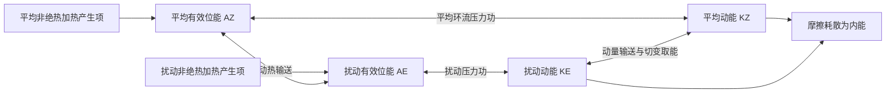

# D05 · 2025第5—22条＋2024第1—6条（24条）

日期：2026-11-02｜建议投入：4小时｜动力40% · 天气40% · 物理20%

> 本学习包依据原50日PDF与仓库学习资料整理。参考答案不是官方评分标准；未完成学科审校及缺题标记均保留。公式采用 GitHub 数学 Markdown，请在 GitHub 正文或 Obsidian 阅读视图打开。

## 今日目标与记忆标准

闭卷说清概念、适用条件、符号与单位；推导必须写出起始方程、近似及关键步骤。先答题，再展开核对。

## 四小时执行

1. 20分钟：回忆此前第1、3、7、14天的重点，尚未开始的日期跳过。
2. 80分钟：逐题闭卷提取，核对以下简答与来源。
3. 70分钟：精选5题完整书写。名词解释90秒、简答7分钟、论述12分钟为训练目标。
4. 40分钟：把本日知识按“假设→方程→物理机制→天气表现”串成2—4条知识链。
5. 30分钟：记录遗漏点、用时与次日/3日/7日/14日复习日期。

## 逐题回忆与简答

### 2025-一-5

光化学烟雾

[解析来源（对应题目行）](https://github.com/0183ty2512/lao-san-yang/blob/main/%E5%8A%A8%E5%8A%9B%E6%B0%94%E8%B1%A1%E8%AF%BE%E5%90%8E%E4%B9%A0%E9%A2%98/%E8%AF%95%E9%A2%98%E8%A7%A3%E7%AD%94/%E5%BE%80%E5%B9%B4%E8%AF%95%E9%A2%98%E8%A7%A3%E6%9E%90/2025.md#L200) · [原始年度题干](https://github.com/0183ty2512/lao-san-yang/blob/main/%E5%BE%80%E5%B9%B4%E8%AF%95%E9%A2%98%E5%88%86%E6%9E%90/2025.md)

**审校状态：已逐题复核（按所列模型与条件）。**

**针对本题的考场作答版（非官方评分标准）：**

光化学烟雾是NOx、挥发性有机物等前体物在阳光下反应形成的含臭氧、PAN及二次颗粒物等的复合污染；关键是光化学二次生成，不是直接排放的烟尘总称。

> 推导题须保留必要推演，简答与论述须按小问展开；精简版只用于回忆作答主线。

### 2025-一-6

抬升凝结高度

[解析来源（对应题目行）](https://github.com/0183ty2512/lao-san-yang/blob/main/%E5%8A%A8%E5%8A%9B%E6%B0%94%E8%B1%A1%E8%AF%BE%E5%90%8E%E4%B9%A0%E9%A2%98/%E8%AF%95%E9%A2%98%E8%A7%A3%E7%AD%94/%E5%BE%80%E5%B9%B4%E8%AF%95%E9%A2%98%E8%A7%A3%E6%9E%90/2025.md#L248) · [原始年度题干](https://github.com/0183ty2512/lao-san-yang/blob/main/%E5%BE%80%E5%B9%B4%E8%AF%95%E9%A2%98%E5%88%86%E6%9E%90/2025.md)

**审校状态：已逐题复核（按所列模型与条件）。**

**针对本题的考场作答版（非官方评分标准）：**

抬升凝结高度LCL是未饱和气块按干绝热抬升首次达到饱和的高度。近地面可粗估$z_{LCL}-z_0\approx125(T_0-T_{d0})$ m，温露差用K或℃，该式有近似条件。

> 推导题须保留必要推演，简答与论述须按小问展开；精简版只用于回忆作答主线。

### 2025-一-7

有效位能

[解析来源（对应题目行）](https://github.com/0183ty2512/lao-san-yang/blob/main/%E5%8A%A8%E5%8A%9B%E6%B0%94%E8%B1%A1%E8%AF%BE%E5%90%8E%E4%B9%A0%E9%A2%98/%E8%AF%95%E9%A2%98%E8%A7%A3%E7%AD%94/%E5%BE%80%E5%B9%B4%E8%AF%95%E9%A2%98%E8%A7%A3%E6%9E%90/2025.md#L297) · [原始年度题干](https://github.com/0183ty2512/lao-san-yang/blob/main/%E5%BE%80%E5%B9%B4%E8%AF%95%E9%A2%98%E5%88%86%E6%9E%90/2025.md)

**审校状态：已逐题复核（按所列模型与条件）。**

**针对本题的考场作答版（非官方评分标准）：**

有效位能是实际大气全位能与保持各气块熵、质量等约束作绝热重排所能达到的最小全位能之差，$A=P-P_{\min}\ge0$。全位能指内能与重力位能之和；有效位能是其中可用于转换为动能的部分。

> 推导题须保留必要推演，简答与论述须按小问展开；精简版只用于回忆作答主线。

### 2025-一-8

埃克曼层

[解析来源（对应题目行）](https://github.com/0183ty2512/lao-san-yang/blob/main/%E5%8A%A8%E5%8A%9B%E6%B0%94%E8%B1%A1%E8%AF%BE%E5%90%8E%E4%B9%A0%E9%A2%98/%E8%AF%95%E9%A2%98%E8%A7%A3%E7%AD%94/%E5%BE%80%E5%B9%B4%E8%AF%95%E9%A2%98%E8%A7%A3%E6%9E%90/2025.md#L348) · [原始年度题干](https://github.com/0183ty2512/lao-san-yang/blob/main/%E5%BE%80%E5%B9%B4%E8%AF%95%E9%A2%98%E5%88%86%E6%9E%90/2025.md)

**审校状态：已逐题复核（按所列模型与条件）。**

**针对本题的考场作答版（非官方评分标准）：**

埃克曼层是湍流摩擦、科氏力与气压梯度力共同控制风场的旋转边界层。经典常系数定常模型中，偏差风随高度旋转衰减，标高$\delta_E=\sqrt{2K_m/|f|}$；其值与惯用的$\pi\delta_E$厚度定义不同。

> 推导题须保留必要推演，简答与论述须按小问展开；精简版只用于回忆作答主线。

### 2025-一-9

正压不稳定

[解析来源（对应题目行）](https://github.com/0183ty2512/lao-san-yang/blob/main/%E5%8A%A8%E5%8A%9B%E6%B0%94%E8%B1%A1%E8%AF%BE%E5%90%8E%E4%B9%A0%E9%A2%98/%E8%AF%95%E9%A2%98%E8%A7%A3%E7%AD%94/%E5%BE%80%E5%B9%B4%E8%AF%95%E9%A2%98%E8%A7%A3%E6%9E%90/2025.md#L399) · [原始年度题干](https://github.com/0183ty2512/lao-san-yang/blob/main/%E5%BE%80%E5%B9%B4%E8%AF%95%E9%A2%98%E5%88%86%E6%9E%90/2025.md)

**审校状态：已逐题复核（按所列模型与条件）。**

**针对本题的考场作答版（非官方评分标准）：**

正压不稳定是扰动从基本流水平切变动能取能而增长的动力不稳定。平行流$U(y)$的转换项为$-\overline{u^{\prime}v^{\prime}}U_y$；在无黏正压无辐散β平面模型中，$\beta-U_{yy}$变号是增长模态的必要而非充分条件。

> 推导题须保留必要推演，简答与论述须按小问展开；精简版只用于回忆作答主线。

### 2025-一-10

上游效应

[解析来源（对应题目行）](https://github.com/0183ty2512/lao-san-yang/blob/main/%E5%8A%A8%E5%8A%9B%E6%B0%94%E8%B1%A1%E8%AF%BE%E5%90%8E%E4%B9%A0%E9%A2%98/%E8%AF%95%E9%A2%98%E8%A7%A3%E7%AD%94/%E5%BE%80%E5%B9%B4%E8%AF%95%E9%A2%98%E8%A7%A3%E6%9E%90/2025.md#L452) · [原始年度题干](https://github.com/0183ty2512/lao-san-yang/blob/main/%E5%BE%80%E5%B9%B4%E8%AF%95%E9%A2%98%E5%88%86%E6%9E%90/2025.md)

**审校状态：已逐题复核（按所列模型与条件）。**

**针对本题的考场作答版（非官方评分标准）：**

本地教材中的上游效应指上游扰动通过能量频散等影响下游，使下游波动在上游槽脊尚未移到之前发展。均匀正压模型$c_{gx}-c_{px}=2\beta k^2/(k^2+l^2)^2>0$，但绝对群速方向仍取决于基本流和波数。

> 推导题须保留必要推演，简答与论述须按小问展开；精简版只用于回忆作答主线。

### 2025-二-1

青藏高原的热力作用

[解析来源（对应题目行）](https://github.com/0183ty2512/lao-san-yang/blob/main/%E5%8A%A8%E5%8A%9B%E6%B0%94%E8%B1%A1%E8%AF%BE%E5%90%8E%E4%B9%A0%E9%A2%98/%E8%AF%95%E9%A2%98%E8%A7%A3%E7%AD%94/%E5%BE%80%E5%B9%B4%E8%AF%95%E9%A2%98%E8%A7%A3%E6%9E%90/2025.md#L505) · [原始年度题干](https://github.com/0183ty2512/lao-san-yang/blob/main/%E5%BE%80%E5%B9%B4%E8%AF%95%E9%A2%98%E5%88%86%E6%9E%90/2025.md)

**审校状态：已逐题复核（按所列模型与条件）。**

**针对本题的考场作答版（非官方评分标准）：**

冬季高原总体偏冷源，春夏转为高架热源，感热、凝结潜热和辐射共同决定热收支；加热改变厚度与环流，影响季风转换、南亚高压、水汽输送和下游降水。

> 推导题须保留必要推演，简答与论述须按小问展开；精简版只用于回忆作答主线。

### 2025-二-2

湍流的特征

[解析来源（对应题目行）](https://github.com/0183ty2512/lao-san-yang/blob/main/%E5%8A%A8%E5%8A%9B%E6%B0%94%E8%B1%A1%E8%AF%BE%E5%90%8E%E4%B9%A0%E9%A2%98/%E8%AF%95%E9%A2%98%E8%A7%A3%E7%AD%94/%E5%BE%80%E5%B9%B4%E8%AF%95%E9%A2%98%E8%A7%A3%E6%9E%90/2025.md#L554) · [原始年度题干](https://github.com/0183ty2512/lao-san-yang/blob/main/%E5%BE%80%E5%B9%B4%E8%AF%95%E9%A2%98%E5%88%86%E6%9E%90/2025.md)

**审校状态：已逐题复核（按所列模型与条件）。**

**针对本题的考场作答版（非官方评分标准）：**

湍流具有不规则脉动、多尺度三维涡旋、强混合输送、能量级联与黏性耗散，以及间歇性和各向异性；常由切变和不稳定浮力产生，需用统计量描述。

> 推导题须保留必要推演，简答与论述须按小问展开；精简版只用于回忆作答主线。

### 2025-二-3

影响东亚季风的基本因子

[解析来源（对应题目行）](https://github.com/0183ty2512/lao-san-yang/blob/main/%E5%8A%A8%E5%8A%9B%E6%B0%94%E8%B1%A1%E8%AF%BE%E5%90%8E%E4%B9%A0%E9%A2%98/%E8%AF%95%E9%A2%98%E8%A7%A3%E7%AD%94/%E5%BE%80%E5%B9%B4%E8%AF%95%E9%A2%98%E8%A7%A3%E6%9E%90/2025.md#L604) · [原始年度题干](https://github.com/0183ty2512/lao-san-yang/blob/main/%E5%BE%80%E5%B9%B4%E8%AF%95%E9%A2%98%E5%88%86%E6%9E%90/2025.md)

**审校状态：已逐题复核（按所列模型与条件）。**

**针对本题的考场作答版（非官方评分标准）：**

基本因子是海陆热力差异、太阳加热与行星环流的季节移动、青藏高原热力和动力作用；海温、积雪土壤状态及中高纬环流等调制强弱和进退。

> 推导题须保留必要推演，简答与论述须按小问展开；精简版只用于回忆作答主线。

### 2025-二-4

江淮气旋形成过程

[解析来源（对应题目行）](https://github.com/0183ty2512/lao-san-yang/blob/main/%E5%8A%A8%E5%8A%9B%E6%B0%94%E8%B1%A1%E8%AF%BE%E5%90%8E%E4%B9%A0%E9%A2%98/%E8%AF%95%E9%A2%98%E8%A7%A3%E7%AD%94/%E5%BE%80%E5%B9%B4%E8%AF%95%E9%A2%98%E8%A7%A3%E6%9E%90/2025.md#L652) · [原始年度题干](https://github.com/0183ty2512/lao-san-yang/blob/main/%E5%BE%80%E5%B9%B4%E8%AF%95%E9%A2%98%E5%88%86%E6%9E%90/2025.md)

**审校状态：已逐题复核（按所列模型与条件）。**

**针对本题的考场作答版（非官方评分标准）：**

江淮锋区与暖湿输送提供背景，高空扰动及低层辐合使锋面起波、低压生成；有利的高低空相位、整柱质量净流出及潜热反馈促其加深，随后常向东或东北移动，条件减弱时填塞。

> 推导题须保留必要推演，简答与论述须按小问展开；精简版只用于回忆作答主线。

### 2025-二-5

地转偏差对大气运动的演变作用

[解析来源（对应题目行）](https://github.com/0183ty2512/lao-san-yang/blob/main/%E5%8A%A8%E5%8A%9B%E6%B0%94%E8%B1%A1%E8%AF%BE%E5%90%8E%E4%B9%A0%E9%A2%98/%E8%AF%95%E9%A2%98%E8%A7%A3%E7%AD%94/%E5%BE%80%E5%B9%B4%E8%AF%95%E9%A2%98%E8%A7%A3%E6%9E%90/2025.md#L701) · [原始年度题干](https://github.com/0183ty2512/lao-san-yang/blob/main/%E5%BE%80%E5%B9%B4%E8%AF%95%E9%A2%98%E5%88%86%E6%9E%90/2025.md)

**审校状态：已逐题复核（按所列模型与条件）。**

**针对本题的考场作答版（非官方评分标准）：**

地转偏差$\mathbf V_a=\mathbf V-\mathbf V_g$满足$\mathbf V_a=\mathbf k\times(D\mathbf V/Dt-\mathbf F)/f$。它联系加速度与摩擦，产生辐合辐散及垂直运动，调整质量、温度场，并使气压梯度力能够做功。

> 推导题须保留必要推演，简答与论述须按小问展开；精简版只用于回忆作答主线。

### 2025-二-6

热带扰动发生发展的 CISK 机制

[解析来源（对应题目行）](https://github.com/0183ty2512/lao-san-yang/blob/main/%E5%8A%A8%E5%8A%9B%E6%B0%94%E8%B1%A1%E8%AF%BE%E5%90%8E%E4%B9%A0%E9%A2%98/%E8%AF%95%E9%A2%98%E8%A7%A3%E7%AD%94/%E5%BE%80%E5%B9%B4%E8%AF%95%E9%A2%98%E8%A7%A3%E6%9E%90/2025.md#L752) · [原始年度题干](https://github.com/0183ty2512/lao-san-yang/blob/main/%E5%BE%80%E5%B9%B4%E8%AF%95%E9%A2%98%E5%88%86%E6%9E%90/2025.md)

**审校状态：已逐题复核（按所列模型与条件）。**

**针对本题的考场作答版（非官方评分标准）：**

CISK指大尺度低压环流与积云对流相互加强：低层摩擦辐合及水汽集中→对流凝结加热→暖心与高层外流、质量场调整→低压环流增强→更强辐合。海面焓通量补给能量；潜热释放是转换环节，不是凭空产能。

> 推导题须保留必要推演，简答与论述须按小问展开；精简版只用于回忆作答主线。

### 2025-三-1

画能量转化在对流层的循环图

[解析来源（对应题目行）](https://github.com/0183ty2512/lao-san-yang/blob/main/%E5%8A%A8%E5%8A%9B%E6%B0%94%E8%B1%A1%E8%AF%BE%E5%90%8E%E4%B9%A0%E9%A2%98/%E8%AF%95%E9%A2%98%E8%A7%A3%E7%AD%94/%E5%BE%80%E5%B9%B4%E8%AF%95%E9%A2%98%E8%A7%A3%E6%9E%90/2025.md#L805) · [原始年度题干](https://github.com/0183ty2512/lao-san-yang/blob/main/%E5%BE%80%E5%B9%B4%E8%AF%95%E9%A2%98%E5%88%86%E6%9E%90/2025.md)

**审校状态：已逐题复核（按所列模型与条件）。**

**针对本题的考场作答版（非官方评分标准）：**

画$A_Z,A_E,K_Z,K_E$四库；标$A_Z\to A_E$的$C_A$、$A_E\to K_E$的$C_E$、$A_Z\to K_Z$的$C_Z$、$K_E\to K_Z$的$C_K$，再补$G_Z,G_E,D_Z,D_E$。箭头规定正方向，不表示转换恒正。

> 推导题须保留必要推演，简答与论述须按小问展开；精简版只用于回忆作答主线。

### 2025-三-2

逆温层形成过程，不同逆温层特征

[解析来源（对应题目行）](https://github.com/0183ty2512/lao-san-yang/blob/main/%E5%8A%A8%E5%8A%9B%E6%B0%94%E8%B1%A1%E8%AF%BE%E5%90%8E%E4%B9%A0%E9%A2%98/%E8%AF%95%E9%A2%98%E8%A7%A3%E7%AD%94/%E5%BE%80%E5%B9%B4%E8%AF%95%E9%A2%98%E8%A7%A3%E6%9E%90/2025.md#L873) · [原始年度题干](https://github.com/0183ty2512/lao-san-yang/blob/main/%E5%BE%80%E5%B9%B4%E8%AF%95%E9%A2%98%E5%88%86%E6%9E%90/2025.md)

**审校状态：已逐题复核（按所列模型与条件）。**

**针对本题的考场作答版（非官方评分标准）：**

逆温满足$dT/dz>0$。辐射逆温来自地面夜间冷却；平流逆温来自暖空气越过冷下垫面；下沉逆温来自稳定层下降压缩、上部较强增温；锋面逆温来自暖空气位于冷空气上方。地形冷池常综合辐射、冷空气汇聚和混合受抑。

> 推导题须保留必要推演，简答与论述须按小问展开；精简版只用于回忆作答主线。

### 2025-三-3

简述罗斯贝波结构特征以及波动和基本流的相互作用过程

[解析来源（对应题目行）](https://github.com/0183ty2512/lao-san-yang/blob/main/%E5%8A%A8%E5%8A%9B%E6%B0%94%E8%B1%A1%E8%AF%BE%E5%90%8E%E4%B9%A0%E9%A2%98/%E8%AF%95%E9%A2%98%E8%A7%A3%E7%AD%94/%E5%BE%80%E5%B9%B4%E8%AF%95%E9%A2%98%E8%A7%A3%E6%9E%90/2025.md#L926) · [原始年度题干](https://github.com/0183ty2512/lao-san-yang/blob/main/%E5%BE%80%E5%B9%B4%E8%AF%95%E9%A2%98%E5%88%86%E6%9E%90/2025.md)

**审校状态：已逐题复核（按所列模型与条件）。**

**针对本题的考场作答版（非官方评分标准）：**

罗斯贝波以位涡梯度为回复机制，典型呈槽脊和近地转涡旋结构、相对基本流西传且频散；基本流决定平流、折射和稳定性，扰动动量/热量通量又改变平均风温场。中性波不必经历增长衰亡生命史。

> 推导题须保留必要推演，简答与论述须按小问展开；精简版只用于回忆作答主线。

### 2025-四-1

推导伯努利方程

[解析来源（对应题目行）](https://github.com/0183ty2512/lao-san-yang/blob/main/%E5%8A%A8%E5%8A%9B%E6%B0%94%E8%B1%A1%E8%AF%BE%E5%90%8E%E4%B9%A0%E9%A2%98/%E8%AF%95%E9%A2%98%E8%A7%A3%E7%AD%94/%E5%BE%80%E5%B9%B4%E8%AF%95%E9%A2%98%E8%A7%A3%E6%9E%90/2025.md#L985) · [原始年度题干](https://github.com/0183ty2512/lao-san-yang/blob/main/%E5%BE%80%E5%B9%B4%E8%AF%95%E9%A2%98%E5%88%86%E6%9E%90/2025.md)

**审校状态：已复核条件解（原卷所给能量三式缺录）。**

**针对本题的考场作答版（非官方评分标准）：**

稳态、无摩擦、保守重力下，动量式点乘速度得$d(K+\Phi)+\alpha dp=0$。正压流体积分为$K+\Phi+\int^p\alpha(s)ds=B$；均质不可压时为$K+\Phi+p/\rho=B$；理想干空气沿流线等熵时为$K+\Phi+c_pT=B_d$。

> 推导题须保留必要推演，简答与论述须按小问展开；精简版只用于回忆作答主线。

### 2025-四-2

给出约束条件，并在约束条件下推出单位质量干湿空气微团能量守恒方程

[解析来源（对应题目行）](https://github.com/0183ty2512/lao-san-yang/blob/main/%E5%8A%A8%E5%8A%9B%E6%B0%94%E8%B1%A1%E8%AF%BE%E5%90%8E%E4%B9%A0%E9%A2%98/%E8%AF%95%E9%A2%98%E8%A7%A3%E7%AD%94/%E5%BE%80%E5%B9%B4%E8%AF%95%E9%A2%98%E8%A7%A3%E6%9E%90/2025.md#L1039) · [原始年度题干](https://github.com/0183ty2512/lao-san-yang/blob/main/%E5%BE%80%E5%B9%B4%E8%AF%95%E9%A2%98%E5%88%86%E6%9E%90/2025.md)

**审校状态：已复核条件解（原卷所给能量三式缺录）。**

**针对本题的考场作答版（非官方评分标准）：**

固定重力场中$D(K+\Phi+c_pT)/Dt=\alpha\partial_tp+\dot Q+\mathbf V\cdot\mathbf F$。无摩擦、绝热且局地压力不变时干伯努利量守恒。稀薄湿空气近似中再加$L_vq_v$；忽略动能变化后才得到干、湿静力能近守恒。

> 推导题须保留必要推演，简答与论述须按小问展开；精简版只用于回忆作答主线。

### 2025-四-3

给出能量守恒方程的适用范围

[解析来源（对应题目行）](https://github.com/0183ty2512/lao-san-yang/blob/main/%E5%8A%A8%E5%8A%9B%E6%B0%94%E8%B1%A1%E8%AF%BE%E5%90%8E%E4%B9%A0%E9%A2%98/%E8%AF%95%E9%A2%98%E8%A7%A3%E7%AD%94/%E5%BE%80%E5%B9%B4%E8%AF%95%E9%A2%98%E8%A7%A3%E6%9E%90/2025.md#L1100) · [原始年度题干](https://github.com/0183ty2512/lao-san-yang/blob/main/%E5%BE%80%E5%B9%B4%E8%AF%95%E9%A2%98%E5%88%86%E6%9E%90/2025.md)

**审校状态：已复核条件解（原卷所给能量三式缺录）。**

**针对本题的考场作答版（非官方评分标准）：**

稳态无摩擦流可用相应伯努利积分；干式需相应热力条件，湿式还需水物质与潜热近似。干、湿静力能再要求动能变化可忽略。非定常压力、加热、摩擦、混合和降水使这些简化量不守恒，但完整系统能量预算仍成立。

> 推导题须保留必要推演，简答与论述须按小问展开；精简版只用于回忆作答主线。

### 2024-一-1

平面近似

[解析来源（对应题目行）](https://github.com/0183ty2512/lao-san-yang/blob/main/%E5%8A%A8%E5%8A%9B%E6%B0%94%E8%B1%A1%E8%AF%BE%E5%90%8E%E4%B9%A0%E9%A2%98/%E8%AF%95%E9%A2%98%E8%A7%A3%E7%AD%94/%E5%BE%80%E5%B9%B4%E8%AF%95%E9%A2%98%E8%A7%A3%E6%9E%90/2024.md#L11) · [原始年度题干](https://github.com/0183ty2512/lao-san-yang/blob/main/%E5%BE%80%E5%B9%B4%E8%AF%95%E9%A2%98%E5%88%86%E6%9E%90/2024.md)

**审校状态：已逐题复核（按所列模型与条件）。**

**针对本题的考场作答版（非官方评分标准）：**

平面近似是在研究区远小于地球半径时，以局地切平面代替球面几何；科氏参数可取常数$f_0$或一阶展开$f_0+\beta y$，两种处理不能混同。

> 推导题须保留必要推演，简答与论述须按小问展开；精简版只用于回忆作答主线。

### 2024-一-2

气压梯度力

[解析来源（对应题目行）](https://github.com/0183ty2512/lao-san-yang/blob/main/%E5%8A%A8%E5%8A%9B%E6%B0%94%E8%B1%A1%E8%AF%BE%E5%90%8E%E4%B9%A0%E9%A2%98/%E8%AF%95%E9%A2%98%E8%A7%A3%E7%AD%94/%E5%BE%80%E5%B9%B4%E8%AF%95%E9%A2%98%E8%A7%A3%E6%9E%90/2024.md#L58) · [原始年度题干](https://github.com/0183ty2512/lao-san-yang/blob/main/%E5%BE%80%E5%B9%B4%E8%AF%95%E9%A2%98%E5%88%86%E6%9E%90/2024.md)

**审校状态：已逐题复核（按所列模型与条件）。**

**针对本题的考场作答版（非官方评分标准）：**

单位质量气压梯度力为$-\nabla p/\rho$，垂直等压面指向低压；等高面水平形式$-\nabla_zp/\rho$，静力气压坐标形式$-\nabla_p\Phi$。

> 推导题须保留必要推演，简答与论述须按小问展开；精简版只用于回忆作答主线。

### 2024-一-3

地转平衡

[解析来源（对应题目行）](https://github.com/0183ty2512/lao-san-yang/blob/main/%E5%8A%A8%E5%8A%9B%E6%B0%94%E8%B1%A1%E8%AF%BE%E5%90%8E%E4%B9%A0%E9%A2%98/%E8%AF%95%E9%A2%98%E8%A7%A3%E7%AD%94/%E5%BE%80%E5%B9%B4%E8%AF%95%E9%A2%98%E8%A7%A3%E6%9E%90/2024.md#L105) · [原始年度题干](https://github.com/0183ty2512/lao-san-yang/blob/main/%E5%BE%80%E5%B9%B4%E8%AF%95%E9%A2%98%E5%88%86%E6%9E%90/2024.md)

**审校状态：已逐题复核（按所列模型与条件）。**

**针对本题的考场作答版（非官方评分标准）：**

地转平衡是水平气压梯度力与科氏力平衡：$f\mathbf k\times\mathbf V_g=-\nabla_p\Phi$，故$u_g=-\Phi_y/f,v_g=\Phi_x/f$。

> 推导题须保留必要推演，简答与论述须按小问展开；精简版只用于回忆作答主线。

### 2024-一-4

低频振荡

[解析来源（对应题目行）](https://github.com/0183ty2512/lao-san-yang/blob/main/%E5%8A%A8%E5%8A%9B%E6%B0%94%E8%B1%A1%E8%AF%BE%E5%90%8E%E4%B9%A0%E9%A2%98/%E8%AF%95%E9%A2%98%E8%A7%A3%E7%AD%94/%E5%BE%80%E5%B9%B4%E8%AF%95%E9%A2%98%E8%A7%A3%E6%9E%90/2024.md#L153) · [原始年度题干](https://github.com/0183ty2512/lao-san-yang/blob/main/%E5%BE%80%E5%B9%B4%E8%AF%95%E9%A2%98%E5%88%86%E6%9E%90/2024.md)

**审校状态：已逐题复核（按所列模型与条件）。**

**针对本题的考场作答版（非官方评分标准）：**

本题季风语境下，低频振荡通常指比天气尺度慢、短于季节或在季节内的环流变化，典型有10—20天及30—60天时间带；MJO是其中重要对流—环流耦合现象。

> 推导题须保留必要推演，简答与论述须按小问展开；精简版只用于回忆作答主线。

### 2024-一-5

辐射差额

[解析来源（对应题目行）](https://github.com/0183ty2512/lao-san-yang/blob/main/%E5%8A%A8%E5%8A%9B%E6%B0%94%E8%B1%A1%E8%AF%BE%E5%90%8E%E4%B9%A0%E9%A2%98/%E8%AF%95%E9%A2%98%E8%A7%A3%E7%AD%94/%E5%BE%80%E5%B9%B4%E8%AF%95%E9%A2%98%E8%A7%A3%E6%9E%90/2024.md#L200) · [原始年度题干](https://github.com/0183ty2512/lao-san-yang/blob/main/%E5%BE%80%E5%B9%B4%E8%AF%95%E9%A2%98%E5%88%86%E6%9E%90/2024.md)

**审校状态：已逐题复核（按所列模型与条件）。**

**针对本题的考场作答版（非官方评分标准）：**

地表辐射差额即净辐射$R_n=(S_\downarrow-S_\uparrow)+(L_\downarrow-L_\uparrow)$，以获得辐射能为正，单位W/m²。

> 推导题须保留必要推演，简答与论述须按小问展开；精简版只用于回忆作答主线。

### 2024-一-6

波包

[解析来源（对应题目行）](https://github.com/0183ty2512/lao-san-yang/blob/main/%E5%8A%A8%E5%8A%9B%E6%B0%94%E8%B1%A1%E8%AF%BE%E5%90%8E%E4%B9%A0%E9%A2%98/%E8%AF%95%E9%A2%98%E8%A7%A3%E7%AD%94/%E5%BE%80%E5%B9%B4%E8%AF%95%E9%A2%98%E8%A7%A3%E6%9E%90/2024.md#L249) · [原始年度题干](https://github.com/0183ty2512/lao-san-yang/blob/main/%E5%BE%80%E5%B9%B4%E8%AF%95%E9%A2%98%E5%88%86%E6%9E%90/2024.md)

**审校状态：已逐题复核（按所列模型与条件）。**

**针对本题的考场作答版（非官方评分标准）：**

波包是波数相近的一组波叠加形成的局地振幅包络；窄谱线性波包的群速度$c_g=d\omega/dk$，一般不同于载波相速度$\omega/k$。

> 推导题须保留必要推演，简答与论述须按小问展开；精简版只用于回忆作答主线。

## 精选完整解析与公式推导

以下保留资料中的条件、步骤和审校信息。先完成手写，再核对。

### 2025-四-2 · 完整解答

给出约束条件，并在约束条件下推出单位质量干湿空气微团能量守恒方程

**修改意见（2026-10-04，第二批）：**

按本问重新从三类能量方程求和，显式保留局地压力变化项；分别写干空气与湿空气约束，避免将湿静力能当作一般严格守恒量。

**核对依据：** [大气中的基本能量形式和平衡方程](https://github.com/0183ty2512/lao-san-yang/blob/main/%E5%8A%A8%E5%8A%9B%E6%B0%94%E8%B1%A1/%E5%A4%A7%E6%B0%94%E8%83%BD%E9%87%8F%E5%AD%A6/%E5%A4%A7%E6%B0%94%E4%B8%AD%E7%9A%84%E5%9F%BA%E6%9C%AC%E8%83%BD%E9%87%8F%E5%BD%A2%E5%BC%8F%E5%92%8C%E5%B9%B3%E8%A1%A1%E6%96%B9%E7%A8%8B.md)；[热力学能量方程及其在球坐标系和局地直角坐标系中的表述](https://github.com/0183ty2512/lao-san-yang/blob/main/%E5%8A%A8%E5%8A%9B%E6%B0%94%E8%B1%A1/%E5%A4%A7%E6%B0%94%E8%BF%90%E5%8A%A8%E7%9A%84%E5%9F%BA%E6%9C%AC%E6%96%B9%E7%A8%8B%E7%BB%84/%E7%83%AD%E5%8A%9B%E5%AD%A6%E8%83%BD%E9%87%8F%E6%96%B9%E7%A8%8B%E5%8F%8A%E5%85%B6%E5%9C%A8%E7%90%83%E5%9D%90%E6%A0%87%E7%B3%BB%E5%92%8C%E5%B1%80%E5%9C%B0%E7%9B%B4%E8%A7%92%E5%9D%90%E6%A0%87%E7%B3%BB%E4%B8%AD%E7%9A%84%E8%A1%A8%E8%BF%B0.md)。本地资料为学习笔记，不视作官方标准答案；冲突处依据下列方程推导与量纲检查作出判断。

**复核后详细解答：**

1. **符号与前提。** $e=c_vT$为单位质量内能，$K=|\mathbf V|^2/2$，$\Phi$为固定重力场位势，$\mathbf F$为摩擦加速度，$\dot Q$为单位质量加热率。先用定组成理想干空气、常比热，暂不假定稳态。
2. **机械能式。** 动能式与位能式相加：
$$\frac{D(K+\Phi)}{Dt}=-\alpha\mathbf V\cdot\nabla p+\mathbf V\cdot\mathbf F.$$
3. **加上内能。** 第一律$De/Dt=-pD\alpha/Dt+\dot Q$，因此
$$\frac{D(K+\Phi+e)}{Dt}=-\alpha\mathbf V\cdot\nabla p-p\frac{D\alpha}{Dt}+\dot Q+\mathbf V\cdot\mathbf F.$$
右端一般不为零，说明气块可以与周围发生压力功交换。
4. **加上压力功项。** 对$p\alpha$用乘积求导，$D(p\alpha)/Dt=pD\alpha/Dt+\alpha Dp/Dt$；加到上一式两端，$pD\alpha/Dt$抵消。又因$Dp/Dt=\partial_tp+\mathbf V\cdot\nabla p$，空间平流项相消：
$$\frac{D(K+\Phi+e+p\alpha)}{Dt}=\alpha\partial_tp+\dot Q+\mathbf V\cdot\mathbf F.$$
5. **干空气守恒式。** $e+p\alpha=c_vT+R_dT=c_pT$，故
$$\boxed{\frac{D(K+\Phi+c_pT)}{Dt}=\alpha\partial_tp+\dot Q+\mathbf V\cdot\mathbf F}.$$
在无摩擦、绝热且$\partial_tp=0$时，$B_d=K+\Phi+c_pT$沿气块守恒；稳态流是满足压力条件的充分情形。若进一步$DK/Dt$可忽略，才有$s_d=c_pT+\Phi$近似守恒。
6. **湿空气的额外近似。** 取稀薄水汽、常$c_p,L_v$，忽略凝结物显热及负载、降水携带的能量和质量损失，并无混合补给。把外部加热记$\dot Q_{\rm ext}$，凝结贡献写$-L_vDq_v/Dt$，于是
$$c_p\frac{DT}{Dt}-\alpha\frac{Dp}{Dt}=\dot Q_{\rm ext}-L_v\frac{Dq_v}{Dt}.$$
凝结时$Dq_v/Dt<0$，该项为正，符号符合释放潜热。
7. **与机械能式相加。** 移水汽项到左侧，使用$Dp/Dt-\mathbf V\cdot\nabla p=\partial_tp$，得
$$\boxed{\frac{D(K+\Phi+c_pT+L_vq_v)}{Dt}\approx\alpha\partial_tp+\dot Q_{\rm ext}+\mathbf V\cdot\mathbf F}.$$
因此在对应零源汇及压力条件下$B_m=K+\Phi+c_pT+L_vq_v$近守恒；再忽略动能变化，湿静力能$s_m=\Phi+c_pT+L_vq_v$近守恒。
8. **不能省略的限制。** 湿过程式用了上述近似，非完整多相能量方程；假绝热降水离开气块时尤其不能称严格封闭系统守恒。干式的$\alpha\partial_tp$也不能仅凭“无摩擦、绝热”就删去。本记录未给原卷三式，采用的方程与条件已明确列出。

[核对原文](https://github.com/0183ty2512/lao-san-yang/blob/main/%E5%8A%A8%E5%8A%9B%E6%B0%94%E8%B1%A1%E8%AF%BE%E5%90%8E%E4%B9%A0%E9%A2%98/%E8%AF%95%E9%A2%98%E8%A7%A3%E7%AD%94/%E5%BE%80%E5%B9%B4%E8%AF%95%E9%A2%98%E8%A7%A3%E6%9E%90/2025.md#L1039)

### 2025-三-1 · 完整解答

画能量转化在对流层的循环图

**修改意见（2026-10-04）：**

现有四能量库图已含平均有效位能与平均动能转换；保留图及预算式，补绘图顺序、箭头符号和逐项守恒检查。

**核对依据：** [有效位能](https://github.com/0183ty2512/lao-san-yang/blob/main/%E5%8A%A8%E5%8A%9B%E6%B0%94%E8%B1%A1/%E5%A4%A7%E6%B0%94%E8%83%BD%E9%87%8F%E5%AD%A6/%E6%9C%89%E6%95%88%E4%BD%8D%E8%83%BD.md)。本地资料为学习笔记，不视作官方标准答案；冲突处依据下列方程推导与量纲检查作出判断。

**复核后详细解答：**

1. 单位质量内能 $e=c_vT$，重力位能 $\Phi=gz$（常重力），动能 $K=|\mathbf V|^2/2$，水汽潜热能近似 $L_vq_v$。总量需对气团质量积分；动能不能漏掉 $1/2$。
2. “全位能”在大气能量学中通常指内能与重力位能之和，而非含动能的总能量。静力、平坦底面且顶边界压力趋零时，$\int\rho gz\,dz=-\int z\,dp=\int p\,dz=\int\rho RT\,dz$；加上内能得到 $\int c_pT\,dm$。
3. 有效位能是实际全位能相对绝热重排到参考最低能态后的可用部分。不是全部内能或重力位能都能转换为动能。差异加热维持水平温差，建立有效位能。
4. 暖上升冷下沉时，$C=-\int\alpha'\omega'\,dm>0$，有效位能转为扰动动能；摩擦最终把动能耗散成内能。凝结使潜热转入热力能库，但水汽能量本来主要来自地表蒸发和辐射收支。
5. 对流层常用 Lorenz 四能量库循环如下。双向箭头表示转换可正可负，方向由收支项决定；中纬度斜压波常沿 $A_Z\to A_E\to K_E$ 取能。$A_Z$ 与 $K_Z$ 的直接转换不能漏掉：平均经圈环流同样可通过压力功在平均有效位能和平均动能之间转换。

产生项也可能为负，图中不是所有加热都增加有效位能。若问完整收支，应分别写 $\dot A_Z=G_Z-C_A-C_Z$、$\dot A_E=G_E+C_A-C_E$、$\dot K_Z=C_Z+C_K-D_Z$、$\dot K_E=C_E-C_K-D_E$，这里 $C_K>0$ 约定为扰动动能转入平均动能。四式相加，内部转换项逐项抵消，只剩外部产生与耗散，可用作检查。

**按题意落笔的顺序：** 先画四个能量库（下标$Z$表示纬向平均，$E$表示涡动），再画四条内部转换线，最后画非绝热产生与摩擦耗散。不得漏掉$A_Z\leftrightarrow K_Z$，也不把“加热产生项”当作第五个储能库。

**逐条解释：** $C_A$由扰动热输送联系平均与扰动有效位能；$C_E$由扰动压力功联系扰动有效位能与动能；$C_Z$由平均环流压力功联系平均两能量库；$C_K$由动量输送与平均切变联系两动能库。这里$C_K$定义的正方向为$K_E\to K_Z$，正压不稳定取基本流动能时可以表现为$C_K<0$。

**守恒检查展开：** 将四式相加，$-C_A+C_A=0$，$-C_E+C_E=0$，$-C_Z+C_Z=0$，$+C_K-C_K=0$，因此
$$\frac{d}{dt}(A_Z+A_E+K_Z+K_E)=G_Z+G_E-D_Z-D_E.$$
这适用于图示的全球或已忽略边界净输送的预算；区域预算还须加边界能量通量。摩擦耗散表示动能离开图中动能库、转为内能，不表示宇宙总能量消失。

[核对原文](https://github.com/0183ty2512/lao-san-yang/blob/main/%E5%8A%A8%E5%8A%9B%E6%B0%94%E8%B1%A1%E8%AF%BE%E5%90%8E%E4%B9%A0%E9%A2%98/%E8%AF%95%E9%A2%98%E8%A7%A3%E7%AD%94/%E5%BE%80%E5%B9%B4%E8%AF%95%E9%A2%98%E8%A7%A3%E6%9E%90/2025.md#L805)

### 2025-三-3 · 完整解答

简述罗斯贝波结构特征以及波动和基本流的相互作用过程

**修改意见（2026-10-07，第四批）：**

先写罗斯贝波恢复机制与结构，再分别讨论基本流影响波及波反馈基本流，补动量预算推导。

**核对依据：** [罗斯贝波、罗斯贝波的传播](https://github.com/0183ty2512/lao-san-yang/blob/main/%E5%8A%A8%E5%8A%9B%E6%B0%94%E8%B1%A1/%E5%A4%A7%E6%B0%94%E4%B8%AD%E7%9A%84%E5%9F%BA%E6%9C%AC%E6%B3%A2%E5%8A%A8/%E7%BD%97%E6%96%AF%E8%B4%9D%E6%B3%A2%E3%80%81%E7%BD%97%E6%96%AF%E8%B4%9D%E6%B3%A2%E7%9A%84%E4%BC%A0%E6%92%AD.md)；[正压和斜压不稳定](https://github.com/0183ty2512/lao-san-yang/blob/main/%E5%8A%A8%E5%8A%9B%E6%B0%94%E8%B1%A1/%E4%B8%8D%E7%A8%B3%E5%AE%9A%E7%90%86%E8%AE%BA/%E6%AD%A3%E5%8E%8B%E5%92%8C%E6%96%9C%E5%8E%8B%E4%B8%8D%E7%A8%B3%E5%AE%9A.md)；[大气中的基本能量形式和平衡方程](https://github.com/0183ty2512/lao-san-yang/blob/main/%E5%8A%A8%E5%8A%9B%E6%B0%94%E8%B1%A1/%E5%A4%A7%E6%B0%94%E8%83%BD%E9%87%8F%E5%AD%A6/%E5%A4%A7%E6%B0%94%E4%B8%AD%E7%9A%84%E5%9F%BA%E6%9C%AC%E8%83%BD%E9%87%8F%E5%BD%A2%E5%BC%8F%E5%92%8C%E5%B9%B3%E8%A1%A1%E6%96%B9%E7%A8%8B.md)。本地资料为学习笔记，不视作官方标准答案；冲突处依据下列物理条件、方程推导和所列外部依据判断。

**复核后详细解答：**

1. **恢复机制。** 在无摩擦正压模型中，气块绝对涡度近守恒。向北移时$f$增加，相对涡度须减小；向南则相反。由此形成的涡旋速度反过来推动位移演变，构成罗斯贝波。更一般应以背景位势涡度梯度描述，而不只限于行星β。
2. **结构与传播。** 取流函数$\psi'=A\cos(kx+ly-\omega t)$，$u'=-\psi'_y$、$v'=\psi'_x$，$\zeta'=\nabla_h^2\psi'=-(k^2+l^2)\psi'$，显示槽脊与涡度相联。均匀正压β平面有$\omega=Uk-\beta k/(k^2+l^2)$，因此相对基本流的纬向相速为$-\beta/(k^2+l^2)$，即西传；对地可东移、西移或静止。
3. **竖直结构不可一概而论。** 正压理想波没有斜压温度结构；相当正压波槽脊可近上下同位。发展中的斜压波常槽轴随高度向西倾斜，并伴向极热输送、暖区上升和冷区下沉；不能把这种倾斜作为所有罗斯贝波必备性质。
4. **基本流对波。** 平均风平流改变对地频率与传播速度，水平/垂直切变改变背景位涡梯度、折射和稳定性，波导及临界层影响传播和吸收。在不稳定条件下，扰动可从基本流动能或有效位能取能；均匀基本流上的中性线性波不会仅因名为罗斯贝波就自行指数增长。
5. **波对平均风的反馈。** 在二维无辐散、纬向周期的简化模型中，对动量方程纬向平均，将平流写成通量散度。纬向导数平均为零，扰动贡献为$\partial_tU=-\partial_y\overline{u'v'}$（另有平均环流、摩擦时须加上）。因此动量通量的辐合加速平均流，辐散使其减速；不能只看$\overline{u'v'}$本身的正负判断局地加速度。
6. **能量交换的符号。** 上式乘$U$：$\partial_t(U^2/2)=-U\partial_y\overline{u'v'}=-\partial_y(U\overline{u'v'})+\overline{u'v'}U_y$。第一项为能量输送，第二项为平均动能所得；因此扰动从平均流取得的对应项为$-\overline{u'v'}U_y$。二者符号相反，符合能量内部交换守恒。
7. **热输送与斜压反馈。** 扰动热通量可削弱平均南北温度差，同时从平均有效位能取能；适当相位关系下暖上升、冷下沉将扰动有效位能转为动能。以气压坐标表达，该压力功转换为$-\overline{\alpha'\omega'}$，暖上升时$\alpha'>0,\omega'<0$给正贡献。
8. **典型发展过程。** 小扰动在不稳定基本态上增长，输送热量与动量；振幅大后可发生波破碎和混合，重塑平均位涡及急流；随后能量来源减弱或被耗散、吸收而衰减。波包能量还可向下游传播，使下游发展。以上是常见相互作用链，不是每一列中性罗斯贝波都必须完成的固定生命史。

[核对原文](https://github.com/0183ty2512/lao-san-yang/blob/main/%E5%8A%A8%E5%8A%9B%E6%B0%94%E8%B1%A1%E8%AF%BE%E5%90%8E%E4%B9%A0%E9%A2%98/%E8%AF%95%E9%A2%98%E8%A7%A3%E7%AD%94/%E5%BE%80%E5%B9%B4%E8%AF%95%E9%A2%98%E8%A7%A3%E6%9E%90/2025.md#L926)

### 2025-四-1 · 完整解答

推导伯努利方程

**修改意见（2026-10-04，第二批）：**

原三小问复用同一答案。本问改为从动能和位能式推导机械伯努利积分，并明确正压或沿流线等熵条件；记录未抄出原题所给三式，不声称恢复唯一原卷形式。

**核对依据：** [大气中的基本能量形式和平衡方程](https://github.com/0183ty2512/lao-san-yang/blob/main/%E5%8A%A8%E5%8A%9B%E6%B0%94%E8%B1%A1/%E5%A4%A7%E6%B0%94%E8%83%BD%E9%87%8F%E5%AD%A6/%E5%A4%A7%E6%B0%94%E4%B8%AD%E7%9A%84%E5%9F%BA%E6%9C%AC%E8%83%BD%E9%87%8F%E5%BD%A2%E5%BC%8F%E5%92%8C%E5%B9%B3%E8%A1%A1%E6%96%B9%E7%A8%8B.md)。本地资料为学习笔记，不视作官方标准答案；冲突处依据下列方程推导与量纲检查作出判断。

**复核后详细解答：**

1. **先说明缺失与模型。** 当前原题记录仅写“给出动能、位能、内能平衡方程”，没有抄出具体方程。以下用三维速度$\mathbf V$、$K=|\mathbf V|^2/2$、比容$\alpha=1/\rho$、不显含时间的重力位势$\Phi$推导；静力大尺度模式若仅保留水平动能，应对应使用其近似方程。
2. **运动方程点乘速度。** 无摩擦时
$$\frac{D\mathbf V}{Dt}+2\boldsymbol\Omega\times\mathbf V=-\alpha\nabla p-\nabla\Phi.$$
利用$\mathbf V\cdot D\mathbf V/Dt=DK/Dt$和$\mathbf V\cdot(\boldsymbol\Omega\times\mathbf V)=0$，得到$DK/Dt=-\alpha\mathbf V\cdot\nabla p-\mathbf V\cdot\nabla\Phi$。
3. **合并位能。** 因$\partial_t\Phi=0$，$D\Phi/Dt=\mathbf V\cdot\nabla\Phi$，故$D(K+\Phi)/Dt=-\alpha\mathbf V\cdot\nabla p$。
4. **转为稳态流线微分。** 稳态时$D/Dt=\mathbf V\cdot\nabla$。以$s$表示流线弧长，$\mathbf V\cdot\nabla=Vd/ds$；在$V\ne0$的流线段除以$V$，得$d(K+\Phi)/ds=-\alpha dp/ds$，即$d(K+\Phi)+\alpha dp=0$。
5. **积分。** 正压流体$\alpha=\alpha(p)$，定义压力势$\Pi(p)=\int_{p_*}^{p}\alpha(s)ds$，则$d\Pi=\alpha dp$。于是$d(K+\Phi+\Pi)=0$，积分得
$$\boxed{K+\Phi+\int_{p_*}^{p}\alpha(s)ds=B}.$$
$B$沿每条流线为常数，不必在不同流线间相同。$p_*$改变只改变常数基准。
6. **两个特例。** 均质不可压时$\alpha$为常数，压力势可写$p/\rho$并把积分常数并入$B$，得到$V^2/2+gz+p/\rho=B$。理想干空气沿流线可逆绝热时$c_p dT=\alpha dp$，直接代入第4步，得$V^2/2+\Phi+c_pT=B_d$；这个特例不要求整个大气具有统一熵值。
7. **核对含义。** 每项单位为$\mathrm{J/kg}$。伯努利量含焓或压力功项，不等于“一个气块的内能、位能、动能之和在所有绝热运动中均不变”。下一问通过保留局地压力变化项说明这个区别。

[核对原文](https://github.com/0183ty2512/lao-san-yang/blob/main/%E5%8A%A8%E5%8A%9B%E6%B0%94%E8%B1%A1%E8%AF%BE%E5%90%8E%E4%B9%A0%E9%A2%98/%E8%AF%95%E9%A2%98%E8%A7%A3%E7%AD%94/%E5%BE%80%E5%B9%B4%E8%AF%95%E9%A2%98%E8%A7%A3%E6%9E%90/2025.md#L985)

### 2025-二-5 · 完整解答

地转偏差对大气运动的演变作用

**修改意见（2026-10-04）：**

原偏差风公式正确；按题意突出加速度、质量调整和能量转换，补β平面地转散度限制，并指出本地笔记摩擦项符号问题。

**核对依据：** [平衡流场的基本特征与性质](https://github.com/0183ty2512/lao-san-yang/blob/main/%E5%8A%A8%E5%8A%9B%E6%B0%94%E8%B1%A1/%E8%87%AA%E7%94%B1%E5%A4%A7%E6%B0%94%E4%B8%AD%E7%9A%84%E5%B9%B3%E8%A1%A1%E6%B5%81%E5%9C%BA%E3%80%81%E7%8E%AF%E6%B5%81%E5%AE%9A%E7%90%86%E5%92%8C%E6%B6%A1%E5%BA%A6%E6%96%B9%E7%A8%8B/%E5%B9%B3%E8%A1%A1%E6%B5%81%E5%9C%BA%E7%9A%84%E5%9F%BA%E6%9C%AC%E7%89%B9%E5%BE%81%E4%B8%8E%E6%80%A7%E8%B4%A8.md)。本地资料为学习笔记，不视作官方标准答案；冲突处依据下列方程推导与量纲检查作出判断。

**复核后详细解答：**

1. **定义。** 水平实际风与同一质量场对应的地转风之差为$\mathbf V_a=\mathbf V-\mathbf V_g$。采用气压坐标，$f\mathbf k\times\mathbf V_g=-\nabla_p\Phi$。
2. **由动量方程求偏差。** 实际运动满足$D\mathbf V/Dt+f\mathbf k\times\mathbf V=-\nabla_p\Phi+\mathbf F$，其中$\mathbf F$为摩擦加速度。减去地转关系得$D\mathbf V/Dt+f\mathbf k\times\mathbf V_a=\mathbf F$。左乘$\mathbf k\times$，利用水平向量恒等式$\mathbf k\times(\mathbf k\times\mathbf V_a)=-\mathbf V_a$：
$$\boxed{\mathbf V_a=\frac1f\mathbf k\times\left(\frac{D\mathbf V}{Dt}-\mathbf F\right)}.$$
无摩擦时偏差风在加速度左侧（北半球）；定常无惯性时为$-\mathbf k\times\mathbf F/f$，在摩擦力右侧。参考笔记的摩擦公式若写正号，应按其力定义核对；按“作用于空气的摩擦力”约定须为上述负号。
3. **质量与垂直运动。** 常数$f$下$u_g=-\Phi_y/f,v_g=\Phi_x/f$，混合偏导相消，$\nabla_p\cdot\mathbf V_g=0$。于是实际散度来自偏差风，连续方程$\nabla_p\cdot\mathbf V+\omega_p=0$把它与垂直运动联系。给定边界及整层散度后才能确定$\omega$，不能只凭一个层次的辐散断定全柱上升。
4. **热力与系统演变。** 垂直运动改变绝热冷却增温及水汽凝结，反过来调整温度和位势场；急流加减速、曲率和摩擦可产生次级环流，因此近地转的大尺度系统仍能发展。
5. **能量联系。** 水平气压梯度功率为$-\mathbf V\cdot\nabla_p\Phi$。地转风与$\nabla_p\Phi$垂直，其贡献为零；故压力功由$-\mathbf V_a\cdot\nabla_p\Phi$承担，非地转分量联系质量场与动能转换。
6. **适用限制。** 在β平面，$\nabla_p\cdot\mathbf V_g=-\beta v_g/f$一般不为零；“地转风无散度”须注明$f$平面或相应近似阶次。近赤道$f$趋零时，不可直接套用含$1/f$的中纬度近似。

[核对原文](https://github.com/0183ty2512/lao-san-yang/blob/main/%E5%8A%A8%E5%8A%9B%E6%B0%94%E8%B1%A1%E8%AF%BE%E5%90%8E%E4%B9%A0%E9%A2%98/%E8%AF%95%E9%A2%98%E8%A7%A3%E7%AD%94/%E5%BE%80%E5%B9%B4%E8%AF%95%E9%A2%98%E8%A7%A3%E6%9E%90/2025.md#L701)

## 当日验收

- [ ] 本日每题均完成至少一次闭卷提取。
- [ ] 精选题写清假设、符号与中间步骤；无漏负号、下标和单位。
- [ ] 能用自己的话解释至少两条跨章节联系。
- [ ] 错题记录包含题号、错因、修正答案及下一次复习日期。
