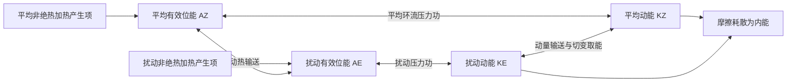

# D10 · 2020第18—21条＋2019全19条＋2018第1条（24条）

日期：2026-11-07｜建议投入：4小时｜动力40% · 天气40% · 物理20%

> 本学习包依据原50日PDF与仓库学习资料整理。参考答案不是官方评分标准；未完成学科审校及缺题标记均保留。公式采用 GitHub 数学 Markdown，请在 GitHub 正文或 Obsidian 阅读视图打开。

## 今日目标与记忆标准

闭卷说清概念、适用条件、符号与单位；推导必须写出起始方程、近似及关键步骤。先答题，再展开核对。

## 四小时执行

1. 20分钟：回忆此前第1、3、7、14天的重点，尚未开始的日期跳过。
2. 80分钟：逐题闭卷提取，核对以下简答与来源。
3. 70分钟：精选5题完整书写。名词解释90秒、简答7分钟、论述12分钟为训练目标。
4. 40分钟：把本日知识按“假设→方程→物理机制→天气表现”串成2—4条知识链。
5. 30分钟：记录遗漏点、用时与次日/3日/7日/14日复习日期。

## 逐题回忆与简答

### 2020-三-2

写出大气内能、重力位能、动能、潜热能的表达式，并叙述它们主要来源及相互转化。

[解析来源（对应题目行）](https://github.com/0183ty2512/lao-san-yang/blob/main/%E5%8A%A8%E5%8A%9B%E6%B0%94%E8%B1%A1%E8%AF%BE%E5%90%8E%E4%B9%A0%E9%A2%98/%E8%AF%95%E9%A2%98%E8%A7%A3%E7%AD%94/%E5%BE%80%E5%B9%B4%E8%AF%95%E9%A2%98%E8%A7%A3%E6%9E%90/2020.md#L699) · [原始年度题干](https://github.com/0183ty2512/lao-san-yang/blob/main/%E5%BE%80%E5%B9%B4%E8%AF%95%E9%A2%98%E5%88%86%E6%9E%90/2020.md)

**审校状态：尚未逐题学科审校。**

> 以上摘要用于回忆答题主线，不是官方评分标准；推导、计算和多小问仍须完成下方步骤。

1. 单位质量内能 $e=c_vT$，重力位能 $\Phi=gz$（常重力），动能 $K=|\mathbf V|^2/2$，水汽潜热能近似 $L_vq_v$。总量需对气团质量积分；动能不能漏掉 $1/2$。
2. “全位能”在大气能量学中通常指内能与重力位能之和，而非含动能的总能量。静力、平坦底面且顶边界压力趋零时，$\int\rho gz\,dz=-\int z\,dp=\int p\,dz=\int\rho RT\,dz$；加上内能得到 $\int c_pT\,dm$。
3. 有效位能是实际全位能相对绝热重排到参考最低能态后的可用部分。不是全部内能或重力位能都能转换为动能。差异加热维持水平温差，建立有效位能。
4. 暖上升冷下沉时，$C=-\int\alpha'\omega'\,dm>0$，有效位能转为扰动动能；摩擦最终把动能耗散成内能。凝结使潜热转入热力能库，但水汽能量本来主要来自地表蒸发和辐射收支。
5. 对流层常用 Lorenz 四能量库循环如下。双向箭头表示转换可正可负，方向由收支项决定；中纬度斜压波常沿 $A_Z\to A_E\to K_E$ 取能。$A_Z$ 与 $K_Z$ 的直接转换不能漏掉：平均经圈环流同样可通过压力功在平均有效位能和平均动能之间转换。

产生项也可能为负，图中不是所有加热都增加有效位能。若问完整收支，应分别写 $\dot A_Z=G_Z-C_A-C_Z$、$\dot A_E=G_E+C_A-C_E$、$\dot K_Z=C_Z+C_K-D_Z$、$\dot K_E=C_E-C_K-D_E$，这里 $C_K>0$ 约定为扰动动能转入平均动能。四式相加，内部转换项逐项抵消，只剩外部产生与耗散，可用作检查。

### 2020-三-3

人类活动对气候的影响方式及过程。（略，不用写）

[解析来源（对应题目行）](https://github.com/0183ty2512/lao-san-yang/blob/main/%E5%8A%A8%E5%8A%9B%E6%B0%94%E8%B1%A1%E8%AF%BE%E5%90%8E%E4%B9%A0%E9%A2%98/%E8%AF%95%E9%A2%98%E8%A7%A3%E7%AD%94/%E5%BE%80%E5%B9%B4%E8%AF%95%E9%A2%98%E8%A7%A3%E6%9E%90/2020.md#L747) · [原始年度题干](https://github.com/0183ty2512/lao-san-yang/blob/main/%E5%BE%80%E5%B9%B4%E8%AF%95%E9%A2%98%E5%88%86%E6%9E%90/2020.md)

**审校状态：尚未逐题学科审校。**

**相关高频考点复习摘要（须按本题设问取舍，不替代完整解答）：**

**人类活动对气候的影响：** 人为影响主要通过温室气体改变红外收支、气溶胶改变辐射与云、土地利用改变反照率和显潜热分配等途径。机制罗列不等于定量归因；局地城市热岛不能单独解释全球气候变化。

> 以上摘要用于回忆答题主线，不是官方评分标准；推导、计算和多小问仍须完成下方步骤。

1. **驱动。** 太阳和轨道变化、火山气溶胶等自然外部强迫，人为温室气体、气溶胶和土地利用变化，以及海气耦合内部变率共同影响气候；区分“可能机制”和实际时段的归因，不是列出机制就证明每项贡献相同。

2. **反馈。** 初始增暖使空气可容纳更多水汽，增强红外吸收，形成正反馈；冰雪减少降低反照率，也是正反馈；温度升高使向外长波增加，是基本负反馈。云反馈需同时考虑短波反射和长波保温，其符号依云高、云量和云相态。

3. **陆面和地表气温。** 纬度及季节控制太阳入射，海拔、海陆距离、洋流、云和环流控制温度背景；植被、土壤湿度、反照率、粗糙度影响净辐射及显潜热分配。干土蒸发受限，显热比例较大，易增暖；湿土热量更多用于蒸发。积雪增加反照率，植被改变蒸散和碳循环。

4. **城市热岛。** 建筑储热、蒸散减少、人为热排放、街谷辐射和通风变化使城区常比郊区暖，晴静夜间尤明显。热岛是局地土地利用效应，不能用它单独解释全球海陆增暖。

## 原卷第四部分

推导（15 分）

### 2020-四-1

给出 P 坐标系的方程，推导坐标系的垂直涡度方程并讨论绝对涡度守恒的条件（以前考过）

[解析来源（对应题目行）](https://github.com/0183ty2512/lao-san-yang/blob/main/%E5%8A%A8%E5%8A%9B%E6%B0%94%E8%B1%A1%E8%AF%BE%E5%90%8E%E4%B9%A0%E9%A2%98/%E8%AF%95%E9%A2%98%E8%A7%A3%E7%AD%94/%E5%BE%80%E5%B9%B4%E8%AF%95%E9%A2%98%E8%A7%A3%E6%9E%90/2020.md#L793) · [原始年度题干](https://github.com/0183ty2512/lao-san-yang/blob/main/%E5%BE%80%E5%B9%B4%E8%AF%95%E9%A2%98%E5%88%86%E6%9E%90/2020.md)

**审校状态：尚未逐题学科审校。**

> 以上摘要用于回忆答题主线，不是官方评分标准；推导、计算和多小问仍须完成下方步骤。

**一、对水平运动方程取旋度。** 高度坐标为
$$D_tu-fv=-\alpha p_x+F_x,\qquad D_tv+fu=-\alpha p_y+F_y,$$
其中 $D_t=\partial_t+u\partial_x+v\partial_y+w\partial_z$，$\alpha=1/\rho$。

对第二式取 $x$ 导数、第一式取 $y$ 导数后相减。用 $\partial_x(D_tv)-\partial_y(D_tu)=D_t\zeta+\zeta(u_x+v_y)+w_xv_z-w_yu_z$，科氏项为 $f(u_x+v_y)+\beta v$，压力项为 $\alpha_yp_x-\alpha_xp_y$，得
$$D_t\zeta=-(\zeta+f)(u_x+v_y)-\beta v+w_yu_z-w_xv_z+\alpha_yp_x-\alpha_xp_y+\partial_xF_y-\partial_yF_x.$$
展开成局地变化：水平平流 $-u\zeta_x-v\zeta_y$；竖直平流 $-w\zeta_z$；行星涡度平流 $-\beta v$；伸缩 $-(\zeta+f)D$；倾斜 $w_yu_z-w_xv_z$；斜压 $\alpha_yp_x-\alpha_xp_y$。这是常说的六项，无摩擦时适用；有摩擦另加摩擦旋度。

**二、气压坐标。** 水平压力梯度改为 $-\Phi_x,-\Phi_y$，交叉导数完全抵消；物质导数的竖直部分改为 $\omega\partial_p$。同样操作得到
$$\boxed{D_t\zeta+\beta v=-(\zeta+f)D+u_p\omega_y-v_p\omega_x+\partial_xF_y-\partial_yF_x}.$$
其中 $D=u_x+v_y=-\omega_p$。不可把高度坐标的显式斜压项重复放入此式。

**三、绝对涡度是否守恒。** 因 $D_tf=\beta v$，左边就是 $D_t(\zeta+f)$。仅“无摩擦”不足以守恒；还需要右边伸缩、倾斜项消失或总和为零。常用充分条件是水平无辐散、无倾斜效应、无摩擦。相对涡度还随纬度变化，故与绝对涡度守恒不同。

### 2020-四-2

根据热力学方程，状态方程推导出 $d\ln \theta / dt$ 与 Q 的关系，及绝对熵守恒？

[解析来源（对应题目行）](https://github.com/0183ty2512/lao-san-yang/blob/main/%E5%8A%A8%E5%8A%9B%E6%B0%94%E8%B1%A1%E8%AF%BE%E5%90%8E%E4%B9%A0%E9%A2%98/%E8%AF%95%E9%A2%98%E8%A7%A3%E7%AD%94/%E5%BE%80%E5%B9%B4%E8%AF%95%E9%A2%98%E8%A7%A3%E6%9E%90/2020.md#L837) · [原始年度题干](https://github.com/0183ty2512/lao-san-yang/blob/main/%E5%BE%80%E5%B9%B4%E8%AF%95%E9%A2%98%E5%88%86%E6%9E%90/2020.md)

**审校状态：尚未逐题学科审校。**

**相关高频考点复习摘要（须按本题设问取舍，不替代完整解答）：**

**位温：** 位温是气块干绝热移至参考气压 $p_0$ 的温度。由 $c_p dT-RTdp/p=0$ 积分得 $\theta=T(p_0/p)^{R/c_p}$，单位K。理想干绝热时沿气块守恒，有加热时 $D\ln\theta/Dt=Q/(c_pT)$。

> 以上摘要用于回忆答题主线，不是官方评分标准；推导、计算和多小问仍须完成下方步骤。

1. **定义。** 位温是干空气块沿干绝热线移到参考气压 $p_0$ 时的温度，通常取 $p_0=1000\ \mathrm{hPa}$。
2. **从第一定律出发。** 干绝热时 $c_p\,dT-\alpha\,dp=0$。由 $\alpha=RT/p$，得 $dT/T=(R/c_p)dp/p$。
3. **积分。** 记 $\kappa=R/c_p$，从 $(p,T)$ 积分到 $(p_0,\theta)$：$\ln(\theta/T)=\kappa\ln(p_0/p)$。
4. **结果。** $\boxed{\theta=T(p_0/p)^\kappa}$。干绝热运动中 $D\theta/Dt=0$；有潜热释放或其他加热时，不能直接假定干位温守恒。位温单位为 K。

1. 单位质量第一定律为 $c_vDT/Dt+pD\alpha/Dt=Q$，其中 $Q$ 是单位质量单位时间的加热，单位 $\mathrm{J\,kg^{-1}\,s^{-1}}$。
2. 对 $p\alpha=RT$ 求物质导数：$pD\alpha/Dt+\alpha Dp/Dt=RDT/Dt$，所以 $pD\alpha/Dt=RDT/Dt-\alpha Dp/Dt$。
3. 代回第一定律并用 $c_v+R=c_p$，得到 $\boxed{c_pDT/Dt-\alpha Dp/Dt=Q}$。
4. 除以 $c_pT$，再用 $\alpha/T=R/p$：$D\ln T/Dt-\kappa D\ln p/Dt=Q/(c_pT)$。
5. 因为 $\ln\theta=\ln T-\kappa\ln p+\kappa\ln p_0$，故 $\boxed{D\ln\theta/Dt=Q/(c_pT)}$。
6. 对定组成理想干空气，$ds=c_p\,d\ln T-R\,d\ln p=c_p\,d\ln\theta$，所以 $s=c_p\ln\theta+\mathrm{常数}$。可逆绝热时 $Ds/Dt=D\theta/Dt=0$。若存在黏性耗散、混合等熵产生，不能仅凭“无外部热输入”就宣称熵守恒。

### 2019-一-1

切变低压

[解析来源（对应题目行）](https://github.com/0183ty2512/lao-san-yang/blob/main/%E5%8A%A8%E5%8A%9B%E6%B0%94%E8%B1%A1%E8%AF%BE%E5%90%8E%E4%B9%A0%E9%A2%98/%E8%AF%95%E9%A2%98%E8%A7%A3%E7%AD%94/%E5%BE%80%E5%B9%B4%E8%AF%95%E9%A2%98%E8%A7%A3%E6%9E%90/2019.md#L11) · [原始年度题干](https://github.com/0183ty2512/lao-san-yang/blob/main/%E5%BE%80%E5%B9%B4%E8%AF%95%E9%A2%98%E5%88%86%E6%9E%90/2019.md)

**审校状态：尚未逐题学科审校。**

> 以上摘要用于回忆答题主线，不是官方评分标准；推导、计算和多小问仍须完成下方步骤。

1. 中尺度系统水平从数公里到上千公里，生命从小时到约一天或更长，时空变化快、局地梯度大、非地转和垂直运动更重要。切变线是风向或风速发生气旋性切变的狭长带；其上闭合或明显低压环流可发展成切变低压。中尺度低压可由加热、地形和对流动力作用形成，不必都有闭合地面等压线。

### 2019-一-2

飑线

[解析来源（对应题目行）](https://github.com/0183ty2512/lao-san-yang/blob/main/%E5%8A%A8%E5%8A%9B%E6%B0%94%E8%B1%A1%E8%AF%BE%E5%90%8E%E4%B9%A0%E9%A2%98/%E8%AF%95%E9%A2%98%E8%A7%A3%E7%AD%94/%E5%BE%80%E5%B9%B4%E8%AF%95%E9%A2%98%E8%A7%A3%E6%9E%90/2019.md#L43) · [原始年度题干](https://github.com/0183ty2512/lao-san-yang/blob/main/%E5%BE%80%E5%B9%B4%E8%AF%95%E9%A2%98%E5%88%86%E6%9E%90/2019.md)

**审校状态：尚未逐题学科审校。**

**相关高频考点复习摘要（须按本题设问取舍，不替代完整解答）：**

**飑线：** 飑线是组织成狭长线状的强对流系统。冷池前缘辐合不断触发新单体，风切变帮助维持组织；过站常有阵风增强、风向突变、降温和升压，可伴雷雨、冰雹，后部可有层状降水。

> 以上摘要用于回忆答题主线，不是官方评分标准；推导、计算和多小问仍须完成下方步骤。

1. 飑线是沿线状排列并组织成系统的强对流，前缘辐合与冷池推进触发新生对流，可有后部层状降水。过站时常风向突变、阵风增强、温度骤降、气压骤升，伴雷雨、冰雹等；地面升压主要与冷池密度增加及动力作用有关。

2. **环境条件。** 低层暖湿、具有可释放的不稳定能量，锋面/辐合线/地形等提供抬升；适宜的垂直风切变使上升和下沉气流分离，支持较长寿命。强切变有助组织化，但不能取代水汽和浮力。

### 2019-一-3

寒潮

[解析来源（对应题目行）](https://github.com/0183ty2512/lao-san-yang/blob/main/%E5%8A%A8%E5%8A%9B%E6%B0%94%E8%B1%A1%E8%AF%BE%E5%90%8E%E4%B9%A0%E9%A2%98/%E8%AF%95%E9%A2%98%E8%A7%A3%E7%AD%94/%E5%BE%80%E5%B9%B4%E8%AF%95%E9%A2%98%E8%A7%A3%E6%9E%90/2019.md#L81) · [原始年度题干](https://github.com/0183ty2512/lao-san-yang/blob/main/%E5%BE%80%E5%B9%B4%E8%AF%95%E9%A2%98%E5%88%86%E6%9E%90/2019.md)

**审校状态：尚未逐题学科审校。**

**相关高频考点复习摘要（须按本题设问取舍，不替代完整解答）：**

**寒潮及其天气过程：** 寒潮是强冷空气大范围南下造成显著降温、大风及可能雨雪冻害的过程。答路径时分西路、西北路、东路；答发展时写冷空气蓄积→高空槽脊调整→地面冷高压和冷锋南下；是否达到业务等级须核对相应标准。

> 以上摘要用于回忆答题主线，不是官方评分标准；推导、计算和多小问仍须完成下方步骤。

1. 寒潮是强冷空气大范围侵入中低纬，造成剧烈降温、大风，常伴雨雪或冻害的天气过程；达到业务寒潮等级还要按适用标准核对降温幅度和最低温度，不能把所有冷空气过程称为寒潮。
2. **源地和蓄积区。** 传统天气学源地归纳包括新地岛以西、新地岛以东和冰岛以南洋面；冷空气可在西伯利亚—蒙古一带进一步辐射冷却、蓄积。源地不同于进入我国的路径，不能混为一项。
3. **路径。** 西路经新疆及高原北侧影响西北、西南；西北路经蒙古、河套南下，常影响我国中东部大部；东路偏经东北、华北和东部沿海。多路冷空气汇合时范围和强度可增大，但不存在不问强度、地形、水汽就永远“最严重”的一路。
4. **环流演变。** 阻塞高压或暖脊建立，东侧冷空气积聚；亚洲极涡或横槽南压；短波发展、横槽转竖或大槽东移使槽后偏北气流加强，地面冷高压增强南下，冷锋迅速推进，随后东亚大槽重建。
5. **天气。** 锋前可回暖和增湿，锋过时风向突变、大风降温，水汽足时出现雨雪；锋后气压升高、天气转晴，夜间辐射降温及霜冻可加剧。干冷型雨雪少，湿冷型雨雪多，不能要求每次寒潮都具同样降水。
6. **倒Ω中期演变。** 两大洋北部脊向高纬发展，极涡分裂或偏心；乌拉尔与东亚东北侧脊发展，亚洲冷涡被夹持并南压，形成类似倒Ω的槽脊配置；随后横槽转竖或长波槽快速发展，槽后冷空气爆发南下。画图时应画“两侧高脊、中间冷槽/涡”，并用槽后偏北箭头表示冷空气路径。
7. **预报关键。** 同时监视阻高和脊、极涡/横槽、地面冷高压与冷锋。常见短中期型包括小槽发展、横槽转竖和低槽东移；不同教材的“第几类”编号不统一，未给分类表时不能凭编号唯一指定。

### 2019-一-4

涡度

[解析来源（对应题目行）](https://github.com/0183ty2512/lao-san-yang/blob/main/%E5%8A%A8%E5%8A%9B%E6%B0%94%E8%B1%A1%E8%AF%BE%E5%90%8E%E4%B9%A0%E9%A2%98/%E8%AF%95%E9%A2%98%E8%A7%A3%E7%AD%94/%E5%BE%80%E5%B9%B4%E8%AF%95%E9%A2%98%E8%A7%A3%E6%9E%90/2019.md#L123) · [原始年度题干](https://github.com/0183ty2512/lao-san-yang/blob/main/%E5%BE%80%E5%B9%B4%E8%AF%95%E9%A2%98%E5%88%86%E6%9E%90/2019.md)

**审校状态：尚未逐题学科审校。**

**相关高频考点复习摘要（须按本题设问取舍，不替代完整解答）：**

**涡度：** 垂直相对涡度 $\zeta=v_x-u_y$，绝对涡度为 $\zeta+f$，单位 $\mathrm{s^{-1}}$。北半球正值通常表示气旋性旋转。取旋度能消去保守压力梯度，但涡度方程单独不能决定完整风场。

> 以上摘要用于回忆答题主线，不是官方评分标准；推导、计算和多小问仍须完成下方步骤。

1. 定义垂直相对涡度 $\zeta=v_x-u_y$，水平散度 $D=u_x+v_y$，单位均为 $\mathrm{s^{-1}}$。绝对涡度的垂直分量为 $\zeta_a=\zeta+f$；三维绝对涡度为 $\nabla\times\mathbf V+2\boldsymbol\Omega$。

### 2019-一-5

气团

[解析来源（对应题目行）](https://github.com/0183ty2512/lao-san-yang/blob/main/%E5%8A%A8%E5%8A%9B%E6%B0%94%E8%B1%A1%E8%AF%BE%E5%90%8E%E4%B9%A0%E9%A2%98/%E8%AF%95%E9%A2%98%E8%A7%A3%E7%AD%94/%E5%BE%80%E5%B9%B4%E8%AF%95%E9%A2%98%E8%A7%A3%E6%9E%90/2019.md#L159) · [原始年度题干](https://github.com/0183ty2512/lao-san-yang/blob/main/%E5%BE%80%E5%B9%B4%E8%AF%95%E9%A2%98%E5%88%86%E6%9E%90/2019.md)

**审校状态：尚未逐题学科审校。**

> 以上摘要用于回忆答题主线，不是官方评分标准；推导、计算和多小问仍须完成下方步骤。

1. 气团是水平范围广、温度湿度等性质较均匀、在共同源地上形成的大块空气。冷暖气团之间的三维过渡带叫锋区，理想化为锋面，与地面的交线叫锋线。

### 2019-一-6

上游效应

[解析来源（对应题目行）](https://github.com/0183ty2512/lao-san-yang/blob/main/%E5%8A%A8%E5%8A%9B%E6%B0%94%E8%B1%A1%E8%AF%BE%E5%90%8E%E4%B9%A0%E9%A2%98/%E8%AF%95%E9%A2%98%E8%A7%A3%E7%AD%94/%E5%BE%80%E5%B9%B4%E8%AF%95%E9%A2%98%E8%A7%A3%E6%9E%90/2019.md#L191) · [原始年度题干](https://github.com/0183ty2512/lao-san-yang/blob/main/%E5%BE%80%E5%B9%B4%E8%AF%95%E9%A2%98%E5%88%86%E6%9E%90/2019.md)

**审校状态：尚未逐题学科审校。**

**相关高频考点复习摘要（须按本题设问取舍，不替代完整解答）：**

**上游效应：** 槽脊之间通过波传播及能量、动量交换相互影响。罗斯贝波包的群速与槽脊相速不同，可出现上游波衰减、下游新波发展。“上游效应”“下游效应”的命名须与教材约定对应，不能假定所有背景流中传播方向都固定。

> 以上摘要用于回忆答题主线，不是官方评分标准；推导、计算和多小问仍须完成下方步骤。

1. 罗斯贝波相速与群速不同，一维均匀西风上 $c_p=U-\beta/k^2$，$c_g=U+\beta/k^2$。能量包络可比槽脊向东传播更快，造成下游新波发展、上游旧波衰减，即下游发展。

2. 上下游效应泛指相邻波系通过传播和能量/动量交换相互影响；“上游效应”的教材用法需看其定义，不能以群速公式证明所有情况下影响只能单向向东。二维波和变化基本流中群速方向会变。

### 2019-一-7

罗斯贝波

[解析来源（对应题目行）](https://github.com/0183ty2512/lao-san-yang/blob/main/%E5%8A%A8%E5%8A%9B%E6%B0%94%E8%B1%A1%E8%AF%BE%E5%90%8E%E4%B9%A0%E9%A2%98/%E8%AF%95%E9%A2%98%E8%A7%A3%E7%AD%94/%E5%BE%80%E5%B9%B4%E8%AF%95%E9%A2%98%E8%A7%A3%E6%9E%90/2019.md#L229) · [原始年度题干](https://github.com/0183ty2512/lao-san-yang/blob/main/%E5%BE%80%E5%B9%B4%E8%AF%95%E9%A2%98%E5%88%86%E6%9E%90/2019.md)

**审校状态：尚未逐题学科审校。**

**相关高频考点复习摘要（须按本题设问取舍，不替代完整解答）：**

**罗斯贝波基本性质：** 罗斯贝波以位涡梯度为回复机制。均匀基本流正压β平面上 $\omega=kU-\beta k/(k^2+l^2)$，内禀纬向相速向西；地面参考系方向还依 $U$。频率对波数非线性，相速与群速一般不同。

> 以上摘要用于回忆答题主线，不是官方评分标准；推导、计算和多小问仍须完成下方步骤。

1. 正压无辐散β平面涡度方程为 $(\partial_t+u\partial_x+v\partial_y)(\zeta+f)=0$，$f=f_0+\beta y$。
2. 令 $u=U+u'$、$v=v'$，$U$ 为常数。减去基本态并舍弃 $u'\zeta'_x+v'\zeta'_y$ 等二阶项，得 $(\partial_t+U\partial_x)\zeta'+\beta v'=0$。
3. 引入 $u'=-\psi'_y$、$v'=\psi'_x$，所以 $\zeta'=\nabla_h^2\psi'$。代回得 $(\partial_t+U\partial_x)\nabla_h^2\psi'+\beta\psi'_x=0$。
4. 设 $\psi'=\hat\psi e^{i(kx+ly-\omega t)}$，有 $\nabla_h^2\psi'=-(k^2+l^2)\psi'$，故 $i(\omega-kU)(k^2+l^2)\psi'+i\beta k\psi'=0$。
5. 非零振幅给出 $\boxed{\omega=kU-\beta k/(k^2+l^2)}$；纬向相速 $c_x=\omega/k=U-\beta/(k^2+l^2)$。一维 $l=0$ 时 $c_x=U-\beta/k^2=U-\beta L^2/(4\pi^2)$。
6. 相对基本气流向西传播；短波西退修正小，常随西风向东，足够长的波可静止或向西。群速为 $c_{gx}=U+\beta(k^2-l^2)/(k^2+l^2)^2$、$c_{gy}=2\beta kl/(k^2+l^2)^2$。群速和相速不同，能量可向下游传播而单个槽脊较慢。

### 2019-一-8

大气经向环流圈

[解析来源（对应题目行）](https://github.com/0183ty2512/lao-san-yang/blob/main/%E5%8A%A8%E5%8A%9B%E6%B0%94%E8%B1%A1%E8%AF%BE%E5%90%8E%E4%B9%A0%E9%A2%98/%E8%AF%95%E9%A2%98%E8%A7%A3%E7%AD%94/%E5%BE%80%E5%B9%B4%E8%AF%95%E9%A2%98%E8%A7%A3%E6%9E%90/2019.md#L270) · [原始年度题干](https://github.com/0183ty2512/lao-san-yang/blob/main/%E5%BE%80%E5%B9%B4%E8%AF%95%E9%A2%98%E5%88%86%E6%9E%90/2019.md)

**审校状态：尚未逐题学科审校。**

**相关高频考点复习摘要（须按本题设问取舍，不替代完整解答）：**

**哈得莱环流：** 哈得莱环流是低纬平均经圈环流：赤道附近暖区上升，高层向副热带流动，副热带下沉，近地面回流形成信风，属于热力直接环流。与中纬度涡旋维持的费雷尔环流、东西向沃克环流区别。

> 以上摘要用于回忆答题主线，不是官方评分标准；推导、计算和多小问仍须完成下方步骤。

1. 平均经圈环流中，哈得莱环流低纬上升、副热带下沉，近地面回流形成信风，属于热力直接环流；费雷尔环流在中纬度、平均上热力间接，依赖天气涡旋维持；极地环流较弱。三圈是统计平均，非每个经度同时存在三个封闭圈。

## 原卷第二部分

简答题（每题 10 分，共 60 分）

### 2019-二-1

地转风运动、惯性运动、旋衡运动都是由什么力平衡的

[解析来源（对应题目行）](https://github.com/0183ty2512/lao-san-yang/blob/main/%E5%8A%A8%E5%8A%9B%E6%B0%94%E8%B1%A1%E8%AF%BE%E5%90%8E%E4%B9%A0%E9%A2%98/%E8%AF%95%E9%A2%98%E8%A7%A3%E7%AD%94/%E5%BE%80%E5%B9%B4%E8%AF%95%E9%A2%98%E8%A7%A3%E6%9E%90/2019.md#L310) · [原始年度题干](https://github.com/0183ty2512/lao-san-yang/blob/main/%E5%BE%80%E5%B9%B4%E8%AF%95%E9%A2%98%E5%88%86%E6%9E%90/2019.md)

**审校状态：尚未逐题学科审校。**

**相关高频考点复习摘要（须按本题设问取舍，不替代完整解答）：**

**地转风：** 中纬度大尺度缓变、摩擦可忽略时，水平气压梯度力与科氏力近似平衡：$u_g=-\Phi_y/f$、$v_g=\Phi_x/f$。风平行等高线，北半球低值在风向左侧。近赤道、摩擦层和强曲率快速运动中须检验适用性。

**惯性运动：** 无水平压力梯度和摩擦、常数f时，$\dot u-fv=0$、$\dot v+fu=0$，故 $\ddot u+f^2u=0$。周期为 $2\pi/|f|$，半径 $V/|f|$；北半球顺时针、南半球逆时针。

> 以上摘要用于回忆答题主线，不是官方评分标准；推导、计算和多小问仍须完成下方步骤。

1. 在局地直角坐标中，忽略摩擦时水平动量方程为 $Du/Dt-fv=-\Phi_x$、$Dv/Dt+fu=-\Phi_y$，这里的导数取在等压面上。
2. 对中纬度大尺度缓变运动，$Ro=U/(fL)\ll1$，惯性项相对较小，得到 $-fv_g=-\Phi_x$、$fu_g=-\Phi_y$。
3. 解得 $\boxed{u_g=-\Phi_y/f,\quad v_g=\Phi_x/f}$，即 $\mathbf V_g=\mathbf k\times\nabla_p\Phi/f$；大小为 $|\nabla_p\Phi|/|f|$。
4. 因叉积垂直于梯度，地转风平行于等高线；北半球背风而立时低值在左、高值在右，南半球相反。等高线越密风越强，但还受纬度 $f$ 影响。
5. 近赤道 $f\to0$、摩擦层、强曲率或快速变化的小尺度系统中不能直接采用地转近似。等高面上应改用 $\nabla_zp/\rho$，不要把两种坐标的梯度混用。

1. 无水平气压梯度、无摩擦、常数 $f$ 时，$\dot u-fv=0$、$\dot v+fu=0$。第一式再对时间求导并用第二式消去 $v$，得 $\ddot u+f^2u=0$。

2. 初值 $u(0)=U_0,v(0)=0$ 给 $u=U_0\cos ft$、$v=-U_0\sin ft$。积分得惯性圆半径 $U_0/|f|$，周期 $2\pi/|f|$。北半球顺时针、南半球逆时针；旋转坐标中科氏力提供曲线运动的法向加速度。

1. 忽略曲率项即地转平衡；小尺度强涡旋若科氏项远小于曲率项，则 $V^2/r=p_r/\rho$，为旋衡平衡。惯性运动则无压力梯度。三种近似依尺度和受力大小选择。

| 北半球情况 | 指向中心的作用 | 指离中心的作用（旋转随流受力图） | 正常支风速 |
|---|---|---|---|
| 低压气旋 | 压力梯度力 | 科氏力、曲率离心惯性项 | 梯度风小于地转风 |
| 高压反气旋 | 科氏力 | 压力梯度力、曲率离心惯性项 | 梯度风大于地转风 |

曲率离心项是随流受力图中的惯性表示；在地球坐标动量方程中对应向心加速度，不能作为额外真实力重复加入。

### 2019-二-2

四种锋面的基本特征

[解析来源（对应题目行）](https://github.com/0183ty2512/lao-san-yang/blob/main/%E5%8A%A8%E5%8A%9B%E6%B0%94%E8%B1%A1%E8%AF%BE%E5%90%8E%E4%B9%A0%E9%A2%98/%E8%AF%95%E9%A2%98%E8%A7%A3%E7%AD%94/%E5%BE%80%E5%B9%B4%E8%AF%95%E9%A2%98%E8%A7%A3%E6%9E%90/2019.md#L367) · [原始年度题干](https://github.com/0183ty2512/lao-san-yang/blob/main/%E5%BE%80%E5%B9%B4%E8%AF%95%E9%A2%98%E5%88%86%E6%9E%90/2019.md)

**审校状态：尚未逐题学科审校。**

**相关高频考点复习摘要（须按本题设问取舍，不替代完整解答）：**

**锋及锋面类型：** 锋区是不同性质气团间的三维过渡带，锋面是其理想化面。按推进关系区分冷锋、暖锋、准静止锋及锢囚锋；锋面向冷侧上倾，温度梯度和气旋性风切变明显，气压本身连续。云雨须结合水汽、稳定度和移动速度。

> 以上摘要用于回忆答题主线，不是官方评分标准；推导、计算和多小问仍须完成下方步骤。

1. 气团是水平范围广、温度湿度等性质较均匀、在共同源地上形成的大块空气。冷暖气团之间的三维过渡带叫锋区，理想化为锋面，与地面的交线叫锋线。

2. **分类。** 冷气团主动推进为冷锋，锋后通常降温、转偏北风、气压升高，锋区可阵雨雷暴；暖气团主动推进为暖锋，暖空气沿冷气团上滑，常有锋前大范围层状云雨；冷暖势力相当、移动缓慢为准静止锋，易持续阴雨；冷锋追及暖锋使暖空气抬离地面形成锢囚锋，天气取决于两侧冷空气和水汽结构。

3. **要素场。** 锋区水平温度和密度梯度大，等温线密集；地面常表现为低压槽，风向有气旋式切变，锋面上升指向冷空气一侧。气压本身连续，其梯度可明显改变；“锋面处气压不连续”是不正确表述。

### 2019-二-3

f 平面近似和 β 平面近似

[解析来源（对应题目行）](https://github.com/0183ty2512/lao-san-yang/blob/main/%E5%8A%A8%E5%8A%9B%E6%B0%94%E8%B1%A1%E8%AF%BE%E5%90%8E%E4%B9%A0%E9%A2%98/%E8%AF%95%E9%A2%98%E8%A7%A3%E7%AD%94/%E5%BE%80%E5%B9%B4%E8%AF%95%E9%A2%98%E8%A7%A3%E6%9E%90/2019.md#L407) · [原始年度题干](https://github.com/0183ty2512/lao-san-yang/blob/main/%E5%BE%80%E5%B9%B4%E8%AF%95%E9%A2%98%E5%88%86%E6%9E%90/2019.md)

**审校状态：尚未逐题学科审校。**

**相关高频考点复习摘要（须按本题设问取舍，不替代完整解答）：**

**β平面近似：** $f=2\Omega\sin\varphi$ 在参考纬度附近展开为 $f_0+\beta y$，$\beta=2\Omega\cos\varphi_0/a$。f平面忽略纬向变化，赤道β平面取 $f_0=0$。β有量纲，不是Rossby数。

> 以上摘要用于回忆答题主线，不是官方评分标准；推导、计算和多小问仍须完成下方步骤。

1. 地转参数 $f=2\Omega\sin\varphi$；在参考纬度展开 $f=f_0+\beta y$，$\beta=2\Omega\cos\varphi_0/a$。$f$ 平面忽略 $\beta y$；赤道β平面取 $f_0=0$、$f=\beta y$，不能在赤道继续除以 $f_0$ 使用中纬地转近似。

### 2019-二-4

厄尔尼诺现象的发生发展过程（略，不用写）

[解析来源（对应题目行）](https://github.com/0183ty2512/lao-san-yang/blob/main/%E5%8A%A8%E5%8A%9B%E6%B0%94%E8%B1%A1%E8%AF%BE%E5%90%8E%E4%B9%A0%E9%A2%98/%E8%AF%95%E9%A2%98%E8%A7%A3%E7%AD%94/%E5%BE%80%E5%B9%B4%E8%AF%95%E9%A2%98%E8%A7%A3%E6%9E%90/2019.md#L443) · [原始年度题干](https://github.com/0183ty2512/lao-san-yang/blob/main/%E5%BE%80%E5%B9%B4%E8%AF%95%E9%A2%98%E5%88%86%E6%9E%90/2019.md)

**审校状态：尚未逐题学科审校。**

**相关高频考点复习摘要（须按本题设问取舍，不替代完整解答）：**

**厄尔尼诺与南方涛动（ENSO）：** ENSO是热带太平洋海气耦合年际变化。厄尔尼诺发展中的正反馈为信风减弱→上升流和温跃层调整→中东部海温升高→对流东移、信风进一步减弱；海洋热含量充放电及波传播提供终止和转相机制，周期并非严格固定。

> 以上摘要用于回忆答题主线，不是官方评分标准；推导、计算和多小问仍须完成下方步骤。

1. ENSO 是热带太平洋海洋与大气耦合的年际变率，包含暖位相厄尔尼诺、冷位相拉尼娜及中性状态。厄尔尼诺核心是赤道中东太平洋海温持续偏暖，不能把任意一次沿岸暖水或某日高温都称 ENSO 事件。

2. 南方涛动是热带太平洋东西部大范围海平面气压的反相变化，常用塔希提与达尔文标准化气压差的指数表征。负位相通常对应厄尔尼诺相关的沃克环流减弱，但海洋和大气指标需综合判断。

3. 发展中的正反馈：信风减弱 → 东部上升流和冷水补给减弱、温跃层倾斜减小 → 中东部海温升高 → 对流加热东移、东西气压梯度减小 → 信风进一步减弱，即 Bjerknes 反馈。

4. 事件不会无限增长：赤道波传播、海洋热含量的充放电和季节变化提供负反馈，温跃层与风应力重新调整，可能转入冷位相。不能把整个 ENSO 周期视为固定严格周期。

### 2019-二-5

副热带高压的定义和西太平洋副高的结构特征

[解析来源（对应题目行）](https://github.com/0183ty2512/lao-san-yang/blob/main/%E5%8A%A8%E5%8A%9B%E6%B0%94%E8%B1%A1%E8%AF%BE%E5%90%8E%E4%B9%A0%E9%A2%98/%E8%AF%95%E9%A2%98%E8%A7%A3%E7%AD%94/%E5%BE%80%E5%B9%B4%E8%AF%95%E9%A2%98%E8%A7%A3%E6%9E%90/2019.md#L485) · [原始年度题干](https://github.com/0183ty2512/lao-san-yang/blob/main/%E5%BE%80%E5%B9%B4%E8%AF%95%E9%A2%98%E5%88%86%E6%9E%90/2019.md)

**审校状态：尚未逐题学科审校。**

**相关高频考点复习摘要（须按本题设问取舍，不替代完整解答）：**

**西太平洋副热带高压：** 西太副高是深厚暖性反气旋系统。控制区下沉少云，北侧和西北侧的暖湿输送与冷空气交汇可形成雨带。其北跳南撤、西伸东退和强度变化共同调制我国雨季、伏旱与台风路径，不能只看一条脊线纬度。

> 以上摘要用于回忆答题主线，不是官方评分标准；推导、计算和多小问仍须完成下方步骤。

1. 西太平洋副热带高压是副热带地区深厚、暖性的反气旋系统。中层常用 500 hPa 高度场描述，其内部下沉、对流受抑制，西北侧及北侧暖湿气流与中纬度系统相遇，是重要雨带区。
2. 形成与副热带下沉、行星波、海陆热力差异及热带加热有关，不能单说成“海面冷所以形成冷高压”。暖性结构使高压在较高层更明显，但不同层中心、脊线并不完全重合。
3. 春季至初夏副高偏南，华南锋面和季风雨活跃；6 月前后第一次北跳后，长江中下游进入梅雨，传统脊线经验约为 20°—25°N。
4. 进一步北抬至约 25°—30°N，雨带向江淮、淮河流域推进；7 月下旬至 8 月上旬前后脊线可在 30°—35°N，雨带到华北、东北，长江中下游较易受高压控制出现伏旱。秋季副高南撤，雨带随之南退。
5. 除南北移动，还要考虑西伸东退、强度和滞留时间。副高西伸使水汽输送路径和落区改变，长期稳定可造成一侧持续暴雨、另一侧持续高温。上述纬度和日期是复习用经验，不是每年的硬界线。
6. 原题若把 25°—30°N 直接与华北盛夏雨季对应，应另起行纠正：通常华北盛夏雨季对应更北的 30°—35°N 阶段。

### 2019-二-6

影响大气环流的基本因子及作用

[解析来源（对应题目行）](https://github.com/0183ty2512/lao-san-yang/blob/main/%E5%8A%A8%E5%8A%9B%E6%B0%94%E8%B1%A1%E8%AF%BE%E5%90%8E%E4%B9%A0%E9%A2%98/%E8%AF%95%E9%A2%98%E8%A7%A3%E7%AD%94/%E5%BE%80%E5%B9%B4%E8%AF%95%E9%A2%98%E8%A7%A3%E6%9E%90/2019.md#L526) · [原始年度题干](https://github.com/0183ty2512/lao-san-yang/blob/main/%E5%BE%80%E5%B9%B4%E8%AF%95%E9%A2%98%E5%88%86%E6%9E%90/2019.md)

**审校状态：尚未逐题学科审校。**

**相关高频考点复习摘要（须按本题设问取舍，不替代完整解答）：**

**大气环流：** 大气环流由辐射纬向不均提供能量，地球自转约束运动，海陆分布、地形和季节性加热塑造区域结构，涡旋输送维持平均风带。答题须把驱动、约束、区域调制与维持过程分清。

> 以上摘要用于回忆答题主线，不是官方评分标准；推导、计算和多小问仍须完成下方步骤。

1. 大气环流的基本驱动是太阳辐射纬向分布不均造成低纬盈余、高纬亏损；地球自转约束运动并产生东西风带，海陆分布、地形、季节性加热及涡旋不稳定使环流偏离纬向对称。

2. 平均经圈环流中，哈得莱环流低纬上升、副热带下沉，近地面回流形成信风，属于热力直接环流；费雷尔环流在中纬度、平均上热力间接，依赖天气涡旋维持；极地环流较弱。三圈是统计平均，非每个经度同时存在三个封闭圈。

3. 沃克环流是热带沿东西方向的垂直环流。典型热带太平洋上暖西太平洋对流上升，东部较冷海区下沉，低层东风回流；与哈得莱环流的南北方向不同。

4. 冬季北半球 500 hPa 等高线较密、西风强、长波振幅较大，东亚和北美东岸常有大槽，大陆冷、海洋相对暖；夏季中高纬梯度减小、西风带北移，副高北抬，大陆暖低压发展。冬季海平面亚洲冷高压、阿留申低压突出，夏季大陆热低压与海洋副高突出。

## 原卷第三部分

综述题（每题 15 分，共 45 分）

### 2019-三-1

气流过山后产生什么样的环流（在位涡守恒的条件下）？条件：气流绝热，层结稳定，定常，山脉东西对称，南北无限。

[解析来源（对应题目行）](https://github.com/0183ty2512/lao-san-yang/blob/main/%E5%8A%A8%E5%8A%9B%E6%B0%94%E8%B1%A1%E8%AF%BE%E5%90%8E%E4%B9%A0%E9%A2%98/%E8%AF%95%E9%A2%98%E8%A7%A3%E7%AD%94/%E5%BE%80%E5%B9%B4%E8%AF%95%E9%A2%98%E8%A7%A3%E6%9E%90/2019.md#L572) · [原始年度题干](https://github.com/0183ty2512/lao-san-yang/blob/main/%E5%BE%80%E5%B9%B4%E8%AF%95%E9%A2%98%E5%88%86%E6%9E%90/2019.md)

**审校状态：尚未逐题学科审校。**

**相关高频考点复习摘要（须按本题设问取舍，不替代完整解答）：**

**气柱越山与位涡守恒应用：** 浅水柱位涡守恒为 $(\zeta+f)/h=\mathrm{常数}$。固定上界、同纬度时迎风柱压缩导致反气旋性变化，背风柱伸长导致气旋性变化。若纬度改变须重新算 $f$；远下游柱厚完全恢复时不能无条件推断永久留有低槽。

> 以上摘要用于回忆答题主线，不是官方评分标准；推导、计算和多小问仍须完成下方步骤。

1. 在绝热、无摩擦、浅水柱近似下 $q=(\zeta+f)/h$ 守恒，故 $(\zeta_1+f_1)/h_1=(\zeta_2+f_2)/h_2$。
2. 解出 $\zeta_2=(h_2/h_1)(\zeta_1+f_1)-f_2$。若同纬度越过山脉且上界固定，迎风坡柱厚减小，绝对涡度减小，产生反气旋性变化；背风坡柱厚恢复增大，产生气旋性变化，有利于背风槽形成。
3. 必须说明上界和气柱厚度：若上下边界同时抬升而厚度不变，不能仅凭“越山”推断伸缩。若纬度变化，则还需计入 $f$ 变化。
4. 理想定常、对称山地、固定纬度模型中，若远下游厚度完全恢复到上游，且没有其他作用，远下游涡度也可恢复。背风坡气旋性涡度倾向并不意味着无条件留下永久低压槽；β效应、路径位移和下游波列可使实际响应更复杂。

### 2019-三-2

海洋对气候变化的作用（略，不用写）

[解析来源（对应题目行）](https://github.com/0183ty2512/lao-san-yang/blob/main/%E5%8A%A8%E5%8A%9B%E6%B0%94%E8%B1%A1%E8%AF%BE%E5%90%8E%E4%B9%A0%E9%A2%98/%E8%AF%95%E9%A2%98%E8%A7%A3%E7%AD%94/%E5%BE%80%E5%B9%B4%E8%AF%95%E9%A2%98%E8%A7%A3%E6%9E%90/2019.md#L611) · [原始年度题干](https://github.com/0183ty2512/lao-san-yang/blob/main/%E5%BE%80%E5%B9%B4%E8%AF%95%E9%A2%98%E5%88%86%E6%9E%90/2019.md)

**审校状态：尚未逐题学科审校。**

**相关高频考点复习摘要（须按本题设问取舍，不替代完整解答）：**

**海洋对气候的作用：** 海洋通过大热容量储热、海流输热、显潜热及辐射交换影响气候，并通过海温和海冰反馈大气。真实翻转环流受密度差、风和混合共同驱动；海气影响是双向的，不是海洋单向给大气加热。

> 以上摘要用于回忆答题主线，不是官方评分标准；推导、计算和多小问仍须完成下方步骤。

1. 海洋热容量大，可吸收、储存和缓慢释放热量，使气候响应具有惯性；海表温度改变海气温差、蒸发和对流，海冰又改变反照率及表面交换。

2. 海气能量交换包括短长波辐射、显热和潜热通量。体积经验式可写 $H=\rho_ac_pC_HU(T_s-T_a)$、$LE=\rho_aL_vC_EU(q_s-q_a)$（向上为正）；风速、温湿差及稳定度决定交换强弱，海洋蒸发失去潜热，水汽凝结后将能量释放到大气。

3. 风应力向海洋输送动量，驱动表层流和上升流；海温、海冰反过来改变边界层与压力场，构成双向耦合。热带气旋可搅拌冷却海面并削弱后续供能，不能只描述海洋单向加热大气。

4. 温盐环流指海水温度、盐度影响密度并与深水形成和大尺度翻转相联系的环流。高纬冷却或增盐使密度增大，下沉水沿深层输送，再经混合、上涌返回；真实全球翻转也受风和机械混合驱动，不是仅靠一条封闭“传送带”。

5. 地气系统低纬辐射盈余、高纬亏损，需要大气和海洋共同向极输送能量。大气通过干静力能和潜热输送，海洋通过流动输送热量。南北半球海陆分布、海洋通道和环流不同，分担比例与跨赤道输送不同；不能脱离具体纬度和资料笼统断言某半球各处都更强。

### 2019-三-3

什么是阻塞高压，简述其建立和崩溃过程，亚欧大陆阻塞高压崩溃对我国天气会产生什么样的影响

[解析来源（对应题目行）](https://github.com/0183ty2512/lao-san-yang/blob/main/%E5%8A%A8%E5%8A%9B%E6%B0%94%E8%B1%A1%E8%AF%BE%E5%90%8E%E4%B9%A0%E9%A2%98/%E8%AF%95%E9%A2%98%E8%A7%A3%E7%AD%94/%E5%BE%80%E5%B9%B4%E8%AF%95%E9%A2%98%E8%A7%A3%E6%9E%90/2019.md#L655) · [原始年度题干](https://github.com/0183ty2512/lao-san-yang/blob/main/%E5%BE%80%E5%B9%B4%E8%AF%95%E9%A2%98%E5%88%86%E6%9E%90/2019.md)

**审校状态：尚未逐题学科审校。**

**相关高频考点复习摘要（须按本题设问取舍，不替代完整解答）：**

**阻塞高压：** 阻塞高压是中高纬持续、少动并使西风绕行的强脊或闭合高压。建立与暖输送、波破碎及涡旋反馈有关；其东侧偏北气流可蓄积和引导冷空气。衰退配合横槽转竖时可触发寒潮，但并非每次崩溃都必然造成寒潮。

> 以上摘要用于回忆答题主线，不是官方评分标准；推导、计算和多小问仍须完成下方步骤。

1. 阻塞高压是中高纬持续、移动缓慢的强高压脊或闭合高压，使西风气流绕行、分支，阻碍天气系统正常东移。关键是持续性和对西风带的阻挡，并非所有高压都叫阻塞。
2. 建立时，暖空气向极地输送使脊增强，经向振幅增大，波破碎、涡旋反馈可帮助维持。高压脊发展或与高纬高压合并，南侧可切出冷低压，形成偶极或Ω型等配置。
3. 维持时，阻高东侧偏北气流引导冷空气南下，西侧偏南气流输送暖空气。下游槽及冷暖空气交汇区可长期停留，造成持久冷凉、降雨；高压控制区下沉、少云，可造成干旱和高温，具体依季节和位置。
4. 衰退或崩溃时，维持高压的暖输送与涡旋反馈减弱，西风恢复，槽脊重新东移；其东侧积聚的冷空气可配合横槽转竖大举南下，触发我国寒潮。不能把每一次阻高衰退都等同于寒潮，仍需冷空气强度和路径配合。
5. 亚洲常关注乌拉尔山及鄂霍次克海等阻塞区，北大西洋—欧洲也是重要活动区；不同季节的优势位置不同，不应把某一季节经验说成全年固定不变。
6. 切断低压是从西风主槽分离出的闭合冷性低压，移动缓慢，可与北侧阻高配合。其冷空气及正涡度有利于下游不稳定和上升，但天气还依水汽供应。

## 原卷第四部分

推导题（15 分）

### 2019-四-1

线性化正压无辐散涡度方程；

[解析来源（对应题目行）](https://github.com/0183ty2512/lao-san-yang/blob/main/%E5%8A%A8%E5%8A%9B%E6%B0%94%E8%B1%A1%E8%AF%BE%E5%90%8E%E4%B9%A0%E9%A2%98/%E8%AF%95%E9%A2%98%E8%A7%A3%E7%AD%94/%E5%BE%80%E5%B9%B4%E8%AF%95%E9%A2%98%E8%A7%A3%E6%9E%90/2019.md#L704) · [原始年度题干](https://github.com/0183ty2512/lao-san-yang/blob/main/%E5%BE%80%E5%B9%B4%E8%AF%95%E9%A2%98%E5%88%86%E6%9E%90/2019.md)

**审校状态：尚未逐题学科审校。**

> 以上摘要用于回忆答题主线，不是官方评分标准；推导、计算和多小问仍须完成下方步骤。

1. 正压无辐散β平面涡度方程为 $(\partial_t+u\partial_x+v\partial_y)(\zeta+f)=0$，$f=f_0+\beta y$。
2. 令 $u=U+u'$、$v=v'$，$U$ 为常数。减去基本态并舍弃 $u'\zeta'_x+v'\zeta'_y$ 等二阶项，得 $(\partial_t+U\partial_x)\zeta'+\beta v'=0$。
3. 引入 $u'=-\psi'_y$、$v'=\psi'_x$，所以 $\zeta'=\nabla_h^2\psi'$。代回得 $(\partial_t+U\partial_x)\nabla_h^2\psi'+\beta\psi'_x=0$。
4. 设 $\psi'=\hat\psi e^{i(kx+ly-\omega t)}$，有 $\nabla_h^2\psi'=-(k^2+l^2)\psi'$，故 $i(\omega-kU)(k^2+l^2)\psi'+i\beta k\psi'=0$。
5. 非零振幅给出 $\boxed{\omega=kU-\beta k/(k^2+l^2)}$；纬向相速 $c_x=\omega/k=U-\beta/(k^2+l^2)$。一维 $l=0$ 时 $c_x=U-\beta/k^2=U-\beta L^2/(4\pi^2)$。
6. 相对基本气流向西传播；短波西退修正小，常随西风向东，足够长的波可静止或向西。群速为 $c_{gx}=U+\beta(k^2-l^2)/(k^2+l^2)^2$、$c_{gy}=2\beta kl/(k^2+l^2)^2$。群速和相速不同，能量可向下游传播而单个槽脊较慢。

### 2019-四-2

引入扰动流函数，求解罗斯贝波的频散关系

[解析来源（对应题目行）](https://github.com/0183ty2512/lao-san-yang/blob/main/%E5%8A%A8%E5%8A%9B%E6%B0%94%E8%B1%A1%E8%AF%BE%E5%90%8E%E4%B9%A0%E9%A2%98/%E8%AF%95%E9%A2%98%E8%A7%A3%E7%AD%94/%E5%BE%80%E5%B9%B4%E8%AF%95%E9%A2%98%E8%A7%A3%E6%9E%90/2019.md#L741) · [原始年度题干](https://github.com/0183ty2512/lao-san-yang/blob/main/%E5%BE%80%E5%B9%B4%E8%AF%95%E9%A2%98%E5%88%86%E6%9E%90/2019.md)

**审校状态：尚未逐题学科审校。**

**相关高频考点复习摘要（须按本题设问取舍，不替代完整解答）：**

**罗斯贝波基本性质：** 罗斯贝波以位涡梯度为回复机制。均匀基本流正压β平面上 $\omega=kU-\beta k/(k^2+l^2)$，内禀纬向相速向西；地面参考系方向还依 $U$。频率对波数非线性，相速与群速一般不同。

> 以上摘要用于回忆答题主线，不是官方评分标准；推导、计算和多小问仍须完成下方步骤。

1. 正压无辐散β平面涡度方程为 $(\partial_t+u\partial_x+v\partial_y)(\zeta+f)=0$，$f=f_0+\beta y$。
2. 令 $u=U+u'$、$v=v'$，$U$ 为常数。减去基本态并舍弃 $u'\zeta'_x+v'\zeta'_y$ 等二阶项，得 $(\partial_t+U\partial_x)\zeta'+\beta v'=0$。
3. 引入 $u'=-\psi'_y$、$v'=\psi'_x$，所以 $\zeta'=\nabla_h^2\psi'$。代回得 $(\partial_t+U\partial_x)\nabla_h^2\psi'+\beta\psi'_x=0$。
4. 设 $\psi'=\hat\psi e^{i(kx+ly-\omega t)}$，有 $\nabla_h^2\psi'=-(k^2+l^2)\psi'$，故 $i(\omega-kU)(k^2+l^2)\psi'+i\beta k\psi'=0$。
5. 非零振幅给出 $\boxed{\omega=kU-\beta k/(k^2+l^2)}$；纬向相速 $c_x=\omega/k=U-\beta/(k^2+l^2)$。一维 $l=0$ 时 $c_x=U-\beta/k^2=U-\beta L^2/(4\pi^2)$。
6. 相对基本气流向西传播；短波西退修正小，常随西风向东，足够长的波可静止或向西。群速为 $c_{gx}=U+\beta(k^2-l^2)/(k^2+l^2)^2$、$c_{gy}=2\beta kl/(k^2+l^2)^2$。群速和相速不同，能量可向下游传播而单个槽脊较慢。

### 2018-一-1

锋生

[解析来源（对应题目行）](https://github.com/0183ty2512/lao-san-yang/blob/main/%E5%8A%A8%E5%8A%9B%E6%B0%94%E8%B1%A1%E8%AF%BE%E5%90%8E%E4%B9%A0%E9%A2%98/%E8%AF%95%E9%A2%98%E8%A7%A3%E7%AD%94/%E5%BE%80%E5%B9%B4%E8%AF%95%E9%A2%98%E8%A7%A3%E6%9E%90/2018.md#L11) · [原始年度题干](https://github.com/0183ty2512/lao-san-yang/blob/main/%E5%BE%80%E5%B9%B4%E8%AF%95%E9%A2%98%E5%88%86%E6%9E%90/2018.md)

**审校状态：尚未逐题学科审校。**

**相关高频考点复习摘要（须按本题设问取舍，不替代完整解答）：**

**锋生与锋消：** 锋生是随气块运动的水平温度或位温梯度增强。令 $F=D|\nabla_h\theta|/Dt$，按链式法则可分为差异加热、水平变形辐合和竖直倾斜贡献。$F>0$ 锋生，$F<0$ 锋消；不能把所有水平辐合无条件视为锋生。

> 以上摘要用于回忆答题主线，不是官方评分标准；推导、计算和多小问仍须完成下方步骤。

1. **锋生定义与推导。** 令 $\mathbf G=\nabla_h\theta$，$F=D|\mathbf G|/Dt$。由 $D\theta/Dt=\dot\theta$ 对 $x_i$ 求导：$DG_i/Dt=\partial_i\dot\theta-(\partial_i u_j)G_j-(\partial_iw)\theta_z$，这里 $i,j=x,y$。

2. 与 $G_i/|\mathbf G|$ 相乘求和，得
$$F=\frac{\mathbf G\cdot\nabla_h\dot\theta}{|\mathbf G|}-\frac{G_i(\partial_i u_j)G_j}{|\mathbf G|}-\frac{\theta_z\mathbf G\cdot\nabla_hw}{|\mathbf G|}.$$
三项分别是差异非绝热加热、水平变形/辐合、竖直倾斜作用；$F>0$ 锋生，$F<0$ 锋消。若温度梯度沿 $x$，绝热且无倾斜时 $F=-|G|u_x$，跨锋辐合 $u_x<0$ 加大梯度，直观说明动力锋生。

## 精选完整解析与公式推导

以下保留资料中的条件、步骤和审校信息。先完成手写，再核对。

### 2020-三-2 · 完整解答

写出大气内能、重力位能、动能、潜热能的表达式，并叙述它们主要来源及相互转化。

1. 单位质量内能 $e=c_vT$，重力位能 $\Phi=gz$（常重力），动能 $K=|\mathbf V|^2/2$，水汽潜热能近似 $L_vq_v$。总量需对气团质量积分；动能不能漏掉 $1/2$。
2. “全位能”在大气能量学中通常指内能与重力位能之和，而非含动能的总能量。静力、平坦底面且顶边界压力趋零时，$\int\rho gz\,dz=-\int z\,dp=\int p\,dz=\int\rho RT\,dz$；加上内能得到 $\int c_pT\,dm$。
3. 有效位能是实际全位能相对绝热重排到参考最低能态后的可用部分。不是全部内能或重力位能都能转换为动能。差异加热维持水平温差，建立有效位能。
4. 暖上升冷下沉时，$C=-\int\alpha'\omega'\,dm>0$，有效位能转为扰动动能；摩擦最终把动能耗散成内能。凝结使潜热转入热力能库，但水汽能量本来主要来自地表蒸发和辐射收支。
5. 对流层常用 Lorenz 四能量库循环如下。双向箭头表示转换可正可负，方向由收支项决定；中纬度斜压波常沿 $A_Z\to A_E\to K_E$ 取能。$A_Z$ 与 $K_Z$ 的直接转换不能漏掉：平均经圈环流同样可通过压力功在平均有效位能和平均动能之间转换。

产生项也可能为负，图中不是所有加热都增加有效位能。若问完整收支，应分别写 $\dot A_Z=G_Z-C_A-C_Z$、$\dot A_E=G_E+C_A-C_E$、$\dot K_Z=C_Z+C_K-D_Z$、$\dot K_E=C_E-C_K-D_E$，这里 $C_K>0$ 约定为扰动动能转入平均动能。四式相加，内部转换项逐项抵消，只剩外部产生与耗散，可用作检查。

[核对原文](https://github.com/0183ty2512/lao-san-yang/blob/main/%E5%8A%A8%E5%8A%9B%E6%B0%94%E8%B1%A1%E8%AF%BE%E5%90%8E%E4%B9%A0%E9%A2%98/%E8%AF%95%E9%A2%98%E8%A7%A3%E7%AD%94/%E5%BE%80%E5%B9%B4%E8%AF%95%E9%A2%98%E8%A7%A3%E6%9E%90/2020.md#L699)

### 2020-四-1 · 完整解答

给出 P 坐标系的方程，推导坐标系的垂直涡度方程并讨论绝对涡度守恒的条件（以前考过）

**一、对水平运动方程取旋度。** 高度坐标为
$$D_tu-fv=-\alpha p_x+F_x,\qquad D_tv+fu=-\alpha p_y+F_y,$$
其中 $D_t=\partial_t+u\partial_x+v\partial_y+w\partial_z$，$\alpha=1/\rho$。

对第二式取 $x$ 导数、第一式取 $y$ 导数后相减。用 $\partial_x(D_tv)-\partial_y(D_tu)=D_t\zeta+\zeta(u_x+v_y)+w_xv_z-w_yu_z$，科氏项为 $f(u_x+v_y)+\beta v$，压力项为 $\alpha_yp_x-\alpha_xp_y$，得
$$D_t\zeta=-(\zeta+f)(u_x+v_y)-\beta v+w_yu_z-w_xv_z+\alpha_yp_x-\alpha_xp_y+\partial_xF_y-\partial_yF_x.$$
展开成局地变化：水平平流 $-u\zeta_x-v\zeta_y$；竖直平流 $-w\zeta_z$；行星涡度平流 $-\beta v$；伸缩 $-(\zeta+f)D$；倾斜 $w_yu_z-w_xv_z$；斜压 $\alpha_yp_x-\alpha_xp_y$。这是常说的六项，无摩擦时适用；有摩擦另加摩擦旋度。

**二、气压坐标。** 水平压力梯度改为 $-\Phi_x,-\Phi_y$，交叉导数完全抵消；物质导数的竖直部分改为 $\omega\partial_p$。同样操作得到
$$\boxed{D_t\zeta+\beta v=-(\zeta+f)D+u_p\omega_y-v_p\omega_x+\partial_xF_y-\partial_yF_x}.$$
其中 $D=u_x+v_y=-\omega_p$。不可把高度坐标的显式斜压项重复放入此式。

**三、绝对涡度是否守恒。** 因 $D_tf=\beta v$，左边就是 $D_t(\zeta+f)$。仅“无摩擦”不足以守恒；还需要右边伸缩、倾斜项消失或总和为零。常用充分条件是水平无辐散、无倾斜效应、无摩擦。相对涡度还随纬度变化，故与绝对涡度守恒不同。

[核对原文](https://github.com/0183ty2512/lao-san-yang/blob/main/%E5%8A%A8%E5%8A%9B%E6%B0%94%E8%B1%A1%E8%AF%BE%E5%90%8E%E4%B9%A0%E9%A2%98/%E8%AF%95%E9%A2%98%E8%A7%A3%E7%AD%94/%E5%BE%80%E5%B9%B4%E8%AF%95%E9%A2%98%E8%A7%A3%E6%9E%90/2020.md#L793)

### 2019-二-1 · 完整解答

地转风运动、惯性运动、旋衡运动都是由什么力平衡的

1. 在局地直角坐标中，忽略摩擦时水平动量方程为 $Du/Dt-fv=-\Phi_x$、$Dv/Dt+fu=-\Phi_y$，这里的导数取在等压面上。
2. 对中纬度大尺度缓变运动，$Ro=U/(fL)\ll1$，惯性项相对较小，得到 $-fv_g=-\Phi_x$、$fu_g=-\Phi_y$。
3. 解得 $\boxed{u_g=-\Phi_y/f,\quad v_g=\Phi_x/f}$，即 $\mathbf V_g=\mathbf k\times\nabla_p\Phi/f$；大小为 $|\nabla_p\Phi|/|f|$。
4. 因叉积垂直于梯度，地转风平行于等高线；北半球背风而立时低值在左、高值在右，南半球相反。等高线越密风越强，但还受纬度 $f$ 影响。
5. 近赤道 $f\to0$、摩擦层、强曲率或快速变化的小尺度系统中不能直接采用地转近似。等高面上应改用 $\nabla_zp/\rho$，不要把两种坐标的梯度混用。

1. 无水平气压梯度、无摩擦、常数 $f$ 时，$\dot u-fv=0$、$\dot v+fu=0$。第一式再对时间求导并用第二式消去 $v$，得 $\ddot u+f^2u=0$。

2. 初值 $u(0)=U_0,v(0)=0$ 给 $u=U_0\cos ft$、$v=-U_0\sin ft$。积分得惯性圆半径 $U_0/|f|$，周期 $2\pi/|f|$。北半球顺时针、南半球逆时针；旋转坐标中科氏力提供曲线运动的法向加速度。

1. 忽略曲率项即地转平衡；小尺度强涡旋若科氏项远小于曲率项，则 $V^2/r=p_r/\rho$，为旋衡平衡。惯性运动则无压力梯度。三种近似依尺度和受力大小选择。

| 北半球情况 | 指向中心的作用 | 指离中心的作用（旋转随流受力图） | 正常支风速 |
|---|---|---|---|
| 低压气旋 | 压力梯度力 | 科氏力、曲率离心惯性项 | 梯度风小于地转风 |
| 高压反气旋 | 科氏力 | 压力梯度力、曲率离心惯性项 | 梯度风大于地转风 |

曲率离心项是随流受力图中的惯性表示；在地球坐标动量方程中对应向心加速度，不能作为额外真实力重复加入。

[核对原文](https://github.com/0183ty2512/lao-san-yang/blob/main/%E5%8A%A8%E5%8A%9B%E6%B0%94%E8%B1%A1%E8%AF%BE%E5%90%8E%E4%B9%A0%E9%A2%98/%E8%AF%95%E9%A2%98%E8%A7%A3%E7%AD%94/%E5%BE%80%E5%B9%B4%E8%AF%95%E9%A2%98%E8%A7%A3%E6%9E%90/2019.md#L310)

### 2020-四-2 · 完整解答

根据热力学方程，状态方程推导出 $d\ln \theta / dt$ 与 Q 的关系，及绝对熵守恒？

1. **定义。** 位温是干空气块沿干绝热线移到参考气压 $p_0$ 时的温度，通常取 $p_0=1000\ \mathrm{hPa}$。
2. **从第一定律出发。** 干绝热时 $c_p\,dT-\alpha\,dp=0$。由 $\alpha=RT/p$，得 $dT/T=(R/c_p)dp/p$。
3. **积分。** 记 $\kappa=R/c_p$，从 $(p,T)$ 积分到 $(p_0,\theta)$：$\ln(\theta/T)=\kappa\ln(p_0/p)$。
4. **结果。** $\boxed{\theta=T(p_0/p)^\kappa}$。干绝热运动中 $D\theta/Dt=0$；有潜热释放或其他加热时，不能直接假定干位温守恒。位温单位为 K。

1. 单位质量第一定律为 $c_vDT/Dt+pD\alpha/Dt=Q$，其中 $Q$ 是单位质量单位时间的加热，单位 $\mathrm{J\,kg^{-1}\,s^{-1}}$。
2. 对 $p\alpha=RT$ 求物质导数：$pD\alpha/Dt+\alpha Dp/Dt=RDT/Dt$，所以 $pD\alpha/Dt=RDT/Dt-\alpha Dp/Dt$。
3. 代回第一定律并用 $c_v+R=c_p$，得到 $\boxed{c_pDT/Dt-\alpha Dp/Dt=Q}$。
4. 除以 $c_pT$，再用 $\alpha/T=R/p$：$D\ln T/Dt-\kappa D\ln p/Dt=Q/(c_pT)$。
5. 因为 $\ln\theta=\ln T-\kappa\ln p+\kappa\ln p_0$，故 $\boxed{D\ln\theta/Dt=Q/(c_pT)}$。
6. 对定组成理想干空气，$ds=c_p\,d\ln T-R\,d\ln p=c_p\,d\ln\theta$，所以 $s=c_p\ln\theta+\mathrm{常数}$。可逆绝热时 $Ds/Dt=D\theta/Dt=0$。若存在黏性耗散、混合等熵产生，不能仅凭“无外部热输入”就宣称熵守恒。

[核对原文](https://github.com/0183ty2512/lao-san-yang/blob/main/%E5%8A%A8%E5%8A%9B%E6%B0%94%E8%B1%A1%E8%AF%BE%E5%90%8E%E4%B9%A0%E9%A2%98/%E8%AF%95%E9%A2%98%E8%A7%A3%E7%AD%94/%E5%BE%80%E5%B9%B4%E8%AF%95%E9%A2%98%E8%A7%A3%E6%9E%90/2020.md#L837)

### 2019-一-7 · 完整解答

罗斯贝波

1. 正压无辐散β平面涡度方程为 $(\partial_t+u\partial_x+v\partial_y)(\zeta+f)=0$，$f=f_0+\beta y$。
2. 令 $u=U+u'$、$v=v'$，$U$ 为常数。减去基本态并舍弃 $u'\zeta'_x+v'\zeta'_y$ 等二阶项，得 $(\partial_t+U\partial_x)\zeta'+\beta v'=0$。
3. 引入 $u'=-\psi'_y$、$v'=\psi'_x$，所以 $\zeta'=\nabla_h^2\psi'$。代回得 $(\partial_t+U\partial_x)\nabla_h^2\psi'+\beta\psi'_x=0$。
4. 设 $\psi'=\hat\psi e^{i(kx+ly-\omega t)}$，有 $\nabla_h^2\psi'=-(k^2+l^2)\psi'$，故 $i(\omega-kU)(k^2+l^2)\psi'+i\beta k\psi'=0$。
5. 非零振幅给出 $\boxed{\omega=kU-\beta k/(k^2+l^2)}$；纬向相速 $c_x=\omega/k=U-\beta/(k^2+l^2)$。一维 $l=0$ 时 $c_x=U-\beta/k^2=U-\beta L^2/(4\pi^2)$。
6. 相对基本气流向西传播；短波西退修正小，常随西风向东，足够长的波可静止或向西。群速为 $c_{gx}=U+\beta(k^2-l^2)/(k^2+l^2)^2$、$c_{gy}=2\beta kl/(k^2+l^2)^2$。群速和相速不同，能量可向下游传播而单个槽脊较慢。

[核对原文](https://github.com/0183ty2512/lao-san-yang/blob/main/%E5%8A%A8%E5%8A%9B%E6%B0%94%E8%B1%A1%E8%AF%BE%E5%90%8E%E4%B9%A0%E9%A2%98/%E8%AF%95%E9%A2%98%E8%A7%A3%E7%AD%94/%E5%BE%80%E5%B9%B4%E8%AF%95%E9%A2%98%E8%A7%A3%E6%9E%90/2019.md#L229)

## 当日验收

- [ ] 本日每题均完成至少一次闭卷提取。
- [ ] 精选题写清假设、符号与中间步骤；无漏负号、下标和单位。
- [ ] 能用自己的话解释至少两条跨章节联系。
- [ ] 错题记录包含题号、错因、修正答案及下一次复习日期。
