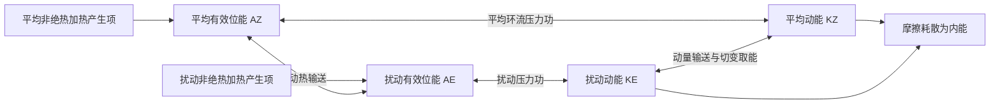

# D12 · 2017第9—17条＋2016第1—14条（23条）

日期：2026-11-09｜建议投入：4小时｜动力40% · 天气40% · 物理20%

> 本学习包依据原50日PDF与仓库学习资料整理。参考答案不是官方评分标准；未完成学科审校及缺题标记均保留。公式采用 GitHub 数学 Markdown，请在 GitHub 正文或 Obsidian 阅读视图打开。

## 今日目标与记忆标准

闭卷说清概念、适用条件、符号与单位；推导必须写出起始方程、近似及关键步骤。先答题，再展开核对。

## 四小时执行

1. 20分钟：回忆此前第1、3、7、14天的重点，尚未开始的日期跳过。
2. 80分钟：逐题闭卷提取，核对以下简答与来源。
3. 70分钟：精选5题完整书写。名词解释90秒、简答7分钟、论述12分钟为训练目标。
4. 40分钟：把本日知识按“假设→方程→物理机制→天气表现”串成2—4条知识链。
5. 30分钟：记录遗漏点、用时与次日/3日/7日/14日复习日期。

> 星级口径：按同考点在不同年份的出现次数，1次★、2—3次★★、4—6次★★★、7—10次★★★★、11次及以上★★★★★；多考点题取最高频考点。星级表示复习频次，不是命题概率。

## 逐题回忆与简答

### 2017-二-1 · ★（同考点1年）

地形对云物理和降水的影响。

[解析来源（对应题目行）](https://github.com/0183ty2512/lao-san-yang/blob/main/%E5%8A%A8%E5%8A%9B%E6%B0%94%E8%B1%A1%E8%AF%BE%E5%90%8E%E4%B9%A0%E9%A2%98/%E8%AF%95%E9%A2%98%E8%A7%A3%E7%AD%94/%E5%BE%80%E5%B9%B4%E8%AF%95%E9%A2%98%E8%A7%A3%E6%9E%90/2017.md#L302) · [原始年度题干](https://github.com/0183ty2512/lao-san-yang/blob/main/%E5%BE%80%E5%B9%B4%E8%AF%95%E9%A2%98%E5%88%86%E6%9E%90/2017.md)

**审校状态：尚未逐题学科审校。**

> 以上摘要用于回忆答题主线，不是官方评分标准；推导、计算和多小问仍须完成下方步骤。

1. **云物理路径。** 迎风抬升使气块降温至饱和，凝结物增长；若达到冷云层，可有冰相增长和播撒效应。地形引起的辐合、驻留和重复对流增大累积雨量；背风下沉促蒸发。降水大小还受水汽、粒子微物理和云相态控制，不能只按海拔单调增加。

2. **动力作用。** 高原作为巨大地形障碍，使西风绕流或爬升，分成南北支，改变下游槽脊、急流和定常行星波；山地抬升使迎风坡降水增加，背风坡下沉增温变干。实际响应取决于风向、层结、山高和阻塞程度。

### 2017-二-2 · ★★★★★（同考点17年）

冬天我国冷空气的源地和路径。

[解析来源（对应题目行）](https://github.com/0183ty2512/lao-san-yang/blob/main/%E5%8A%A8%E5%8A%9B%E6%B0%94%E8%B1%A1%E8%AF%BE%E5%90%8E%E4%B9%A0%E9%A2%98/%E8%AF%95%E9%A2%98%E8%A7%A3%E7%AD%94/%E5%BE%80%E5%B9%B4%E8%AF%95%E9%A2%98%E8%A7%A3%E6%9E%90/2017.md#L336) · [原始年度题干](https://github.com/0183ty2512/lao-san-yang/blob/main/%E5%BE%80%E5%B9%B4%E8%AF%95%E9%A2%98%E5%88%86%E6%9E%90/2017.md)

**审校状态：尚未逐题学科审校。**

**相关高频考点复习摘要（须按本题设问取舍，不替代完整解答）：**

**寒潮及其天气过程：** 寒潮是强冷空气大范围南下造成显著降温、大风及可能雨雪冻害的过程。答路径时分西路、西北路、东路；答发展时写冷空气蓄积→高空槽脊调整→地面冷高压和冷锋南下；是否达到业务等级须核对相应标准。

> 以上摘要用于回忆答题主线，不是官方评分标准；推导、计算和多小问仍须完成下方步骤。

1. 寒潮是强冷空气大范围侵入中低纬，造成剧烈降温、大风，常伴雨雪或冻害的天气过程；达到业务寒潮等级还要按适用标准核对降温幅度和最低温度，不能把所有冷空气过程称为寒潮。
2. **源地和蓄积区。** 传统天气学源地归纳包括新地岛以西、新地岛以东和冰岛以南洋面；冷空气可在西伯利亚—蒙古一带进一步辐射冷却、蓄积。源地不同于进入我国的路径，不能混为一项。
3. **路径。** 西路经新疆及高原北侧影响西北、西南；西北路经蒙古、河套南下，常影响我国中东部大部；东路偏经东北、华北和东部沿海。多路冷空气汇合时范围和强度可增大，但不存在不问强度、地形、水汽就永远“最严重”的一路。
4. **环流演变。** 阻塞高压或暖脊建立，东侧冷空气积聚；亚洲极涡或横槽南压；短波发展、横槽转竖或大槽东移使槽后偏北气流加强，地面冷高压增强南下，冷锋迅速推进，随后东亚大槽重建。
5. **天气。** 锋前可回暖和增湿，锋过时风向突变、大风降温，水汽足时出现雨雪；锋后气压升高、天气转晴，夜间辐射降温及霜冻可加剧。干冷型雨雪少，湿冷型雨雪多，不能要求每次寒潮都具同样降水。
6. **倒Ω中期演变。** 两大洋北部脊向高纬发展，极涡分裂或偏心；乌拉尔与东亚东北侧脊发展，亚洲冷涡被夹持并南压，形成类似倒Ω的槽脊配置；随后横槽转竖或长波槽快速发展，槽后冷空气爆发南下。画图时应画“两侧高脊、中间冷槽/涡”，并用槽后偏北箭头表示冷空气路径。
7. **预报关键。** 同时监视阻高和脊、极涡/横槽、地面冷高压与冷锋。常见短中期型包括小槽发展、横槽转竖和低槽东移；不同教材的“第几类”编号不统一，未给分类表时不能凭编号唯一指定。

### 2017-二-3 · ★★★（同考点4年）

斜压不稳定的能量来源。

[解析来源（对应题目行）](https://github.com/0183ty2512/lao-san-yang/blob/main/%E5%8A%A8%E5%8A%9B%E6%B0%94%E8%B1%A1%E8%AF%BE%E5%90%8E%E4%B9%A0%E9%A2%98/%E8%AF%95%E9%A2%98%E8%A7%A3%E7%AD%94/%E5%BE%80%E5%B9%B4%E8%AF%95%E9%A2%98%E8%A7%A3%E6%9E%90/2017.md#L378) · [原始年度题干](https://github.com/0183ty2512/lao-san-yang/blob/main/%E5%BE%80%E5%B9%B4%E8%AF%95%E9%A2%98%E5%88%86%E6%9E%90/2017.md)

**审校状态：尚未逐题学科审校。**

**相关高频考点复习摘要（须按本题设问取舍，不替代完整解答）：**

**斜压不稳定：** 斜压不稳定从基本态水平温差的有效位能取能，经扰动向极热输送和暖升冷沉转入扰动动能。成长波常随高度向西倾斜，即使干静力稳定仍可发展；与依赖水平切变动能的正压不稳定区别。

> 以上摘要用于回忆答题主线，不是官方评分标准；推导、计算和多小问仍须完成下方步骤。

1. 斜压不稳定指在旋转、层结的大气中，扰动利用基本态水平温度差所储存的有效位能而增长；静力稳定的大气也可能发生斜压不稳定。
2. 水平温度梯度对应热成风切变。扰动把暖空气送向冷侧、冷空气送向暖侧，减小平均水平温差，使基本态有效位能转入扰动有效位能。
3. 暖空气上升、冷空气下沉时 $\overline{w'T'}>0$，气压坐标等价为 $-\overline{\alpha'\omega'}>0$，扰动有效位能进一步转为扰动动能。
4. 成长中的典型中纬度斜压波高度槽脊轴随高度向西倾斜，温度与高度扰动存在有利相位差，槽前暖平流和上升、槽后冷平流和下沉配合，形成气旋发展。进入成熟阶段倾斜减弱，取能效率下降。
5. 正压不稳定主要抽取基本流动能并与水平风切变有关；斜压不稳定主要抽取基本流有效位能并与垂直风切变有关。两者可同时存在。具体波长范围和增长率依 Eady、Charney 等模型及边界条件而异，不应混用一个固定阈值。

### 2017-二-4 · ★★★（同考点4年）

海洋对气候变化的影响（略，不用写）。

[解析来源（对应题目行）](https://github.com/0183ty2512/lao-san-yang/blob/main/%E5%8A%A8%E5%8A%9B%E6%B0%94%E8%B1%A1%E8%AF%BE%E5%90%8E%E4%B9%A0%E9%A2%98/%E8%AF%95%E9%A2%98%E8%A7%A3%E7%AD%94/%E5%BE%80%E5%B9%B4%E8%AF%95%E9%A2%98%E8%A7%A3%E6%9E%90/2017.md#L418) · [原始年度题干](https://github.com/0183ty2512/lao-san-yang/blob/main/%E5%BE%80%E5%B9%B4%E8%AF%95%E9%A2%98%E5%88%86%E6%9E%90/2017.md)

**审校状态：尚未逐题学科审校。**

**相关高频考点复习摘要（须按本题设问取舍，不替代完整解答）：**

**海洋对气候的作用：** 海洋通过大热容量储热、海流输热、显潜热及辐射交换影响气候，并通过海温和海冰反馈大气。真实翻转环流受密度差、风和混合共同驱动；海气影响是双向的，不是海洋单向给大气加热。

> 以上摘要用于回忆答题主线，不是官方评分标准；推导、计算和多小问仍须完成下方步骤。

1. 海洋热容量大，可吸收、储存和缓慢释放热量，使气候响应具有惯性；海表温度改变海气温差、蒸发和对流，海冰又改变反照率及表面交换。

2. 海气能量交换包括短长波辐射、显热和潜热通量。体积经验式可写 $H=\rho_ac_pC_HU(T_s-T_a)$、$LE=\rho_aL_vC_EU(q_s-q_a)$（向上为正）；风速、温湿差及稳定度决定交换强弱，海洋蒸发失去潜热，水汽凝结后将能量释放到大气。

3. 风应力向海洋输送动量，驱动表层流和上升流；海温、海冰反过来改变边界层与压力场，构成双向耦合。热带气旋可搅拌冷却海面并削弱后续供能，不能只描述海洋单向加热大气。

4. 温盐环流指海水温度、盐度影响密度并与深水形成和大尺度翻转相联系的环流。高纬冷却或增盐使密度增大，下沉水沿深层输送，再经混合、上涌返回；真实全球翻转也受风和机械混合驱动，不是仅靠一条封闭“传送带”。

5. 地气系统低纬辐射盈余、高纬亏损，需要大气和海洋共同向极输送能量。大气通过干静力能和潜热输送，海洋通过流动输送热量。南北半球海陆分布、海洋通道和环流不同，分担比例与跨赤道输送不同；不能脱离具体纬度和资料笼统断言某半球各处都更强。

### 2017-二-5 · ★★（同考点3年）

人类活动影响气候的主要途径（略，不用写）。

[解析来源（对应题目行）](https://github.com/0183ty2512/lao-san-yang/blob/main/%E5%8A%A8%E5%8A%9B%E6%B0%94%E8%B1%A1%E8%AF%BE%E5%90%8E%E4%B9%A0%E9%A2%98/%E8%AF%95%E9%A2%98%E8%A7%A3%E7%AD%94/%E5%BE%80%E5%B9%B4%E8%AF%95%E9%A2%98%E8%A7%A3%E6%9E%90/2017.md#L462) · [原始年度题干](https://github.com/0183ty2512/lao-san-yang/blob/main/%E5%BE%80%E5%B9%B4%E8%AF%95%E9%A2%98%E5%88%86%E6%9E%90/2017.md)

**审校状态：尚未逐题学科审校。**

**相关高频考点复习摘要（须按本题设问取舍，不替代完整解答）：**

**人类活动对气候的影响：** 人为影响主要通过温室气体改变红外收支、气溶胶改变辐射与云、土地利用改变反照率和显潜热分配等途径。机制罗列不等于定量归因；局地城市热岛不能单独解释全球气候变化。

> 以上摘要用于回忆答题主线，不是官方评分标准；推导、计算和多小问仍须完成下方步骤。

1. **驱动。** 太阳和轨道变化、火山气溶胶等自然外部强迫，人为温室气体、气溶胶和土地利用变化，以及海气耦合内部变率共同影响气候；区分“可能机制”和实际时段的归因，不是列出机制就证明每项贡献相同。

2. **反馈。** 初始增暖使空气可容纳更多水汽，增强红外吸收，形成正反馈；冰雪减少降低反照率，也是正反馈；温度升高使向外长波增加，是基本负反馈。云反馈需同时考虑短波反射和长波保温，其符号依云高、云量和云相态。

3. **陆面和地表气温。** 纬度及季节控制太阳入射，海拔、海陆距离、洋流、云和环流控制温度背景；植被、土壤湿度、反照率、粗糙度影响净辐射及显潜热分配。干土蒸发受限，显热比例较大，易增暖；湿土热量更多用于蒸发。积雪增加反照率，植被改变蒸散和碳循环。

4. **城市热岛。** 建筑储热、蒸散减少、人为热排放、街谷辐射和通风变化使城区常比郊区暖，晴静夜间尤明显。热岛是局地土地利用效应，不能用它单独解释全球海陆增暖。

### 2017-二-6 · ★★★★★（同考点16年）

什么是阻塞高压？阻塞高压的建成和衰退过程。

[解析来源（对应题目行）](https://github.com/0183ty2512/lao-san-yang/blob/main/%E5%8A%A8%E5%8A%9B%E6%B0%94%E8%B1%A1%E8%AF%BE%E5%90%8E%E4%B9%A0%E9%A2%98/%E8%AF%95%E9%A2%98%E8%A7%A3%E7%AD%94/%E5%BE%80%E5%B9%B4%E8%AF%95%E9%A2%98%E8%A7%A3%E6%9E%90/2017.md#L504) · [原始年度题干](https://github.com/0183ty2512/lao-san-yang/blob/main/%E5%BE%80%E5%B9%B4%E8%AF%95%E9%A2%98%E5%88%86%E6%9E%90/2017.md)

**审校状态：尚未逐题学科审校。**

**相关高频考点复习摘要（须按本题设问取舍，不替代完整解答）：**

**阻塞高压：** 阻塞高压是中高纬持续、少动并使西风绕行的强脊或闭合高压。建立与暖输送、波破碎及涡旋反馈有关；其东侧偏北气流可蓄积和引导冷空气。衰退配合横槽转竖时可触发寒潮，但并非每次崩溃都必然造成寒潮。

> 以上摘要用于回忆答题主线，不是官方评分标准；推导、计算和多小问仍须完成下方步骤。

1. 阻塞高压是中高纬持续、移动缓慢的强高压脊或闭合高压，使西风气流绕行、分支，阻碍天气系统正常东移。关键是持续性和对西风带的阻挡，并非所有高压都叫阻塞。
2. 建立时，暖空气向极地输送使脊增强，经向振幅增大，波破碎、涡旋反馈可帮助维持。高压脊发展或与高纬高压合并，南侧可切出冷低压，形成偶极或Ω型等配置。
3. 维持时，阻高东侧偏北气流引导冷空气南下，西侧偏南气流输送暖空气。下游槽及冷暖空气交汇区可长期停留，造成持久冷凉、降雨；高压控制区下沉、少云，可造成干旱和高温，具体依季节和位置。
4. 衰退或崩溃时，维持高压的暖输送与涡旋反馈减弱，西风恢复，槽脊重新东移；其东侧积聚的冷空气可配合横槽转竖大举南下，触发我国寒潮。不能把每一次阻高衰退都等同于寒潮，仍需冷空气强度和路径配合。
5. 亚洲常关注乌拉尔山及鄂霍次克海等阻塞区，北大西洋—欧洲也是重要活动区；不同季节的优势位置不同，不应把某一季节经验说成全年固定不变。
6. 切断低压是从西风主槽分离出的闭合冷性低压，移动缓慢，可与北侧阻高配合。其冷空气及正涡度有利于下游不稳定和上升，但天气还依水汽供应。

### 2017-三-1 · ★★（同考点2年）

写出准地转 $\omega$方程，并解释左右两边各项的含义，

[解析来源（对应题目行）](https://github.com/0183ty2512/lao-san-yang/blob/main/%E5%8A%A8%E5%8A%9B%E6%B0%94%E8%B1%A1%E8%AF%BE%E5%90%8E%E4%B9%A0%E9%A2%98/%E8%AF%95%E9%A2%98%E8%A7%A3%E7%AD%94/%E5%BE%80%E5%B9%B4%E8%AF%95%E9%A2%98%E8%A7%A3%E6%9E%90/2017.md#L549) · [原始年度题干](https://github.com/0183ty2512/lao-san-yang/blob/main/%E5%BE%80%E5%B9%B4%E8%AF%95%E9%A2%98%E5%88%86%E6%9E%90/2017.md)

**审校状态：尚未逐题学科审校。**

> 以上摘要用于回忆答题主线，不是官方评分标准；推导、计算和多小问仍须完成下方步骤。

取 $f_0$ 常数、$\sigma=\sigma(p)>0$、绝热无摩擦准地转近似。记 $\zeta_g=\nabla_h^2\Phi/f_0$、$\chi=\Phi_t$、$A=\mathbf V_g\cdot\nabla(\zeta_g+f)$、$B=\mathbf V_g\cdot\nabla\Phi_p$。原题平流速度应在准地转阶取地转风。

**1. 改写两条方程。** 涡度式为 $\nabla_h^2\chi=f_0^2\omega_p-f_0A$；热力式为 $\chi_p+B+\sigma\omega=0$。

**2. 位势倾向方程。** 第二式给 $\omega=-(\chi_p+B)/\sigma$。对 $p$ 求导，代入第一式，移项得到
$$\boxed{\left[\nabla_h^2+f_0^2\frac{\partial}{\partial p}\left(\frac1\sigma\frac{\partial}{\partial p}\right)\right]\chi=-f_0A-f_0^2\frac{\partial}{\partial p}\left(\frac B\sigma\right)}.$$
第一项是绝对涡度平流，第二项是温度平流垂直差异的作用。求实际倾向仍需边界条件。

**3. 消去倾向得到ω方程。** 涡度式对 $p$ 求导：$\nabla_h^2\chi_p=f_0^2\omega_{pp}-f_0A_p$。热力式取水平拉普拉斯：$\nabla_h^2\chi_p=-\nabla_h^2B-\sigma\nabla_h^2\omega$。两式相等并移项：
$$\boxed{(\sigma\nabla_h^2+f_0^2\partial_{pp})\omega=f_0\partial_pA-\nabla_h^2B}.$$
因为 $\Phi_p=-R_dT/p$，$B=-(R_d/p)\mathbf V_g\cdot\nabla T$，也可将温度项写成 $(R_d/p)\nabla_h^2(\mathbf V_g\cdot\nabla T)$。

**4. 符号与物理意义。** 左边是水平、竖直稳定约束算子。平滑局地模态有 $\nabla^2\sim-K^2$、$\partial_{pp}\sim-m_p^2$，算子为负，所以正的右端对应负 $\omega$（上升），不能把右端正直接说成下沉。常见上升配置是正涡度平流随高度增强、暖平流中心；反向配置利于下沉。必须结合整个强迫分布和边界求解，不能仅凭单一层的符号作绝对判断。

### 2017-三-2 · ★★（同考点3年）

说出大气上升和下沉的条件。

[解析来源（对应题目行）](https://github.com/0183ty2512/lao-san-yang/blob/main/%E5%8A%A8%E5%8A%9B%E6%B0%94%E8%B1%A1%E8%AF%BE%E5%90%8E%E4%B9%A0%E9%A2%98/%E8%AF%95%E9%A2%98%E8%A7%A3%E7%AD%94/%E5%BE%80%E5%B9%B4%E8%AF%95%E9%A2%98%E8%A7%A3%E6%9E%90/2017.md#L593) · [原始年度题干](https://github.com/0183ty2512/lao-san-yang/blob/main/%E5%BE%80%E5%B9%B4%E8%AF%95%E9%A2%98%E5%88%86%E6%9E%90/2017.md)

**审校状态：已按设问复核。**

**针对本题的精简作答：**

先给w与ω符号；用整层连续性说明低辐合高辐散常配合上升；再联系ω方程的差动涡度平流与温度平流强迫，明确近似和边界。

> 以上摘要用于回忆答题主线，不是官方评分标准；推导、计算和多小问仍须完成下方步骤。

### 2017-三-3 · ★★（同考点2年）

写出 z 坐标系下的水平动量方程，并推导出垂直涡度方程，写出各项意义。

[解析来源（对应题目行）](https://github.com/0183ty2512/lao-san-yang/blob/main/%E5%8A%A8%E5%8A%9B%E6%B0%94%E8%B1%A1%E8%AF%BE%E5%90%8E%E4%B9%A0%E9%A2%98/%E8%AF%95%E9%A2%98%E8%A7%A3%E7%AD%94/%E5%BE%80%E5%B9%B4%E8%AF%95%E9%A2%98%E8%A7%A3%E6%9E%90/2017.md#L634) · [原始年度题干](https://github.com/0183ty2512/lao-san-yang/blob/main/%E5%BE%80%E5%B9%B4%E8%AF%95%E9%A2%98%E5%88%86%E6%9E%90/2017.md)

**审校状态：尚未逐题学科审校。**

> 以上摘要用于回忆答题主线，不是官方评分标准；推导、计算和多小问仍须完成下方步骤。

**一、对水平运动方程取旋度。** 高度坐标为
$$D_tu-fv=-\alpha p_x+F_x,\qquad D_tv+fu=-\alpha p_y+F_y,$$
其中 $D_t=\frac{\partial}{\partial t}+u\frac{\partial}{\partial x}+v\frac{\partial}{\partial y}+w\frac{\partial}{\partial z}$，$\alpha=1/\rho$。

对第二式取 $x$ 导数、第一式取 $y$ 导数后相减。用 $\frac{\partial}{\partial x}(D_tv)-\frac{\partial}{\partial y}(D_tu)=D_t\zeta+\zeta(\frac{\partial u}{\partial x}+\frac{\partial v}{\partial y})+w_xv_z-w_yu_z$，科氏项为 $f(\frac{\partial u}{\partial x}+\frac{\partial v}{\partial y})+\beta v$，压力项为 $\alpha_yp_x-\alpha_xp_y$，得
$$D_t\zeta=-(\zeta+f)(\frac{\partial u}{\partial x}+\frac{\partial v}{\partial y})-\beta v+w_yu_z-w_xv_z+\alpha_yp_x-\alpha_xp_y+\partial_xF_y-\partial_yF_x.$$
展开成局地变化：水平平流 $-u\zeta_x-v\zeta_y$；竖直平流 $-w\zeta_z$；行星涡度平流 $-\beta v$；伸缩 $-(\zeta+f)D$；倾斜 $w_yu_z-w_xv_z$；斜压 $\alpha_yp_x-\alpha_xp_y$。这是常说的六项，无摩擦时适用；有摩擦另加摩擦旋度。

**二、气压坐标。** 水平压力梯度改为 $-\frac{\partial \Phi}{\partial x},-\frac{\partial \Phi}{\partial y}$，交叉导数完全抵消；物质导数的竖直部分改为 $\omega\frac{\partial}{\partial p}$。同样操作得到
$$\boxed{D_t\zeta+\beta v=-(\zeta+f)D+u_p\omega_y-v_p\omega_x+\partial_xF_y-\partial_yF_x}.$$
其中 $D=\frac{\partial u}{\partial x}+\frac{\partial v}{\partial y}=-\omega_p$。不可把高度坐标的显式斜压项重复放入此式。

**三、绝对涡度是否守恒。** 因 $D_tf=\beta v$，左边就是 $D_t(\zeta+f)$。仅“无摩擦”不足以守恒；还需要右边伸缩、倾斜项消失或总和为零。常用充分条件是水平无辐散、无倾斜效应、无摩擦。相对涡度还随纬度变化，故与绝对涡度守恒不同。

### 2016-一-1 · ★★（同考点2年）

波的相速度

[解析来源（对应题目行）](https://github.com/0183ty2512/lao-san-yang/blob/main/%E5%8A%A8%E5%8A%9B%E6%B0%94%E8%B1%A1%E8%AF%BE%E5%90%8E%E4%B9%A0%E9%A2%98/%E8%AF%95%E9%A2%98%E8%A7%A3%E7%AD%94/%E5%BE%80%E5%B9%B4%E8%AF%95%E9%A2%98%E8%A7%A3%E6%9E%90/2016.md#L11) · [原始年度题干](https://github.com/0183ty2512/lao-san-yang/blob/main/%E5%BE%80%E5%B9%B4%E8%AF%95%E9%A2%98%E5%88%86%E6%9E%90/2016.md)

**审校状态：尚未逐题学科审校。**

> 以上摘要用于回忆答题主线，不是官方评分标准；推导、计算和多小问仍须完成下方步骤。

1. 简谐波写为 $A\cos(kx-\omega t)$。对等位相 $kx-\omega t=C$ 求导，得 $c_p=dx/dt=\omega/k$，它是波峰等位相点的速度。
2. 两列相近波叠加，利用和差化积得到 $2A\cos[(\Delta kx-\Delta\omega t)/2]\cos[(\bar kx-\bar\omega t)]$。第一项是缓变包络，故包络速度为 $\Delta\omega/\Delta k$。
3. 极限 $\Delta k\to0$ 时，群速度 $c_g=d\omega/dk$。多维形式为 $\mathbf c_g=\nabla_{\mathbf k}\omega$；在无耗散、缓变介质的线性波理论中，波包及波能量通常以群速度传播。
4. 若 $\omega=ck$ 且 $c$ 与 $k$ 无关，所有波数的相速相同，为非频散波；否则不同波数组分分离，波形和包络演变，称频散。因为 $\omega=kc_p(k)$，有 $c_g=c_p+k\,dc_p/dk$。
5. 频散的根本原因是恢复机制与惯性响应具有尺度依赖性，使频率对波数不呈简单线性关系；它不等于摩擦耗散。旋转浅水波和罗斯贝波有频散，无旋转均匀浅水长波近似非频散。

### 2016-一-2 · ★★★（同考点5年）

锋生

[解析来源（对应题目行）](https://github.com/0183ty2512/lao-san-yang/blob/main/%E5%8A%A8%E5%8A%9B%E6%B0%94%E8%B1%A1%E8%AF%BE%E5%90%8E%E4%B9%A0%E9%A2%98/%E8%AF%95%E9%A2%98%E8%A7%A3%E7%AD%94/%E5%BE%80%E5%B9%B4%E8%AF%95%E9%A2%98%E8%A7%A3%E6%9E%90/2016.md#L47) · [原始年度题干](https://github.com/0183ty2512/lao-san-yang/blob/main/%E5%BE%80%E5%B9%B4%E8%AF%95%E9%A2%98%E5%88%86%E6%9E%90/2016.md)

**审校状态：尚未逐题学科审校。**

**相关高频考点复习摘要（须按本题设问取舍，不替代完整解答）：**

**锋生与锋消：** 锋生是随气块运动的水平温度或位温梯度增强。令 $F=D|\nabla_h\theta|/Dt$，按链式法则可分为差异加热、水平变形辐合和竖直倾斜贡献。$F>0$ 锋生，$F<0$ 锋消；不能把所有水平辐合无条件视为锋生。

> 以上摘要用于回忆答题主线，不是官方评分标准；推导、计算和多小问仍须完成下方步骤。

1. **锋生定义与推导。** 令 $\mathbf G=\nabla_h\theta$，$F=D|\mathbf G|/Dt$。由 $D\theta/Dt=\dot\theta$ 对 $x_i$ 求导：$DG_i/Dt=\partial_i\dot\theta-(\partial_i u_j)G_j-(\partial_iw)\theta_z$，这里 $i,j=x,y$。

2. 与 $G_i/|\mathbf G|$ 相乘求和，得
$$F=\frac{\mathbf G\cdot\nabla_h\dot\theta}{|\mathbf G|}-\frac{G_i(\partial_i u_j)G_j}{|\mathbf G|}-\frac{\theta_z\mathbf G\cdot\nabla_hw}{|\mathbf G|}.$$
三项分别是差异非绝热加热、水平变形/辐合、竖直倾斜作用；$F>0$ 锋生，$F<0$ 锋消。若温度梯度沿 $x$，绝热且无倾斜时 $F=-|G|\frac{\partial u}{\partial x}$，跨锋辐合 $\frac{\partial u}{\partial x}<0$ 加大梯度，直观说明动力锋生。

### 2016-一-3 · ★★★★★（同考点17年）

寒潮

[解析来源（对应题目行）](https://github.com/0183ty2512/lao-san-yang/blob/main/%E5%8A%A8%E5%8A%9B%E6%B0%94%E8%B1%A1%E8%AF%BE%E5%90%8E%E4%B9%A0%E9%A2%98/%E8%AF%95%E9%A2%98%E8%A7%A3%E7%AD%94/%E5%BE%80%E5%B9%B4%E8%AF%95%E9%A2%98%E8%A7%A3%E6%9E%90/2016.md#L87) · [原始年度题干](https://github.com/0183ty2512/lao-san-yang/blob/main/%E5%BE%80%E5%B9%B4%E8%AF%95%E9%A2%98%E5%88%86%E6%9E%90/2016.md)

**审校状态：尚未逐题学科审校。**

**相关高频考点复习摘要（须按本题设问取舍，不替代完整解答）：**

本段与上文相同，可回看前面的解析，不再重复展开。

> 以上摘要用于回忆答题主线，不是官方评分标准；推导、计算和多小问仍须完成下方步骤。

本段与上文相同，可回看前面的解析，不再重复展开。

### 2016-一-4 · ★★（同考点3年）

气候模拟（略，不用写）

[解析来源（对应题目行）](https://github.com/0183ty2512/lao-san-yang/blob/main/%E5%8A%A8%E5%8A%9B%E6%B0%94%E8%B1%A1%E8%AF%BE%E5%90%8E%E4%B9%A0%E9%A2%98/%E8%AF%95%E9%A2%98%E8%A7%A3%E7%AD%94/%E5%BE%80%E5%B9%B4%E8%AF%95%E9%A2%98%E8%A7%A3%E6%9E%90/2016.md#L129) · [原始年度题干](https://github.com/0183ty2512/lao-san-yang/blob/main/%E5%BE%80%E5%B9%B4%E8%AF%95%E9%A2%98%E5%88%86%E6%9E%90/2016.md)

**审校状态：尚未逐题学科审校。**

**相关高频考点复习摘要（须按本题设问取舍，不替代完整解答）：**

**气候模式：** 气候模式把动力、热力、辐射等方程数值离散，耦合海洋陆面冰雪并参数化未解析过程。给定强迫作长期积分和集合，研究统计气候及响应；不是准确预报几十年后某天的天气。

> 以上摘要用于回忆答题主线，不是官方评分标准；推导、计算和多小问仍须完成下方步骤。

1. **模式。** 气候模式把流体、热力学、辐射等方程在网格上数值求解，耦合海洋、陆面、冰雪等，并参数化未解析过程。给定外强迫与初边值，作长期积分和集合，比较统计气候及响应；分辨率、参数化、情景和内部变率造成不确定性，气候模拟不等于准确预报几十年后某一天的天气。

### 2016-一-5 · ★（同考点1年）

气候突变（略，不用写）

[解析来源（对应题目行）](https://github.com/0183ty2512/lao-san-yang/blob/main/%E5%8A%A8%E5%8A%9B%E6%B0%94%E8%B1%A1%E8%AF%BE%E5%90%8E%E4%B9%A0%E9%A2%98/%E8%AF%95%E9%A2%98%E8%A7%A3%E7%AD%94/%E5%BE%80%E5%B9%B4%E8%AF%95%E9%A2%98%E8%A7%A3%E6%9E%90/2016.md#L165) · [原始年度题干](https://github.com/0183ty2512/lao-san-yang/blob/main/%E5%BE%80%E5%B9%B4%E8%AF%95%E9%A2%98%E5%88%86%E6%9E%90/2016.md)

**审校状态：尚未逐题学科审校。**

> 以上摘要用于回忆答题主线，不是官方评分标准；推导、计算和多小问仍须完成下方步骤。

1. 气候突变是相对背景时间尺度而言较快、且持续的气候状态转变，可涉及阈值与非线性反馈；极端气候事件是相对于特定地区和时段统计分布少见的事件，例如高温或极端降水，必须说明阈值、基准期和持续时间。二者并非同义。

### 2016-一-6 · ★★★（同考点6年）

斜压大气

[解析来源（对应题目行）](https://github.com/0183ty2512/lao-san-yang/blob/main/%E5%8A%A8%E5%8A%9B%E6%B0%94%E8%B1%A1%E8%AF%BE%E5%90%8E%E4%B9%A0%E9%A2%98/%E8%AF%95%E9%A2%98%E8%A7%A3%E7%AD%94/%E5%BE%80%E5%B9%B4%E8%AF%95%E9%A2%98%E8%A7%A3%E6%9E%90/2016.md#L197) · [原始年度题干](https://github.com/0183ty2512/lao-san-yang/blob/main/%E5%BE%80%E5%B9%B4%E8%AF%95%E9%A2%98%E5%88%86%E6%9E%90/2016.md)

**审校状态：尚未逐题学科审校。**

**相关高频考点复习摘要（须按本题设问取舍，不替代完整解答）：**

**正压与斜压大气：** 正压大气满足 $\rho=\rho(p)$，等压面与等密度面重合；斜压时两面相交，$\nabla\rho\times\nabla p\ne0$。在静力、地转条件下，等压面温度梯度对应地转风垂直切变。斜压状态不自动等于斜压不稳定。

> 以上摘要用于回忆答题主线，不是官方评分标准；推导、计算和多小问仍须完成下方步骤。

1. 正压大气满足 $\rho=\rho(p)$，等压面与等密度面重合，故 $\nabla\rho\times\nabla p=0$。对理想气体，在等压面上温度均匀。
2. 斜压大气中等压面与等密度面相交，$\nabla\rho\times\nabla p\ne0$，等压面上有水平温度梯度。
3. 斜压项可生成环流和涡度；在静力、地转条件下，水平温度梯度通过热成风关系对应地转风垂直切变。正压条件下地转风不随高度改变。
4. “正压”不意味着实际风必无任何垂直切变；上述切变结论还用了地转平衡。“斜压”也不等于“斜压不稳定”，后者需要扰动从基本态有效位能获得净能量。

### 2016-一-7 · ★★★（同考点6年）

有效位能

[解析来源（对应题目行）](https://github.com/0183ty2512/lao-san-yang/blob/main/%E5%8A%A8%E5%8A%9B%E6%B0%94%E8%B1%A1%E8%AF%BE%E5%90%8E%E4%B9%A0%E9%A2%98/%E8%AF%95%E9%A2%98%E8%A7%A3%E7%AD%94/%E5%BE%80%E5%B9%B4%E8%AF%95%E9%A2%98%E8%A7%A3%E6%9E%90/2016.md#L236) · [原始年度题干](https://github.com/0183ty2512/lao-san-yang/blob/main/%E5%BE%80%E5%B9%B4%E8%AF%95%E9%A2%98%E5%88%86%E6%9E%90/2016.md)

**审校状态：尚未逐题学科审校。**

**相关高频考点复习摘要（须按本题设问取舍，不替代完整解答）：**

**有效位能：** 有效位能是实际全位能相对绝热重排后的最低参考态中可供转换的部分。差异加热维持温差，暖升冷沉可将其转为动能。全位能通常指内能与重力位能之和，不是全部都能被利用。

> 以上摘要用于回忆答题主线，不是官方评分标准；推导、计算和多小问仍须完成下方步骤。

1. 单位质量内能 $e=c_vT$，重力位能 $\Phi=gz$（常重力），动能 $K=|\mathbf V|^2/2$，水汽潜热能近似 $L_vq_v$。总量需对气团质量积分；动能不能漏掉 $1/2$。
2. “全位能”在大气能量学中通常指内能与重力位能之和，而非含动能的总能量。静力、平坦底面且顶边界压力趋零时，$\int\rho gz\,dz=-\int z\,dp=\int p\,dz=\int\rho RT\,dz$；加上内能得到 $\int c_pT\,dm$。
3. 有效位能是实际全位能相对绝热重排到参考最低能态后的可用部分。不是全部内能或重力位能都能转换为动能。差异加热维持水平温差，建立有效位能。
4. 暖上升冷下沉时，$C=-\int\alpha'\omega'\,dm>0$，有效位能转为扰动动能；摩擦最终把动能耗散成内能。凝结使潜热转入热力能库，但水汽能量本来主要来自地表蒸发和辐射收支。
5. 对流层常用 Lorenz 四能量库循环如下。双向箭头表示转换可正可负，方向由收支项决定；中纬度斜压波常沿 $A_Z\to A_E\to K_E$ 取能。$A_Z$ 与 $K_Z$ 的直接转换不能漏掉：平均经圈环流同样可通过压力功在平均有效位能和平均动能之间转换。

产生项也可能为负，图中不是所有加热都增加有效位能。若问完整收支，应分别写 $\dot A_Z=G_Z-C_A-C_Z$、$\dot A_E=G_E+C_A-C_E$、$\dot K_Z=C_Z+C_K-D_Z$、$\dot K_E=C_E-C_K-D_E$，这里 $C_K>0$ 约定为扰动动能转入平均动能。四式相加，内部转换项逐项抵消，只剩外部产生与耗散，可用作检查。

### 2016-一-8 · ★★★（同考点5年）

南方涛动

[解析来源（对应题目行）](https://github.com/0183ty2512/lao-san-yang/blob/main/%E5%8A%A8%E5%8A%9B%E6%B0%94%E8%B1%A1%E8%AF%BE%E5%90%8E%E4%B9%A0%E9%A2%98/%E8%AF%95%E9%A2%98%E8%A7%A3%E7%AD%94/%E5%BE%80%E5%B9%B4%E8%AF%95%E9%A2%98%E8%A7%A3%E6%9E%90/2016.md#L288) · [原始年度题干](https://github.com/0183ty2512/lao-san-yang/blob/main/%E5%BE%80%E5%B9%B4%E8%AF%95%E9%A2%98%E5%88%86%E6%9E%90/2016.md)

**审校状态：尚未逐题学科审校。**

**相关高频考点复习摘要（须按本题设问取舍，不替代完整解答）：**

**南方涛动：** 南方涛动是热带太平洋东西部海平面气压的大范围反相变化，常用塔希提与达尔文标准化气压差表征。它是ENSO的大气侧表现，应与海温异常这一海洋侧指标区分。

> 以上摘要用于回忆答题主线，不是官方评分标准；推导、计算和多小问仍须完成下方步骤。

1. 南方涛动是热带太平洋东西部大范围海平面气压的反相变化，常用塔希提与达尔文标准化气压差的指数表征。负位相通常对应厄尔尼诺相关的沃克环流减弱，但海洋和大气指标需综合判断。

### 2016-二-1 · ★★★★（同考点8年）

全球经圈环流及其组成。

[解析来源（对应题目行）](https://github.com/0183ty2512/lao-san-yang/blob/main/%E5%8A%A8%E5%8A%9B%E6%B0%94%E8%B1%A1%E8%AF%BE%E5%90%8E%E4%B9%A0%E9%A2%98/%E8%AF%95%E9%A2%98%E8%A7%A3%E7%AD%94/%E5%BE%80%E5%B9%B4%E8%AF%95%E9%A2%98%E8%A7%A3%E6%9E%90/2016.md#L328) · [原始年度题干](https://github.com/0183ty2512/lao-san-yang/blob/main/%E5%BE%80%E5%B9%B4%E8%AF%95%E9%A2%98%E5%88%86%E6%9E%90/2016.md)

**审校状态：尚未逐题学科审校。**

**相关高频考点复习摘要（须按本题设问取舍，不替代完整解答）：**

**哈得莱环流：** 哈得莱环流是低纬平均经圈环流：赤道附近暖区上升，高层向副热带流动，副热带下沉，近地面回流形成信风，属于热力直接环流。与中纬度涡旋维持的费雷尔环流、东西向沃克环流区别。

> 以上摘要用于回忆答题主线，不是官方评分标准；推导、计算和多小问仍须完成下方步骤。

1. 平均经圈环流中，哈得莱环流低纬上升、副热带下沉，近地面回流形成信风，属于热力直接环流；费雷尔环流在中纬度、平均上热力间接，依赖天气涡旋维持；极地环流较弱。三圈是统计平均，非每个经度同时存在三个封闭圈。

### 2016-二-2 · ★★★★（同考点8年）

按冷暖气团位置对锋分类并简要介绍。

[解析来源（对应题目行）](https://github.com/0183ty2512/lao-san-yang/blob/main/%E5%8A%A8%E5%8A%9B%E6%B0%94%E8%B1%A1%E8%AF%BE%E5%90%8E%E4%B9%A0%E9%A2%98/%E8%AF%95%E9%A2%98%E8%A7%A3%E7%AD%94/%E5%BE%80%E5%B9%B4%E8%AF%95%E9%A2%98%E8%A7%A3%E6%9E%90/2016.md#L364) · [原始年度题干](https://github.com/0183ty2512/lao-san-yang/blob/main/%E5%BE%80%E5%B9%B4%E8%AF%95%E9%A2%98%E5%88%86%E6%9E%90/2016.md)

**审校状态：尚未逐题学科审校。**

**相关高频考点复习摘要（须按本题设问取舍，不替代完整解答）：**

**锋及锋面类型：** 锋区是不同性质气团间的三维过渡带，锋面是其理想化面。按推进关系区分冷锋、暖锋、准静止锋及锢囚锋；锋面向冷侧上倾，温度梯度和气旋性风切变明显，气压本身连续。云雨须结合水汽、稳定度和移动速度。

> 以上摘要用于回忆答题主线，不是官方评分标准；推导、计算和多小问仍须完成下方步骤。

1. 气团是水平范围广、温度湿度等性质较均匀、在共同源地上形成的大块空气。冷暖气团之间的三维过渡带叫锋区，理想化为锋面，与地面的交线叫锋线。

2. **分类。** 冷气团主动推进为冷锋，锋后通常降温、转偏北风、气压升高，锋区可阵雨雷暴；暖气团主动推进为暖锋，暖空气沿冷气团上滑，常有锋前大范围层状云雨；冷暖势力相当、移动缓慢为准静止锋，易持续阴雨；冷锋追及暖锋使暖空气抬离地面形成锢囚锋，天气取决于两侧冷空气和水汽结构。

3. **要素场。** 锋区水平温度和密度梯度大，等温线密集；地面常表现为低压槽，风向有气旋式切变，锋面上升指向冷空气一侧。气压本身连续，其梯度可明显改变；“锋面处气压不连续”是不正确表述。

### 2016-二-3 · ★（同考点1年）

简述热盐环流及其重要性。

[解析来源（对应题目行）](https://github.com/0183ty2512/lao-san-yang/blob/main/%E5%8A%A8%E5%8A%9B%E6%B0%94%E8%B1%A1%E8%AF%BE%E5%90%8E%E4%B9%A0%E9%A2%98/%E8%AF%95%E9%A2%98%E8%A7%A3%E7%AD%94/%E5%BE%80%E5%B9%B4%E8%AF%95%E9%A2%98%E8%A7%A3%E6%9E%90/2016.md#L404) · [原始年度题干](https://github.com/0183ty2512/lao-san-yang/blob/main/%E5%BE%80%E5%B9%B4%E8%AF%95%E9%A2%98%E5%88%86%E6%9E%90/2016.md)

**审校状态：尚未逐题学科审校。**

> 以上摘要用于回忆答题主线，不是官方评分标准；推导、计算和多小问仍须完成下方步骤。

1. 温盐环流指海水温度、盐度影响密度并与深水形成和大尺度翻转相联系的环流。高纬冷却或增盐使密度增大，下沉水沿深层输送，再经混合、上涌返回；真实全球翻转也受风和机械混合驱动，不是仅靠一条封闭“传送带”。

2. 海洋热容量大，可吸收、储存和缓慢释放热量，使气候响应具有惯性；海表温度改变海气温差、蒸发和对流，海冰又改变反照率及表面交换。

### 2016-二-4 · ★★★（同考点5年）

简述上下游效应。

[解析来源（对应题目行）](https://github.com/0183ty2512/lao-san-yang/blob/main/%E5%8A%A8%E5%8A%9B%E6%B0%94%E8%B1%A1%E8%AF%BE%E5%90%8E%E4%B9%A0%E9%A2%98/%E8%AF%95%E9%A2%98%E8%A7%A3%E7%AD%94/%E5%BE%80%E5%B9%B4%E8%AF%95%E9%A2%98%E8%A7%A3%E6%9E%90/2016.md#L438) · [原始年度题干](https://github.com/0183ty2512/lao-san-yang/blob/main/%E5%BE%80%E5%B9%B4%E8%AF%95%E9%A2%98%E5%88%86%E6%9E%90/2016.md)

**审校状态：尚未逐题学科审校。**

**相关高频考点复习摘要（须按本题设问取舍，不替代完整解答）：**

**上游效应：** 槽脊之间通过波传播及能量、动量交换相互影响。罗斯贝波包的群速与槽脊相速不同，可出现上游波衰减、下游新波发展。“上游效应”“下游效应”的命名须与教材约定对应，不能假定所有背景流中传播方向都固定。

> 以上摘要用于回忆答题主线，不是官方评分标准；推导、计算和多小问仍须完成下方步骤。

1. 罗斯贝波相速与群速不同，一维均匀西风上 $c_p=U-\beta/k^2$，$c_g=U+\beta/k^2$。能量包络可比槽脊向东传播更快，造成下游新波发展、上游旧波衰减，即下游发展。

2. 上下游效应泛指相邻波系通过传播和能量/动量交换相互影响；“上游效应”的教材用法需看其定义，不能以群速公式证明所有情况下影响只能单向向东。二维波和变化基本流中群速方向会变。

### 2016-二-5 · ★★★（同考点5年）

简述气旋的 Ekman 抽吸效应。

[解析来源（对应题目行）](https://github.com/0183ty2512/lao-san-yang/blob/main/%E5%8A%A8%E5%8A%9B%E6%B0%94%E8%B1%A1%E8%AF%BE%E5%90%8E%E4%B9%A0%E9%A2%98/%E8%AF%95%E9%A2%98%E8%A7%A3%E7%AD%94/%E5%BE%80%E5%B9%B4%E8%AF%95%E9%A2%98%E8%A7%A3%E6%9E%90/2016.md#L476) · [原始年度题干](https://github.com/0183ty2512/lao-san-yang/blob/main/%E5%BE%80%E5%B9%B4%E8%AF%95%E9%A2%98%E5%88%86%E6%9E%90/2016.md)

**审校状态：尚未逐题学科审校。**

**相关高频考点复习摘要（须按本题设问取舍，不替代完整解答）：**

**埃克曼抽吸：** 边界层摩擦造成水平输送辐合，经质量连续性在层顶形成垂直运动。设偏差风积分输送为 $\mathbf M$，下边界无穿透，则 $w_E=-\nabla_h\cdot\mathbf M$。气旋常对应上升；应力形式公式须先说明应力方向与 $w/\omega$ 约定。

> 以上摘要用于回忆答题主线，不是官方评分标准；推导、计算和多小问仍须完成下方步骤。

1. 气旋边界层摩擦辐合，经连续性在层顶产生上升，即埃克曼抽吸；反气旋常相反。若 $M$ 为积分边界层偏差输送、下边界 $w=0$，$w_E=-\nabla_h\cdot M$。明确应力为地面对空气的应力 $\boldsymbol\tau_s$，常数 $\rho,f$ 下 $M=-\mathbf k\times\boldsymbol\tau_s/(\rho f)$，故 $w_E=-\operatorname{curl}_z\boldsymbol\tau_s/(\rho f)$；若采用空气对地面应力，符号相反。

2. 抽吸将摩擦影响传入内区，使旋转流逐步衰减，称 spin down。理查森数 $Ri=N^2/[(\bar u_z)^2+(\bar v_z)^2]$ 比较稳定层结抑制与切变产湍，不能把常见的 $1/4$ 理论阈值当作所有大气湍流的开关。雷诺数 $Re=UL/\nu$ 衡量惯性与分子黏性；大气通常很大，湍流多尺度、随机且强混合，但仍服从守恒定律。

### 2016-三-1 · ★★（同考点2年）

陆面过程对气候的重要作用（略，不用写）。

[解析来源（对应题目行）](https://github.com/0183ty2512/lao-san-yang/blob/main/%E5%8A%A8%E5%8A%9B%E6%B0%94%E8%B1%A1%E8%AF%BE%E5%90%8E%E4%B9%A0%E9%A2%98/%E8%AF%95%E9%A2%98%E8%A7%A3%E7%AD%94/%E5%BE%80%E5%B9%B4%E8%AF%95%E9%A2%98%E8%A7%A3%E6%9E%90/2016.md#L518) · [原始年度题干](https://github.com/0183ty2512/lao-san-yang/blob/main/%E5%BE%80%E5%B9%B4%E8%AF%95%E9%A2%98%E5%88%86%E6%9E%90/2016.md)

**审校状态：尚未逐题学科审校。**

> 以上摘要用于回忆答题主线，不是官方评分标准；推导、计算和多小问仍须完成下方步骤。

1. **陆面和地表气温。** 纬度及季节控制太阳入射，海拔、海陆距离、洋流、云和环流控制温度背景；植被、土壤湿度、反照率、粗糙度影响净辐射及显潜热分配。干土蒸发受限，显热比例较大，易增暖；湿土热量更多用于蒸发。积雪增加反照率，植被改变蒸散和碳循环。

## 精选完整解析与公式推导

以下保留资料中的条件、步骤和审校信息。先完成手写，再核对。

### 2017-三-1 · 完整解答

写出准地转 $\omega$方程，并解释左右两边各项的含义，

本段与上文相同，可回看前面的解析，不再重复展开。

**1. 改写两条方程。** 涡度式为 $\nabla_h^2\chi=f_0^2\omega_p-f_0A$；热力式为 $\chi_p+B+\sigma\omega=0$。

本段与上文相同，可回看前面的解析，不再重复展开。

本段与上文相同，可回看前面的解析，不再重复展开。

本段与上文相同，可回看前面的解析，不再重复展开。

[核对原文](https://github.com/0183ty2512/lao-san-yang/blob/main/%E5%8A%A8%E5%8A%9B%E6%B0%94%E8%B1%A1%E8%AF%BE%E5%90%8E%E4%B9%A0%E9%A2%98/%E8%AF%95%E9%A2%98%E8%A7%A3%E7%AD%94/%E5%BE%80%E5%B9%B4%E8%AF%95%E9%A2%98%E8%A7%A3%E6%9E%90/2017.md#L549)

### 2016-一-7 · 完整解答

有效位能

本段与上文相同，可回看前面的解析，不再重复展开。

[核对原文](https://github.com/0183ty2512/lao-san-yang/blob/main/%E5%8A%A8%E5%8A%9B%E6%B0%94%E8%B1%A1%E8%AF%BE%E5%90%8E%E4%B9%A0%E9%A2%98/%E8%AF%95%E9%A2%98%E8%A7%A3%E7%AD%94/%E5%BE%80%E5%B9%B4%E8%AF%95%E9%A2%98%E8%A7%A3%E6%9E%90/2016.md#L236)

### 2017-三-3 · 完整解答

写出 z 坐标系下的水平动量方程，并推导出垂直涡度方程，写出各项意义。

本段与上文相同，可回看前面的解析，不再重复展开。

本段与上文相同，可回看前面的解析，不再重复展开。

本段与上文相同，可回看前面的解析，不再重复展开。

本段与上文相同，可回看前面的解析，不再重复展开。

[核对原文](https://github.com/0183ty2512/lao-san-yang/blob/main/%E5%8A%A8%E5%8A%9B%E6%B0%94%E8%B1%A1%E8%AF%BE%E5%90%8E%E4%B9%A0%E9%A2%98/%E8%AF%95%E9%A2%98%E8%A7%A3%E7%AD%94/%E5%BE%80%E5%B9%B4%E8%AF%95%E9%A2%98%E8%A7%A3%E6%9E%90/2017.md#L634)

### 2017-二-2 · 完整解答

冬天我国冷空气的源地和路径。

本段与上文相同，可回看前面的解析，不再重复展开。

[核对原文](https://github.com/0183ty2512/lao-san-yang/blob/main/%E5%8A%A8%E5%8A%9B%E6%B0%94%E8%B1%A1%E8%AF%BE%E5%90%8E%E4%B9%A0%E9%A2%98/%E8%AF%95%E9%A2%98%E8%A7%A3%E7%AD%94/%E5%BE%80%E5%B9%B4%E8%AF%95%E9%A2%98%E8%A7%A3%E6%9E%90/2017.md#L336)

### 2016-一-3 · 完整解答

寒潮

本段与上文相同，可回看前面的解析，不再重复展开。

[核对原文](https://github.com/0183ty2512/lao-san-yang/blob/main/%E5%8A%A8%E5%8A%9B%E6%B0%94%E8%B1%A1%E8%AF%BE%E5%90%8E%E4%B9%A0%E9%A2%98/%E8%AF%95%E9%A2%98%E8%A7%A3%E7%AD%94/%E5%BE%80%E5%B9%B4%E8%AF%95%E9%A2%98%E8%A7%A3%E6%9E%90/2016.md#L87)

## 当日验收

- [ ] 本日每题均完成至少一次闭卷提取。
- [ ] 精选题写清假设、符号与中间步骤；无漏负号、下标和单位。
- [ ] 能用自己的话解释至少两条跨章节联系。
- [ ] 错题记录包含题号、错因、修正答案及下一次复习日期。
