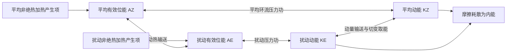

# D17 · 2006_1第2—9条＋2006全9条＋2005_1第1—6条（23条）

日期：2026-11-14｜建议投入：4小时｜动力40% · 天气40% · 物理20%

> 本学习包依据原50日PDF与仓库学习资料整理。参考答案不是官方评分标准；未完成学科审校及缺题标记均保留。公式采用 GitHub 数学 Markdown，请在 GitHub 正文或 Obsidian 阅读视图打开。

## 今日目标与记忆标准

闭卷说清概念、适用条件、符号与单位；推导必须写出起始方程、近似及关键步骤。先答题，再展开核对。

## 四小时执行

1. 20分钟：回忆此前第1、3、7、14天的重点，尚未开始的日期跳过。
2. 80分钟：逐题闭卷提取，核对以下简答与来源。
3. 70分钟：精选5题完整书写。名词解释90秒、简答7分钟、论述12分钟为训练目标。
4. 40分钟：把本日知识按“假设→方程→物理机制→天气表现”串成2—4条知识链。
5. 30分钟：记录遗漏点、用时与次日/3日/7日/14日复习日期。

> 星级口径：按同考点在不同年份的出现次数，1次★、2—3次★★、4—6次★★★、7—10次★★★★、11次及以上★★★★★；多考点题取最高频考点。星级表示复习频次，不是命题概率。

## 逐题回忆与简答

### 2006_1-一-2 · ★★★（同考点6年）

什么是正压大气？什么是斜压大气？

[解析来源（对应题目行）](https://github.com/0183ty2512/lao-san-yang/blob/main/%E5%8A%A8%E5%8A%9B%E6%B0%94%E8%B1%A1%E8%AF%BE%E5%90%8E%E4%B9%A0%E9%A2%98/%E8%AF%95%E9%A2%98%E8%A7%A3%E7%AD%94/%E5%BE%80%E5%B9%B4%E8%AF%95%E9%A2%98%E8%A7%A3%E6%9E%90/2006_1.md#L43) · [原始年度题干](https://github.com/0183ty2512/lao-san-yang/blob/main/%E5%BE%80%E5%B9%B4%E8%AF%95%E9%A2%98%E5%88%86%E6%9E%90/2006_1.md)

**审校状态：尚未逐题学科审校。**

**相关高频考点复习摘要（须按本题设问取舍，不替代完整解答）：**

**正压与斜压大气：** 正压大气满足 $\rho=\rho(p)$，等压面与等密度面重合；斜压时两面相交，$\nabla\rho\times\nabla p\ne0$。在静力、地转条件下，等压面温度梯度对应地转风垂直切变。斜压状态不自动等于斜压不稳定。

> 以上摘要用于回忆答题主线，不是官方评分标准；推导、计算和多小问仍须完成下方步骤。

1. 正压大气满足 $\rho=\rho(p)$，等压面与等密度面重合，故 $\nabla\rho\times\nabla p=0$。对理想气体，在等压面上温度均匀。
2. 斜压大气中等压面与等密度面相交，$\nabla\rho\times\nabla p\ne0$，等压面上有水平温度梯度。
3. 斜压项可生成环流和涡度；在静力、地转条件下，水平温度梯度通过热成风关系对应地转风垂直切变。正压条件下地转风不随高度改变。
4. “正压”不意味着实际风必无任何垂直切变；上述切变结论还用了地转平衡。“斜压”也不等于“斜压不稳定”，后者需要扰动从基本态有效位能获得净能量。

### 2006_1-一-3 · ★★★★（同考点10年）

什么是正压不稳定？什么是斜压不稳定？

[解析来源（对应题目行）](https://github.com/0183ty2512/lao-san-yang/blob/main/%E5%8A%A8%E5%8A%9B%E6%B0%94%E8%B1%A1%E8%AF%BE%E5%90%8E%E4%B9%A0%E9%A2%98/%E8%AF%95%E9%A2%98%E8%A7%A3%E7%AD%94/%E5%BE%80%E5%B9%B4%E8%AF%95%E9%A2%98%E8%A7%A3%E6%9E%90/2006_1.md#L82) · [原始年度题干](https://github.com/0183ty2512/lao-san-yang/blob/main/%E5%BE%80%E5%B9%B4%E8%AF%95%E9%A2%98%E5%88%86%E6%9E%90/2006_1.md)

**审校状态：尚未逐题学科审校。**

**相关高频考点复习摘要（须按本题设问取舍，不替代完整解答）：**

**正压不稳定：** 正压不稳定从基本流的水平切变动能取能。平行流的Rayleigh–Kuo必要条件为 $\beta-U_{yy}$ 在域内变号；它不是充分条件。推导应写模态方程、乘共轭积分并取虚部；求临界风速仍需基本流与边界。

**斜压不稳定：** 斜压不稳定从基本态水平温差的有效位能取能，经扰动向极热输送和暖升冷沉转入扰动动能。成长波常随高度向西倾斜，即使干静力稳定仍可发展；与依赖水平切变动能的正压不稳定区别。

> 以上摘要用于回忆答题主线，不是官方评分标准；推导、计算和多小问仍须完成下方步骤。

1. 正压不稳定是扰动从具有水平切变的基本流动能获得能量而增长。设基本流 $U(y)$，扰动流函数为 $\psi'=\phi(y)e^{ik(x-ct)}$。
2. 线性涡度方程为 $(\frac{\partial}{\partial t}+U\frac{\partial}{\partial x})\nabla^2\psi'+(\beta-U'')\frac{\partial}{\partial x}\psi'=0$。代入模态并除以 $ik$，得 $(U-c)(\phi''-k^2\phi)+(\beta-U'')\phi=0$。
3. 设边界 $\phi=0$，除以 $U-c$，乘 $\phi^*$ 后在通道上积分。对 $\phi^*\phi''$ 分部积分，边界项为零：
$$-\int(|\phi'|^2+k^2|\phi|^2)dy+\int\frac{\beta-U''}{U-c}|\phi|^2dy=0.$$
4. 写 $c=c_r+ic_i$，取虚部：$c_i\int(\beta-U'')|\phi|^2/[(U-c_r)^2+c_i^2]dy=0$。若增长 $kc_i>0$，积分中的权重非负，故 $\boxed{\beta-U''\text{ 必须在域内变号}}$，这只是必要条件。
5. 扰动能量转换率含 $-\overline{u'v'}U_y$；扰动向平均切变反方向输送动量时可取能。若要求具体临界风速，必须给 $U(y)$、边界和波数，不能由必要条件唯一决定。
6. 例：仅在额外假定 $U=U_0\cos(my)$ 且区域含完整正负峰时，变号要求 $|U_0|m^2>\beta$；这个幅度界限仍不是该流动必定不稳定的充分临界值。

1. 斜压不稳定指在旋转、层结的大气中，扰动利用基本态水平温度差所储存的有效位能而增长；静力稳定的大气也可能发生斜压不稳定。
2. 水平温度梯度对应热成风切变。扰动把暖空气送向冷侧、冷空气送向暖侧，减小平均水平温差，使基本态有效位能转入扰动有效位能。
3. 暖空气上升、冷空气下沉时 $\overline{w'T'}>0$，气压坐标等价为 $-\overline{\alpha'\omega'}>0$，扰动有效位能进一步转为扰动动能。
4. 成长中的典型中纬度斜压波高度槽脊轴随高度向西倾斜，温度与高度扰动存在有利相位差，槽前暖平流和上升、槽后冷平流和下沉配合，形成气旋发展。进入成熟阶段倾斜减弱，取能效率下降。
5. 正压不稳定主要抽取基本流动能并与水平风切变有关；斜压不稳定主要抽取基本流有效位能并与垂直风切变有关。两者可同时存在。具体波长范围和增长率依 Eady、Charney 等模型及边界条件而异，不应混用一个固定阈值。

### 2006_1-一-4 · ★★★★（同考点7年）

以涡度方程代替水平运动方程有什么好处？

[解析来源（对应题目行）](https://github.com/0183ty2512/lao-san-yang/blob/main/%E5%8A%A8%E5%8A%9B%E6%B0%94%E8%B1%A1%E8%AF%BE%E5%90%8E%E4%B9%A0%E9%A2%98/%E8%AF%95%E9%A2%98%E8%A7%A3%E7%AD%94/%E5%BE%80%E5%B9%B4%E8%AF%95%E9%A2%98%E8%A7%A3%E6%9E%90/2006_1.md#L133) · [原始年度题干](https://github.com/0183ty2512/lao-san-yang/blob/main/%E5%BE%80%E5%B9%B4%E8%AF%95%E9%A2%98%E5%88%86%E6%9E%90/2006_1.md)

**审校状态：尚未逐题学科审校。**

**相关高频考点复习摘要（须按本题设问取舍，不替代完整解答）：**

**涡度：** 垂直相对涡度 $\zeta=\frac{\partial v}{\partial x}-\frac{\partial u}{\partial y}$，绝对涡度为 $\zeta+f$，单位 $\mathrm{s^{-1}}$。北半球正值通常表示气旋性旋转。取旋度能消去保守压力梯度，但涡度方程单独不能决定完整风场。

> 以上摘要用于回忆答题主线，不是官方评分标准；推导、计算和多小问仍须完成下方步骤。

1. 定义垂直相对涡度 $\zeta=\frac{\partial v}{\partial x}-\frac{\partial u}{\partial y}$，水平散度 $D=\frac{\partial u}{\partial x}+\frac{\partial v}{\partial y}$，单位均为 $\mathrm{s^{-1}}$。绝对涡度的垂直分量为 $\zeta_a=\zeta+f$；三维绝对涡度为 $\nabla\times\mathbf V+2\boldsymbol\Omega$。

**针对“代替水平运动方程的好处”：** 取旋度可消去保守压力梯度，突出旋转、伸缩和位涡演变，并方便在无辐散近似下引入流函数。代价是涡度方程单独不决定散度和质量场，恢复风场需要边界条件及其他方程，不能说完全等价而不丢信息。

### 2006_1-一-5 · ★★（同考点3年）

试述赤道地区大气中开尔文波与罗斯贝 - 重力混合波的主要性质？

[解析来源（对应题目行）](https://github.com/0183ty2512/lao-san-yang/blob/main/%E5%8A%A8%E5%8A%9B%E6%B0%94%E8%B1%A1%E8%AF%BE%E5%90%8E%E4%B9%A0%E9%A2%98/%E8%AF%95%E9%A2%98%E8%A7%A3%E7%AD%94/%E5%BE%80%E5%B9%B4%E8%AF%95%E9%A2%98%E8%A7%A3%E6%9E%90/2006_1.md#L171) · [原始年度题干](https://github.com/0183ty2512/lao-san-yang/blob/main/%E5%BE%80%E5%B9%B4%E8%AF%95%E9%A2%98%E5%88%86%E6%9E%90/2006_1.md)

**审校状态：尚未逐题学科审校。**

**相关高频考点复习摘要（须按本题设问取舍，不替代完整解答）：**

**赤道开尔文波：** 赤道开尔文波在基本浅水模态中 $v=0$，$\omega=ck$，$c=\sqrt{gH}$；纬向重力传播、经向近地转平衡共同使振幅按 $e^{-\beta y^2/(2c)}$ 束缚。满足远离赤道有界的分支向东传播。

> 以上摘要用于回忆答题主线，不是官方评分标准；推导、计算和多小问仍须完成下方步骤。

1. 赤道附近 $f\approx\beta y$，科氏参数变号使若干波动被束缚在赤道附近。主要模态有赤道开尔文波、赤道罗斯贝波、混合罗斯贝—重力波及赤道惯性重力波。线性理论描述它们的动力骨架，实际云雨还受湿对流耦合。
2. **赤道开尔文波。** 取浅水等效波速 $c=\sqrt{gH}$，令 $v=0$。纬向动量与连续方程给 $u_t=-g\eta_x$、$\eta_t=-Hu_x$，组合得 $u_{tt}=c^2u_{xx}$，故 $\omega=\pm ck$。
3. 经向动量给 $\beta yu=-g\eta_y$。东传支有 $u=g\eta/c$，故 $\eta_y=-(\beta y/c)\eta$，积分得 $\eta\propto\exp[-\beta y^2/(2c)]$；西传支随远离赤道增长，不能满足有界条件。因此开尔文波为东传、近非频散，$u,\eta$ 关于赤道对称，$v=0$，束缚尺度 $L_e=\sqrt{c/\beta}$。
4. **混合波。** 兼具涡旋性与重力回复特征，经向风不为零；标准 $n=0$ 物理解可写 $\omega=ck/2+\sqrt{c^2k^2/4+\beta c}$（连同实场的共轭分支）。负波数一侧相速向西，群速可向东，不能把它当成单纯非频散东传波。
5. **赤道罗斯贝波。** 主要受位涡梯度约束，内禀相速向西，常表现为赤道两侧成对的涡旋；重力波分支较快，以辐散、质量场振荡显著。
6. 沿岸开尔文波与赤道开尔文波应区分：前者靠边界无穿透与地转横向平衡束缚，离岸按 $e^{-y/L_D}$ 衰减，$L_D=c/|f|$；北半球沿传播方向海岸在右侧。赤道波无需实体岸界。

### 2006_1-二-1 · ★★（同考点3年）

求出此大气中波动的频率方程。

[解析来源（对应题目行）](https://github.com/0183ty2512/lao-san-yang/blob/main/%E5%8A%A8%E5%8A%9B%E6%B0%94%E8%B1%A1%E8%AF%BE%E5%90%8E%E4%B9%A0%E9%A2%98/%E8%AF%95%E9%A2%98%E8%A7%A3%E7%AD%94/%E5%BE%80%E5%B9%B4%E8%AF%95%E9%A2%98%E8%A7%A3%E6%9E%90/2006_1.md#L223) · [原始年度题干](https://github.com/0183ty2512/lao-san-yang/blob/main/%E5%BE%80%E5%B9%B4%E8%AF%95%E9%A2%98%E5%88%86%E6%9E%90/2006_1.md)

**审校状态：尚未逐题学科审校。**

**相关高频考点复习摘要（须按本题设问取舍，不替代完整解答）：**

**β平面波动方程与频散关系：** 先检查原题动量与涡度方程是否在同一β近似阶次。局地近似下有罗斯贝慢波与惯性重力快波两类，快波有正负频率分支；常数f动量式不能不加说明地与额外βv涡度式同时作为精确方程。

> 以上摘要用于回忆答题主线，不是官方评分标准；推导、计算和多小问仍须完成下方步骤。

**先检查方程是否相容。** 原卷若同时给常数 $f_0$ 的两条精确动量方程及额外 $\beta v$ 的涡度方程，前两式取旋度只会得到 $\zeta_t+f_0D=0$。与原涡度式相减便是 $\beta v=0$。所以这四式不能不加说明地作为一般非零 $v$ 波动的精确方程组。

**以下解答采用通常命题意图：局地β平面快慢波近似。** 保留位涡方程中的β效应，在散度方程忽略相对较小的β修正。设传播沿 $x$，$c^2=gH$，得到
$$\zeta_t+\beta v+f_0D=0,\quad D_t-f_0\zeta=-g h_{xx},\quad h_t+HD=0,\quad \zeta=\frac{\partial v}{\partial x}.$$
1. 取 $e^{i(kx-\omega t)}$，由 $\zeta=ikv$，得 $v=\zeta/(ik)$；涡度式化为 $-i(\omega+\beta/k)\zeta+f_0D=0$。
2. 连续式给 $h=HD/(i\omega)$。散度式代入为 $-i\omega D-f_0\zeta=-ic^2k^2D/\omega$，所以 $\zeta=-i(\omega^2-c^2k^2)D/(f_0\omega)$。
3. 把它代回涡度式，得到 $\boxed{(\omega+\beta/k)(\omega^2-c^2k^2)-f_0^2\omega=0}$，即此套局地近似的一种三次频率方程。
4. 小β的一阶分析中，慢根满足 $|\omega|\ll\sqrt{f_0^2+c^2k^2}$，忽略相应高阶项得到 $\omega_R\approx-\beta c^2k/(f_0^2+c^2k^2)=-\beta k/(k^2+L_D^{-2})$；快根零阶为 $\omega_\pm\approx\pm\sqrt{f_0^2+c^2k^2}$。
5. 常见更简化的频率多项式 $\omega[\omega^2-f_0^2-c^2K^2]-\beta c^2k=0$，还删去了此推导中的高频β修正项；不能把不同截断层级的多项式当作完全相同的精确式。
6. 两类波指慢的罗斯贝波和快的惯性重力波，后者有两个传播分支。前者以行星位涡梯度为恢复机制、偏涡旋性，后者以重力和旋转为回复、辐散与质量振荡明显。严格全球β平面问题须保留 $f(y)$ 并求经向结构，不能假设所有系数全球常数。

### 2006_1-二-2 · ★★（同考点3年）

说明上述两种波动是什么波，并比较其性质差异。

[解析来源（对应题目行）](https://github.com/0183ty2512/lao-san-yang/blob/main/%E5%8A%A8%E5%8A%9B%E6%B0%94%E8%B1%A1%E8%AF%BE%E5%90%8E%E4%B9%A0%E9%A2%98/%E8%AF%95%E9%A2%98%E8%A7%A3%E7%AD%94/%E5%BE%80%E5%B9%B4%E8%AF%95%E9%A2%98%E8%A7%A3%E6%9E%90/2006_1.md#L268) · [原始年度题干](https://github.com/0183ty2512/lao-san-yang/blob/main/%E5%BE%80%E5%B9%B4%E8%AF%95%E9%A2%98%E5%88%86%E6%9E%90/2006_1.md)

**审校状态：尚未逐题学科审校。**

**相关高频考点复习摘要（须按本题设问取舍，不替代完整解答）：**

本段与上文相同，可回看前面的解析，不再重复展开。

> 以上摘要用于回忆答题主线，不是官方评分标准；推导、计算和多小问仍须完成下方步骤。

本段与上文相同，可回看前面的解析，不再重复展开。

本段与上文相同，可回看前面的解析，不再重复展开。

### 2006_1-三-1 · ★★（同考点2年）

什么是梯度风？并写出空气质点所受力的平衡。

[解析来源（对应题目行）](https://github.com/0183ty2512/lao-san-yang/blob/main/%E5%8A%A8%E5%8A%9B%E6%B0%94%E8%B1%A1%E8%AF%BE%E5%90%8E%E4%B9%A0%E9%A2%98/%E8%AF%95%E9%A2%98%E8%A7%A3%E7%AD%94/%E5%BE%80%E5%B9%B4%E8%AF%95%E9%A2%98%E8%A7%A3%E6%9E%90/2006_1.md#L317) · [原始年度题干](https://github.com/0183ty2512/lao-san-yang/blob/main/%E5%BE%80%E5%B9%B4%E8%AF%95%E9%A2%98%E5%88%86%E6%9E%90/2006_1.md)

**审校状态：尚未逐题学科审校。**

> 以上摘要用于回忆答题主线，不是官方评分标准；推导、计算和多小问仍须完成下方步骤。

1. 单位质量压力梯度力为 $-\nabla p/\rho$，从高压指向低压。局地北半球气旋圆流取半径 $r$ 向外、切向速度 $V$ 正值为逆时针，稳态径向平衡为
$$\frac{V^2}{r}+fV=\frac1\rho\frac{\partial p}{\partial r}.$$
这就是梯度风平衡：压力梯度、科氏作用共同提供曲率加速度。

2. 低压中心外侧 $p_r>0$，定义同半径地转风 $V_g=p_r/(\rho f)>0$，上式给 $V_g=V+V^2/(fr)>V$，故正常气旋梯度风次地转。

3. 高压正常反气旋支写 $V=-S$、$S>0$，$S_g=-p_r/(\rho f)$，则 $S_g=S-S^2/(fr)<S$，即超地转。判别式要求 $S_g\le fr/4$，反气旋正常支存在上限，不能把任意根均当作真实大气风。

4. 忽略曲率项即地转平衡；小尺度强涡旋若科氏项远小于曲率项，则 $V^2/r=p_r/\rho$，为旋衡平衡。惯性运动则无压力梯度。三种近似依尺度和受力大小选择。

| 北半球情况 | 指向中心的作用 | 指离中心的作用（旋转随流受力图） | 正常支风速 |
|---|---|---|---|
| 低压气旋 | 压力梯度力 | 科氏力、曲率离心惯性项 | 梯度风小于地转风 |
| 高压反气旋 | 科氏力 | 压力梯度力、曲率离心惯性项 | 梯度风大于地转风 |

曲率离心项是随流受力图中的惯性表示；在地球坐标动量方程中对应向心加速度，不能作为额外真实力重复加入。

### 2006_1-三-2 · ★★★★★（同考点12年）

画图说明在高、低压天气系统中梯度风与地转风的差异。

[解析来源（对应题目行）](https://github.com/0183ty2512/lao-san-yang/blob/main/%E5%8A%A8%E5%8A%9B%E6%B0%94%E8%B1%A1%E8%AF%BE%E5%90%8E%E4%B9%A0%E9%A2%98/%E8%AF%95%E9%A2%98%E8%A7%A3%E7%AD%94/%E5%BE%80%E5%B9%B4%E8%AF%95%E9%A2%98%E8%A7%A3%E6%9E%90/2006_1.md#L364) · [原始年度题干](https://github.com/0183ty2512/lao-san-yang/blob/main/%E5%BE%80%E5%B9%B4%E8%AF%95%E9%A2%98%E5%88%86%E6%9E%90/2006_1.md)

**审校状态：尚未逐题学科审校。**

**相关高频考点复习摘要（须按本题设问取舍，不替代完整解答）：**

**地转风：** 中纬度大尺度缓变、摩擦可忽略时，水平气压梯度力与科氏力近似平衡：$u_g=-\frac{\partial \Phi}{\partial y}/f$、$v_g=\frac{\partial \Phi}{\partial x}/f$。风平行等高线，北半球低值在风向左侧。近赤道、摩擦层和强曲率快速运动中须检验适用性。

> 以上摘要用于回忆答题主线，不是官方评分标准；推导、计算和多小问仍须完成下方步骤。

本段与上文相同，可回看前面的解析，不再重复展开。

2. 低压中心外侧 $p_r>0$，定义同半径地转风 $V_g=p_r/(\rho f)>0$，上式给 $V_g=V+V^2/(fr)>V$，故正常气旋梯度风次地转。

本段与上文相同，可回看前面的解析，不再重复展开。

4. 忽略曲率项即地转平衡；小尺度强涡旋若科氏项远小于曲率项，则 $V^2/r=p_r/\rho$，为旋衡平衡。惯性运动则无压力梯度。三种近似依尺度和受力大小选择。

| 北半球情况 | 指向中心的作用 | 指离中心的作用（旋转随流受力图） | 正常支风速 |
|---|---|---|---|
| 低压气旋 | 压力梯度力 | 科氏力、曲率离心惯性项 | 梯度风小于地转风 |
| 高压反气旋 | 科氏力 | 压力梯度力、曲率离心惯性项 | 梯度风大于地转风 |

曲率离心项是随流受力图中的惯性表示；在地球坐标动量方程中对应向心加速度，不能作为额外真实力重复加入。

1. 在局地直角坐标中，忽略摩擦时水平动量方程为 $Du/Dt-fv=-\frac{\partial \Phi}{\partial x}$、$Dv/Dt+fu=-\frac{\partial \Phi}{\partial y}$，这里的导数取在等压面上。
2. 对中纬度大尺度缓变运动，$Ro=U/(|f|L)\ll1$，惯性项相对较小，得到 $-fv_g=-\frac{\partial \Phi}{\partial x}$、$fu_g=-\frac{\partial \Phi}{\partial y}$。
3. 解得 $\boxed{u_g=-\frac{\partial \Phi}{\partial y}/f,\quad v_g=\frac{\partial \Phi}{\partial x}/f}$，即 $\mathbf V_g=\mathbf k\times\nabla_p\Phi/f$；大小为 $|\nabla_p\Phi|/|f|$。
4. 因叉积垂直于梯度，地转风平行于等高线；北半球背风而立时低值在左、高值在右，南半球相反。等高线越密风越强，但还受纬度 $f$ 影响。
5. 近赤道 $f\to0$、摩擦层、强曲率或快速变化的小尺度系统中不能直接采用地转近似。等高面上应改用 $\nabla_zp/\rho$，不要把两种坐标的梯度混用。

!梯度风受力.png（库内引用未定位）

图示北半球圆形系统东侧的受力。曲率项画在加速度一侧，避免把向心加速度和随流离心惯性项同时计入。由 $V_g=V+V^2/(fr)$ 判断低压正常支次地转；高压正常支以风速大小写成 $S_g=S-S^2/(fr)$，所以超地转。

### 2006-一-1 · ★★（同考点3年）

大气低频振荡

[解析来源（对应题目行）](https://github.com/0183ty2512/lao-san-yang/blob/main/%E5%8A%A8%E5%8A%9B%E6%B0%94%E8%B1%A1%E8%AF%BE%E5%90%8E%E4%B9%A0%E9%A2%98/%E8%AF%95%E9%A2%98%E8%A7%A3%E7%AD%94/%E5%BE%80%E5%B9%B4%E8%AF%95%E9%A2%98%E8%A7%A3%E6%9E%90/2006.md#L11) · [原始年度题干](https://github.com/0183ty2512/lao-san-yang/blob/main/%E5%BE%80%E5%B9%B4%E8%AF%95%E9%A2%98%E5%88%86%E6%9E%90/2006.md)

**审校状态：尚未逐题学科审校。**

**相关高频考点复习摘要（须按本题设问取舍，不替代完整解答）：**

**大气低频振荡：** 大气低频振荡是比天气尺度更慢的周至季节内变化，热带常讨论10—20天和30—60天时间带。MJO是对流—环流耦合的典型季节内振荡，常见东移活跃包络，调制季风及热带扰动；不能与平流层QBO混同。

> 以上摘要用于回忆答题主线，不是官方评分标准；推导、计算和多小问仍须完成下方步骤。

1. 大气低频振荡指比天气尺度变化更慢的周至季节内变化，热带常讨论 10—20 天、30—60 天等时间带；MJO 是典型季节内对流—环流耦合现象，活跃包络常东移，调制季风降水和热带扰动。准两年振荡属于另一个更长的时间尺度。

### 2006-一-2 · ★★（同考点3年）

东风波

[解析来源（对应题目行）](https://github.com/0183ty2512/lao-san-yang/blob/main/%E5%8A%A8%E5%8A%9B%E6%B0%94%E8%B1%A1%E8%AF%BE%E5%90%8E%E4%B9%A0%E9%A2%98/%E8%AF%95%E9%A2%98%E8%A7%A3%E7%AD%94/%E5%BE%80%E5%B9%B4%E8%AF%95%E9%A2%98%E8%A7%A3%E6%9E%90/2006.md#L47) · [原始年度题干](https://github.com/0183ty2512/lao-san-yang/blob/main/%E5%BE%80%E5%B9%B4%E8%AF%95%E9%A2%98%E5%88%86%E6%9E%90/2006.md)

**审校状态：尚未逐题学科审校。**

**相关高频考点复习摘要（须按本题设问取舍，不替代完整解答）：**

**东风波：** 东风波是热带东风气流中的槽脊波动，通常随背景东风向西传播，伴涡度、辐合和对流信号；部分可提供热带气旋初始扰动，但不是每个东风波都发展成台风。

> 以上摘要用于回忆答题主线，不是官方评分标准；推导、计算和多小问仍须完成下方步骤。

1. 东风波是热带东风气流中的波状槽脊扰动，通常向西移动，具有风场、涡度和对流信号；其某些阶段可提供热带气旋初始扰动，但并非每个东风波都会发展成台风。

### 2006-一-3 · ★★★★（同考点8年）

高空急流

[解析来源（对应题目行）](https://github.com/0183ty2512/lao-san-yang/blob/main/%E5%8A%A8%E5%8A%9B%E6%B0%94%E8%B1%A1%E8%AF%BE%E5%90%8E%E4%B9%A0%E9%A2%98/%E8%AF%95%E9%A2%98%E8%A7%A3%E7%AD%94/%E5%BE%80%E5%B9%B4%E8%AF%95%E9%A2%98%E8%A7%A3%E6%9E%90/2006.md#L83) · [原始年度题干](https://github.com/0183ty2512/lao-san-yang/blob/main/%E5%BE%80%E5%B9%B4%E8%AF%95%E9%A2%98%E5%88%86%E6%9E%90/2006.md)

**审校状态：尚未逐题学科审校。**

**相关高频考点复习摘要（须按本题设问取舍，不替代完整解答）：**

**高空急流：** 高空急流是对流层上部狭长强风带，横向和垂直切变强。极锋急流与斜压锋区相关，副热带急流还受低纬角动量输送影响；冬强偏南、夏弱偏北。急流加减速与曲率引起非地转次级环流，可影响下方上升和气旋发展。

> 以上摘要用于回忆答题主线，不是官方评分标准；推导、计算和多小问仍须完成下方步骤。

1. 急流是狭长的强风带，横向和竖直风切变显著，急流轴是局地最大风速的位置。高空西风急流位于对流层上部，冬季更强、更偏南；夏季整体偏北、减弱。东亚日本附近冬季急流可很强，题中 70—80 m/s 是典型量级而非上限。

2. 极锋急流与中纬度锋区斜压性相联系；副热带急流还与低纬向极运动的角动量输送和热成风共同有关。强南北温度梯度通过热成风使西风随高度增强；不能只归因于地面风向上复制。

3. 急流入口、出口的加减速和曲率导致非地转次级环流，局部辐散有利于下方上升和气旋发展；简单直急流象限规则只在相应理想条件下适用。

### 2006-一-4 · ★★★★★（同考点17年）

寒潮天气过程

[解析来源（对应题目行）](https://github.com/0183ty2512/lao-san-yang/blob/main/%E5%8A%A8%E5%8A%9B%E6%B0%94%E8%B1%A1%E8%AF%BE%E5%90%8E%E4%B9%A0%E9%A2%98/%E8%AF%95%E9%A2%98%E8%A7%A3%E7%AD%94/%E5%BE%80%E5%B9%B4%E8%AF%95%E9%A2%98%E8%A7%A3%E6%9E%90/2006.md#L123) · [原始年度题干](https://github.com/0183ty2512/lao-san-yang/blob/main/%E5%BE%80%E5%B9%B4%E8%AF%95%E9%A2%98%E5%88%86%E6%9E%90/2006.md)

**审校状态：尚未逐题学科审校。**

**相关高频考点复习摘要（须按本题设问取舍，不替代完整解答）：**

**寒潮及其天气过程：** 寒潮是强冷空气大范围南下造成显著降温、大风及可能雨雪冻害的过程。答路径时分西路、西北路、东路；答发展时写冷空气蓄积→高空槽脊调整→地面冷高压和冷锋南下；是否达到业务等级须核对相应标准。

> 以上摘要用于回忆答题主线，不是官方评分标准；推导、计算和多小问仍须完成下方步骤。

1. 寒潮是强冷空气大范围侵入中低纬，造成剧烈降温、大风，常伴雨雪或冻害的天气过程；达到业务寒潮等级还要按适用标准核对降温幅度和最低温度，不能把所有冷空气过程称为寒潮。
2. **源地和蓄积区。** 传统天气学源地归纳包括新地岛以西、新地岛以东和冰岛以南洋面；冷空气可在西伯利亚—蒙古一带进一步辐射冷却、蓄积。源地不同于进入我国的路径，不能混为一项。
3. **路径。** 西路经新疆及高原北侧影响西北、西南；西北路经蒙古、河套南下，常影响我国中东部大部；东路偏经东北、华北和东部沿海。多路冷空气汇合时范围和强度可增大，但不存在不问强度、地形、水汽就永远“最严重”的一路。
4. **环流演变。** 阻塞高压或暖脊建立，东侧冷空气积聚；亚洲极涡或横槽南压；短波发展、横槽转竖或大槽东移使槽后偏北气流加强，地面冷高压增强南下，冷锋迅速推进，随后东亚大槽重建。
5. **天气。** 锋前可回暖和增湿，锋过时风向突变、大风降温，水汽足时出现雨雪；锋后气压升高、天气转晴，夜间辐射降温及霜冻可加剧。干冷型雨雪少，湿冷型雨雪多，不能要求每次寒潮都具同样降水。
6. **倒Ω中期演变。** 两大洋北部脊向高纬发展，极涡分裂或偏心；乌拉尔与东亚东北侧脊发展，亚洲冷涡被夹持并南压，形成类似倒Ω的槽脊配置；随后横槽转竖或长波槽快速发展，槽后冷空气爆发南下。画图时应画“两侧高脊、中间冷槽/涡”，并用槽后偏北箭头表示冷空气路径。
7. **预报关键。** 同时监视阻高和脊、极涡/横槽、地面冷高压与冷锋。常见短中期型包括小槽发展、横槽转竖和低槽东移；不同教材的“第几类”编号不统一，未给分类表时不能凭编号唯一指定。

### 2006-二-整题 · ★★★★（同考点7年）

叙述冬、夏 500 百帕上北半球大气环流的基本特征。

[解析来源（对应题目行）](https://github.com/0183ty2512/lao-san-yang/blob/main/%E5%8A%A8%E5%8A%9B%E6%B0%94%E8%B1%A1%E8%AF%BE%E5%90%8E%E4%B9%A0%E9%A2%98/%E8%AF%95%E9%A2%98%E8%A7%A3%E7%AD%94/%E5%BE%80%E5%B9%B4%E8%AF%95%E9%A2%98%E8%A7%A3%E6%9E%90/2006.md#L169) · [原始年度题干](https://github.com/0183ty2512/lao-san-yang/blob/main/%E5%BE%80%E5%B9%B4%E8%AF%95%E9%A2%98%E5%88%86%E6%9E%90/2006.md)

**审校状态：尚未逐题学科审校。**

**相关高频考点复习摘要（须按本题设问取舍，不替代完整解答）：**

**东亚大气环流：** 冬季北半球中高纬温度梯度和西风较强，槽脊较显著，东亚大槽突出；夏季西风减弱北移，副高北抬。回答500 hPa题应围绕中层高度场、风场、槽脊位置和季节温差展开，地面系统只作解释背景。

> 以上摘要用于回忆答题主线，不是官方评分标准；推导、计算和多小问仍须完成下方步骤。

1. 冬季北半球 500 hPa 等高线较密、西风强、长波振幅较大，东亚和北美东岸常有大槽，大陆冷、海洋相对暖；夏季中高纬梯度减小、西风带北移，副高北抬，大陆暖低压发展。冬季海平面亚洲冷高压、阿留申低压突出，夏季大陆热低压与海洋副高突出。

2. 东亚冬季受西伯利亚高压—阿留申低压、东亚大槽和强西风急流控制，偏北风冷干；夏季副高、季风低压、低空水汽输送和南亚高压配合，偏南风暖湿。春夏转换可发生分阶段突变，因海陆/高原加热、季风爆发和急流、副高位置跃变，而不只是平滑逐日北移。

### 2006-三-整题 · ★★★★（同考点9年）

叙述东亚环流的季节变化与雨带活动的关系。

[解析来源（对应题目行）](https://github.com/0183ty2512/lao-san-yang/blob/main/%E5%8A%A8%E5%8A%9B%E6%B0%94%E8%B1%A1%E8%AF%BE%E5%90%8E%E4%B9%A0%E9%A2%98/%E8%AF%95%E9%A2%98%E8%A7%A3%E7%AD%94/%E5%BE%80%E5%B9%B4%E8%AF%95%E9%A2%98%E8%A7%A3%E6%9E%90/2006.md#L211) · [原始年度题干](https://github.com/0183ty2512/lao-san-yang/blob/main/%E5%BE%80%E5%B9%B4%E8%AF%95%E9%A2%98%E5%88%86%E6%9E%90/2006.md)

**审校状态：尚未逐题学科审校。**

**相关高频考点复习摘要（须按本题设问取舍，不替代完整解答）：**

**我国雨带季节活动：** 我国雨带一般由华南前汛期，推进到江淮梅雨，再到华北、东北盛夏雨季，秋季南撤。副高脊线20—25°N、25—30°N、30—35°N是常用阶段性经验范围，应结合西伸东退、冷空气和年份差异，不能当作硬界线。

> 以上摘要用于回忆答题主线，不是官方评分标准；推导、计算和多小问仍须完成下方步骤。

1. 西太平洋副热带高压是副热带地区深厚、暖性的反气旋系统。中层常用 500 hPa 高度场描述，其内部下沉、对流受抑制，西北侧及北侧暖湿气流与中纬度系统相遇，是重要雨带区。
2. 形成与副热带下沉、行星波、海陆热力差异及热带加热有关，不能单说成“海面冷所以形成冷高压”。暖性结构使高压在较高层更明显，但不同层中心、脊线并不完全重合。
3. 春季至初夏副高偏南，华南锋面和季风雨活跃；6 月前后第一次北跳后，长江中下游进入梅雨，传统脊线经验约为 20°—25°N。
4. 进一步北抬至约 25°—30°N，雨带向江淮、淮河流域推进；7 月下旬至 8 月上旬前后脊线可在 30°—35°N，雨带到华北、东北，长江中下游较易受高压控制出现伏旱。秋季副高南撤，雨带随之南退。
5. 除南北移动，还要考虑西伸东退、强度和滞留时间。副高西伸使水汽输送路径和落区改变，长期稳定可造成一侧持续暴雨、另一侧持续高温。上述纬度和日期是复习用经验，不是每年的硬界线。
6. 原题若把 25°—30°N 直接与华北盛夏雨季对应，应另起行纠正：通常华北盛夏雨季对应更北的 30°—35°N 阶段。

### 2006-四-整题 · ★★★（同考点5年）

叙述低纬度大气运动的基本特征。

[解析来源（对应题目行）](https://github.com/0183ty2512/lao-san-yang/blob/main/%E5%8A%A8%E5%8A%9B%E6%B0%94%E8%B1%A1%E8%AF%BE%E5%90%8E%E4%B9%A0%E9%A2%98/%E8%AF%95%E9%A2%98%E8%A7%A3%E7%AD%94/%E5%BE%80%E5%B9%B4%E8%AF%95%E9%A2%98%E8%A7%A3%E6%9E%90/2006.md#L256) · [原始年度题干](https://github.com/0183ty2512/lao-san-yang/blob/main/%E5%BE%80%E5%B9%B4%E8%AF%95%E9%A2%98%E5%88%86%E6%9E%90/2006.md)

**审校状态：尚未逐题学科审校。**

**相关高频考点复习摘要（须按本题设问取舍，不替代完整解答）：**

**热带大气与天气系统：** 低纬科氏参数小且跨赤道变号，不能直接套用中纬地转近似；大尺度水平温差常小，湿对流加热、辐合辐散与海气相互作用重要。主要有哈得莱、沃克环流及热带波动和涡旋，局部强涡旋仍可近梯度平衡。

> 以上摘要用于回忆答题主线，不是官方评分标准；推导、计算和多小问仍须完成下方步骤。

1. 低纬度 $f$ 小且跨赤道变号，不能普遍使用中纬度地转和准地转近似。大尺度气压、温度水平差异常较小，但水汽与对流差异很大；垂直运动、辐合辐散和潜热加热在环流维持中更突出。

2. 中纬度系统常依赖强水平温度梯度、地转风和斜压能量转换；热带大尺度运动常以对流加热与辐散环流、波动和涡旋相互作用组织，热带气旋内又可有强旋转和梯度风平衡。

3. 低纬垂直环流包括经向哈得莱环流和纬向沃克环流。暖湿上升区常对应深对流，补偿下沉区较干，不能把热带描写成处处同样上升。

### 2006-五-整题 · ★★（同考点2年）

叙述强雷暴发生、发展的有利条件。

[解析来源（对应题目行）](https://github.com/0183ty2512/lao-san-yang/blob/main/%E5%8A%A8%E5%8A%9B%E6%B0%94%E8%B1%A1%E8%AF%BE%E5%90%8E%E4%B9%A0%E9%A2%98/%E8%AF%95%E9%A2%98%E8%A7%A3%E7%AD%94/%E5%BE%80%E5%B9%B4%E8%AF%95%E9%A2%98%E8%A7%A3%E6%9E%90/2006.md#L300) · [原始年度题干](https://github.com/0183ty2512/lao-san-yang/blob/main/%E5%BE%80%E5%B9%B4%E8%AF%95%E9%A2%98%E5%88%86%E6%9E%90/2006.md)

**审校状态：尚未逐题学科审校。**

> 以上摘要用于回忆答题主线，不是官方评分标准；推导、计算和多小问仍须完成下方步骤。

1. **环境条件。** 低层暖湿、具有可释放的不稳定能量，锋面/辐合线/地形等提供抬升；适宜的垂直风切变使上升和下沉气流分离，支持较长寿命。强切变有助组织化，但不能取代水汽和浮力。

2. **普通雷暴三阶段。** 积云阶段以上升为主、云滴增长；成熟阶段上升和降水拖曳/蒸发冷却产生的下沉共存，雷电、阵雨和阵风最活跃；消散阶段下沉与冷出流占据，切断暖湿入流，云体和降水逐渐减弱。

### 2006-六-整题 · ★★★★★（同考点16年）

叙述欧亚地区阻高的建立与崩溃对我国天气的影响。

[解析来源（对应题目行）](https://github.com/0183ty2512/lao-san-yang/blob/main/%E5%8A%A8%E5%8A%9B%E6%B0%94%E8%B1%A1%E8%AF%BE%E5%90%8E%E4%B9%A0%E9%A2%98/%E8%AF%95%E9%A2%98%E8%A7%A3%E7%AD%94/%E5%BE%80%E5%B9%B4%E8%AF%95%E9%A2%98%E8%A7%A3%E6%9E%90/2006.md#L338) · [原始年度题干](https://github.com/0183ty2512/lao-san-yang/blob/main/%E5%BE%80%E5%B9%B4%E8%AF%95%E9%A2%98%E5%88%86%E6%9E%90/2006.md)

**审校状态：尚未逐题学科审校。**

**相关高频考点复习摘要（须按本题设问取舍，不替代完整解答）：**

**阻塞高压：** 阻塞高压是中高纬持续、少动并使西风绕行的强脊或闭合高压。建立与暖输送、波破碎及涡旋反馈有关；其东侧偏北气流可蓄积和引导冷空气。衰退配合横槽转竖时可触发寒潮，但并非每次崩溃都必然造成寒潮。

> 以上摘要用于回忆答题主线，不是官方评分标准；推导、计算和多小问仍须完成下方步骤。

1. 阻塞高压是中高纬持续、移动缓慢的强高压脊或闭合高压，使西风气流绕行、分支，阻碍天气系统正常东移。关键是持续性和对西风带的阻挡，并非所有高压都叫阻塞。
2. 建立时，暖空气向极地输送使脊增强，经向振幅增大，波破碎、涡旋反馈可帮助维持。高压脊发展或与高纬高压合并，南侧可切出冷低压，形成偶极或Ω型等配置。
3. 维持时，阻高东侧偏北气流引导冷空气南下，西侧偏南气流输送暖空气。下游槽及冷暖空气交汇区可长期停留，造成持久冷凉、降雨；高压控制区下沉、少云，可造成干旱和高温，具体依季节和位置。
4. 衰退或崩溃时，维持高压的暖输送与涡旋反馈减弱，西风恢复，槽脊重新东移；其东侧积聚的冷空气可配合横槽转竖大举南下，触发我国寒潮。不能把每一次阻高衰退都等同于寒潮，仍需冷空气强度和路径配合。
5. 亚洲常关注乌拉尔山及鄂霍次克海等阻塞区，北大西洋—欧洲也是重要活动区；不同季节的优势位置不同，不应把某一季节经验说成全年固定不变。
6. 切断低压是从西风主槽分离出的闭合冷性低压，移动缓慢，可与北侧阻高配合。其冷空气及正涡度有利于下游不稳定和上升，但天气还依水汽供应。

### 2005_1-一-1 · ★★★（同考点6年）

正压大气和斜压大气

[解析来源（对应题目行）](https://github.com/0183ty2512/lao-san-yang/blob/main/%E5%8A%A8%E5%8A%9B%E6%B0%94%E8%B1%A1%E8%AF%BE%E5%90%8E%E4%B9%A0%E9%A2%98/%E8%AF%95%E9%A2%98%E8%A7%A3%E7%AD%94/%E5%BE%80%E5%B9%B4%E8%AF%95%E9%A2%98%E8%A7%A3%E6%9E%90/2005_1.md#L11) · [原始年度题干](https://github.com/0183ty2512/lao-san-yang/blob/main/%E5%BE%80%E5%B9%B4%E8%AF%95%E9%A2%98%E5%88%86%E6%9E%90/2005_1.md)

**审校状态：尚未逐题学科审校。**

**相关高频考点复习摘要（须按本题设问取舍，不替代完整解答）：**

本段与上文相同，可回看前面的解析，不再重复展开。

> 以上摘要用于回忆答题主线，不是官方评分标准；推导、计算和多小问仍须完成下方步骤。

本段与上文相同，可回看前面的解析，不再重复展开。

### 2005_1-一-2 · ★★★★（同考点7年）

涡度和散度，并写出其表达式

[解析来源（对应题目行）](https://github.com/0183ty2512/lao-san-yang/blob/main/%E5%8A%A8%E5%8A%9B%E6%B0%94%E8%B1%A1%E8%AF%BE%E5%90%8E%E4%B9%A0%E9%A2%98/%E8%AF%95%E9%A2%98%E8%A7%A3%E7%AD%94/%E5%BE%80%E5%B9%B4%E8%AF%95%E9%A2%98%E8%A7%A3%E6%9E%90/2005_1.md#L50) · [原始年度题干](https://github.com/0183ty2512/lao-san-yang/blob/main/%E5%BE%80%E5%B9%B4%E8%AF%95%E9%A2%98%E5%88%86%E6%9E%90/2005_1.md)

**审校状态：尚未逐题学科审校。**

**相关高频考点复习摘要（须按本题设问取舍，不替代完整解答）：**

本段与上文相同，可回看前面的解析，不再重复展开。

**散度：** 水平散度 $D=\frac{\partial u}{\partial x}+\frac{\partial v}{\partial y}$，正为辐散、负为辐合，单位 $\mathrm{s^{-1}}$。静力气压坐标连续式 $D+\omega_p=0$，求垂直速度须沿气压积分并给边界条件，不能由单层辐合唯一确定整柱运动。

> 以上摘要用于回忆答题主线，不是官方评分标准；推导、计算和多小问仍须完成下方步骤。

本段与上文相同，可回看前面的解析，不再重复展开。

### 2005_1-一-3 · ★★★★（同考点8年）

大气长波的频散

[解析来源（对应题目行）](https://github.com/0183ty2512/lao-san-yang/blob/main/%E5%8A%A8%E5%8A%9B%E6%B0%94%E8%B1%A1%E8%AF%BE%E5%90%8E%E4%B9%A0%E9%A2%98/%E8%AF%95%E9%A2%98%E8%A7%A3%E7%AD%94/%E5%BE%80%E5%B9%B4%E8%AF%95%E9%A2%98%E8%A7%A3%E6%9E%90/2005_1.md#L89) · [原始年度题干](https://github.com/0183ty2512/lao-san-yang/blob/main/%E5%BE%80%E5%B9%B4%E8%AF%95%E9%A2%98%E5%88%86%E6%9E%90/2005_1.md)

**审校状态：尚未逐题学科审校。**

**相关高频考点复习摘要（须按本题设问取舍，不替代完整解答）：**

**罗斯贝波基本性质：** 罗斯贝波以位涡梯度为回复机制。均匀基本流正压β平面上 $\omega=kU-\beta k/(k^2+l^2)$，内禀纬向相速向西；地面参考系方向还依 $U$。频率对波数非线性，相速与群速一般不同。

**频散与非频散波：** 相速 $c_p=\omega/k$ 是等位相移动速度；群速 $c_g=d\omega/dk$ 是窄波包速度。不同波数的相速不同则有频散。由 $\omega=kc_p$ 得 $c_g=c_p+kdc_p/dk$，频散不等于能量耗散。

> 以上摘要用于回忆答题主线，不是官方评分标准；推导、计算和多小问仍须完成下方步骤。

1. 正压无辐散β平面涡度方程为 $(\frac{\partial}{\partial t}+u\frac{\partial}{\partial x}+v\frac{\partial}{\partial y})(\zeta+f)=0$，$f=f_0+\beta y$。
2. 令 $u=U+u'$、$v=v'$，$U$ 为常数。减去基本态并舍弃 $u'\frac{\partial \zeta'}{\partial x}+v'\frac{\partial \zeta'}{\partial y}$ 等二阶项，得 $(\frac{\partial}{\partial t}+U\frac{\partial}{\partial x})\zeta'+\beta v'=0$。
3. 引入 $u'=-\frac{\partial \psi'}{\partial y}$、$v'=\frac{\partial \psi'}{\partial x}$，所以 $\zeta'=\nabla_h^2\psi'$。代回得 $(\frac{\partial}{\partial t}+U\frac{\partial}{\partial x})\nabla_h^2\psi'+\beta\psi'_x=0$。
4. 设 $\psi'=\hat\psi e^{i(kx+ly-\omega t)}$，有 $\nabla_h^2\psi'=-(k^2+l^2)\psi'$，故 $i(\omega-kU)(k^2+l^2)\psi'+i\beta k\psi'=0$。
5. 非零振幅给出 $\boxed{\omega=kU-\beta k/(k^2+l^2)}$；纬向相速 $c_x=\omega/k=U-\beta/(k^2+l^2)$。一维 $l=0$ 时 $c_x=U-\beta/k^2=U-\beta L^2/(4\pi^2)$。
6. 相对基本气流向西传播；短波西退修正小，常随西风向东，足够长的波可静止或向西。群速为 $c_{gx}=U+\beta(k^2-l^2)/(k^2+l^2)^2$、$c_{gy}=2\beta kl/(k^2+l^2)^2$。群速和相速不同，能量可向下游传播而单个槽脊较慢。

1. 简谐波写为 $A\cos(kx-\omega t)$。对等位相 $kx-\omega t=C$ 求导，得 $c_p=dx/dt=\omega/k$，它是波峰等位相点的速度。
2. 两列相近波叠加，利用和差化积得到 $2A\cos[(\Delta kx-\Delta\omega t)/2]\cos[(\bar kx-\bar\omega t)]$。第一项是缓变包络，故包络速度为 $\Delta\omega/\Delta k$。
3. 极限 $\Delta k\to0$ 时，群速度 $c_g=d\omega/dk$。多维形式为 $\mathbf c_g=\nabla_{\mathbf k}\omega$；在无耗散、缓变介质的线性波理论中，波包及波能量通常以群速度传播。
4. 若 $\omega=ck$ 且 $c$ 与 $k$ 无关，所有波数的相速相同，为非频散波；否则不同波数组分分离，波形和包络演变，称频散。因为 $\omega=kc_p(k)$，有 $c_g=c_p+k\,dc_p/dk$。
5. 频散的根本原因是恢复机制与惯性响应具有尺度依赖性，使频率对波数不呈简单线性关系；它不等于摩擦耗散。旋转浅水波和罗斯贝波有频散，无旋转均匀浅水长波近似非频散。

### 2005_1-一-4 · ★★★（同考点6年）

有效位能

[解析来源（对应题目行）](https://github.com/0183ty2512/lao-san-yang/blob/main/%E5%8A%A8%E5%8A%9B%E6%B0%94%E8%B1%A1%E8%AF%BE%E5%90%8E%E4%B9%A0%E9%A2%98/%E8%AF%95%E9%A2%98%E8%A7%A3%E7%AD%94/%E5%BE%80%E5%B9%B4%E8%AF%95%E9%A2%98%E8%A7%A3%E6%9E%90/2005_1.md#L139) · [原始年度题干](https://github.com/0183ty2512/lao-san-yang/blob/main/%E5%BE%80%E5%B9%B4%E8%AF%95%E9%A2%98%E5%88%86%E6%9E%90/2005_1.md)

**审校状态：尚未逐题学科审校。**

**相关高频考点复习摘要（须按本题设问取舍，不替代完整解答）：**

**有效位能：** 有效位能是实际全位能相对绝热重排后的最低参考态中可供转换的部分。差异加热维持温差，暖升冷沉可将其转为动能。全位能通常指内能与重力位能之和，不是全部都能被利用。

> 以上摘要用于回忆答题主线，不是官方评分标准；推导、计算和多小问仍须完成下方步骤。

1. 单位质量内能 $e=c_vT$，重力位能 $\Phi=gz$（常重力），动能 $K=|\mathbf V|^2/2$，水汽潜热能近似 $L_vq_v$。总量需对气团质量积分；动能不能漏掉 $1/2$。
2. “全位能”在大气能量学中通常指内能与重力位能之和，而非含动能的总能量。静力、平坦底面且顶边界压力趋零时，$\int\rho gz\,dz=-\int z\,dp=\int p\,dz=\int\rho RT\,dz$；加上内能得到 $\int c_pT\,dm$。
3. 有效位能是实际全位能相对绝热重排到参考最低能态后的可用部分。不是全部内能或重力位能都能转换为动能。差异加热维持水平温差，建立有效位能。
4. 暖上升冷下沉时，$C=-\int\alpha'\omega'\,dm>0$，有效位能转为扰动动能；摩擦最终把动能耗散成内能。凝结使潜热转入热力能库，但水汽能量本来主要来自地表蒸发和辐射收支。
5. 对流层常用 Lorenz 四能量库循环如下。双向箭头表示转换可正可负，方向由收支项决定；中纬度斜压波常沿 $A_Z\to A_E\to K_E$ 取能。$A_Z$ 与 $K_Z$ 的直接转换不能漏掉：平均经圈环流同样可通过压力功在平均有效位能和平均动能之间转换。

产生项也可能为负，图中不是所有加热都增加有效位能。若问完整收支，应分别写 $\dot A_Z=G_Z-C_A-C_Z$、$\dot A_E=G_E+C_A-C_E$、$\dot K_Z=C_Z+C_K-D_Z$、$\dot K_E=C_E-C_K-D_E$，这里 $C_K>0$ 约定为扰动动能转入平均动能。四式相加，内部转换项逐项抵消，只剩外部产生与耗散，可用作检查。

### 2005_1-一-5 · ★★★（同考点5年）

赤道波动

[解析来源（对应题目行）](https://github.com/0183ty2512/lao-san-yang/blob/main/%E5%8A%A8%E5%8A%9B%E6%B0%94%E8%B1%A1%E8%AF%BE%E5%90%8E%E4%B9%A0%E9%A2%98/%E8%AF%95%E9%A2%98%E8%A7%A3%E7%AD%94/%E5%BE%80%E5%B9%B4%E8%AF%95%E9%A2%98%E8%A7%A3%E6%9E%90/2005_1.md#L191) · [原始年度题干](https://github.com/0183ty2512/lao-san-yang/blob/main/%E5%BE%80%E5%B9%B4%E8%AF%95%E9%A2%98%E5%88%86%E6%9E%90/2005_1.md)

**审校状态：尚未逐题学科审校。**

**相关高频考点复习摘要（须按本题设问取舍，不替代完整解答）：**

**赤道波动：** 赤道β平面存在开尔文波、赤道罗斯贝波、混合罗斯贝—重力波和惯性重力波。开尔文波东传、经向风为零且赤道束缚；罗斯贝模态内禀相速向西；混合波兼有涡旋与重力特征。实际云雨还依赖湿对流耦合。

> 以上摘要用于回忆答题主线，不是官方评分标准；推导、计算和多小问仍须完成下方步骤。

本段与上文相同，可回看前面的解析，不再重复展开。

### 2005_1-一-6 · ★★★★★（同考点12年）

地转风和热成风，并写出其表达式

[解析来源（对应题目行）](https://github.com/0183ty2512/lao-san-yang/blob/main/%E5%8A%A8%E5%8A%9B%E6%B0%94%E8%B1%A1%E8%AF%BE%E5%90%8E%E4%B9%A0%E9%A2%98/%E8%AF%95%E9%A2%98%E8%A7%A3%E7%AD%94/%E5%BE%80%E5%B9%B4%E8%AF%95%E9%A2%98%E8%A7%A3%E6%9E%90/2005_1.md#L232) · [原始年度题干](https://github.com/0183ty2512/lao-san-yang/blob/main/%E5%BE%80%E5%B9%B4%E8%AF%95%E9%A2%98%E5%88%86%E6%9E%90/2005_1.md)

**审校状态：尚未逐题学科审校。**

**相关高频考点复习摘要（须按本题设问取舍，不替代完整解答）：**

本段与上文相同，可回看前面的解析，不再重复展开。

**热成风：** 热成风是上下两层地转风之差。由静力关系 $\Phi_{\ln p}=-RT$ 与地转关系得 $\partial u_g/\partial\ln p=(R/f)\frac{\partial T}{\partial y}$、$\partial v_g/\partial\ln p=-(R/f)\frac{\partial T}{\partial x}$。北半球向上的热成风冷侧在左，表示温度梯度对应垂直风切变。

> 以上摘要用于回忆答题主线，不是官方评分标准；推导、计算和多小问仍须完成下方步骤。

本段与上文相同，可回看前面的解析，不再重复展开。

1. 热成风是两个高度或等压面之间的**地转风差**，不是独立的一股实际风。
2. 静力关系给出 $\Phi_{\ln p}=-RT$。对 $u_g=-\frac{\partial \Phi}{\partial y}/f$、$v_g=\frac{\partial \Phi}{\partial x}/f$ 分别作 $\ln p$ 导数（局地取 $f$ 固定），得
$$\frac{\partial u_g}{\partial\ln p}=\frac RfT_y,\qquad \frac{\partial v_g}{\partial\ln p}=-\frac RfT_x.$$
3. 从下层 $p_b$ 积到上层 $p_t<p_b$，若用对数气压平均温度 $\bar T$，则 $u_t-u_b=-(R/f)\ln(p_b/p_t)\bar T_y$、$v_t-v_b=(R/f)\ln(p_b/p_t)\bar T_x$。
4. 北半球向上的热成风沿平均等温线，冷空气在其左侧。温度向北降低时，西风一般随高度增强。该关系把水平温度梯度和垂直风切变连接起来。

## 精选完整解析与公式推导

以下保留资料中的条件、步骤和审校信息。先完成手写，再核对。

### 2005_1-一-3 · 完整解答

大气长波的频散

本段与上文相同，可回看前面的解析，不再重复展开。

本段与上文相同，可回看前面的解析，不再重复展开。

[核对原文](https://github.com/0183ty2512/lao-san-yang/blob/main/%E5%8A%A8%E5%8A%9B%E6%B0%94%E8%B1%A1%E8%AF%BE%E5%90%8E%E4%B9%A0%E9%A2%98/%E8%AF%95%E9%A2%98%E8%A7%A3%E7%AD%94/%E5%BE%80%E5%B9%B4%E8%AF%95%E9%A2%98%E8%A7%A3%E6%9E%90/2005_1.md#L89)

### 2006_1-三-2 · 完整解答

画图说明在高、低压天气系统中梯度风与地转风的差异。

本段与上文相同，可回看前面的解析，不再重复展开。

2. 低压中心外侧 $p_r>0$，定义同半径地转风 $V_g=p_r/(\rho f)>0$，上式给 $V_g=V+V^2/(fr)>V$，故正常气旋梯度风次地转。

本段与上文相同，可回看前面的解析，不再重复展开。

4. 忽略曲率项即地转平衡；小尺度强涡旋若科氏项远小于曲率项，则 $V^2/r=p_r/\rho$，为旋衡平衡。惯性运动则无压力梯度。三种近似依尺度和受力大小选择。

| 北半球情况 | 指向中心的作用 | 指离中心的作用（旋转随流受力图） | 正常支风速 |
|---|---|---|---|
| 低压气旋 | 压力梯度力 | 科氏力、曲率离心惯性项 | 梯度风小于地转风 |
| 高压反气旋 | 科氏力 | 压力梯度力、曲率离心惯性项 | 梯度风大于地转风 |

曲率离心项是随流受力图中的惯性表示；在地球坐标动量方程中对应向心加速度，不能作为额外真实力重复加入。

本段与上文相同，可回看前面的解析，不再重复展开。

!梯度风受力.png（库内引用未定位）

本段与上文相同，可回看前面的解析，不再重复展开。

[核对原文](https://github.com/0183ty2512/lao-san-yang/blob/main/%E5%8A%A8%E5%8A%9B%E6%B0%94%E8%B1%A1%E8%AF%BE%E5%90%8E%E4%B9%A0%E9%A2%98/%E8%AF%95%E9%A2%98%E8%A7%A3%E7%AD%94/%E5%BE%80%E5%B9%B4%E8%AF%95%E9%A2%98%E8%A7%A3%E6%9E%90/2006_1.md#L364)

### 2006_1-一-3 · 完整解答

什么是正压不稳定？什么是斜压不稳定？

本段与上文相同，可回看前面的解析，不再重复展开。

本段与上文相同，可回看前面的解析，不再重复展开。

[核对原文](https://github.com/0183ty2512/lao-san-yang/blob/main/%E5%8A%A8%E5%8A%9B%E6%B0%94%E8%B1%A1%E8%AF%BE%E5%90%8E%E4%B9%A0%E9%A2%98/%E8%AF%95%E9%A2%98%E8%A7%A3%E7%AD%94/%E5%BE%80%E5%B9%B4%E8%AF%95%E9%A2%98%E8%A7%A3%E6%9E%90/2006_1.md#L82)

### 2006_1-二-2 · 完整解答

说明上述两种波动是什么波，并比较其性质差异。

本段与上文相同，可回看前面的解析，不再重复展开。

本段与上文相同，可回看前面的解析，不再重复展开。

[核对原文](https://github.com/0183ty2512/lao-san-yang/blob/main/%E5%8A%A8%E5%8A%9B%E6%B0%94%E8%B1%A1%E8%AF%BE%E5%90%8E%E4%B9%A0%E9%A2%98/%E8%AF%95%E9%A2%98%E8%A7%A3%E7%AD%94/%E5%BE%80%E5%B9%B4%E8%AF%95%E9%A2%98%E8%A7%A3%E6%9E%90/2006_1.md#L268)

### 2006_1-二-1 · 完整解答

求出此大气中波动的频率方程。

本段与上文相同，可回看前面的解析，不再重复展开。

本段与上文相同，可回看前面的解析，不再重复展开。

[核对原文](https://github.com/0183ty2512/lao-san-yang/blob/main/%E5%8A%A8%E5%8A%9B%E6%B0%94%E8%B1%A1%E8%AF%BE%E5%90%8E%E4%B9%A0%E9%A2%98/%E8%AF%95%E9%A2%98%E8%A7%A3%E7%AD%94/%E5%BE%80%E5%B9%B4%E8%AF%95%E9%A2%98%E8%A7%A3%E6%9E%90/2006_1.md#L223)

## 当日验收

- [ ] 本日每题均完成至少一次闭卷提取。
- [ ] 精选题写清假设、符号与中间步骤；无漏负号、下标和单位。
- [ ] 能用自己的话解释至少两条跨章节联系。
- [ ] 错题记录包含题号、错因、修正答案及下一次复习日期。
