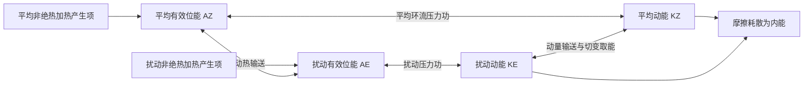

# D19 · 2004第5—10条＋2003_1全13条＋2003第1—4条（23条）

日期：2026-11-16｜建议投入：4小时｜动力40% · 天气40% · 物理20%

> 本学习包依据原50日PDF与仓库学习资料整理。参考答案不是官方评分标准；未完成学科审校及缺题标记均保留。公式采用 GitHub 数学 Markdown，请在 GitHub 正文或 Obsidian 阅读视图打开。

## 今日目标与记忆标准

闭卷说清概念、适用条件、符号与单位；推导必须写出起始方程、近似及关键步骤。先答题，再展开核对。

## 四小时执行

1. 20分钟：回忆此前第1、3、7、14天的重点，尚未开始的日期跳过。
2. 80分钟：逐题闭卷提取，核对以下简答与来源。
3. 70分钟：精选5题完整书写。名词解释90秒、简答7分钟、论述12分钟为训练目标。
4. 40分钟：把本日知识按“假设→方程→物理机制→天气表现”串成2—4条知识链。
5. 30分钟：记录遗漏点、用时与次日/3日/7日/14日复习日期。

> 星级口径：按同考点在不同年份的出现次数，1次★、2—3次★★、4—6次★★★、7—10次★★★★、11次及以上★★★★★；多考点题取最高频考点。星级表示复习频次，不是命题概率。

## 逐题回忆与简答

### 2004-一-5 · ★★（同考点3年）

中尺度低压系统

[解析来源（对应题目行）](https://github.com/0183ty2512/lao-san-yang/blob/main/%E5%8A%A8%E5%8A%9B%E6%B0%94%E8%B1%A1%E8%AF%BE%E5%90%8E%E4%B9%A0%E9%A2%98/%E8%AF%95%E9%A2%98%E8%A7%A3%E7%AD%94/%E5%BE%80%E5%B9%B4%E8%AF%95%E9%A2%98%E8%A7%A3%E6%9E%90/2004.md#L169) · [原始年度题干](https://github.com/0183ty2512/lao-san-yang/blob/main/%E5%BE%80%E5%B9%B4%E8%AF%95%E9%A2%98%E5%88%86%E6%9E%90/2004.md)

**审校状态：尚未逐题学科审校。**

**相关高频考点复习摘要（须按本题设问取舍，不替代完整解答）：**

**中尺度低压：** 中尺度低压是水平几十至数百公里等中尺度范围的低压扰动，可由地形、加热、锋面或对流动力作用形成；寿命和结构随类型变化。切变线上的气旋性涡旋也可发展为低压，并非都具有清楚闭合的地面等压线。

> 以上摘要用于回忆答题主线，不是官方评分标准；推导、计算和多小问仍须完成下方步骤。

1. 中尺度系统水平从数公里到上千公里，生命从小时到约一天或更长，时空变化快、局地梯度大、非地转和垂直运动更重要。切变线是风向或风速发生气旋性切变的狭长带；其上闭合或明显低压环流可发展成切变低压。中尺度低压可由加热、地形和对流动力作用形成，不必都有闭合地面等压线。

### 2004-一-6 · ★★★（同考点4年）

赤道辐合带

[解析来源（对应题目行）](https://github.com/0183ty2512/lao-san-yang/blob/main/%E5%8A%A8%E5%8A%9B%E6%B0%94%E8%B1%A1%E8%AF%BE%E5%90%8E%E4%B9%A0%E9%A2%98/%E8%AF%95%E9%A2%98%E8%A7%A3%E7%AD%94/%E5%BE%80%E5%B9%B4%E8%AF%95%E9%A2%98%E8%A7%A3%E6%9E%90/2004.md#L205) · [原始年度题干](https://github.com/0183ty2512/lao-san-yang/blob/main/%E5%BE%80%E5%B9%B4%E8%AF%95%E9%A2%98%E5%88%86%E6%9E%90/2004.md)

**审校状态：尚未逐题学科审校。**

**相关高频考点复习摘要（须按本题设问取舍，不替代完整解答）：**

**热带辐合带：** ITCZ是低纬信风和季风气流辐合、上升与深对流活跃的带状区域，随季节及海陆热力分布移动，不固定在地理赤道。赤道槽着重气压形态，ITCZ着重风场辐合与对流，二者不必逐点重合。

> 以上摘要用于回忆答题主线，不是官方评分标准；推导、计算和多小问仍须完成下方步骤。

1. 热带辐合带（ITCZ）是低纬近地面信风及季风气流辐合、上升和深对流较活跃的带状区域，常与赤道附近低压槽相联系。

2. 太阳加热、海表温度及海陆分布使它并不总沿地理赤道，通常随季节向夏半球移动，并具有区域差异；海洋双辐合带等情况也可能出现。

3. 低层辐合持续补给暖湿空气，凝结潜热帮助维持上升和高层辐散，常带来云雨及热带扰动。赤道槽着重气压槽形态，ITCZ着重风场辐合和对流，两者密切相关但不是所有天气图上都逐点重合。

### 2004-二-整题 · ★★★★（同考点7年）

冬夏东亚大气环流有哪些显著差异。

[解析来源（对应题目行）](https://github.com/0183ty2512/lao-san-yang/blob/main/%E5%8A%A8%E5%8A%9B%E6%B0%94%E8%B1%A1%E8%AF%BE%E5%90%8E%E4%B9%A0%E9%A2%98/%E8%AF%95%E9%A2%98%E8%A7%A3%E7%AD%94/%E5%BE%80%E5%B9%B4%E8%AF%95%E9%A2%98%E8%A7%A3%E6%9E%90/2004.md#L249) · [原始年度题干](https://github.com/0183ty2512/lao-san-yang/blob/main/%E5%BE%80%E5%B9%B4%E8%AF%95%E9%A2%98%E5%88%86%E6%9E%90/2004.md)

**审校状态：尚未逐题学科审校。**

**相关高频考点复习摘要（须按本题设问取舍，不替代完整解答）：**

**东亚大气环流：** 冬季北半球中高纬温度梯度和西风较强，槽脊较显著，东亚大槽突出；夏季西风减弱北移，副高北抬。回答500 hPa题应围绕中层高度场、风场、槽脊位置和季节温差展开，地面系统只作解释背景。

> 以上摘要用于回忆答题主线，不是官方评分标准；推导、计算和多小问仍须完成下方步骤。

1. 冬季北半球 500 hPa 等高线较密、西风强、长波振幅较大，东亚和北美东岸常有大槽，大陆冷、海洋相对暖；夏季中高纬梯度减小、西风带北移，副高北抬，大陆暖低压发展。冬季海平面亚洲冷高压、阿留申低压突出，夏季大陆热低压与海洋副高突出。

2. 东亚冬季受西伯利亚高压—阿留申低压、东亚大槽和强西风急流控制，偏北风冷干；夏季副高、季风低压、低空水汽输送和南亚高压配合，偏南风暖湿。春夏转换可发生分阶段突变，因海陆/高原加热、季风爆发和急流、副高位置跃变，而不只是平滑逐日北移。

### 2004-三-整题 · ★★★（同考点4年）

试比较台风和温带气旋，冷高压和副热带高压的异同点。

[解析来源（对应题目行）](https://github.com/0183ty2512/lao-san-yang/blob/main/%E5%8A%A8%E5%8A%9B%E6%B0%94%E8%B1%A1%E8%AF%BE%E5%90%8E%E4%B9%A0%E9%A2%98/%E8%AF%95%E9%A2%98%E8%A7%A3%E7%AD%94/%E5%BE%80%E5%B9%B4%E8%AF%95%E9%A2%98%E8%A7%A3%E6%9E%90/2004.md#L291) · [原始年度题干](https://github.com/0183ty2512/lao-san-yang/blob/main/%E5%BE%80%E5%B9%B4%E8%AF%95%E9%A2%98%E5%88%86%E6%9E%90/2004.md)

**审校状态：已按设问复核。**

**针对本题的精简作答：**

两张对照：台风/温带气旋按环境能量、温度锋面、竖直结构、尺度；冷高压/副高按温度、深度、形成背景、天气。先讲共同点，再讲差异。

> 以上摘要用于回忆答题主线，不是官方评分标准；推导、计算和多小问仍须完成下方步骤。

### 2004-四-整题 · ★★★★（同考点8年）

叙述急流的基本特征。

[解析来源（对应题目行）](https://github.com/0183ty2512/lao-san-yang/blob/main/%E5%8A%A8%E5%8A%9B%E6%B0%94%E8%B1%A1%E8%AF%BE%E5%90%8E%E4%B9%A0%E9%A2%98/%E8%AF%95%E9%A2%98%E8%A7%A3%E7%AD%94/%E5%BE%80%E5%B9%B4%E8%AF%95%E9%A2%98%E8%A7%A3%E6%9E%90/2004.md#L349) · [原始年度题干](https://github.com/0183ty2512/lao-san-yang/blob/main/%E5%BE%80%E5%B9%B4%E8%AF%95%E9%A2%98%E5%88%86%E6%9E%90/2004.md)

**审校状态：尚未逐题学科审校。**

**相关高频考点复习摘要（须按本题设问取舍，不替代完整解答）：**

**高空急流：** 高空急流是对流层上部狭长强风带，横向和垂直切变强。极锋急流与斜压锋区相关，副热带急流还受低纬角动量输送影响；冬强偏南、夏弱偏北。急流加减速与曲率引起非地转次级环流，可影响下方上升和气旋发展。

> 以上摘要用于回忆答题主线，不是官方评分标准；推导、计算和多小问仍须完成下方步骤。

1. 急流是狭长的强风带，横向和竖直风切变显著，急流轴是局地最大风速的位置。高空西风急流位于对流层上部，冬季更强、更偏南；夏季整体偏北、减弱。东亚日本附近冬季急流可很强，题中 70—80 m/s 是典型量级而非上限。

2. 极锋急流与中纬度锋区斜压性相联系；副热带急流还与低纬向极运动的角动量输送和热成风共同有关。强南北温度梯度通过热成风使西风随高度增强；不能只归因于地面风向上复制。

3. 急流入口、出口的加减速和曲率导致非地转次级环流，局部辐散有利于下方上升和气旋发展；简单直急流象限规则只在相应理想条件下适用。

### 2004-五-整题 · ★★★★★（同考点13年）

叙述江淮梅雨环流特征

[解析来源（对应题目行）](https://github.com/0183ty2512/lao-san-yang/blob/main/%E5%8A%A8%E5%8A%9B%E6%B0%94%E8%B1%A1%E8%AF%BE%E5%90%8E%E4%B9%A0%E9%A2%98/%E8%AF%95%E9%A2%98%E8%A7%A3%E7%AD%94/%E5%BE%80%E5%B9%B4%E8%AF%95%E9%A2%98%E8%A7%A3%E6%9E%90/2004.md#L393) · [原始年度题干](https://github.com/0183ty2512/lao-san-yang/blob/main/%E5%BE%80%E5%B9%B4%E8%AF%95%E9%A2%98%E5%88%86%E6%9E%90/2004.md)

**审校状态：尚未逐题学科审校。**

**相关高频考点复习摘要（须按本题设问取舍，不替代完整解答）：**

**梅雨：** 梅雨是初夏江淮及长江中下游的持续阴雨过程。梅雨锋常以水汽和相当位温梯度、低层切变辐合突出；低层西南急流供水汽，中层副高北缘与中高纬槽脊维持冷暖交汇，高层合适辐散配合上升。北段锋区温差可明显，不能说梅雨锋完全无温度梯度。

> 以上摘要用于回忆答题主线，不是官方评分标准；推导、计算和多小问仍须完成下方步骤。

1. **梅雨定义与天气。** 初夏江淮及长江中下游的持续阴雨期，常在 6 月中旬至 7 月上旬附近，但年际变化明显。天气高湿、云量多，层状云雨夹有对流和暴雨，日照少，雨带易持续。

2. **锋区结构。** 梅雨锋在南段常温度梯度较弱而水汽、相当位温梯度很强；低层有风向切变、辐合和正涡度，锋南暖湿偏南/西南风，锋北较冷偏东/偏北气流。北段温度梯度可更显著，不能概括为“完全无温度差”。

3. **高中低层配置。** 高层南亚高压与西风急流提供适宜的辐散背景；500 hPa 中高纬阻高、东亚槽和西太副高使冷暖气流维持；850—700 hPa 西南急流输送水汽，梅雨锋、切变线或低涡提供抬升。双阻型通常在欧亚中高纬形成两处阻塞、其间冷槽南伸，与低纬副高北侧暖湿气流相遇；两阻的精确中心依原教材图例而定。

4. **梅雨与极锋比较。** 极锋主要表现为强水平温度梯度及深厚斜压性，梅雨锋常以水汽差异和低层切变更突出；两者均可提供持续上升并组织降水。

### 2003_1-一-1 · ★★★（同考点6年）

正压大气，斜压大气

[解析来源（对应题目行）](https://github.com/0183ty2512/lao-san-yang/blob/main/%E5%8A%A8%E5%8A%9B%E6%B0%94%E8%B1%A1%E8%AF%BE%E5%90%8E%E4%B9%A0%E9%A2%98/%E8%AF%95%E9%A2%98%E8%A7%A3%E7%AD%94/%E5%BE%80%E5%B9%B4%E8%AF%95%E9%A2%98%E8%A7%A3%E6%9E%90/2003_1.md#L11) · [原始年度题干](https://github.com/0183ty2512/lao-san-yang/blob/main/%E5%BE%80%E5%B9%B4%E8%AF%95%E9%A2%98%E5%88%86%E6%9E%90/2003_1.md)

**审校状态：尚未逐题学科审校。**

**相关高频考点复习摘要（须按本题设问取舍，不替代完整解答）：**

**正压与斜压大气：** 正压大气满足 $\rho=\rho(p)$，等压面与等密度面重合；斜压时两面相交，$\nabla\rho\times\nabla p\ne0$。在静力、地转条件下，等压面温度梯度对应地转风垂直切变。斜压状态不自动等于斜压不稳定。

> 以上摘要用于回忆答题主线，不是官方评分标准；推导、计算和多小问仍须完成下方步骤。

1. 正压大气满足 $\rho=\rho(p)$，等压面与等密度面重合，故 $\nabla\rho\times\nabla p=0$。对理想气体，在等压面上温度均匀。
2. 斜压大气中等压面与等密度面相交，$\nabla\rho\times\nabla p\ne0$，等压面上有水平温度梯度。
3. 斜压项可生成环流和涡度；在静力、地转条件下，水平温度梯度通过热成风关系对应地转风垂直切变。正压条件下地转风不随高度改变。
4. “正压”不意味着实际风必无任何垂直切变；上述切变结论还用了地转平衡。“斜压”也不等于“斜压不稳定”，后者需要扰动从基本态有效位能获得净能量。

### 2003_1-一-2 · ★★★★★（同考点12年）

地转风和热成风

[解析来源（对应题目行）](https://github.com/0183ty2512/lao-san-yang/blob/main/%E5%8A%A8%E5%8A%9B%E6%B0%94%E8%B1%A1%E8%AF%BE%E5%90%8E%E4%B9%A0%E9%A2%98/%E8%AF%95%E9%A2%98%E8%A7%A3%E7%AD%94/%E5%BE%80%E5%B9%B4%E8%AF%95%E9%A2%98%E8%A7%A3%E6%9E%90/2003_1.md#L50) · [原始年度题干](https://github.com/0183ty2512/lao-san-yang/blob/main/%E5%BE%80%E5%B9%B4%E8%AF%95%E9%A2%98%E5%88%86%E6%9E%90/2003_1.md)

**审校状态：尚未逐题学科审校。**

**相关高频考点复习摘要（须按本题设问取舍，不替代完整解答）：**

**地转风：** 中纬度大尺度缓变、摩擦可忽略时，水平气压梯度力与科氏力近似平衡：$u_g=-\frac{\partial \Phi}{\partial y}/f$、$v_g=\frac{\partial \Phi}{\partial x}/f$。风平行等高线，北半球低值在风向左侧。近赤道、摩擦层和强曲率快速运动中须检验适用性。

**热成风：** 热成风是上下两层地转风之差。由静力关系 $\frac{\partial\Phi}{\partial\ln p}=-RT$ 与地转关系得 $\frac{\partial u_g}{\partial\ln p}=(R/f)\frac{\partial T}{\partial y}$、$\frac{\partial v_g}{\partial\ln p}=-(R/f)\frac{\partial T}{\partial x}$。北半球向上的热成风冷侧在左，表示温度梯度对应垂直风切变。

> 以上摘要用于回忆答题主线，不是官方评分标准；推导、计算和多小问仍须完成下方步骤。

1. 在局地直角坐标中，忽略摩擦时水平动量方程为 $Du/Dt-fv=-\frac{\partial \Phi}{\partial x}$、$Dv/Dt+fu=-\frac{\partial \Phi}{\partial y}$，这里的导数取在等压面上。
2. 对中纬度大尺度缓变运动，$Ro=U/(|f|L)\ll1$，惯性项相对较小，得到 $-fv_g=-\frac{\partial \Phi}{\partial x}$、$fu_g=-\frac{\partial \Phi}{\partial y}$。
3. 解得 $\boxed{u_g=-\frac{\partial \Phi}{\partial y}/f,\quad v_g=\frac{\partial \Phi}{\partial x}/f}$，即 $\mathbf V_g=\mathbf k\times\nabla_p\Phi/f$；大小为 $|\nabla_p\Phi|/|f|$。
4. 因叉积垂直于梯度，地转风平行于等高线；北半球背风而立时低值在左、高值在右，南半球相反。等高线越密风越强，但还受纬度 $f$ 影响。
5. 近赤道 $f\to0$、摩擦层、强曲率或快速变化的小尺度系统中不能直接采用地转近似。等高面上应改用 $\nabla_zp/\rho$，不要把两种坐标的梯度混用。

1. 热成风是两个高度或等压面之间的**地转风差**，不是独立的一股实际风。
2. 静力关系给出 $\frac{\partial\Phi}{\partial\ln p}=-RT$。对 $u_g=-\frac{\partial \Phi}{\partial y}/f$、$v_g=\frac{\partial \Phi}{\partial x}/f$ 分别作 $\ln p$ 导数（局地取 $f$ 固定），得
$$\frac{\partial u_g}{\partial\ln p}=\frac RfT_y,\qquad \frac{\partial v_g}{\partial\ln p}=-\frac RfT_x.$$
3. 从下层 $p_b$ 积到上层 $p_t<p_b$，若用对数气压平均温度 $\bar T$，则 $u_t-u_b=-(R/f)\ln(p_b/p_t)\frac{\partial\bar T}{\partial y}$、$v_t-v_b=(R/f)\ln(p_b/p_t)\frac{\partial\bar T}{\partial x}$。
4. 北半球向上的热成风沿平均等温线，冷空气在其左侧。温度向北降低时，西风一般随高度增强。该关系把水平温度梯度和垂直风切变连接起来。

### 2003_1-一-3 · ★★★★（同考点8年）

大气长波的频散

[解析来源（对应题目行）](https://github.com/0183ty2512/lao-san-yang/blob/main/%E5%8A%A8%E5%8A%9B%E6%B0%94%E8%B1%A1%E8%AF%BE%E5%90%8E%E4%B9%A0%E9%A2%98/%E8%AF%95%E9%A2%98%E8%A7%A3%E7%AD%94/%E5%BE%80%E5%B9%B4%E8%AF%95%E9%A2%98%E8%A7%A3%E6%9E%90/2003_1.md#L99) · [原始年度题干](https://github.com/0183ty2512/lao-san-yang/blob/main/%E5%BE%80%E5%B9%B4%E8%AF%95%E9%A2%98%E5%88%86%E6%9E%90/2003_1.md)

**审校状态：尚未逐题学科审校。**

**相关高频考点复习摘要（须按本题设问取舍，不替代完整解答）：**

**罗斯贝波基本性质：** 罗斯贝波以位涡梯度为回复机制。均匀基本流正压β平面上 $\omega=kU-\beta k/(k^2+l^2)$，内禀纬向相速向西；地面参考系方向还依 $U$。频率对波数非线性，相速与群速一般不同。

**频散与非频散波：** 相速 $c_p=\omega/k$ 是等位相移动速度；群速 $c_g=d\omega/dk$ 是窄波包速度。不同波数的相速不同则有频散。由 $\omega=kc_p$ 得 $c_g=c_p+kdc_p/dk$，频散不等于能量耗散。

> 以上摘要用于回忆答题主线，不是官方评分标准；推导、计算和多小问仍须完成下方步骤。

1. 正压无辐散β平面涡度方程为 $(\frac{\partial}{\partial t}+u\frac{\partial}{\partial x}+v\frac{\partial}{\partial y})(\zeta+f)=0$，$f=f_0+\beta y$。
2. 令 $u=U+u'$、$v=v'$，$U$ 为常数。减去基本态并舍弃 $u'\frac{\partial \zeta'}{\partial x}+v'\frac{\partial \zeta'}{\partial y}$ 等二阶项，得 $(\frac{\partial}{\partial t}+U\frac{\partial}{\partial x})\zeta'+\beta v'=0$。
3. 引入 $u'=-\frac{\partial \psi'}{\partial y}$、$v'=\frac{\partial \psi'}{\partial x}$，所以 $\zeta'=\nabla_h^2\psi'$。代回得 $(\frac{\partial}{\partial t}+U\frac{\partial}{\partial x})\nabla_h^2\psi'+\beta\psi'_x=0$。
4. 设 $\psi'=\hat\psi e^{i(kx+ly-\omega t)}$，有 $\nabla_h^2\psi'=-(k^2+l^2)\psi'$，故 $i(\omega-kU)(k^2+l^2)\psi'+i\beta k\psi'=0$。
5. 非零振幅给出 $\boxed{\omega=kU-\beta k/(k^2+l^2)}$；纬向相速 $c_x=\omega/k=U-\beta/(k^2+l^2)$。一维 $l=0$ 时 $c_x=U-\beta/k^2=U-\beta L^2/(4\pi^2)$。
6. 相对基本气流向西传播；短波西退修正小，常随西风向东，足够长的波可静止或向西。群速为 $c_{gx}=U+\beta(k^2-l^2)/(k^2+l^2)^2$、$c_{gy}=2\beta kl/(k^2+l^2)^2$。群速和相速不同，能量可向下游传播而单个槽脊较慢。

1. 简谐波写为 $A\cos(kx-\omega t)$。对等位相 $kx-\omega t=C$ 求导，得 $c_p=dx/dt=\omega/k$，它是波峰等位相点的速度。
2. 两列相近波叠加，利用和差化积得到 $2A\cos[(\Delta kx-\Delta\omega t)/2]\cos[(\bar kx-\bar\omega t)]$。第一项是缓变包络，故包络速度为 $\Delta\omega/\Delta k$。
3. 极限 $\Delta k\to0$ 时，群速度 $c_g=d\omega/dk$。多维形式为 $\mathbf c_g=\nabla_{\mathbf k}\omega$；在无耗散、缓变介质的线性波理论中，波包及波能量通常以群速度传播。
4. 若 $\omega=ck$ 且 $c$ 与 $k$ 无关，所有波数的相速相同，为非频散波；否则不同波数组分分离，波形和包络演变，称频散。因为 $\omega=kc_p(k)$，有 $c_g=c_p+k\,dc_p/dk$。
5. 频散的根本原因是恢复机制与惯性响应具有尺度依赖性，使频率对波数不呈简单线性关系；它不等于摩擦耗散。旋转浅水波和罗斯贝波有频散，无旋转均匀浅水长波近似非频散。

### 2003_1-一-4 · ★★★（同考点6年）

有效位能

[解析来源（对应题目行）](https://github.com/0183ty2512/lao-san-yang/blob/main/%E5%8A%A8%E5%8A%9B%E6%B0%94%E8%B1%A1%E8%AF%BE%E5%90%8E%E4%B9%A0%E9%A2%98/%E8%AF%95%E9%A2%98%E8%A7%A3%E7%AD%94/%E5%BE%80%E5%B9%B4%E8%AF%95%E9%A2%98%E8%A7%A3%E6%9E%90/2003_1.md#L149) · [原始年度题干](https://github.com/0183ty2512/lao-san-yang/blob/main/%E5%BE%80%E5%B9%B4%E8%AF%95%E9%A2%98%E5%88%86%E6%9E%90/2003_1.md)

**审校状态：尚未逐题学科审校。**

**相关高频考点复习摘要（须按本题设问取舍，不替代完整解答）：**

**有效位能：** 有效位能是实际全位能相对绝热重排后的最低参考态中可供转换的部分。差异加热维持温差，暖升冷沉可将其转为动能。全位能通常指内能与重力位能之和，不是全部都能被利用。

> 以上摘要用于回忆答题主线，不是官方评分标准；推导、计算和多小问仍须完成下方步骤。

1. 单位质量内能 $e=c_vT$，重力位能 $\Phi=gz$（常重力），动能 $K=|\mathbf V|^2/2$，水汽潜热能近似 $L_vq_v$。总量需对气团质量积分；动能不能漏掉 $1/2$。
2. “全位能”在大气能量学中通常指内能与重力位能之和，而非含动能的总能量。静力、平坦底面且顶边界压力趋零时，$\int\rho gz\,dz=-\int z\,dp=\int p\,dz=\int\rho RT\,dz$；加上内能得到 $\int c_pT\,dm$。
3. 有效位能是实际全位能相对绝热重排到参考最低能态后的可用部分。不是全部内能或重力位能都能转换为动能。差异加热维持水平温差，建立有效位能。
4. 暖上升冷下沉时，$C=-\int\alpha'\omega'\,dm>0$，有效位能转为扰动动能；摩擦最终把动能耗散成内能。凝结使潜热转入热力能库，但水汽能量本来主要来自地表蒸发和辐射收支。
5. 对流层常用 Lorenz 四能量库循环如下。双向箭头表示转换可正可负，方向由收支项决定；中纬度斜压波常沿 $A_Z\to A_E\to K_E$ 取能。$A_Z$ 与 $K_Z$ 的直接转换不能漏掉：平均经圈环流同样可通过压力功在平均有效位能和平均动能之间转换。

产生项也可能为负，图中不是所有加热都增加有效位能。若问完整收支，应分别写 $\dot A_Z=G_Z-C_A-C_Z$、$\dot A_E=G_E+C_A-C_E$、$\dot K_Z=C_Z+C_K-D_Z$、$\dot K_E=C_E-C_K-D_E$，这里 $C_K>0$ 约定为扰动动能转入平均动能。四式相加，内部转换项逐项抵消，只剩外部产生与耗散，可用作检查。

### 2003_1-一-5 · ★★★★（同考点7年）

位温

[解析来源（对应题目行）](https://github.com/0183ty2512/lao-san-yang/blob/main/%E5%8A%A8%E5%8A%9B%E6%B0%94%E8%B1%A1%E8%AF%BE%E5%90%8E%E4%B9%A0%E9%A2%98/%E8%AF%95%E9%A2%98%E8%A7%A3%E7%AD%94/%E5%BE%80%E5%B9%B4%E8%AF%95%E9%A2%98%E8%A7%A3%E6%9E%90/2003_1.md#L201) · [原始年度题干](https://github.com/0183ty2512/lao-san-yang/blob/main/%E5%BE%80%E5%B9%B4%E8%AF%95%E9%A2%98%E5%88%86%E6%9E%90/2003_1.md)

**审校状态：尚未逐题学科审校。**

**相关高频考点复习摘要（须按本题设问取舍，不替代完整解答）：**

**位温：** 位温是气块干绝热移至参考气压 $p_0$ 的温度。由 $c_p dT-RTdp/p=0$ 积分得 $\theta=T(p_0/p)^{R/c_p}$，单位K。理想干绝热时沿气块守恒，有加热时 $D\ln\theta/Dt=Q/(c_pT)$。

> 以上摘要用于回忆答题主线，不是官方评分标准；推导、计算和多小问仍须完成下方步骤。

1. **定义。** 位温是干空气块沿干绝热线移到参考气压 $p_0$ 时的温度，通常取 $p_0=1000\ \mathrm{hPa}$。
2. **从第一定律出发。** 干绝热时 $c_p\,dT-\alpha\,dp=0$。由 $\alpha=RT/p$，得 $dT/T=(R/c_p)dp/p$。
3. **积分。** 记 $\kappa=R/c_p$，从 $(p,T)$ 积分到 $(p_0,\theta)$：$\ln(\theta/T)=\kappa\ln(p_0/p)$。
4. **结果。** $\boxed{\theta=T(p_0/p)^\kappa}$。干绝热运动中 $D\theta/Dt=0$；有潜热释放或其他加热时，不能直接假定干位温守恒。位温单位为 K。

### 2003_1-一-6 · ★★★★（同考点10年）

第二类条件不稳定

[解析来源（对应题目行）](https://github.com/0183ty2512/lao-san-yang/blob/main/%E5%8A%A8%E5%8A%9B%E6%B0%94%E8%B1%A1%E8%AF%BE%E5%90%8E%E4%B9%A0%E9%A2%98/%E8%AF%95%E9%A2%98%E8%A7%A3%E7%AD%94/%E5%BE%80%E5%B9%B4%E8%AF%95%E9%A2%98%E8%A7%A3%E6%9E%90/2003_1.md#L240) · [原始年度题干](https://github.com/0183ty2512/lao-san-yang/blob/main/%E5%BE%80%E5%B9%B4%E8%AF%95%E9%A2%98%E5%88%86%E6%9E%90/2003_1.md)

**审校状态：尚未逐题学科审校。**

**相关高频考点复习摘要（须按本题设问取舍，不替代完整解答）：**

**第二类条件不稳定（CISK）：** CISK是对流和大尺度环流的正反馈：初始旋转扰动→摩擦辐合和水汽输送→凝结潜热加热→暖心、质量场及高层外流调整→低压和辐合增强。能量依海气焓供应与湿对流转化，不能把凝结视作凭空产能。

> 以上摘要用于回忆答题主线，不是官方评分标准；推导、计算和多小问仍须完成下方步骤。

1. **初始扰动。** 季风槽、热带辐合带扰动、东风波、赤道罗斯贝波等可提供涡度、辐合和持续对流。多数初始扰动不会发展，环境与内部组织过程都重要。

2. **CISK 链条。** 初始低压旋转 → 边界层摩擦造成向中心的水汽辐合 → 对流凝结释放潜热 → 暖心及质量场调整、高层外流加强 → 低压和低层旋转增强 → 更强辐合。对流和大尺度环流相互反馈而非单独气块条件不稳定，因此称第二类条件不稳定。它是理想化解释，现代海气通量反馈等机制不可省略。

3. **能量。** 水汽主要由暖海蒸发补给，海面潜热和显热通量提供焓；凝结将潜热释放，暖升冷沉及压力功转化为动能，摩擦耗散动能。不能把凝结说成凭空制造能量。

### 2003_1-一-7 · ★★★（同考点5年）

赤道波动

[解析来源（对应题目行）](https://github.com/0183ty2512/lao-san-yang/blob/main/%E5%8A%A8%E5%8A%9B%E6%B0%94%E8%B1%A1%E8%AF%BE%E5%90%8E%E4%B9%A0%E9%A2%98/%E8%AF%95%E9%A2%98%E8%A7%A3%E7%AD%94/%E5%BE%80%E5%B9%B4%E8%AF%95%E9%A2%98%E8%A7%A3%E6%9E%90/2003_1.md#L280) · [原始年度题干](https://github.com/0183ty2512/lao-san-yang/blob/main/%E5%BE%80%E5%B9%B4%E8%AF%95%E9%A2%98%E5%88%86%E6%9E%90/2003_1.md)

**审校状态：尚未逐题学科审校。**

**相关高频考点复习摘要（须按本题设问取舍，不替代完整解答）：**

**赤道波动：** 赤道β平面存在开尔文波、赤道罗斯贝波、混合罗斯贝—重力波和惯性重力波。开尔文波东传、经向风为零且赤道束缚；罗斯贝模态内禀相速向西；混合波兼有涡旋与重力特征。实际云雨还依赖湿对流耦合。

> 以上摘要用于回忆答题主线，不是官方评分标准；推导、计算和多小问仍须完成下方步骤。

1. 赤道附近 $f\approx\beta y$，科氏参数变号使若干波动被束缚在赤道附近。主要模态有赤道开尔文波、赤道罗斯贝波、混合罗斯贝—重力波及赤道惯性重力波。线性理论描述它们的动力骨架，实际云雨还受湿对流耦合。
2. **赤道开尔文波。** 取浅水等效波速 $c=\sqrt{gH}$，令 $v=0$。纬向动量与连续方程给 $u_t=-g\eta_x$、$\eta_t=-Hu_x$，组合得 $u_{tt}=c^2u_{xx}$，故 $\omega=\pm ck$。
3. 经向动量给 $\beta yu=-g\eta_y$。东传支有 $u=g\eta/c$，故 $\eta_y=-(\beta y/c)\eta$，积分得 $\eta\propto\exp[-\beta y^2/(2c)]$；西传支随远离赤道增长，不能满足有界条件。因此开尔文波为东传、近非频散，$u,\eta$ 关于赤道对称，$v=0$，束缚尺度 $L_e=\sqrt{c/\beta}$。
4. **混合波。** 兼具涡旋性与重力回复特征，经向风不为零；标准 $n=0$ 物理解可写 $\omega=ck/2+\sqrt{c^2k^2/4+\beta c}$（连同实场的共轭分支）。负波数一侧相速向西，群速可向东，不能把它当成单纯非频散东传波。
5. **赤道罗斯贝波。** 主要受位涡梯度约束，内禀相速向西，常表现为赤道两侧成对的涡旋；重力波分支较快，以辐散、质量场振荡显著。
6. 沿岸开尔文波与赤道开尔文波应区分：前者靠边界无穿透与地转横向平衡束缚，离岸按 $e^{-y/L_D}$ 衰减，$L_D=c/|f|$；北半球沿传播方向海岸在右侧。赤道波无需实体岸界。

### 2003_1-一-8 · ★★（同考点3年）

位涡度

[解析来源（对应题目行）](https://github.com/0183ty2512/lao-san-yang/blob/main/%E5%8A%A8%E5%8A%9B%E6%B0%94%E8%B1%A1%E8%AF%BE%E5%90%8E%E4%B9%A0%E9%A2%98/%E8%AF%95%E9%A2%98%E8%A7%A3%E7%AD%94/%E5%BE%80%E5%B9%B4%E8%AF%95%E9%A2%98%E8%A7%A3%E6%9E%90/2003_1.md#L321) · [原始年度题干](https://github.com/0183ty2512/lao-san-yang/blob/main/%E5%BE%80%E5%B9%B4%E8%AF%95%E9%A2%98%E5%88%86%E6%9E%90/2003_1.md)

**审校状态：尚未逐题学科审校。**

**相关高频考点复习摘要（须按本题设问取舍，不替代完整解答）：**

**位涡：** 干绝热、无摩擦条件下，Ertel位涡 $q=(\boldsymbol\omega_a\cdot\nabla\theta)/\rho$ 沿气块守恒。证明时由涡度、连续和位温方程组合，速度梯度项相消，斜压三重积为零；不等于绝对涡度本身守恒。

> 以上摘要用于回忆答题主线，不是官方评分标准；推导、计算和多小问仍须完成下方步骤。

1. 取完整无摩擦运动方程的旋度，定义绝对涡度 $\boldsymbol\omega_a=\nabla\times\mathbf V+2\boldsymbol\Omega$，得到
$$\frac{D\boldsymbol\omega_a}{Dt}=(\boldsymbol\omega_a\cdot\nabla)\mathbf V-\boldsymbol\omega_a\nabla\cdot\mathbf V+\frac{\nabla\rho\times\nabla p}{\rho^2}.$$
2. 连续方程给 $D\rho/Dt=-\rho\nabla\cdot\mathbf V$。对 $\mathbf B=\boldsymbol\omega_a/\rho$ 用商法则，膨胀项相消：$D\mathbf B/Dt=(\mathbf B\cdot\nabla)\mathbf V+(\nabla\rho\times\nabla p)/\rho^3$。
3. 绝热时 $D\theta/Dt=0$，对空间求导得 $D(\partial_i\theta)/Dt=-(\partial_iV_j)(\partial_j\theta)$。
4. 定义 $q=B_i\partial_i\theta$。其物质导数中，速度梯度两项分别为 $B_j\partial_jV_i\partial_i\theta$ 和 $-B_i\partial_iV_j\partial_j\theta$；交换虚指标后恰好相消。
5. 剩下 $Dq/Dt=(\nabla\rho\times\nabla p)\cdot\nabla\theta/\rho^3$。定组成理想气体的 $\theta=\theta(p,\rho)$，因此 $\nabla\theta$ 是 $\nabla p,\nabla\rho$ 的线性组合，三重积为零。
6. 故 $\boxed{D[(\boldsymbol\omega_a\cdot\nabla\theta)/\rho]/Dt=0}$，即 Ertel 位涡守恒。条件是绝热、无摩擦及适用的状态关系；用于气柱伸缩、越山响应和气团追踪时要选择与模型一致的位涡形式。浅水模型相应为 $(\zeta+f)/h$。

### 2003_1-一-9 · ★★★（同考点5年）

Ekman 抽吸作用

[解析来源（对应题目行）](https://github.com/0183ty2512/lao-san-yang/blob/main/%E5%8A%A8%E5%8A%9B%E6%B0%94%E8%B1%A1%E8%AF%BE%E5%90%8E%E4%B9%A0%E9%A2%98/%E8%AF%95%E9%A2%98%E8%A7%A3%E7%AD%94/%E5%BE%80%E5%B9%B4%E8%AF%95%E9%A2%98%E8%A7%A3%E6%9E%90/2003_1.md#L363) · [原始年度题干](https://github.com/0183ty2512/lao-san-yang/blob/main/%E5%BE%80%E5%B9%B4%E8%AF%95%E9%A2%98%E5%88%86%E6%9E%90/2003_1.md)

**审校状态：尚未逐题学科审校。**

**相关高频考点复习摘要（须按本题设问取舍，不替代完整解答）：**

**埃克曼抽吸：** 边界层摩擦造成水平输送辐合，经质量连续性在层顶形成垂直运动。设偏差风积分输送为 $\mathbf M$，下边界无穿透，则 $w_E=-\nabla_h\cdot\mathbf M$。气旋常对应上升；应力形式公式须先说明应力方向与 $w/\omega$ 约定。

> 以上摘要用于回忆答题主线，不是官方评分标准；推导、计算和多小问仍须完成下方步骤。

1. 气旋边界层摩擦辐合，经连续性在层顶产生上升，即埃克曼抽吸；反气旋常相反。若 $M$ 为积分边界层偏差输送、下边界 $w=0$，$w_E=-\nabla_h\cdot M$。明确应力为地面对空气的应力 $\boldsymbol\tau_s$，常数 $\rho,f$ 下 $M=-\mathbf k\times\boldsymbol\tau_s/(\rho f)$，故 $w_E=-\operatorname{curl}_z\boldsymbol\tau_s/(\rho f)$；若采用空气对地面应力，符号相反。

2. 抽吸将摩擦影响传入内区，使旋转流逐步衰减，称 spin down。理查森数 $Ri=N^2/[(\bar u_z)^2+(\bar v_z)^2]$ 比较稳定层结抑制与切变产湍，不能把常见的 $1/4$ 理论阈值当作所有大气湍流的开关。雷诺数 $Re=UL/\nu$ 衡量惯性与分子黏性；大气通常很大，湍流多尺度、随机且强混合，但仍服从守恒定律。

### 2003_1-二-整题 · ★★★（同考点4年）

在 60°N 有一气柱，起始时相对涡度等于 0，从地面一直伸展到固定为 10 公里的对流层顶，假如这个气柱移到 30°N 并爬越一个高度为 5 公里的高原，问此气柱当越过高原顶部时的相对涡度与绝对涡度为多少？

[解析来源（对应题目行）](https://github.com/0183ty2512/lao-san-yang/blob/main/%E5%8A%A8%E5%8A%9B%E6%B0%94%E8%B1%A1%E8%AF%BE%E5%90%8E%E4%B9%A0%E9%A2%98/%E8%AF%95%E9%A2%98%E8%A7%A3%E7%AD%94/%E5%BE%80%E5%B9%B4%E8%AF%95%E9%A2%98%E8%A7%A3%E6%9E%90/2003_1.md#L405) · [原始年度题干](https://github.com/0183ty2512/lao-san-yang/blob/main/%E5%BE%80%E5%B9%B4%E8%AF%95%E9%A2%98%E5%88%86%E6%9E%90/2003_1.md)

**审校状态：条件解，须核对原题及教材。**

**相关高频考点复习摘要（须按本题设问取舍，不替代完整解答）：**

**气柱越山与位涡守恒应用：** 浅水柱位涡守恒为 $(\zeta+f)/h=\mathrm{常数}$。固定上界、同纬度时迎风柱压缩导致反气旋性变化，背风柱伸长导致气旋性变化。若纬度改变须重新算 $f$；远下游柱厚完全恢复时不能无条件推断永久留有低槽。

> 以上摘要用于回忆答题主线，不是官方评分标准；推导、计算和多小问仍须完成下方步骤。

1. 假设无摩擦、绝热，采用均匀浅水气柱模型，上界固定在海拔10 km。初始柱厚 $h_1=10\,000\ \mathrm m$，越过5 km高原时柱厚 $h_2=10\,000-5\,000=5\,000\ \mathrm m$。
2. 初始相对涡度 $\zeta_1=0$，故绝对涡度 $\zeta_{a1}=f_1=2\Omega\sin60°$。取 $\Omega=7.2921\times10^{-5}\ \mathrm{s^{-1}}$，$f_1=1.26303\times10^{-4}\ \mathrm{s^{-1}}$。
3. 位涡守恒 $\zeta_{a1}/h_1=\zeta_{a2}/h_2$，所以 $\boxed{\zeta_{a2}=(h_2/h_1)f_1=6.31515\times10^{-5}\ \mathrm{s^{-1}}}$。
4. 到30°N时 $f_2=2\Omega\sin30°=7.2921\times10^{-5}\ \mathrm{s^{-1}}$。相对涡度要减去当地行星涡度，得到
$$\boxed{\zeta_2=\zeta_{a2}-f_2=-9.7695\times10^{-6}\ \mathrm{s^{-1}}}.$$
5. 检查：绝对涡度仍为正，等于初始的一半，符合柱厚压缩一半；相对涡度为负，对应北半球反气旋性。不能把绝对涡度减半误写成相对涡度减半。

### 2003_1-三-整题 · ★（同考点1年）

在绝热、无摩擦和无辐散的假定下，若在某一矩形区域D中有周期边界条件，试证明如下正压大气方程组在此区域中总动能守恒。

[解析来源（对应题目行）](https://github.com/0183ty2512/lao-san-yang/blob/main/%E5%8A%A8%E5%8A%9B%E6%B0%94%E8%B1%A1%E8%AF%BE%E5%90%8E%E4%B9%A0%E9%A2%98/%E8%AF%95%E9%A2%98%E8%A7%A3%E7%AD%94/%E5%BE%80%E5%B9%B4%E8%AF%95%E9%A2%98%E8%A7%A3%E6%9E%90/2003_1.md#L450) · [原始年度题干](https://github.com/0183ty2512/lao-san-yang/blob/main/%E5%BE%80%E5%B9%B4%E8%AF%95%E9%A2%98%E5%88%86%E6%9E%90/2003_1.md)

**审校状态：尚未逐题学科审校。**

> 以上摘要用于回忆答题主线，不是官方评分标准；推导、计算和多小问仍须完成下方步骤。

1. 取无摩擦水平动量方程 $D_tu-fv=-\frac{\partial \Phi}{\partial x}$、$D_tv+fu=-\frac{\partial \Phi}{\partial y}$，分别乘 $u,v$ 后相加。科氏项 $-fuv+fuv=0$，得 $D_tK=-\mathbf V\cdot\nabla\Phi$，$K=(u^2+v^2)/2$。
2. 无辐散时 $\nabla\cdot\mathbf V=0$，恒等式 $\mathbf V\cdot\nabla F=\nabla\cdot(F\mathbf V)$ 成立，故 $\partial_tK+\nabla\cdot[(K+\Phi)\mathbf V]=0$。
3. 在矩形区域 $D$ 积分并用散度定理：$d\int_DK\,dA/dt=-\oint_{\partial D}(K+\Phi)\mathbf V\cdot\mathbf n\,ds$。
4. 周期边界的相对两边场值相同、外法向相反，通量两两抵消，所以 $\boxed{d\int_DK\,dA/dt=0}$。均匀密度和恒定层厚只增加常数质量因子。
5. 该证明需要原题所指的无辐散正压模型；若自由层厚变化并存在辐散，守恒的一般是动能与位能之和，不能直接套用总动能单独守恒。

### 2003_1-四-1 · ★★（同考点2年）

试推出 "浅水模式"。

[解析来源（对应题目行）](https://github.com/0183ty2512/lao-san-yang/blob/main/%E5%8A%A8%E5%8A%9B%E6%B0%94%E8%B1%A1%E8%AF%BE%E5%90%8E%E4%B9%A0%E9%A2%98/%E8%AF%95%E9%A2%98%E8%A7%A3%E7%AD%94/%E5%BE%80%E5%B9%B4%E8%AF%95%E9%A2%98%E8%A7%A3%E6%9E%90/2003_1.md#L496) · [原始年度题干](https://github.com/0183ty2512/lao-san-yang/blob/main/%E5%BE%80%E5%B9%B4%E8%AF%95%E9%A2%98%E5%88%86%E6%9E%90/2003_1.md)

**审校状态：尚未逐题学科审校。**

> 以上摘要用于回忆答题主线，不是官方评分标准；推导、计算和多小问仍须完成下方步骤。

**第一步：竖直积分。** 设底面 $z=0$，自由面 $z=h(x,y,t)$，均匀密度 $\rho_0$，表面压力固定。由 $p_z=-\rho_0g$ 得 $p=p_s+\rho_0g(h-z)$，所以水平压力梯度力为 $-g\nabla_hh$。采用柱状水平速度，得
$$D_tu-fv=-gh_x,\qquad D_tv+fu=-gh_y,\qquad D_t=\frac{\partial}{\partial t}+u\frac{\partial}{\partial x}+v\frac{\partial}{\partial y}.$$
**第二步：连续方程。** 由 $\frac{\partial u}{\partial x}+\frac{\partial v}{\partial y}+w_z=0$ 和 $w(0)=0$，有 $w(h)=-h(\frac{\partial u}{\partial x}+\frac{\partial v}{\partial y})$。自由面的运动学条件为 $w(h)=h_t+uh_x+vh_y$，两式合并：$D_th=-hD$，其中 $D=\frac{\partial u}{\partial x}+\frac{\partial v}{\partial y}$。这三式构成浅水模式。

**第三步：取旋度。** 对第二个动量方程取 $x$ 导数，减去第一个方程的 $y$ 导数。加速度交叉项产生 $\zeta D$，科氏项产生 $fD+\beta v$，压力梯度交叉导数相消，得 $D_t\zeta+(\zeta+f)D+\beta v=0$。

**第四步：组合成位涡。** 因 $D_tf=\beta v$，有 $D_t(\zeta+f)=-(\zeta+f)D$。于是
$$D_t\frac{\zeta+f}{h}=\frac{-h(\zeta+f)D-(\zeta+f)(-hD)}{h^2}=0.$$
因此 $\boxed{q=(\zeta+f)/h\text{ 沿气柱守恒}}$，适用于上述无摩擦、无质量源汇的浅水模型。

**第五步：有基本流时的线性化。** 令 $u=U+u'$、$v=v'$、$h=H(y)+h'$，$U$ 为常数且 $gH_y=-f_0U$。代入后减去基本态，再删去两个扰动量相乘的二阶项，得到
$$\begin{aligned}(\frac{\partial}{\partial t}+U\frac{\partial}{\partial x})u'-f_0v'&=-gh'_x,\\(\frac{\partial}{\partial t}+U\frac{\partial}{\partial x})v'+f_0u'&=-gh'_y,\\(\frac{\partial}{\partial t}+U\frac{\partial}{\partial x})h'+H(\frac{\partial u'}{\partial x}+\frac{\partial v'}{\partial y})+H_yv'&=0.\end{aligned}$$
相应局地β平面涡度式为 $(\frac{\partial}{\partial t}+U\frac{\partial}{\partial x})\zeta'+\beta v'+f_0D'=0$。若原题把层厚写成 $H(x)$ 却要求 $H_y$ 平衡，需改正为 $H(y)$ 后才可使用这一基本态。

### 2003_1-四-2 · ★★（同考点3年）

证明 "浅水模式" 具有位涡度守恒的性质。

[解析来源（对应题目行）](https://github.com/0183ty2512/lao-san-yang/blob/main/%E5%8A%A8%E5%8A%9B%E6%B0%94%E8%B1%A1%E8%AF%BE%E5%90%8E%E4%B9%A0%E9%A2%98/%E8%AF%95%E9%A2%98%E8%A7%A3%E7%AD%94/%E5%BE%80%E5%B9%B4%E8%AF%95%E9%A2%98%E8%A7%A3%E6%9E%90/2003_1.md#L540) · [原始年度题干](https://github.com/0183ty2512/lao-san-yang/blob/main/%E5%BE%80%E5%B9%B4%E8%AF%95%E9%A2%98%E5%88%86%E6%9E%90/2003_1.md)

**审校状态：尚未逐题学科审校。**

**相关高频考点复习摘要（须按本题设问取舍，不替代完整解答）：**

**浅水位涡守恒：** 无摩擦浅水连续式 $D_th=-hD$，涡度式 $D_t(\zeta+f)=-(\zeta+f)D$。对 $(\zeta+f)/h$ 用商法则，两项恰好抵消，得到位涡沿气柱守恒。条件包括无质量源汇及模型假设。

> 以上摘要用于回忆答题主线，不是官方评分标准；推导、计算和多小问仍须完成下方步骤。

本段与上文相同，可回看前面的解析，不再重复展开。

本段与上文相同，可回看前面的解析，不再重复展开。

本段与上文相同，可回看前面的解析，不再重复展开。

本段与上文相同，可回看前面的解析，不再重复展开。

### 2003-一-1 · ★★★（同考点4年）

说出以下系统的水平尺度：超长波**>10000km**，副热带高压**3000~5000km**，台风**500~1000km**，以及龙卷风**<1km（数十米至数百米）**。

[解析来源（对应题目行）](https://github.com/0183ty2512/lao-san-yang/blob/main/%E5%8A%A8%E5%8A%9B%E6%B0%94%E8%B1%A1%E8%AF%BE%E5%90%8E%E4%B9%A0%E9%A2%98/%E8%AF%95%E9%A2%98%E8%A7%A3%E7%AD%94/%E5%BE%80%E5%B9%B4%E8%AF%95%E9%A2%98%E8%A7%A3%E6%9E%90/2003.md#L11) · [原始年度题干](https://github.com/0183ty2512/lao-san-yang/blob/main/%E5%BE%80%E5%B9%B4%E8%AF%95%E9%A2%98%E5%88%86%E6%9E%90/2003.md)

**审校状态：尚未逐题学科审校。**

**相关高频考点复习摘要（须按本题设问取舍，不替代完整解答）：**

**天气系统水平尺度：** 常用中α为200—2000 km、中β为20—200 km、中γ为2—20 km。温带气旋约千公里、台风数百公里、西南涡数百公里、龙卷常几十至几百米；这些是典型尺度范围，不是每个系统的固定直径。

> 以上摘要用于回忆答题主线，不是官方评分标准；推导、计算和多小问仍须完成下方步骤。

**原记录填空值：** >10000km；3000~5000km；500~1000km；<1km（数十米至数百米）。下文核对其物理含义；出现修改意见时，以修改后的说明为准。

1. 常用尺度分类：中α约 200—2000 km，中β约 20—200 km，中γ约 2—20 km；天气尺度温带气旋约千公里，台风约数百公里，西南涡约数百公里，龙卷常几十至几百米。这些是典型范围，系统边界和平均口径不同会有差异。

### 2003-一-2 · ★★★★（同考点8年）

大气的平均经圈环流中，在低纬度的为**Hadley（哈得来）**环流，中纬度的则为**Ferrel（费雷尔）**环流。

[解析来源（对应题目行）](https://github.com/0183ty2512/lao-san-yang/blob/main/%E5%8A%A8%E5%8A%9B%E6%B0%94%E8%B1%A1%E8%AF%BE%E5%90%8E%E4%B9%A0%E9%A2%98/%E8%AF%95%E9%A2%98%E8%A7%A3%E7%AD%94/%E5%BE%80%E5%B9%B4%E8%AF%95%E9%A2%98%E8%A7%A3%E6%9E%90/2003.md#L49) · [原始年度题干](https://github.com/0183ty2512/lao-san-yang/blob/main/%E5%BE%80%E5%B9%B4%E8%AF%95%E9%A2%98%E5%88%86%E6%9E%90/2003.md)

**审校状态：尚未逐题学科审校。**

**相关高频考点复习摘要（须按本题设问取舍，不替代完整解答）：**

**哈得莱环流：** 哈得莱环流是低纬平均经圈环流：赤道附近暖区上升，高层向副热带流动，副热带下沉，近地面回流形成信风，属于热力直接环流。与中纬度涡旋维持的费雷尔环流、东西向沃克环流区别。

> 以上摘要用于回忆答题主线，不是官方评分标准；推导、计算和多小问仍须完成下方步骤。

**原记录填空值：** Hadley（哈得来）；Ferrel（费雷尔）。下文核对其物理含义；出现修改意见时，以修改后的说明为准。

1. 平均经圈环流中，哈得莱环流低纬上升、副热带下沉，近地面回流形成信风，属于热力直接环流；费雷尔环流在中纬度、平均上热力间接，依赖天气涡旋维持；极地环流较弱。三圈是统计平均，非每个经度同时存在三个封闭圈。

### 2003-一-3 · ★（同考点1年）

台风眼的主要特征为**下沉气流/晴朗无云**、**高温/暖心结构**、**静风或微风**。

[解析来源（对应题目行）](https://github.com/0183ty2512/lao-san-yang/blob/main/%E5%8A%A8%E5%8A%9B%E6%B0%94%E8%B1%A1%E8%AF%BE%E5%90%8E%E4%B9%A0%E9%A2%98/%E8%AF%95%E9%A2%98%E8%A7%A3%E7%AD%94/%E5%BE%80%E5%B9%B4%E8%AF%95%E9%A2%98%E8%A7%A3%E6%9E%90/2003.md#L87) · [原始年度题干](https://github.com/0183ty2512/lao-san-yang/blob/main/%E5%BE%80%E5%B9%B4%E8%AF%95%E9%A2%98%E5%88%86%E6%9E%90/2003.md)

**审校状态：尚未逐题学科审校。**

> 以上摘要用于回忆答题主线，不是官方评分标准；推导、计算和多小问仍须完成下方步骤。

**原记录填空值：** 下沉气流/晴朗无云；高温/暖心结构；静风或微风。下文核对其物理含义；出现修改意见时，以修改后的说明为准。

1. **结构与分层。** 低层摩擦入流、气旋旋转和辐合；中层眼墙强上升、强风和强降水，外围有螺旋雨带；高层向外辐散，常带反气旋性外流。中心气压低、温度暖，最大风通常在眼墙附近而不在眼中心。眼区下沉增温、相对湿度低、风较弱，可有低云，不能绝对说完全无云。

### 2003-二-整题 · ★★（同考点3年）

给出一种计算大气垂直速度的方法（8 分）

[解析来源（对应题目行）](https://github.com/0183ty2512/lao-san-yang/blob/main/%E5%8A%A8%E5%8A%9B%E6%B0%94%E8%B1%A1%E8%AF%BE%E5%90%8E%E4%B9%A0%E9%A2%98/%E8%AF%95%E9%A2%98%E8%A7%A3%E7%AD%94/%E5%BE%80%E5%B9%B4%E8%AF%95%E9%A2%98%E8%A7%A3%E6%9E%90/2003.md#L125) · [原始年度题干](https://github.com/0183ty2512/lao-san-yang/blob/main/%E5%BE%80%E5%B9%B4%E8%AF%95%E9%A2%98%E5%88%86%E6%9E%90/2003.md)

**审校状态：尚未逐题学科审校。**

**相关高频考点复习摘要（须按本题设问取舍，不替代完整解答）：**

**垂直运动：** 运动学法由 $D+\frac{\partial\omega}{\partial p}=0$ 积分，$\omega(p)=\omega(p_b)-\int_{p_b}^{p}Ddp$。高度坐标 $w>0$ 上升，气压坐标通常 $\omega<0$ 上升；边界条件和整层散度分布决定结果。

> 以上摘要用于回忆答题主线，不是官方评分标准；推导、计算和多小问仍须完成下方步骤。

1. 对固定体积，质量变化率等于边界质量净流入，应用散度定理得 $\frac{\partial}{\partial t}\rho+\nabla\cdot(\rho\mathbf V)=0$。
2. 展开后 $D\rho/Dt+\rho\nabla\cdot\mathbf V=0$；不可压缩条件下 $\nabla\cdot\mathbf V=0$。
3. 静力气压坐标中，单位水平面积、气压厚度 $dp$ 的质量为 $-dp/g$，质量连续方程化为 $\frac{\partial u}{\partial x}+\frac{\partial v}{\partial y}+\frac{\partial\omega}{\partial p}=0$。
4. 记 $D=\frac{\partial u}{\partial x}+\frac{\partial v}{\partial y}$，从给定边界 $p_b$ 积分，得到 $\boxed{\omega(p)=\omega(p_b)-\int_{p_b}^{p}D(p')\,dp'}$。这就是运动学法。边界可用地面运动学条件，或在模式顶取规定的 $\omega$。
5. $\omega<0$ 表示上升，$\omega>0$ 表示下沉。低层辐合高层辐散常配合上升，但必须满足整层质量连续性；风场误差会通过垂直积分累积，应作质量守恒修正。

## 精选完整解析与公式推导

以下保留资料中的条件、步骤和审校信息。先完成手写，再核对。

### 2003_1-一-3 · 完整解答

大气长波的频散

本段与上文相同，可回看前面的解析，不再重复展开。

本段与上文相同，可回看前面的解析，不再重复展开。

[核对原文](https://github.com/0183ty2512/lao-san-yang/blob/main/%E5%8A%A8%E5%8A%9B%E6%B0%94%E8%B1%A1%E8%AF%BE%E5%90%8E%E4%B9%A0%E9%A2%98/%E8%AF%95%E9%A2%98%E8%A7%A3%E7%AD%94/%E5%BE%80%E5%B9%B4%E8%AF%95%E9%A2%98%E8%A7%A3%E6%9E%90/2003_1.md#L99)

### 2003_1-四-1 · 完整解答

试推出 "浅水模式"。

本段与上文相同，可回看前面的解析，不再重复展开。

本段与上文相同，可回看前面的解析，不再重复展开。

本段与上文相同，可回看前面的解析，不再重复展开。

本段与上文相同，可回看前面的解析，不再重复展开。

[核对原文](https://github.com/0183ty2512/lao-san-yang/blob/main/%E5%8A%A8%E5%8A%9B%E6%B0%94%E8%B1%A1%E8%AF%BE%E5%90%8E%E4%B9%A0%E9%A2%98/%E8%AF%95%E9%A2%98%E8%A7%A3%E7%AD%94/%E5%BE%80%E5%B9%B4%E8%AF%95%E9%A2%98%E8%A7%A3%E6%9E%90/2003_1.md#L496)

### 2003_1-四-2 · 完整解答

证明 "浅水模式" 具有位涡度守恒的性质。

本段与上文相同，可回看前面的解析，不再重复展开。

本段与上文相同，可回看前面的解析，不再重复展开。

本段与上文相同，可回看前面的解析，不再重复展开。

本段与上文相同，可回看前面的解析，不再重复展开。

[核对原文](https://github.com/0183ty2512/lao-san-yang/blob/main/%E5%8A%A8%E5%8A%9B%E6%B0%94%E8%B1%A1%E8%AF%BE%E5%90%8E%E4%B9%A0%E9%A2%98/%E8%AF%95%E9%A2%98%E8%A7%A3%E7%AD%94/%E5%BE%80%E5%B9%B4%E8%AF%95%E9%A2%98%E8%A7%A3%E6%9E%90/2003_1.md#L540)

### 2003_1-一-8 · 完整解答

位涡度

本段与上文相同，可回看前面的解析，不再重复展开。

[核对原文](https://github.com/0183ty2512/lao-san-yang/blob/main/%E5%8A%A8%E5%8A%9B%E6%B0%94%E8%B1%A1%E8%AF%BE%E5%90%8E%E4%B9%A0%E9%A2%98/%E8%AF%95%E9%A2%98%E8%A7%A3%E7%AD%94/%E5%BE%80%E5%B9%B4%E8%AF%95%E9%A2%98%E8%A7%A3%E6%9E%90/2003_1.md#L321)

### 2003_1-一-4 · 完整解答

有效位能

本段与上文相同，可回看前面的解析，不再重复展开。

[核对原文](https://github.com/0183ty2512/lao-san-yang/blob/main/%E5%8A%A8%E5%8A%9B%E6%B0%94%E8%B1%A1%E8%AF%BE%E5%90%8E%E4%B9%A0%E9%A2%98/%E8%AF%95%E9%A2%98%E8%A7%A3%E7%AD%94/%E5%BE%80%E5%B9%B4%E8%AF%95%E9%A2%98%E8%A7%A3%E6%9E%90/2003_1.md#L149)

## 当日验收

- [ ] 本日每题均完成至少一次闭卷提取。
- [ ] 精选题写清假设、符号与中间步骤；无漏负号、下标和单位。
- [ ] 能用自己的话解释至少两条跨章节联系。
- [ ] 错题记录包含题号、错因、修正答案及下一次复习日期。
