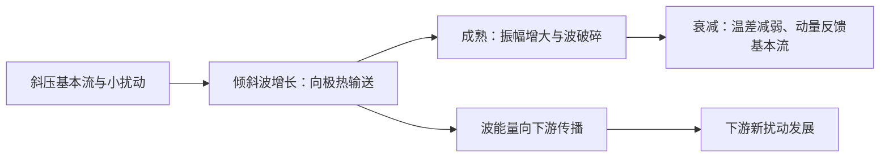

# D22 · 1999第3—10条＋1998全12条＋1997第1—3条（23条）

日期：2026-11-19｜建议投入：4小时｜动力40% · 天气40% · 物理20%

> 本学习包依据原50日PDF与仓库学习资料整理。参考答案不是官方评分标准；未完成学科审校及缺题标记均保留。公式采用 GitHub 数学 Markdown，请在 GitHub 正文或 Obsidian 阅读视图打开。

## 今日目标与记忆标准

闭卷说清概念、适用条件、符号与单位；推导必须写出起始方程、近似及关键步骤。先答题，再展开核对。

## 四小时执行

1. 20分钟：回忆此前第1、3、7、14天的重点，尚未开始的日期跳过。
2. 80分钟：逐题闭卷提取，核对以下简答与来源。
3. 70分钟：精选5题完整书写。名词解释90秒、简答7分钟、论述12分钟为训练目标。
4. 40分钟：把本日知识按“假设→方程→物理机制→天气表现”串成2—4条知识链。
5. 30分钟：记录遗漏点、用时与次日/3日/7日/14日复习日期。

> 星级口径：按同考点在不同年份的出现次数，1次★、2—3次★★、4—6次★★★、7—10次★★★★、11次及以上★★★★★；多考点题取最高频考点。星级表示复习频次，不是命题概率。

## 逐题回忆与简答

### 1999-一-3 · ★★★（同考点4年）

气象常称的行星边界层，其顶层高度一般为**1000~1500**米。

[解析来源（对应题目行）](https://github.com/0183ty2512/lao-san-yang/blob/main/%E5%8A%A8%E5%8A%9B%E6%B0%94%E8%B1%A1%E8%AF%BE%E5%90%8E%E4%B9%A0%E9%A2%98/%E8%AF%95%E9%A2%98%E8%A7%A3%E7%AD%94/%E5%BE%80%E5%B9%B4%E8%AF%95%E9%A2%98%E8%A7%A3%E6%9E%90/1999.md#L85) · [原始年度题干](https://github.com/0183ty2512/lao-san-yang/blob/main/%E5%BE%80%E5%B9%B4%E8%AF%95%E9%A2%98%E5%88%86%E6%9E%90/1999.md)

**审校状态：尚未逐题学科审校。**

**相关高频考点复习摘要（须按本题设问取舍，不替代完整解答）：**

**行星边界层：** 行星边界层直接受地面摩擦和热湿交换影响，高度随日变化与稳定度改变。近地面层可近常通量，其上科氏作用更重要；夜间稳定层可浅薄且湍流间歇，上方残留层未必仍与地面耦合。

> 以上摘要用于回忆答题主线，不是官方评分标准；推导、计算和多小问仍须完成下方步骤。

**原记录填空值：** 1000~1500。下文核对其物理含义；出现修改意见时，以修改后的说明为准。

1. 行星边界层是直接受地面摩擦、湍流热量和水汽交换影响，并在较短时间内响应的低层大气。高度随稳定度和时段变化，不能固定为某一个常数；白天对流层可较深，夜间稳定层常浅得多。

2. 近地面层中湍流通量随高度变化较小，可用常通量近似；其上外层科氏力逐渐重要，风速和风向向地转风过渡。稳定夜间边界层上可存在残留层，残留层不一定仍与地面有效交换。

### 1999-一-4 · ★★★★（同考点7年）

我国大陆上夏季低空急流一般高度为**850~700**hPa 左右，风速为**12**m/s 以上。

[解析来源（对应题目行）](https://github.com/0183ty2512/lao-san-yang/blob/main/%E5%8A%A8%E5%8A%9B%E6%B0%94%E8%B1%A1%E8%AF%BE%E5%90%8E%E4%B9%A0%E9%A2%98/%E8%AF%95%E9%A2%98%E8%A7%A3%E7%AD%94/%E5%BE%80%E5%B9%B4%E8%AF%95%E9%A2%98%E8%A7%A3%E6%9E%90/1999.md#L125) · [原始年度题干](https://github.com/0183ty2512/lao-san-yang/blob/main/%E5%BE%80%E5%B9%B4%E8%AF%95%E9%A2%98%E5%88%86%E6%9E%90/1999.md)

**审校状态：尚未逐题学科审校。**

**相关高频考点复习摘要（须按本题设问取舍，不替代完整解答）：**

**低空急流：** 低空急流是低层风速局地极大带，东亚夏季常在850—700 hPa附近。可由压力梯度、地形和夜间摩擦减弱后的惯性振荡形成；输送暖湿空气，在出口或与锋、切变线交汇处产生辐合，利于暴雨；对流加热亦可反馈加强急流。

> 以上摘要用于回忆答题主线，不是官方评分标准；推导、计算和多小问仍须完成下方步骤。

**原记录填空值：** 850~700；12。下文核对其物理含义；出现修改意见时，以修改后的说明为准。

1. 低空急流是对流层低层的局地风速极大带，东亚夏季常在 850—700 hPa 附近，题中的 12 m/s 或 12—15 m/s 属常用识别量级，具体标准随研究变化。

2. 形成机制包括大尺度压力梯度加强、地形通道和山坡热力差异；夜间地表稳定化削弱摩擦，残余风发生惯性振荡，也可产生夜间风速极大。不同类型低空急流机制并不相同。

3. 低空急流输送暖湿空气，出口附近或与锋、切变线相交处辐合，利于不稳定能量和水汽积聚、暴雨触发；对流加热也可反过来加强低层压力梯度及急流。

### 1999-二-1 · ★★（同考点2年）

给出天气动力分析中常用的连续方程表达式，并说明它的物理意义。

[解析来源（对应题目行）](https://github.com/0183ty2512/lao-san-yang/blob/main/%E5%8A%A8%E5%8A%9B%E6%B0%94%E8%B1%A1%E8%AF%BE%E5%90%8E%E4%B9%A0%E9%A2%98/%E8%AF%95%E9%A2%98%E8%A7%A3%E7%AD%94/%E5%BE%80%E5%B9%B4%E8%AF%95%E9%A2%98%E8%A7%A3%E6%9E%90/1999.md#L171) · [原始年度题干](https://github.com/0183ty2512/lao-san-yang/blob/main/%E5%BE%80%E5%B9%B4%E8%AF%95%E9%A2%98%E5%88%86%E6%9E%90/1999.md)

**审校状态：尚未逐题学科审校。**

> 以上摘要用于回忆答题主线，不是官方评分标准；推导、计算和多小问仍须完成下方步骤。

1. 对固定体积，质量变化率等于边界质量净流入，应用散度定理得 $\frac{\partial}{\partial t}\rho+\nabla\cdot(\rho\mathbf V)=0$。
2. 展开后 $D\rho/Dt+\rho\nabla\cdot\mathbf V=0$；不可压缩条件下 $\nabla\cdot\mathbf V=0$。
3. 静力气压坐标中，单位水平面积、气压厚度 $dp$ 的质量为 $-dp/g$，质量连续方程化为 $\frac{\partial u}{\partial x}+\frac{\partial v}{\partial y}+\frac{\partial\omega}{\partial p}=0$。
4. 记 $D=\frac{\partial u}{\partial x}+\frac{\partial v}{\partial y}$，从给定边界 $p_b$ 积分，得到 $\boxed{\omega(p)=\omega(p_b)-\int_{p_b}^{p}D(p')\,dp'}$。这就是运动学法。边界可用地面运动学条件，或在模式顶取规定的 $\omega$。
5. $\omega<0$ 表示上升，$\omega>0$ 表示下沉。低层辐合高层辐散常配合上升，但必须满足整层质量连续性；风场误差会通过垂直积分累积，应作质量守恒修正。

### 1999-二-2 · ★★★（同考点5年）

位势稳定度的定义及其表示式。

[解析来源（对应题目行）](https://github.com/0183ty2512/lao-san-yang/blob/main/%E5%8A%A8%E5%8A%9B%E6%B0%94%E8%B1%A1%E8%AF%BE%E5%90%8E%E4%B9%A0%E9%A2%98/%E8%AF%95%E9%A2%98%E8%A7%A3%E7%AD%94/%E5%BE%80%E5%B9%B4%E8%AF%95%E9%A2%98%E8%A7%A3%E6%9E%90/1999.md#L207) · [原始年度题干](https://github.com/0183ty2512/lao-san-yang/blob/main/%E5%BE%80%E5%B9%B4%E8%AF%95%E9%A2%98%E5%88%86%E6%9E%90/1999.md)

**审校状态：尚未逐题学科审校。**

**相关高频考点复习摘要（须按本题设问取舍，不替代完整解答）：**

**位势不稳定：** 位势不稳定针对整层抬升，常以 $\partial\theta_e/\partial z<0$ 或教材的假相当位温梯度判断。整层抬升饱和后可转为不稳定。它不同于单气块条件不稳定 $\Gamma_m<\Gamma<\Gamma_d$，两者不能简单当同义词。

> 以上摘要用于回忆答题主线，不是官方评分标准；推导、计算和多小问仍须完成下方步骤。

1. 干大气 $N^2=(g/\theta)d\theta/dz$。位温随高度增大为干静力稳定，等位温为中性，随高度减小为不稳定。这是对单个小气块竖直位移的判据。

2. 饱和上升时潜热释放使湿绝热直减率 $\Gamma_m<\Gamma_d$。若环境直减率满足 $\Gamma_m<\Gamma<\Gamma_d$，未饱和气块稳定而饱和气块不稳定，称条件不稳定。

3. 位势（对流）不稳定针对整层抬升：$d\theta_e/dz<0$（按教材也用假相当位温 $\theta_{se}$）时，抬升至饱和后低层更暖湿、释放更多潜热，整层可转为不稳定；位势稳定度可写成 $\partial\theta_e/\partial z$，在 $p$ 坐标符号相反。

4. 条件不稳定与位势不稳定并非同义，原题若写“条件（位势）不稳定”应分别说明。常见应用是雷暴：先由抬升克服抑制，气块达到自由对流高度后释放不稳定能量，并非有不稳定层结就必然立刻降雨。

### 1999-三-1 · ★★（同考点2年）

用角动量输送理论说明大气中，东西风带维持的机制。

[解析来源（对应题目行）](https://github.com/0183ty2512/lao-san-yang/blob/main/%E5%8A%A8%E5%8A%9B%E6%B0%94%E8%B1%A1%E8%AF%BE%E5%90%8E%E4%B9%A0%E9%A2%98/%E8%AF%95%E9%A2%98%E8%A7%A3%E7%AD%94/%E5%BE%80%E5%B9%B4%E8%AF%95%E9%A2%98%E8%A7%A3%E6%9E%90/1999.md#L253) · [原始年度题干](https://github.com/0183ty2512/lao-san-yang/blob/main/%E5%BE%80%E5%B9%B4%E8%AF%95%E9%A2%98%E5%88%86%E6%9E%90/1999.md)

**审校状态：尚未逐题学科审校。**

> 以上摘要用于回忆答题主线，不是官方评分标准；推导、计算和多小问仍须完成下方步骤。

1. 经向输送绝对角动量 $M=a\cos\varphi(\Omega a\cos\varphi+u)$ 的过程包括平均经圈环流、定常涡旋和瞬变天气涡旋。地表摩擦对东风带和西风带施加不同符号的转矩，内部经向与竖直输送把获得的动量重新分配，维持平均风带。

2. 动量通量 $\overline{u'v'}$ 的辐合可加速平均西风；平均流向扰动的正压动能转换为 $-\overline{u'v'}U_y$。不能用“地球自转不变”直接推出每一时刻所有输送都严格从东风带指向西风带，必须写出收支、外部摩擦转矩与统计稳态。

### 1999-三-2 · ★★（同考点2年）

气象分析中用等压面代替等高面的基本原理是什么？有什么优越性？

[解析来源（对应题目行）](https://github.com/0183ty2512/lao-san-yang/blob/main/%E5%8A%A8%E5%8A%9B%E6%B0%94%E8%B1%A1%E8%AF%BE%E5%90%8E%E4%B9%A0%E9%A2%98/%E8%AF%95%E9%A2%98%E8%A7%A3%E7%AD%94/%E5%BE%80%E5%B9%B4%E8%AF%95%E9%A2%98%E8%A7%A3%E6%9E%90/1999.md#L296) · [原始年度题干](https://github.com/0183ty2512/lao-san-yang/blob/main/%E5%BE%80%E5%B9%B4%E8%AF%95%E9%A2%98%E5%88%86%E6%9E%90/1999.md)

**审校状态：尚未逐题学科审校。**

> 以上摘要用于回忆答题主线，不是官方评分标准；推导、计算和多小问仍须完成下方步骤。

1. 静力条件 $p_z=-\rho g<0$ 使气压随高度单调减小，所以在同一柱中可用 $p$ 代替 $z$ 定位。
2. 对任意标量 $F(x,y,z,t)=\widetilde F(x,y,p,t)$，链式法则给出 $(F_x)_z=(\widetilde F_x)_p+F_p(p_x)_z$，以及 $F_z=F_pp_z$；时间导数同理。
3. 气压垂直速度定义为 $\omega=Dp/Dt=p_t+up_x+vp_y+wp_z$。因此物质导数在新坐标中为 $D/Dt=\frac{\partial}{\partial t}+u\frac{\partial}{\partial x}+v\frac{\partial}{\partial y}+\omega\frac{\partial}{\partial p}$。
4. 将链式法则与静力关系合用，水平压力梯度力变为 $-\nabla_p\Phi$；连续方程变为 $\frac{\partial u}{\partial x}+\frac{\partial v}{\partial y}+\frac{\partial\omega}{\partial p}=0$；静力方程为 $\frac{\partial\Phi}{\partial p}=-\alpha$。
5. 优点是等压面上质量层厚简单、连续方程不显含密度、探空和高空图资料易使用。局限是地面不是固定等压面，山地部分等压面可位于地下，需要地形边界处理。

### 1999-四-整题 · ★★★（同考点5年）

叙述低纬度大气运动的基本特征。

[解析来源（对应题目行）](https://github.com/0183ty2512/lao-san-yang/blob/main/%E5%8A%A8%E5%8A%9B%E6%B0%94%E8%B1%A1%E8%AF%BE%E5%90%8E%E4%B9%A0%E9%A2%98/%E8%AF%95%E9%A2%98%E8%A7%A3%E7%AD%94/%E5%BE%80%E5%B9%B4%E8%AF%95%E9%A2%98%E8%A7%A3%E6%9E%90/1999.md#L336) · [原始年度题干](https://github.com/0183ty2512/lao-san-yang/blob/main/%E5%BE%80%E5%B9%B4%E8%AF%95%E9%A2%98%E5%88%86%E6%9E%90/1999.md)

**审校状态：尚未逐题学科审校。**

**相关高频考点复习摘要（须按本题设问取舍，不替代完整解答）：**

**热带大气与天气系统：** 低纬科氏参数小且跨赤道变号，不能直接套用中纬地转近似；大尺度水平温差常小，湿对流加热、辐合辐散与海气相互作用重要。主要有哈得莱、沃克环流及热带波动和涡旋，局部强涡旋仍可近梯度平衡。

> 以上摘要用于回忆答题主线，不是官方评分标准；推导、计算和多小问仍须完成下方步骤。

1. 低纬度 $f$ 小且跨赤道变号，不能普遍使用中纬度地转和准地转近似。大尺度气压、温度水平差异常较小，但水汽与对流差异很大；垂直运动、辐合辐散和潜热加热在环流维持中更突出。

2. 中纬度系统常依赖强水平温度梯度、地转风和斜压能量转换；热带大尺度运动常以对流加热与辐散环流、波动和涡旋相互作用组织，热带气旋内又可有强旋转和梯度风平衡。

3. 低纬垂直环流包括经向哈得莱环流和纬向沃克环流。暖湿上升区常对应深对流，补偿下沉区较干，不能把热带描写成处处同样上升。

### 1999-五-整题 · ★★★★★（同考点12年）

叙述东亚季风形成的基本因子。

[解析来源（对应题目行）](https://github.com/0183ty2512/lao-san-yang/blob/main/%E5%8A%A8%E5%8A%9B%E6%B0%94%E8%B1%A1%E8%AF%BE%E5%90%8E%E4%B9%A0%E9%A2%98/%E8%AF%95%E9%A2%98%E8%A7%A3%E7%AD%94/%E5%BE%80%E5%B9%B4%E8%AF%95%E9%A2%98%E8%A7%A3%E6%9E%90/1999.md#L380) · [原始年度题干](https://github.com/0183ty2512/lao-san-yang/blob/main/%E5%BE%80%E5%B9%B4%E8%AF%95%E9%A2%98%E5%88%86%E6%9E%90/1999.md)

**审校状态：尚未逐题学科审校。**

**相关高频考点复习摘要（须按本题设问取舍，不替代完整解答）：**

**季风：** 季风是大范围盛行风向随季节显著转换的环流。形成因子包括海陆热力差异、行星风带季节移动及高原作用。东亚冬季风联系大陆冷高压与东亚大槽；夏季风联系季风低压、副高边缘水汽输送和高空南亚高压，热带与副热带季风并存。

> 以上摘要用于回忆答题主线，不是官方评分标准；推导、计算和多小问仍须完成下方步骤。

1. **概念。** 季风是大范围盛行风向随季节发生显著转换的环流，通常伴有干湿季变化；季风区是这种季节性风向转换及其天气气候影响显著的地区。不能仅用一个地点冬夏偶然相反的风判定。

2. **基本因子。** 海陆热容量不同：冬季大陆冷却快、形成冷高压，夏季大陆增温快、形成热低压；压力配置改变，推动低层风季节反转。太阳直射点移动带动行星风带和热带辐合带移动，青藏高原热力及动力作用进一步重塑亚洲环流。

3. **冬季系统。** 亚洲大陆和高原为冷源，西伯利亚高压、阿留申低压、东亚大槽及强西风急流配合；我国大部盛行偏北风，带来寒冷干燥天气，沿海还受海陆和地形调制。

4. **夏季系统。** 大陆、高原感热及南亚—东亚降水潜热形成热源；低层印度季风槽、南海季风、西太平洋副高西侧偏南气流、跨赤道气流共同输送水汽，上层南亚高压及热带东风急流响应加热。

5. **东亚特点。** 既有热带季风也有副热带季风，冬季风尤其强；夏季水汽路径包括孟加拉湾—南海和西太平洋，雨带随季风推进分阶段北跳，又受中高纬冷空气影响。热源、环流、水汽辐合和潜热释放相互反馈，不能归结成单一海陆风的放大。

### 1998-一-1 · ★★（同考点3年）

**本次复核提示（2026-10-31）：** 原填空是强事件量级，不是寒潮、台风的普遍中心气压；1060—1080 hPa尤其不能理解为常态。高海拔地区海平面订正气压与实际站压须区分。

冬季，东亚寒潮活动时，地面气压中心大致为**1060~1080** hPa，而夏季台风中心的地面气压则下降至**900~950** hPa 左右。

[解析来源（对应题目行）](https://github.com/0183ty2512/lao-san-yang/blob/main/%E5%8A%A8%E5%8A%9B%E6%B0%94%E8%B1%A1%E8%AF%BE%E5%90%8E%E4%B9%A0%E9%A2%98/%E8%AF%95%E9%A2%98%E8%A7%A3%E7%AD%94/%E5%BE%80%E5%B9%B4%E8%AF%95%E9%A2%98%E8%A7%A3%E6%9E%90/1998.md#L11) · [原始年度题干](https://github.com/0183ty2512/lao-san-yang/blob/main/%E5%BE%80%E5%B9%B4%E8%AF%95%E9%A2%98%E5%88%86%E6%9E%90/1998.md)

**审校状态：尚未逐题学科审校。**

**相关高频考点复习摘要（须按本题设问取舍，不替代完整解答）：**

**地面气压极值：** 1060 hPa以上大陆冷高压、950 hPa以下强热带气旋中心等是强事件量级，不是所有寒潮或台风的典型平均。极值还需说明海平面订正、地区和统计样本，不能拿填空中的例值当绝对上限或下限。

> 以上摘要用于回忆答题主线，不是官方评分标准；推导、计算和多小问仍须完成下方步骤。

**原记录填空值：** 1060~1080；900~950。下文核对其物理含义；出现修改意见时，以修改后的说明为准。

1. 强大陆冷高压可达到1060 hPa甚至更高，强热带气旋中心可低于950 hPa、极强个例低于900 hPa；这些是强事件量级，不是“所有寒潮或台风的一般气压”。原文给出的极值范围不应当作气候平均。

### 1998-一-2 · ★★（同考点2年）

**本次复核提示（2026-10-31）：** 原记录两套单位不等价。静力条件下$\omega=\frac{\partial p}{\partial t}+\mathbf V_h\cdot\nabla_zp-\rho gw$；仅当前两项可忽略时用$\omega\simeq-\rho gw$。取密度1 kg/m³，1—10 cm/s约对应3.5—35 hPa/h，1—10 m/s约对应353—3530 hPa/h；上升对应负值。不能把几十hPa/h与1—10 m/s直接等同。

天气尺度系统中垂直速度量级一般为**几hPa/h**（或用 **1~10 cm/s**）；而在中尺度对流系统中，垂直速度可达**几十hPa/h**（或用 **1~10 m/s**）。

[解析来源（对应题目行）](https://github.com/0183ty2512/lao-san-yang/blob/main/%E5%8A%A8%E5%8A%9B%E6%B0%94%E8%B1%A1%E8%AF%BE%E5%90%8E%E4%B9%A0%E9%A2%98/%E8%AF%95%E9%A2%98%E8%A7%A3%E7%AD%94/%E5%BE%80%E5%B9%B4%E8%AF%95%E9%A2%98%E8%A7%A3%E6%9E%90/1998.md#L49) · [原始年度题干](https://github.com/0183ty2512/lao-san-yang/blob/main/%E5%BE%80%E5%B9%B4%E8%AF%95%E9%A2%98%E5%88%86%E6%9E%90/1998.md)

**审校状态：尚未逐题学科审校。**

> 以上摘要用于回忆答题主线，不是官方评分标准；推导、计算和多小问仍须完成下方步骤。

**原记录填空值：** 几hPa/h；1~10 cm/s；几十hPa/h；1~10 m/s。下文核对其物理含义；出现修改意见时，以修改后的说明为准。

1. 连续方程估算 $W/H\sim D$。一般辐散流 $D\sim U/L$，故 $W\sim UH/L$；准地转运动地转部分近无辐散，实际 $D$ 更小，$W$ 也更小。天气尺度 $w$ 常为厘米每秒量级，对流上升可达米每秒甚至更高。

**单位核对：** $\omega\approx-\rho gw$。取 $\rho=1\ \mathrm{kg\,m^{-3}}$，$w=1\ \mathrm{m/s}$ 对应 $|\omega|\approx353\ \mathrm{hPa/h}$。所以原题把“几十hPa/h”与“1—10 m/s”并列成等价量级不一致；还应说明密度随高度变化。

### 1998-一-3 · ★★★★★（同考点16年）

**本次复核提示（2026-10-31）：** 待核教材口径：原填空给出的三处位置不能据此认定为冬季阻塞频率的严格前三名；鄂霍次克海阻高有明显季节性。原解主要讲阻塞机制，未提供冬季分布统计依据，保留此疑点。

北半球冬季最易出现阻塞高压的地区为**乌拉尔山地区**、**鄂霍次克海地区**和**北大西洋东部**。

[解析来源（对应题目行）](https://github.com/0183ty2512/lao-san-yang/blob/main/%E5%8A%A8%E5%8A%9B%E6%B0%94%E8%B1%A1%E8%AF%BE%E5%90%8E%E4%B9%A0%E9%A2%98/%E8%AF%95%E9%A2%98%E8%A7%A3%E7%AD%94/%E5%BE%80%E5%B9%B4%E8%AF%95%E9%A2%98%E8%A7%A3%E6%9E%90/1998.md#L85) · [原始年度题干](https://github.com/0183ty2512/lao-san-yang/blob/main/%E5%BE%80%E5%B9%B4%E8%AF%95%E9%A2%98%E5%88%86%E6%9E%90/1998.md)

**审校状态：尚未逐题学科审校。**

**相关高频考点复习摘要（须按本题设问取舍，不替代完整解答）：**

**阻塞高压：** 阻塞高压是中高纬持续、少动并使西风绕行的强脊或闭合高压。建立与暖输送、波破碎及涡旋反馈有关；其东侧偏北气流可蓄积和引导冷空气。衰退配合横槽转竖时可触发寒潮，但并非每次崩溃都必然造成寒潮。

> 以上摘要用于回忆答题主线，不是官方评分标准；推导、计算和多小问仍须完成下方步骤。

**原记录填空值：** 乌拉尔山地区；鄂霍次克海地区；北大西洋东部。下文核对其物理含义；出现修改意见时，以修改后的说明为准。

1. 阻塞高压是中高纬持续、移动缓慢的强高压脊或闭合高压，使西风气流绕行、分支，阻碍天气系统正常东移。关键是持续性和对西风带的阻挡，并非所有高压都叫阻塞。
2. 建立时，暖空气向极地输送使脊增强，经向振幅增大，波破碎、涡旋反馈可帮助维持。高压脊发展或与高纬高压合并，南侧可切出冷低压，形成偶极或Ω型等配置。
3. 维持时，阻高东侧偏北气流引导冷空气南下，西侧偏南气流输送暖空气。下游槽及冷暖空气交汇区可长期停留，造成持久冷凉、降雨；高压控制区下沉、少云，可造成干旱和高温，具体依季节和位置。
4. 衰退或崩溃时，维持高压的暖输送与涡旋反馈减弱，西风恢复，槽脊重新东移；其东侧积聚的冷空气可配合横槽转竖大举南下，触发我国寒潮。不能把每一次阻高衰退都等同于寒潮，仍需冷空气强度和路径配合。
5. 亚洲常关注乌拉尔山及鄂霍次克海等阻塞区，北大西洋—欧洲也是重要活动区；不同季节的优势位置不同，不应把某一季节经验说成全年固定不变。
6. 切断低压是从西风主槽分离出的闭合冷性低压，移动缓慢，可与北侧阻高配合。其冷空气及正涡度有利于下游不稳定和上升，但天气还依水汽供应。

### 1998-二-1 · ★★★★（同考点7年）

**本次复核提示（2026-10-31）：** 涡度、水平散度及垂直积分公式符号正确，水平导数须在同一等压面取值。补充地面边界$\omega_s=\frac{\partial p_s}{\partial t}+u_s\frac{\partial p_s}{\partial x}+v_s\frac{\partial p_s}{\partial y}$，一般不等于零。质量薄层为$(p_{底}-p_{顶})/g>0$；原文$-dp/g$仅适用于向上积分时dp为负的取向。

给出用风场（如$u, v$分量）计算的涡度$\zeta$，散度D及垂直速度$\omega$表达式。

[解析来源（对应题目行）](https://github.com/0183ty2512/lao-san-yang/blob/main/%E5%8A%A8%E5%8A%9B%E6%B0%94%E8%B1%A1%E8%AF%BE%E5%90%8E%E4%B9%A0%E9%A2%98/%E8%AF%95%E9%A2%98%E8%A7%A3%E7%AD%94/%E5%BE%80%E5%B9%B4%E8%AF%95%E9%A2%98%E8%A7%A3%E6%9E%90/1998.md#L132) · [原始年度题干](https://github.com/0183ty2512/lao-san-yang/blob/main/%E5%BE%80%E5%B9%B4%E8%AF%95%E9%A2%98%E5%88%86%E6%9E%90/1998.md)

**审校状态：尚未逐题学科审校。**

**相关高频考点复习摘要（须按本题设问取舍，不替代完整解答）：**

**涡度：** 垂直相对涡度 $\zeta=\frac{\partial v}{\partial x}-\frac{\partial u}{\partial y}$，绝对涡度为 $\zeta+f$，单位 $\mathrm{s^{-1}}$。北半球正值通常表示气旋性旋转。取旋度能消去保守压力梯度，但涡度方程单独不能决定完整风场。

**散度：** 水平散度 $D=\frac{\partial u}{\partial x}+\frac{\partial v}{\partial y}$，正为辐散、负为辐合，单位 $\mathrm{s^{-1}}$。静力气压坐标连续式 $D+\frac{\partial\omega}{\partial p}=0$，求垂直速度须沿气压积分并给边界条件，不能由单层辐合唯一确定整柱运动。

**垂直运动：** 运动学法由 $D+\frac{\partial\omega}{\partial p}=0$ 积分，$\omega(p)=\omega(p_b)-\int_{p_b}^{p}Ddp$。高度坐标 $w>0$ 上升，气压坐标通常 $\omega<0$ 上升；边界条件和整层散度分布决定结果。

> 以上摘要用于回忆答题主线，不是官方评分标准；推导、计算和多小问仍须完成下方步骤。

1. 定义垂直相对涡度 $\zeta=\frac{\partial v}{\partial x}-\frac{\partial u}{\partial y}$，水平散度 $D=\frac{\partial u}{\partial x}+\frac{\partial v}{\partial y}$，单位均为 $\mathrm{s^{-1}}$。绝对涡度的垂直分量为 $\zeta_a=\zeta+f$；三维绝对涡度为 $\nabla\times\mathbf V+2\boldsymbol\Omega$。

本段与上文相同，可回看前面的解析，不再重复展开。

### 1998-二-2 · ★★★★（同考点8年）

**本次复核提示（2026-10-31）：** Hadley是热带平均南北向垂直环流，Walker是热带东西向垂直环流；太平洋西升东沉是典型背景态，会随ENSO变化。费雷尔与极地环流不是本题必答项。

什么叫 Hadley 环流和 Walker 环流。

[解析来源（对应题目行）](https://github.com/0183ty2512/lao-san-yang/blob/main/%E5%8A%A8%E5%8A%9B%E6%B0%94%E8%B1%A1%E8%AF%BE%E5%90%8E%E4%B9%A0%E9%A2%98/%E8%AF%95%E9%A2%98%E8%A7%A3%E7%AD%94/%E5%BE%80%E5%B9%B4%E8%AF%95%E9%A2%98%E8%A7%A3%E6%9E%90/1998.md#L180) · [原始年度题干](https://github.com/0183ty2512/lao-san-yang/blob/main/%E5%BE%80%E5%B9%B4%E8%AF%95%E9%A2%98%E5%88%86%E6%9E%90/1998.md)

**审校状态：尚未逐题学科审校。**

**相关高频考点复习摘要（须按本题设问取舍，不替代完整解答）：**

**哈得莱环流：** 哈得莱环流是低纬平均经圈环流：赤道附近暖区上升，高层向副热带流动，副热带下沉，近地面回流形成信风，属于热力直接环流。与中纬度涡旋维持的费雷尔环流、东西向沃克环流区别。

**沃克环流：** 沃克环流是热带东西向垂直环流，典型太平洋状态为暖西部上升、较冷东部下沉，高低层构成回流。它不同于南北向哈得莱环流，可随ENSO调整。

> 以上摘要用于回忆答题主线，不是官方评分标准；推导、计算和多小问仍须完成下方步骤。

1. 平均经圈环流中，哈得莱环流低纬上升、副热带下沉，近地面回流形成信风，属于热力直接环流；费雷尔环流在中纬度、平均上热力间接，依赖天气涡旋维持；极地环流较弱。三圈是统计平均，非每个经度同时存在三个封闭圈。

1. 沃克环流是热带沿东西方向的垂直环流。典型热带太平洋上暖西太平洋对流上升，东部较冷海区下沉，低层东风回流；与哈得莱环流的南北方向不同。

### 1998-二-3 · ★★★★★（同考点12年）

**本次复核提示（2026-10-31）：** 应直接列假定：远离赤道、摩擦可忽略、局地及平流加速度均远小于科氏项，水平气压梯度力与科氏力平衡。$Ro=\frac{U}{|f|L}\ll1$及$\frac{1}{|f|T}\ll1$分别约束两类加速度；不能仅说“无摩擦”便推出地转风。

说出地转风的基本假定。

[解析来源（对应题目行）](https://github.com/0183ty2512/lao-san-yang/blob/main/%E5%8A%A8%E5%8A%9B%E6%B0%94%E8%B1%A1%E8%AF%BE%E5%90%8E%E4%B9%A0%E9%A2%98/%E8%AF%95%E9%A2%98%E8%A7%A3%E7%AD%94/%E5%BE%80%E5%B9%B4%E8%AF%95%E9%A2%98%E8%A7%A3%E6%9E%90/1998.md#L221) · [原始年度题干](https://github.com/0183ty2512/lao-san-yang/blob/main/%E5%BE%80%E5%B9%B4%E8%AF%95%E9%A2%98%E5%88%86%E6%9E%90/1998.md)

**审校状态：尚未逐题学科审校。**

**相关高频考点复习摘要（须按本题设问取舍，不替代完整解答）：**

**地转风：** 中纬度大尺度缓变、摩擦可忽略时，水平气压梯度力与科氏力近似平衡：$u_g=-\frac{\partial \Phi}{\partial y}/f$、$v_g=\frac{\partial \Phi}{\partial x}/f$。风平行等高线，北半球低值在风向左侧。近赤道、摩擦层和强曲率快速运动中须检验适用性。

> 以上摘要用于回忆答题主线，不是官方评分标准；推导、计算和多小问仍须完成下方步骤。

1. 在局地直角坐标中，忽略摩擦时水平动量方程为 $Du/Dt-fv=-\frac{\partial \Phi}{\partial x}$、$Dv/Dt+fu=-\frac{\partial \Phi}{\partial y}$，这里的导数取在等压面上。
2. 对中纬度大尺度缓变运动，$Ro=U/(|f|L)\ll1$，惯性项相对较小，得到 $-fv_g=-\frac{\partial \Phi}{\partial x}$、$fu_g=-\frac{\partial \Phi}{\partial y}$。
3. 解得 $\boxed{u_g=-\frac{\partial \Phi}{\partial y}/f,\quad v_g=\frac{\partial \Phi}{\partial x}/f}$，即 $\mathbf V_g=\mathbf k\times\nabla_p\Phi/f$；大小为 $|\nabla_p\Phi|/|f|$。
4. 因叉积垂直于梯度，地转风平行于等高线；北半球背风而立时低值在左、高值在右，南半球相反。等高线越密风越强，但还受纬度 $f$ 影响。
5. 近赤道 $f\to0$、摩擦层、强曲率或快速变化的小尺度系统中不能直接采用地转近似。等高面上应改用 $\nabla_zp/\rho$，不要把两种坐标的梯度混用。

### 1998-二-4 · ★（同考点1年）

**本次复核提示（2026-10-31）：** 西南涡与高原涡须区分。西南涡主要位于高原东侧及四川盆地附近低层，常用700 hPa识别，是中尺度低压涡旋；原解“小尺度”应理解为相对天气尺度较小，不宜误当微尺度。作答补充地形、低层切变/辐合与湿过程共同影响，发展东移时可带来下游暴雨。

西南低涡（又称西南涡）的基本特征。

[解析来源（对应题目行）](https://github.com/0183ty2512/lao-san-yang/blob/main/%E5%8A%A8%E5%8A%9B%E6%B0%94%E8%B1%A1%E8%AF%BE%E5%90%8E%E4%B9%A0%E9%A2%98/%E8%AF%95%E9%A2%98%E8%A7%A3%E7%AD%94/%E5%BE%80%E5%B9%B4%E8%AF%95%E9%A2%98%E8%A7%A3%E6%9E%90/1998.md#L261) · [原始年度题干](https://github.com/0183ty2512/lao-san-yang/blob/main/%E5%BE%80%E5%B9%B4%E8%AF%95%E9%A2%98%E5%88%86%E6%9E%90/1998.md)

**审校状态：尚未逐题学科审校。**

> 以上摘要用于回忆答题主线，不是官方评分标准；推导、计算和多小问仍须完成下方步骤。

1. 高原低涡常在高原近地中低层出现，水平较小，受地形、边界层加热和潜热作用影响；移出高原需合适引导气流及下游水汽。西南涡多活动于高原东南侧、四川盆地附近的低层，是气旋性小尺度低压环流，常在 700 hPa 分析，配合暖湿输送可造成暴雨。

### 1998-三-1 · ★★★★（同考点9年）

**本次复核提示（2026-10-31）：** 活动应同时答季节北跳南撤、短期西伸东退以及强度和持续时间变化；雨带多在副高边缘水汽输送与冷空气交汇处，内部持续控制易高温少雨。日期和纬度范围仅为经验，不是逐年的固定对应表。

夏季西太平洋副热带高压的活动特点及与我国降水的关系。

[解析来源（对应题目行）](https://github.com/0183ty2512/lao-san-yang/blob/main/%E5%8A%A8%E5%8A%9B%E6%B0%94%E8%B1%A1%E8%AF%BE%E5%90%8E%E4%B9%A0%E9%A2%98/%E8%AF%95%E9%A2%98%E8%A7%A3%E7%AD%94/%E5%BE%80%E5%B9%B4%E8%AF%95%E9%A2%98%E8%A7%A3%E6%9E%90/1998.md#L297) · [原始年度题干](https://github.com/0183ty2512/lao-san-yang/blob/main/%E5%BE%80%E5%B9%B4%E8%AF%95%E9%A2%98%E5%88%86%E6%9E%90/1998.md)

**审校状态：尚未逐题学科审校。**

**相关高频考点复习摘要（须按本题设问取舍，不替代完整解答）：**

**西太平洋副热带高压：** 西太副高是深厚暖性反气旋系统。控制区下沉少云，北侧和西北侧的暖湿输送与冷空气交汇可形成雨带。其北跳南撤、西伸东退和强度变化共同调制我国雨季、伏旱与台风路径，不能只看一条脊线纬度。

**我国雨带季节活动：** 我国雨带一般由华南前汛期，推进到江淮梅雨，再到华北、东北盛夏雨季，秋季南撤。副高脊线20—25°N、25—30°N、30—35°N是常用阶段性经验范围，应结合西伸东退、冷空气和年份差异，不能当作硬界线。

> 以上摘要用于回忆答题主线，不是官方评分标准；推导、计算和多小问仍须完成下方步骤。

1. 西太平洋副热带高压是副热带地区深厚、暖性的反气旋系统。中层常用 500 hPa 高度场描述，其内部下沉、对流受抑制，西北侧及北侧暖湿气流与中纬度系统相遇，是重要雨带区。
2. 形成与副热带下沉、行星波、海陆热力差异及热带加热有关，不能单说成“海面冷所以形成冷高压”。暖性结构使高压在较高层更明显，但不同层中心、脊线并不完全重合。
3. 春季至初夏副高偏南，华南锋面和季风雨活跃；6 月前后第一次北跳后，长江中下游进入梅雨，传统脊线经验约为 20°—25°N。
4. 进一步北抬至约 25°—30°N，雨带向江淮、淮河流域推进；7 月下旬至 8 月上旬前后脊线可在 30°—35°N，雨带到华北、东北，长江中下游较易受高压控制出现伏旱。秋季副高南撤，雨带随之南退。
5. 除南北移动，还要考虑西伸东退、强度和滞留时间。副高西伸使水汽输送路径和落区改变，长期稳定可造成一侧持续暴雨、另一侧持续高温。上述纬度和日期是复习用经验，不是每年的硬界线。
6. 原题若把 25°—30°N 直接与华北盛夏雨季对应，应另起行纠正：通常华北盛夏雨季对应更北的 30°—35°N 阶段。

### 1998-三-2 · ★★（同考点2年）

**本次复核提示（2026-10-31）：** 压力坐标局地温度方程各项符号正确；需区分局地变化$\frac{\partial T}{\partial t}$与随气块变化$\frac{DT}{Dt}$。自由大气仍有辐射、凝结等非绝热加热，Q的量纲为单位质量单位时间加热率。

自由大气中决定温度变化的因子有哪些？

[解析来源（对应题目行）](https://github.com/0183ty2512/lao-san-yang/blob/main/%E5%8A%A8%E5%8A%9B%E6%B0%94%E8%B1%A1%E8%AF%BE%E5%90%8E%E4%B9%A0%E9%A2%98/%E8%AF%95%E9%A2%98%E8%A7%A3%E7%AD%94/%E5%BE%80%E5%B9%B4%E8%AF%95%E9%A2%98%E8%A7%A3%E6%9E%90/1998.md#L341) · [原始年度题干](https://github.com/0183ty2512/lao-san-yang/blob/main/%E5%BE%80%E5%B9%B4%E8%AF%95%E9%A2%98%E5%88%86%E6%9E%90/1998.md)

**审校状态：尚未逐题学科审校。**

> 以上摘要用于回忆答题主线，不是官方评分标准；推导、计算和多小问仍须完成下方步骤。

1. 水平温度平流为 $A_T=-\mathbf V_h\cdot\nabla T=-(u\frac{\partial T}{\partial x}+v\frac{\partial T}{\partial y})$。风由暖区吹向冷区时，沿风向温度减小，点积为负，故 $A_T>0$，为暖平流；反之 $A_T<0$，为冷平流。
2. 由 $c_pDT/Dt-\alpha\omega=Q$ 和 $\alpha=RT/p$，得 $DT/Dt-\kappa T\omega/p=Q/c_p$。
3. 展开物质导数 $DT/Dt=\frac{\partial T}{\partial t}+u\frac{\partial T}{\partial x}+v\frac{\partial T}{\partial y}+\omega\frac{\partial T}{\partial p}$，移项：
$$\boxed{\frac{\partial T}{\partial t}=-\mathbf V_h\cdot\nabla_pT+\omega\left(\frac{\kappa T}{p}-\frac{\partial T}{\partial p}\right)+\frac Q{c_p}}.$$
4. 右侧依次为水平平流、垂直运动与绝热压缩膨胀的合成作用、非绝热加热。在稳定层结下，上升（$\omega<0$）的动力变温通常为冷却，下沉则增温。因此有暖平流不等于局地温度一定上升。

### 1998-三-3 · ★★（同考点2年）

**本次复核提示（2026-10-31）：** 待核教材分型体系：按中高纬槽脊数目、位置、振幅和优势流向，可概括纬向型、经向型及混合型；若试卷要求某一特定半球总体分型，须依指定教材名称与判据。原解大气活动中心定义与本题无直接关系，不能充当分型依据。

主要依照什么原则对大气环流分型？一般大气环流（北半球）分几种类型？

[解析来源（对应题目行）](https://github.com/0183ty2512/lao-san-yang/blob/main/%E5%8A%A8%E5%8A%9B%E6%B0%94%E8%B1%A1%E8%AF%BE%E5%90%8E%E4%B9%A0%E9%A2%98/%E8%AF%95%E9%A2%98%E8%A7%A3%E7%AD%94/%E5%BE%80%E5%B9%B4%E8%AF%95%E9%A2%98%E8%A7%A3%E6%9E%90/1998.md#L377) · [原始年度题干](https://github.com/0183ty2512/lao-san-yang/blob/main/%E5%BE%80%E5%B9%B4%E8%AF%95%E9%A2%98%E5%88%86%E6%9E%90/1998.md)

**审校状态：尚未逐题学科审校。**

> 以上摘要用于回忆答题主线，不是官方评分标准；推导、计算和多小问仍须完成下方步骤。

1. 环流分型可依槽脊数目、振幅、位置和优势流向分为纬向型、经向型及过渡/混合型；其他教材还按区域槽脊位置作更细分类。大气活动中心是多年平均气压场中持续或季节性出现的主要高低压区，位置和强度的变化组织区域天气。

### 1998-三-4 · ★★★★（同考点9年）

**本次复核提示（2026-10-31）：** 按理想锋面气旋答初生、发展、成熟/锢囚、衰亡。冷锋追近暖锋时地面暖区逐渐收窄，不能背成发展期暖区必扩大。区域需区分生成与移动：蒙古及东北、江淮、东部近海为常见生成或发展区，蒙古并非我国境内全部地区；冷反气旋入侵路线不是本题所问。

叙述气旋发生史中的几个阶段，我国气旋主要发生在什么区域？

[解析来源（对应题目行）](https://github.com/0183ty2512/lao-san-yang/blob/main/%E5%8A%A8%E5%8A%9B%E6%B0%94%E8%B1%A1%E8%AF%BE%E5%90%8E%E4%B9%A0%E9%A2%98/%E8%AF%95%E9%A2%98%E8%A7%A3%E7%AD%94/%E5%BE%80%E5%B9%B4%E8%AF%95%E9%A2%98%E8%A7%A3%E6%9E%90/1998.md#L409) · [原始年度题干](https://github.com/0183ty2512/lao-san-yang/blob/main/%E5%BE%80%E5%B9%B4%E8%AF%95%E9%A2%98%E5%88%86%E6%9E%90/1998.md)

**审校状态：尚未逐题学科审校。**

**相关高频考点复习摘要（须按本题设问取舍，不替代完整解答）：**

**气旋及其发展：** 气旋是低压及气旋式环流。温带锋面气旋依次经历初生波动、发展加深、成熟锢囚、衰亡填塞；斜压有效位能、高空涡度平流和辐散、低层暖平流及潜热共同影响发展。不能把所有气旋都概括成轴对称冷心。

> 以上摘要用于回忆答题主线，不是官方评分标准；推导、计算和多小问仍须完成下方步骤。

1. 气旋是低压及其气旋式环流系统，北半球逆时针、南半球顺时针；反气旋为高压及反气旋式环流。低层摩擦使气旋常辐合上升、反气旋常辐散下沉，但云雨仍依水汽和热力条件。

2. **温带锋面气旋四阶段。** 初生：静止锋上出现波动，暖空气向冷侧、冷空气向暖侧推进；发展：低压加深，冷暖锋清楚，冷锋通常较暖锋移动快，地面暖区逐渐收窄，槽前正涡度平流和高空辐散配合；成熟/锢囚：冷锋追上暖锋，暖空气抬离地面，气旋范围较大且结构复杂；衰亡：近地面冷空气占据中心，水平温差和斜压取能减弱，低压逐渐填塞。

3. **主要发展因子。** 基本态温度梯度与垂直风切变提供有效位能，高低空槽与地面低压有利配置，低层暖平流、高层正涡度平流和辐散支持上升，凝结潜热可加强发展。并非每个实际气旋都严格走完同一理想阶段。

4. 我国温带气旋常活动于蒙古—东北、黄淮—江淮及东部沿海等区，路径随季节变化。冷反气旋多随冷空气从西北、北方或东北方向南下，冬半年强且广，暖季较弱；不能给出一条全年唯一入侵路线。

### 1998-三-5 · ★★★★（同考点7年）

**本次复核提示（2026-10-31）：** 原解暖海焓供给、湿度、弱垂直切变、初始涡旋与适宜旋转环境覆盖主要有利条件。它们不是各自独立的充分条件；26.5℃为经验参考。CISK和能量来源可作解释，不必把整段生命周期知识替代条件清单。

叙述台风形成的几个条件。

[解析来源（对应题目行）](https://github.com/0183ty2512/lao-san-yang/blob/main/%E5%8A%A8%E5%8A%9B%E6%B0%94%E8%B1%A1%E8%AF%BE%E5%90%8E%E4%B9%A0%E9%A2%98/%E8%AF%95%E9%A2%98%E8%A7%A3%E7%AD%94/%E5%BE%80%E5%B9%B4%E8%AF%95%E9%A2%98%E8%A7%A3%E6%9E%90/1998.md#L451) · [原始年度题干](https://github.com/0183ty2512/lao-san-yang/blob/main/%E5%BE%80%E5%B9%B4%E8%AF%95%E9%A2%98%E5%88%86%E6%9E%90/1998.md)

**审校状态：尚未逐题学科审校。**

**相关高频考点复习摘要（须按本题设问取舍，不替代完整解答）：**

**热带气旋生成条件：** 热带气旋生成需暖海焓供应、暖湿且有对流潜能的环境、较弱垂直风切变、可用科氏作用、初始低层旋转扰动和高层外流。季风槽、东风波等可提供初始扰动；有利条件不等于保证生成。

> 以上摘要用于回忆答题主线，不是官方评分标准；推导、计算和多小问仍须完成下方步骤。

1. **生成条件。** 较深的暖海水供给焓，低层暖湿、对流潜能和中层湿度较充足，垂直风切变较弱，有初始低层旋转扰动及高层有效外流；离赤道要足够远以有可用科氏作用。常用约 26.5℃ 是经验参考，并非脱离海洋热含量和大气状态的绝对门槛。

2. **初始扰动。** 季风槽、热带辐合带扰动、东风波、赤道罗斯贝波等可提供涡度、辐合和持续对流。多数初始扰动不会发展，环境与内部组织过程都重要。

3. **CISK 链条。** 初始低压旋转 → 边界层摩擦造成向中心的水汽辐合 → 对流凝结释放潜热 → 暖心及质量场调整、高层外流加强 → 低压和低层旋转增强 → 更强辐合。对流和大尺度环流相互反馈而非单独气块条件不稳定，因此称第二类条件不稳定。它是理想化解释，现代海气通量反馈等机制不可省略。

4. **能量。** 水汽主要由暖海蒸发补给，海面潜热和显热通量提供焓；凝结将潜热释放，暖升冷沉及压力功转化为动能，摩擦耗散动能。不能把凝结说成凭空制造能量。

### 1997-一-1 · ★★★★（同考点8年）

**本次复核提示（2026-10-31）：** 200 hPa约12 km是代表性高度，气压面高度随温度场变化；70—80 m/s为题设量级，不是观测风速上限。原题130°E的位置与“日本上空”概括应按教材图例理解。

冬季东亚副热带急流轴平均高度在**200hPa（约12km）**，在 130°E 日本上空风速最大可至**70~80** m/s。

[解析来源（对应题目行）](https://github.com/0183ty2512/lao-san-yang/blob/main/%E5%8A%A8%E5%8A%9B%E6%B0%94%E8%B1%A1%E8%AF%BE%E5%90%8E%E4%B9%A0%E9%A2%98/%E8%AF%95%E9%A2%98%E8%A7%A3%E7%AD%94/%E5%BE%80%E5%B9%B4%E8%AF%95%E9%A2%98%E8%A7%A3%E6%9E%90/1997.md#L11) · [原始年度题干](https://github.com/0183ty2512/lao-san-yang/blob/main/%E5%BE%80%E5%B9%B4%E8%AF%95%E9%A2%98%E5%88%86%E6%9E%90/1997.md)

**审校状态：尚未逐题学科审校。**

**相关高频考点复习摘要（须按本题设问取舍，不替代完整解答）：**

**高空急流：** 高空急流是对流层上部狭长强风带，横向和垂直切变强。极锋急流与斜压锋区相关，副热带急流还受低纬角动量输送影响；冬强偏南、夏弱偏北。急流加减速与曲率引起非地转次级环流，可影响下方上升和气旋发展。

> 以上摘要用于回忆答题主线，不是官方评分标准；推导、计算和多小问仍须完成下方步骤。

**原记录填空值：** 200hPa（约12km）；70~80。下文核对其物理含义；出现修改意见时，以修改后的说明为准。

1. 急流是狭长的强风带，横向和竖直风切变显著，急流轴是局地最大风速的位置。高空西风急流位于对流层上部，冬季更强、更偏南；夏季整体偏北、减弱。东亚日本附近冬季急流可很强，题中 70—80 m/s 是典型量级而非上限。

2. 极锋急流与中纬度锋区斜压性相联系；副热带急流还与低纬向极运动的角动量输送和热成风共同有关。强南北温度梯度通过热成风使西风随高度增强；不能只归因于地面风向上复制。

3. 急流入口、出口的加减速和曲率导致非地转次级环流，局部辐散有利于下方上升和气旋发展；简单直急流象限规则只在相应理想条件下适用。

### 1997-一-2 · ★★★★（同考点7年）

**本次复核提示（2026-10-31）：** 850—700 hPa、12—15 m/s是本题给定的经验尺度，不是所有低空急流的统一定义。暴雨还需水汽、抬升和不稳定条件配合，不能由急流存在单独推出。

夏季东亚地区低空急流轴高度一般在 **850~700 hPa**，风速约为**12~15** m/s，它对**暴雨**天气影响。

[解析来源（对应题目行）](https://github.com/0183ty2512/lao-san-yang/blob/main/%E5%8A%A8%E5%8A%9B%E6%B0%94%E8%B1%A1%E8%AF%BE%E5%90%8E%E4%B9%A0%E9%A2%98/%E8%AF%95%E9%A2%98%E8%A7%A3%E7%AD%94/%E5%BE%80%E5%B9%B4%E8%AF%95%E9%A2%98%E8%A7%A3%E6%9E%90/1997.md#L53) · [原始年度题干](https://github.com/0183ty2512/lao-san-yang/blob/main/%E5%BE%80%E5%B9%B4%E8%AF%95%E9%A2%98%E5%88%86%E6%9E%90/1997.md)

**审校状态：尚未逐题学科审校。**

**相关高频考点复习摘要（须按本题设问取舍，不替代完整解答）：**

本段与上文相同，可回看前面的解析，不再重复展开。

> 以上摘要用于回忆答题主线，不是官方评分标准；推导、计算和多小问仍须完成下方步骤。

**原记录填空值：** 850~700 hPa；12~15；暴雨。下文核对其物理含义；出现修改意见时，以修改后的说明为准。

1. 低空急流是对流层低层的局地风速极大带，东亚夏季常在 850—700 hPa 附近，题中的 12 m/s 或 12—15 m/s 属常用识别量级，具体标准随研究变化。

2. 形成机制包括大尺度压力梯度加强、地形通道和山坡热力差异；夜间地表稳定化削弱摩擦，残余风发生惯性振荡，也可产生夜间风速极大。不同类型低空急流机制并不相同。

3. 低空急流输送暖湿空气，出口附近或与锋、切变线相交处辐合，利于不稳定能量和水汽积聚、暴雨触发；对流加热也可反过来加强低层压力梯度及急流。

### 1997-一-3 · ★★（同考点3年）

**本次复核提示（2026-10-31）：** 原填空存在错误：阿拉伯海属于北印度洋热带气旋活动洋盆，南大西洋也不能表述为绝对无热带气旋。“台风”是地区命名，不能用于排除其他洋盆的同类系统。参考：[NOAA热带气旋洋盆说明](https://www.noaa.gov/jetstream/tropical/tropical-cyclone-introduction)、[NOAA热带气旋问答](https://www.aoml.noaa.gov/hrd/tcfaq/G1.html)。

全球台风发生频率以**西北太平洋**最高，而**南大西洋**、**东南太平洋**和**北印度洋（阿拉伯海）**地区则无台风发生。

[解析来源（对应题目行）](https://github.com/0183ty2512/lao-san-yang/blob/main/%E5%8A%A8%E5%8A%9B%E6%B0%94%E8%B1%A1%E8%AF%BE%E5%90%8E%E4%B9%A0%E9%A2%98/%E8%AF%95%E9%A2%98%E8%A7%A3%E7%AD%94/%E5%BE%80%E5%B9%B4%E8%AF%95%E9%A2%98%E8%A7%A3%E6%9E%90/1997.md#L95) · [原始年度题干](https://github.com/0183ty2512/lao-san-yang/blob/main/%E5%BE%80%E5%B9%B4%E8%AF%95%E9%A2%98%E5%88%86%E6%9E%90/1997.md)

**审校状态：尚未逐题学科审校。**

**相关高频考点复习摘要（须按本题设问取舍，不替代完整解答）：**

**热带气旋分布：** 西北太平洋热带气旋活动频繁，通常在离赤道一定距离的暖海区生成。阿拉伯海也有热带气旋，南大西洋少见但并非绝对没有；“台风”是区域命名，不是判断其他洋盆是否存在同类系统的依据。

> 以上摘要用于回忆答题主线，不是官方评分标准；推导、计算和多小问仍须完成下方步骤。

**原记录填空值：** 西北太平洋；南大西洋；东南太平洋；北印度洋（阿拉伯海）。下文核对其物理含义；出现修改意见时，以修改后的说明为准。

1. **分布。** 西北太平洋活动频繁，多在离赤道一定距离的热带海洋生成。阿拉伯海会发生热带气旋；不能因那里不使用“台风”这一地区名称，就说没有该类系统。南大西洋很少发生但并非绝对不发生，赤道附近通常不利于生成。

## 精选完整解析与公式推导

以下保留资料中的条件、步骤和审校信息。先完成手写，再核对。

### 1998-二-1 · 完整解答

**本次复核提示（2026-10-31）：** 涡度、水平散度及垂直积分公式符号正确，水平导数须在同一等压面取值。补充地面边界$\omega_s=\frac{\partial p_s}{\partial t}+u_s\frac{\partial p_s}{\partial x}+v_s\frac{\partial p_s}{\partial y}$，一般不等于零。质量薄层为$(p_{底}-p_{顶})/g>0$；原文$-dp/g$仅适用于向上积分时dp为负的取向。

给出用风场（如$u, v$分量）计算的涡度$\zeta$，散度D及垂直速度$\omega$表达式。

本段与上文相同，可回看前面的解析，不再重复展开。

本段与上文相同，可回看前面的解析，不再重复展开。

[核对原文](https://github.com/0183ty2512/lao-san-yang/blob/main/%E5%8A%A8%E5%8A%9B%E6%B0%94%E8%B1%A1%E8%AF%BE%E5%90%8E%E4%B9%A0%E9%A2%98/%E8%AF%95%E9%A2%98%E8%A7%A3%E7%AD%94/%E5%BE%80%E5%B9%B4%E8%AF%95%E9%A2%98%E8%A7%A3%E6%9E%90/1998.md#L132)

### 1998-一-3 · 完整解答

**本次复核提示（2026-10-31）：** 待核教材口径：原填空给出的三处位置不能据此认定为冬季阻塞频率的严格前三名；鄂霍次克海阻高有明显季节性。原解主要讲阻塞机制，未提供冬季分布统计依据，保留此疑点。

北半球冬季最易出现阻塞高压的地区为**乌拉尔山地区**、**鄂霍次克海地区**和**北大西洋东部**。

**原记录填空值：** 乌拉尔山地区；鄂霍次克海地区；北大西洋东部。下文核对其物理含义；出现修改意见时，以修改后的说明为准。

本段与上文相同，可回看前面的解析，不再重复展开。

[核对原文](https://github.com/0183ty2512/lao-san-yang/blob/main/%E5%8A%A8%E5%8A%9B%E6%B0%94%E8%B1%A1%E8%AF%BE%E5%90%8E%E4%B9%A0%E9%A2%98/%E8%AF%95%E9%A2%98%E8%A7%A3%E7%AD%94/%E5%BE%80%E5%B9%B4%E8%AF%95%E9%A2%98%E8%A7%A3%E6%9E%90/1998.md#L85)

### 1999-五-整题 · 完整解答

叙述东亚季风形成的基本因子。

1. **概念。** 季风是大范围盛行风向随季节发生显著转换的环流，通常伴有干湿季变化；季风区是这种季节性风向转换及其天气气候影响显著的地区。不能仅用一个地点冬夏偶然相反的风判定。

本段与上文相同，可回看前面的解析，不再重复展开。

3. **冬季系统。** 亚洲大陆和高原为冷源，西伯利亚高压、阿留申低压、东亚大槽及强西风急流配合；我国大部盛行偏北风，带来寒冷干燥天气，沿海还受海陆和地形调制。

4. **夏季系统。** 大陆、高原感热及南亚—东亚降水潜热形成热源；低层印度季风槽、南海季风、西太平洋副高西侧偏南气流、跨赤道气流共同输送水汽，上层南亚高压及热带东风急流响应加热。

本段与上文相同，可回看前面的解析，不再重复展开。

[核对原文](https://github.com/0183ty2512/lao-san-yang/blob/main/%E5%8A%A8%E5%8A%9B%E6%B0%94%E8%B1%A1%E8%AF%BE%E5%90%8E%E4%B9%A0%E9%A2%98/%E8%AF%95%E9%A2%98%E8%A7%A3%E7%AD%94/%E5%BE%80%E5%B9%B4%E8%AF%95%E9%A2%98%E8%A7%A3%E6%9E%90/1999.md#L380)

### 1999-三-2 · 完整解答

气象分析中用等压面代替等高面的基本原理是什么？有什么优越性？

本段与上文相同，可回看前面的解析，不再重复展开。

[核对原文](https://github.com/0183ty2512/lao-san-yang/blob/main/%E5%8A%A8%E5%8A%9B%E6%B0%94%E8%B1%A1%E8%AF%BE%E5%90%8E%E4%B9%A0%E9%A2%98/%E8%AF%95%E9%A2%98%E8%A7%A3%E7%AD%94/%E5%BE%80%E5%B9%B4%E8%AF%95%E9%A2%98%E8%A7%A3%E6%9E%90/1999.md#L296)

### 1998-三-1 · 完整解答

**本次复核提示（2026-10-31）：** 活动应同时答季节北跳南撤、短期西伸东退以及强度和持续时间变化；雨带多在副高边缘水汽输送与冷空气交汇处，内部持续控制易高温少雨。日期和纬度范围仅为经验，不是逐年的固定对应表。

夏季西太平洋副热带高压的活动特点及与我国降水的关系。

本段与上文相同，可回看前面的解析，不再重复展开。

[核对原文](https://github.com/0183ty2512/lao-san-yang/blob/main/%E5%8A%A8%E5%8A%9B%E6%B0%94%E8%B1%A1%E8%AF%BE%E5%90%8E%E4%B9%A0%E9%A2%98/%E8%AF%95%E9%A2%98%E8%A7%A3%E7%AD%94/%E5%BE%80%E5%B9%B4%E8%AF%95%E9%A2%98%E8%A7%A3%E6%9E%90/1998.md#L297)

## 当日验收

- [ ] 本日每题均完成至少一次闭卷提取。
- [ ] 精选题写清假设、符号与中间步骤；无漏负号、下标和单位。
- [ ] 能用自己的话解释至少两条跨章节联系。
- [ ] 错题记录包含题号、错因、修正答案及下一次复习日期。
