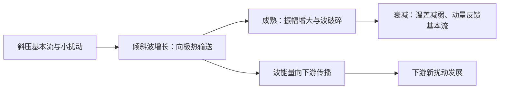
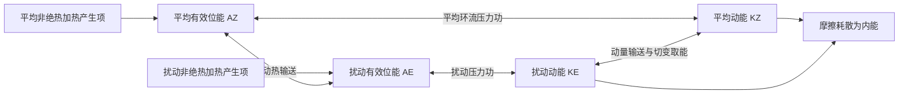

# D23 · 1997第4—14条＋1996第1—12条（23条）

日期：2026-11-20｜建议投入：4小时｜动力40% · 天气40% · 物理20%

> 本学习包依据原50日PDF与仓库学习资料整理。参考答案不是官方评分标准；未完成学科审校及缺题标记均保留。公式采用 GitHub 数学 Markdown，请在 GitHub 正文或 Obsidian 阅读视图打开。

## 今日目标与记忆标准

闭卷说清概念、适用条件、符号与单位；推导必须写出起始方程、近似及关键步骤。先答题，再展开核对。

## 四小时执行

1. 20分钟：回忆此前第1、3、7、14天的重点，尚未开始的日期跳过。
2. 80分钟：逐题闭卷提取，核对以下简答与来源。
3. 70分钟：精选5题完整书写。名词解释90秒、简答7分钟、论述12分钟为训练目标。
4. 40分钟：把本日知识按“假设→方程→物理机制→天气表现”串成2—4条知识链。
5. 30分钟：记录遗漏点、用时与次日/3日/7日/14日复习日期。

> 星级口径：按同考点在不同年份的出现次数，1次★、2—3次★★、4—6次★★★、7—10次★★★★、11次及以上★★★★★；多考点题取最高频考点。星级表示复习频次，不是命题概率。

## 逐题回忆与简答

### 1997-一-4 · ★★★（同考点4年）

**本次复核提示（2026-10-31）：** 位涡守恒推导及柱厚比正确；迎风反气旋性、背风气旋性变化的解释限定北半球、固定纬度和固定上界的理想气柱。南半球涡度符号相反，不宜省略半球条件。

当地气流越过山脉，环流系统绕强变化是：迎风面易使槽**减弱**，脊**加强**，而背风坡相反。

[解析来源（对应题目行）](https://github.com/0183ty2512/lao-san-yang/blob/main/%E5%8A%A8%E5%8A%9B%E6%B0%94%E8%B1%A1%E8%AF%BE%E5%90%8E%E4%B9%A0%E9%A2%98/%E8%AF%95%E9%A2%98%E8%A7%A3%E7%AD%94/%E5%BE%80%E5%B9%B4%E8%AF%95%E9%A2%98%E8%A7%A3%E6%9E%90/1997.md#L133) · [原始年度题干](https://github.com/0183ty2512/lao-san-yang/blob/main/%E5%BE%80%E5%B9%B4%E8%AF%95%E9%A2%98%E5%88%86%E6%9E%90/1997.md)

**审校状态：尚未逐题学科审校。**

**相关高频考点复习摘要（须按本题设问取舍，不替代完整解答）：**

**气柱越山与位涡守恒应用：** 浅水柱位涡守恒为 $(\zeta+f)/h=\mathrm{常数}$。固定上界、同纬度时迎风柱压缩导致反气旋性变化，背风柱伸长导致气旋性变化。若纬度改变须重新算 $f$；远下游柱厚完全恢复时不能无条件推断永久留有低槽。

> 以上摘要用于回忆答题主线，不是官方评分标准；推导、计算和多小问仍须完成下方步骤。

**原记录填空值：** 减弱；加强。下文核对其物理含义；出现修改意见时，以修改后的说明为准。

1. 在绝热、无摩擦、浅水柱近似下 $q=(\zeta+f)/h$ 守恒，故 $(\zeta_1+f_1)/h_1=(\zeta_2+f_2)/h_2$。
2. 解出 $\zeta_2=(h_2/h_1)(\zeta_1+f_1)-f_2$。若同纬度越过山脉且上界固定，迎风坡柱厚减小，绝对涡度减小，产生反气旋性变化；背风坡柱厚恢复增大，产生气旋性变化，有利于背风槽形成。
3. 必须说明上界和气柱厚度：若上下边界同时抬升而厚度不变，不能仅凭“越山”推断伸缩。若纬度变化，则还需计入 $f$ 变化。
4. 理想定常、对称山地、固定纬度模型中，若远下游厚度完全恢复到上游，且没有其他作用，远下游涡度也可恢复。背风坡气旋性涡度倾向并不意味着无条件留下永久低压槽；β效应、路径位移和下游波列可使实际响应更复杂。

### 1997-二-1 · ★（同考点1年）

**本次复核提示（2026-10-31）：** 直接作答：大气活动中心是多年平均气压场中经常或季节性存在的主要高、低压区域，如冬季西伯利亚高压、阿留申低压及副热带高压。它们可随季节迁移和变强弱，不是每一天固定不动的天气系统；原解开头环流分型可略。

大气活动中心

[解析来源（对应题目行）](https://github.com/0183ty2512/lao-san-yang/blob/main/%E5%8A%A8%E5%8A%9B%E6%B0%94%E8%B1%A1%E8%AF%BE%E5%90%8E%E4%B9%A0%E9%A2%98/%E8%AF%95%E9%A2%98%E8%A7%A3%E7%AD%94/%E5%BE%80%E5%B9%B4%E8%AF%95%E9%A2%98%E8%A7%A3%E6%9E%90/1997.md#L178) · [原始年度题干](https://github.com/0183ty2512/lao-san-yang/blob/main/%E5%BE%80%E5%B9%B4%E8%AF%95%E9%A2%98%E5%88%86%E6%9E%90/1997.md)

**审校状态：尚未逐题学科审校。**

> 以上摘要用于回忆答题主线，不是官方评分标准；推导、计算和多小问仍须完成下方步骤。

1. 环流分型可依槽脊数目、振幅、位置和优势流向分为纬向型、经向型及过渡/混合型；其他教材还按区域槽脊位置作更细分类。大气活动中心是多年平均气压场中持续或季节性出现的主要高低压区，位置和强度的变化组织区域天气。

### 1997-二-2 · ★★★★（同考点8年）

**本次复核提示（2026-10-31）：** 地转风差定义、静力关系和对数气压积分符号正确。有限层厚采用层平均温度，北半球冷空气在向上热成风左侧；上下层下标t、b不表示时间导数。

热成风

[解析来源（对应题目行）](https://github.com/0183ty2512/lao-san-yang/blob/main/%E5%8A%A8%E5%8A%9B%E6%B0%94%E8%B1%A1%E8%AF%BE%E5%90%8E%E4%B9%A0%E9%A2%98/%E8%AF%95%E9%A2%98%E8%A7%A3%E7%AD%94/%E5%BE%80%E5%B9%B4%E8%AF%95%E9%A2%98%E8%A7%A3%E6%9E%90/1997.md#L210) · [原始年度题干](https://github.com/0183ty2512/lao-san-yang/blob/main/%E5%BE%80%E5%B9%B4%E8%AF%95%E9%A2%98%E5%88%86%E6%9E%90/1997.md)

**审校状态：尚未逐题学科审校。**

**相关高频考点复习摘要（须按本题设问取舍，不替代完整解答）：**

**热成风：** 热成风是上下两层地转风之差。由静力关系 $\frac{\partial\Phi}{\partial\ln p}=-RT$ 与地转关系得 $\frac{\partial u_g}{\partial\ln p}=(R/f)\frac{\partial T}{\partial y}$、$\frac{\partial v_g}{\partial\ln p}=-(R/f)\frac{\partial T}{\partial x}$。北半球向上的热成风冷侧在左，表示温度梯度对应垂直风切变。

> 以上摘要用于回忆答题主线，不是官方评分标准；推导、计算和多小问仍须完成下方步骤。

1. 热成风是两个高度或等压面之间的**地转风差**，不是独立的一股实际风。
2. 静力关系给出 $\frac{\partial\Phi}{\partial\ln p}=-RT$。对 $u_g=-\frac{\partial \Phi}{\partial y}/f$、$v_g=\frac{\partial \Phi}{\partial x}/f$ 分别作 $\ln p$ 导数（局地取 $f$ 固定），得
$$\frac{\partial u_g}{\partial\ln p}=\frac RfT_y,\qquad \frac{\partial v_g}{\partial\ln p}=-\frac RfT_x.$$
3. 从下层 $p_b$ 积到上层 $p_t<p_b$，若用对数气压平均温度 $\bar T$，则 $u_t-u_b=-(R/f)\ln(p_b/p_t)\frac{\partial\bar T}{\partial y}$、$v_t-v_b=(R/f)\ln(p_b/p_t)\frac{\partial\bar T}{\partial x}$。
4. 北半球向上的热成风沿平均等温线，冷空气在其左侧。温度向北降低时，西风一般随高度增强。该关系把水平温度梯度和垂直风切变连接起来。

### 1997-二-3 · ★★★★（同考点10年）

**本次复核提示（2026-10-31）：** CISK指积云对流加热与较大尺度低层辐合相互增强的耦合不稳定，区别于单气块条件不稳定。原链条适合作理想化说明；不能据此断言每个扰动都会发展为台风或忽略海面焓通量。

第二类条件不稳定

[解析来源（对应题目行）](https://github.com/0183ty2512/lao-san-yang/blob/main/%E5%8A%A8%E5%8A%9B%E6%B0%94%E8%B1%A1%E8%AF%BE%E5%90%8E%E4%B9%A0%E9%A2%98/%E8%AF%95%E9%A2%98%E8%A7%A3%E7%AD%94/%E5%BE%80%E5%B9%B4%E8%AF%95%E9%A2%98%E8%A7%A3%E6%9E%90/1997.md#L250) · [原始年度题干](https://github.com/0183ty2512/lao-san-yang/blob/main/%E5%BE%80%E5%B9%B4%E8%AF%95%E9%A2%98%E5%88%86%E6%9E%90/1997.md)

**审校状态：尚未逐题学科审校。**

**相关高频考点复习摘要（须按本题设问取舍，不替代完整解答）：**

**第二类条件不稳定（CISK）：** CISK是对流和大尺度环流的正反馈：初始旋转扰动→摩擦辐合和水汽输送→凝结潜热加热→暖心、质量场及高层外流调整→低压和辐合增强。能量依海气焓供应与湿对流转化，不能把凝结视作凭空产能。

> 以上摘要用于回忆答题主线，不是官方评分标准；推导、计算和多小问仍须完成下方步骤。

1. **初始扰动。** 季风槽、热带辐合带扰动、东风波、赤道罗斯贝波等可提供涡度、辐合和持续对流。多数初始扰动不会发展，环境与内部组织过程都重要。

2. **CISK 链条。** 初始低压旋转 → 边界层摩擦造成向中心的水汽辐合 → 对流凝结释放潜热 → 暖心及质量场调整、高层外流加强 → 低压和低层旋转增强 → 更强辐合。对流和大尺度环流相互反馈而非单独气块条件不稳定，因此称第二类条件不稳定。它是理想化解释，现代海气通量反馈等机制不可省略。

3. **能量。** 水汽主要由暖海蒸发补给，海面潜热和显热通量提供焓；凝结将潜热释放，暖升冷沉及压力功转化为动能，摩擦耗散动能。不能把凝结说成凭空制造能量。

### 1997-二-4 · ★★★★（同考点7年）

**本次复核提示（2026-10-31）：** 飑线应先定义为有组织的线状对流系统，区别于仅有风向突变的地面飑。冷池、风切变和持续抬升有助维持；冰雹、后部层状雨及每站剧烈降温均非必备特征。

飑线

[解析来源（对应题目行）](https://github.com/0183ty2512/lao-san-yang/blob/main/%E5%8A%A8%E5%8A%9B%E6%B0%94%E8%B1%A1%E8%AF%BE%E5%90%8E%E4%B9%A0%E9%A2%98/%E8%AF%95%E9%A2%98%E8%A7%A3%E7%AD%94/%E5%BE%80%E5%B9%B4%E8%AF%95%E9%A2%98%E8%A7%A3%E6%9E%90/1997.md#L290) · [原始年度题干](https://github.com/0183ty2512/lao-san-yang/blob/main/%E5%BE%80%E5%B9%B4%E8%AF%95%E9%A2%98%E5%88%86%E6%9E%90/1997.md)

**审校状态：尚未逐题学科审校。**

**相关高频考点复习摘要（须按本题设问取舍，不替代完整解答）：**

**飑线：** 飑线是组织成狭长线状的强对流系统。冷池前缘辐合不断触发新单体，风切变帮助维持组织；过站常有阵风增强、风向突变、降温和升压，可伴雷雨、冰雹，后部可有层状降水。

> 以上摘要用于回忆答题主线，不是官方评分标准；推导、计算和多小问仍须完成下方步骤。

1. 飑线是沿线状排列并组织成系统的强对流，前缘辐合与冷池推进触发新生对流，可有后部层状降水。过站时常风向突变、阵风增强、温度骤降、气压骤升，伴雷雨、冰雹等；地面升压主要与冷池密度增加及动力作用有关。

2. **环境条件。** 低层暖湿、具有可释放的不稳定能量，锋面/辐合线/地形等提供抬升；适宜的垂直风切变使上升和下沉气流分离，支持较长寿命。强切变有助组织化，但不能取代水汽和浮力。

### 1997-二-5 · ★★★（同考点4年）

**本次复核提示（2026-10-31）：** 高度差定义需注明气压层、纬带与经度平均范围；高度差单位m，换算的风速单位m/s。高低指数是环流状态概括，指数循环不是严格周期。

西风指数

[解析来源（对应题目行）](https://github.com/0183ty2512/lao-san-yang/blob/main/%E5%8A%A8%E5%8A%9B%E6%B0%94%E8%B1%A1%E8%AF%BE%E5%90%8E%E4%B9%A0%E9%A2%98/%E8%AF%95%E9%A2%98%E8%A7%A3%E7%AD%94/%E5%BE%80%E5%B9%B4%E8%AF%95%E9%A2%98%E8%A7%A3%E6%9E%90/1997.md#L328) · [原始年度题干](https://github.com/0183ty2512/lao-san-yang/blob/main/%E5%BE%80%E5%B9%B4%E8%AF%95%E9%A2%98%E5%88%86%E6%9E%90/1997.md)

**审校状态：尚未逐题学科审校。**

**相关高频考点复习摘要（须按本题设问取舍，不替代完整解答）：**

**环流指数：** 西风指数利用中高纬某层的南北高度差或平均纬向风衡量西风强弱；需注明采用的层次、纬带和公式。高指数偏纬向、低指数偏经向，指数循环描述槽脊振幅与流型演变，不是严格周期。

> 以上摘要用于回忆答题主线，不是官方评分标准；推导、计算和多小问仍须完成下方步骤。

1. 西风指数用中高纬某层的南北位势高度差表征平均西风强度，例如 $I=\overline{Z}(35°N)-\overline{Z}(55°N)$，由地转关系换算纬带平均西风。具体层次、纬度带依课程定义，应写出采用的约定。高指数偏纬向、低指数偏经向，指数循环是两类状态及波幅的演变，不是严格周期。

### 1997-三-1 · ★★★★★（同考点12年）

**本次复核提示（2026-10-31）：** 水平动量方程、地转解和半球左右规则核对一致；导数在等压面取值，$Ro=\frac{U}{|f|L}$。仅小平流罗斯贝数还不够，局地变化也应缓慢且摩擦弱；气流强曲率时可能需梯度风平衡。

说明地转风关系的基本原理，它在天气分析中应用原则。

[解析来源（对应题目行）](https://github.com/0183ty2512/lao-san-yang/blob/main/%E5%8A%A8%E5%8A%9B%E6%B0%94%E8%B1%A1%E8%AF%BE%E5%90%8E%E4%B9%A0%E9%A2%98/%E8%AF%95%E9%A2%98%E8%A7%A3%E7%AD%94/%E5%BE%80%E5%B9%B4%E8%AF%95%E9%A2%98%E8%A7%A3%E6%9E%90/1997.md#L368) · [原始年度题干](https://github.com/0183ty2512/lao-san-yang/blob/main/%E5%BE%80%E5%B9%B4%E8%AF%95%E9%A2%98%E5%88%86%E6%9E%90/1997.md)

**审校状态：尚未逐题学科审校。**

**相关高频考点复习摘要（须按本题设问取舍，不替代完整解答）：**

**地转风：** 中纬度大尺度缓变、摩擦可忽略时，水平气压梯度力与科氏力近似平衡：$u_g=-\frac{\partial \Phi}{\partial y}/f$、$v_g=\frac{\partial \Phi}{\partial x}/f$。风平行等高线，北半球低值在风向左侧。近赤道、摩擦层和强曲率快速运动中须检验适用性。

> 以上摘要用于回忆答题主线，不是官方评分标准；推导、计算和多小问仍须完成下方步骤。

1. 在局地直角坐标中，忽略摩擦时水平动量方程为 $Du/Dt-fv=-\frac{\partial \Phi}{\partial x}$、$Dv/Dt+fu=-\frac{\partial \Phi}{\partial y}$，这里的导数取在等压面上。
2. 对中纬度大尺度缓变运动，$Ro=U/(|f|L)\ll1$，惯性项相对较小，得到 $-fv_g=-\frac{\partial \Phi}{\partial x}$、$fu_g=-\frac{\partial \Phi}{\partial y}$。
3. 解得 $\boxed{u_g=-\frac{\partial \Phi}{\partial y}/f,\quad v_g=\frac{\partial \Phi}{\partial x}/f}$，即 $\mathbf V_g=\mathbf k\times\nabla_p\Phi/f$；大小为 $|\nabla_p\Phi|/|f|$。
4. 因叉积垂直于梯度，地转风平行于等高线；北半球背风而立时低值在左、高值在右，南半球相反。等高线越密风越强，但还受纬度 $f$ 影响。
5. 近赤道 $f\to0$、摩擦层、强曲率或快速变化的小尺度系统中不能直接采用地转近似。等高面上应改用 $\nabla_zp/\rho$，不要把两种坐标的梯度混用。

### 1997-三-2 · ★★★★★（同考点13年）

**本次复核提示（2026-10-31）：** 原解“南段弱、北段强”的地域表述不够准确。梅雨—Baiu锋的西部（中国至日本以西一带）常表现为强湿度/相当位温梯度和较弱温度梯度，东部日本以东斜压性可更强；具体随过程而变。与极锋比较应突出湿度梯度、低层切变和温度斜压性差别，而非说梅雨锋完全没有温差。参考：[西部Baiu锋低压结构研究](https://journals.ametsoc.org/view/journals/clim/36/8/JCLI-D-22-0515.1.xml)。

梅雨锋的基本特征是什么？它与极峰的差异是什么？

[解析来源（对应题目行）](https://github.com/0183ty2512/lao-san-yang/blob/main/%E5%8A%A8%E5%8A%9B%E6%B0%94%E8%B1%A1%E8%AF%BE%E5%90%8E%E4%B9%A0%E9%A2%98/%E8%AF%95%E9%A2%98%E8%A7%A3%E7%AD%94/%E5%BE%80%E5%B9%B4%E8%AF%95%E9%A2%98%E8%A7%A3%E6%9E%90/1997.md#L408) · [原始年度题干](https://github.com/0183ty2512/lao-san-yang/blob/main/%E5%BE%80%E5%B9%B4%E8%AF%95%E9%A2%98%E5%88%86%E6%9E%90/1997.md)

**审校状态：尚未逐题学科审校。**

**相关高频考点复习摘要（须按本题设问取舍，不替代完整解答）：**

**梅雨：** 梅雨是初夏江淮及长江中下游的持续阴雨过程。梅雨锋常以水汽和相当位温梯度、低层切变辐合突出；低层西南急流供水汽，中层副高北缘与中高纬槽脊维持冷暖交汇，高层合适辐散配合上升。北段锋区温差可明显，不能说梅雨锋完全无温度梯度。

> 以上摘要用于回忆答题主线，不是官方评分标准；推导、计算和多小问仍须完成下方步骤。

1. **梅雨定义与天气。** 初夏江淮及长江中下游的持续阴雨期，常在 6 月中旬至 7 月上旬附近，但年际变化明显。天气高湿、云量多，层状云雨夹有对流和暴雨，日照少，雨带易持续。

2. **锋区结构。** 梅雨锋在南段常温度梯度较弱而水汽、相当位温梯度很强；低层有风向切变、辐合和正涡度，锋南暖湿偏南/西南风，锋北较冷偏东/偏北气流。北段温度梯度可更显著，不能概括为“完全无温度差”。

3. **高中低层配置。** 高层南亚高压与西风急流提供适宜的辐散背景；500 hPa 中高纬阻高、东亚槽和西太副高使冷暖气流维持；850—700 hPa 西南急流输送水汽，梅雨锋、切变线或低涡提供抬升。双阻型通常在欧亚中高纬形成两处阻塞、其间冷槽南伸，与低纬副高北侧暖湿气流相遇；两阻的精确中心依原教材图例而定。

4. **梅雨与极锋比较。** 极锋主要表现为强水平温度梯度及深厚斜压性，梅雨锋常以水汽差异和低层切变更突出；两者均可提供持续上升并组织降水。

### 1997-三-3 · ★★（同考点3年）

**本次复核提示（2026-10-31）：** 直接比较成熟结构：台风通常深厚暖心、中心轴较直立、近中心较对称，无典型冷暖锋，强台风常有眼和眼墙，低层入流、高层外流；温带锋面气旋通常明显不对称，伴冷暖锋或锢囚锋，温度梯度强，发展期上下层中心倾斜。温带气旋成熟锢囚后可能趋于垂直，不能把倾斜当作始终不变的特征。龙卷和反气旋分类不属于本题必答内容。

说明成熟台风与温带气旋在结构上的主要差别。

[解析来源（对应题目行）](https://github.com/0183ty2512/lao-san-yang/blob/main/%E5%8A%A8%E5%8A%9B%E6%B0%94%E8%B1%A1%E8%AF%BE%E5%90%8E%E4%B9%A0%E9%A2%98/%E8%AF%95%E9%A2%98%E8%A7%A3%E7%AD%94/%E5%BE%80%E5%B9%B4%E8%AF%95%E9%A2%98%E8%A7%A3%E6%9E%90/1997.md#L450) · [原始年度题干](https://github.com/0183ty2512/lao-san-yang/blob/main/%E5%BE%80%E5%B9%B4%E8%AF%95%E9%A2%98%E5%88%86%E6%9E%90/1997.md)

**审校状态：尚未逐题学科审校。**

**相关高频考点复习摘要（须按本题设问取舍，不替代完整解答）：**

**温带气旋与热带气旋比较：** 温带气旋常有锋、非轴对称和斜压倾斜，主要利用基本态有效位能；成熟台风无典型锋、深厚暖心，依海气焓供应与湿对流。冷高压下层强且随高度减弱，副高暖性深厚；不能把气旋反气旋各自都归为同一种热力结构。

> 以上摘要用于回忆答题主线，不是官方评分标准；推导、计算和多小问仍须完成下方步骤。

1. 气旋是低压及其气旋式环流系统，北半球逆时针、南半球顺时针；反气旋为高压及反气旋式环流。低层摩擦使气旋常辐合上升、反气旋常辐散下沉，但云雨仍依水汽和热力条件。

2. **温带锋面气旋四阶段。** 初生：静止锋上出现波动，暖空气向冷侧、冷空气向暖侧推进；发展：低压加深，冷暖锋清楚，冷锋通常较暖锋移动快，地面暖区逐渐收窄，槽前正涡度平流和高空辐散配合；成熟/锢囚：冷锋追上暖锋，暖空气抬离地面，气旋范围较大且结构复杂；衰亡：近地面冷空气占据中心，水平温差和斜压取能减弱，低压逐渐填塞。

3. **与台风、龙卷比较。** 温带气旋通常千公里量级，常有锋、热力不对称、发展期向冷侧随高度倾斜；成熟热带气旋数百公里量级，深厚暖心、无典型冷暖锋，主要依海面焓通量与湿对流；龙卷是雷暴内或其下方的小尺度强旋转气柱，水平多为几十至几百米、生命较短，不能与温带气旋使用同一准地转模型。

4. **反气旋热力分类。** 大陆冷高压下层强、随高度减弱，常对应冷干大风；副热带暖高压较深厚，控制区下沉少云。按热力结构可说冷性、暖性系统，但实际锋面气旋和过渡系统可不对称，不能把所有气旋都称冷心。

### 1997-三-4 · ★★★★★（同考点16年）

**本次复核提示（2026-10-31）：** 本题要求判断并解释。冬季冷空气过程可重点讨论阻高与大槽对蓄积、路径及爆发的控制，并补充急流动力配置；夏季重点讨论西太副高对水汽、雨带和高温的控制。应给出所讨论季节与天气范围，不把三者排成适用于全国所有过程的固定名次。

你认为急流、阻高、副高三者对我国冬季天气的影响，哪个是主要的？而夏季哪个是主要的？各说明理由。

[解析来源（对应题目行）](https://github.com/0183ty2512/lao-san-yang/blob/main/%E5%8A%A8%E5%8A%9B%E6%B0%94%E8%B1%A1%E8%AF%BE%E5%90%8E%E4%B9%A0%E9%A2%98/%E8%AF%95%E9%A2%98%E8%A7%A3%E7%AD%94/%E5%BE%80%E5%B9%B4%E8%AF%95%E9%A2%98%E8%A7%A3%E6%9E%90/1997.md#L492) · [原始年度题干](https://github.com/0183ty2512/lao-san-yang/blob/main/%E5%BE%80%E5%B9%B4%E8%AF%95%E9%A2%98%E5%88%86%E6%9E%90/1997.md)

**审校状态：尚未逐题学科审校。**

**相关高频考点复习摘要（须按本题设问取舍，不替代完整解答）：**

**高空急流：** 高空急流是对流层上部狭长强风带，横向和垂直切变强。极锋急流与斜压锋区相关，副热带急流还受低纬角动量输送影响；冬强偏南、夏弱偏北。急流加减速与曲率引起非地转次级环流，可影响下方上升和气旋发展。

**阻塞高压：** 阻塞高压是中高纬持续、少动并使西风绕行的强脊或闭合高压。建立与暖输送、波破碎及涡旋反馈有关；其东侧偏北气流可蓄积和引导冷空气。衰退配合横槽转竖时可触发寒潮，但并非每次崩溃都必然造成寒潮。

**西太平洋副热带高压：** 西太副高是深厚暖性反气旋系统。控制区下沉少云，北侧和西北侧的暖湿输送与冷空气交汇可形成雨带。其北跳南撤、西伸东退和强度变化共同调制我国雨季、伏旱与台风路径，不能只看一条脊线纬度。

> 以上摘要用于回忆答题主线，不是官方评分标准；推导、计算和多小问仍须完成下方步骤。

1. 急流是狭长的强风带，横向和竖直风切变显著，急流轴是局地最大风速的位置。高空西风急流位于对流层上部，冬季更强、更偏南；夏季整体偏北、减弱。东亚日本附近冬季急流可很强，题中 70—80 m/s 是典型量级而非上限。

2. 极锋急流与中纬度锋区斜压性相联系；副热带急流还与低纬向极运动的角动量输送和热成风共同有关。强南北温度梯度通过热成风使西风随高度增强；不能只归因于地面风向上复制。

3. 急流入口、出口的加减速和曲率导致非地转次级环流，局部辐散有利于下方上升和气旋发展；简单直急流象限规则只在相应理想条件下适用。

1. 阻塞高压是中高纬持续、移动缓慢的强高压脊或闭合高压，使西风气流绕行、分支，阻碍天气系统正常东移。关键是持续性和对西风带的阻挡，并非所有高压都叫阻塞。
2. 建立时，暖空气向极地输送使脊增强，经向振幅增大，波破碎、涡旋反馈可帮助维持。高压脊发展或与高纬高压合并，南侧可切出冷低压，形成偶极或Ω型等配置。
3. 维持时，阻高东侧偏北气流引导冷空气南下，西侧偏南气流输送暖空气。下游槽及冷暖空气交汇区可长期停留，造成持久冷凉、降雨；高压控制区下沉、少云，可造成干旱和高温，具体依季节和位置。
4. 衰退或崩溃时，维持高压的暖输送与涡旋反馈减弱，西风恢复，槽脊重新东移；其东侧积聚的冷空气可配合横槽转竖大举南下，触发我国寒潮。不能把每一次阻高衰退都等同于寒潮，仍需冷空气强度和路径配合。
5. 亚洲常关注乌拉尔山及鄂霍次克海等阻塞区，北大西洋—欧洲也是重要活动区；不同季节的优势位置不同，不应把某一季节经验说成全年固定不变。
6. 切断低压是从西风主槽分离出的闭合冷性低压，移动缓慢，可与北侧阻高配合。其冷空气及正涡度有利于下游不稳定和上升，但天气还依水汽供应。

1. 西太平洋副热带高压是副热带地区深厚、暖性的反气旋系统。中层常用 500 hPa 高度场描述，其内部下沉、对流受抑制，西北侧及北侧暖湿气流与中纬度系统相遇，是重要雨带区。
2. 形成与副热带下沉、行星波、海陆热力差异及热带加热有关，不能单说成“海面冷所以形成冷高压”。暖性结构使高压在较高层更明显，但不同层中心、脊线并不完全重合。
3. 春季至初夏副高偏南，华南锋面和季风雨活跃；6 月前后第一次北跳后，长江中下游进入梅雨，传统脊线经验约为 20°—25°N。
4. 进一步北抬至约 25°—30°N，雨带向江淮、淮河流域推进；7 月下旬至 8 月上旬前后脊线可在 30°—35°N，雨带到华北、东北，长江中下游较易受高压控制出现伏旱。秋季副高南撤，雨带随之南退。
5. 除南北移动，还要考虑西伸东退、强度和滞留时间。副高西伸使水汽输送路径和落区改变，长期稳定可造成一侧持续暴雨、另一侧持续高温。上述纬度和日期是复习用经验，不是每年的硬界线。
6. 原题若把 25°—30°N 直接与华北盛夏雨季对应，应另起行纠正：通常华北盛夏雨季对应更北的 30°—35°N 阶段。

**对应设问：** 冬季通常应突出中高纬阻高/大槽对冷空气蓄积与爆发的控制，并说明高空急流的动力配置；夏季应突出西太副高对雨带、水汽与高温的控制。不能把三个系统在任何地区和任一天机械排列成固定主次。

### 1997-三-5 · ★★（同考点2年）

**本次复核提示（2026-10-31）：** 补全输送闭环：在统计稳态下，东风带地表摩擦向大气提供向东角动量，西风带摩擦从大气移走向东角动量；平均经圈环流、定常及瞬变涡旋的经向和垂直输送连接两类区域，山地压力转矩也可参与收支。$M=a\cos\varphi(\Omega a\cos\varphi+u)$为单位质量轴向绝对角动量。$-\overline{u\prime v\prime}\frac{\partial U}{\partial y}$是局地平行基本流中的动能转换，不等于完整球面角动量通量辐合；原波动生命周期图不能替代上述闭环。

在地球自转速度不变的事实前提下，大气中必有一种从东风带向西风带输送旋转动量的过程，试叙述这种过程是如何完成的。

[解析来源（对应题目行）](https://github.com/0183ty2512/lao-san-yang/blob/main/%E5%8A%A8%E5%8A%9B%E6%B0%94%E8%B1%A1%E8%AF%BE%E5%90%8E%E4%B9%A0%E9%A2%98/%E8%AF%95%E9%A2%98%E8%A7%A3%E7%AD%94/%E5%BE%80%E5%B9%B4%E8%AF%95%E9%A2%98%E8%A7%A3%E6%9E%90/1997.md#L554) · [原始年度题干](https://github.com/0183ty2512/lao-san-yang/blob/main/%E5%BE%80%E5%B9%B4%E8%AF%95%E9%A2%98%E5%88%86%E6%9E%90/1997.md)

**审校状态：尚未逐题学科审校。**

> 以上摘要用于回忆答题主线，不是官方评分标准；推导、计算和多小问仍须完成下方步骤。

1. 经向输送绝对角动量 $M=a\cos\varphi(\Omega a\cos\varphi+u)$ 的过程包括平均经圈环流、定常涡旋和瞬变天气涡旋。地表摩擦对东风带和西风带施加不同符号的转矩，内部经向与竖直输送把获得的动量重新分配，维持平均风带。

2. 动量通量 $\overline{u'v'}$ 的辐合可加速平均西风；平均流向扰动的正压动能转换为 $-\overline{u'v'}U_y$。不能用“地球自转不变”直接推出每一时刻所有输送都严格从东风带指向西风带，必须写出收支、外部摩擦转矩与统计稳态。

### 1996-一-1 · ★★★（同考点4年）

**本次复核提示（2026-10-31）：** 原填空“几十到几百公里”不能覆盖全部中尺度。按常用中α、中β、中γ划分，总范围约2—2000 km；200—2000 km仅是中α。

中尺度系统的尺度一般在**几十到几百**公里之间，其中 $\alpha$ 尺度系统为**200~2000**公里左右。

[解析来源（对应题目行）](https://github.com/0183ty2512/lao-san-yang/blob/main/%E5%8A%A8%E5%8A%9B%E6%B0%94%E8%B1%A1%E8%AF%BE%E5%90%8E%E4%B9%A0%E9%A2%98/%E8%AF%95%E9%A2%98%E8%A7%A3%E7%AD%94/%E5%BE%80%E5%B9%B4%E8%AF%95%E9%A2%98%E8%A7%A3%E6%9E%90/1996.md#L11) · [原始年度题干](https://github.com/0183ty2512/lao-san-yang/blob/main/%E5%BE%80%E5%B9%B4%E8%AF%95%E9%A2%98%E5%88%86%E6%9E%90/1996.md)

**审校状态：尚未逐题学科审校。**

**相关高频考点复习摘要（须按本题设问取舍，不替代完整解答）：**

**天气系统水平尺度：** 常用中α为200—2000 km、中β为20—200 km、中γ为2—20 km。温带气旋约千公里、台风数百公里、西南涡数百公里、龙卷常几十至几百米；这些是典型尺度范围，不是每个系统的固定直径。

> 以上摘要用于回忆答题主线，不是官方评分标准；推导、计算和多小问仍须完成下方步骤。

**原记录填空值：** 几十到几百；200~2000。下文核对其物理含义；出现修改意见时，以修改后的说明为准。

1. 常用尺度分类：中α约 200—2000 km，中β约 20—200 km，中γ约 2—20 km；天气尺度温带气旋约千公里，台风约数百公里，西南涡约数百公里，龙卷常几十至几百米。这些是典型范围，系统边界和平均口径不同会有差异。

### 1996-一-2 · ★★★（同考点6年）

**本次复核提示（2026-10-31）：** 填空可用凝结潜热与斜压有效位能，但解释须补充热带气旋从暖海获取焓，凝结不是能量的最终来源；四能量库收支内部转换项相消。

热带气旋的主要能量来源是**凝结潜热释放**，而温带气旋主要能量来源则为**有效位能释放（斜压能量）**。

[解析来源（对应题目行）](https://github.com/0183ty2512/lao-san-yang/blob/main/%E5%8A%A8%E5%8A%9B%E6%B0%94%E8%B1%A1%E8%AF%BE%E5%90%8E%E4%B9%A0%E9%A2%98/%E8%AF%95%E9%A2%98%E8%A7%A3%E7%AD%94/%E5%BE%80%E5%B9%B4%E8%AF%95%E9%A2%98%E8%A7%A3%E6%9E%90/1996.md#L49) · [原始年度题干](https://github.com/0183ty2512/lao-san-yang/blob/main/%E5%BE%80%E5%B9%B4%E8%AF%95%E9%A2%98%E5%88%86%E6%9E%90/1996.md)

**审校状态：尚未逐题学科审校。**

**相关高频考点复习摘要（须按本题设问取舍，不替代完整解答）：**

**有效位能：** 有效位能是实际全位能相对绝热重排后的最低参考态中可供转换的部分。差异加热维持温差，暖升冷沉可将其转为动能。全位能通常指内能与重力位能之和，不是全部都能被利用。

> 以上摘要用于回忆答题主线，不是官方评分标准；推导、计算和多小问仍须完成下方步骤。

**原记录填空值：** 凝结潜热释放；有效位能释放（斜压能量）。下文核对其物理含义；出现修改意见时，以修改后的说明为准。

1. **能量。** 水汽主要由暖海蒸发补给，海面潜热和显热通量提供焓；凝结将潜热释放，暖升冷沉及压力功转化为动能，摩擦耗散动能。不能把凝结说成凭空制造能量。

1. 单位质量内能 $e=c_vT$，重力位能 $\Phi=gz$（常重力），动能 $K=|\mathbf V|^2/2$，水汽潜热能近似 $L_vq_v$。总量需对气团质量积分；动能不能漏掉 $1/2$。
2. “全位能”在大气能量学中通常指内能与重力位能之和，而非含动能的总能量。静力、平坦底面且顶边界压力趋零时，$\int\rho gz\,dz=-\int z\,dp=\int p\,dz=\int\rho RT\,dz$；加上内能得到 $\int c_pT\,dm$。
3. 有效位能是实际全位能相对绝热重排到参考最低能态后的可用部分。不是全部内能或重力位能都能转换为动能。差异加热维持水平温差，建立有效位能。
4. 暖上升冷下沉时，$C=-\int\alpha'\omega'\,dm>0$，有效位能转为扰动动能；摩擦最终把动能耗散成内能。凝结使潜热转入热力能库，但水汽能量本来主要来自地表蒸发和辐射收支。
5. 对流层常用 Lorenz 四能量库循环如下。双向箭头表示转换可正可负，方向由收支项决定；中纬度斜压波常沿 $A_Z\to A_E\to K_E$ 取能。$A_Z$ 与 $K_Z$ 的直接转换不能漏掉：平均经圈环流同样可通过压力功在平均有效位能和平均动能之间转换。

产生项也可能为负，图中不是所有加热都增加有效位能。若问完整收支，应分别写 $\dot A_Z=G_Z-C_A-C_Z$、$\dot A_E=G_E+C_A-C_E$、$\dot K_Z=C_Z+C_K-D_Z$、$\dot K_E=C_E-C_K-D_E$，这里 $C_K>0$ 约定为扰动动能转入平均动能。四式相加，内部转换项逐项抵消，只剩外部产生与耗散，可用作检查。

### 1996-一-3 · ★★★★（同考点8年）

**本次复核提示（2026-10-31）：** 有限层厚热成风平行层平均等温线；局地垂直切变才与该等压面等温线对应。静力式写为$\frac{\partial\Phi}{\partial\ln p}=-RT$，上下层下标t、b不表示偏导。

热成风的风向与等压面上的**等温**线平行。

[解析来源（对应题目行）](https://github.com/0183ty2512/lao-san-yang/blob/main/%E5%8A%A8%E5%8A%9B%E6%B0%94%E8%B1%A1%E8%AF%BE%E5%90%8E%E4%B9%A0%E9%A2%98/%E8%AF%95%E9%A2%98%E8%A7%A3%E7%AD%94/%E5%BE%80%E5%B9%B4%E8%AF%95%E9%A2%98%E8%A7%A3%E6%9E%90/1996.md#L106) · [原始年度题干](https://github.com/0183ty2512/lao-san-yang/blob/main/%E5%BE%80%E5%B9%B4%E8%AF%95%E9%A2%98%E5%88%86%E6%9E%90/1996.md)

**审校状态：尚未逐题学科审校。**

**相关高频考点复习摘要（须按本题设问取舍，不替代完整解答）：**

本段与上文相同，可回看前面的解析，不再重复展开。

> 以上摘要用于回忆答题主线，不是官方评分标准；推导、计算和多小问仍须完成下方步骤。

**原记录填空值：** 等温。下文核对其物理含义；出现修改意见时，以修改后的说明为准。

本段与上文相同，可回看前面的解析，不再重复展开。

### 1996-一-4 · ★★★★（同考点9年）

**本次复核提示（2026-10-31）：** 日期、脊线纬度为气候经验范围；“全长江流域进入伏旱”过于绝对，应理解为长江中下游在副高控制下较易出现伏旱，不能套用每个地区和每年。

每年夏季的**7月下旬至8月上旬**时期为我国华北地区雨季，这时副热带高压脊线位于**30~35**°N 之间，全长江流域则进入**伏旱**天气。

[解析来源（对应题目行）](https://github.com/0183ty2512/lao-san-yang/blob/main/%E5%8A%A8%E5%8A%9B%E6%B0%94%E8%B1%A1%E8%AF%BE%E5%90%8E%E4%B9%A0%E9%A2%98/%E8%AF%95%E9%A2%98%E8%A7%A3%E7%AD%94/%E5%BE%80%E5%B9%B4%E8%AF%95%E9%A2%98%E8%A7%A3%E6%9E%90/1996.md#L148) · [原始年度题干](https://github.com/0183ty2512/lao-san-yang/blob/main/%E5%BE%80%E5%B9%B4%E8%AF%95%E9%A2%98%E5%88%86%E6%9E%90/1996.md)

**审校状态：尚未逐题学科审校。**

**相关高频考点复习摘要（须按本题设问取舍，不替代完整解答）：**

**我国雨带季节活动：** 我国雨带一般由华南前汛期，推进到江淮梅雨，再到华北、东北盛夏雨季，秋季南撤。副高脊线20—25°N、25—30°N、30—35°N是常用阶段性经验范围，应结合西伸东退、冷空气和年份差异，不能当作硬界线。

> 以上摘要用于回忆答题主线，不是官方评分标准；推导、计算和多小问仍须完成下方步骤。

**原记录填空值：** 7月下旬至8月上旬；30~35；伏旱。下文核对其物理含义；出现修改意见时，以修改后的说明为准。

本段与上文相同，可回看前面的解析，不再重复展开。

### 1996-一-5 · ★★（同考点3年）

**本次复核提示（2026-10-31）：** 西北太平洋是主要活跃洋盆；5—20°应注明北纬且为常见生成纬带，不能理解为所有台风活动轨迹都限于该纬带。

台风发生的最大频率区为**西北太平洋**区。台风大多数发生在**5~20**纬带之间。

[解析来源（对应题目行）](https://github.com/0183ty2512/lao-san-yang/blob/main/%E5%8A%A8%E5%8A%9B%E6%B0%94%E8%B1%A1%E8%AF%BE%E5%90%8E%E4%B9%A0%E9%A2%98/%E8%AF%95%E9%A2%98%E8%A7%A3%E7%AD%94/%E5%BE%80%E5%B9%B4%E8%AF%95%E9%A2%98%E8%A7%A3%E6%9E%90/1996.md#L191) · [原始年度题干](https://github.com/0183ty2512/lao-san-yang/blob/main/%E5%BE%80%E5%B9%B4%E8%AF%95%E9%A2%98%E5%88%86%E6%9E%90/1996.md)

**审校状态：尚未逐题学科审校。**

**相关高频考点复习摘要（须按本题设问取舍，不替代完整解答）：**

**热带气旋分布：** 西北太平洋热带气旋活动频繁，通常在离赤道一定距离的暖海区生成。阿拉伯海也有热带气旋，南大西洋少见但并非绝对没有；“台风”是区域命名，不是判断其他洋盆是否存在同类系统的依据。

> 以上摘要用于回忆答题主线，不是官方评分标准；推导、计算和多小问仍须完成下方步骤。

**原记录填空值：** 西北太平洋；5~20。下文核对其物理含义；出现修改意见时，以修改后的说明为准。

1. **分布。** 西北太平洋活动频繁，多在离赤道一定距离的热带海洋生成。阿拉伯海会发生热带气旋；不能因那里不使用“台风”这一地区名称，就说没有该类系统。南大西洋很少发生但并非绝对不发生，赤道附近通常不利于生成。

### 1996-二-1 · ★★★★（同考点7年）

**本次复核提示（2026-10-31）：** 定义重点是低层局地风速极大。原解“题中的12 m/s”不适用本题（题干未给数值）；高度和阈值仅作具体研究的例子。

低空急流

[解析来源（对应题目行）](https://github.com/0183ty2512/lao-san-yang/blob/main/%E5%8A%A8%E5%8A%9B%E6%B0%94%E8%B1%A1%E8%AF%BE%E5%90%8E%E4%B9%A0%E9%A2%98/%E8%AF%95%E9%A2%98%E8%A7%A3%E7%AD%94/%E5%BE%80%E5%B9%B4%E8%AF%95%E9%A2%98%E8%A7%A3%E6%9E%90/1996.md#L233) · [原始年度题干](https://github.com/0183ty2512/lao-san-yang/blob/main/%E5%BE%80%E5%B9%B4%E8%AF%95%E9%A2%98%E5%88%86%E6%9E%90/1996.md)

**审校状态：尚未逐题学科审校。**

**相关高频考点复习摘要（须按本题设问取舍，不替代完整解答）：**

**低空急流：** 低空急流是低层风速局地极大带，东亚夏季常在850—700 hPa附近。可由压力梯度、地形和夜间摩擦减弱后的惯性振荡形成；输送暖湿空气，在出口或与锋、切变线交汇处产生辐合，利于暴雨；对流加热亦可反馈加强急流。

> 以上摘要用于回忆答题主线，不是官方评分标准；推导、计算和多小问仍须完成下方步骤。

1. 低空急流是对流层低层的局地风速极大带，东亚夏季常在 850—700 hPa 附近，题中的 12 m/s 或 12—15 m/s 属常用识别量级，具体标准随研究变化。

2. 形成机制包括大尺度压力梯度加强、地形通道和山坡热力差异；夜间地表稳定化削弱摩擦，残余风发生惯性振荡，也可产生夜间风速极大。不同类型低空急流机制并不相同。

3. 低空急流输送暖湿空气，出口附近或与锋、切变线相交处辐合，利于不稳定能量和水汽积聚、暴雨触发；对流加热也可反过来加强低层压力梯度及急流。

### 1996-二-2 · ★（同考点1年）

**本次复核提示（2026-10-31）：** 季节突变指环流从一季型向另一季型较迅速转换，需举急流或副高跃变、季风建立等指标；并非所有要素同步突变。

季节突变

[解析来源（对应题目行）](https://github.com/0183ty2512/lao-san-yang/blob/main/%E5%8A%A8%E5%8A%9B%E6%B0%94%E8%B1%A1%E8%AF%BE%E5%90%8E%E4%B9%A0%E9%A2%98/%E8%AF%95%E9%A2%98%E8%A7%A3%E7%AD%94/%E5%BE%80%E5%B9%B4%E8%AF%95%E9%A2%98%E8%A7%A3%E6%9E%90/1996.md#L273) · [原始年度题干](https://github.com/0183ty2512/lao-san-yang/blob/main/%E5%BE%80%E5%B9%B4%E8%AF%95%E9%A2%98%E5%88%86%E6%9E%90/1996.md)

**审校状态：尚未逐题学科审校。**

> 以上摘要用于回忆答题主线，不是官方评分标准；推导、计算和多小问仍须完成下方步骤。

1. 东亚冬季受西伯利亚高压—阿留申低压、东亚大槽和强西风急流控制，偏北风冷干；夏季副高、季风低压、低空水汽输送和南亚高压配合，偏南风暖湿。春夏转换可发生分阶段突变，因海陆/高原加热、季风爆发和急流、副高位置跃变，而不只是平滑逐日北移。

### 1996-二-3 · ★★★（同考点5年）

**本次复核提示（2026-10-31）：** 待核教材术语：原解第一段推导的是均匀西风背景下一维无辐散罗斯贝波的下游发展，不能据此作为“上游效应”的完整答案。保留群速解释作对照，本题定义仍须与课程指定教材核实。

上游效应

[解析来源（对应题目行）](https://github.com/0183ty2512/lao-san-yang/blob/main/%E5%8A%A8%E5%8A%9B%E6%B0%94%E8%B1%A1%E8%AF%BE%E5%90%8E%E4%B9%A0%E9%A2%98/%E8%AF%95%E9%A2%98%E8%A7%A3%E7%AD%94/%E5%BE%80%E5%B9%B4%E8%AF%95%E9%A2%98%E8%A7%A3%E6%9E%90/1996.md#L305) · [原始年度题干](https://github.com/0183ty2512/lao-san-yang/blob/main/%E5%BE%80%E5%B9%B4%E8%AF%95%E9%A2%98%E5%88%86%E6%9E%90/1996.md)

**审校状态：尚未逐题学科审校。**

**相关高频考点复习摘要（须按本题设问取舍，不替代完整解答）：**

**上游效应：** 槽脊之间通过波传播及能量、动量交换相互影响。罗斯贝波包的群速与槽脊相速不同，可出现上游波衰减、下游新波发展。“上游效应”“下游效应”的命名须与教材约定对应，不能假定所有背景流中传播方向都固定。

> 以上摘要用于回忆答题主线，不是官方评分标准；推导、计算和多小问仍须完成下方步骤。

1. 罗斯贝波相速与群速不同，一维均匀西风上 $c_p=U-\beta/k^2$，$c_g=U+\beta/k^2$。能量包络可比槽脊向东传播更快，造成下游新波发展、上游旧波衰减，即下游发展。

2. 上下游效应泛指相邻波系通过传播和能量/动量交换相互影响；“上游效应”的教材用法需看其定义，不能以群速公式证明所有情况下影响只能单向向东。二维波和变化基本流中群速方向会变。

### 1996-二-4 · ★★★★★（同考点16年）

**本次复核提示（2026-10-31）：** 阻塞的持续性、准静止和阻挡西风带三点齐全。相关雨雪、高温及寒潮只是随位置、季节与冷空气条件变化的可能影响。

阻塞高压

[解析来源（对应题目行）](https://github.com/0183ty2512/lao-san-yang/blob/main/%E5%8A%A8%E5%8A%9B%E6%B0%94%E8%B1%A1%E8%AF%BE%E5%90%8E%E4%B9%A0%E9%A2%98/%E8%AF%95%E9%A2%98%E8%A7%A3%E7%AD%94/%E5%BE%80%E5%B9%B4%E8%AF%95%E9%A2%98%E8%A7%A3%E6%9E%90/1996.md#L343) · [原始年度题干](https://github.com/0183ty2512/lao-san-yang/blob/main/%E5%BE%80%E5%B9%B4%E8%AF%95%E9%A2%98%E5%88%86%E6%9E%90/1996.md)

**审校状态：尚未逐题学科审校。**

**相关高频考点复习摘要（须按本题设问取舍，不替代完整解答）：**

本段与上文相同，可回看前面的解析，不再重复展开。

> 以上摘要用于回忆答题主线，不是官方评分标准；推导、计算和多小问仍须完成下方步骤。

本段与上文相同，可回看前面的解析，不再重复展开。

### 1996-三-1 · ★★★★（同考点7年）

**本次复核提示（2026-10-31）：** 补充相对涡度是相对地球旋转坐标系速度场的旋度。三维定义为$\boldsymbol\zeta=\nabla\times\mathbf V$；局地直角坐标的垂直分量为$\zeta=\frac{\partial v}{\partial x}-\frac{\partial u}{\partial y}$，单位为$\mathrm{s^{-1}}$。

绝对涡度

[解析来源（对应题目行）](https://github.com/0183ty2512/lao-san-yang/blob/main/%E5%8A%A8%E5%8A%9B%E6%B0%94%E8%B1%A1%E8%AF%BE%E5%90%8E%E4%B9%A0%E9%A2%98/%E8%AF%95%E9%A2%98%E8%A7%A3%E7%AD%94/%E5%BE%80%E5%B9%B4%E8%AF%95%E9%A2%98%E8%A7%A3%E6%9E%90/1996.md#L388) · [原始年度题干](https://github.com/0183ty2512/lao-san-yang/blob/main/%E5%BE%80%E5%B9%B4%E8%AF%95%E9%A2%98%E5%88%86%E6%9E%90/1996.md)

**审校状态：尚未逐题学科审校。**

**相关高频考点复习摘要（须按本题设问取舍，不替代完整解答）：**

**涡度：** 垂直相对涡度 $\zeta=\frac{\partial v}{\partial x}-\frac{\partial u}{\partial y}$，绝对涡度为 $\zeta+f$，单位 $\mathrm{s^{-1}}$。北半球正值通常表示气旋性旋转。取旋度能消去保守压力梯度，但涡度方程单独不能决定完整风场。

> 以上摘要用于回忆答题主线，不是官方评分标准；推导、计算和多小问仍须完成下方步骤。

1. 定义垂直相对涡度 $\zeta=\frac{\partial v}{\partial x}-\frac{\partial u}{\partial y}$，水平散度 $D=\frac{\partial u}{\partial x}+\frac{\partial v}{\partial y}$，单位均为 $\mathrm{s^{-1}}$。绝对涡度的垂直分量为 $\zeta_a=\zeta+f$；三维绝对涡度为 $\nabla\times\mathbf V+2\boldsymbol\Omega$。

### 1996-三-2 · ★★★（同考点4年）

**本次复核提示（2026-10-31）：** 原解只给水平散度，补全三维散度$\nabla\cdot\mathbf V=\frac{\partial u}{\partial x}+\frac{\partial v}{\partial y}+\frac{\partial w}{\partial z}$；水平散度仅取前两项。散度描述局地体积膨胀率，不可把水平辐合直接等同整柱上升。

散度

[解析来源（对应题目行）](https://github.com/0183ty2512/lao-san-yang/blob/main/%E5%8A%A8%E5%8A%9B%E6%B0%94%E8%B1%A1%E8%AF%BE%E5%90%8E%E4%B9%A0%E9%A2%98/%E8%AF%95%E9%A2%98%E8%A7%A3%E7%AD%94/%E5%BE%80%E5%B9%B4%E8%AF%95%E9%A2%98%E8%A7%A3%E6%9E%90/1996.md#L424) · [原始年度题干](https://github.com/0183ty2512/lao-san-yang/blob/main/%E5%BE%80%E5%B9%B4%E8%AF%95%E9%A2%98%E5%88%86%E6%9E%90/1996.md)

**审校状态：尚未逐题学科审校。**

**相关高频考点复习摘要（须按本题设问取舍，不替代完整解答）：**

**散度：** 水平散度 $D=\frac{\partial u}{\partial x}+\frac{\partial v}{\partial y}$，正为辐散、负为辐合，单位 $\mathrm{s^{-1}}$。静力气压坐标连续式 $D+\frac{\partial\omega}{\partial p}=0$，求垂直速度须沿气压积分并给边界条件，不能由单层辐合唯一确定整柱运动。

> 以上摘要用于回忆答题主线，不是官方评分标准；推导、计算和多小问仍须完成下方步骤。

本段与上文相同，可回看前面的解析，不再重复展开。

### 1996-三-3 · ★★★（同考点5年）

**本次复核提示（2026-10-31）：** 平流贡献负号及压力坐标热力方程核对一致；Q为单位质量单位时间加热，稳定层结的上升动力冷却可抵消暖平流。

温度平流

[解析来源（对应题目行）](https://github.com/0183ty2512/lao-san-yang/blob/main/%E5%8A%A8%E5%8A%9B%E6%B0%94%E8%B1%A1%E8%AF%BE%E5%90%8E%E4%B9%A0%E9%A2%98/%E8%AF%95%E9%A2%98%E8%A7%A3%E7%AD%94/%E5%BE%80%E5%B9%B4%E8%AF%95%E9%A2%98%E8%A7%A3%E6%9E%90/1996.md#L460) · [原始年度题干](https://github.com/0183ty2512/lao-san-yang/blob/main/%E5%BE%80%E5%B9%B4%E8%AF%95%E9%A2%98%E5%88%86%E6%9E%90/1996.md)

**审校状态：尚未逐题学科审校。**

**相关高频考点复习摘要（须按本题设问取舍，不替代完整解答）：**

**温度平流：** 温度平流贡献为 $-\mathbf V_h\cdot\nabla T$。由暖处吹向冷处通常为暖平流、该项为正；反向为冷平流。局地变温还包含垂直运动与非绝热加热，不能把平流贡献等同最终变温。

> 以上摘要用于回忆答题主线，不是官方评分标准；推导、计算和多小问仍须完成下方步骤。

1. 水平温度平流为 $A_T=-\mathbf V_h\cdot\nabla T=-(u\frac{\partial T}{\partial x}+v\frac{\partial T}{\partial y})$。风由暖区吹向冷区时，沿风向温度减小，点积为负，故 $A_T>0$，为暖平流；反之 $A_T<0$，为冷平流。
2. 由 $c_pDT/Dt-\alpha\omega=Q$ 和 $\alpha=RT/p$，得 $DT/Dt-\kappa T\omega/p=Q/c_p$。
3. 展开物质导数 $DT/Dt=\frac{\partial T}{\partial t}+u\frac{\partial T}{\partial x}+v\frac{\partial T}{\partial y}+\omega\frac{\partial T}{\partial p}$，移项：
$$\boxed{\frac{\partial T}{\partial t}=-\mathbf V_h\cdot\nabla_pT+\omega\left(\frac{\kappa T}{p}-\frac{\partial T}{\partial p}\right)+\frac Q{c_p}}.$$
4. 右侧依次为水平平流、垂直运动与绝热压缩膨胀的合成作用、非绝热加热。在稳定层结下，上升（$\omega<0$）的动力变温通常为冷却，下沉则增温。因此有暖平流不等于局地温度一定上升。

## 精选完整解析与公式推导

以下保留资料中的条件、步骤和审校信息。先完成手写，再核对。

### 1997-三-4 · 完整解答

**本次复核提示（2026-10-31）：** 本题要求判断并解释。冬季冷空气过程可重点讨论阻高与大槽对蓄积、路径及爆发的控制，并补充急流动力配置；夏季重点讨论西太副高对水汽、雨带和高温的控制。应给出所讨论季节与天气范围，不把三者排成适用于全国所有过程的固定名次。

你认为急流、阻高、副高三者对我国冬季天气的影响，哪个是主要的？而夏季哪个是主要的？各说明理由。

本段与上文相同，可回看前面的解析，不再重复展开。

2. 极锋急流与中纬度锋区斜压性相联系；副热带急流还与低纬向极运动的角动量输送和热成风共同有关。强南北温度梯度通过热成风使西风随高度增强；不能只归因于地面风向上复制。

3. 急流入口、出口的加减速和曲率导致非地转次级环流，局部辐散有利于下方上升和气旋发展；简单直急流象限规则只在相应理想条件下适用。

本段与上文相同，可回看前面的解析，不再重复展开。

本段与上文相同，可回看前面的解析，不再重复展开。

**对应设问：** 冬季通常应突出中高纬阻高/大槽对冷空气蓄积与爆发的控制，并说明高空急流的动力配置；夏季应突出西太副高对雨带、水汽与高温的控制。不能把三个系统在任何地区和任一天机械排列成固定主次。

[核对原文](https://github.com/0183ty2512/lao-san-yang/blob/main/%E5%8A%A8%E5%8A%9B%E6%B0%94%E8%B1%A1%E8%AF%BE%E5%90%8E%E4%B9%A0%E9%A2%98/%E8%AF%95%E9%A2%98%E8%A7%A3%E7%AD%94/%E5%BE%80%E5%B9%B4%E8%AF%95%E9%A2%98%E8%A7%A3%E6%9E%90/1997.md#L492)

### 1996-一-2 · 完整解答

**本次复核提示（2026-10-31）：** 填空可用凝结潜热与斜压有效位能，但解释须补充热带气旋从暖海获取焓，凝结不是能量的最终来源；四能量库收支内部转换项相消。

热带气旋的主要能量来源是**凝结潜热释放**，而温带气旋主要能量来源则为**有效位能释放（斜压能量）**。

**原记录填空值：** 凝结潜热释放；有效位能释放（斜压能量）。下文核对其物理含义；出现修改意见时，以修改后的说明为准。

1. **能量。** 水汽主要由暖海蒸发补给，海面潜热和显热通量提供焓；凝结将潜热释放，暖升冷沉及压力功转化为动能，摩擦耗散动能。不能把凝结说成凭空制造能量。

本段与上文相同，可回看前面的解析，不再重复展开。

[核对原文](https://github.com/0183ty2512/lao-san-yang/blob/main/%E5%8A%A8%E5%8A%9B%E6%B0%94%E8%B1%A1%E8%AF%BE%E5%90%8E%E4%B9%A0%E9%A2%98/%E8%AF%95%E9%A2%98%E8%A7%A3%E7%AD%94/%E5%BE%80%E5%B9%B4%E8%AF%95%E9%A2%98%E8%A7%A3%E6%9E%90/1996.md#L49)

### 1996-一-4 · 完整解答

**本次复核提示（2026-10-31）：** 日期、脊线纬度为气候经验范围；“全长江流域进入伏旱”过于绝对，应理解为长江中下游在副高控制下较易出现伏旱，不能套用每个地区和每年。

每年夏季的**7月下旬至8月上旬**时期为我国华北地区雨季，这时副热带高压脊线位于**30~35**°N 之间，全长江流域则进入**伏旱**天气。

**原记录填空值：** 7月下旬至8月上旬；30~35；伏旱。下文核对其物理含义；出现修改意见时，以修改后的说明为准。

本段与上文相同，可回看前面的解析，不再重复展开。

[核对原文](https://github.com/0183ty2512/lao-san-yang/blob/main/%E5%8A%A8%E5%8A%9B%E6%B0%94%E8%B1%A1%E8%AF%BE%E5%90%8E%E4%B9%A0%E9%A2%98/%E8%AF%95%E9%A2%98%E8%A7%A3%E7%AD%94/%E5%BE%80%E5%B9%B4%E8%AF%95%E9%A2%98%E8%A7%A3%E6%9E%90/1996.md#L148)

### 1996-二-4 · 完整解答

**本次复核提示（2026-10-31）：** 阻塞的持续性、准静止和阻挡西风带三点齐全。相关雨雪、高温及寒潮只是随位置、季节与冷空气条件变化的可能影响。

阻塞高压

本段与上文相同，可回看前面的解析，不再重复展开。

[核对原文](https://github.com/0183ty2512/lao-san-yang/blob/main/%E5%8A%A8%E5%8A%9B%E6%B0%94%E8%B1%A1%E8%AF%BE%E5%90%8E%E4%B9%A0%E9%A2%98/%E8%AF%95%E9%A2%98%E8%A7%A3%E7%AD%94/%E5%BE%80%E5%B9%B4%E8%AF%95%E9%A2%98%E8%A7%A3%E6%9E%90/1996.md#L343)

### 1997-三-3 · 完整解答

**本次复核提示（2026-10-31）：** 直接比较成熟结构：台风通常深厚暖心、中心轴较直立、近中心较对称，无典型冷暖锋，强台风常有眼和眼墙，低层入流、高层外流；温带锋面气旋通常明显不对称，伴冷暖锋或锢囚锋，温度梯度强，发展期上下层中心倾斜。温带气旋成熟锢囚后可能趋于垂直，不能把倾斜当作始终不变的特征。龙卷和反气旋分类不属于本题必答内容。

说明成熟台风与温带气旋在结构上的主要差别。

1. 气旋是低压及其气旋式环流系统，北半球逆时针、南半球顺时针；反气旋为高压及反气旋式环流。低层摩擦使气旋常辐合上升、反气旋常辐散下沉，但云雨仍依水汽和热力条件。

本段与上文相同，可回看前面的解析，不再重复展开。

本段与上文相同，可回看前面的解析，不再重复展开。

本段与上文相同，可回看前面的解析，不再重复展开。

[核对原文](https://github.com/0183ty2512/lao-san-yang/blob/main/%E5%8A%A8%E5%8A%9B%E6%B0%94%E8%B1%A1%E8%AF%BE%E5%90%8E%E4%B9%A0%E9%A2%98/%E8%AF%95%E9%A2%98%E8%A7%A3%E7%AD%94/%E5%BE%80%E5%B9%B4%E8%AF%95%E9%A2%98%E8%A7%A3%E6%9E%90/1997.md#L450)

## 当日验收

- [ ] 本日每题均完成至少一次闭卷提取。
- [ ] 精选题写清假设、符号与中间步骤；无漏负号、下标和单位。
- [ ] 能用自己的话解释至少两条跨章节联系。
- [ ] 错题记录包含题号、错因、修正答案及下一次复习日期。
