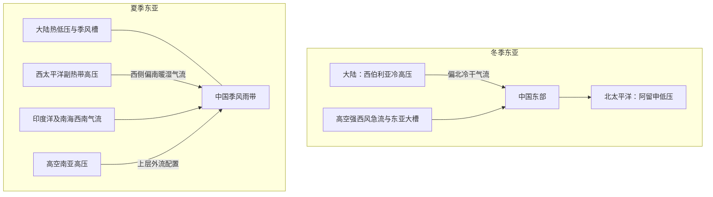

# D25 · 1994第17—19条＋1992全17条＋1990第1—3条（23条）

日期：2026-11-22｜建议投入：4小时｜动力40% · 天气40% · 物理20%

> 本学习包依据原50日PDF与仓库学习资料整理。参考答案不是官方评分标准；未完成学科审校及缺题标记均保留。公式采用 GitHub 数学 Markdown，请在 GitHub 正文或 Obsidian 阅读视图打开。

## 今日目标与记忆标准

闭卷说清概念、适用条件、符号与单位；推导必须写出起始方程、近似及关键步骤。先答题，再展开核对。

## 四小时执行

1. 20分钟：回忆此前第1、3、7、14天的重点，尚未开始的日期跳过。
2. 80分钟：逐题闭卷提取，核对以下简答与来源。
3. 70分钟：精选5题完整书写。名词解释90秒、简答7分钟、论述12分钟为训练目标。
4. 40分钟：把本日知识按“假设→方程→物理机制→天气表现”串成2—4条知识链。
5. 30分钟：记录遗漏点、用时与次日/3日/7日/14日复习日期。

> 星级口径：按同考点在不同年份的出现次数，1次★、2—3次★★、4—6次★★★、7—10次★★★★、11次及以上★★★★★；多考点题取最高频考点。星级表示复习频次，不是命题概率。

## 逐题回忆与简答

### 1994-三-4 · ★★★★（同考点7年）

**本次复核提示（2026-10-31）：** 台风生成的暖水、湿度、低切变和初始涡旋为有利条件集合；26.5℃经验值非绝对充分必要门槛。

台风发生、发展的必要条件。

[解析来源（对应题目行）](https://github.com/0183ty2512/lao-san-yang/blob/main/%E5%8A%A8%E5%8A%9B%E6%B0%94%E8%B1%A1%E8%AF%BE%E5%90%8E%E4%B9%A0%E9%A2%98/%E8%AF%95%E9%A2%98%E8%A7%A3%E7%AD%94/%E5%BE%80%E5%B9%B4%E8%AF%95%E9%A2%98%E8%A7%A3%E6%9E%90/1994.md#L648) · [原始年度题干](https://github.com/0183ty2512/lao-san-yang/blob/main/%E5%BE%80%E5%B9%B4%E8%AF%95%E9%A2%98%E5%88%86%E6%9E%90/1994.md)

**审校状态：尚未逐题学科审校。**

**相关高频考点复习摘要（须按本题设问取舍，不替代完整解答）：**

**热带气旋生成条件：** 热带气旋生成需暖海焓供应、暖湿且有对流潜能的环境、较弱垂直风切变、可用科氏作用、初始低层旋转扰动和高层外流。季风槽、东风波等可提供初始扰动；有利条件不等于保证生成。

> 以上摘要用于回忆答题主线，不是官方评分标准；推导、计算和多小问仍须完成下方步骤。

1. **生成条件。** 较深的暖海水供给焓，低层暖湿、对流潜能和中层湿度较充足，垂直风切变较弱，有初始低层旋转扰动及高层有效外流；离赤道要足够远以有可用科氏作用。常用约 26.5℃ 是经验参考，并非脱离海洋热含量和大气状态的绝对门槛。

2. **初始扰动。** 季风槽、热带辐合带扰动、东风波、赤道罗斯贝波等可提供涡度、辐合和持续对流。多数初始扰动不会发展，环境与内部组织过程都重要。

3. **CISK 链条。** 初始低压旋转 → 边界层摩擦造成向中心的水汽辐合 → 对流凝结释放潜热 → 暖心及质量场调整、高层外流加强 → 低压和低层旋转增强 → 更强辐合。对流和大尺度环流相互反馈而非单独气块条件不稳定，因此称第二类条件不稳定。它是理想化解释，现代海气通量反馈等机制不可省略。

4. **能量。** 水汽主要由暖海蒸发补给，海面潜热和显热通量提供焓；凝结将潜热释放，暖升冷沉及压力功转化为动能，摩擦耗散动能。不能把凝结说成凭空制造能量。

### 1994-三-5 · ★★★★（同考点7年）

**本次复核提示（2026-10-31）：** 原答案偏重东亚，补充北半球范围：海平面还应标冰岛低压、北太平洋及北大西洋副热带高压；中层包括北美东岸槽和大西洋—欧洲槽脊。具体中心、强度随月份和平均时段改变。

北半球冬季对流层中层和底层的主要环流特征。

[解析来源（对应题目行）](https://github.com/0183ty2512/lao-san-yang/blob/main/%E5%8A%A8%E5%8A%9B%E6%B0%94%E8%B1%A1%E8%AF%BE%E5%90%8E%E4%B9%A0%E9%A2%98/%E8%AF%95%E9%A2%98%E8%A7%A3%E7%AD%94/%E5%BE%80%E5%B9%B4%E8%AF%95%E9%A2%98%E8%A7%A3%E6%9E%90/1994.md#L690) · [原始年度题干](https://github.com/0183ty2512/lao-san-yang/blob/main/%E5%BE%80%E5%B9%B4%E8%AF%95%E9%A2%98%E5%88%86%E6%9E%90/1994.md)

**审校状态：尚未逐题学科审校。**

**相关高频考点复习摘要（须按本题设问取舍，不替代完整解答）：**

**东亚大气环流：** 冬季北半球中高纬温度梯度和西风较强，槽脊较显著，东亚大槽突出；夏季西风减弱北移，副高北抬。回答500 hPa题应围绕中层高度场、风场、槽脊位置和季节温差展开，地面系统只作解释背景。

> 以上摘要用于回忆答题主线，不是官方评分标准；推导、计算和多小问仍须完成下方步骤。

1. 冬季北半球 500 hPa 等高线较密、西风强、长波振幅较大，东亚和北美东岸常有大槽，大陆冷、海洋相对暖；夏季中高纬梯度减小、西风带北移，副高北抬，大陆暖低压发展。冬季海平面亚洲冷高压、阿留申低压突出，夏季大陆热低压与海洋副高突出。

2. 东亚冬季受西伯利亚高压—阿留申低压、东亚大槽和强西风急流控制，偏北风冷干；夏季副高、季风低压、低空水汽输送和南亚高压配合，偏南风暖湿。春夏转换可发生分阶段突变，因海陆/高原加热、季风爆发和急流、副高位置跃变，而不只是平滑逐日北移。

### 1994-四-整题 · ★（同考点1年）

**本次复核提示（2026-10-31）：** 剖面须包括低层信风、中纬西风及极地东风，和极地/热带对流层顶高度差、倾斜锋区与急流位置；原表主要给相对关系，不等于完整作图答案。

给出北半球冬季主要气团，对流层顶和锋面，急流。以及低层风系特征示意图，并简述他们之间的关系。

[解析来源（对应题目行）](https://github.com/0183ty2512/lao-san-yang/blob/main/%E5%8A%A8%E5%8A%9B%E6%B0%94%E8%B1%A1%E8%AF%BE%E5%90%8E%E4%B9%A0%E9%A2%98/%E8%AF%95%E9%A2%98%E8%A7%A3%E7%AD%94/%E5%BE%80%E5%B9%B4%E8%AF%95%E9%A2%98%E8%A7%A3%E6%9E%90/1994.md#L732) · [原始年度题干](https://github.com/0183ty2512/lao-san-yang/blob/main/%E5%BE%80%E5%B9%B4%E8%AF%95%E9%A2%98%E5%88%86%E6%9E%90/1994.md)

**审校状态：尚未逐题学科审校。**

> 以上摘要用于回忆答题主线，不是官方评分标准；推导、计算和多小问仍须完成下方步骤。

1. 气团是水平范围广、温度湿度等性质较均匀、在共同源地上形成的大块空气。冷暖气团之间的三维过渡带叫锋区，理想化为锋面，与地面的交线叫锋线。

2. **要素场。** 锋区水平温度和密度梯度大，等温线密集；地面常表现为低压槽，风向有气旋式切变，锋面上升指向冷空气一侧。气压本身连续，其梯度可明显改变；“锋面处气压不连续”是不正确表述。

3. **与急流、对流层顶联系。** 中纬度锋区强温度梯度经热成风关系形成高空强西风，极锋急流靠近高空锋区；副热带急流还受哈得莱环流角动量输送影响。极地对流层顶低、热带高，急流附近常有顶高陡变。

| 南北剖面 | 低纬暖区 | 中纬锋区 | 高纬冷区 |
|---|---|---|---|
| 对流层顶 | 高 | 过渡、可能折叠 | 低 |
| 高空 | 副热带急流附近 | 极锋急流、强温度梯度 | 极地气团 |
| 低层 | 暖湿气团 | 锋面向冷侧上倾 | 冷气团 |

该表给出应画的相对位置，实际急流和锋面位置随季节、天气变化。

!冬季纬向剖面.png（库内引用未定位）

图中表示热带、极锋两处典型对流层顶过渡和急流位置，低层暖冷气团由倾斜锋区连接；这是概念剖面，不表示两急流每天始终完全分离。

### 1992-一-1 · ★★★★★（同考点16年）

**本次复核提示（2026-10-31）：** 冬季阻塞高发区的原填空属教材地域概括；鄂霍次克海阻高有明显季节性，不将此表当全年统计排序。

北半球冬季阻塞高压最常出现的地区是**乌拉尔山地区**、**鄂霍次克海地区**、**北大西洋东部**。

[解析来源（对应题目行）](https://github.com/0183ty2512/lao-san-yang/blob/main/%E5%8A%A8%E5%8A%9B%E6%B0%94%E8%B1%A1%E8%AF%BE%E5%90%8E%E4%B9%A0%E9%A2%98/%E8%AF%95%E9%A2%98%E8%A7%A3%E7%AD%94/%E5%BE%80%E5%B9%B4%E8%AF%95%E9%A2%98%E8%A7%A3%E6%9E%90/1992.md#L11) · [原始年度题干](https://github.com/0183ty2512/lao-san-yang/blob/main/%E5%BE%80%E5%B9%B4%E8%AF%95%E9%A2%98%E5%88%86%E6%9E%90/1992.md)

**审校状态：尚未逐题学科审校。**

**相关高频考点复习摘要（须按本题设问取舍，不替代完整解答）：**

**阻塞高压：** 阻塞高压是中高纬持续、少动并使西风绕行的强脊或闭合高压。建立与暖输送、波破碎及涡旋反馈有关；其东侧偏北气流可蓄积和引导冷空气。衰退配合横槽转竖时可触发寒潮，但并非每次崩溃都必然造成寒潮。

> 以上摘要用于回忆答题主线，不是官方评分标准；推导、计算和多小问仍须完成下方步骤。

**原记录填空值：** 乌拉尔山地区；鄂霍次克海地区；北大西洋东部。下文核对其物理含义；出现修改意见时，以修改后的说明为准。

1. 阻塞高压是中高纬持续、移动缓慢的强高压脊或闭合高压，使西风气流绕行、分支，阻碍天气系统正常东移。关键是持续性和对西风带的阻挡，并非所有高压都叫阻塞。
2. 建立时，暖空气向极地输送使脊增强，经向振幅增大，波破碎、涡旋反馈可帮助维持。高压脊发展或与高纬高压合并，南侧可切出冷低压，形成偶极或Ω型等配置。
3. 维持时，阻高东侧偏北气流引导冷空气南下，西侧偏南气流输送暖空气。下游槽及冷暖空气交汇区可长期停留，造成持久冷凉、降雨；高压控制区下沉、少云，可造成干旱和高温，具体依季节和位置。
4. 衰退或崩溃时，维持高压的暖输送与涡旋反馈减弱，西风恢复，槽脊重新东移；其东侧积聚的冷空气可配合横槽转竖大举南下，触发我国寒潮。不能把每一次阻高衰退都等同于寒潮，仍需冷空气强度和路径配合。
5. 亚洲常关注乌拉尔山及鄂霍次克海等阻塞区，北大西洋—欧洲也是重要活动区；不同季节的优势位置不同，不应把某一季节经验说成全年固定不变。
6. 切断低压是从西风主槽分离出的闭合冷性低压，移动缓慢，可与北侧阻高配合。其冷空气及正涡度有利于下游不稳定和上升，但天气还依水汽供应。

### 1992-一-2 · ★★★★（同考点8年）

**本次复核提示（2026-10-31）：** 原填空“北侧反气旋式切变”应纠正。在北半球典型西风急流北侧，$\frac{\partial u}{\partial y}<0$，故$\zeta\simeq-\frac{\partial u}{\partial y}>0$，为气旋性切变；南侧相反。

北半球冬季副热带急流大致稳定在**25~30**°N 之间，夏季则北移**5~10**个纬距，在流域北侧等中风场为**反气旋式**切变。

[解析来源（对应题目行）](https://github.com/0183ty2512/lao-san-yang/blob/main/%E5%8A%A8%E5%8A%9B%E6%B0%94%E8%B1%A1%E8%AF%BE%E5%90%8E%E4%B9%A0%E9%A2%98/%E8%AF%95%E9%A2%98%E8%A7%A3%E7%AD%94/%E5%BE%80%E5%B9%B4%E8%AF%95%E9%A2%98%E8%A7%A3%E6%9E%90/1992.md#L54) · [原始年度题干](https://github.com/0183ty2512/lao-san-yang/blob/main/%E5%BE%80%E5%B9%B4%E8%AF%95%E9%A2%98%E5%88%86%E6%9E%90/1992.md)

**审校状态：尚未逐题学科审校。**

**相关高频考点复习摘要（须按本题设问取舍，不替代完整解答）：**

**高空急流：** 高空急流是对流层上部狭长强风带，横向和垂直切变强。极锋急流与斜压锋区相关，副热带急流还受低纬角动量输送影响；冬强偏南、夏弱偏北。急流加减速与曲率引起非地转次级环流，可影响下方上升和气旋发展。

> 以上摘要用于回忆答题主线，不是官方评分标准；推导、计算和多小问仍须完成下方步骤。

**原记录填空值：** 25~30；5~10；反气旋式。下文核对其物理含义；出现修改意见时，以修改后的说明为准。

1. 急流是狭长的强风带，横向和竖直风切变显著，急流轴是局地最大风速的位置。高空西风急流位于对流层上部，冬季更强、更偏南；夏季整体偏北、减弱。东亚日本附近冬季急流可很强，题中 70—80 m/s 是典型量级而非上限。

2. 极锋急流与中纬度锋区斜压性相联系；副热带急流还与低纬向极运动的角动量输送和热成风共同有关。强南北温度梯度通过热成风使西风随高度增强；不能只归因于地面风向上复制。

3. 急流入口、出口的加减速和曲率导致非地转次级环流，局部辐散有利于下方上升和气旋发展；简单直急流象限规则只在相应理想条件下适用。

**原填空修改意见：** 急流北侧通常为气旋性切变、南侧通常为反气旋性切变（北半球，取急流西风峰值的典型横向分布）。原记录“北侧为反气旋式切变”的表述疑似错误；由 $\zeta\approx-\frac{\partial u}{\partial y}$，北侧 $\frac{\partial u}{\partial y}<0$，所以 $\zeta>0$。

### 1992-一-3 · ★★（同考点3年）

**本次复核提示（2026-10-31）：** 900、1060hPa为强事件量级，不是台风或冷高压平均值。

夏季台风中心气压可低至**900**百帕以下，而冬季大陆冷高压可达**1060**百帕以上。

[解析来源（对应题目行）](https://github.com/0183ty2512/lao-san-yang/blob/main/%E5%8A%A8%E5%8A%9B%E6%B0%94%E8%B1%A1%E8%AF%BE%E5%90%8E%E4%B9%A0%E9%A2%98/%E8%AF%95%E9%A2%98%E8%A7%A3%E7%AD%94/%E5%BE%80%E5%B9%B4%E8%AF%95%E9%A2%98%E8%A7%A3%E6%9E%90/1992.md#L98) · [原始年度题干](https://github.com/0183ty2512/lao-san-yang/blob/main/%E5%BE%80%E5%B9%B4%E8%AF%95%E9%A2%98%E5%88%86%E6%9E%90/1992.md)

**审校状态：尚未逐题学科审校。**

**相关高频考点复习摘要（须按本题设问取舍，不替代完整解答）：**

**地面气压极值：** 1060 hPa以上大陆冷高压、950 hPa以下强热带气旋中心等是强事件量级，不是所有寒潮或台风的典型平均。极值还需说明海平面订正、地区和统计样本，不能拿填空中的例值当绝对上限或下限。

> 以上摘要用于回忆答题主线，不是官方评分标准；推导、计算和多小问仍须完成下方步骤。

**原记录填空值：** 900；1060。下文核对其物理含义；出现修改意见时，以修改后的说明为准。

1. 强大陆冷高压可达到1060 hPa甚至更高，强热带气旋中心可低于950 hPa、极强个例低于900 hPa；这些是强事件量级，不是“所有寒潮或台风的一般气压”。原文给出的极值范围不应当作气候平均。

### 1992-一-4 · ★（同考点1年）

**本次复核提示（2026-10-31）：** QBO完整周期约28个月，不能把约14个月的风向转换间隔当完整周期。依据：[NASA QBO资料](https://acd-ext.gsfc.nasa.gov/Data_services/met/qbo/qbo.html)。

平流层中存在着准**两**年的振荡现象，主要表现为赤道平流层**东西**风环流的交替。

[解析来源（对应题目行）](https://github.com/0183ty2512/lao-san-yang/blob/main/%E5%8A%A8%E5%8A%9B%E6%B0%94%E8%B1%A1%E8%AF%BE%E5%90%8E%E4%B9%A0%E9%A2%98/%E8%AF%95%E9%A2%98%E8%A7%A3%E7%AD%94/%E5%BE%80%E5%B9%B4%E8%AF%95%E9%A2%98%E8%A7%A3%E6%9E%90/1992.md#L136) · [原始年度题干](https://github.com/0183ty2512/lao-san-yang/blob/main/%E5%BE%80%E5%B9%B4%E8%AF%95%E9%A2%98%E5%88%86%E6%9E%90/1992.md)

**审校状态：尚未逐题学科审校。**

> 以上摘要用于回忆答题主线，不是官方评分标准；推导、计算和多小问仍须完成下方步骤。

**原记录填空值：** 两；东西。下文核对其物理含义；出现修改意见时，以修改后的说明为准。

1. 准两年振荡（QBO）是赤道平流层纬向风东、西风带交替的现象，“准”表示周期并非严格两年，平均约28个月。
2. 东西风剪切层通常从较高处逐渐向下传播，主要通过赤道波和重力波输送、沉积动量与平均流相互作用维持，而非地面季风直接延伸到平流层。
3. 对填空“准几年的振荡”，教材名称填“两”；若问准确周期，写“约28个月，存在变化”，不要把完整周期与半个东西风转换周期混淆。参考：[Met Office 的QBO说明](https://www.metoffice.gov.uk/services/government/contingency-planners/seasonal-forecasts-and-climate-drivers-resources)。

### 1992-一-5 · ★★（同考点3年）

**本次复核提示（2026-10-31）：** 环流基本驱动为辐射差异；自转、海陆、地形和涡旋调节。原题将太阳活动并列为主要因素，应保留教材措辞疑点，不理解为同等主导作用。

影响大气环流形成的主要因素有：太阳辐射能随纬度分布的不均匀、基本气流的不稳定、太阳活动和**地球自转（海陆分布和地形）**。

[解析来源（对应题目行）](https://github.com/0183ty2512/lao-san-yang/blob/main/%E5%8A%A8%E5%8A%9B%E6%B0%94%E8%B1%A1%E8%AF%BE%E5%90%8E%E4%B9%A0%E9%A2%98/%E8%AF%95%E9%A2%98%E8%A7%A3%E7%AD%94/%E5%BE%80%E5%B9%B4%E8%AF%95%E9%A2%98%E8%A7%A3%E6%9E%90/1992.md#L172) · [原始年度题干](https://github.com/0183ty2512/lao-san-yang/blob/main/%E5%BE%80%E5%B9%B4%E8%AF%95%E9%A2%98%E5%88%86%E6%9E%90/1992.md)

**审校状态：尚未逐题学科审校。**

**相关高频考点复习摘要（须按本题设问取舍，不替代完整解答）：**

**大气环流：** 大气环流由辐射纬向不均提供能量，地球自转约束运动，海陆分布、地形和季节性加热塑造区域结构，涡旋输送维持平均风带。答题须把驱动、约束、区域调制与维持过程分清。

> 以上摘要用于回忆答题主线，不是官方评分标准；推导、计算和多小问仍须完成下方步骤。

**原记录填空值：** 地球自转（海陆分布和地形）。下文核对其物理含义；出现修改意见时，以修改后的说明为准。

1. 大气环流的基本驱动是太阳辐射纬向分布不均造成低纬盈余、高纬亏损；地球自转约束运动并产生东西风带，海陆分布、地形、季节性加热及涡旋不稳定使环流偏离纬向对称。

2. 平均经圈环流中，哈得莱环流低纬上升、副热带下沉，近地面回流形成信风，属于热力直接环流；费雷尔环流在中纬度、平均上热力间接，依赖天气涡旋维持；极地环流较弱。三圈是统计平均，非每个经度同时存在三个封闭圈。

3. 沃克环流是热带沿东西方向的垂直环流。典型热带太平洋上暖西太平洋对流上升，东部较冷海区下沉，低层东风回流；与哈得莱环流的南北方向不同。

4. 冬季北半球 500 hPa 等高线较密、西风强、长波振幅较大，东亚和北美东岸常有大槽，大陆冷、海洋相对暖；夏季中高纬梯度减小、西风带北移，副高北抬，大陆暖低压发展。冬季海平面亚洲冷高压、阿留申低压突出，夏季大陆热低压与海洋副高突出。

### 1992-二-1 · ★★★★（同考点8年）

**本次复核提示（2026-10-31）：** Hadley环流为统计平均的热力直接环流，上升支随季节移动。

Hadley 环流

[解析来源（对应题目行）](https://github.com/0183ty2512/lao-san-yang/blob/main/%E5%8A%A8%E5%8A%9B%E6%B0%94%E8%B1%A1%E8%AF%BE%E5%90%8E%E4%B9%A0%E9%A2%98/%E8%AF%95%E9%A2%98%E8%A7%A3%E7%AD%94/%E5%BE%80%E5%B9%B4%E8%AF%95%E9%A2%98%E8%A7%A3%E6%9E%90/1992.md#L220) · [原始年度题干](https://github.com/0183ty2512/lao-san-yang/blob/main/%E5%BE%80%E5%B9%B4%E8%AF%95%E9%A2%98%E5%88%86%E6%9E%90/1992.md)

**审校状态：尚未逐题学科审校。**

**相关高频考点复习摘要（须按本题设问取舍，不替代完整解答）：**

**哈得莱环流：** 哈得莱环流是低纬平均经圈环流：赤道附近暖区上升，高层向副热带流动，副热带下沉，近地面回流形成信风，属于热力直接环流。与中纬度涡旋维持的费雷尔环流、东西向沃克环流区别。

> 以上摘要用于回忆答题主线，不是官方评分标准；推导、计算和多小问仍须完成下方步骤。

1. 平均经圈环流中，哈得莱环流低纬上升、副热带下沉，近地面回流形成信风，属于热力直接环流；费雷尔环流在中纬度、平均上热力间接，依赖天气涡旋维持；极地环流较弱。三圈是统计平均，非每个经度同时存在三个封闭圈。

### 1992-二-2 · ★★★★（同考点8年）

**本次复核提示（2026-10-31）：** 热成风积分上下限和正负号一致；下标t/b表示上下层，不是偏导；平均温度须为对数气压平均。

热成风

[解析来源（对应题目行）](https://github.com/0183ty2512/lao-san-yang/blob/main/%E5%8A%A8%E5%8A%9B%E6%B0%94%E8%B1%A1%E8%AF%BE%E5%90%8E%E4%B9%A0%E9%A2%98/%E8%AF%95%E9%A2%98%E8%A7%A3%E7%AD%94/%E5%BE%80%E5%B9%B4%E8%AF%95%E9%A2%98%E8%A7%A3%E6%9E%90/1992.md#L256) · [原始年度题干](https://github.com/0183ty2512/lao-san-yang/blob/main/%E5%BE%80%E5%B9%B4%E8%AF%95%E9%A2%98%E5%88%86%E6%9E%90/1992.md)

**审校状态：尚未逐题学科审校。**

**相关高频考点复习摘要（须按本题设问取舍，不替代完整解答）：**

**热成风：** 热成风是上下两层地转风之差。由静力关系 $\frac{\partial\Phi}{\partial\ln p}=-RT$ 与地转关系得 $\frac{\partial u_g}{\partial\ln p}=(R/f)\frac{\partial T}{\partial y}$、$\frac{\partial v_g}{\partial\ln p}=-(R/f)\frac{\partial T}{\partial x}$。北半球向上的热成风冷侧在左，表示温度梯度对应垂直风切变。

> 以上摘要用于回忆答题主线，不是官方评分标准；推导、计算和多小问仍须完成下方步骤。

1. 热成风是两个高度或等压面之间的**地转风差**，不是独立的一股实际风。
2. 静力关系给出 $\frac{\partial\Phi}{\partial\ln p}=-RT$。对 $u_g=-\frac{\partial \Phi}{\partial y}/f$、$v_g=\frac{\partial \Phi}{\partial x}/f$ 分别作 $\ln p$ 导数（局地取 $f$ 固定），得
$$\frac{\partial u_g}{\partial\ln p}=\frac RfT_y,\qquad \frac{\partial v_g}{\partial\ln p}=-\frac RfT_x.$$
3. 从下层 $p_b$ 积到上层 $p_t<p_b$，若用对数气压平均温度 $\bar T$，则 $u_t-u_b=-(R/f)\ln(p_b/p_t)\frac{\partial\bar T}{\partial y}$、$v_t-v_b=(R/f)\ln(p_b/p_t)\frac{\partial\bar T}{\partial x}$。
4. 北半球向上的热成风沿平均等温线，冷空气在其左侧。温度向北降低时，西风一般随高度增强。该关系把水平温度梯度和垂直风切变连接起来。

### 1992-二-3 · ★★（同考点3年）

**本次复核提示（2026-10-31）：** 假相当位温定义包含凝结物立即移出；所列指数式是近似，区别于可逆湿绝热过程。

假相当位温

[解析来源（对应题目行）](https://github.com/0183ty2512/lao-san-yang/blob/main/%E5%8A%A8%E5%8A%9B%E6%B0%94%E8%B1%A1%E8%AF%BE%E5%90%8E%E4%B9%A0%E9%A2%98/%E8%AF%95%E9%A2%98%E8%A7%A3%E7%AD%94/%E5%BE%80%E5%B9%B4%E8%AF%95%E9%A2%98%E8%A7%A3%E6%9E%90/1992.md#L296) · [原始年度题干](https://github.com/0183ty2512/lao-san-yang/blob/main/%E5%BE%80%E5%B9%B4%E8%AF%95%E9%A2%98%E5%88%86%E6%9E%90/1992.md)

**审校状态：尚未逐题学科审校。**

**相关高频考点复习摘要（须按本题设问取舍，不替代完整解答）：**

**湿位温及相当位温：** 假相当位温按先干绝热至饱和、再假绝热使水汽凝结移出、最后干绝热至参考气压定义，综合温度与水汽潜热信息。夏季适于追踪暖湿气团和分析位势稳定度；假绝热有凝结物移出，不能当成封闭可逆过程。

> 以上摘要用于回忆答题主线，不是官方评分标准；推导、计算和多小问仍须完成下方步骤。

1. 干位温只表示干绝热压缩膨胀后的热力状态；夏季水汽多，凝结潜热显著，相同干位温的气块可有很不相同的对流潜能。

2. 假相当位温 $\theta_{se}$ 的概念定义：气块先干绝热抬升到凝结高度，再沿假绝热过程抬升，凝结物立即移出，直至水汽基本凝结完，再把剩余干空气沿干绝热线移到参考气压时的温度。它把温度、气压和水汽能量综合在一起。

3. 近似表达常写 $\theta_e\approx\theta\exp[L_vq_v/(c_pT_L)]$，$T_L$ 为凝结温度；精确教材公式可能还有干空气分压和热容修正。水汽越多，一般相当位温越高，适合追踪暖湿气团、梅雨锋和位势稳定度。

### 1992-二-4 · ★★★★（同考点7年）

**本次复核提示（2026-10-31）：** 低空急流高度和阈值依类型与判据变化，不能用单一850hPa定义所有低空急流。

低空急流

[解析来源（对应题目行）](https://github.com/0183ty2512/lao-san-yang/blob/main/%E5%8A%A8%E5%8A%9B%E6%B0%94%E8%B1%A1%E8%AF%BE%E5%90%8E%E4%B9%A0%E9%A2%98/%E8%AF%95%E9%A2%98%E8%A7%A3%E7%AD%94/%E5%BE%80%E5%B9%B4%E8%AF%95%E9%A2%98%E8%A7%A3%E6%9E%90/1992.md#L336) · [原始年度题干](https://github.com/0183ty2512/lao-san-yang/blob/main/%E5%BE%80%E5%B9%B4%E8%AF%95%E9%A2%98%E5%88%86%E6%9E%90/1992.md)

**审校状态：尚未逐题学科审校。**

**相关高频考点复习摘要（须按本题设问取舍，不替代完整解答）：**

**低空急流：** 低空急流是低层风速局地极大带，东亚夏季常在850—700 hPa附近。可由压力梯度、地形和夜间摩擦减弱后的惯性振荡形成；输送暖湿空气，在出口或与锋、切变线交汇处产生辐合，利于暴雨；对流加热亦可反馈加强急流。

> 以上摘要用于回忆答题主线，不是官方评分标准；推导、计算和多小问仍须完成下方步骤。

1. 低空急流是对流层低层的局地风速极大带，东亚夏季常在 850—700 hPa 附近，题中的 12 m/s 或 12—15 m/s 属常用识别量级，具体标准随研究变化。

2. 形成机制包括大尺度压力梯度加强、地形通道和山坡热力差异；夜间地表稳定化削弱摩擦，残余风发生惯性振荡，也可产生夜间风速极大。不同类型低空急流机制并不相同。

3. 低空急流输送暖湿空气，出口附近或与锋、切变线相交处辐合，利于不稳定能量和水汽积聚、暴雨触发；对流加热也可反过来加强低层压力梯度及急流。

### 1992-二-5 · ★★★（同考点4年）

**本次复核提示（2026-10-31）：** 西风指数须注明纬带与层次；指数循环不是严格周期。

指数循环

[解析来源（对应题目行）](https://github.com/0183ty2512/lao-san-yang/blob/main/%E5%8A%A8%E5%8A%9B%E6%B0%94%E8%B1%A1%E8%AF%BE%E5%90%8E%E4%B9%A0%E9%A2%98/%E8%AF%95%E9%A2%98%E8%A7%A3%E7%AD%94/%E5%BE%80%E5%B9%B4%E8%AF%95%E9%A2%98%E8%A7%A3%E6%9E%90/1992.md#L376) · [原始年度题干](https://github.com/0183ty2512/lao-san-yang/blob/main/%E5%BE%80%E5%B9%B4%E8%AF%95%E9%A2%98%E5%88%86%E6%9E%90/1992.md)

**审校状态：尚未逐题学科审校。**

**相关高频考点复习摘要（须按本题设问取舍，不替代完整解答）：**

**环流指数：** 西风指数利用中高纬某层的南北高度差或平均纬向风衡量西风强弱；需注明采用的层次、纬带和公式。高指数偏纬向、低指数偏经向，指数循环描述槽脊振幅与流型演变，不是严格周期。

> 以上摘要用于回忆答题主线，不是官方评分标准；推导、计算和多小问仍须完成下方步骤。

1. 西风指数用中高纬某层的南北位势高度差表征平均西风强度，例如 $I=\overline{Z}(35°N)-\overline{Z}(55°N)$，由地转关系换算纬带平均西风。具体层次、纬度带依课程定义，应写出采用的约定。高指数偏纬向、低指数偏经向，指数循环是两类状态及波幅的演变，不是严格周期。

### 1992-二-6 · ★★（同考点2年）

**本次复核提示（2026-10-31）：** “内力”是传统台风移动术语；β漂移源于涡旋与行星涡度梯度作用，不能等同凭空净内力。

台风内力

[解析来源（对应题目行）](https://github.com/0183ty2512/lao-san-yang/blob/main/%E5%8A%A8%E5%8A%9B%E6%B0%94%E8%B1%A1%E8%AF%BE%E5%90%8E%E4%B9%A0%E9%A2%98/%E8%AF%95%E9%A2%98%E8%A7%A3%E7%AD%94/%E5%BE%80%E5%B9%B4%E8%AF%95%E9%A2%98%E8%A7%A3%E6%9E%90/1992.md#L412) · [原始年度题干](https://github.com/0183ty2512/lao-san-yang/blob/main/%E5%BE%80%E5%B9%B4%E8%AF%95%E9%A2%98%E5%88%86%E6%9E%90/1992.md)

**审校状态：尚未逐题学科审校。**

> 以上摘要用于回忆答题主线，不是官方评分标准；推导、计算和多小问仍须完成下方步骤。

1. **移动。** 环境深层平均引导气流是主要因素，副高南侧常引导西移，西缘可北上，遇中纬西风槽可转向东北。β漂移源于涡旋与行星涡度梯度相互作用，北半球常有向西北的分量；传统“内力”不能理解为违反系统整体动量守恒的凭空外力。双台风作用、地形及结构变化亦可修正路径。

### 1992-二-7 · ★★（同考点3年）

**本次复核提示（2026-10-31）：** Walker环流是热带纬向垂直环流；西升东沉是典型太平洋背景态。

沃克环流

[解析来源（对应题目行）](https://github.com/0183ty2512/lao-san-yang/blob/main/%E5%8A%A8%E5%8A%9B%E6%B0%94%E8%B1%A1%E8%AF%BE%E5%90%8E%E4%B9%A0%E9%A2%98/%E8%AF%95%E9%A2%98%E8%A7%A3%E7%AD%94/%E5%BE%80%E5%B9%B4%E8%AF%95%E9%A2%98%E8%A7%A3%E6%9E%90/1992.md#L444) · [原始年度题干](https://github.com/0183ty2512/lao-san-yang/blob/main/%E5%BE%80%E5%B9%B4%E8%AF%95%E9%A2%98%E5%88%86%E6%9E%90/1992.md)

**审校状态：尚未逐题学科审校。**

**相关高频考点复习摘要（须按本题设问取舍，不替代完整解答）：**

**沃克环流：** 沃克环流是热带东西向垂直环流，典型太平洋状态为暖西部上升、较冷东部下沉，高低层构成回流。它不同于南北向哈得莱环流，可随ENSO调整。

> 以上摘要用于回忆答题主线，不是官方评分标准；推导、计算和多小问仍须完成下方步骤。

1. 沃克环流是热带沿东西方向的垂直环流。典型热带太平洋上暖西太平洋对流上升，东部较冷海区下沉，低层东风回流；与哈得莱环流的南北方向不同。

### 1992-三-1 · ★★★★★（同考点13年）

**本次复核提示（2026-10-31）：** 高低层水汽、抬升与急流配置齐全；高空辐散需看具体相对位置，非只要有急流就必有辐散。

江淮流域梅雨锋高、低空环流的基本特征。

[解析来源（对应题目行）](https://github.com/0183ty2512/lao-san-yang/blob/main/%E5%8A%A8%E5%8A%9B%E6%B0%94%E8%B1%A1%E8%AF%BE%E5%90%8E%E4%B9%A0%E9%A2%98/%E8%AF%95%E9%A2%98%E8%A7%A3%E7%AD%94/%E5%BE%80%E5%B9%B4%E8%AF%95%E9%A2%98%E8%A7%A3%E6%9E%90/1992.md#L484) · [原始年度题干](https://github.com/0183ty2512/lao-san-yang/blob/main/%E5%BE%80%E5%B9%B4%E8%AF%95%E9%A2%98%E5%88%86%E6%9E%90/1992.md)

**审校状态：尚未逐题学科审校。**

**相关高频考点复习摘要（须按本题设问取舍，不替代完整解答）：**

**梅雨：** 梅雨是初夏江淮及长江中下游的持续阴雨过程。梅雨锋常以水汽和相当位温梯度、低层切变辐合突出；低层西南急流供水汽，中层副高北缘与中高纬槽脊维持冷暖交汇，高层合适辐散配合上升。北段锋区温差可明显，不能说梅雨锋完全无温度梯度。

> 以上摘要用于回忆答题主线，不是官方评分标准；推导、计算和多小问仍须完成下方步骤。

1. **梅雨定义与天气。** 初夏江淮及长江中下游的持续阴雨期，常在 6 月中旬至 7 月上旬附近，但年际变化明显。天气高湿、云量多，层状云雨夹有对流和暴雨，日照少，雨带易持续。

2. **锋区结构。** 梅雨—Baiu锋西部常温度梯度较弱而水汽、相当位温梯度很强；低层有风向切变、辐合和正涡度，锋南暖湿偏南/西南风，锋北较冷偏东/偏北气流。向日本以东延伸的东部温度梯度可更显著，不能概括为“完全无温度差”。

3. **高中低层配置。** 高层南亚高压与西风急流提供适宜的辐散背景；500 hPa 中高纬阻高、东亚槽和西太副高使冷暖气流维持；850—700 hPa 西南急流输送水汽，梅雨锋、切变线或低涡提供抬升。双阻型通常在欧亚中高纬形成两处阻塞、其间冷槽南伸，与低纬副高北侧暖湿气流相遇；两阻的精确中心依原教材图例而定。

4. **梅雨与极锋比较。** 极锋主要表现为强水平温度梯度及深厚斜压性，梅雨锋常以水汽差异和低层切变更突出；两者均可提供持续上升并组织降水。

### 1992-三-2 · ★★★★（同考点9年）

**本次复核提示（2026-10-31）：** 四阶段是理想锋面气旋模型；已使用地面暖区逐渐收窄的修正表述。

温带气旋发展各个阶段的主要特点。

[解析来源（对应题目行）](https://github.com/0183ty2512/lao-san-yang/blob/main/%E5%8A%A8%E5%8A%9B%E6%B0%94%E8%B1%A1%E8%AF%BE%E5%90%8E%E4%B9%A0%E9%A2%98/%E8%AF%95%E9%A2%98%E8%A7%A3%E7%AD%94/%E5%BE%80%E5%B9%B4%E8%AF%95%E9%A2%98%E8%A7%A3%E6%9E%90/1992.md#L526) · [原始年度题干](https://github.com/0183ty2512/lao-san-yang/blob/main/%E5%BE%80%E5%B9%B4%E8%AF%95%E9%A2%98%E5%88%86%E6%9E%90/1992.md)

**审校状态：尚未逐题学科审校。**

**相关高频考点复习摘要（须按本题设问取舍，不替代完整解答）：**

**气旋及其发展：** 气旋是低压及气旋式环流。温带锋面气旋依次经历初生波动、发展加深、成熟锢囚、衰亡填塞；斜压有效位能、高空涡度平流和辐散、低层暖平流及潜热共同影响发展。不能把所有气旋都概括成轴对称冷心。

> 以上摘要用于回忆答题主线，不是官方评分标准；推导、计算和多小问仍须完成下方步骤。

1. 气旋是低压及其气旋式环流系统，北半球逆时针、南半球顺时针；反气旋为高压及反气旋式环流。低层摩擦使气旋常辐合上升、反气旋常辐散下沉，但云雨仍依水汽和热力条件。

2. **温带锋面气旋四阶段。** 初生：静止锋上出现波动，暖空气向冷侧、冷空气向暖侧推进；发展：低压加深，冷暖锋清楚，冷锋通常较暖锋移动快，地面暖区逐渐收窄，槽前正涡度平流和高空辐散配合；成熟/锢囚：冷锋追上暖锋，暖空气抬离地面，气旋范围较大且结构复杂；衰亡：近地面冷空气占据中心，水平温差和斜压取能减弱，低压逐渐填塞。

3. **主要发展因子。** 基本态温度梯度与垂直风切变提供有效位能，高低空槽与地面低压有利配置，低层暖平流、高层正涡度平流和辐散支持上升，凝结潜热可加强发展。并非每个实际气旋都严格走完同一理想阶段。

4. 我国温带气旋常活动于蒙古—东北、黄淮—江淮及东部沿海等区，路径随季节变化。冷反气旋多随冷空气从西北、北方或东北方向南下，冬半年强且广，暖季较弱；不能给出一条全年唯一入侵路线。

### 1992-三-3 · ★★（同考点3年）

**本次复核提示（2026-10-31）：** 比较应突出尺度、锋面、热力结构、能源和寿命；龙卷不适用同一准地转模型。

温带气旋、台风、龙卷的主要差异。

[解析来源（对应题目行）](https://github.com/0183ty2512/lao-san-yang/blob/main/%E5%8A%A8%E5%8A%9B%E6%B0%94%E8%B1%A1%E8%AF%BE%E5%90%8E%E4%B9%A0%E9%A2%98/%E8%AF%95%E9%A2%98%E8%A7%A3%E7%AD%94/%E5%BE%80%E5%B9%B4%E8%AF%95%E9%A2%98%E8%A7%A3%E6%9E%90/1992.md#L568) · [原始年度题干](https://github.com/0183ty2512/lao-san-yang/blob/main/%E5%BE%80%E5%B9%B4%E8%AF%95%E9%A2%98%E5%88%86%E6%9E%90/1992.md)

**审校状态：尚未逐题学科审校。**

**相关高频考点复习摘要（须按本题设问取舍，不替代完整解答）：**

**温带气旋与热带气旋比较：** 温带气旋常有锋、非轴对称和斜压倾斜，主要利用基本态有效位能；成熟台风无典型锋、深厚暖心，依海气焓供应与湿对流。冷高压下层强且随高度减弱，副高暖性深厚；不能把气旋反气旋各自都归为同一种热力结构。

> 以上摘要用于回忆答题主线，不是官方评分标准；推导、计算和多小问仍须完成下方步骤。

1. 气旋是低压及其气旋式环流系统，北半球逆时针、南半球顺时针；反气旋为高压及反气旋式环流。低层摩擦使气旋常辐合上升、反气旋常辐散下沉，但云雨仍依水汽和热力条件。

本段与上文相同，可回看前面的解析，不再重复展开。

3. **与台风、龙卷比较。** 温带气旋通常千公里量级，常有锋、热力不对称、发展期向冷侧随高度倾斜；成熟热带气旋数百公里量级，深厚暖心、无典型冷暖锋，主要依海面焓通量与湿对流；龙卷是雷暴内或其下方的小尺度强旋转气柱，水平多为几十至几百米、生命较短，不能与温带气旋使用同一准地转模型。

4. **反气旋热力分类。** 大陆冷高压下层强、随高度减弱，常对应冷干大风；副热带暖高压较深厚，控制区下沉少云。按热力结构可说冷性、暖性系统，但实际锋面气旋和过渡系统可不对称，不能把所有气旋都称冷心。

### 1992-三-4 · ★★★★（同考点7年）

**本次复核提示（2026-10-31）：** 题目要求地面系统：冬季标亚洲冷高压与阿留申低压；夏季标大陆热低压/季风槽与西太副高。高空系统作为解释，不替代地面示意图。

画出表明东亚地区冬季和夏季主要地面天气系统，并说明各个天气系统对中国冬夏天气的主要影响。

[解析来源（对应题目行）](https://github.com/0183ty2512/lao-san-yang/blob/main/%E5%8A%A8%E5%8A%9B%E6%B0%94%E8%B1%A1%E8%AF%BE%E5%90%8E%E4%B9%A0%E9%A2%98/%E8%AF%95%E9%A2%98%E8%A7%A3%E7%AD%94/%E5%BE%80%E5%B9%B4%E8%AF%95%E9%A2%98%E8%A7%A3%E6%9E%90/1992.md#L610) · [原始年度题干](https://github.com/0183ty2512/lao-san-yang/blob/main/%E5%BE%80%E5%B9%B4%E8%AF%95%E9%A2%98%E5%88%86%E6%9E%90/1992.md)

**审校状态：尚未逐题学科审校。**

**相关高频考点复习摘要（须按本题设问取舍，不替代完整解答）：**

本段与上文相同，可回看前面的解析，不再重复展开。

> 以上摘要用于回忆答题主线，不是官方评分标准；推导、计算和多小问仍须完成下方步骤。

本段与上文相同，可回看前面的解析，不再重复展开。

本段与上文相同，可回看前面的解析，不再重复展开。

**对应示意图（位置关系，不按比例）：**

### 1992-三-5 · ★★★（同考点5年）

**本次复核提示（2026-10-31）：** 锋生公式三项的符号经物质导数与空间导数交换核对一致。令$G_i=\frac{\partial\theta}{\partial x_i}$，$i,j=x,y$且重复指标求和；公式要求$|\mathbf G|\ne0$。$\partial_i$表示$\frac{\partial}{\partial x_i}$，动力锋生包括水平变形/辐合与倾斜，非绝热项应单列。

什么叫锋生？写出锋生公式并解释各项的物理意义。

[解析来源（对应题目行）](https://github.com/0183ty2512/lao-san-yang/blob/main/%E5%8A%A8%E5%8A%9B%E6%B0%94%E8%B1%A1%E8%AF%BE%E5%90%8E%E4%B9%A0%E9%A2%98/%E8%AF%95%E9%A2%98%E8%A7%A3%E7%AD%94/%E5%BE%80%E5%B9%B4%E8%AF%95%E9%A2%98%E8%A7%A3%E6%9E%90/1992.md#L666) · [原始年度题干](https://github.com/0183ty2512/lao-san-yang/blob/main/%E5%BE%80%E5%B9%B4%E8%AF%95%E9%A2%98%E5%88%86%E6%9E%90/1992.md)

**审校状态：尚未逐题学科审校。**

**相关高频考点复习摘要（须按本题设问取舍，不替代完整解答）：**

**锋生与锋消：** 锋生是随气块运动的水平温度或位温梯度增强。令 $F=D|\nabla_h\theta|/Dt$，按链式法则可分为差异加热、水平变形辐合和竖直倾斜贡献。$F>0$ 锋生，$F<0$ 锋消；不能把所有水平辐合无条件视为锋生。

> 以上摘要用于回忆答题主线，不是官方评分标准；推导、计算和多小问仍须完成下方步骤。

1. **锋生定义与推导。** 令 $\mathbf G=\nabla_h\theta$，$F=D|\mathbf G|/Dt$。由 $D\theta/Dt=\dot\theta$ 对 $x_i$ 求导：$DG_i/Dt=\frac{\partial\dot\theta}{\partial x_i}-(\frac{\partial u_j}{\partial x_i})G_j-(\frac{\partial w}{\partial x_i})\frac{\partial\theta}{\partial z}$，这里 $i,j=x,y$。

2. 与 $G_i/|\mathbf G|$ 相乘求和，得
$$F=\frac{\mathbf G\cdot\nabla_h\dot\theta}{|\mathbf G|}-\frac{G_i(\frac{\partial u_j}{\partial x_i})G_j}{|\mathbf G|}-\frac{\frac{\partial\theta}{\partial z}\mathbf G\cdot\nabla_hw}{|\mathbf G|}.$$
三项分别是差异非绝热加热、水平变形/辐合、竖直倾斜作用；$F>0$ 锋生，$F<0$ 锋消。若温度梯度沿 $x$，绝热且无倾斜时 $F=-|G|\frac{\partial u}{\partial x}$，跨锋辐合 $\frac{\partial u}{\partial x}<0$ 加大梯度，直观说明动力锋生。

### 1990-一-1 · ★★★（同考点4年）

中-α 尺度天气系统的尺度为**200~2000**公里。中-β 尺度则为**20~200**公里左右。中-γ 尺度系统的尺度一般为**2~20**公里左右。

[解析来源（对应题目行）](https://github.com/0183ty2512/lao-san-yang/blob/main/%E5%8A%A8%E5%8A%9B%E6%B0%94%E8%B1%A1%E8%AF%BE%E5%90%8E%E4%B9%A0%E9%A2%98/%E8%AF%95%E9%A2%98%E8%A7%A3%E7%AD%94/%E5%BE%80%E5%B9%B4%E8%AF%95%E9%A2%98%E8%A7%A3%E6%9E%90/1990.md#L11) · [原始年度题干](https://github.com/0183ty2512/lao-san-yang/blob/main/%E5%BE%80%E5%B9%B4%E8%AF%95%E9%A2%98%E5%88%86%E6%9E%90/1990.md)

**审校状态：尚未逐题学科审校。**

**相关高频考点复习摘要（须按本题设问取舍，不替代完整解答）：**

**天气系统水平尺度：** 常用中α为200—2000 km、中β为20—200 km、中γ为2—20 km。温带气旋约千公里、台风数百公里、西南涡数百公里、龙卷常几十至几百米；这些是典型尺度范围，不是每个系统的固定直径。

> 以上摘要用于回忆答题主线，不是官方评分标准；推导、计算和多小问仍须完成下方步骤。

**原记录填空值：** 200~2000；20~200；2~20。下文核对其物理含义；出现修改意见时，以修改后的说明为准。

1. 常用尺度分类：中α约 200—2000 km，中β约 20—200 km，中γ约 2—20 km；天气尺度温带气旋约千公里，台风约数百公里，西南涡约数百公里，龙卷常几十至几百米。这些是典型范围，系统边界和平均口径不同会有差异。

### 1990-一-2 · ★★（同考点3年）

冬季中纬度地区对流层顶高度一般为**200~300**百帕左右。

[解析来源（对应题目行）](https://github.com/0183ty2512/lao-san-yang/blob/main/%E5%8A%A8%E5%8A%9B%E6%B0%94%E8%B1%A1%E8%AF%BE%E5%90%8E%E4%B9%A0%E9%A2%98/%E8%AF%95%E9%A2%98%E8%A7%A3%E7%AD%94/%E5%BE%80%E5%B9%B4%E8%AF%95%E9%A2%98%E8%A7%A3%E6%9E%90/1990.md#L49) · [原始年度题干](https://github.com/0183ty2512/lao-san-yang/blob/main/%E5%BE%80%E5%B9%B4%E8%AF%95%E9%A2%98%E5%88%86%E6%9E%90/1990.md)

**审校状态：尚未逐题学科审校。**

**相关高频考点复习摘要（须按本题设问取舍，不替代完整解答）：**

**对流层顶：** 对流层顶是温度直减率特征改变的过渡位置，热带通常较高、极地较低；100、200—300 hPa等是气压量级，不是长度单位。实际顶高随纬度、季节和天气变化。

> 以上摘要用于回忆答题主线，不是官方评分标准；推导、计算和多小问仍须完成下方步骤。

**原记录填空值：** 200~300。下文核对其物理含义；出现修改意见时，以修改后的说明为准。

1. 对流层顶是对流层与平流层间温度直减率显著变化的过渡位置，热带较高（约100 hPa量级），极地较低（约300 hPa量级），中纬冬季常在200—300 hPa附近；不能把气压数值叫“公里高度”。

### 1990-一-3 · ★★★★（同考点8年）

假相当位温随高度减小时大气处于**对流不稳定**状态，东北低压对应的高空急流为**极锋急流**。

[解析来源（对应题目行）](https://github.com/0183ty2512/lao-san-yang/blob/main/%E5%8A%A8%E5%8A%9B%E6%B0%94%E8%B1%A1%E8%AF%BE%E5%90%8E%E4%B9%A0%E9%A2%98/%E8%AF%95%E9%A2%98%E8%A7%A3%E7%AD%94/%E5%BE%80%E5%B9%B4%E8%AF%95%E9%A2%98%E8%A7%A3%E6%9E%90/1990.md#L87) · [原始年度题干](https://github.com/0183ty2512/lao-san-yang/blob/main/%E5%BE%80%E5%B9%B4%E8%AF%95%E9%A2%98%E5%88%86%E6%9E%90/1990.md)

**审校状态：尚未逐题学科审校。**

**相关高频考点复习摘要（须按本题设问取舍，不替代完整解答）：**

**位势不稳定：** 位势不稳定针对整层抬升，常以 $\partial\theta_e/\partial z<0$ 或教材的假相当位温梯度判断。整层抬升饱和后可转为不稳定。它不同于单气块条件不稳定 $\Gamma_m<\Gamma<\Gamma_d$，两者不能简单当同义词。

本段与上文相同，可回看前面的解析，不再重复展开。

> 以上摘要用于回忆答题主线，不是官方评分标准；推导、计算和多小问仍须完成下方步骤。

**原记录填空值：** 对流不稳定；极锋急流。下文核对其物理含义；出现修改意见时，以修改后的说明为准。

1. 干大气 $N^2=(g/\theta)d\theta/dz$。位温随高度增大为干静力稳定，等位温为中性，随高度减小为不稳定。这是对单个小气块竖直位移的判据。

2. 饱和上升时潜热释放使湿绝热直减率 $\Gamma_m<\Gamma_d$。若环境直减率满足 $\Gamma_m<\Gamma<\Gamma_d$，未饱和气块稳定而饱和气块不稳定，称条件不稳定。

3. 位势（对流）不稳定针对整层抬升：$d\theta_e/dz<0$（按教材也用假相当位温 $\theta_{se}$）时，抬升至饱和后低层更暖湿、释放更多潜热，整层可转为不稳定；位势稳定度可写成 $\partial\theta_e/\partial z$，在 $p$ 坐标符号相反。

4. 条件不稳定与位势不稳定并非同义，原题若写“条件（位势）不稳定”应分别说明。常见应用是雷暴：先由抬升克服抑制，气块达到自由对流高度后释放不稳定能量，并非有不稳定层结就必然立刻降雨。

本段与上文相同，可回看前面的解析，不再重复展开。

2. 极锋急流与中纬度锋区斜压性相联系；副热带急流还与低纬向极运动的角动量输送和热成风共同有关。强南北温度梯度通过热成风使西风随高度增强；不能只归因于地面风向上复制。

3. 急流入口、出口的加减速和曲率导致非地转次级环流，局部辐散有利于下方上升和气旋发展；简单直急流象限规则只在相应理想条件下适用。

## 精选完整解析与公式推导

以下保留资料中的条件、步骤和审校信息。先完成手写，再核对。

### 1990-一-3 · 完整解答

假相当位温随高度减小时大气处于**对流不稳定**状态，东北低压对应的高空急流为**极锋急流**。

**原记录填空值：** 对流不稳定；极锋急流。下文核对其物理含义；出现修改意见时，以修改后的说明为准。

1. 干大气 $N^2=(g/\theta)d\theta/dz$。位温随高度增大为干静力稳定，等位温为中性，随高度减小为不稳定。这是对单个小气块竖直位移的判据。

2. 饱和上升时潜热释放使湿绝热直减率 $\Gamma_m<\Gamma_d$。若环境直减率满足 $\Gamma_m<\Gamma<\Gamma_d$，未饱和气块稳定而饱和气块不稳定，称条件不稳定。

本段与上文相同，可回看前面的解析，不再重复展开。

4. 条件不稳定与位势不稳定并非同义，原题若写“条件（位势）不稳定”应分别说明。常见应用是雷暴：先由抬升克服抑制，气块达到自由对流高度后释放不稳定能量，并非有不稳定层结就必然立刻降雨。

本段与上文相同，可回看前面的解析，不再重复展开。

2. 极锋急流与中纬度锋区斜压性相联系；副热带急流还与低纬向极运动的角动量输送和热成风共同有关。强南北温度梯度通过热成风使西风随高度增强；不能只归因于地面风向上复制。

3. 急流入口、出口的加减速和曲率导致非地转次级环流，局部辐散有利于下方上升和气旋发展；简单直急流象限规则只在相应理想条件下适用。

[核对原文](https://github.com/0183ty2512/lao-san-yang/blob/main/%E5%8A%A8%E5%8A%9B%E6%B0%94%E8%B1%A1%E8%AF%BE%E5%90%8E%E4%B9%A0%E9%A2%98/%E8%AF%95%E9%A2%98%E8%A7%A3%E7%AD%94/%E5%BE%80%E5%B9%B4%E8%AF%95%E9%A2%98%E8%A7%A3%E6%9E%90/1990.md#L87)

### 1992-一-1 · 完整解答

**本次复核提示（2026-10-31）：** 冬季阻塞高发区的原填空属教材地域概括；鄂霍次克海阻高有明显季节性，不将此表当全年统计排序。

北半球冬季阻塞高压最常出现的地区是**乌拉尔山地区**、**鄂霍次克海地区**、**北大西洋东部**。

**原记录填空值：** 乌拉尔山地区；鄂霍次克海地区；北大西洋东部。下文核对其物理含义；出现修改意见时，以修改后的说明为准。

本段与上文相同，可回看前面的解析，不再重复展开。

[核对原文](https://github.com/0183ty2512/lao-san-yang/blob/main/%E5%8A%A8%E5%8A%9B%E6%B0%94%E8%B1%A1%E8%AF%BE%E5%90%8E%E4%B9%A0%E9%A2%98/%E8%AF%95%E9%A2%98%E8%A7%A3%E7%AD%94/%E5%BE%80%E5%B9%B4%E8%AF%95%E9%A2%98%E8%A7%A3%E6%9E%90/1992.md#L11)

### 1992-三-4 · 完整解答

**本次复核提示（2026-10-31）：** 题目要求地面系统：冬季标亚洲冷高压与阿留申低压；夏季标大陆热低压/季风槽与西太副高。高空系统作为解释，不替代地面示意图。

画出表明东亚地区冬季和夏季主要地面天气系统，并说明各个天气系统对中国冬夏天气的主要影响。

本段与上文相同，可回看前面的解析，不再重复展开。

本段与上文相同，可回看前面的解析，不再重复展开。

本段与上文相同，可回看前面的解析，不再重复展开。

[核对原文](https://github.com/0183ty2512/lao-san-yang/blob/main/%E5%8A%A8%E5%8A%9B%E6%B0%94%E8%B1%A1%E8%AF%BE%E5%90%8E%E4%B9%A0%E9%A2%98/%E8%AF%95%E9%A2%98%E8%A7%A3%E7%AD%94/%E5%BE%80%E5%B9%B4%E8%AF%95%E9%A2%98%E8%A7%A3%E6%9E%90/1992.md#L610)

### 1994-四-整题 · 完整解答

**本次复核提示（2026-10-31）：** 剖面须包括低层信风、中纬西风及极地东风，和极地/热带对流层顶高度差、倾斜锋区与急流位置；原表主要给相对关系，不等于完整作图答案。

给出北半球冬季主要气团，对流层顶和锋面，急流。以及低层风系特征示意图，并简述他们之间的关系。

1. 气团是水平范围广、温度湿度等性质较均匀、在共同源地上形成的大块空气。冷暖气团之间的三维过渡带叫锋区，理想化为锋面，与地面的交线叫锋线。

2. **要素场。** 锋区水平温度和密度梯度大，等温线密集；地面常表现为低压槽，风向有气旋式切变，锋面上升指向冷空气一侧。气压本身连续，其梯度可明显改变；“锋面处气压不连续”是不正确表述。

3. **与急流、对流层顶联系。** 中纬度锋区强温度梯度经热成风关系形成高空强西风，极锋急流靠近高空锋区；副热带急流还受哈得莱环流角动量输送影响。极地对流层顶低、热带高，急流附近常有顶高陡变。

| 南北剖面 | 低纬暖区 | 中纬锋区 | 高纬冷区 |
|---|---|---|---|
| 对流层顶 | 高 | 过渡、可能折叠 | 低 |
| 高空 | 副热带急流附近 | 极锋急流、强温度梯度 | 极地气团 |
| 低层 | 暖湿气团 | 锋面向冷侧上倾 | 冷气团 |

该表给出应画的相对位置，实际急流和锋面位置随季节、天气变化。

!冬季纬向剖面.png（库内引用未定位）

图中表示热带、极锋两处典型对流层顶过渡和急流位置，低层暖冷气团由倾斜锋区连接；这是概念剖面，不表示两急流每天始终完全分离。

[核对原文](https://github.com/0183ty2512/lao-san-yang/blob/main/%E5%8A%A8%E5%8A%9B%E6%B0%94%E8%B1%A1%E8%AF%BE%E5%90%8E%E4%B9%A0%E9%A2%98/%E8%AF%95%E9%A2%98%E8%A7%A3%E7%AD%94/%E5%BE%80%E5%B9%B4%E8%AF%95%E9%A2%98%E8%A7%A3%E6%9E%90/1994.md#L732)

### 1992-三-5 · 完整解答

**本次复核提示（2026-10-31）：** 锋生公式三项的符号经物质导数与空间导数交换核对一致。令$G_i=\frac{\partial\theta}{\partial x_i}$，$i,j=x,y$且重复指标求和；公式要求$|\mathbf G|\ne0$。$\partial_i$表示$\frac{\partial}{\partial x_i}$，动力锋生包括水平变形/辐合与倾斜，非绝热项应单列。

什么叫锋生？写出锋生公式并解释各项的物理意义。

本段与上文相同，可回看前面的解析，不再重复展开。

本段与上文相同，可回看前面的解析，不再重复展开。

[核对原文](https://github.com/0183ty2512/lao-san-yang/blob/main/%E5%8A%A8%E5%8A%9B%E6%B0%94%E8%B1%A1%E8%AF%BE%E5%90%8E%E4%B9%A0%E9%A2%98/%E8%AF%95%E9%A2%98%E8%A7%A3%E7%AD%94/%E5%BE%80%E5%B9%B4%E8%AF%95%E9%A2%98%E8%A7%A3%E6%9E%90/1992.md#L666)

## 当日验收

- [ ] 本日每题均完成至少一次闭卷提取。
- [ ] 精选题写清假设、符号与中间步骤；无漏负号、下标和单位。
- [ ] 能用自己的话解释至少两条跨章节联系。
- [ ] 错题记录包含题号、错因、修正答案及下一次复习日期。
