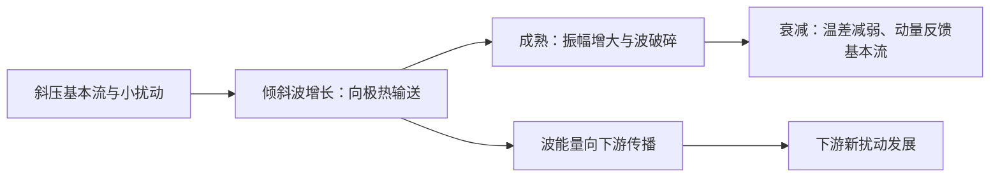

# D26 · 1990第4—12条＋1989全14条；核验全库记录总量（23条）

日期：2026-11-23｜建议投入：4小时｜动力40% · 天气40% · 物理20%

> 本学习包依据原50日PDF与仓库学习资料整理。参考答案不是官方评分标准；未完成学科审校及缺题标记均保留。公式采用 GitHub 数学 Markdown，请在 GitHub 正文或 Obsidian 阅读视图打开。

## 今日目标与记忆标准

闭卷说清概念、适用条件、符号与单位；推导必须写出起始方程、近似及关键步骤。先答题，再展开核对。

## 四小时执行

1. 20分钟：回忆此前第1、3、7、14天的重点，尚未开始的日期跳过。
2. 80分钟：逐题闭卷提取，核对以下简答与来源。
3. 70分钟：精选5题完整书写。名词解释90秒、简答7分钟、论述12分钟为训练目标。
4. 40分钟：把本日知识按“假设→方程→物理机制→天气表现”串成2—4条知识链。
5. 30分钟：记录遗漏点、用时与次日/3日/7日/14日复习日期。

> 星级口径：按同考点在不同年份的出现次数，1次★、2—3次★★、4—6次★★★、7—10次★★★★、11次及以上★★★★★；多考点题取最高频考点。星级表示复习频次，不是命题概率。

## 逐题回忆与简答

### 1990-一-4 · ★★★★（同考点8年）

春季江淮气旋对应的高空急流为**副热带急流**。

[解析来源（对应题目行）](https://github.com/0183ty2512/lao-san-yang/blob/main/%E5%8A%A8%E5%8A%9B%E6%B0%94%E8%B1%A1%E8%AF%BE%E5%90%8E%E4%B9%A0%E9%A2%98/%E8%AF%95%E9%A2%98%E8%A7%A3%E7%AD%94/%E5%BE%80%E5%B9%B4%E8%AF%95%E9%A2%98%E8%A7%A3%E6%9E%90/1990.md#L140) · [原始年度题干](https://github.com/0183ty2512/lao-san-yang/blob/main/%E5%BE%80%E5%B9%B4%E8%AF%95%E9%A2%98%E5%88%86%E6%9E%90/1990.md)

**审校状态：尚未逐题学科审校。**

**相关高频考点复习摘要（须按本题设问取舍，不替代完整解答）：**

**高空急流：** 高空急流是对流层上部狭长强风带，横向和垂直切变强。极锋急流与斜压锋区相关，副热带急流还受低纬角动量输送影响；冬强偏南、夏弱偏北。急流加减速与曲率引起非地转次级环流，可影响下方上升和气旋发展。

> 以上摘要用于回忆答题主线，不是官方评分标准；推导、计算和多小问仍须完成下方步骤。

**原记录填空值：** 副热带急流。下文核对其物理含义；出现修改意见时，以修改后的说明为准。

1. 急流是狭长的强风带，横向和竖直风切变显著，急流轴是局地最大风速的位置。高空西风急流位于对流层上部，冬季更强、更偏南；夏季整体偏北、减弱。东亚日本附近冬季急流可很强，题中 70—80 m/s 是典型量级而非上限。

2. 极锋急流与中纬度锋区斜压性相联系；副热带急流还与低纬向极运动的角动量输送和热成风共同有关。强南北温度梯度通过热成风使西风随高度增强；不能只归因于地面风向上复制。

3. 急流入口、出口的加减速和曲率导致非地转次级环流，局部辐散有利于下方上升和气旋发展；简单直急流象限规则只在相应理想条件下适用。

### 1990-一-5 · ★★★★（同考点9年）

东亚夏季副热带高压脊线处于 25 - 30°N 时，华北地区为**雨季/多雨**天气，长江中下游为**伏旱/高温少雨**天气，华南地区为**高温/热带气旋影响**天气。

[解析来源（对应题目行）](https://github.com/0183ty2512/lao-san-yang/blob/main/%E5%8A%A8%E5%8A%9B%E6%B0%94%E8%B1%A1%E8%AF%BE%E5%90%8E%E4%B9%A0%E9%A2%98/%E8%AF%95%E9%A2%98%E8%A7%A3%E7%AD%94/%E5%BE%80%E5%B9%B4%E8%AF%95%E9%A2%98%E8%A7%A3%E6%9E%90/1990.md#L182) · [原始年度题干](https://github.com/0183ty2512/lao-san-yang/blob/main/%E5%BE%80%E5%B9%B4%E8%AF%95%E9%A2%98%E5%88%86%E6%9E%90/1990.md)

**审校状态：尚未逐题学科审校。**

**相关高频考点复习摘要（须按本题设问取舍，不替代完整解答）：**

**我国雨带季节活动：** 我国雨带一般由华南前汛期，推进到江淮梅雨，再到华北、东北盛夏雨季，秋季南撤。副高脊线20—25°N、25—30°N、30—35°N是常用阶段性经验范围，应结合西伸东退、冷空气和年份差异，不能当作硬界线。

> 以上摘要用于回忆答题主线，不是官方评分标准；推导、计算和多小问仍须完成下方步骤。

**原记录填空值：** 雨季/多雨；伏旱/高温少雨；高温/热带气旋影响。下文核对其物理含义；出现修改意见时，以修改后的说明为准。

1. 西太平洋副热带高压是副热带地区深厚、暖性的反气旋系统。中层常用 500 hPa 高度场描述，其内部下沉、对流受抑制，西北侧及北侧暖湿气流与中纬度系统相遇，是重要雨带区。
2. 形成与副热带下沉、行星波、海陆热力差异及热带加热有关，不能单说成“海面冷所以形成冷高压”。暖性结构使高压在较高层更明显，但不同层中心、脊线并不完全重合。
3. 春季至初夏副高偏南，华南锋面和季风雨活跃；6 月前后第一次北跳后，长江中下游进入梅雨，传统脊线经验约为 20°—25°N。
4. 进一步北抬至约 25°—30°N，雨带向江淮、淮河流域推进；7 月下旬至 8 月上旬前后脊线可在 30°—35°N，雨带到华北、东北，长江中下游较易受高压控制出现伏旱。秋季副高南撤，雨带随之南退。
5. 除南北移动，还要考虑西伸东退、强度和滞留时间。副高西伸使水汽输送路径和落区改变，长期稳定可造成一侧持续暴雨、另一侧持续高温。上述纬度和日期是复习用经验，不是每年的硬界线。
6. 原题若把 25°—30°N 直接与华北盛夏雨季对应，应另起行纠正：通常华北盛夏雨季对应更北的 30°—35°N 阶段。

### 1990-一-6 · ★★★★（同考点8年）

冬季日本上空西风急流风速可达**70~80**m/s。

[解析来源（对应题目行）](https://github.com/0183ty2512/lao-san-yang/blob/main/%E5%8A%A8%E5%8A%9B%E6%B0%94%E8%B1%A1%E8%AF%BE%E5%90%8E%E4%B9%A0%E9%A2%98/%E8%AF%95%E9%A2%98%E8%A7%A3%E7%AD%94/%E5%BE%80%E5%B9%B4%E8%AF%95%E9%A2%98%E8%A7%A3%E6%9E%90/1990.md#L225) · [原始年度题干](https://github.com/0183ty2512/lao-san-yang/blob/main/%E5%BE%80%E5%B9%B4%E8%AF%95%E9%A2%98%E5%88%86%E6%9E%90/1990.md)

**审校状态：尚未逐题学科审校。**

**相关高频考点复习摘要（须按本题设问取舍，不替代完整解答）：**

本段与上文相同，可回看前面的解析，不再重复展开。

> 以上摘要用于回忆答题主线，不是官方评分标准；推导、计算和多小问仍须完成下方步骤。

**原记录填空值：** 70~80。下文核对其物理含义；出现修改意见时，以修改后的说明为准。

本段与上文相同，可回看前面的解析，不再重复展开。

2. 极锋急流与中纬度锋区斜压性相联系；副热带急流还与低纬向极运动的角动量输送和热成风共同有关。强南北温度梯度通过热成风使西风随高度增强；不能只归因于地面风向上复制。

3. 急流入口、出口的加减速和曲率导致非地转次级环流，局部辐散有利于下方上升和气旋发展；简单直急流象限规则只在相应理想条件下适用。

### 1990-二-1 · ★★（同考点2年）

中尺度系统的特点是什么？其数值大小如何？

[解析来源（对应题目行）](https://github.com/0183ty2512/lao-san-yang/blob/main/%E5%8A%A8%E5%8A%9B%E6%B0%94%E8%B1%A1%E8%AF%BE%E5%90%8E%E4%B9%A0%E9%A2%98/%E8%AF%95%E9%A2%98%E8%A7%A3%E7%AD%94/%E5%BE%80%E5%B9%B4%E8%AF%95%E9%A2%98%E8%A7%A3%E6%9E%90/1990.md#L271) · [原始年度题干](https://github.com/0183ty2512/lao-san-yang/blob/main/%E5%BE%80%E5%B9%B4%E8%AF%95%E9%A2%98%E5%88%86%E6%9E%90/1990.md)

**审校状态：已按设问复核。**

**针对本题的精简作答：**

先列中α、β、γ的200—2000、20—200、2—20 km，再答局地快变、垂直运动与非地转效应、地形和湿过程；注明近似是否适用取决于具体尺度。

> 以上摘要用于回忆答题主线，不是官方评分标准；推导、计算和多小问仍须完成下方步骤。

### 1990-二-2 · ★★★（同考点5年）

简述暴雨形成的物理条件。

[解析来源（对应题目行）](https://github.com/0183ty2512/lao-san-yang/blob/main/%E5%8A%A8%E5%8A%9B%E6%B0%94%E8%B1%A1%E8%AF%BE%E5%90%8E%E4%B9%A0%E9%A2%98/%E8%AF%95%E9%A2%98%E8%A7%A3%E7%AD%94/%E5%BE%80%E5%B9%B4%E8%AF%95%E9%A2%98%E8%A7%A3%E6%9E%90/1990.md#L312) · [原始年度题干](https://github.com/0183ty2512/lao-san-yang/blob/main/%E5%BE%80%E5%B9%B4%E8%AF%95%E9%A2%98%E5%88%86%E6%9E%90/1990.md)

**审校状态：尚未逐题学科审校。**

**相关高频考点复习摘要（须按本题设问取舍，不替代完整解答）：**

**暴雨形成条件：** 暴雨需充足并持续的水汽供应、有效抬升、较高降水效率和足够持续时间。锋面、切变、低涡、地形及冷池可触发；不稳定与风切变可组织强对流，训练效应增加累积雨量。并非所有暴雨都要求强条件不稳定。

> 以上摘要用于回忆答题主线，不是官方评分标准；推导、计算和多小问仍须完成下方步骤。

1. 暴雨需要持续的水汽供应、有效抬升和较高降水效率，并常有不稳定能量与中尺度组织配合。水汽只是原料；没有辐合和抬升，湿空气未必产生暴雨。

2. 水汽由低空急流等输送至锋区或切变线，辐合后被迫抬升。锋面、低涡、切变线、地形及雷暴冷池出流均可触发上升；暖湿气块达到自由对流高度后释放不稳定能量。

3. 风切变使对流组织化，冷池和环境风配合可反复触发新单体；系统移动缓慢或单体沿相似路径连续经过同一区域，形成训练效应，增加累计雨量。层状降水也可产生暴雨，不能把强条件不稳定列为每场暴雨的绝对必要条件。

### 1990-二-3 · ★★（同考点2年）

写出用流函数和势函数表示的水平风及涡度、散度的表达式，并简述意义。

[解析来源（对应题目行）](https://github.com/0183ty2512/lao-san-yang/blob/main/%E5%8A%A8%E5%8A%9B%E6%B0%94%E8%B1%A1%E8%AF%BE%E5%90%8E%E4%B9%A0%E9%A2%98/%E8%AF%95%E9%A2%98%E8%A7%A3%E7%AD%94/%E5%BE%80%E5%B9%B4%E8%AF%95%E9%A2%98%E8%A7%A3%E6%9E%90/1990.md#L352) · [原始年度题干](https://github.com/0183ty2512/lao-san-yang/blob/main/%E5%BE%80%E5%B9%B4%E8%AF%95%E9%A2%98%E5%88%86%E6%9E%90/1990.md)

**审校状态：尚未逐题学科审校。**

> 以上摘要用于回忆答题主线，不是官方评分标准；推导、计算和多小问仍须完成下方步骤。

1. 定义垂直相对涡度 $\zeta=\frac{\partial v}{\partial x}-\frac{\partial u}{\partial y}$，水平散度 $D=\frac{\partial u}{\partial x}+\frac{\partial v}{\partial y}$，单位均为 $\mathrm{s^{-1}}$。绝对涡度的垂直分量为 $\zeta_a=\zeta+f$；三维绝对涡度为 $\nabla\times\mathbf V+2\boldsymbol\Omega$。

2. 取约定 $u=-\frac{\partial \psi}{\partial y}+\frac{\partial \chi}{\partial x}$、$v=\frac{\partial \psi}{\partial x}+\frac{\partial \chi}{\partial y}$，$\psi$ 为流函数，$\chi$ 为速度势。

3. 代入旋度：$\frac{\partial v}{\partial x}-\frac{\partial u}{\partial y}=\psi_{xx}+\psi_{yy}+\chi_{yx}-\chi_{xy}=\nabla_h^2\psi$。代入散度：$\frac{\partial u}{\partial x}+\frac{\partial v}{\partial y}=-\psi_{yx}+\psi_{xy}+\chi_{xx}+\chi_{yy}=\nabla_h^2\chi$。

4. 因此 $\boxed{\nabla_h^2\psi=\zeta,\ \nabla_h^2\chi=D}$。流函数部分无辐散，速度势部分无旋；反求风场还需边界条件，不能仅凭涡度和散度数值唯一决定全域风场。

### 1990-二-4 · ★★★★★（同考点17年）

冬季东亚大型槽寒潮活动时的主要天气特征。

[解析来源（对应题目行）](https://github.com/0183ty2512/lao-san-yang/blob/main/%E5%8A%A8%E5%8A%9B%E6%B0%94%E8%B1%A1%E8%AF%BE%E5%90%8E%E4%B9%A0%E9%A2%98/%E8%AF%95%E9%A2%98%E8%A7%A3%E7%AD%94/%E5%BE%80%E5%B9%B4%E8%AF%95%E9%A2%98%E8%A7%A3%E6%9E%90/1990.md#L390) · [原始年度题干](https://github.com/0183ty2512/lao-san-yang/blob/main/%E5%BE%80%E5%B9%B4%E8%AF%95%E9%A2%98%E5%88%86%E6%9E%90/1990.md)

**审校状态：尚未逐题学科审校。**

**相关高频考点复习摘要（须按本题设问取舍，不替代完整解答）：**

**寒潮及其天气过程：** 寒潮是强冷空气大范围南下造成显著降温、大风及可能雨雪冻害的过程。答路径时分西路、西北路、东路；答发展时写冷空气蓄积→高空槽脊调整→地面冷高压和冷锋南下；是否达到业务等级须核对相应标准。

> 以上摘要用于回忆答题主线，不是官方评分标准；推导、计算和多小问仍须完成下方步骤。

1. 寒潮是强冷空气大范围侵入中低纬，造成剧烈降温、大风，常伴雨雪或冻害的天气过程；达到业务寒潮等级还要按适用标准核对降温幅度和最低温度，不能把所有冷空气过程称为寒潮。
2. **源地和蓄积区。** 传统天气学源地归纳包括新地岛以西、新地岛以东和冰岛以南洋面；冷空气可在西伯利亚—蒙古一带进一步辐射冷却、蓄积。源地不同于进入我国的路径，不能混为一项。
3. **路径。** 西路经新疆及高原北侧影响西北、西南；西北路经蒙古、河套南下，常影响我国中东部大部；东路偏经东北、华北和东部沿海。多路冷空气汇合时范围和强度可增大，但不存在不问强度、地形、水汽就永远“最严重”的一路。
4. **环流演变。** 阻塞高压或暖脊建立，东侧冷空气积聚；亚洲极涡或横槽南压；短波发展、横槽转竖或大槽东移使槽后偏北气流加强，地面冷高压增强南下，冷锋迅速推进，随后东亚大槽重建。
5. **天气。** 锋前可回暖和增湿，锋过时风向突变、大风降温，水汽足时出现雨雪；锋后气压升高、天气转晴，夜间辐射降温及霜冻可加剧。干冷型雨雪少，湿冷型雨雪多，不能要求每次寒潮都具同样降水。
6. **倒Ω中期演变。** 两大洋北部脊向高纬发展，极涡分裂或偏心；乌拉尔与东亚东北侧脊发展，亚洲冷涡被夹持并南压，形成类似倒Ω的槽脊配置；随后横槽转竖或长波槽快速发展，槽后冷空气爆发南下。画图时应画“两侧高脊、中间冷槽/涡”，并用槽后偏北箭头表示冷空气路径。
7. **预报关键。** 同时监视阻高和脊、极涡/横槽、地面冷高压与冷锋。常见短中期型包括小槽发展、横槽转竖和低槽东移；不同教材的“第几类”编号不统一，未给分类表时不能凭编号唯一指定。

### 1990-二-5 · ★★★★（同考点8年）

长波公式的表达式及其意义如何？它对西风带波动移动速度能作何定性解释？

[解析来源（对应题目行）](https://github.com/0183ty2512/lao-san-yang/blob/main/%E5%8A%A8%E5%8A%9B%E6%B0%94%E8%B1%A1%E8%AF%BE%E5%90%8E%E4%B9%A0%E9%A2%98/%E8%AF%95%E9%A2%98%E8%A7%A3%E7%AD%94/%E5%BE%80%E5%B9%B4%E8%AF%95%E9%A2%98%E8%A7%A3%E6%9E%90/1990.md#L432) · [原始年度题干](https://github.com/0183ty2512/lao-san-yang/blob/main/%E5%BE%80%E5%B9%B4%E8%AF%95%E9%A2%98%E5%88%86%E6%9E%90/1990.md)

**审校状态：尚未逐题学科审校。**

**相关高频考点复习摘要（须按本题设问取舍，不替代完整解答）：**

**罗斯贝波基本性质：** 罗斯贝波以位涡梯度为回复机制。均匀基本流正压β平面上 $\omega=kU-\beta k/(k^2+l^2)$，内禀纬向相速向西；地面参考系方向还依 $U$。频率对波数非线性，相速与群速一般不同。

> 以上摘要用于回忆答题主线，不是官方评分标准；推导、计算和多小问仍须完成下方步骤。

1. 正压无辐散β平面涡度方程为 $(\frac{\partial}{\partial t}+u\frac{\partial}{\partial x}+v\frac{\partial}{\partial y})(\zeta+f)=0$，$f=f_0+\beta y$。
2. 令 $u=U+u'$、$v=v'$，$U$ 为常数。减去基本态并舍弃 $u'\frac{\partial \zeta'}{\partial x}+v'\frac{\partial \zeta'}{\partial y}$ 等二阶项，得 $(\frac{\partial}{\partial t}+U\frac{\partial}{\partial x})\zeta'+\beta v'=0$。
3. 引入 $u'=-\frac{\partial \psi'}{\partial y}$、$v'=\frac{\partial \psi'}{\partial x}$，所以 $\zeta'=\nabla_h^2\psi'$。代回得 $(\frac{\partial}{\partial t}+U\frac{\partial}{\partial x})\nabla_h^2\psi'+\beta\psi'_x=0$。
4. 设 $\psi'=\hat\psi e^{i(kx+ly-\omega t)}$，有 $\nabla_h^2\psi'=-(k^2+l^2)\psi'$，故 $i(\omega-kU)(k^2+l^2)\psi'+i\beta k\psi'=0$。
5. 非零振幅给出 $\boxed{\omega=kU-\beta k/(k^2+l^2)}$；纬向相速 $c_x=\omega/k=U-\beta/(k^2+l^2)$。一维 $l=0$ 时 $c_x=U-\beta/k^2=U-\beta L^2/(4\pi^2)$。
6. 相对基本气流向西传播；短波西退修正小，常随西风向东，足够长的波可静止或向西。群速为 $c_{gx}=U+\beta(k^2-l^2)/(k^2+l^2)^2$、$c_{gy}=2\beta kl/(k^2+l^2)^2$。群速和相速不同，能量可向下游传播而单个槽脊较慢。

### 1990-二-6 · ★★★★★（同考点13年）

试述梅雨锋的主要特点，并给出它对应的对流层各层的环流图像。

[解析来源（对应题目行）](https://github.com/0183ty2512/lao-san-yang/blob/main/%E5%8A%A8%E5%8A%9B%E6%B0%94%E8%B1%A1%E8%AF%BE%E5%90%8E%E4%B9%A0%E9%A2%98/%E8%AF%95%E9%A2%98%E8%A7%A3%E7%AD%94/%E5%BE%80%E5%B9%B4%E8%AF%95%E9%A2%98%E8%A7%A3%E6%9E%90/1990.md#L473) · [原始年度题干](https://github.com/0183ty2512/lao-san-yang/blob/main/%E5%BE%80%E5%B9%B4%E8%AF%95%E9%A2%98%E5%88%86%E6%9E%90/1990.md)

**审校状态：尚未逐题学科审校。**

**相关高频考点复习摘要（须按本题设问取舍，不替代完整解答）：**

**梅雨：** 梅雨是初夏江淮及长江中下游的持续阴雨过程。梅雨锋常以水汽和相当位温梯度、低层切变辐合突出；低层西南急流供水汽，中层副高北缘与中高纬槽脊维持冷暖交汇，高层合适辐散配合上升。北段锋区温差可明显，不能说梅雨锋完全无温度梯度。

> 以上摘要用于回忆答题主线，不是官方评分标准；推导、计算和多小问仍须完成下方步骤。

1. **梅雨定义与天气。** 初夏江淮及长江中下游的持续阴雨期，常在 6 月中旬至 7 月上旬附近，但年际变化明显。天气高湿、云量多，层状云雨夹有对流和暴雨，日照少，雨带易持续。

2. **锋区结构。** 梅雨锋在南段常温度梯度较弱而水汽、相当位温梯度很强；低层有风向切变、辐合和正涡度，锋南暖湿偏南/西南风，锋北较冷偏东/偏北气流。北段温度梯度可更显著，不能概括为“完全无温度差”。

3. **高中低层配置。** 高层南亚高压与西风急流提供适宜的辐散背景；500 hPa 中高纬阻高、东亚槽和西太副高使冷暖气流维持；850—700 hPa 西南急流输送水汽，梅雨锋、切变线或低涡提供抬升。双阻型通常在欧亚中高纬形成两处阻塞、其间冷槽南伸，与低纬副高北侧暖湿气流相遇；两阻的精确中心依原教材图例而定。

4. **梅雨与极锋比较。** 极锋主要表现为强水平温度梯度及深厚斜压性，梅雨锋常以水汽差异和低层切变更突出；两者均可提供持续上升并组织降水。

### 1989-一-1 · ★（同考点1年）

气象上风向为 90 度为**东**风，180 度为**南**风。

[解析来源（对应题目行）](https://github.com/0183ty2512/lao-san-yang/blob/main/%E5%8A%A8%E5%8A%9B%E6%B0%94%E8%B1%A1%E8%AF%BE%E5%90%8E%E4%B9%A0%E9%A2%98/%E8%AF%95%E9%A2%98%E8%A7%A3%E7%AD%94/%E5%BE%80%E5%B9%B4%E8%AF%95%E9%A2%98%E8%A7%A3%E6%9E%90/1989.md#L11) · [原始年度题干](https://github.com/0183ty2512/lao-san-yang/blob/main/%E5%BE%80%E5%B9%B4%E8%AF%95%E9%A2%98%E5%88%86%E6%9E%90/1989.md)

**审校状态：尚未逐题学科审校。**

> 以上摘要用于回忆答题主线，不是官方评分标准；推导、计算和多小问仍须完成下方步骤。

**原记录填空值：** 东；南。下文核对其物理含义；出现修改意见时，以修改后的说明为准。

1. 气象风向按风**从哪里来**定义，从正北起顺时针计角：0°或360°北风、90°东风、180°南风、270°西风。若 $u$ 向东、$v$ 向北，东风对应 $u<0$，南风对应 $v>0$。

### 1989-一-2 · ★★★（同考点4年）

气旋的平均直径为**1000~2000**公里，台风平均直径为**500~1000**公里，西南涡的平均直径为**200~500**公里。

[解析来源（对应题目行）](https://github.com/0183ty2512/lao-san-yang/blob/main/%E5%8A%A8%E5%8A%9B%E6%B0%94%E8%B1%A1%E8%AF%BE%E5%90%8E%E4%B9%A0%E9%A2%98/%E8%AF%95%E9%A2%98%E8%A7%A3%E7%AD%94/%E5%BE%80%E5%B9%B4%E8%AF%95%E9%A2%98%E8%A7%A3%E6%9E%90/1989.md#L45) · [原始年度题干](https://github.com/0183ty2512/lao-san-yang/blob/main/%E5%BE%80%E5%B9%B4%E8%AF%95%E9%A2%98%E5%88%86%E6%9E%90/1989.md)

**审校状态：尚未逐题学科审校。**

**相关高频考点复习摘要（须按本题设问取舍，不替代完整解答）：**

**天气系统水平尺度：** 常用中α为200—2000 km、中β为20—200 km、中γ为2—20 km。温带气旋约千公里、台风数百公里、西南涡数百公里、龙卷常几十至几百米；这些是典型尺度范围，不是每个系统的固定直径。

> 以上摘要用于回忆答题主线，不是官方评分标准；推导、计算和多小问仍须完成下方步骤。

**原记录填空值：** 1000~2000；500~1000；200~500。下文核对其物理含义；出现修改意见时，以修改后的说明为准。

1. 常用尺度分类：中α约 200—2000 km，中β约 20—200 km，中γ约 2—20 km；天气尺度温带气旋约千公里，台风约数百公里，西南涡约数百公里，龙卷常几十至几百米。这些是典型范围，系统边界和平均口径不同会有差异。

### 1989-一-3 · ★（同考点1年）

850 毫巴平均高度为**1.5**公里，100 毫巴平均高度约为**16**公里，30 毫巴平均高度约**24**公里。

[解析来源（对应题目行）](https://github.com/0183ty2512/lao-san-yang/blob/main/%E5%8A%A8%E5%8A%9B%E6%B0%94%E8%B1%A1%E8%AF%BE%E5%90%8E%E4%B9%A0%E9%A2%98/%E8%AF%95%E9%A2%98%E8%A7%A3%E7%AD%94/%E5%BE%80%E5%B9%B4%E8%AF%95%E9%A2%98%E8%A7%A3%E6%9E%90/1989.md#L83) · [原始年度题干](https://github.com/0183ty2512/lao-san-yang/blob/main/%E5%BE%80%E5%B9%B4%E8%AF%95%E9%A2%98%E5%88%86%E6%9E%90/1989.md)

**审校状态：尚未逐题学科审校。**

> 以上摘要用于回忆答题主线，不是官方评分标准；推导、计算和多小问仍须完成下方步骤。

**原记录填空值：** 1.5；16；24。下文核对其物理含义；出现修改意见时，以修改后的说明为准。

1. 标准大气近似下，850 hPa 高度约 1.5 km，100 hPa 约 16 km，30 hPa 约 24 km；暖冷空气柱的实际高度不同，应由测高公式和温度廓线计算。

### 1989-一-4 · ★★★★（同考点9年）

长江流域梅雨发生时段为**6~7**月，华北雨季发生在**7~8**月。

[解析来源（对应题目行）](https://github.com/0183ty2512/lao-san-yang/blob/main/%E5%8A%A8%E5%8A%9B%E6%B0%94%E8%B1%A1%E8%AF%BE%E5%90%8E%E4%B9%A0%E9%A2%98/%E8%AF%95%E9%A2%98%E8%A7%A3%E7%AD%94/%E5%BE%80%E5%B9%B4%E8%AF%95%E9%A2%98%E8%A7%A3%E6%9E%90/1989.md#L117) · [原始年度题干](https://github.com/0183ty2512/lao-san-yang/blob/main/%E5%BE%80%E5%B9%B4%E8%AF%95%E9%A2%98%E5%88%86%E6%9E%90/1989.md)

**审校状态：尚未逐题学科审校。**

**相关高频考点复习摘要（须按本题设问取舍，不替代完整解答）：**

本段与上文相同，可回看前面的解析，不再重复展开。

> 以上摘要用于回忆答题主线，不是官方评分标准；推导、计算和多小问仍须完成下方步骤。

**原记录填空值：** 6~7；7~8。下文核对其物理含义；出现修改意见时，以修改后的说明为准。

本段与上文相同，可回看前面的解析，不再重复展开。

### 1989-二-1 · ★★★★（同考点7年）

绝对涡度

[解析来源（对应题目行）](https://github.com/0183ty2512/lao-san-yang/blob/main/%E5%8A%A8%E5%8A%9B%E6%B0%94%E8%B1%A1%E8%AF%BE%E5%90%8E%E4%B9%A0%E9%A2%98/%E8%AF%95%E9%A2%98%E8%A7%A3%E7%AD%94/%E5%BE%80%E5%B9%B4%E8%AF%95%E9%A2%98%E8%A7%A3%E6%9E%90/1989.md#L164) · [原始年度题干](https://github.com/0183ty2512/lao-san-yang/blob/main/%E5%BE%80%E5%B9%B4%E8%AF%95%E9%A2%98%E5%88%86%E6%9E%90/1989.md)

**审校状态：尚未逐题学科审校。**

**相关高频考点复习摘要（须按本题设问取舍，不替代完整解答）：**

**涡度：** 垂直相对涡度 $\zeta=\frac{\partial v}{\partial x}-\frac{\partial u}{\partial y}$，绝对涡度为 $\zeta+f$，单位 $\mathrm{s^{-1}}$。北半球正值通常表示气旋性旋转。取旋度能消去保守压力梯度，但涡度方程单独不能决定完整风场。

> 以上摘要用于回忆答题主线，不是官方评分标准；推导、计算和多小问仍须完成下方步骤。

本段与上文相同，可回看前面的解析，不再重复展开。

### 1989-二-2 · ★★★★（同考点7年）

位温

[解析来源（对应题目行）](https://github.com/0183ty2512/lao-san-yang/blob/main/%E5%8A%A8%E5%8A%9B%E6%B0%94%E8%B1%A1%E8%AF%BE%E5%90%8E%E4%B9%A0%E9%A2%98/%E8%AF%95%E9%A2%98%E8%A7%A3%E7%AD%94/%E5%BE%80%E5%B9%B4%E8%AF%95%E9%A2%98%E8%A7%A3%E6%9E%90/1989.md#L200) · [原始年度题干](https://github.com/0183ty2512/lao-san-yang/blob/main/%E5%BE%80%E5%B9%B4%E8%AF%95%E9%A2%98%E5%88%86%E6%9E%90/1989.md)

**审校状态：尚未逐题学科审校。**

**相关高频考点复习摘要（须按本题设问取舍，不替代完整解答）：**

**位温：** 位温是气块干绝热移至参考气压 $p_0$ 的温度。由 $c_p dT-RTdp/p=0$ 积分得 $\theta=T(p_0/p)^{R/c_p}$，单位K。理想干绝热时沿气块守恒，有加热时 $D\ln\theta/Dt=Q/(c_pT)$。

> 以上摘要用于回忆答题主线，不是官方评分标准；推导、计算和多小问仍须完成下方步骤。

1. **定义。** 位温是干空气块沿干绝热线移到参考气压 $p_0$ 时的温度，通常取 $p_0=1000\ \mathrm{hPa}$。
2. **从第一定律出发。** 干绝热时 $c_p\,dT-\alpha\,dp=0$。由 $\alpha=RT/p$，得 $dT/T=(R/c_p)dp/p$。
3. **积分。** 记 $\kappa=R/c_p$，从 $(p,T)$ 积分到 $(p_0,\theta)$：$\ln(\theta/T)=\kappa\ln(p_0/p)$。
4. **结果。** $\boxed{\theta=T(p_0/p)^\kappa}$。干绝热运动中 $D\theta/Dt=0$；有潜热释放或其他加热时，不能直接假定干位温守恒。位温单位为 K。

### 1989-二-3 · ★★★（同考点5年）

温度平流

[解析来源（对应题目行）](https://github.com/0183ty2512/lao-san-yang/blob/main/%E5%8A%A8%E5%8A%9B%E6%B0%94%E8%B1%A1%E8%AF%BE%E5%90%8E%E4%B9%A0%E9%A2%98/%E8%AF%95%E9%A2%98%E8%A7%A3%E7%AD%94/%E5%BE%80%E5%B9%B4%E8%AF%95%E9%A2%98%E8%A7%A3%E6%9E%90/1989.md#L239) · [原始年度题干](https://github.com/0183ty2512/lao-san-yang/blob/main/%E5%BE%80%E5%B9%B4%E8%AF%95%E9%A2%98%E5%88%86%E6%9E%90/1989.md)

**审校状态：尚未逐题学科审校。**

**相关高频考点复习摘要（须按本题设问取舍，不替代完整解答）：**

**温度平流：** 温度平流贡献为 $-\mathbf V_h\cdot\nabla T$。由暖处吹向冷处通常为暖平流、该项为正；反向为冷平流。局地变温还包含垂直运动与非绝热加热，不能把平流贡献等同最终变温。

> 以上摘要用于回忆答题主线，不是官方评分标准；推导、计算和多小问仍须完成下方步骤。

1. 水平温度平流为 $A_T=-\mathbf V_h\cdot\nabla T=-(u\frac{\partial T}{\partial x}+v\frac{\partial T}{\partial y})$。风由暖区吹向冷区时，沿风向温度减小，点积为负，故 $A_T>0$，为暖平流；反之 $A_T<0$，为冷平流。
2. 由 $c_pDT/Dt-\alpha\omega=Q$ 和 $\alpha=RT/p$，得 $DT/Dt-\kappa T\omega/p=Q/c_p$。
3. 展开物质导数 $DT/Dt=\frac{\partial T}{\partial t}+u\frac{\partial T}{\partial x}+v\frac{\partial T}{\partial y}+\omega\frac{\partial T}{\partial p}$，移项：
$$\boxed{\frac{\partial T}{\partial t}=-\mathbf V_h\cdot\nabla_pT+\omega\left(\frac{\kappa T}{p}-\frac{\partial T}{\partial p}\right)+\frac Q{c_p}}.$$
4. 右侧依次为水平平流、垂直运动与绝热压缩膨胀的合成作用、非绝热加热。在稳定层结下，上升（$\omega<0$）的动力变温通常为冷却，下沉则增温。因此有暖平流不等于局地温度一定上升。

### 1989-二-4 · ★★★★★（同考点12年）

地转风速

[解析来源（对应题目行）](https://github.com/0183ty2512/lao-san-yang/blob/main/%E5%8A%A8%E5%8A%9B%E6%B0%94%E8%B1%A1%E8%AF%BE%E5%90%8E%E4%B9%A0%E9%A2%98/%E8%AF%95%E9%A2%98%E8%A7%A3%E7%AD%94/%E5%BE%80%E5%B9%B4%E8%AF%95%E9%A2%98%E8%A7%A3%E6%9E%90/1989.md#L279) · [原始年度题干](https://github.com/0183ty2512/lao-san-yang/blob/main/%E5%BE%80%E5%B9%B4%E8%AF%95%E9%A2%98%E5%88%86%E6%9E%90/1989.md)

**审校状态：尚未逐题学科审校。**

**相关高频考点复习摘要（须按本题设问取舍，不替代完整解答）：**

**地转风：** 中纬度大尺度缓变、摩擦可忽略时，水平气压梯度力与科氏力近似平衡：$u_g=-\frac{\partial \Phi}{\partial y}/f$、$v_g=\frac{\partial \Phi}{\partial x}/f$。风平行等高线，北半球低值在风向左侧。近赤道、摩擦层和强曲率快速运动中须检验适用性。

> 以上摘要用于回忆答题主线，不是官方评分标准；推导、计算和多小问仍须完成下方步骤。

1. 在局地直角坐标中，忽略摩擦时水平动量方程为 $Du/Dt-fv=-\frac{\partial \Phi}{\partial x}$、$Dv/Dt+fu=-\frac{\partial \Phi}{\partial y}$，这里的导数取在等压面上。
2. 对中纬度大尺度缓变运动，$Ro=U/(|f|L)\ll1$，惯性项相对较小，得到 $-fv_g=-\frac{\partial \Phi}{\partial x}$、$fu_g=-\frac{\partial \Phi}{\partial y}$。
3. 解得 $\boxed{u_g=-\frac{\partial \Phi}{\partial y}/f,\quad v_g=\frac{\partial \Phi}{\partial x}/f}$，即 $\mathbf V_g=\mathbf k\times\nabla_p\Phi/f$；大小为 $|\nabla_p\Phi|/|f|$。
4. 因叉积垂直于梯度，地转风平行于等高线；北半球背风而立时低值在左、高值在右，南半球相反。等高线越密风越强，但还受纬度 $f$ 影响。
5. 近赤道 $f\to0$、摩擦层、强曲率或快速变化的小尺度系统中不能直接采用地转近似。等高面上应改用 $\nabla_zp/\rho$，不要把两种坐标的梯度混用。

### 1989-三-1 · ★★（同考点3年）

试述大气长波系统的结构（热力，动力）。

[解析来源（对应题目行）](https://github.com/0183ty2512/lao-san-yang/blob/main/%E5%8A%A8%E5%8A%9B%E6%B0%94%E8%B1%A1%E8%AF%BE%E5%90%8E%E4%B9%A0%E9%A2%98/%E8%AF%95%E9%A2%98%E8%A7%A3%E7%AD%94/%E5%BE%80%E5%B9%B4%E8%AF%95%E9%A2%98%E8%A7%A3%E6%9E%90/1989.md#L323) · [原始年度题干](https://github.com/0183ty2512/lao-san-yang/blob/main/%E5%BE%80%E5%B9%B4%E8%AF%95%E9%A2%98%E5%88%86%E6%9E%90/1989.md)

**审校状态：尚未逐题学科审校。**

**相关高频考点复习摘要（须按本题设问取舍，不替代完整解答）：**

**罗斯贝波生命史与演变：** 典型斜压罗斯贝扰动经历取能增长、振幅增大与波破碎、混合和动量反馈后的衰减。成长时槽轴常随高度向西倾斜，暖升冷沉取能；成熟后倾斜减弱。该生命史不是所有中性线性罗斯贝波的必然演变。

> 以上摘要用于回忆答题主线，不是官方评分标准；推导、计算和多小问仍须完成下方步骤。

1. 西风带槽脊是流场的波动。典型发展中的斜压长波，高度槽轴随高度向西倾斜，槽前暖平流上升、槽后冷平流下沉；温度扰动与速度存在相位差，支持向极热输送和有效位能释放。

2. 成长阶段从平均有效位能取能，扰动增强；成熟阶段热量混合使温度梯度减弱，槽脊加大并可发生波破碎；衰减阶段扰动动量输送与基本流交换能量，气旋锢囚、场趋于较正压结构。并非每个中性线性罗斯贝波都必有增长和衰亡，这一“生命史”是典型不稳定波演变概念。

3. 罗斯贝波相速与群速不同，一维均匀西风上 $c_p=U-\beta/k^2$，$c_g=U+\beta/k^2$。能量包络可比槽脊向东传播更快，造成下游新波发展、上游旧波衰减，即下游发展。

4. 上下游效应泛指相邻波系通过传播和能量/动量交换相互影响；“上游效应”的教材用法需看其定义，不能以群速公式证明所有情况下影响只能单向向东。二维波和变化基本流中群速方向会变。

5. 动量通量 $\overline{u'v'}$ 的辐合可加速平均西风；平均流向扰动的正压动能转换为 $-\overline{u'v'}U_y$。不能用“地球自转不变”直接推出每一时刻所有输送都严格从东风带指向西风带，必须写出收支、外部摩擦转矩与统计稳态。

### 1989-三-2 · ★★★★★（同考点12年）

何为季风区，简述东亚季风的特点。

[解析来源（对应题目行）](https://github.com/0183ty2512/lao-san-yang/blob/main/%E5%8A%A8%E5%8A%9B%E6%B0%94%E8%B1%A1%E8%AF%BE%E5%90%8E%E4%B9%A0%E9%A2%98/%E8%AF%95%E9%A2%98%E8%A7%A3%E7%AD%94/%E5%BE%80%E5%B9%B4%E8%AF%95%E9%A2%98%E8%A7%A3%E6%9E%90/1989.md#L376) · [原始年度题干](https://github.com/0183ty2512/lao-san-yang/blob/main/%E5%BE%80%E5%B9%B4%E8%AF%95%E9%A2%98%E5%88%86%E6%9E%90/1989.md)

**审校状态：尚未逐题学科审校。**

**相关高频考点复习摘要（须按本题设问取舍，不替代完整解答）：**

**季风：** 季风是大范围盛行风向随季节显著转换的环流。形成因子包括海陆热力差异、行星风带季节移动及高原作用。东亚冬季风联系大陆冷高压与东亚大槽；夏季风联系季风低压、副高边缘水汽输送和高空南亚高压，热带与副热带季风并存。

> 以上摘要用于回忆答题主线，不是官方评分标准；推导、计算和多小问仍须完成下方步骤。

1. **概念。** 季风是大范围盛行风向随季节发生显著转换的环流，通常伴有干湿季变化；季风区是这种季节性风向转换及其天气气候影响显著的地区。不能仅用一个地点冬夏偶然相反的风判定。

2. **基本因子。** 海陆热容量不同：冬季大陆冷却快、形成冷高压，夏季大陆增温快、形成热低压；压力配置改变，推动低层风季节反转。太阳直射点移动带动行星风带和热带辐合带移动，青藏高原热力及动力作用进一步重塑亚洲环流。

3. **冬季系统。** 亚洲大陆和高原为冷源，西伯利亚高压、阿留申低压、东亚大槽及强西风急流配合；我国大部盛行偏北风，带来寒冷干燥天气，沿海还受海陆和地形调制。

4. **夏季系统。** 大陆、高原感热及南亚—东亚降水潜热形成热源；低层印度季风槽、南海季风、西太平洋副高西侧偏南气流、跨赤道气流共同输送水汽，上层南亚高压及热带东风急流响应加热。

5. **东亚特点。** 既有热带季风也有副热带季风，冬季风尤其强；夏季水汽路径包括孟加拉湾—南海和西太平洋，雨带随季风推进分阶段北跳，又受中高纬冷空气影响。热源、环流、水汽辐合和潜热释放相互反馈，不能归结成单一海陆风的放大。

### 1989-三-3 · ★★★★★（同考点16年）

怎样定义阻塞高压？它对下游地区环流形势的影响如何？

[解析来源（对应题目行）](https://github.com/0183ty2512/lao-san-yang/blob/main/%E5%8A%A8%E5%8A%9B%E6%B0%94%E8%B1%A1%E8%AF%BE%E5%90%8E%E4%B9%A0%E9%A2%98/%E8%AF%95%E9%A2%98%E8%A7%A3%E7%AD%94/%E5%BE%80%E5%B9%B4%E8%AF%95%E9%A2%98%E8%A7%A3%E6%9E%90/1989.md#L420) · [原始年度题干](https://github.com/0183ty2512/lao-san-yang/blob/main/%E5%BE%80%E5%B9%B4%E8%AF%95%E9%A2%98%E5%88%86%E6%9E%90/1989.md)

**审校状态：尚未逐题学科审校。**

**相关高频考点复习摘要（须按本题设问取舍，不替代完整解答）：**

**阻塞高压：** 阻塞高压是中高纬持续、少动并使西风绕行的强脊或闭合高压。建立与暖输送、波破碎及涡旋反馈有关；其东侧偏北气流可蓄积和引导冷空气。衰退配合横槽转竖时可触发寒潮，但并非每次崩溃都必然造成寒潮。

> 以上摘要用于回忆答题主线，不是官方评分标准；推导、计算和多小问仍须完成下方步骤。

1. 阻塞高压是中高纬持续、移动缓慢的强高压脊或闭合高压，使西风气流绕行、分支，阻碍天气系统正常东移。关键是持续性和对西风带的阻挡，并非所有高压都叫阻塞。
2. 建立时，暖空气向极地输送使脊增强，经向振幅增大，波破碎、涡旋反馈可帮助维持。高压脊发展或与高纬高压合并，南侧可切出冷低压，形成偶极或Ω型等配置。
3. 维持时，阻高东侧偏北气流引导冷空气南下，西侧偏南气流输送暖空气。下游槽及冷暖空气交汇区可长期停留，造成持久冷凉、降雨；高压控制区下沉、少云，可造成干旱和高温，具体依季节和位置。
4. 衰退或崩溃时，维持高压的暖输送与涡旋反馈减弱，西风恢复，槽脊重新东移；其东侧积聚的冷空气可配合横槽转竖大举南下，触发我国寒潮。不能把每一次阻高衰退都等同于寒潮，仍需冷空气强度和路径配合。
5. 亚洲常关注乌拉尔山及鄂霍次克海等阻塞区，北大西洋—欧洲也是重要活动区；不同季节的优势位置不同，不应把某一季节经验说成全年固定不变。
6. 切断低压是从西风主槽分离出的闭合冷性低压，移动缓慢，可与北侧阻高配合。其冷空气及正涡度有利于下游不稳定和上升，但天气还依水汽供应。

### 1989-三-4 · ★★★（同考点5年）

简述暴雨形成的主要物理条件。

[解析来源（对应题目行）](https://github.com/0183ty2512/lao-san-yang/blob/main/%E5%8A%A8%E5%8A%9B%E6%B0%94%E8%B1%A1%E8%AF%BE%E5%90%8E%E4%B9%A0%E9%A2%98/%E8%AF%95%E9%A2%98%E8%A7%A3%E7%AD%94/%E5%BE%80%E5%B9%B4%E8%AF%95%E9%A2%98%E8%A7%A3%E6%9E%90/1989.md#L461) · [原始年度题干](https://github.com/0183ty2512/lao-san-yang/blob/main/%E5%BE%80%E5%B9%B4%E8%AF%95%E9%A2%98%E5%88%86%E6%9E%90/1989.md)

**审校状态：尚未逐题学科审校。**

**相关高频考点复习摘要（须按本题设问取舍，不替代完整解答）：**

本段与上文相同，可回看前面的解析，不再重复展开。

> 以上摘要用于回忆答题主线，不是官方评分标准；推导、计算和多小问仍须完成下方步骤。

1. 暴雨需要持续的水汽供应、有效抬升和较高降水效率，并常有不稳定能量与中尺度组织配合。水汽只是原料；没有辐合和抬升，湿空气未必产生暴雨。

2. 水汽由低空急流等输送至锋区或切变线，辐合后被迫抬升。锋面、低涡、切变线、地形及雷暴冷池出流均可触发上升；暖湿气块达到自由对流高度后释放不稳定能量。

本段与上文相同，可回看前面的解析，不再重复展开。

### 1989-三-5 · ★★★★（同考点9年）

说明温带气旋发展四个阶段特点。

[解析来源（对应题目行）](https://github.com/0183ty2512/lao-san-yang/blob/main/%E5%8A%A8%E5%8A%9B%E6%B0%94%E8%B1%A1%E8%AF%BE%E5%90%8E%E4%B9%A0%E9%A2%98/%E8%AF%95%E9%A2%98%E8%A7%A3%E7%AD%94/%E5%BE%80%E5%B9%B4%E8%AF%95%E9%A2%98%E8%A7%A3%E6%9E%90/1989.md#L501) · [原始年度题干](https://github.com/0183ty2512/lao-san-yang/blob/main/%E5%BE%80%E5%B9%B4%E8%AF%95%E9%A2%98%E5%88%86%E6%9E%90/1989.md)

**审校状态：尚未逐题学科审校。**

**相关高频考点复习摘要（须按本题设问取舍，不替代完整解答）：**

**气旋及其发展：** 气旋是低压及气旋式环流。温带锋面气旋依次经历初生波动、发展加深、成熟锢囚、衰亡填塞；斜压有效位能、高空涡度平流和辐散、低层暖平流及潜热共同影响发展。不能把所有气旋都概括成轴对称冷心。

> 以上摘要用于回忆答题主线，不是官方评分标准；推导、计算和多小问仍须完成下方步骤。

1. 气旋是低压及其气旋式环流系统，北半球逆时针、南半球顺时针；反气旋为高压及反气旋式环流。低层摩擦使气旋常辐合上升、反气旋常辐散下沉，但云雨仍依水汽和热力条件。

2. **温带锋面气旋四阶段。** 初生：静止锋上出现波动，暖空气向冷侧、冷空气向暖侧推进；发展：低压加深，冷暖锋清楚，冷锋通常较暖锋移动快，地面暖区逐渐收窄，槽前正涡度平流和高空辐散配合；成熟/锢囚：冷锋追上暖锋，暖空气抬离地面，气旋范围较大且结构复杂；衰亡：近地面冷空气占据中心，水平温差和斜压取能减弱，低压逐渐填塞。

3. **主要发展因子。** 基本态温度梯度与垂直风切变提供有效位能，高低空槽与地面低压有利配置，低层暖平流、高层正涡度平流和辐散支持上升，凝结潜热可加强发展。并非每个实际气旋都严格走完同一理想阶段。

4. 我国温带气旋常活动于蒙古—东北、黄淮—江淮及东部沿海等区，路径随季节变化。冷反气旋多随冷空气从西北、北方或东北方向南下，冬半年强且广，暖季较弱；不能给出一条全年唯一入侵路线。

### 1989-三-6 · ★★★★（同考点7年）

什么叫$\theta$，夏季在作剖面分析时，为何要用$\theta_{se}$代替$\theta$？

[解析来源（对应题目行）](https://github.com/0183ty2512/lao-san-yang/blob/main/%E5%8A%A8%E5%8A%9B%E6%B0%94%E8%B1%A1%E8%AF%BE%E5%90%8E%E4%B9%A0%E9%A2%98/%E8%AF%95%E9%A2%98%E8%A7%A3%E7%AD%94/%E5%BE%80%E5%B9%B4%E8%AF%95%E9%A2%98%E8%A7%A3%E6%9E%90/1989.md#L543) · [原始年度题干](https://github.com/0183ty2512/lao-san-yang/blob/main/%E5%BE%80%E5%B9%B4%E8%AF%95%E9%A2%98%E5%88%86%E6%9E%90/1989.md)

**审校状态：尚未逐题学科审校。**

**相关高频考点复习摘要（须按本题设问取舍，不替代完整解答）：**

**湿位温及相当位温：** 假相当位温按先干绝热至饱和、再假绝热使水汽凝结移出、最后干绝热至参考气压定义，综合温度与水汽潜热信息。夏季适于追踪暖湿气团和分析位势稳定度；假绝热有凝结物移出，不能当成封闭可逆过程。

本段与上文相同，可回看前面的解析，不再重复展开。

> 以上摘要用于回忆答题主线，不是官方评分标准；推导、计算和多小问仍须完成下方步骤。

1. 干位温只表示干绝热压缩膨胀后的热力状态；夏季水汽多，凝结潜热显著，相同干位温的气块可有很不相同的对流潜能。

2. 假相当位温 $\theta_{se}$ 的概念定义：气块先干绝热抬升到凝结高度，再沿假绝热过程抬升，凝结物立即移出，直至水汽基本凝结完，再把剩余干空气沿干绝热线移到参考气压时的温度。它把温度、气压和水汽能量综合在一起。

3. 近似表达常写 $\theta_e\approx\theta\exp[L_vq_v/(c_pT_L)]$，$T_L$ 为凝结温度；精确教材公式可能还有干空气分压和热容修正。水汽越多，一般相当位温越高，适合追踪暖湿气团、梅雨锋和位势稳定度。

本段与上文相同，可回看前面的解析，不再重复展开。

## 精选完整解析与公式推导

以下保留资料中的条件、步骤和审校信息。先完成手写，再核对。

### 1990-二-5 · 完整解答

长波公式的表达式及其意义如何？它对西风带波动移动速度能作何定性解释？

本段与上文相同，可回看前面的解析，不再重复展开。

[核对原文](https://github.com/0183ty2512/lao-san-yang/blob/main/%E5%8A%A8%E5%8A%9B%E6%B0%94%E8%B1%A1%E8%AF%BE%E5%90%8E%E4%B9%A0%E9%A2%98/%E8%AF%95%E9%A2%98%E8%A7%A3%E7%AD%94/%E5%BE%80%E5%B9%B4%E8%AF%95%E9%A2%98%E8%A7%A3%E6%9E%90/1990.md#L432)

### 1990-二-4 · 完整解答

冬季东亚大型槽寒潮活动时的主要天气特征。

本段与上文相同，可回看前面的解析，不再重复展开。

[核对原文](https://github.com/0183ty2512/lao-san-yang/blob/main/%E5%8A%A8%E5%8A%9B%E6%B0%94%E8%B1%A1%E8%AF%BE%E5%90%8E%E4%B9%A0%E9%A2%98/%E8%AF%95%E9%A2%98%E8%A7%A3%E7%AD%94/%E5%BE%80%E5%B9%B4%E8%AF%95%E9%A2%98%E8%A7%A3%E6%9E%90/1990.md#L390)

### 1989-三-1 · 完整解答

试述大气长波系统的结构（热力，动力）。

1. 西风带槽脊是流场的波动。典型发展中的斜压长波，高度槽轴随高度向西倾斜，槽前暖平流上升、槽后冷平流下沉；温度扰动与速度存在相位差，支持向极热输送和有效位能释放。

本段与上文相同，可回看前面的解析，不再重复展开。

3. 罗斯贝波相速与群速不同，一维均匀西风上 $c_p=U-\beta/k^2$，$c_g=U+\beta/k^2$。能量包络可比槽脊向东传播更快，造成下游新波发展、上游旧波衰减，即下游发展。

4. 上下游效应泛指相邻波系通过传播和能量/动量交换相互影响；“上游效应”的教材用法需看其定义，不能以群速公式证明所有情况下影响只能单向向东。二维波和变化基本流中群速方向会变。

本段与上文相同，可回看前面的解析，不再重复展开。

本段与上文相同，可回看前面的解析，不再重复展开。

[核对原文](https://github.com/0183ty2512/lao-san-yang/blob/main/%E5%8A%A8%E5%8A%9B%E6%B0%94%E8%B1%A1%E8%AF%BE%E5%90%8E%E4%B9%A0%E9%A2%98/%E8%AF%95%E9%A2%98%E8%A7%A3%E7%AD%94/%E5%BE%80%E5%B9%B4%E8%AF%95%E9%A2%98%E8%A7%A3%E6%9E%90/1989.md#L323)

### 1989-三-6 · 完整解答

什么叫$\theta$，夏季在作剖面分析时，为何要用$\theta_{se}$代替$\theta$？

1. 干位温只表示干绝热压缩膨胀后的热力状态；夏季水汽多，凝结潜热显著，相同干位温的气块可有很不相同的对流潜能。

本段与上文相同，可回看前面的解析，不再重复展开。

本段与上文相同，可回看前面的解析，不再重复展开。

本段与上文相同，可回看前面的解析，不再重复展开。

[核对原文](https://github.com/0183ty2512/lao-san-yang/blob/main/%E5%8A%A8%E5%8A%9B%E6%B0%94%E8%B1%A1%E8%AF%BE%E5%90%8E%E4%B9%A0%E9%A2%98/%E8%AF%95%E9%A2%98%E8%A7%A3%E7%AD%94/%E5%BE%80%E5%B9%B4%E8%AF%95%E9%A2%98%E8%A7%A3%E6%9E%90/1989.md#L543)

### 1989-一-4 · 完整解答

长江流域梅雨发生时段为**6~7**月，华北雨季发生在**7~8**月。

**原记录填空值：** 6~7；7~8。下文核对其物理含义；出现修改意见时，以修改后的说明为准。

本段与上文相同，可回看前面的解析，不再重复展开。

[核对原文](https://github.com/0183ty2512/lao-san-yang/blob/main/%E5%8A%A8%E5%8A%9B%E6%B0%94%E8%B1%A1%E8%AF%BE%E5%90%8E%E4%B9%A0%E9%A2%98/%E8%AF%95%E9%A2%98%E8%A7%A3%E7%AD%94/%E5%BE%80%E5%B9%B4%E8%AF%95%E9%A2%98%E8%A7%A3%E6%9E%90/1989.md#L117)

## 当日验收

- [ ] 本日每题均完成至少一次闭卷提取。
- [ ] 精选题写清假设、符号与中间步骤；无漏负号、下标和单位。
- [ ] 能用自己的话解释至少两条跨章节联系。
- [ ] 错题记录包含题号、错因、修正答案及下一次复习日期。
