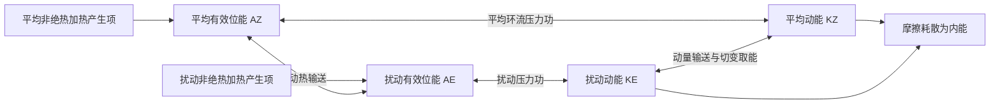

# D49 · 大气物理学：云物理、辐射、湿度与稳定度

日期：2026-12-16｜建议投入：4小时｜动力40% · 天气40% · 物理20%

> 本学习包依据原50日PDF与仓库学习资料整理。参考答案不是官方评分标准；未完成学科审校及缺题标记均保留。公式采用 GitHub 数学 Markdown，请在 GitHub 正文或 Obsidian 阅读视图打开。

## 今日目标与记忆标准

闭卷说清概念、适用条件、符号与单位；推导必须写出起始方程、近似及关键步骤。先答题，再展开核对。

## 四小时执行

1. 20分钟：回忆此前第1、3、7、14天的重点，尚未开始的日期跳过。
2. 80分钟：逐题闭卷提取，核对以下简答与来源。
3. 70分钟：精选5题完整书写。名词解释90秒、简答7分钟、论述12分钟为训练目标。
4. 40分钟：把本日知识按“假设→方程→物理机制→天气表现”串成2—4条知识链。
5. 30分钟：记录遗漏点、用时与次日/3日/7日/14日复习日期。

## 逐题回忆与简答

### 2026-一-6

焚风：

[解析来源（对应题目行）](https://github.com/0183ty2512/lao-san-yang/blob/main/%E5%8A%A8%E5%8A%9B%E6%B0%94%E8%B1%A1%E8%AF%BE%E5%90%8E%E4%B9%A0%E9%A2%98/%E8%AF%95%E9%A2%98%E8%A7%A3%E7%AD%94/%E5%BE%80%E5%B9%B4%E8%AF%95%E9%A2%98%E8%A7%A3%E6%9E%90/2026.md#L248) · [原始年度题干](https://github.com/0183ty2512/lao-san-yang/blob/main/%E5%BE%80%E5%B9%B4%E8%AF%95%E9%A2%98%E5%88%86%E6%9E%90/2026.md)

**审校状态：已逐题复核（按所列模型与条件）。**

**针对本题的考场作答版（非官方评分标准）：**

焚风是背风坡下沉气流导致的暖干风。经典模型中迎风饱和上升按湿绝热率降温、失水，背风未饱和下降按干绝热率增温，在相同高度可较迎风暖且干；增温来自压缩。

> 推导题须保留必要推演，简答与论述须按小问展开；精简版只用于回忆作答主线。

### 2017-二-1

地形对云物理和降水的影响。

[解析来源（对应题目行）](https://github.com/0183ty2512/lao-san-yang/blob/main/%E5%8A%A8%E5%8A%9B%E6%B0%94%E8%B1%A1%E8%AF%BE%E5%90%8E%E4%B9%A0%E9%A2%98/%E8%AF%95%E9%A2%98%E8%A7%A3%E7%AD%94/%E5%BE%80%E5%B9%B4%E8%AF%95%E9%A2%98%E8%A7%A3%E6%9E%90/2017.md#L302) · [原始年度题干](https://github.com/0183ty2512/lao-san-yang/blob/main/%E5%BE%80%E5%B9%B4%E8%AF%95%E9%A2%98%E5%88%86%E6%9E%90/2017.md)

**审校状态：尚未逐题学科审校。**

> 以上摘要用于回忆答题主线，不是官方评分标准；推导、计算和多小问仍须完成下方步骤。

1. **云物理路径。** 迎风抬升使气块降温至饱和，凝结物增长；若达到冷云层，可有冰相增长和播撒效应。地形引起的辐合、驻留和重复对流增大累积雨量；背风下沉促蒸发。降水大小还受水汽、粒子微物理和云相态控制，不能只按海拔单调增加。

2. **动力作用。** 高原作为巨大地形障碍，使西风绕流或爬升，分成南北支，改变下游槽脊、急流和定常行星波；山地抬升使迎风坡降水增加，背风坡下沉增温变干。实际响应取决于风向、层结、山高和阻塞程度。

### 2024-一-5

辐射差额

[解析来源（对应题目行）](https://github.com/0183ty2512/lao-san-yang/blob/main/%E5%8A%A8%E5%8A%9B%E6%B0%94%E8%B1%A1%E8%AF%BE%E5%90%8E%E4%B9%A0%E9%A2%98/%E8%AF%95%E9%A2%98%E8%A7%A3%E7%AD%94/%E5%BE%80%E5%B9%B4%E8%AF%95%E9%A2%98%E8%A7%A3%E6%9E%90/2024.md#L200) · [原始年度题干](https://github.com/0183ty2512/lao-san-yang/blob/main/%E5%BE%80%E5%B9%B4%E8%AF%95%E9%A2%98%E5%88%86%E6%9E%90/2024.md)

**审校状态：已逐题复核（按所列模型与条件）。**

**针对本题的考场作答版（非官方评分标准）：**

地表辐射差额即净辐射$R_n=(S_\downarrow-S_\uparrow)+(L_\downarrow-L_\uparrow)$，以获得辐射能为正，单位W/m²。

> 推导题须保留必要推演，简答与论述须按小问展开；精简版只用于回忆作答主线。

### 2024-三-3

长波辐射的传播特征，并用来解释温室效应

[解析来源（对应题目行）](https://github.com/0183ty2512/lao-san-yang/blob/main/%E5%8A%A8%E5%8A%9B%E6%B0%94%E8%B1%A1%E8%AF%BE%E5%90%8E%E4%B9%A0%E9%A2%98/%E8%AF%95%E9%A2%98%E8%A7%A3%E7%AD%94/%E5%BE%80%E5%B9%B4%E8%AF%95%E9%A2%98%E8%A7%A3%E6%9E%90/2024.md#L899) · [原始年度题干](https://github.com/0183ty2512/lao-san-yang/blob/main/%E5%BE%80%E5%B9%B4%E8%AF%95%E9%A2%98%E5%88%86%E6%9E%90/2024.md)

**审校状态：已逐题复核（按所列模型与条件）。**

**针对本题的考场作答版（非官方评分标准）：**

长波传播同时有吸收和热发射；LTE、忽略散射时$dI_\nu/d\tau_\nu=-I_\nu+B_\nu(T)$。温室气体使有效向外辐射来自较冷的更高层，固定温度下出射减少，系统需增温恢复收支；大气同时向地面发射长波。

> 推导题须保留必要推演，简答与论述须按小问展开；精简版只用于回忆作答主线。

### 2023-二-6

简述假绝热（湿绝热）过程，解释其不可逆的原因。

[解析来源（对应题目行）](https://github.com/0183ty2512/lao-san-yang/blob/main/%E5%8A%A8%E5%8A%9B%E6%B0%94%E8%B1%A1%E8%AF%BE%E5%90%8E%E4%B9%A0%E9%A2%98/%E8%AF%95%E9%A2%98%E8%A7%A3%E7%AD%94/%E5%BE%80%E5%B9%B4%E8%AF%95%E9%A2%98%E8%A7%A3%E6%9E%90/2023.md#L743) · [原始年度题干](https://github.com/0183ty2512/lao-san-yang/blob/main/%E5%BE%80%E5%B9%B4%E8%AF%95%E9%A2%98%E5%88%86%E6%9E%90/2023.md)

**审校状态：已逐题复核（按所列模型与条件）。**

**针对本题的考场作答版（非官方评分标准）：**

假绝热过程指饱和气块绝热上升、凝结物随形成随移出的理想过程。潜热释放使降温慢于干绝热；因降水移走水分及其携带的能量，反向下沉不能恢复原状态，不能把所有湿绝热过程都称为不可逆。

> 推导题须保留必要推演，简答与论述须按小问展开；精简版只用于回忆作答主线。

### 2025-一-6

抬升凝结高度

[解析来源（对应题目行）](https://github.com/0183ty2512/lao-san-yang/blob/main/%E5%8A%A8%E5%8A%9B%E6%B0%94%E8%B1%A1%E8%AF%BE%E5%90%8E%E4%B9%A0%E9%A2%98/%E8%AF%95%E9%A2%98%E8%A7%A3%E7%AD%94/%E5%BE%80%E5%B9%B4%E8%AF%95%E9%A2%98%E8%A7%A3%E6%9E%90/2025.md#L248) · [原始年度题干](https://github.com/0183ty2512/lao-san-yang/blob/main/%E5%BE%80%E5%B9%B4%E8%AF%95%E9%A2%98%E5%88%86%E6%9E%90/2025.md)

**审校状态：已逐题复核（按所列模型与条件）。**

**针对本题的考场作答版（非官方评分标准）：**

抬升凝结高度LCL是未饱和气块按干绝热抬升首次达到饱和的高度。近地面可粗估$z_{LCL}-z_0\approx125(T_0-T_{d0})$ m，温露差用K或℃，该式有近似条件。

> 推导题须保留必要推演，简答与论述须按小问展开；精简版只用于回忆作答主线。

### 2022-三-2

运用大气物理知识解释气溶胶在云雾降水及大气辐射中的作用？

[解析来源（对应题目行）](https://github.com/0183ty2512/lao-san-yang/blob/main/%E5%8A%A8%E5%8A%9B%E6%B0%94%E8%B1%A1%E8%AF%BE%E5%90%8E%E4%B9%A0%E9%A2%98/%E8%AF%95%E9%A2%98%E8%A7%A3%E7%AD%94/%E5%BE%80%E5%B9%B4%E8%AF%95%E9%A2%98%E8%A7%A3%E6%9E%90/2022.md#L849) · [原始年度题干](https://github.com/0183ty2512/lao-san-yang/blob/main/%E5%BE%80%E5%B9%B4%E8%AF%95%E9%A2%98%E5%88%86%E6%9E%90/2022.md)

**审校状态：已逐题复核（按所列模型与条件）。**

**针对本题的考场作答版（非官方评分标准）：**

气溶胶可作为云凝结核和冰核，改变云滴、冰晶谱及降水过程；可直接散射、吸收辐射，也可通过云滴大小、云量等改变辐射。效应取决于粒子性质和云环境，不能仅按数量给出固定增雨或减雨结论。

> 推导题须保留必要推演，简答与论述须按小问展开；精简版只用于回忆作答主线。

### 2023-一-6

辐射逆温

[解析来源（对应题目行）](https://github.com/0183ty2512/lao-san-yang/blob/main/%E5%8A%A8%E5%8A%9B%E6%B0%94%E8%B1%A1%E8%AF%BE%E5%90%8E%E4%B9%A0%E9%A2%98/%E8%AF%95%E9%A2%98%E8%A7%A3%E7%AD%94/%E5%BE%80%E5%B9%B4%E8%AF%95%E9%A2%98%E8%A7%A3%E6%9E%90/2023.md#L250) · [原始年度题干](https://github.com/0183ty2512/lao-san-yang/blob/main/%E5%BE%80%E5%B9%B4%E8%AF%95%E9%A2%98%E5%88%86%E6%9E%90/2023.md)

**审校状态：已逐题复核（按所列模型与条件）。**

**针对本题的考场作答版（非官方评分标准）：**

晴朗、弱风夜间地面净长波辐射冷却，接触地面的空气先降温，使近地面出现$dT/dz>0$的逆温层，称辐射逆温。

> 推导题须保留必要推演，简答与论述须按小问展开；精简版只用于回忆作答主线。

### 2013-一-5

地面有效辐射

[解析来源（对应题目行）](https://github.com/0183ty2512/lao-san-yang/blob/main/%E5%8A%A8%E5%8A%9B%E6%B0%94%E8%B1%A1%E8%AF%BE%E5%90%8E%E4%B9%A0%E9%A2%98/%E8%AF%95%E9%A2%98%E8%A7%A3%E7%AD%94/%E5%BE%80%E5%B9%B4%E8%AF%95%E9%A2%98%E8%A7%A3%E6%9E%90/2013.md#L173) · [原始年度题干](https://github.com/0183ty2512/lao-san-yang/blob/main/%E5%BE%80%E5%B9%B4%E8%AF%95%E9%A2%98%E5%88%86%E6%9E%90/2013.md)

**审校状态：尚未逐题学科审校。**

> 以上摘要用于回忆答题主线，不是官方评分标准；推导、计算和多小问仍须完成下方步骤。

1. **地面有效辐射。** 按常用净长波冷却定义，$E=L_\uparrow-L_\downarrow$；若把向上长波区分为地表自发射和反射的大气长波，则 $E=\epsilon_s\sigma_BT_s^4-\epsilon_sL_\downarrow$（灰体表面、长波反射率 $1-\epsilon_s$）。夜间无太阳短波时，$R_n\approx-E$。

2. 晴空、干燥时向下长波较弱，夜间地表易净冷却；云和水汽通常增强向下长波，减弱夜间辐射冷却。不能将有效辐射等同地表自身发射而漏掉大气逆辐射。

### 2011-一-1

地面有效辐射

[解析来源（对应题目行）](https://github.com/0183ty2512/lao-san-yang/blob/main/%E5%8A%A8%E5%8A%9B%E6%B0%94%E8%B1%A1%E8%AF%BE%E5%90%8E%E4%B9%A0%E9%A2%98/%E8%AF%95%E9%A2%98%E8%A7%A3%E7%AD%94/%E5%BE%80%E5%B9%B4%E8%AF%95%E9%A2%98%E8%A7%A3%E6%9E%90/2011.md#L11) · [原始年度题干](https://github.com/0183ty2512/lao-san-yang/blob/main/%E5%BE%80%E5%B9%B4%E8%AF%95%E9%A2%98%E5%88%86%E6%9E%90/2011.md)

**审校状态：尚未逐题学科审校。**

> 以上摘要用于回忆答题主线，不是官方评分标准；推导、计算和多小问仍须完成下方步骤。

1. **地面有效辐射。** 按常用净长波冷却定义，$E=L_\uparrow-L_\downarrow$；若把向上长波区分为地表自发射和反射的大气长波，则 $E=\epsilon_s\sigma_BT_s^4-\epsilon_sL_\downarrow$（灰体表面、长波反射率 $1-\epsilon_s$）。夜间无太阳短波时，$R_n\approx-E$。

2. 晴空、干燥时向下长波较弱，夜间地表易净冷却；云和水汽通常增强向下长波，减弱夜间辐射冷却。不能将有效辐射等同地表自身发射而漏掉大气逆辐射。

### 1992-一-5

影响大气环流形成的主要因素有：太阳辐射能随纬度分布的不均匀、基本气流的不稳定、太阳活动和**地球自转（海陆分布和地形）**。

[解析来源（对应题目行）](https://github.com/0183ty2512/lao-san-yang/blob/main/%E5%8A%A8%E5%8A%9B%E6%B0%94%E8%B1%A1%E8%AF%BE%E5%90%8E%E4%B9%A0%E9%A2%98/%E8%AF%95%E9%A2%98%E8%A7%A3%E7%AD%94/%E5%BE%80%E5%B9%B4%E8%AF%95%E9%A2%98%E8%A7%A3%E6%9E%90/1992.md#L172) · [原始年度题干](https://github.com/0183ty2512/lao-san-yang/blob/main/%E5%BE%80%E5%B9%B4%E8%AF%95%E9%A2%98%E5%88%86%E6%9E%90/1992.md)

**审校状态：尚未逐题学科审校。**

**相关高频考点复习摘要（须按本题设问取舍，不替代完整解答）：**

**大气环流：** 大气环流由辐射纬向不均提供能量，地球自转约束运动，海陆分布、地形和季节性加热塑造区域结构，涡旋输送维持平均风带。答题须把驱动、约束、区域调制与维持过程分清。

> 以上摘要用于回忆答题主线，不是官方评分标准；推导、计算和多小问仍须完成下方步骤。

**原记录填空值：** 地球自转（海陆分布和地形）。下文核对其物理含义；出现修改意见时，以修改后的说明为准。

1. 大气环流的基本驱动是太阳辐射纬向分布不均造成低纬盈余、高纬亏损；地球自转约束运动并产生东西风带，海陆分布、地形、季节性加热及涡旋不稳定使环流偏离纬向对称。

2. 平均经圈环流中，哈得莱环流低纬上升、副热带下沉，近地面回流形成信风，属于热力直接环流；费雷尔环流在中纬度、平均上热力间接，依赖天气涡旋维持；极地环流较弱。三圈是统计平均，非每个经度同时存在三个封闭圈。

3. 沃克环流是热带沿东西方向的垂直环流。典型热带太平洋上暖西太平洋对流上升，东部较冷海区下沉，低层东风回流；与哈得莱环流的南北方向不同。

4. 冬季北半球 500 hPa 等高线较密、西风强、长波振幅较大，东亚和北美东岸常有大槽，大陆冷、海洋相对暖；夏季中高纬梯度减小、西风带北移，副高北抬，大陆暖低压发展。冬季海平面亚洲冷高压、阿留申低压突出，夏季大陆热低压与海洋副高突出。

### 1996-一-2

热带气旋的主要能量来源是**凝结潜热释放**，而温带气旋主要能量来源则为**有效位能释放（斜压能量）**。

[解析来源（对应题目行）](https://github.com/0183ty2512/lao-san-yang/blob/main/%E5%8A%A8%E5%8A%9B%E6%B0%94%E8%B1%A1%E8%AF%BE%E5%90%8E%E4%B9%A0%E9%A2%98/%E8%AF%95%E9%A2%98%E8%A7%A3%E7%AD%94/%E5%BE%80%E5%B9%B4%E8%AF%95%E9%A2%98%E8%A7%A3%E6%9E%90/1996.md#L49) · [原始年度题干](https://github.com/0183ty2512/lao-san-yang/blob/main/%E5%BE%80%E5%B9%B4%E8%AF%95%E9%A2%98%E5%88%86%E6%9E%90/1996.md)

**审校状态：尚未逐题学科审校。**

**相关高频考点复习摘要（须按本题设问取舍，不替代完整解答）：**

**有效位能：** 有效位能是实际全位能相对绝热重排后的最低参考态中可供转换的部分。差异加热维持温差，暖升冷沉可将其转为动能。全位能通常指内能与重力位能之和，不是全部都能被利用。

> 以上摘要用于回忆答题主线，不是官方评分标准；推导、计算和多小问仍须完成下方步骤。

**原记录填空值：** 凝结潜热释放；有效位能释放（斜压能量）。下文核对其物理含义；出现修改意见时，以修改后的说明为准。

1. **能量。** 水汽主要由暖海蒸发补给，海面潜热和显热通量提供焓；凝结将潜热释放，暖升冷沉及压力功转化为动能，摩擦耗散动能。不能把凝结说成凭空制造能量。

1. 单位质量内能 $e=c_vT$，重力位能 $\Phi=gz$（常重力），动能 $K=|\mathbf V|^2/2$，水汽潜热能近似 $L_vq_v$。总量需对气团质量积分；动能不能漏掉 $1/2$。
2. “全位能”在大气能量学中通常指内能与重力位能之和，而非含动能的总能量。静力、平坦底面且顶边界压力趋零时，$\int\rho gz\,dz=-\int z\,dp=\int p\,dz=\int\rho RT\,dz$；加上内能得到 $\int c_pT\,dm$。
3. 有效位能是实际全位能相对绝热重排到参考最低能态后的可用部分。不是全部内能或重力位能都能转换为动能。差异加热维持水平温差，建立有效位能。
4. 暖上升冷下沉时，$C=-\int\alpha'\omega'\,dm>0$，有效位能转为扰动动能；摩擦最终把动能耗散成内能。凝结使潜热转入热力能库，但水汽能量本来主要来自地表蒸发和辐射收支。
5. 对流层常用 Lorenz 四能量库循环如下。双向箭头表示转换可正可负，方向由收支项决定；中纬度斜压波常沿 $A_Z\to A_E\to K_E$ 取能。$A_Z$ 与 $K_Z$ 的直接转换不能漏掉：平均经圈环流同样可通过压力功在平均有效位能和平均动能之间转换。

产生项也可能为负，图中不是所有加热都增加有效位能。若问完整收支，应分别写 $\dot A_Z=G_Z-C_A-C_Z$、$\dot A_E=G_E+C_A-C_E$、$\dot K_Z=C_Z+C_K-D_Z$、$\dot K_E=C_E-C_K-D_E$，这里 $C_K>0$ 约定为扰动动能转入平均动能。四式相加，内部转换项逐项抵消，只剩外部产生与耗散，可用作检查。

## 精选完整解析与公式推导

以下保留资料中的条件、步骤和审校信息。先完成手写，再核对。

### 2024-三-3 · 完整解答

长波辐射的传播特征，并用来解释温室效应

**修改意见（2026-10-05，第三批）：**

补吸收与发射并存的传输方程及积分解，用顶层收支解释温室效应。

**核对依据：** [地球－大气系统的长波辐射](https://github.com/0183ty2512/lao-san-yang/blob/main/%E5%A4%A7%E6%B0%94%E7%89%A9%E7%90%86%E5%AD%A6/%E5%A4%A7%E6%B0%94%E8%BE%90%E5%B0%84%E5%AD%A6/%E5%9C%B0%E7%90%83%EF%BC%8D%E5%A4%A7%E6%B0%94%E7%B3%BB%E7%BB%9F%E7%9A%84%E9%95%BF%E6%B3%A2%E8%BE%90%E5%B0%84.md)。本地资料为学习笔记，不视作官方标准答案；冲突处依据下列物理条件、方程推导和所列外部依据判断。

**复核后详细解答：**

1. **波段及物质。** 地表与大气温度约为数百K，主要发出热红外长波。水汽、二氧化碳、臭氧等在不同谱带吸收并发射；云也有显著作用。大气窗口相对透明，但受水汽和云影响，并非任何天气下都完全透明。
2. **单条光路传输。** 沿辐射传播方向$s$，局地热力学平衡且忽略长波散射时，$dI_\nu/ds=-\beta_{a,\nu}I_\nu+\beta_{a,\nu}B_\nu(T)$。第一项移除原光束，第二项是当地介质热发射；同一吸收系数出现在两项体现Kirchhoff关系。设沿程$d\tau_\nu=\beta_{a,\nu}ds$，则$dI_\nu/d\tau_\nu+I_\nu=B_\nu(T)$。
3. **逐步求解。** 两边乘积分因子$e^{\tau}$，得$d(Ie^\tau)/d\tau=B(T)e^\tau$。从0到$\tau$积分：$I(\tau)e^\tau-I(0)=\int_0^\tau B[T(t)]e^t dt$，所以
$$I(\tau)=I(0)e^{-\tau}+\int_0^\tau B[T(t)]e^{-(\tau-t)}dt.$$
结果明确分为原有辐射透过和沿程各层发射。不能只写$I=I_0e^{-\tau}$而漏掉温暖大气自身的长波发射。
4. **地表和大气之间。** 地面长波一部分经窗口到太空，一部分被大气和云吸收；大气向上和向下均发射。向下长波使地面净长波损失小于其单独向上发射量，但辐射净能量仍可由较暖地表流向较冷环境，不违反热力学第二定律。
5. **温室效应的顶层解释。** 取太阳吸收暂不变，增加红外吸收能力后，在对流层温度通常随高度下降的情况下，许多波段向太空的有效辐射高度升高，来自更冷的层，固定温度廓线时向外长波减小。输入大于输出形成能量积累，地表和对流层随后增温，直到大气顶出射重新与吸收太阳辐射相平衡。
6. **简单模型核对。** 仅为解释机制，设全球均匀地表为黑体，大气一层对短波透明、对长波全吸收，且忽略对流。记吸收太阳通量为$F$。大气收地表$\sigma T_s^4$，向上下各发$\sigma T_a^4$，故$\sigma T_s^4=2\sigma T_a^4$；大气顶平衡要求$\sigma T_a^4=F$，因此$T_s=(2F/\sigma)^{1/4}$，比无大气时$T_e=(F/\sigma)^{1/4}$高。真实大气部分吸收、多层、存在对流与云，不能把该模型温度当成地球实测值。
7. **限定。** 温室效应不是辐射被永远困住，也不是温室气体只吸收不发射。云、冰粒等情形可能需要长波散射；本题的传输式是在明确近似下说明主过程。

[核对原文](https://github.com/0183ty2512/lao-san-yang/blob/main/%E5%8A%A8%E5%8A%9B%E6%B0%94%E8%B1%A1%E8%AF%BE%E5%90%8E%E4%B9%A0%E9%A2%98/%E8%AF%95%E9%A2%98%E8%A7%A3%E7%AD%94/%E5%BE%80%E5%B9%B4%E8%AF%95%E9%A2%98%E8%A7%A3%E6%9E%90/2024.md#L899)

### 1996-一-2 · 完整解答

热带气旋的主要能量来源是**凝结潜热释放**，而温带气旋主要能量来源则为**有效位能释放（斜压能量）**。

**原记录填空值：** 凝结潜热释放；有效位能释放（斜压能量）。下文核对其物理含义；出现修改意见时，以修改后的说明为准。

1. **能量。** 水汽主要由暖海蒸发补给，海面潜热和显热通量提供焓；凝结将潜热释放，暖升冷沉及压力功转化为动能，摩擦耗散动能。不能把凝结说成凭空制造能量。

1. 单位质量内能 $e=c_vT$，重力位能 $\Phi=gz$（常重力），动能 $K=|\mathbf V|^2/2$，水汽潜热能近似 $L_vq_v$。总量需对气团质量积分；动能不能漏掉 $1/2$。
2. “全位能”在大气能量学中通常指内能与重力位能之和，而非含动能的总能量。静力、平坦底面且顶边界压力趋零时，$\int\rho gz\,dz=-\int z\,dp=\int p\,dz=\int\rho RT\,dz$；加上内能得到 $\int c_pT\,dm$。
3. 有效位能是实际全位能相对绝热重排到参考最低能态后的可用部分。不是全部内能或重力位能都能转换为动能。差异加热维持水平温差，建立有效位能。
4. 暖上升冷下沉时，$C=-\int\alpha'\omega'\,dm>0$，有效位能转为扰动动能；摩擦最终把动能耗散成内能。凝结使潜热转入热力能库，但水汽能量本来主要来自地表蒸发和辐射收支。
5. 对流层常用 Lorenz 四能量库循环如下。双向箭头表示转换可正可负，方向由收支项决定；中纬度斜压波常沿 $A_Z\to A_E\to K_E$ 取能。$A_Z$ 与 $K_Z$ 的直接转换不能漏掉：平均经圈环流同样可通过压力功在平均有效位能和平均动能之间转换。

产生项也可能为负，图中不是所有加热都增加有效位能。若问完整收支，应分别写 $\dot A_Z=G_Z-C_A-C_Z$、$\dot A_E=G_E+C_A-C_E$、$\dot K_Z=C_Z+C_K-D_Z$、$\dot K_E=C_E-C_K-D_E$，这里 $C_K>0$ 约定为扰动动能转入平均动能。四式相加，内部转换项逐项抵消，只剩外部产生与耗散，可用作检查。

[核对原文](https://github.com/0183ty2512/lao-san-yang/blob/main/%E5%8A%A8%E5%8A%9B%E6%B0%94%E8%B1%A1%E8%AF%BE%E5%90%8E%E4%B9%A0%E9%A2%98/%E8%AF%95%E9%A2%98%E8%A7%A3%E7%AD%94/%E5%BE%80%E5%B9%B4%E8%AF%95%E9%A2%98%E8%A7%A3%E6%9E%90/1996.md#L49)

### 2022-三-2 · 完整解答

运用大气物理知识解释气溶胶在云雾降水及大气辐射中的作用？

**修改意见（2026-10-05，第三批）：**

将成核、降水、直接辐射与云介导作用分开，明确降水响应的条件性。

**核对依据：** [大气气溶胶的概念、谱分布、来源及在大气过程中的作用](https://github.com/0183ty2512/lao-san-yang/blob/main/%E5%A4%A7%E6%B0%94%E7%89%A9%E7%90%86%E5%AD%A6/%E5%9C%B0%E7%90%83%E5%A4%A7%E6%B0%94%E7%9A%84%E6%88%90%E5%88%86%E4%B8%8E%E5%88%86%E5%B8%83/%E5%A4%A7%E6%B0%94%E6%B0%94%E6%BA%B6%E8%83%B6%E7%9A%84%E6%A6%82%E5%BF%B5%E3%80%81%E8%B0%B1%E5%88%86%E5%B8%83%E3%80%81%E6%9D%A5%E6%BA%90%E5%8F%8A%E5%9C%A8%E5%A4%A7%E6%B0%94%E8%BF%87%E7%A8%8B%E4%B8%AD%E7%9A%84%E4%BD%9C%E7%94%A8.md)。本地资料为学习笔记，不视作官方标准答案；冲突处依据下列物理条件、方程推导和所列外部依据判断。

**复核后详细解答：**

1. **定义。** 大气气溶胶是悬浮于空气中的固态或液态微粒及其与气体构成的分散体系。常见来源包括海盐、沙尘、燃烧颗粒以及气态前体物生成的二次颗粒；云滴、雨滴通常在云物理中另归为水成物。
2. **云雾凝结。** 部分可吸湿颗粒可充当云凝结核。空气冷却使相对湿度升高后，合适的粒子先吸水，达到相应临界过饱和度便可活化成云滴。曲率效应使小纯水滴较难稳定，溶质效应降低平衡水汽压，两者共同决定活化；因此不是任何粒子在任何湿度下都能成为云滴。
3. **冰相成核。** 某些颗粒在适宜低温与湿度下可充当冰核，参与浸没冻结、接触冻结等过程，影响冰晶数目和混合相云演变。冰核与云凝结核的有效性不同，不能把所有颗粒等同为冰核。
4. **降水过程。** 气溶胶改变初始云滴数目、大小和谱宽，进而改变碰并、冰相增长和降水。若液态水总量相同而活化云滴更多，平均云滴偏小，暖雨碰并可能延迟；巨型凝结核也可能形成较大水滴、促进碰并。冰核多少会影响冰晶竞争水汽及混合相过程。最终降水响应还依赖水汽、云动力和云寿命，不能写“气溶胶越多降水一定越多/越少”。
5. **直接辐射作用。** 颗粒对太阳短波散射，使一部分辐射返回太空、减少到达地面的短波；吸收性颗粒还可吸收辐射、加热所在空气层。净效应依赖成分、粒径、地表反照率和垂直位置，不能把所有气溶胶都归为单纯冷却。
6. **通过云的辐射作用。** 在液水路径相同的比较条件下，较多较小云滴通常使云光学厚度和反照率增大；粒子也能改变降水效率、云量与云寿命。吸收性颗粒引起的层结变化还会改变云。这些响应带有环境依赖，不能由第一项效应直接推断全部净气候作用。
7. **综合关系。** 成核改变微物理，微物理影响降水与云光学性质，辐射加热又反馈云动力。答题按“云雾—冰相与降水—直接辐射—云介导辐射”的顺序展开即可。

[核对原文](https://github.com/0183ty2512/lao-san-yang/blob/main/%E5%8A%A8%E5%8A%9B%E6%B0%94%E8%B1%A1%E8%AF%BE%E5%90%8E%E4%B9%A0%E9%A2%98/%E8%AF%95%E9%A2%98%E8%A7%A3%E7%AD%94/%E5%BE%80%E5%B9%B4%E8%AF%95%E9%A2%98%E8%A7%A3%E6%9E%90/2022.md#L849)

### 2025-一-6 · 完整解答

抬升凝结高度

**修改意见（2026-10-05，第三批）：**

区分LCL、自由对流高度和实际云底，补125倍温露差估算的来源。

**核对依据：** [大气中的干绝热过程](https://github.com/0183ty2512/lao-san-yang/blob/main/%E5%A4%A7%E6%B0%94%E7%89%A9%E7%90%86%E5%AD%A6/%E5%A4%A7%E6%B0%94%E7%83%AD%E5%8A%9B%E5%AD%A6/%E5%A4%A7%E6%B0%94%E4%B8%AD%E7%9A%84%E5%B9%B2%E7%BB%9D%E7%83%AD%E8%BF%87%E7%A8%8B.md)。本地资料为学习笔记，不视作官方标准答案；冲突处依据下列物理条件、方程推导和所列外部依据判断。

**复核后详细解答：**

1. 取初始未饱和气块，不与环境混合、未凝结前无水汽损失，使其干绝热抬升。气温降低、饱和水汽压降低，首次达到相对湿度100%的位置称抬升凝结高度，记LCL。
2. 干绝热阶段温度近似按$T(z)=T_0-\Gamma_d(z-z_0)$变化，$\Gamma_d\approx9.8\ \mathrm{K/km}$。实际水汽混合比近守恒，但气压下降使水汽压也降低，故露点不是常数，可粗估$T_d(z)=T_{d0}-\Gamma_{Td}(z-z_0)$，近地面$\Gamma_{Td}$约为$1.8$—$2\ \mathrm{K/km}$。
3. 在LCL令$T=T_d$：$T_0-\Gamma_d\Delta z=T_{d0}-\Gamma_{Td}\Delta z$；移项得$T_0-T_{d0}=(\Gamma_d-\Gamma_{Td})\Delta z$，故
$$\Delta z=\frac{T_0-T_{d0}}{\Gamma_d-\Gamma_{Td}}\approx\frac{T_0-T_{d0}}{8\ \mathrm{K/km}}\approx125(T_0-T_{d0})\ \mathrm m.$$
4. 此处高度是相对初始高度$z_0$的抬升距离。温露差可用K或℃；若初始已饱和，温露差为0，LCL就在初始位置，符合检验。高温、低压或很大温露差时应采用更准确的热力计算。
5. LCL回答“何时达到饱和”，自由对流高度LFC回答“何时相对环境获得自由上升浮力”，两者不相同。实际云底还受混合、层结及云形成机制影响，不能无条件认定所有云底都等于地面气块LCL。

[核对原文](https://github.com/0183ty2512/lao-san-yang/blob/main/%E5%8A%A8%E5%8A%9B%E6%B0%94%E8%B1%A1%E8%AF%BE%E5%90%8E%E4%B9%A0%E9%A2%98/%E8%AF%95%E9%A2%98%E8%A7%A3%E7%AD%94/%E5%BE%80%E5%B9%B4%E8%AF%95%E9%A2%98%E8%A7%A3%E6%9E%90/2025.md#L248)

### 2026-一-6 · 完整解答

焚风：

**修改意见（2026-10-05，第三批）：**

用完整迎风/背风热力路径解释焚风，限定经典降水模型并说明不必每次都迎风降雨。

**核对依据：** [大气中的干绝热过程](https://github.com/0183ty2512/lao-san-yang/blob/main/%E5%A4%A7%E6%B0%94%E7%89%A9%E7%90%86%E5%AD%A6/%E5%A4%A7%E6%B0%94%E7%83%AD%E5%8A%9B%E5%AD%A6/%E5%A4%A7%E6%B0%94%E4%B8%AD%E7%9A%84%E5%B9%B2%E7%BB%9D%E7%83%AD%E8%BF%87%E7%A8%8B.md)。本地资料为学习笔记，不视作官方标准答案；冲突处依据下列物理条件、方程推导和所列外部依据判断。

**复核后详细解答：**

1. 焚风是越山或山地相关下沉气流在背风坡造成的暖而干的风。下降时气压增加，气块受压缩增温；不是主要靠空气摩擦山坡发热。
2. **经典迎风段。** 设同一比较高度为0，山顶高度$H$，迎风LCL高度$z_L<H$。未饱和气块从0升到$z_L$按$\Gamma_d$降温；从$z_L$升到$H$按平均湿绝热递减率$\Gamma_m$降温，并有凝结降水移走水分，故山顶温度$T_H=T_0-\Gamma_d z_L-\Gamma_m(H-z_L)$。
3. **背风段。** 假设凝结物已移除，气块背风下降基本未饱和，回到相同高度时按干绝热增温$\Gamma_dH$，得到$T_b=T_H+\Gamma_dH$。
4. **逐项相减。** 代入山顶温度：$T_b-T_0=-\Gamma_dz_L-\Gamma_m(H-z_L)+\Gamma_dH=(\Gamma_d-\Gamma_m)(H-z_L)>0$。这说明饱和上升段降温较慢，而下降增温较快，造成同高度暖差。若全程未饱和、可逆地升降同一气块，$\Gamma_m$段不存在，就不能由此模型推出同高度净增温。
5. **为什么干。** 迎风降水减少气块水汽，背风增温又提高饱和水汽压，二者使相对湿度减小。即使绝对水汽变化小，仅增温也能降低相对湿度。
6. **模型边界。** 实际焚风还可能由较高位温空气下沉、等熵抽降及混合等形成，并不必每次都出现明显迎风降水。上式是经典失水模型的解释，不是所有焚风的唯一成因或精确预报式。

[核对原文](https://github.com/0183ty2512/lao-san-yang/blob/main/%E5%8A%A8%E5%8A%9B%E6%B0%94%E8%B1%A1%E8%AF%BE%E5%90%8E%E4%B9%A0%E9%A2%98/%E8%AF%95%E9%A2%98%E8%A7%A3%E7%AD%94/%E5%BE%80%E5%B9%B4%E8%AF%95%E9%A2%98%E8%A7%A3%E6%9E%90/2026.md#L248)

## 当日验收

- [ ] 本日每题均完成至少一次闭卷提取。
- [ ] 精选题写清假设、符号与中间步骤；无漏负号、下标和单位。
- [ ] 能用自己的话解释至少两条跨章节联系。
- [ ] 错题记录包含题号、错因、修正答案及下一次复习日期。
