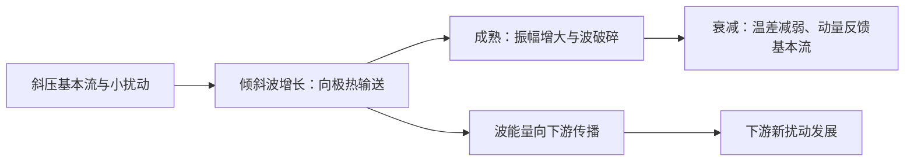

# 2025 年试题解析：逐题解答、考点与频次

> 本文件保留原题及频次，补充对应解答。星级为复习用主观评级；有缺题或排印疑点时，明确注明条件及可解范围。频次按考点出现的不同年份统计，不能视作命题概率。

原始记录：[[动力气象课后习题/往年试题分析/2025]]　｜　[[动力气象课后习题/往年试题解析/00_使用说明与年份索引|统计口径与目录]]

## 原卷第一部分

名词解释（共 10 题，每小题 3 分，共 30 分）

## 题目 2025-一-1

### 原题

准静止锋

### 考点与考察频次

**考察频次：2 次（按年份去重）；一般。**

| 考点 | 频次 | 标记 | 对应年份 |
|---|---:|---|---|
| 准静止锋 | 2 次 | 一般 | 2022、2025 |

同考点的全部题号见 [[动力气象课后习题/往年试题解析/01_考点频次与证据总表|考点频次与证据总表]]。

### 难度与考试相关度

**难度：★☆☆☆☆（1/5）｜考试相关度：★★★★☆（4/5）**

评级依据：历史出现且直接对应所给考纲；频次用于区分复习优先级。

### 详细解答

1. 气团是水平范围广、温度湿度等性质较均匀、在共同源地上形成的大块空气。冷暖气团之间的三维过渡带叫锋区，理想化为锋面，与地面的交线叫锋线。

2. **分类。** 冷气团主动推进为冷锋，锋后通常降温、转偏北风、气压升高，锋区可阵雨雷暴；暖气团主动推进为暖锋，暖空气沿冷气团上滑，常有锋前大范围层状云雨；冷暖势力相当、移动缓慢为准静止锋，易持续阴雨；冷锋追及暖锋使暖空气抬离地面形成锢囚锋，天气取决于两侧冷空气和水汽结构。

3. **要素场。** 锋区水平温度和密度梯度大，等温线密集；地面常表现为低压槽，风向有气旋式切变，锋面上升指向冷空气一侧。气压本身连续，其梯度可明显改变；“锋面处气压不连续”是不正确表述。

## 题目 2025-一-2

### 原题

极涡

### 考点与考察频次

**考察频次：1 次（按年份去重）；一般。**

| 考点 | 频次 | 标记 | 对应年份 |
|---|---:|---|---|
| 极涡 | 1 次 | 一般 | 2025 |

同考点的全部题号见 [[动力气象课后习题/往年试题解析/01_考点频次与证据总表|考点频次与证据总表]]。

### 难度与考试相关度

**难度：★☆☆☆☆（1/5）｜考试相关度：★★★★☆（4/5）**

评级依据：历史出现且直接对应所给考纲；频次用于区分复习优先级。

### 详细解答

1. 极涡是高纬大尺度气旋性环流，对流层极涡与冬季平流层极涡应区分；尺度为行星或大尺度，不能写成普遍小于 1000 km。偏心、分裂、槽脊变化可影响冷空气路径，但不等于每次极涡减弱都会在中国发生寒潮。

## 题目 2025-一-3

### 原题

低空急流

### 考点与考察频次

**考察频次：7 次（按年份去重）；🔴 重点。**

| 考点 | 频次 | 标记 | 对应年份 |
|---|---:|---|---|
| 低空急流 | 7 次 | 重点 | 1992、1996、1997、1999、2012、2015、2025 |

同考点的全部题号见 [[动力气象课后习题/往年试题解析/01_考点频次与证据总表|考点频次与证据总表]]。

### 难度与考试相关度

**难度：★☆☆☆☆（1/5）｜考试相关度：★★★★★（5/5）**

评级依据：历史出现且直接对应所给考纲；频次用于区分复习优先级。

### 详细解答

1. 低空急流是对流层低层的局地风速极大带，东亚夏季常在 850—700 hPa 附近，题中的 12 m/s 或 12—15 m/s 属常用识别量级，具体标准随研究变化。

2. 形成机制包括大尺度压力梯度加强、地形通道和山坡热力差异；夜间地表稳定化削弱摩擦，残余风发生惯性振荡，也可产生夜间风速极大。不同类型低空急流机制并不相同。

3. 低空急流输送暖湿空气，出口附近或与锋、切变线相交处辐合，利于不稳定能量和水汽积聚、暴雨触发；对流加热也可反过来加强低层压力梯度及急流。

## 题目 2025-一-4

### 原题

高原低涡

### 考点与考察频次

**考察频次：1 次（按年份去重）；一般。**

| 考点 | 频次 | 标记 | 对应年份 |
|---|---:|---|---|
| 高原涡 | 1 次 | 一般 | 2025 |

同考点的全部题号见 [[动力气象课后习题/往年试题解析/01_考点频次与证据总表|考点频次与证据总表]]。

### 难度与考试相关度

**难度：★☆☆☆☆（1/5）｜考试相关度：★★★★☆（4/5）**

评级依据：历史出现且直接对应所给考纲；频次用于区分复习优先级。

### 详细解答

1. 高原低涡常在高原近地中低层出现，水平较小，受地形、边界层加热和潜热作用影响；移出高原需合适引导气流及下游水汽。西南涡多活动于高原东南侧、四川盆地附近的低层，是气旋性小尺度低压环流，常在 700 hPa 分析，配合暖湿输送可造成暴雨。

## 题目 2025-一-5

### 原题

光化学烟雾

### 考点与考察频次

**考察频次：1 次（按年份去重）；一般。**

| 考点 | 频次 | 标记 | 对应年份 |
|---|---:|---|---|
| 烟雾与污染天气 | 1 次 | 一般 | 2025 |

同考点的全部题号见 [[动力气象课后习题/往年试题解析/01_考点频次与证据总表|考点频次与证据总表]]。

### 难度与考试相关度

**难度：★☆☆☆☆（1/5）｜考试相关度：★★★★☆（4/5）**

评级依据：历史出现且直接对应所给考纲；频次用于区分复习优先级。

### 详细解答

1. 光化学烟雾由 NOx、挥发性有机物等前体物在阳光下发生反应产生臭氧、过氧乙酰硝酸酯等氧化性污染物，常在日照强、空气停滞条件下累积。关键在于有机过氧自由基把NO转为NO₂而不消耗臭氧，使净臭氧生成；它与仅由燃煤烟尘、雾滴组成的传统烟雾不同。

## 题目 2025-一-6

### 原题

抬升凝结高度

### 考点与考察频次

**考察频次：1 次（按年份去重）；一般。**

| 考点 | 频次 | 标记 | 对应年份 |
|---|---:|---|---|
| 抬升凝结高度 | 1 次 | 一般 | 2025 |

同考点的全部题号见 [[动力气象课后习题/往年试题解析/01_考点频次与证据总表|考点频次与证据总表]]。

### 难度与考试相关度

**难度：★☆☆☆☆（1/5）｜考试相关度：★★★★☆（4/5）**

评级依据：历史出现且直接对应所给考纲；频次用于区分复习优先级。

### 详细解答

1. 抬升凝结高度 LCL 是未饱和气块干绝热上升首次达到饱和的高度，近地层经验 $z_{LCL}\approx125(T-T_d)$ m（温差用℃）来自温度与露点随高度接近的速率差。它是近似估算，不能等同自由对流高度 LFC。

## 题目 2025-一-7

### 原题

有效位能

### 考点与考察频次

**考察频次：6 次（按年份去重）；🔴 重点。**

| 考点 | 频次 | 标记 | 对应年份 |
|---|---:|---|---|
| 有效位能 | 6 次 | 重点 | 1996、2003、2005、2016、2022、2025 |

同考点的全部题号见 [[动力气象课后习题/往年试题解析/01_考点频次与证据总表|考点频次与证据总表]]。

### 难度与考试相关度

**难度：★☆☆☆☆（1/5）｜考试相关度：★★★★★（5/5）**

评级依据：历史出现且直接对应所给考纲；频次用于区分复习优先级。

### 详细解答

1. 单位质量内能 $e=c_vT$，重力位能 $\Phi=gz$（常重力），动能 $K=|\mathbf V|^2/2$，水汽潜热能近似 $L_vq_v$。总量需对气团质量积分；动能不能漏掉 $1/2$。
2. “全位能”在大气能量学中通常指内能与重力位能之和，而非含动能的总能量。静力、平坦底面且顶边界压力趋零时，$\int\rho gz\,dz=-\int z\,dp=\int p\,dz=\int\rho RT\,dz$；加上内能得到 $\int c_pT\,dm$。
3. 有效位能是实际全位能相对绝热重排到参考最低能态后的可用部分。不是全部内能或重力位能都能转换为动能。差异加热维持水平温差，建立有效位能。
4. 暖上升冷下沉时，$C=-\int\alpha'\omega'\,dm>0$，有效位能转为扰动动能；摩擦最终把动能耗散成内能。凝结使潜热转入热力能库，但水汽能量本来主要来自地表蒸发和辐射收支。
5. 对流层常用 Lorenz 能量循环示意如下，箭头为典型净转换方向，实际某一时段可逆转：

## 题目 2025-一-8

### 原题

埃克曼层

### 考点与考察频次

**考察频次：2 次（按年份去重）；一般。**

| 考点 | 频次 | 标记 | 对应年份 |
|---|---:|---|---|
| 埃克曼层 | 2 次 | 一般 | 2020、2025 |

同考点的全部题号见 [[动力气象课后习题/往年试题解析/01_考点频次与证据总表|考点频次与证据总表]]。

### 难度与考试相关度

**难度：★☆☆☆☆（1/5）｜考试相关度：★★★★☆（4/5）**

评级依据：历史出现且直接对应所给考纲；频次用于区分复习优先级。

### 详细解答

1. 稳态常涡黏系数埃克曼模式为 $-f(v-v_g)=K_mu_{zz}$、$f(u-u_g)=K_mv_{zz}$，偏差风随高度旋转并衰减，特征厚度 $\delta_E=\sqrt{2K_m/|f|}$。摩擦使近地风斜穿等压线流向低压。

2. 气旋边界层摩擦辐合，经连续性在层顶产生上升，即埃克曼抽吸；反气旋常相反。若 $M$ 为积分边界层偏差输送、下边界 $w=0$，$w_E=-\nabla_h\cdot M$。明确应力为地面对空气的应力 $\boldsymbol\tau_s$，常数 $\rho,f$ 下 $M=-\mathbf k\times\boldsymbol\tau_s/(\rho f)$，故 $w_E=-\operatorname{curl}_z\boldsymbol\tau_s/(\rho f)$；若采用空气对地面应力，符号相反。

## 题目 2025-一-9

### 原题

正压不稳定

### 考点与考察频次

**考察频次：10 次（按年份去重）；🔴 重点。**

| 考点 | 频次 | 标记 | 对应年份 |
|---|---:|---|---|
| 正压不稳定 | 10 次 | 重点 | 2006、2010、2011、2013、2015、2018、2020、2022、2023、2025 |

同考点的全部题号见 [[动力气象课后习题/往年试题解析/01_考点频次与证据总表|考点频次与证据总表]]。

### 难度与考试相关度

**难度：★★☆☆☆（2/5）｜考试相关度：★★★★★（5/5）**

评级依据：历史出现且直接对应所给考纲；频次用于区分复习优先级。

### 详细解答

1. 正压不稳定是扰动从具有水平切变的基本流动能获得能量而增长。设基本流 $U(y)$，扰动流函数为 $\psi'=\phi(y)e^{ik(x-ct)}$。
2. 线性涡度方程为 $(\partial_t+U\partial_x)\nabla^2\psi'+(\beta-U'')\partial_x\psi'=0$。代入模态并除以 $ik$，得 $(U-c)(\phi''-k^2\phi)+(\beta-U'')\phi=0$。
3. 设边界 $\phi=0$，除以 $U-c$，乘 $\phi^*$ 后在通道上积分。对 $\phi^*\phi''$ 分部积分，边界项为零：
$$-\int(|\phi'|^2+k^2|\phi|^2)dy+\int\frac{\beta-U''}{U-c}|\phi|^2dy=0.$$
4. 写 $c=c_r+ic_i$，取虚部：$c_i\int(\beta-U'')|\phi|^2/[(U-c_r)^2+c_i^2]dy=0$。若增长 $kc_i>0$，积分中的权重非负，故 $\boxed{\beta-U''\text{ 必须在域内变号}}$，这只是必要条件。
5. 扰动能量转换率含 $-\overline{u'v'}U_y$；扰动向平均切变反方向输送动量时可取能。若要求具体临界风速，必须给 $U(y)$、边界和波数，不能由必要条件唯一决定。
6. 例：仅在额外假定 $U=U_0\cos(my)$ 且区域含完整正负峰时，变号要求 $|U_0|m^2>\beta$；这个幅度界限仍不是该流动必定不稳定的充分临界值。

## 题目 2025-一-10

### 原题

上游效应

### 考点与考察频次

**考察频次：5 次（按年份去重）；🔴 重点。**

| 考点 | 频次 | 标记 | 对应年份 |
|---|---:|---|---|
| 上游效应 | 5 次 | 重点 | 1996、2013、2016、2019、2025 |

同考点的全部题号见 [[动力气象课后习题/往年试题解析/01_考点频次与证据总表|考点频次与证据总表]]。

### 难度与考试相关度

**难度：★☆☆☆☆（1/5）｜考试相关度：★★★★★（5/5）**

评级依据：历史出现且直接对应所给考纲；频次用于区分复习优先级。

### 详细解答

1. 罗斯贝波相速与群速不同，一维均匀西风上 $c_p=U-\beta/k^2$，$c_g=U+\beta/k^2$。能量包络可比槽脊向东传播更快，造成下游新波发展、上游旧波衰减，即下游发展。

2. 上下游效应泛指相邻波系通过传播和能量/动量交换相互影响；“上游效应”的教材用法需看其定义，不能以群速公式证明所有情况下影响只能单向向东。二维波和变化基本流中群速方向会变。

## 原卷第二部分

简答题（每小题 10 分，共 60 分）

## 题目 2025-二-1

### 原题

青藏高原的热力作用

### 考点与考察频次

**考察频次：6 次（按年份去重）；🔴 重点。**

| 考点 | 频次 | 标记 | 对应年份 |
|---|---:|---|---|
| 青藏高原天气气候效应 | 6 次 | 重点 | 1994、1996、2000、2010、2013、2025 |

同考点的全部题号见 [[动力气象课后习题/往年试题解析/01_考点频次与证据总表|考点频次与证据总表]]。

### 难度与考试相关度

**难度：★★☆☆☆（2/5）｜考试相关度：★★★★★（5/5）**

评级依据：历史出现且直接对应所给考纲；频次用于区分复习优先级。

### 详细解答

1. **动力作用。** 高原作为巨大地形障碍，使西风绕流或爬升，分成南北支，改变下游槽脊、急流和定常行星波；山地抬升使迎风坡降水增加，背风坡下沉增温变干。实际响应取决于风向、层结、山高和阻塞程度。

2. **热力作用。** 冬季高原是重要冷源，近地层冷却有利于冷高压背景；夏季高原地表显热与对流凝结潜热使其成为高架热源，低层热低压、高层南亚高压及季风环流响应。注意近地层热低压和高空暖高压可同时存在，不能认为相互矛盾。

3. **对我国天气。** 冬季加强东亚下游槽和冷空气输送背景；春夏高原加热促进季风转换；夏季调节副高与南亚高压配置、水汽通道、梅雨雨带；高原低涡和切变线移出高原可触发下游降水；地形阻挡改变冷空气路径。这些作用满足“四种以上”的列举要求。

## 题目 2025-二-2

### 原题

湍流的特征

### 考点与考察频次

**考察频次：1 次（按年份去重）；一般。**

| 考点 | 频次 | 标记 | 对应年份 |
|---|---:|---|---|
| 大气湍流 | 1 次 | 一般 | 2025 |

同考点的全部题号见 [[动力气象课后习题/往年试题解析/01_考点频次与证据总表|考点频次与证据总表]]。

### 难度与考试相关度

**难度：★★☆☆☆（2/5）｜考试相关度：★★★★☆（4/5）**

评级依据：历史出现且直接对应所给考纲；频次用于区分复习优先级。

### 详细解答

1. 大气湍流是具有不规则、多尺度涡旋和三维速度脉动的流动，常在高雷诺数、风切变或浮力作用下发生。瞬时运动难以逐点确定，但统计量可以有规律。
2. 用雷诺分解 $u=\bar u+u'$ 等区分平均量和脉动。湍流输送由协方差表示，例如 $\overline{u'w'}$ 为垂直动量通量，$\overline{w'T'}$ 为热量输送的重要部分，平均速度小不意味着脉动输送也小。
3. 能量可由平均切变转入湍动能，也可由不稳定浮力供给；不同尺度间相互作用并向小尺度传递，最终经分子黏性耗散为热。湍流显著混合动量、热量、水汽和污染物。
4. 稳定层结抑制竖直交换，可形成各向异性和间歇湍流；近地面、自由对流和自由大气中的湍流统计不同，不能假定处处均匀各向同性。

## 题目 2025-二-3

### 原题

影响东亚季风的基本因子

### 考点与考察频次

**考察频次：12 次（按年份去重）；🔴 重点。**

| 考点 | 频次 | 标记 | 对应年份 |
|---|---:|---|---|
| 季风 | 12 次 | 重点 | 1989、1994、1999、2000、2005、2014、2018、2020、2021、2022、2023、2025 |

同考点的全部题号见 [[动力气象课后习题/往年试题解析/01_考点频次与证据总表|考点频次与证据总表]]。

### 难度与考试相关度

**难度：★★☆☆☆（2/5）｜考试相关度：★★★★★（5/5）**

评级依据：历史出现且直接对应所给考纲；频次用于区分复习优先级。

### 详细解答

1. **概念。** 季风是大范围盛行风向随季节发生显著转换的环流，通常伴有干湿季变化；季风区是这种季节性风向转换及其天气气候影响显著的地区。不能仅用一个地点冬夏偶然相反的风判定。

2. **基本因子。** 海陆热容量不同：冬季大陆冷却快、形成冷高压，夏季大陆增温快、形成热低压；压力配置改变，推动低层风季节反转。太阳直射点移动带动行星风带和热带辐合带移动，青藏高原热力及动力作用进一步重塑亚洲环流。

3. **冬季系统。** 亚洲大陆和高原为冷源，西伯利亚高压、阿留申低压、东亚大槽及强西风急流配合；我国大部盛行偏北风，带来寒冷干燥天气，沿海还受海陆和地形调制。

4. **夏季系统。** 大陆、高原感热及南亚—东亚降水潜热形成热源；低层印度季风槽、南海季风、西太平洋副高西侧偏南气流、跨赤道气流共同输送水汽，上层南亚高压及热带东风急流响应加热。

5. **东亚特点。** 既有热带季风也有副热带季风，冬季风尤其强；夏季水汽路径包括孟加拉湾—南海和西太平洋，雨带随季风推进分阶段北跳，又受中高纬冷空气影响。热源、环流、水汽辐合和潜热释放相互反馈，不能归结成单一海陆风的放大。

## 题目 2025-二-4

### 原题

江淮气旋形成过程

### 考点与考察频次

**考察频次：2 次（按年份去重）；一般。**

| 考点 | 频次 | 标记 | 对应年份 |
|---|---:|---|---|
| 江淮气旋 | 2 次 | 一般 | 2012、2025 |

同考点的全部题号见 [[动力气象课后习题/往年试题解析/01_考点频次与证据总表|考点频次与证据总表]]。

### 难度与考试相关度

**难度：★★★☆☆（3/5）｜考试相关度：★★★★☆（4/5）**

评级依据：历史出现且直接对应所给考纲；频次用于区分复习优先级。

### 详细解答

1. **江淮气旋。** 高空槽东移、江淮锋区波动、低层西南暖湿急流与北侧冷空气交汇，触发锋生和地面低压；高空辐散、涡度平流与潜热反馈使其加深并向东或东北移动。暖锋北侧常持续降水，冷锋及暖区易强对流，系统发展可造成大风、暴雨和区域性降温。

2. **主要发展因子。** 基本态温度梯度与垂直风切变提供有效位能，高低空槽与地面低压有利配置，低层暖平流、高层正涡度平流和辐散支持上升，凝结潜热可加强发展。并非每个实际气旋都严格走完同一理想阶段。

## 题目 2025-二-5

### 原题

地转偏差对大气运动的演变作用

### 考点与考察频次

**考察频次：3 次（按年份去重）；🔴 重点。**

| 考点 | 频次 | 标记 | 对应年份 |
|---|---:|---|---|
| 非地转风 | 3 次 | 重点 | 2010、2012、2025 |

同考点的全部题号见 [[动力气象课后习题/往年试题解析/01_考点频次与证据总表|考点频次与证据总表]]。

### 难度与考试相关度

**难度：★★☆☆☆（2/5）｜考试相关度：★★★★★（5/5）**

评级依据：历史出现且直接对应所给考纲；频次用于区分复习优先级。

### 详细解答

1. 地转偏差（非地转风）为 $\mathbf V_a=\mathbf V-\mathbf V_g$。水平动量方程写为 $D\mathbf V/Dt+f\mathbf k\times\mathbf V=-\nabla_p\Phi+\mathbf F$。
2. 减去地转平衡后 $D\mathbf V/Dt+f\mathbf k\times\mathbf V_a=\mathbf F$。左乘 $\mathbf k\times$，利用水平向量恒等式 $\mathbf k\times(\mathbf k\times\mathbf V_a)=-\mathbf V_a$，得到 $\mathbf V_a=\mathbf k\times(D\mathbf V/Dt-\mathbf F)/f$。
3. 地转风在 $f$ 平面无辐散，非地转风虽小却控制辐合辐散，由连续方程驱动垂直运动，从而改变质量场和温度场。这使天气系统能够发展，不能把地转近似理解为整个运动绝对静止。
4. 地转适应是初始风压不平衡激发惯性重力波，快速传播带走不平衡部分，剩余流趋近地转平衡的过程。比较水平尺度 $L$ 与变形半径 $L_D=c/|f|$：$L\gg L_D$ 时较偏向风适应压力，$L\ll L_D$ 时较偏向压力适应风。
5. 斜压适应需分解不同竖直模态，每个模态具有自己的等效波速和变形半径；内模态通常较慢。结果受位涡、总质量、边界及初始条件共同限制，并非摩擦把所有风消耗为零。

## 题目 2025-二-6

### 原题

热带扰动发生发展的 CISK 机制

### 考点与考察频次

**考察频次：10 次（按年份去重）；🔴 重点。**

| 考点 | 频次 | 标记 | 对应年份 |
|---|---:|---|---|
| 第二类条件不稳定（CISK） | 10 次 | 重点 | 1997、2000、2003、2010、2014、2016、2020、2022、2025、2026 |

同考点的全部题号见 [[动力气象课后习题/往年试题解析/01_考点频次与证据总表|考点频次与证据总表]]。

### 难度与考试相关度

**难度：★★★☆☆（3/5）｜考试相关度：★★★★★（5/5）**

评级依据：历史出现且直接对应所给考纲；频次用于区分复习优先级。

### 详细解答

1. **初始扰动。** 季风槽、热带辐合带扰动、东风波、赤道罗斯贝波等可提供涡度、辐合和持续对流。多数初始扰动不会发展，环境与内部组织过程都重要。

2. **CISK 链条。** 初始低压旋转 → 边界层摩擦造成向中心的水汽辐合 → 对流凝结释放潜热 → 暖心及质量场调整、高层外流加强 → 低压和低层旋转增强 → 更强辐合。对流和大尺度环流相互反馈而非单独气块条件不稳定，因此称第二类条件不稳定。它是理想化解释，现代海气通量反馈等机制不可省略。

3. **能量。** 水汽主要由暖海蒸发补给，海面潜热和显热通量提供焓；凝结将潜热释放，暖升冷沉及压力功转化为动能，摩擦耗散动能。不能把凝结说成凭空制造能量。

## 原卷第三部分

论述题（每小题 15 分，共 45 分）

## 题目 2025-三-1

### 原题

画能量转化在对流层的循环图

### 考点与考察频次

**考察频次：2 次（按年份去重）；一般。**

| 考点 | 频次 | 标记 | 对应年份 |
|---|---:|---|---|
| 大气能量及转换 | 2 次 | 一般 | 2020、2025 |

同考点的全部题号见 [[动力气象课后习题/往年试题解析/01_考点频次与证据总表|考点频次与证据总表]]。

### 难度与考试相关度

**难度：★★★☆☆（3/5）｜考试相关度：★★★★☆（4/5）**

评级依据：历史出现且直接对应所给考纲；频次用于区分复习优先级。

### 详细解答

1. 单位质量内能 $e=c_vT$，重力位能 $\Phi=gz$（常重力），动能 $K=|\mathbf V|^2/2$，水汽潜热能近似 $L_vq_v$。总量需对气团质量积分；动能不能漏掉 $1/2$。
2. “全位能”在大气能量学中通常指内能与重力位能之和，而非含动能的总能量。静力、平坦底面且顶边界压力趋零时，$\int\rho gz\,dz=-\int z\,dp=\int p\,dz=\int\rho RT\,dz$；加上内能得到 $\int c_pT\,dm$。
3. 有效位能是实际全位能相对绝热重排到参考最低能态后的可用部分。不是全部内能或重力位能都能转换为动能。差异加热维持水平温差，建立有效位能。
4. 暖上升冷下沉时，$C=-\int\alpha'\omega'\,dm>0$，有效位能转为扰动动能；摩擦最终把动能耗散成内能。凝结使潜热转入热力能库，但水汽能量本来主要来自地表蒸发和辐射收支。
5. 对流层常用 Lorenz 能量循环示意如下，箭头为典型净转换方向，实际某一时段可逆转：

## 题目 2025-三-2

### 原题

逆温层形成过程，不同逆温层特征

### 考点与考察频次

**考察频次：2 次（按年份去重）；一般。**

| 考点 | 频次 | 标记 | 对应年份 |
|---|---:|---|---|
| 逆温 | 2 次 | 一般 | 2023、2025 |

同考点的全部题号见 [[动力气象课后习题/往年试题解析/01_考点频次与证据总表|考点频次与证据总表]]。

### 难度与考试相关度

**难度：★★★☆☆（3/5）｜考试相关度：★★★★☆（4/5）**

评级依据：历史出现且直接对应所给考纲；频次用于区分复习优先级。

### 详细解答

1. 逆温是气温随高度增加而升高的层，$dT/dz>0$，静力稳定，抑制竖直混合，易使水汽和污染物滞留。

2. 辐射逆温：晴空、弱风夜间地面长波辐射冷却，近地空气被冷却，上层相对暖，逆温自地面向上形成；日出后地表加热常逐渐破坏它。

3. 下沉逆温：高压下空气下沉压缩增温，上部空气可能下沉更多，在边界层顶形成暖盖；锋面逆温：暖空气位于冷空气上方；平流逆温：暖空气流到较冷地表后下部先冷却。形成位置和持续性各不相同。

## 题目 2025-三-3

### 原题

简述罗斯贝波结构特征以及波动和基本流的相互作用过程

### 考点与考察频次

**考察频次：3 次（按年份去重）；🔴 重点。**

| 考点 | 频次 | 标记 | 对应年份 |
|---|---:|---|---|
| 罗斯贝波生命史与演变 | 3 次 | 重点 | 1989、2018、2025 |

同考点的全部题号见 [[动力气象课后习题/往年试题解析/01_考点频次与证据总表|考点频次与证据总表]]。

### 难度与考试相关度

**难度：★★★☆☆（3/5）｜考试相关度：★★★★★（5/5）**

评级依据：历史出现且直接对应所给考纲；频次用于区分复习优先级。

### 详细解答

1. 西风带槽脊是流场的波动。典型发展中的斜压长波，高度槽轴随高度向西倾斜，槽前暖平流上升、槽后冷平流下沉；温度扰动与速度存在相位差，支持向极热输送和有效位能释放。

2. 成长阶段从平均有效位能取能，扰动增强；成熟阶段热量混合使温度梯度减弱，槽脊加大并可发生波破碎；衰减阶段扰动动量输送与基本流交换能量，气旋锢囚、场趋于较正压结构。并非每个中性线性罗斯贝波都必有增长和衰亡，这一“生命史”是典型不稳定波演变概念。

3. 罗斯贝波相速与群速不同，一维均匀西风上 $c_p=U-\beta/k^2$，$c_g=U+\beta/k^2$。能量包络可比槽脊向东传播更快，造成下游新波发展、上游旧波衰减，即下游发展。

4. 上下游效应泛指相邻波系通过传播和能量/动量交换相互影响；“上游效应”的教材用法需看其定义，不能以群速公式证明所有情况下影响只能单向向东。二维波和变化基本流中群速方向会变。

5. 动量通量 $\overline{u'v'}$ 的辐合可加速平均西风；平均流向扰动的正压动能转换为 $-\overline{u'v'}U_y$。不能用“地球自转不变”直接推出每一时刻所有输送都严格从东风带指向西风带，必须写出收支、外部摩擦转矩与统计稳态。

## 原卷第四部分

推导题

### 本部分共用题干

题干给出动能平衡方程、位能平衡方程、内能平衡方程

## 题目 2025-四-1

### 原题

推导伯努利方程

### 考点与考察频次

**考察频次：1 次（按年份去重）；一般。**

| 考点 | 频次 | 标记 | 对应年份 |
|---|---:|---|---|
| 伯努利方程 | 1 次 | 一般 | 2025 |

同考点的全部题号见 [[动力气象课后习题/往年试题解析/01_考点频次与证据总表|考点频次与证据总表]]。

### 难度与考试相关度

**难度：★★★★☆（4/5）｜考试相关度：★★★★☆（4/5）**

评级依据：历史出现且直接对应所给考纲；频次用于区分复习优先级。

### 详细解答

1. 稳态、无摩擦运动方程为 $(\mathbf V\cdot\nabla)\mathbf V+2\boldsymbol\Omega\times\mathbf V=-\alpha\nabla p-\nabla\Phi$。与 $\mathbf V$ 点乘，科氏项因垂直于速度而为零，得 $\mathbf V\cdot\nabla(K+\Phi)+\alpha\mathbf V\cdot\nabla p=0$。
2. 沿流线 $ds$，上式化为 $d(K+\Phi)+\alpha\,dp=0$。正压流体可积分为 $\boxed{K+\Phi+\int\alpha(p)dp=B}$，$B$ 沿流线恒定；均匀不可压缩时为 $K+gz+p/\rho=B$。
3. 对干理想气体，绝热第一定律 $c_p\,dT-\alpha\,dp=0$ 给 $\alpha\,dp=c_p\,dT$，故 $\boxed{K+gz+c_pT=B_d}$。若动能变化相对很小，则干静力能 $s=c_pT+gz$ 近守恒。
4. 对湿空气采用常 $c_p,L_v$、忽略凝结物显热和负载的近似，潜热释放使 $c_p\,dT-\alpha\,dp=-L_v\,dq_v$，即 $\alpha\,dp=c_p\,dT+L_v\,dq_v$。代入机械能式得 $\boxed{K+gz+c_pT+L_vq_v\approx B_m}$。
5. 忽略动能得到湿静力能 $h_m=c_pT+gz+L_vq_v$。上升时 $gz$ 增加，温度和水汽潜热项共同补偿；它是湿对流、气团能量分析中的常用近似量。
6. 限制：稳态流线伯努利常数不意味着整个空间同一常数；非定常流、摩擦、辐射、与环境混合、地表显潜热交换均破坏上述守恒。降水离开气块会携带能量和质量，因此湿静力能只能在明确忽略这些项的模型中近似守恒，不能声称对所有假绝热过程严格成立。

## 题目 2025-四-2

### 原题

给出约束条件，并在约束条件下推出单位质量干湿空气微团能量守恒方程

### 考点与考察频次

**考察频次：1 次（按年份去重）；一般。**

| 考点 | 频次 | 标记 | 对应年份 |
|---|---:|---|---|
| 湿静力能 | 1 次 | 一般 | 2025 |

同考点的全部题号见 [[动力气象课后习题/往年试题解析/01_考点频次与证据总表|考点频次与证据总表]]。

### 难度与考试相关度

**难度：★★★★☆（4/5）｜考试相关度：★★★★☆（4/5）**

评级依据：历史出现且直接对应所给考纲；频次用于区分复习优先级。

### 详细解答

1. 稳态、无摩擦运动方程为 $(\mathbf V\cdot\nabla)\mathbf V+2\boldsymbol\Omega\times\mathbf V=-\alpha\nabla p-\nabla\Phi$。与 $\mathbf V$ 点乘，科氏项因垂直于速度而为零，得 $\mathbf V\cdot\nabla(K+\Phi)+\alpha\mathbf V\cdot\nabla p=0$。
2. 沿流线 $ds$，上式化为 $d(K+\Phi)+\alpha\,dp=0$。正压流体可积分为 $\boxed{K+\Phi+\int\alpha(p)dp=B}$，$B$ 沿流线恒定；均匀不可压缩时为 $K+gz+p/\rho=B$。
3. 对干理想气体，绝热第一定律 $c_p\,dT-\alpha\,dp=0$ 给 $\alpha\,dp=c_p\,dT$，故 $\boxed{K+gz+c_pT=B_d}$。若动能变化相对很小，则干静力能 $s=c_pT+gz$ 近守恒。
4. 对湿空气采用常 $c_p,L_v$、忽略凝结物显热和负载的近似，潜热释放使 $c_p\,dT-\alpha\,dp=-L_v\,dq_v$，即 $\alpha\,dp=c_p\,dT+L_v\,dq_v$。代入机械能式得 $\boxed{K+gz+c_pT+L_vq_v\approx B_m}$。
5. 忽略动能得到湿静力能 $h_m=c_pT+gz+L_vq_v$。上升时 $gz$ 增加，温度和水汽潜热项共同补偿；它是湿对流、气团能量分析中的常用近似量。
6. 限制：稳态流线伯努利常数不意味着整个空间同一常数；非定常流、摩擦、辐射、与环境混合、地表显潜热交换均破坏上述守恒。降水离开气块会携带能量和质量，因此湿静力能只能在明确忽略这些项的模型中近似守恒，不能声称对所有假绝热过程严格成立。

## 题目 2025-四-3

### 原题

给出能量守恒方程的适用范围

### 考点与考察频次

**考察频次：1 次（按年份去重）；一般。**

| 考点 | 频次 | 标记 | 对应年份 |
|---|---:|---|---|
| 湿静力能 | 1 次 | 一般 | 2025 |

同考点的全部题号见 [[动力气象课后习题/往年试题解析/01_考点频次与证据总表|考点频次与证据总表]]。

### 难度与考试相关度

**难度：★★★★☆（4/5）｜考试相关度：★★★★☆（4/5）**

评级依据：历史出现且直接对应所给考纲；频次用于区分复习优先级。

### 详细解答

1. 稳态、无摩擦运动方程为 $(\mathbf V\cdot\nabla)\mathbf V+2\boldsymbol\Omega\times\mathbf V=-\alpha\nabla p-\nabla\Phi$。与 $\mathbf V$ 点乘，科氏项因垂直于速度而为零，得 $\mathbf V\cdot\nabla(K+\Phi)+\alpha\mathbf V\cdot\nabla p=0$。
2. 沿流线 $ds$，上式化为 $d(K+\Phi)+\alpha\,dp=0$。正压流体可积分为 $\boxed{K+\Phi+\int\alpha(p)dp=B}$，$B$ 沿流线恒定；均匀不可压缩时为 $K+gz+p/\rho=B$。
3. 对干理想气体，绝热第一定律 $c_p\,dT-\alpha\,dp=0$ 给 $\alpha\,dp=c_p\,dT$，故 $\boxed{K+gz+c_pT=B_d}$。若动能变化相对很小，则干静力能 $s=c_pT+gz$ 近守恒。
4. 对湿空气采用常 $c_p,L_v$、忽略凝结物显热和负载的近似，潜热释放使 $c_p\,dT-\alpha\,dp=-L_v\,dq_v$，即 $\alpha\,dp=c_p\,dT+L_v\,dq_v$。代入机械能式得 $\boxed{K+gz+c_pT+L_vq_v\approx B_m}$。
5. 忽略动能得到湿静力能 $h_m=c_pT+gz+L_vq_v$。上升时 $gz$ 增加，温度和水汽潜热项共同补偿；它是湿对流、气团能量分析中的常用近似量。
6. 限制：稳态流线伯努利常数不意味着整个空间同一常数；非定常流、摩擦、辐射、与环境混合、地表显潜热交换均破坏上述守恒。降水离开气块会携带能量和质量，因此湿静力能只能在明确忽略这些项的模型中近似守恒，不能声称对所有假绝热过程严格成立。

