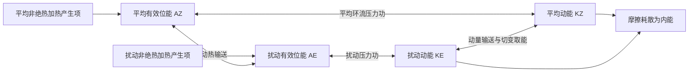

# 填空题：常考必备知识点

> 按本题型考察年份数降序排列；同频次依跨题型总频次、最近出现年份排序。频次不是2027年命题概率。补充题均置于历史考点之后，不计入真题频次。

[[牢三样/动力气象课后习题/常考必备知识点/00_总目录与统计口径|总目录与统计口径]] ｜ [[牢三样/动力气象课后习题/常考必备知识点/08_考纲覆盖与补充清单|77项考纲覆盖检查]]

## 历史考点速查

| 排名 | 考点 | 本题型年份数 | 全题型年份数 | 重点 |
|---:|---|---:|---:|---|
| 1 | [[#K-rainband 我国雨带季节活动|我国雨带季节活动]] | 5 | 9 | 重点 |
| 2 | [[#K-upperjet 高空急流|高空急流]] | 4 | 8 | 重点 |
| 3 | [[#K-size 天气系统水平尺度|天气系统水平尺度]] | 4 | 4 | 重点 |
| 4 | [[#K-block 阻塞高压|阻塞高压]] | 3 | 16 | 重点 |
| 5 | [[#K-tropopause 对流层顶|对流层顶]] | 3 | 3 | 重点 |
| 6 | [[#K-tcclimatology 热带气旋分布|热带气旋分布]] | 3 | 3 | 重点 |
| 7 | [[#K-pressureextreme 地面气压极值|地面气压极值]] | 3 | 3 | 重点 |
| 8 | [[#K-geo 地转风|地转风]] | 2 | 12 | — |
| 9 | [[#K-hadley 哈得莱环流|哈得莱环流]] | 2 | 8 | — |
| 10 | [[#K-thermal 热成风|热成风]] | 2 | 8 | — |
| 11 | [[#K-lowjet 低空急流|低空急流]] | 2 | 7 | — |
| 12 | [[#K-convective 中小尺度对流系统类型|中小尺度对流系统类型]] | 2 | 2 | — |
| 13 | [[#K-verticalscale 垂直速度尺度|垂直速度尺度]] | 2 | 2 | — |
| 14 | [[#K-cold 寒潮及其天气过程|寒潮及其天气过程]] | 1 | 17 | — |
| 15 | [[#K-meiyu 梅雨|梅雨]] | 1 | 13 | — |
| 16 | [[#K-monsoon 季风|季风]] | 1 | 12 | — |
| 17 | [[#K-squall 飑线|飑线]] | 1 | 7 | — |
| 18 | [[#K-ape 有效位能|有效位能]] | 1 | 6 | — |
| 19 | [[#K-plateau 青藏高原天气气候效应|青藏高原天气气候效应]] | 1 | 6 | — |
| 20 | [[#K-potunstable 位势不稳定|位势不稳定]] | 1 | 5 | — |
| 21 | [[#K-pbl 行星边界层|行星边界层]] | 1 | 4 | — |
| 22 | [[#K-mountainpv 气柱越山与位涡守恒应用|气柱越山与位涡守恒应用]] | 1 | 4 | — |
| 23 | [[#K-geopotential 位势与位势高度|位势与位势高度]] | 1 | 3 | — |
| 24 | [[#K-circulation 大气环流|大气环流]] | 1 | 3 | — |
| 25 | [[#K-tceye 台风眼|台风眼]] | 1 | 1 | — |
| 26 | [[#K-rainthreshold 暴雨等级阈值|暴雨等级阈值]] | 1 | 1 | — |
| 27 | [[#K-floodhistory 历史洪涝天气过程|历史洪涝天气过程]] | 1 | 1 | — |
| 28 | [[#K-tcenergy 热带气旋能量来源|热带气旋能量来源]] | 1 | 1 | — |
| 29 | [[#K-stormsurface 雷暴地面气象要素变化|雷暴地面气象要素变化]] | 1 | 1 | — |
| 30 | [[#K-qbo 准两年振荡|准两年振荡]] | 1 | 1 | — |
| 31 | [[#K-heights 等压面高度与高空天气图|等压面高度与高空天气图]] | 1 | 1 | — |
| 32 | [[#K-winddir 风向判定|风向判定]] | 1 | 1 | — |

## K-rainband 我国雨带季节活动

**本题型考察：5 次（5个年份）；全题型考察：9 次。**
**本题型：重点；跨题型：重点。**

本题型年份：1989、1990、1996、2001、2002。

### 原题问法与对应解答

> 按独立问法保留答案；同一多考点题可能在不同考点下交叉索引，这不增加年份频次。以下同时保留题目特有数据和条件，不能只背一个通用结论。

#### 问法 1

来源：[[牢三样/动力气象课后习题/试题解答/往年试题解析/1989#题目 1989-一-4|1989-一-4]]

**原题：**

长江流域梅雨发生时段为**6~7**月，华北雨季发生在**7~8**月。

**评级参考：** 难度：★☆☆☆☆（1/5）｜考试相关度：★★★★★（5/5）

**解答：**

**原记录填空值：** 6~7；7~8。下文核对其物理含义；出现修改意见时，以修改后的说明为准。

1. 西太平洋副热带高压是副热带地区深厚、暖性的反气旋系统。中层常用 500 hPa 高度场描述，其内部下沉、对流受抑制，西北侧及北侧暖湿气流与中纬度系统相遇，是重要雨带区。
2. 形成与副热带下沉、行星波、海陆热力差异及热带加热有关，不能单说成“海面冷所以形成冷高压”。暖性结构使高压在较高层更明显，但不同层中心、脊线并不完全重合。
3. 春季至初夏副高偏南，华南锋面和季风雨活跃；6 月前后第一次北跳后，长江中下游进入梅雨，传统脊线经验约为 20°—25°N。
4. 进一步北抬至约 25°—30°N，雨带向江淮、淮河流域推进；7 月下旬至 8 月上旬前后脊线可在 30°—35°N，雨带到华北、东北，长江中下游较易受高压控制出现伏旱。秋季副高南撤，雨带随之南退。
5. 除南北移动，还要考虑西伸东退、强度和滞留时间。副高西伸使水汽输送路径和落区改变，长期稳定可造成一侧持续暴雨、另一侧持续高温。上述纬度和日期是复习用经验，不是每年的硬界线。
6. 原题若把 25°—30°N 直接与华北盛夏雨季对应，应另起行纠正：通常华北盛夏雨季对应更北的 30°—35°N 阶段。

#### 问法 2

来源：[[牢三样/动力气象课后习题/试题解答/往年试题解析/1990#题目 1990-一-5|1990-一-5]]

**原题：**

东亚夏季副热带高压脊线处于 25 - 30°N 时，华北地区为**雨季/多雨**天气，长江中下游为**伏旱/高温少雨**天气，华南地区为**高温/热带气旋影响**天气。

**评级参考：** 难度：★☆☆☆☆（1/5）｜考试相关度：★★★★★（5/5）

**解答：**

**原记录填空值：** 雨季/多雨；伏旱/高温少雨；高温/热带气旋影响。下文核对其物理含义；出现修改意见时，以修改后的说明为准。

1. 西太平洋副热带高压是副热带地区深厚、暖性的反气旋系统。中层常用 500 hPa 高度场描述，其内部下沉、对流受抑制，西北侧及北侧暖湿气流与中纬度系统相遇，是重要雨带区。
2. 形成与副热带下沉、行星波、海陆热力差异及热带加热有关，不能单说成“海面冷所以形成冷高压”。暖性结构使高压在较高层更明显，但不同层中心、脊线并不完全重合。
3. 春季至初夏副高偏南，华南锋面和季风雨活跃；6 月前后第一次北跳后，长江中下游进入梅雨，传统脊线经验约为 20°—25°N。
4. 进一步北抬至约 25°—30°N，雨带向江淮、淮河流域推进；7 月下旬至 8 月上旬前后脊线可在 30°—35°N，雨带到华北、东北，长江中下游较易受高压控制出现伏旱。秋季副高南撤，雨带随之南退。
5. 除南北移动，还要考虑西伸东退、强度和滞留时间。副高西伸使水汽输送路径和落区改变，长期稳定可造成一侧持续暴雨、另一侧持续高温。上述纬度和日期是复习用经验，不是每年的硬界线。
6. 原题若把 25°—30°N 直接与华北盛夏雨季对应，应另起行纠正：通常华北盛夏雨季对应更北的 30°—35°N 阶段。

#### 问法 3

来源：[[牢三样/动力气象课后习题/试题解答/往年试题解析/1996#题目 1996-一-4|1996-一-4]]

**原题：**

每年夏季的**7月下旬至8月上旬**时期为我国华北地区雨季，这时副热带高压脊线位于**30~35**°N 之间，全长江流域则进入**伏旱**天气。

**评级参考：** 难度：★☆☆☆☆（1/5）｜考试相关度：★★★★★（5/5）

**解答：**

**原记录填空值：** 7月下旬至8月上旬；30~35；伏旱。下文核对其物理含义；出现修改意见时，以修改后的说明为准。

1. 西太平洋副热带高压是副热带地区深厚、暖性的反气旋系统。中层常用 500 hPa 高度场描述，其内部下沉、对流受抑制，西北侧及北侧暖湿气流与中纬度系统相遇，是重要雨带区。
2. 形成与副热带下沉、行星波、海陆热力差异及热带加热有关，不能单说成“海面冷所以形成冷高压”。暖性结构使高压在较高层更明显，但不同层中心、脊线并不完全重合。
3. 春季至初夏副高偏南，华南锋面和季风雨活跃；6 月前后第一次北跳后，长江中下游进入梅雨，传统脊线经验约为 20°—25°N。
4. 进一步北抬至约 25°—30°N，雨带向江淮、淮河流域推进；7 月下旬至 8 月上旬前后脊线可在 30°—35°N，雨带到华北、东北，长江中下游较易受高压控制出现伏旱。秋季副高南撤，雨带随之南退。
5. 除南北移动，还要考虑西伸东退、强度和滞留时间。副高西伸使水汽输送路径和落区改变，长期稳定可造成一侧持续暴雨、另一侧持续高温。上述纬度和日期是复习用经验，不是每年的硬界线。
6. 原题若把 25°—30°N 直接与华北盛夏雨季对应，应另起行纠正：通常华北盛夏雨季对应更北的 30°—35°N 阶段。

#### 问法 4

来源：[[牢三样/动力气象课后习题/试题解答/往年试题解析/2001#题目 2001-一-5|2001-一-5]]

**原题：**

我国夏季华南前汛期的时段是**4~6月**，长江流域梅雨时段则为**6月中旬至7月上旬**。

**评级参考：** 难度：★☆☆☆☆（1/5）｜考试相关度：★★★★★（5/5）

**解答：**

**原记录填空值：** 4~6月；6月中旬至7月上旬。下文核对其物理含义；出现修改意见时，以修改后的说明为准。

1. 西太平洋副热带高压是副热带地区深厚、暖性的反气旋系统。中层常用 500 hPa 高度场描述，其内部下沉、对流受抑制，西北侧及北侧暖湿气流与中纬度系统相遇，是重要雨带区。
2. 形成与副热带下沉、行星波、海陆热力差异及热带加热有关，不能单说成“海面冷所以形成冷高压”。暖性结构使高压在较高层更明显，但不同层中心、脊线并不完全重合。
3. 春季至初夏副高偏南，华南锋面和季风雨活跃；6 月前后第一次北跳后，长江中下游进入梅雨，传统脊线经验约为 20°—25°N。
4. 进一步北抬至约 25°—30°N，雨带向江淮、淮河流域推进；7 月下旬至 8 月上旬前后脊线可在 30°—35°N，雨带到华北、东北，长江中下游较易受高压控制出现伏旱。秋季副高南撤，雨带随之南退。
5. 除南北移动，还要考虑西伸东退、强度和滞留时间。副高西伸使水汽输送路径和落区改变，长期稳定可造成一侧持续暴雨、另一侧持续高温。上述纬度和日期是复习用经验，不是每年的硬界线。
6. 原题若把 25°—30°N 直接与华北盛夏雨季对应，应另起行纠正：通常华北盛夏雨季对应更北的 30°—35°N 阶段。

#### 问法 5

来源：[[牢三样/动力气象课后习题/试题解答/往年试题解析/2002#题目 2002-一-4|2002-一-4]]

**原题：**

江淮流域梅雨时段为**6月中旬至7月上旬**，这时副热带高压脊线大体在 **20~25** $ ^\circ \text{N} $；而华北雨季时，西太平洋副热带高压脊线大体在 **30~35** $ ^\circ \text{N} $。

**评级参考：** 难度：★☆☆☆☆（1/5）｜考试相关度：★★★★★（5/5）

**解答：**

**原记录填空值：** 6月中旬至7月上旬；20~25；30~35。下文核对其物理含义；出现修改意见时，以修改后的说明为准。

1. 西太平洋副热带高压是副热带地区深厚、暖性的反气旋系统。中层常用 500 hPa 高度场描述，其内部下沉、对流受抑制，西北侧及北侧暖湿气流与中纬度系统相遇，是重要雨带区。
2. 形成与副热带下沉、行星波、海陆热力差异及热带加热有关，不能单说成“海面冷所以形成冷高压”。暖性结构使高压在较高层更明显，但不同层中心、脊线并不完全重合。
3. 春季至初夏副高偏南，华南锋面和季风雨活跃；6 月前后第一次北跳后，长江中下游进入梅雨，传统脊线经验约为 20°—25°N。
4. 进一步北抬至约 25°—30°N，雨带向江淮、淮河流域推进；7 月下旬至 8 月上旬前后脊线可在 30°—35°N，雨带到华北、东北，长江中下游较易受高压控制出现伏旱。秋季副高南撤，雨带随之南退。
5. 除南北移动，还要考虑西伸东退、强度和滞留时间。副高西伸使水汽输送路径和落区改变，长期稳定可造成一侧持续暴雨、另一侧持续高温。上述纬度和日期是复习用经验，不是每年的硬界线。
6. 原题若把 25°—30°N 直接与华北盛夏雨季对应，应另起行纠正：通常华北盛夏雨季对应更北的 30°—35°N 阶段。

---

## K-upperjet 高空急流

**本题型考察：4 次（4个年份）；全题型考察：8 次。**
**本题型：重点；跨题型：重点。**

本题型年份：1990、1992、1997、2000。

### 原题问法与对应解答

> 按独立问法保留答案；同一多考点题可能在不同考点下交叉索引，这不增加年份频次。以下同时保留题目特有数据和条件，不能只背一个通用结论。

#### 问法 1

来源：[[牢三样/动力气象课后习题/试题解答/往年试题解析/1990#题目 1990-一-3|1990-一-3]]

**原题：**

假相当位温随高度减小时大气处于**对流不稳定**状态，东北低压对应的高空急流为**极锋急流**。

**评级参考：** 难度：★☆☆☆☆（1/5）｜考试相关度：★★★★★（5/5）

**解答：**

**原记录填空值：** 对流不稳定；极锋急流。下文核对其物理含义；出现修改意见时，以修改后的说明为准。

1. 干大气 $N^2=(g/\theta)d\theta/dz$。位温随高度增大为干静力稳定，等位温为中性，随高度减小为不稳定。这是对单个小气块竖直位移的判据。

2. 饱和上升时潜热释放使湿绝热直减率 $\Gamma_m<\Gamma_d$。若环境直减率满足 $\Gamma_m<\Gamma<\Gamma_d$，未饱和气块稳定而饱和气块不稳定，称条件不稳定。

3. 位势（对流）不稳定针对整层抬升：$d\theta_e/dz<0$（按教材也用假相当位温 $\theta_{se}$）时，抬升至饱和后低层更暖湿、释放更多潜热，整层可转为不稳定；位势稳定度可写成 $\partial\theta_e/\partial z$，在 $p$ 坐标符号相反。

4. 条件不稳定与位势不稳定并非同义，原题若写“条件（位势）不稳定”应分别说明。常见应用是雷暴：先由抬升克服抑制，气块达到自由对流高度后释放不稳定能量，并非有不稳定层结就必然立刻降雨。

1. 急流是狭长的强风带，横向和竖直风切变显著，急流轴是局地最大风速的位置。高空西风急流位于对流层上部，冬季更强、更偏南；夏季整体偏北、减弱。东亚日本附近冬季急流可很强，题中 70—80 m/s 是典型量级而非上限。

2. 极锋急流与中纬度锋区斜压性相联系；副热带急流还与低纬向极运动的角动量输送和热成风共同有关。强南北温度梯度通过热成风使西风随高度增强；不能只归因于地面风向上复制。

3. 急流入口、出口的加减速和曲率导致非地转次级环流，局部辐散有利于下方上升和气旋发展；简单直急流象限规则只在相应理想条件下适用。

#### 问法 2

来源：[[牢三样/动力气象课后习题/试题解答/往年试题解析/1990#题目 1990-一-4|1990-一-4]]

**原题：**

春季江淮气旋对应的高空急流为**副热带急流**。

**评级参考：** 难度：★☆☆☆☆（1/5）｜考试相关度：★★★★★（5/5）

**解答：**

**原记录填空值：** 副热带急流。下文核对其物理含义；出现修改意见时，以修改后的说明为准。

1. 急流是狭长的强风带，横向和竖直风切变显著，急流轴是局地最大风速的位置。高空西风急流位于对流层上部，冬季更强、更偏南；夏季整体偏北、减弱。东亚日本附近冬季急流可很强，题中 70—80 m/s 是典型量级而非上限。

2. 极锋急流与中纬度锋区斜压性相联系；副热带急流还与低纬向极运动的角动量输送和热成风共同有关。强南北温度梯度通过热成风使西风随高度增强；不能只归因于地面风向上复制。

3. 急流入口、出口的加减速和曲率导致非地转次级环流，局部辐散有利于下方上升和气旋发展；简单直急流象限规则只在相应理想条件下适用。

#### 问法 3

来源：[[牢三样/动力气象课后习题/试题解答/往年试题解析/1990#题目 1990-一-6|1990-一-6]]

**原题：**

冬季日本上空西风急流风速可达**70~80**m/s。

**评级参考：** 难度：★☆☆☆☆（1/5）｜考试相关度：★★★★★（5/5）

**解答：**

**原记录填空值：** 70~80。下文核对其物理含义；出现修改意见时，以修改后的说明为准。

1. 急流是狭长的强风带，横向和竖直风切变显著，急流轴是局地最大风速的位置。高空西风急流位于对流层上部，冬季更强、更偏南；夏季整体偏北、减弱。东亚日本附近冬季急流可很强，题中 70—80 m/s 是典型量级而非上限。

2. 极锋急流与中纬度锋区斜压性相联系；副热带急流还与低纬向极运动的角动量输送和热成风共同有关。强南北温度梯度通过热成风使西风随高度增强；不能只归因于地面风向上复制。

3. 急流入口、出口的加减速和曲率导致非地转次级环流，局部辐散有利于下方上升和气旋发展；简单直急流象限规则只在相应理想条件下适用。

#### 问法 4

来源：[[牢三样/动力气象课后习题/试题解答/往年试题解析/1992#题目 1992-一-2|1992-一-2]]

**原题：**

北半球冬季副热带急流大致稳定在**25~30**°N 之间，夏季则北移**5~10**个纬距，在流域北侧等中风场为**反气旋式**切变。

**评级参考：** 难度：★☆☆☆☆（1/5）｜考试相关度：★★★★★（5/5）

**解答：**

**原记录填空值：** 25~30；5~10；反气旋式。下文核对其物理含义；出现修改意见时，以修改后的说明为准。

1. 急流是狭长的强风带，横向和竖直风切变显著，急流轴是局地最大风速的位置。高空西风急流位于对流层上部，冬季更强、更偏南；夏季整体偏北、减弱。东亚日本附近冬季急流可很强，题中 70—80 m/s 是典型量级而非上限。

2. 极锋急流与中纬度锋区斜压性相联系；副热带急流还与低纬向极运动的角动量输送和热成风共同有关。强南北温度梯度通过热成风使西风随高度增强；不能只归因于地面风向上复制。

3. 急流入口、出口的加减速和曲率导致非地转次级环流，局部辐散有利于下方上升和气旋发展；简单直急流象限规则只在相应理想条件下适用。

**原填空修改意见：** 急流北侧通常为气旋性切变、南侧通常为反气旋性切变（北半球，取急流西风峰值的典型横向分布）。原记录“北侧为反气旋式切变”的表述疑似错误；由 $\zeta\approx-\partial u/\partial y$，北侧 $u_y<0$，所以 $\zeta>0$。

#### 问法 5

来源：[[牢三样/动力气象课后习题/试题解答/往年试题解析/1997#题目 1997-一-1|1997-一-1]]

**原题：**

冬季东亚副热带急流轴平均高度在**200hPa（约12km）**，在 130°E 日本上空风速最大可至**70~80** m/s。

**评级参考：** 难度：★☆☆☆☆（1/5）｜考试相关度：★★★★★（5/5）

**解答：**

**原记录填空值：** 200hPa（约12km）；70~80。下文核对其物理含义；出现修改意见时，以修改后的说明为准。

1. 急流是狭长的强风带，横向和竖直风切变显著，急流轴是局地最大风速的位置。高空西风急流位于对流层上部，冬季更强、更偏南；夏季整体偏北、减弱。东亚日本附近冬季急流可很强，题中 70—80 m/s 是典型量级而非上限。

2. 极锋急流与中纬度锋区斜压性相联系；副热带急流还与低纬向极运动的角动量输送和热成风共同有关。强南北温度梯度通过热成风使西风随高度增强；不能只归因于地面风向上复制。

3. 急流入口、出口的加减速和曲率导致非地转次级环流，局部辐散有利于下方上升和气旋发展；简单直急流象限规则只在相应理想条件下适用。

#### 问法 6

来源：[[牢三样/动力气象课后习题/试题解答/往年试题解析/2000#题目 2000-一-4|2000-一-4]]

**原题：**

冬季对流层顶高度一般为**9~12**公里，西风急流轴高度为**10~12**公里。

**评级参考：** 难度：★☆☆☆☆（1/5）｜考试相关度：★★★★★（5/5）

**解答：**

**原记录填空值：** 9~12；10~12。下文核对其物理含义；出现修改意见时，以修改后的说明为准。

1. 对流层顶是对流层与平流层间温度直减率显著变化的过渡位置，热带较高（约100 hPa量级），极地较低（约300 hPa量级），中纬冬季常在200—300 hPa附近；不能把气压数值叫“公里高度”。

1. 急流是狭长的强风带，横向和竖直风切变显著，急流轴是局地最大风速的位置。高空西风急流位于对流层上部，冬季更强、更偏南；夏季整体偏北、减弱。东亚日本附近冬季急流可很强，题中 70—80 m/s 是典型量级而非上限。

2. 极锋急流与中纬度锋区斜压性相联系；副热带急流还与低纬向极运动的角动量输送和热成风共同有关。强南北温度梯度通过热成风使西风随高度增强；不能只归因于地面风向上复制。

3. 急流入口、出口的加减速和曲率导致非地转次级环流，局部辐散有利于下方上升和气旋发展；简单直急流象限规则只在相应理想条件下适用。

---

## K-size 天气系统水平尺度

**本题型考察：4 次（4个年份）；全题型考察：4 次。**
**本题型：重点；跨题型：重点。**

本题型年份：1989、1990、1996、2003。

### 原题问法与对应解答

> 按独立问法保留答案；同一多考点题可能在不同考点下交叉索引，这不增加年份频次。以下同时保留题目特有数据和条件，不能只背一个通用结论。

#### 问法 1

来源：[[牢三样/动力气象课后习题/试题解答/往年试题解析/1989#题目 1989-一-2|1989-一-2]]

**原题：**

气旋的平均直径为**1000~2000**公里，台风平均直径为**500~1000**公里，西南涡的平均直径为**200~500**公里。

**评级参考：** 难度：★☆☆☆☆（1/5）｜考试相关度：★★★★★（5/5）

**解答：**

**原记录填空值：** 1000~2000；500~1000；200~500。下文核对其物理含义；出现修改意见时，以修改后的说明为准。

1. 常用尺度分类：中α约 200—2000 km，中β约 20—200 km，中γ约 2—20 km；天气尺度温带气旋约千公里，台风约数百公里，西南涡约数百公里，龙卷常几十至几百米。这些是典型范围，系统边界和平均口径不同会有差异。

#### 问法 2

来源：[[牢三样/动力气象课后习题/试题解答/往年试题解析/1990#题目 1990-一-1|1990-一-1]]

**原题：**

中-α 尺度天气系统的尺度为**200~2000**公里。中-β 尺度则为**20~200**公里左右。中-γ 尺度系统的尺度一般为**2~20**公里左右。

**评级参考：** 难度：★☆☆☆☆（1/5）｜考试相关度：★★★★★（5/5）

**解答：**

**原记录填空值：** 200~2000；20~200；2~20。下文核对其物理含义；出现修改意见时，以修改后的说明为准。

1. 常用尺度分类：中α约 200—2000 km，中β约 20—200 km，中γ约 2—20 km；天气尺度温带气旋约千公里，台风约数百公里，西南涡约数百公里，龙卷常几十至几百米。这些是典型范围，系统边界和平均口径不同会有差异。

#### 问法 3

来源：[[牢三样/动力气象课后习题/试题解答/往年试题解析/1996#题目 1996-一-1|1996-一-1]]

**原题：**

中尺度系统的尺度一般在**几十到几百**公里之间，其中 $\alpha$ 尺度系统为**200~2000**公里左右。

**评级参考：** 难度：★☆☆☆☆（1/5）｜考试相关度：★★★★★（5/5）

**解答：**

**原记录填空值：** 几十到几百；200~2000。下文核对其物理含义；出现修改意见时，以修改后的说明为准。

1. 常用尺度分类：中α约 200—2000 km，中β约 20—200 km，中γ约 2—20 km；天气尺度温带气旋约千公里，台风约数百公里，西南涡约数百公里，龙卷常几十至几百米。这些是典型范围，系统边界和平均口径不同会有差异。

#### 问法 4

来源：[[牢三样/动力气象课后习题/试题解答/往年试题解析/2003#题目 2003-一-1|2003-一-1]]

**原题：**

说出以下系统的水平尺度：超长波**>10000km**，副热带高压**3000~5000km**，台风**500~1000km**，以及龙卷风**<1km（数十米至数百米）**。

**评级参考：** 难度：★☆☆☆☆（1/5）｜考试相关度：★★★★★（5/5）

**解答：**

**原记录填空值：** >10000km；3000~5000km；500~1000km；<1km（数十米至数百米）。下文核对其物理含义；出现修改意见时，以修改后的说明为准。

1. 常用尺度分类：中α约 200—2000 km，中β约 20—200 km，中γ约 2—20 km；天气尺度温带气旋约千公里，台风约数百公里，西南涡约数百公里，龙卷常几十至几百米。这些是典型范围，系统边界和平均口径不同会有差异。

---

## K-block 阻塞高压

**本题型考察：3 次（3个年份）；全题型考察：16 次。**
**本题型：重点；跨题型：重点。**

本题型年份：1992、1998、2000。

### 原题问法与对应解答

> 按独立问法保留答案；同一多考点题可能在不同考点下交叉索引，这不增加年份频次。以下同时保留题目特有数据和条件，不能只背一个通用结论。

#### 问法 1

来源：[[牢三样/动力气象课后习题/试题解答/往年试题解析/1992#题目 1992-一-1|1992-一-1]]、[[牢三样/动力气象课后习题/试题解答/往年试题解析/1998#题目 1998-一-3|1998-一-3]]

**原题：**

北半球冬季阻塞高压最常出现的地区是**乌拉尔山地区**、**鄂霍次克海地区**、**北大西洋东部**。

**原题：**

北半球冬季最易出现阻塞高压的地区为**乌拉尔山地区**、**鄂霍次克海地区**和**北大西洋东部**。

**评级参考：** 难度：★☆☆☆☆（1/5）｜考试相关度：★★★★★（5/5）

**解答：**

**原记录填空值：** 乌拉尔山地区；鄂霍次克海地区；北大西洋东部。下文核对其物理含义；出现修改意见时，以修改后的说明为准。

1. 阻塞高压是中高纬持续、移动缓慢的强高压脊或闭合高压，使西风气流绕行、分支，阻碍天气系统正常东移。关键是持续性和对西风带的阻挡，并非所有高压都叫阻塞。
2. 建立时，暖空气向极地输送使脊增强，经向振幅增大，波破碎、涡旋反馈可帮助维持。高压脊发展或与高纬高压合并，南侧可切出冷低压，形成偶极或Ω型等配置。
3. 维持时，阻高东侧偏北气流引导冷空气南下，西侧偏南气流输送暖空气。下游槽及冷暖空气交汇区可长期停留，造成持久冷凉、降雨；高压控制区下沉、少云，可造成干旱和高温，具体依季节和位置。
4. 衰退或崩溃时，维持高压的暖输送与涡旋反馈减弱，西风恢复，槽脊重新东移；其东侧积聚的冷空气可配合横槽转竖大举南下，触发我国寒潮。不能把每一次阻高衰退都等同于寒潮，仍需冷空气强度和路径配合。
5. 亚洲常关注乌拉尔山及鄂霍次克海等阻塞区，北大西洋—欧洲也是重要活动区；不同季节的优势位置不同，不应把某一季节经验说成全年固定不变。
6. 切断低压是从西风主槽分离出的闭合冷性低压，移动缓慢，可与北侧阻高配合。其冷空气及正涡度有利于下游不稳定和上升，但天气还依水汽供应。

#### 问法 2

来源：[[牢三样/动力气象课后习题/试题解答/往年试题解析/2000#题目 2000-一-2|2000-一-2]]

**原题：**

北半球冬季阻塞高压的高频发生区有**乌拉尔山地区**、**鄂霍次克海地区**和**北大西洋东部（欧洲西海岸）**。

**评级参考：** 难度：★☆☆☆☆（1/5）｜考试相关度：★★★★★（5/5）

**解答：**

**原记录填空值：** 乌拉尔山地区；鄂霍次克海地区；北大西洋东部（欧洲西海岸）。下文核对其物理含义；出现修改意见时，以修改后的说明为准。

1. 阻塞高压是中高纬持续、移动缓慢的强高压脊或闭合高压，使西风气流绕行、分支，阻碍天气系统正常东移。关键是持续性和对西风带的阻挡，并非所有高压都叫阻塞。
2. 建立时，暖空气向极地输送使脊增强，经向振幅增大，波破碎、涡旋反馈可帮助维持。高压脊发展或与高纬高压合并，南侧可切出冷低压，形成偶极或Ω型等配置。
3. 维持时，阻高东侧偏北气流引导冷空气南下，西侧偏南气流输送暖空气。下游槽及冷暖空气交汇区可长期停留，造成持久冷凉、降雨；高压控制区下沉、少云，可造成干旱和高温，具体依季节和位置。
4. 衰退或崩溃时，维持高压的暖输送与涡旋反馈减弱，西风恢复，槽脊重新东移；其东侧积聚的冷空气可配合横槽转竖大举南下，触发我国寒潮。不能把每一次阻高衰退都等同于寒潮，仍需冷空气强度和路径配合。
5. 亚洲常关注乌拉尔山及鄂霍次克海等阻塞区，北大西洋—欧洲也是重要活动区；不同季节的优势位置不同，不应把某一季节经验说成全年固定不变。
6. 切断低压是从西风主槽分离出的闭合冷性低压，移动缓慢，可与北侧阻高配合。其冷空气及正涡度有利于下游不稳定和上升，但天气还依水汽供应。

---

## K-tropopause 对流层顶

**本题型考察：3 次（3个年份）；全题型考察：3 次。**
**本题型：重点；跨题型：重点。**

本题型年份：1990、2000、2002。

### 原题问法与对应解答

> 按独立问法保留答案；同一多考点题可能在不同考点下交叉索引，这不增加年份频次。以下同时保留题目特有数据和条件，不能只背一个通用结论。

#### 问法 1

来源：[[牢三样/动力气象课后习题/试题解答/往年试题解析/1990#题目 1990-一-2|1990-一-2]]

**原题：**

冬季中纬度地区对流层顶高度一般为**200~300**百帕左右。

**评级参考：** 难度：★☆☆☆☆（1/5）｜考试相关度：★★★★★（5/5）

**解答：**

**原记录填空值：** 200~300。下文核对其物理含义；出现修改意见时，以修改后的说明为准。

1. 对流层顶是对流层与平流层间温度直减率显著变化的过渡位置，热带较高（约100 hPa量级），极地较低（约300 hPa量级），中纬冬季常在200—300 hPa附近；不能把气压数值叫“公里高度”。

#### 问法 2

来源：[[牢三样/动力气象课后习题/试题解答/往年试题解析/2000#题目 2000-一-4|2000-一-4]]

**原题：**

冬季对流层顶高度一般为**9~12**公里，西风急流轴高度为**10~12**公里。

**评级参考：** 难度：★☆☆☆☆（1/5）｜考试相关度：★★★★★（5/5）

**解答：**

**原记录填空值：** 9~12；10~12。下文核对其物理含义；出现修改意见时，以修改后的说明为准。

1. 对流层顶是对流层与平流层间温度直减率显著变化的过渡位置，热带较高（约100 hPa量级），极地较低（约300 hPa量级），中纬冬季常在200—300 hPa附近；不能把气压数值叫“公里高度”。

1. 急流是狭长的强风带，横向和竖直风切变显著，急流轴是局地最大风速的位置。高空西风急流位于对流层上部，冬季更强、更偏南；夏季整体偏北、减弱。东亚日本附近冬季急流可很强，题中 70—80 m/s 是典型量级而非上限。

2. 极锋急流与中纬度锋区斜压性相联系；副热带急流还与低纬向极运动的角动量输送和热成风共同有关。强南北温度梯度通过热成风使西风随高度增强；不能只归因于地面风向上复制。

3. 急流入口、出口的加减速和曲率导致非地转次级环流，局部辐散有利于下方上升和气旋发展；简单直急流象限规则只在相应理想条件下适用。

#### 问法 3

来源：[[牢三样/动力气象课后习题/试题解答/往年试题解析/2002#题目 2002-一-3|2002-一-3]]

**原题：**

热带对流层顶高度大致为 **100** hPa，而在极地则为 **300** hPa。

**评级参考：** 难度：★☆☆☆☆（1/5）｜考试相关度：★★★★★（5/5）

**解答：**

**原记录填空值：** 100；300。下文核对其物理含义；出现修改意见时，以修改后的说明为准。

1. 对流层顶是对流层与平流层间温度直减率显著变化的过渡位置，热带较高（约100 hPa量级），极地较低（约300 hPa量级），中纬冬季常在200—300 hPa附近；不能把气压数值叫“公里高度”。

---

## K-tcclimatology 热带气旋分布

**本题型考察：3 次（3个年份）；全题型考察：3 次。**
**本题型：重点；跨题型：重点。**

本题型年份：1996、1997、2001。

### 原题问法与对应解答

> 按独立问法保留答案；同一多考点题可能在不同考点下交叉索引，这不增加年份频次。以下同时保留题目特有数据和条件，不能只背一个通用结论。

#### 问法 1

来源：[[牢三样/动力气象课后习题/试题解答/往年试题解析/1996#题目 1996-一-5|1996-一-5]]

**原题：**

台风发生的最大频率区为**西北太平洋**区。台风大多数发生在**5~20**纬带之间。

**评级参考：** 难度：★☆☆☆☆（1/5）｜考试相关度：★★★★★（5/5）

**解答：**

**原记录填空值：** 西北太平洋；5~20。下文核对其物理含义；出现修改意见时，以修改后的说明为准。

1. **分布。** 西北太平洋活动频繁，多在离赤道一定距离的热带海洋生成。阿拉伯海会发生热带气旋；不能因那里不使用“台风”这一地区名称，就说没有该类系统。南大西洋很少发生但并非绝对不发生，赤道附近通常不利于生成。

#### 问法 2

来源：[[牢三样/动力气象课后习题/试题解答/往年试题解析/1997#题目 1997-一-3|1997-一-3]]

**原题：**

全球台风发生频率以**西北太平洋**最高，而**南大西洋**、**东南太平洋**和**北印度洋（阿拉伯海）**地区则无台风发生。

**评级参考：** 难度：★☆☆☆☆（1/5）｜考试相关度：★★★★★（5/5）

**解答：**

**原记录填空值：** 西北太平洋；南大西洋；东南太平洋；北印度洋（阿拉伯海）。下文核对其物理含义；出现修改意见时，以修改后的说明为准。

1. **分布。** 西北太平洋活动频繁，多在离赤道一定距离的热带海洋生成。阿拉伯海会发生热带气旋；不能因那里不使用“台风”这一地区名称，就说没有该类系统。南大西洋很少发生但并非绝对不发生，赤道附近通常不利于生成。

#### 问法 3

来源：[[牢三样/动力气象课后习题/试题解答/往年试题解析/2001#题目 2001-一-3|2001-一-3]]

**原题：**

台风大多发生在南、北半球的**5~20**纬带之间。

**评级参考：** 难度：★☆☆☆☆（1/5）｜考试相关度：★★★★★（5/5）

**解答：**

**原记录填空值：** 5~20。下文核对其物理含义；出现修改意见时，以修改后的说明为准。

1. **分布。** 西北太平洋活动频繁，多在离赤道一定距离的热带海洋生成。阿拉伯海会发生热带气旋；不能因那里不使用“台风”这一地区名称，就说没有该类系统。南大西洋很少发生但并非绝对不发生，赤道附近通常不利于生成。

---

## K-pressureextreme 地面气压极值

**本题型考察：3 次（3个年份）；全题型考察：3 次。**
**本题型：重点；跨题型：重点。**

本题型年份：1992、1998、2000。

### 原题问法与对应解答

> 按独立问法保留答案；同一多考点题可能在不同考点下交叉索引，这不增加年份频次。以下同时保留题目特有数据和条件，不能只背一个通用结论。

#### 问法 1

来源：[[牢三样/动力气象课后习题/试题解答/往年试题解析/1992#题目 1992-一-3|1992-一-3]]

**原题：**

夏季台风中心气压可低至**900**百帕以下，而冬季大陆冷高压可达**1060**百帕以上。

**评级参考：** 难度：★☆☆☆☆（1/5）｜考试相关度：★★★★★（5/5）

**解答：**

**原记录填空值：** 900；1060。下文核对其物理含义；出现修改意见时，以修改后的说明为准。

1. 强大陆冷高压可达到1060 hPa甚至更高，强热带气旋中心可低于950 hPa、极强个例低于900 hPa；这些是强事件量级，不是“所有寒潮或台风的一般气压”。原文给出的极值范围不应当作气候平均。

#### 问法 2

来源：[[牢三样/动力气象课后习题/试题解答/往年试题解析/1998#题目 1998-一-1|1998-一-1]]、[[牢三样/动力气象课后习题/试题解答/往年试题解析/2000#题目 2000-一-1|2000-一-1]]

**原题：**

冬季，东亚寒潮活动时，地面气压中心大致为**1060~1080** hPa，而夏季台风中心的地面气压则下降至**900~950** hPa 左右。

**原题：**

冬季与寒潮相联系的冷高压中心一般高达**1060~1080** hPa；而台风中心气压可低至**900~950** hPa。

**评级参考：** 难度：★☆☆☆☆（1/5）｜考试相关度：★★★★★（5/5）

**解答：**

**原记录填空值：** 1060~1080；900~950。下文核对其物理含义；出现修改意见时，以修改后的说明为准。

1. 强大陆冷高压可达到1060 hPa甚至更高，强热带气旋中心可低于950 hPa、极强个例低于900 hPa；这些是强事件量级，不是“所有寒潮或台风的一般气压”。原文给出的极值范围不应当作气候平均。

---

## K-geo 地转风

**本题型考察：2 次（2个年份）；全题型考察：12 次。**
**本题型：一般；跨题型：重点。**

本题型年份：1994、2001。

### 原题问法与对应解答

> 按独立问法保留答案；同一多考点题可能在不同考点下交叉索引，这不增加年份频次。以下同时保留题目特有数据和条件，不能只背一个通用结论。

#### 问法 1

来源：[[牢三样/动力气象课后习题/试题解答/往年试题解析/1994#题目 1994-一-2|1994-一-2]]

**原题：**

地转风是指水平运动中**气压梯度**力与**科里奥利（地转偏向）**力相互平衡的运动，地转风与**等高**线平行，热成风与**等温**线平行。

**评级参考：** 难度：★☆☆☆☆（1/5）｜考试相关度：★★★★★（5/5）

**解答：**

**原记录填空值：** 气压梯度；科里奥利（地转偏向）；等高；等温。下文核对其物理含义；出现修改意见时，以修改后的说明为准。

1. 在局地直角坐标中，忽略摩擦时水平动量方程为 $Du/Dt-fv=-\Phi_x$、$Dv/Dt+fu=-\Phi_y$，这里的导数取在等压面上。
2. 对中纬度大尺度缓变运动，$Ro=U/(fL)\ll1$，惯性项相对较小，得到 $-fv_g=-\Phi_x$、$fu_g=-\Phi_y$。
3. 解得 $\boxed{u_g=-\Phi_y/f,\quad v_g=\Phi_x/f}$，即 $\mathbf V_g=\mathbf k\times\nabla_p\Phi/f$；大小为 $|\nabla_p\Phi|/|f|$。
4. 因叉积垂直于梯度，地转风平行于等高线；北半球背风而立时低值在左、高值在右，南半球相反。等高线越密风越强，但还受纬度 $f$ 影响。
5. 近赤道 $f\to0$、摩擦层、强曲率或快速变化的小尺度系统中不能直接采用地转近似。等高面上应改用 $\nabla_zp/\rho$，不要把两种坐标的梯度混用。

1. 热成风是两个高度或等压面之间的**地转风差**，不是独立的一股实际风。
2. 静力关系给出 $\Phi_{\ln p}=-RT$。对 $u_g=-\Phi_y/f$、$v_g=\Phi_x/f$ 分别作 $\ln p$ 导数（局地取 $f$ 固定），得
$$\frac{\partial u_g}{\partial\ln p}=\frac RfT_y,\qquad \frac{\partial v_g}{\partial\ln p}=-\frac RfT_x.$$
3. 从下层 $p_b$ 积到上层 $p_t<p_b$，若用对数气压平均温度 $\bar T$，则 $u_t-u_b=-(R/f)\ln(p_b/p_t)\bar T_y$、$v_t-v_b=(R/f)\ln(p_b/p_t)\bar T_x$。
4. 北半球向上的热成风沿平均等温线，冷空气在其左侧。温度向北降低时，西风一般随高度增强。该关系把水平温度梯度和垂直风切变连接起来。

#### 问法 2

来源：[[牢三样/动力气象课后习题/试题解答/往年试题解析/2001#题目 2001-一-1|2001-一-1]]

**原题：**

地转风原理是基于**气压梯度**力与**地转偏向（科里奥利）**力相平衡基础上的，它在**近赤道地区**、**摩擦层**等情况下不再适用。

**评级参考：** 难度：★☆☆☆☆（1/5）｜考试相关度：★★★★★（5/5）

**解答：**

**原记录填空值：** 气压梯度；地转偏向（科里奥利）；近赤道地区；摩擦层。下文核对其物理含义；出现修改意见时，以修改后的说明为准。

1. 在局地直角坐标中，忽略摩擦时水平动量方程为 $Du/Dt-fv=-\Phi_x$、$Dv/Dt+fu=-\Phi_y$，这里的导数取在等压面上。
2. 对中纬度大尺度缓变运动，$Ro=U/(fL)\ll1$，惯性项相对较小，得到 $-fv_g=-\Phi_x$、$fu_g=-\Phi_y$。
3. 解得 $\boxed{u_g=-\Phi_y/f,\quad v_g=\Phi_x/f}$，即 $\mathbf V_g=\mathbf k\times\nabla_p\Phi/f$；大小为 $|\nabla_p\Phi|/|f|$。
4. 因叉积垂直于梯度，地转风平行于等高线；北半球背风而立时低值在左、高值在右，南半球相反。等高线越密风越强，但还受纬度 $f$ 影响。
5. 近赤道 $f\to0$、摩擦层、强曲率或快速变化的小尺度系统中不能直接采用地转近似。等高面上应改用 $\nabla_zp/\rho$，不要把两种坐标的梯度混用。

---

## K-hadley 哈得莱环流

**本题型考察：2 次（2个年份）；全题型考察：8 次。**
**本题型：一般；跨题型：重点。**

本题型年份：1994、2003。

### 原题问法与对应解答

> 按独立问法保留答案；同一多考点题可能在不同考点下交叉索引，这不增加年份频次。以下同时保留题目特有数据和条件，不能只背一个通用结论。

#### 问法 1

来源：[[牢三样/动力气象课后习题/试题解答/往年试题解析/1994#题目 1994-一-5|1994-一-5]]

**原题：**

全球大气平均经圈环流图上，位于低纬的环流圈的上升支在赤道附近的**热带辐合带（ITCZ）**，而下沉支在**副热带（30°N/S附近）**。

**评级参考：** 难度：★☆☆☆☆（1/5）｜考试相关度：★★★★★（5/5）

**解答：**

**原记录填空值：** 热带辐合带（ITCZ）；副热带（30°N/S附近）。下文核对其物理含义；出现修改意见时，以修改后的说明为准。

1. 平均经圈环流中，哈得莱环流低纬上升、副热带下沉，近地面回流形成信风，属于热力直接环流；费雷尔环流在中纬度、平均上热力间接，依赖天气涡旋维持；极地环流较弱。三圈是统计平均，非每个经度同时存在三个封闭圈。

#### 问法 2

来源：[[牢三样/动力气象课后习题/试题解答/往年试题解析/2003#题目 2003-一-2|2003-一-2]]

**原题：**

大气的平均经圈环流中，在低纬度的为**Hadley（哈得来）**环流，中纬度的则为**Ferrel（费雷尔）**环流。

**评级参考：** 难度：★☆☆☆☆（1/5）｜考试相关度：★★★★★（5/5）

**解答：**

**原记录填空值：** Hadley（哈得来）；Ferrel（费雷尔）。下文核对其物理含义；出现修改意见时，以修改后的说明为准。

1. 平均经圈环流中，哈得莱环流低纬上升、副热带下沉，近地面回流形成信风，属于热力直接环流；费雷尔环流在中纬度、平均上热力间接，依赖天气涡旋维持；极地环流较弱。三圈是统计平均，非每个经度同时存在三个封闭圈。

---

## K-thermal 热成风

**本题型考察：2 次（2个年份）；全题型考察：8 次。**
**本题型：一般；跨题型：重点。**

本题型年份：1994、1996。

### 原题问法与对应解答

> 按独立问法保留答案；同一多考点题可能在不同考点下交叉索引，这不增加年份频次。以下同时保留题目特有数据和条件，不能只背一个通用结论。

#### 问法 1

来源：[[牢三样/动力气象课后习题/试题解答/往年试题解析/1994#题目 1994-一-2|1994-一-2]]

**原题：**

地转风是指水平运动中**气压梯度**力与**科里奥利（地转偏向）**力相互平衡的运动，地转风与**等高**线平行，热成风与**等温**线平行。

**评级参考：** 难度：★☆☆☆☆（1/5）｜考试相关度：★★★★★（5/5）

**解答：**

**原记录填空值：** 气压梯度；科里奥利（地转偏向）；等高；等温。下文核对其物理含义；出现修改意见时，以修改后的说明为准。

1. 在局地直角坐标中，忽略摩擦时水平动量方程为 $Du/Dt-fv=-\Phi_x$、$Dv/Dt+fu=-\Phi_y$，这里的导数取在等压面上。
2. 对中纬度大尺度缓变运动，$Ro=U/(fL)\ll1$，惯性项相对较小，得到 $-fv_g=-\Phi_x$、$fu_g=-\Phi_y$。
3. 解得 $\boxed{u_g=-\Phi_y/f,\quad v_g=\Phi_x/f}$，即 $\mathbf V_g=\mathbf k\times\nabla_p\Phi/f$；大小为 $|\nabla_p\Phi|/|f|$。
4. 因叉积垂直于梯度，地转风平行于等高线；北半球背风而立时低值在左、高值在右，南半球相反。等高线越密风越强，但还受纬度 $f$ 影响。
5. 近赤道 $f\to0$、摩擦层、强曲率或快速变化的小尺度系统中不能直接采用地转近似。等高面上应改用 $\nabla_zp/\rho$，不要把两种坐标的梯度混用。

1. 热成风是两个高度或等压面之间的**地转风差**，不是独立的一股实际风。
2. 静力关系给出 $\Phi_{\ln p}=-RT$。对 $u_g=-\Phi_y/f$、$v_g=\Phi_x/f$ 分别作 $\ln p$ 导数（局地取 $f$ 固定），得
$$\frac{\partial u_g}{\partial\ln p}=\frac RfT_y,\qquad \frac{\partial v_g}{\partial\ln p}=-\frac RfT_x.$$
3. 从下层 $p_b$ 积到上层 $p_t<p_b$，若用对数气压平均温度 $\bar T$，则 $u_t-u_b=-(R/f)\ln(p_b/p_t)\bar T_y$、$v_t-v_b=(R/f)\ln(p_b/p_t)\bar T_x$。
4. 北半球向上的热成风沿平均等温线，冷空气在其左侧。温度向北降低时，西风一般随高度增强。该关系把水平温度梯度和垂直风切变连接起来。

#### 问法 2

来源：[[牢三样/动力气象课后习题/试题解答/往年试题解析/1996#题目 1996-一-3|1996-一-3]]

**原题：**

热成风的风向与等压面上的**等温**线平行。

**评级参考：** 难度：★☆☆☆☆（1/5）｜考试相关度：★★★★★（5/5）

**解答：**

**原记录填空值：** 等温。下文核对其物理含义；出现修改意见时，以修改后的说明为准。

1. 热成风是两个高度或等压面之间的**地转风差**，不是独立的一股实际风。
2. 静力关系给出 $\Phi_{\ln p}=-RT$。对 $u_g=-\Phi_y/f$、$v_g=\Phi_x/f$ 分别作 $\ln p$ 导数（局地取 $f$ 固定），得
$$\frac{\partial u_g}{\partial\ln p}=\frac RfT_y,\qquad \frac{\partial v_g}{\partial\ln p}=-\frac RfT_x.$$
3. 从下层 $p_b$ 积到上层 $p_t<p_b$，若用对数气压平均温度 $\bar T$，则 $u_t-u_b=-(R/f)\ln(p_b/p_t)\bar T_y$、$v_t-v_b=(R/f)\ln(p_b/p_t)\bar T_x$。
4. 北半球向上的热成风沿平均等温线，冷空气在其左侧。温度向北降低时，西风一般随高度增强。该关系把水平温度梯度和垂直风切变连接起来。

---

## K-lowjet 低空急流

**本题型考察：2 次（2个年份）；全题型考察：7 次。**
**本题型：一般；跨题型：重点。**

本题型年份：1997、1999。

### 原题问法与对应解答

> 按独立问法保留答案；同一多考点题可能在不同考点下交叉索引，这不增加年份频次。以下同时保留题目特有数据和条件，不能只背一个通用结论。

#### 问法 1

来源：[[牢三样/动力气象课后习题/试题解答/往年试题解析/1997#题目 1997-一-2|1997-一-2]]

**原题：**

夏季东亚地区低空急流轴高度一般在 **850~700 hPa**，风速约为**12~15** m/s，它对**暴雨**天气影响。

**评级参考：** 难度：★☆☆☆☆（1/5）｜考试相关度：★★★★★（5/5）

**解答：**

**原记录填空值：** 850~700 hPa；12~15；暴雨。下文核对其物理含义；出现修改意见时，以修改后的说明为准。

1. 低空急流是对流层低层的局地风速极大带，东亚夏季常在 850—700 hPa 附近，题中的 12 m/s 或 12—15 m/s 属常用识别量级，具体标准随研究变化。

2. 形成机制包括大尺度压力梯度加强、地形通道和山坡热力差异；夜间地表稳定化削弱摩擦，残余风发生惯性振荡，也可产生夜间风速极大。不同类型低空急流机制并不相同。

3. 低空急流输送暖湿空气，出口附近或与锋、切变线相交处辐合，利于不稳定能量和水汽积聚、暴雨触发；对流加热也可反过来加强低层压力梯度及急流。

#### 问法 2

来源：[[牢三样/动力气象课后习题/试题解答/往年试题解析/1999#题目 1999-一-4|1999-一-4]]

**原题：**

我国大陆上夏季低空急流一般高度为**850~700**hPa 左右，风速为**12**m/s 以上。

**评级参考：** 难度：★☆☆☆☆（1/5）｜考试相关度：★★★★★（5/5）

**解答：**

**原记录填空值：** 850~700；12。下文核对其物理含义；出现修改意见时，以修改后的说明为准。

1. 低空急流是对流层低层的局地风速极大带，东亚夏季常在 850—700 hPa 附近，题中的 12 m/s 或 12—15 m/s 属常用识别量级，具体标准随研究变化。

2. 形成机制包括大尺度压力梯度加强、地形通道和山坡热力差异；夜间地表稳定化削弱摩擦，残余风发生惯性振荡，也可产生夜间风速极大。不同类型低空急流机制并不相同。

3. 低空急流输送暖湿空气，出口附近或与锋、切变线相交处辐合，利于不稳定能量和水汽积聚、暴雨触发；对流加热也可反过来加强低层压力梯度及急流。

---

## K-convective 中小尺度对流系统类型

**本题型考察：2 次（2个年份）；全题型考察：2 次。**
**本题型：一般；跨题型：一般。**

本题型年份：1994、2002。

### 原题问法与对应解答

> 按独立问法保留答案；同一多考点题可能在不同考点下交叉索引，这不增加年份频次。以下同时保留题目特有数据和条件，不能只背一个通用结论。

#### 问法 1

来源：[[牢三样/动力气象课后习题/试题解答/往年试题解析/1994#题目 1994-一-3|1994-一-3]]、[[牢三样/动力气象课后习题/试题解答/往年试题解析/2002#题目 2002-一-1|2002-一-1]]

**原题：**

与强对流活动有关的中尺度天气有**飑线**、**雷暴**、**冰雹/龙卷**等。

**原题：**

中尺度对流性天气有**飑线**、**雷暴**、**冰雹/龙卷**等。

**评级参考：** 难度：★☆☆☆☆（1/5）｜考试相关度：★★★★☆（4/5）

**解答：**

**原记录填空值：** 飑线；雷暴；冰雹/龙卷。下文核对其物理含义；出现修改意见时，以修改后的说明为准。

1. **环境条件。** 低层暖湿、具有可释放的不稳定能量，锋面/辐合线/地形等提供抬升；适宜的垂直风切变使上升和下沉气流分离，支持较长寿命。强切变有助组织化，但不能取代水汽和浮力。

2. **组织类型。** 多单体风暴由不同生命阶段单体组成，冷池边界不断触发新单体，整体比单个单体活得久；超级单体的识别核心是深厚、持续旋转的上升气流（中气旋），不是单纯雨量最大。[NWS 超级单体说明](https://www.weather.gov/ama/supercell)

3. 飑线是沿线状排列并组织成系统的强对流，前缘辐合与冷池推进触发新生对流，可有后部层状降水。过站时常风向突变、阵风增强、温度骤降、气压骤升，伴雷雨、冰雹等；地面升压主要与冷池密度增加及动力作用有关。

---

## K-verticalscale 垂直速度尺度

**本题型考察：2 次（2个年份）；全题型考察：2 次。**
**本题型：一般；跨题型：一般。**

本题型年份：1998、2002。

### 原题问法与对应解答

> 按独立问法保留答案；同一多考点题可能在不同考点下交叉索引，这不增加年份频次。以下同时保留题目特有数据和条件，不能只背一个通用结论。

#### 问法 1

来源：[[牢三样/动力气象课后习题/试题解答/往年试题解析/1998#题目 1998-一-2|1998-一-2]]

**原题：**

天气尺度系统中垂直速度量级一般为**几hPa/h**（或用 **1~10 cm/s**）；而在中尺度对流系统中，垂直速度可达**几十hPa/h**（或用 **1~10 m/s**）。

**评级参考：** 难度：★☆☆☆☆（1/5）｜考试相关度：★★★★☆（4/5）

**解答：**

**原记录填空值：** 几hPa/h；1~10 cm/s；几十hPa/h；1~10 m/s。下文核对其物理含义；出现修改意见时，以修改后的说明为准。

1. 连续方程估算 $W/H\sim D$。一般辐散流 $D\sim U/L$，故 $W\sim UH/L$；准地转运动地转部分近无辐散，实际 $D$ 更小，$W$ 也更小。天气尺度 $w$ 常为厘米每秒量级，对流上升可达米每秒甚至更高。

**单位核对：** $\omega\approx-\rho gw$。取 $\rho=1\ \mathrm{kg\,m^{-3}}$，$w=1\ \mathrm{m/s}$ 对应 $|\omega|\approx353\ \mathrm{hPa/h}$。所以原题把“几十hPa/h”与“1—10 m/s”并列成等价量级不一致；还应说明密度随高度变化。

#### 问法 2

来源：[[牢三样/动力气象课后习题/试题解答/往年试题解析/2002#题目 2002-一-2|2002-一-2]]

**原题：**

行星尺度系统中，散度的量级大致为 **$10^{-6}$** $ s^{-1} $，而在对流系统中则可达 **$10^{-3}$** $ s^{-1} $。

**评级参考：** 难度：★☆☆☆☆（1/5）｜考试相关度：★★★★☆（4/5）

**解答：**

**原记录填空值：** $10^{-6}$；$10^{-3}$。下文核对其物理含义；出现修改意见时，以修改后的说明为准。

1. 连续方程估算 $W/H\sim D$。一般辐散流 $D\sim U/L$，故 $W\sim UH/L$；准地转运动地转部分近无辐散，实际 $D$ 更小，$W$ 也更小。天气尺度 $w$ 常为厘米每秒量级，对流上升可达米每秒甚至更高。

**对应填空：** 行星尺度水平散度常取 $10^{-6}\ \mathrm{s^{-1}}$，对流系统可取 $10^{-3}\ \mathrm{s^{-1}}$ 量级。由 $w_z=-D$ 可见，垂直速度还取决于层厚与边界，散度量级不是垂直速度本身。

---

## K-cold 寒潮及其天气过程

**本题型考察：1 次（1个年份）；全题型考察：17 次。**
**本题型：一般；跨题型：重点。**

本题型年份：2001。

### 原题问法与对应解答

> 按独立问法保留答案；同一多考点题可能在不同考点下交叉索引，这不增加年份频次。以下同时保留题目特有数据和条件，不能只背一个通用结论。

#### 问法 1

来源：[[牢三样/动力气象课后习题/试题解答/往年试题解析/2001#题目 2001-一-4|2001-一-4]]

**原题：**

冬季造成我国寒潮的冷空气源地有**新地岛以西洋面**、**新地岛以东洋面**、**冰岛以南洋面**等，它们的入侵路径也各不相同。

**评级参考：** 难度：★☆☆☆☆（1/5）｜考试相关度：★★★★★（5/5）

**解答：**

**原记录填空值：** 新地岛以西洋面；新地岛以东洋面；冰岛以南洋面。下文核对其物理含义；出现修改意见时，以修改后的说明为准。

1. 寒潮是强冷空气大范围侵入中低纬，造成剧烈降温、大风，常伴雨雪或冻害的天气过程；达到业务寒潮等级还要按适用标准核对降温幅度和最低温度，不能把所有冷空气过程称为寒潮。
2. **源地和蓄积区。** 传统天气学源地归纳包括新地岛以西、新地岛以东和冰岛以南洋面；冷空气可在西伯利亚—蒙古一带进一步辐射冷却、蓄积。源地不同于进入我国的路径，不能混为一项。
3. **路径。** 西路经新疆及高原北侧影响西北、西南；西北路经蒙古、河套南下，常影响我国中东部大部；东路偏经东北、华北和东部沿海。多路冷空气汇合时范围和强度可增大，但不存在不问强度、地形、水汽就永远“最严重”的一路。
4. **环流演变。** 阻塞高压或暖脊建立，东侧冷空气积聚；亚洲极涡或横槽南压；短波发展、横槽转竖或大槽东移使槽后偏北气流加强，地面冷高压增强南下，冷锋迅速推进，随后东亚大槽重建。
5. **天气。** 锋前可回暖和增湿，锋过时风向突变、大风降温，水汽足时出现雨雪；锋后气压升高、天气转晴，夜间辐射降温及霜冻可加剧。干冷型雨雪少，湿冷型雨雪多，不能要求每次寒潮都具同样降水。
6. **倒Ω中期演变。** 两大洋北部脊向高纬发展，极涡分裂或偏心；乌拉尔与东亚东北侧脊发展，亚洲冷涡被夹持并南压，形成类似倒Ω的槽脊配置；随后横槽转竖或长波槽快速发展，槽后冷空气爆发南下。画图时应画“两侧高脊、中间冷槽/涡”，并用槽后偏北箭头表示冷空气路径。
7. **预报关键。** 同时监视阻高和脊、极涡/横槽、地面冷高压与冷锋。常见短中期型包括小槽发展、横槽转竖和低槽东移；不同教材的“第几类”编号不统一，未给分类表时不能凭编号唯一指定。

---

## K-meiyu 梅雨

**本题型考察：1 次（1个年份）；全题型考察：13 次。**
**本题型：一般；跨题型：重点。**

本题型年份：2000。

### 原题问法与对应解答

> 按独立问法保留答案；同一多考点题可能在不同考点下交叉索引，这不增加年份频次。以下同时保留题目特有数据和条件，不能只背一个通用结论。

#### 问法 1

来源：[[牢三样/动力气象课后习题/试题解答/往年试题解析/2000#题目 2000-一-5|2000-一-5]]

**原题：**

长江流域梅雨区指的时段大致为**6月中旬至7月上旬**。

**评级参考：** 难度：★☆☆☆☆（1/5）｜考试相关度：★★★★★（5/5）

**解答：**

**原记录填空值：** 6月中旬至7月上旬。下文核对其物理含义；出现修改意见时，以修改后的说明为准。

1. **梅雨定义与天气。** 初夏江淮及长江中下游的持续阴雨期，常在 6 月中旬至 7 月上旬附近，但年际变化明显。天气高湿、云量多，层状云雨夹有对流和暴雨，日照少，雨带易持续。

2. **锋区结构。** 梅雨锋在南段常温度梯度较弱而水汽、相当位温梯度很强；低层有风向切变、辐合和正涡度，锋南暖湿偏南/西南风，锋北较冷偏东/偏北气流。北段温度梯度可更显著，不能概括为“完全无温度差”。

3. **高中低层配置。** 高层南亚高压与西风急流提供适宜的辐散背景；500 hPa 中高纬阻高、东亚槽和西太副高使冷暖气流维持；850—700 hPa 西南急流输送水汽，梅雨锋、切变线或低涡提供抬升。双阻型通常在欧亚中高纬形成两处阻塞、其间冷槽南伸，与低纬副高北侧暖湿气流相遇；两阻的精确中心依原教材图例而定。

4. **梅雨与极锋比较。** 极锋主要表现为强水平温度梯度及深厚斜压性，梅雨锋常以水汽差异和低层切变更突出；两者均可提供持续上升并组织降水。

---

## K-monsoon 季风

**本题型考察：1 次（1个年份）；全题型考察：12 次。**
**本题型：一般；跨题型：重点。**

本题型年份：2000。

### 原题问法与对应解答

> 按独立问法保留答案；同一多考点题可能在不同考点下交叉索引，这不增加年份频次。以下同时保留题目特有数据和条件，不能只背一个通用结论。

#### 问法 1

来源：[[牢三样/动力气象课后习题/试题解答/往年试题解析/2000#题目 2000-一-3|2000-一-3]]

**原题：**

亚洲夏季风的盛行风向是**西南风**；冬季风盛行风向为**西北风/东北风**。

**评级参考：** 难度：★☆☆☆☆（1/5）｜考试相关度：★★★★★（5/5）

**解答：**

**原记录填空值：** 西南风；西北风/东北风。下文核对其物理含义；出现修改意见时，以修改后的说明为准。

1. **概念。** 季风是大范围盛行风向随季节发生显著转换的环流，通常伴有干湿季变化；季风区是这种季节性风向转换及其天气气候影响显著的地区。不能仅用一个地点冬夏偶然相反的风判定。

2. **基本因子。** 海陆热容量不同：冬季大陆冷却快、形成冷高压，夏季大陆增温快、形成热低压；压力配置改变，推动低层风季节反转。太阳直射点移动带动行星风带和热带辐合带移动，青藏高原热力及动力作用进一步重塑亚洲环流。

3. **冬季系统。** 亚洲大陆和高原为冷源，西伯利亚高压、阿留申低压、东亚大槽及强西风急流配合；我国大部盛行偏北风，带来寒冷干燥天气，沿海还受海陆和地形调制。

4. **夏季系统。** 大陆、高原感热及南亚—东亚降水潜热形成热源；低层印度季风槽、南海季风、西太平洋副高西侧偏南气流、跨赤道气流共同输送水汽，上层南亚高压及热带东风急流响应加热。

5. **东亚特点。** 既有热带季风也有副热带季风，冬季风尤其强；夏季水汽路径包括孟加拉湾—南海和西太平洋，雨带随季风推进分阶段北跳，又受中高纬冷空气影响。热源、环流、水汽辐合和潜热释放相互反馈，不能归结成单一海陆风的放大。

---

## K-squall 飑线

**本题型考察：1 次（1个年份）；全题型考察：7 次。**
**本题型：一般；跨题型：重点。**

本题型年份：1999。

### 原题问法与对应解答

> 按独立问法保留答案；同一多考点题可能在不同考点下交叉索引，这不增加年份频次。以下同时保留题目特有数据和条件，不能只背一个通用结论。

#### 问法 1

来源：[[牢三样/动力气象课后习题/试题解答/往年试题解析/1999#题目 1999-一-2|1999-一-2]]

**原题：**

当飑线系统过境时本站的气象要素会发生如下变化：气压**骤升**，气温**骤降**，天气现象**狂风暴雨/雷暴大风冰雹**。

**评级参考：** 难度：★☆☆☆☆（1/5）｜考试相关度：★★★★★（5/5）

**解答：**

**原记录填空值：** 骤升；骤降；狂风暴雨/雷暴大风冰雹。下文核对其物理含义；出现修改意见时，以修改后的说明为准。

1. 飑线是沿线状排列并组织成系统的强对流，前缘辐合与冷池推进触发新生对流，可有后部层状降水。过站时常风向突变、阵风增强、温度骤降、气压骤升，伴雷雨、冰雹等；地面升压主要与冷池密度增加及动力作用有关。

2. **环境条件。** 低层暖湿、具有可释放的不稳定能量，锋面/辐合线/地形等提供抬升；适宜的垂直风切变使上升和下沉气流分离，支持较长寿命。强切变有助组织化，但不能取代水汽和浮力。

---

## K-ape 有效位能

**本题型考察：1 次（1个年份）；全题型考察：6 次。**
**本题型：一般；跨题型：重点。**

本题型年份：1996。

### 原题问法与对应解答

> 按独立问法保留答案；同一多考点题可能在不同考点下交叉索引，这不增加年份频次。以下同时保留题目特有数据和条件，不能只背一个通用结论。

#### 问法 1

来源：[[牢三样/动力气象课后习题/试题解答/往年试题解析/1996#题目 1996-一-2|1996-一-2]]

**原题：**

热带气旋的主要能量来源是**凝结潜热释放**，而温带气旋主要能量来源则为**有效位能释放（斜压能量）**。

**评级参考：** 难度：★☆☆☆☆（1/5）｜考试相关度：★★★★★（5/5）

**解答：**

**原记录填空值：** 凝结潜热释放；有效位能释放（斜压能量）。下文核对其物理含义；出现修改意见时，以修改后的说明为准。

1. **能量。** 水汽主要由暖海蒸发补给，海面潜热和显热通量提供焓；凝结将潜热释放，暖升冷沉及压力功转化为动能，摩擦耗散动能。不能把凝结说成凭空制造能量。

1. 单位质量内能 $e=c_vT$，重力位能 $\Phi=gz$（常重力），动能 $K=|\mathbf V|^2/2$，水汽潜热能近似 $L_vq_v$。总量需对气团质量积分；动能不能漏掉 $1/2$。
2. “全位能”在大气能量学中通常指内能与重力位能之和，而非含动能的总能量。静力、平坦底面且顶边界压力趋零时，$\int\rho gz\,dz=-\int z\,dp=\int p\,dz=\int\rho RT\,dz$；加上内能得到 $\int c_pT\,dm$。
3. 有效位能是实际全位能相对绝热重排到参考最低能态后的可用部分。不是全部内能或重力位能都能转换为动能。差异加热维持水平温差，建立有效位能。
4. 暖上升冷下沉时，$C=-\int\alpha'\omega'\,dm>0$，有效位能转为扰动动能；摩擦最终把动能耗散成内能。凝结使潜热转入热力能库，但水汽能量本来主要来自地表蒸发和辐射收支。
5. 对流层常用 Lorenz 四能量库循环如下。双向箭头表示转换可正可负，方向由收支项决定；中纬度斜压波常沿 $A_Z\to A_E\to K_E$ 取能。$A_Z$ 与 $K_Z$ 的直接转换不能漏掉：平均经圈环流同样可通过压力功在平均有效位能和平均动能之间转换。

产生项也可能为负，图中不是所有加热都增加有效位能。若问完整收支，应分别写 $\dot A_Z=G_Z-C_A-C_Z$、$\dot A_E=G_E+C_A-C_E$、$\dot K_Z=C_Z+C_K-D_Z$、$\dot K_E=C_E-C_K-D_E$，这里 $C_K>0$ 约定为扰动动能转入平均动能。四式相加，内部转换项逐项抵消，只剩外部产生与耗散，可用作检查。

---

## K-plateau 青藏高原天气气候效应

**本题型考察：1 次（1个年份）；全题型考察：6 次。**
**本题型：一般；跨题型：重点。**

本题型年份：1994。

### 原题问法与对应解答

> 按独立问法保留答案；同一多考点题可能在不同考点下交叉索引，这不增加年份频次。以下同时保留题目特有数据和条件，不能只背一个通用结论。

#### 问法 1

来源：[[牢三样/动力气象课后习题/试题解答/往年试题解析/1994#题目 1994-一-1|1994-一-1]]

**原题：**

冬季青藏高原边界层附近为一个**冷高**压系统，夏季则为**热低**压系统。

**评级参考：** 难度：★☆☆☆☆（1/5）｜考试相关度：★★★★★（5/5）

**解答：**

**原记录填空值：** 冷高；热低。下文核对其物理含义；出现修改意见时，以修改后的说明为准。

1. **动力作用。** 高原作为巨大地形障碍，使西风绕流或爬升，分成南北支，改变下游槽脊、急流和定常行星波；山地抬升使迎风坡降水增加，背风坡下沉增温变干。实际响应取决于风向、层结、山高和阻塞程度。

2. **热力作用。** 冬季高原是重要冷源，近地层冷却有利于冷高压背景；夏季高原地表显热与对流凝结潜热使其成为高架热源，低层热低压、高层南亚高压及季风环流响应。注意近地层热低压和高空暖高压可同时存在，不能认为相互矛盾。

3. **对我国天气。** 冬季加强东亚下游槽和冷空气输送背景；春夏高原加热促进季风转换；夏季调节副高与南亚高压配置、水汽通道、梅雨雨带；高原低涡和切变线移出高原可触发下游降水；地形阻挡改变冷空气路径。这些作用满足“四种以上”的列举要求。

---

## K-potunstable 位势不稳定

**本题型考察：1 次（1个年份）；全题型考察：5 次。**
**本题型：一般；跨题型：重点。**

本题型年份：1990。

### 原题问法与对应解答

> 按独立问法保留答案；同一多考点题可能在不同考点下交叉索引，这不增加年份频次。以下同时保留题目特有数据和条件，不能只背一个通用结论。

#### 问法 1

来源：[[牢三样/动力气象课后习题/试题解答/往年试题解析/1990#题目 1990-一-3|1990-一-3]]

**原题：**

假相当位温随高度减小时大气处于**对流不稳定**状态，东北低压对应的高空急流为**极锋急流**。

**评级参考：** 难度：★☆☆☆☆（1/5）｜考试相关度：★★★★★（5/5）

**解答：**

**原记录填空值：** 对流不稳定；极锋急流。下文核对其物理含义；出现修改意见时，以修改后的说明为准。

1. 干大气 $N^2=(g/\theta)d\theta/dz$。位温随高度增大为干静力稳定，等位温为中性，随高度减小为不稳定。这是对单个小气块竖直位移的判据。

2. 饱和上升时潜热释放使湿绝热直减率 $\Gamma_m<\Gamma_d$。若环境直减率满足 $\Gamma_m<\Gamma<\Gamma_d$，未饱和气块稳定而饱和气块不稳定，称条件不稳定。

3. 位势（对流）不稳定针对整层抬升：$d\theta_e/dz<0$（按教材也用假相当位温 $\theta_{se}$）时，抬升至饱和后低层更暖湿、释放更多潜热，整层可转为不稳定；位势稳定度可写成 $\partial\theta_e/\partial z$，在 $p$ 坐标符号相反。

4. 条件不稳定与位势不稳定并非同义，原题若写“条件（位势）不稳定”应分别说明。常见应用是雷暴：先由抬升克服抑制，气块达到自由对流高度后释放不稳定能量，并非有不稳定层结就必然立刻降雨。

1. 急流是狭长的强风带，横向和竖直风切变显著，急流轴是局地最大风速的位置。高空西风急流位于对流层上部，冬季更强、更偏南；夏季整体偏北、减弱。东亚日本附近冬季急流可很强，题中 70—80 m/s 是典型量级而非上限。

2. 极锋急流与中纬度锋区斜压性相联系；副热带急流还与低纬向极运动的角动量输送和热成风共同有关。强南北温度梯度通过热成风使西风随高度增强；不能只归因于地面风向上复制。

3. 急流入口、出口的加减速和曲率导致非地转次级环流，局部辐散有利于下方上升和气旋发展；简单直急流象限规则只在相应理想条件下适用。

---

## K-pbl 行星边界层

**本题型考察：1 次（1个年份）；全题型考察：4 次。**
**本题型：一般；跨题型：重点。**

本题型年份：1999。

### 原题问法与对应解答

> 按独立问法保留答案；同一多考点题可能在不同考点下交叉索引，这不增加年份频次。以下同时保留题目特有数据和条件，不能只背一个通用结论。

#### 问法 1

来源：[[牢三样/动力气象课后习题/试题解答/往年试题解析/1999#题目 1999-一-3|1999-一-3]]

**原题：**

气象常称的行星边界层，其顶层高度一般为**1000~1500**米。

**评级参考：** 难度：★☆☆☆☆（1/5）｜考试相关度：★★★★★（5/5）

**解答：**

**原记录填空值：** 1000~1500。下文核对其物理含义；出现修改意见时，以修改后的说明为准。

1. 行星边界层是直接受地面摩擦、湍流热量和水汽交换影响，并在较短时间内响应的低层大气。高度随稳定度和时段变化，不能固定为某一个常数；白天对流层可较深，夜间稳定层常浅得多。

2. 近地面层中湍流通量随高度变化较小，可用常通量近似；其上外层科氏力逐渐重要，风速和风向向地转风过渡。稳定夜间边界层上可存在残留层，残留层不一定仍与地面有效交换。

---

## K-mountainpv 气柱越山与位涡守恒应用

**本题型考察：1 次（1个年份）；全题型考察：4 次。**
**本题型：一般；跨题型：重点。**

本题型年份：1997。

### 原题问法与对应解答

> 按独立问法保留答案；同一多考点题可能在不同考点下交叉索引，这不增加年份频次。以下同时保留题目特有数据和条件，不能只背一个通用结论。

#### 问法 1

来源：[[牢三样/动力气象课后习题/试题解答/往年试题解析/1997#题目 1997-一-4|1997-一-4]]

**原题：**

当地气流越过山脉，环流系统绕强变化是：迎风面易使槽**减弱**，脊**加强**，而背风坡相反。

**评级参考：** 难度：★☆☆☆☆（1/5）｜考试相关度：★★★★★（5/5）

**解答：**

**原记录填空值：** 减弱；加强。下文核对其物理含义；出现修改意见时，以修改后的说明为准。

1. 在绝热、无摩擦、浅水柱近似下 $q=(\zeta+f)/h$ 守恒，故 $(\zeta_1+f_1)/h_1=(\zeta_2+f_2)/h_2$。
2. 解出 $\zeta_2=(h_2/h_1)(\zeta_1+f_1)-f_2$。若同纬度越过山脉且上界固定，迎风坡柱厚减小，绝对涡度减小，产生反气旋性变化；背风坡柱厚恢复增大，产生气旋性变化，有利于背风槽形成。
3. 必须说明上界和气柱厚度：若上下边界同时抬升而厚度不变，不能仅凭“越山”推断伸缩。若纬度变化，则还需计入 $f$ 变化。
4. 理想定常、对称山地、固定纬度模型中，若远下游厚度完全恢复到上游，且没有其他作用，远下游涡度也可恢复。背风坡气旋性涡度倾向并不意味着无条件留下永久低压槽；β效应、路径位移和下游波列可使实际响应更复杂。

---

## K-geopotential 位势与位势高度

**本题型考察：1 次（1个年份）；全题型考察：3 次。**
**本题型：一般；跨题型：重点。**

本题型年份：1994。

### 原题问法与对应解答

> 按独立问法保留答案；同一多考点题可能在不同考点下交叉索引，这不增加年份频次。以下同时保留题目特有数据和条件，不能只背一个通用结论。

#### 问法 1

来源：[[牢三样/动力气象课后习题/试题解答/往年试题解析/1994#题目 1994-一-6|1994-一-6]]

**原题：**

位势的单位是**位势米（gpm）**，是一个**能量**单位，而不是高度单位。

**评级参考：** 难度：★☆☆☆☆（1/5）｜考试相关度：★★★★★（5/5）

**解答：**

**原记录填空值：** 位势米（gpm）；能量。下文核对其物理含义；出现修改意见时，以修改后的说明为准。

1. 厚度为 $dz$ 的单位面积气层，底部向上的压力为 $p$，顶部向下的压力为 $p+dp$，重力为 $\rho g\,dz$。竖直加速度可忽略时，$p-(p+dp)-\rho g\,dz=0$，所以 $dp/dz=-\rho g$。
2. 位势定义为 $\Phi(z)=\int_0^zg(z')dz'$，单位为 $\mathrm{J/kg=m^2/s^2}$；位势高度为 $Z=\Phi/g_0$，单位为 m（常记位势米）。
3. 由状态方程 $p=\rho R_dT_v$，$d\Phi=g\,dz=-dp/\rho=-R_dT_v\,d\ln p$。
4. 从下层 $p_1$ 积到上层 $p_2<p_1$：
$$\Phi_2-\Phi_1=R_d\int_{p_2}^{p_1}T_v\,d\ln p=R_d\bar T_v\ln\frac{p_1}{p_2}.$$
5. 故 $\boxed{Z_2-Z_1=(R_d\bar T_v/g_0)\ln(p_1/p_2)}$。$\bar T_v$ 是对数气压加权的层平均虚温。暖空气柱较厚，冷空气柱较薄；该式可由厚度诊断平均温度，或用气压和温度求高度差。静力平衡不要求垂直速度为零。

**原填空修改意见：** 应改为“位势的单位是 J/kg 或 m²/s²，位势高度的单位是位势米”。原题将两种量的单位混用，不能保留为正确填空。

---

## K-circulation 大气环流

**本题型考察：1 次（1个年份）；全题型考察：3 次。**
**本题型：一般；跨题型：重点。**

本题型年份：1992。

### 原题问法与对应解答

> 按独立问法保留答案；同一多考点题可能在不同考点下交叉索引，这不增加年份频次。以下同时保留题目特有数据和条件，不能只背一个通用结论。

#### 问法 1

来源：[[牢三样/动力气象课后习题/试题解答/往年试题解析/1992#题目 1992-一-5|1992-一-5]]

**原题：**

影响大气环流形成的主要因素有：太阳辐射能随纬度分布的不均匀、基本气流的不稳定、太阳活动和**地球自转（海陆分布和地形）**。

**评级参考：** 难度：★☆☆☆☆（1/5）｜考试相关度：★★★★★（5/5）

**解答：**

**原记录填空值：** 地球自转（海陆分布和地形）。下文核对其物理含义；出现修改意见时，以修改后的说明为准。

1. 大气环流的基本驱动是太阳辐射纬向分布不均造成低纬盈余、高纬亏损；地球自转约束运动并产生东西风带，海陆分布、地形、季节性加热及涡旋不稳定使环流偏离纬向对称。

2. 平均经圈环流中，哈得莱环流低纬上升、副热带下沉，近地面回流形成信风，属于热力直接环流；费雷尔环流在中纬度、平均上热力间接，依赖天气涡旋维持；极地环流较弱。三圈是统计平均，非每个经度同时存在三个封闭圈。

3. 沃克环流是热带沿东西方向的垂直环流。典型热带太平洋上暖西太平洋对流上升，东部较冷海区下沉，低层东风回流；与哈得莱环流的南北方向不同。

4. 冬季北半球 500 hPa 等高线较密、西风强、长波振幅较大，东亚和北美东岸常有大槽，大陆冷、海洋相对暖；夏季中高纬梯度减小、西风带北移，副高北抬，大陆暖低压发展。冬季海平面亚洲冷高压、阿留申低压突出，夏季大陆热低压与海洋副高突出。

---

## K-tceye 台风眼

**本题型考察：1 次（1个年份）；全题型考察：1 次。**
**本题型：一般；跨题型：一般。**

本题型年份：2003。

### 原题问法与对应解答

> 按独立问法保留答案；同一多考点题可能在不同考点下交叉索引，这不增加年份频次。以下同时保留题目特有数据和条件，不能只背一个通用结论。

#### 问法 1

来源：[[牢三样/动力气象课后习题/试题解答/往年试题解析/2003#题目 2003-一-3|2003-一-3]]

**原题：**

台风眼的主要特征为**下沉气流/晴朗无云**、**高温/暖心结构**、**静风或微风**。

**评级参考：** 难度：★☆☆☆☆（1/5）｜考试相关度：★★★★☆（4/5）

**解答：**

**原记录填空值：** 下沉气流/晴朗无云；高温/暖心结构；静风或微风。下文核对其物理含义；出现修改意见时，以修改后的说明为准。

1. **结构与分层。** 低层摩擦入流、气旋旋转和辐合；中层眼墙强上升、强风和强降水，外围有螺旋雨带；高层向外辐散，常带反气旋性外流。中心气压低、温度暖，最大风通常在眼墙附近而不在眼中心。眼区下沉增温、相对湿度低、风较弱，可有低云，不能绝对说完全无云。

---

## K-rainthreshold 暴雨等级阈值

**本题型考察：1 次（1个年份）；全题型考察：1 次。**
**本题型：一般；跨题型：一般。**

本题型年份：2001。

### 原题问法与对应解答

> 按独立问法保留答案；同一多考点题可能在不同考点下交叉索引，这不增加年份频次。以下同时保留题目特有数据和条件，不能只背一个通用结论。

#### 问法 1

来源：[[牢三样/动力气象课后习题/试题解答/往年试题解析/2001#题目 2001-一-2|2001-一-2]]

**原题：**

按我国气象规定，暴雨的日降水量需大于**50**毫米。

**评级参考：** 难度：★☆☆☆☆（1/5）｜考试相关度：★★★★☆（4/5）

**解答：**

**原记录填空值：** 50。下文核对其物理含义；出现修改意见时，以修改后的说明为准。

按常用24小时降水量等级，暴雨为50.0—99.9 mm，即达到50 mm便进入暴雨等级，不应写成严格“大于50 mm”；更大的量分别属于大暴雨、特大暴雨。作答需写明24小时统计时长，不能把日降水等级与1小时短时强降水或暴雨预警信号阈值混用。原题填空数值为 **50 mm**，文字建议改为“达到50 mm”。参见[GB/T 28592—2012《降水量等级》](https://www.cma.gov.cn/zfxxgk/gknr/flfgbz/bz/202209/P020220921551942529160.pdf)。

---

## K-floodhistory 历史洪涝天气过程

**本题型考察：1 次（1个年份）；全题型考察：1 次。**
**本题型：一般；跨题型：一般。**

本题型年份：1999。

### 原题问法与对应解答

> 按独立问法保留答案；同一多考点题可能在不同考点下交叉索引，这不增加年份频次。以下同时保留题目特有数据和条件，不能只背一个通用结论。

#### 问法 1

来源：[[牢三样/动力气象课后习题/试题解答/往年试题解析/1999#题目 1999-一-1|1999-一-1]]

**原题：**

1998 年夏在我国东部**长江流域（长江中下游）**地区发生了特大洪涝灾害；我国历史上该地区发生过这类特大洪涝天气过程的还有**1954**年、**1991**年等。

**评级参考：** 难度：★☆☆☆☆（1/5）｜考试相关度：★★★★☆（4/5）

**解答：**

**原记录填空值：** 长江流域（长江中下游）；1954；1991。下文核对其物理含义；出现修改意见时，以修改后的说明为准。

1. 1998年长江流域发生严重洪涝，1954年也是典型长江大洪水年；1991年突出的是江淮地区洪涝。答历史填空时应区分“长江干流流域”与更广泛“江淮地区”，避免把不同灾区完全等同。

---

## K-tcenergy 热带气旋能量来源

**本题型考察：1 次（1个年份）；全题型考察：1 次。**
**本题型：一般；跨题型：一般。**

本题型年份：1996。

### 原题问法与对应解答

> 按独立问法保留答案；同一多考点题可能在不同考点下交叉索引，这不增加年份频次。以下同时保留题目特有数据和条件，不能只背一个通用结论。

#### 问法 1

来源：[[牢三样/动力气象课后习题/试题解答/往年试题解析/1996#题目 1996-一-2|1996-一-2]]

**原题：**

热带气旋的主要能量来源是**凝结潜热释放**，而温带气旋主要能量来源则为**有效位能释放（斜压能量）**。

**评级参考：** 难度：★☆☆☆☆（1/5）｜考试相关度：★★★★★（5/5）

**解答：**

**原记录填空值：** 凝结潜热释放；有效位能释放（斜压能量）。下文核对其物理含义；出现修改意见时，以修改后的说明为准。

1. **能量。** 水汽主要由暖海蒸发补给，海面潜热和显热通量提供焓；凝结将潜热释放，暖升冷沉及压力功转化为动能，摩擦耗散动能。不能把凝结说成凭空制造能量。

1. 单位质量内能 $e=c_vT$，重力位能 $\Phi=gz$（常重力），动能 $K=|\mathbf V|^2/2$，水汽潜热能近似 $L_vq_v$。总量需对气团质量积分；动能不能漏掉 $1/2$。
2. “全位能”在大气能量学中通常指内能与重力位能之和，而非含动能的总能量。静力、平坦底面且顶边界压力趋零时，$\int\rho gz\,dz=-\int z\,dp=\int p\,dz=\int\rho RT\,dz$；加上内能得到 $\int c_pT\,dm$。
3. 有效位能是实际全位能相对绝热重排到参考最低能态后的可用部分。不是全部内能或重力位能都能转换为动能。差异加热维持水平温差，建立有效位能。
4. 暖上升冷下沉时，$C=-\int\alpha'\omega'\,dm>0$，有效位能转为扰动动能；摩擦最终把动能耗散成内能。凝结使潜热转入热力能库，但水汽能量本来主要来自地表蒸发和辐射收支。
5. 对流层常用 Lorenz 四能量库循环如下。双向箭头表示转换可正可负，方向由收支项决定；中纬度斜压波常沿 $A_Z\to A_E\to K_E$ 取能。$A_Z$ 与 $K_Z$ 的直接转换不能漏掉：平均经圈环流同样可通过压力功在平均有效位能和平均动能之间转换。

产生项也可能为负，图中不是所有加热都增加有效位能。若问完整收支，应分别写 $\dot A_Z=G_Z-C_A-C_Z$、$\dot A_E=G_E+C_A-C_E$、$\dot K_Z=C_Z+C_K-D_Z$、$\dot K_E=C_E-C_K-D_E$，这里 $C_K>0$ 约定为扰动动能转入平均动能。四式相加，内部转换项逐项抵消，只剩外部产生与耗散，可用作检查。

---

## K-stormsurface 雷暴地面气象要素变化

**本题型考察：1 次（1个年份）；全题型考察：1 次。**
**本题型：一般；跨题型：一般。**

本题型年份：1994。

### 原题问法与对应解答

> 按独立问法保留答案；同一多考点题可能在不同考点下交叉索引，这不增加年份频次。以下同时保留题目特有数据和条件，不能只背一个通用结论。

#### 问法 1

来源：[[牢三样/动力气象课后习题/试题解答/往年试题解析/1994#题目 1994-一-4|1994-一-4]]

**原题：**

雷暴系统过境时，单站地面气象要素变化趋势是：气压**骤升**，气温**骤降**，风速**猛增**。

**评级参考：** 难度：★☆☆☆☆（1/5）｜考试相关度：★★★★☆（4/5）

**解答：**

**原记录填空值：** 骤升；骤降；猛增。下文核对其物理含义；出现修改意见时，以修改后的说明为准。

1. 飑线是沿线状排列并组织成系统的强对流，前缘辐合与冷池推进触发新生对流，可有后部层状降水。过站时常风向突变、阵风增强、温度骤降、气压骤升，伴雷雨、冰雹等；地面升压主要与冷池密度增加及动力作用有关。

---

## K-qbo 准两年振荡

**本题型考察：1 次（1个年份）；全题型考察：1 次。**
**本题型：一般；跨题型：一般。**

本题型年份：1992。

### 原题问法与对应解答

> 按独立问法保留答案；同一多考点题可能在不同考点下交叉索引，这不增加年份频次。以下同时保留题目特有数据和条件，不能只背一个通用结论。

#### 问法 1

来源：[[牢三样/动力气象课后习题/试题解答/往年试题解析/1992#题目 1992-一-4|1992-一-4]]

**原题：**

平流层中存在着准**两**年的振荡现象，主要表现为赤道平流层**东西**风环流的交替。

**评级参考：** 难度：★☆☆☆☆（1/5）｜考试相关度：★★★★☆（4/5）

**解答：**

**原记录填空值：** 两；东西。下文核对其物理含义；出现修改意见时，以修改后的说明为准。

1. 准两年振荡（QBO）是赤道平流层纬向风东、西风带交替的现象，“准”表示周期并非严格两年，平均约28个月。
2. 东西风剪切层通常从较高处逐渐向下传播，主要通过赤道波和重力波输送、沉积动量与平均流相互作用维持，而非地面季风直接延伸到平流层。
3. 对填空“准几年的振荡”，教材名称填“两”；若问准确周期，写“约28个月，存在变化”，不要把完整周期与半个东西风转换周期混淆。参考：[Met Office 的QBO说明](https://www.metoffice.gov.uk/services/government/contingency-planners/seasonal-forecasts-and-climate-drivers-resources)。

---

## K-heights 等压面高度与高空天气图

**本题型考察：1 次（1个年份）；全题型考察：1 次。**
**本题型：一般；跨题型：一般。**

本题型年份：1989。

### 原题问法与对应解答

> 按独立问法保留答案；同一多考点题可能在不同考点下交叉索引，这不增加年份频次。以下同时保留题目特有数据和条件，不能只背一个通用结论。

#### 问法 1

来源：[[牢三样/动力气象课后习题/试题解答/往年试题解析/1989#题目 1989-一-3|1989-一-3]]

**原题：**

850 毫巴平均高度为**1.5**公里，100 毫巴平均高度约为**16**公里，30 毫巴平均高度约**24**公里。

**评级参考：** 难度：★☆☆☆☆（1/5）｜考试相关度：★★★★☆（4/5）

**解答：**

**原记录填空值：** 1.5；16；24。下文核对其物理含义；出现修改意见时，以修改后的说明为准。

1. 标准大气近似下，850 hPa 高度约 1.5 km，100 hPa 约 16 km，30 hPa 约 24 km；暖冷空气柱的实际高度不同，应由测高公式和温度廓线计算。

---

## K-winddir 风向判定

**本题型考察：1 次（1个年份）；全题型考察：1 次。**
**本题型：一般；跨题型：一般。**

本题型年份：1989。

### 原题问法与对应解答

> 按独立问法保留答案；同一多考点题可能在不同考点下交叉索引，这不增加年份频次。以下同时保留题目特有数据和条件，不能只背一个通用结论。

#### 问法 1

来源：[[牢三样/动力气象课后习题/试题解答/往年试题解析/1989#题目 1989-一-1|1989-一-1]]

**原题：**

气象上风向为 90 度为**东**风，180 度为**南**风。

**评级参考：** 难度：★☆☆☆☆（1/5）｜考试相关度：★★★★☆（4/5）

**解答：**

**原记录填空值：** 东；南。下文核对其物理含义；出现修改意见时，以修改后的说明为准。

1. 气象风向按风**从哪里来**定义，从正北起顺时针计角：0°或360°北风、90°东风、180°南风、270°西风。若 $u$ 向东、$v$ 向北，东风对应 $u<0$，南风对应 $v>0$。

---

## 考纲补充：当前题库未见对应细项的直接设问

以下只表示在本次收集的资料中未识别到该细项的直接独立设问；相关大主题可能已经考过，不能据此宣称所有历史试卷从未考过。补充题是自拟练习，不是预测真题。

### B01 干空气组成与分压状态方程

**本细项直接设问：0次（当前题库识别口径）｜考纲补充｜难度：★☆☆☆☆（1/5）｜考试相关度：★★★★☆（4/5，考纲明确相关）**

考纲依据：物理·成分与分布1、2、5。相关主题的已有覆盖见[[牢三样/动力气象课后习题/常考必备知识点/08_考纲覆盖与补充清单|覆盖清单]]。

**补充设问：** 干空气主要组成是什么？分别写出干空气、水汽的状态方程。

1. 干空气按体积约含氮气78%、氧气21%、氩气0.93%，其余为CO₂等微量气体。水汽不属于“干空气”组成，比例随时空变化，不能当成全球固定常量填入。
2. 理想气体混合物服从分压相加：$p=p_d+e$。干空气满足 $p_d=\rho_dR_dT$，水汽满足 $e=\rho_vR_vT$，其中 $R_d\approx287$、$R_v\approx461.5\ \mathrm{J\,kg^{-1}K^{-1}}$。
3. $p_d,\rho_d$ 和 $e,\rho_v$ 必须配对；湿空气总压不能直接与干空气分密度代入同一条式子。温度用K，计算密度时压力用Pa。

## 题干缺失记录（不计频次排序）

2002年一-5仅记录“此题缺内容”，无法识别考点、难度或解答。来源：[[牢三样/动力气象课后习题/试题解答/往年试题解析/2002#题目 2002-一-5|2002-一-5]]。
