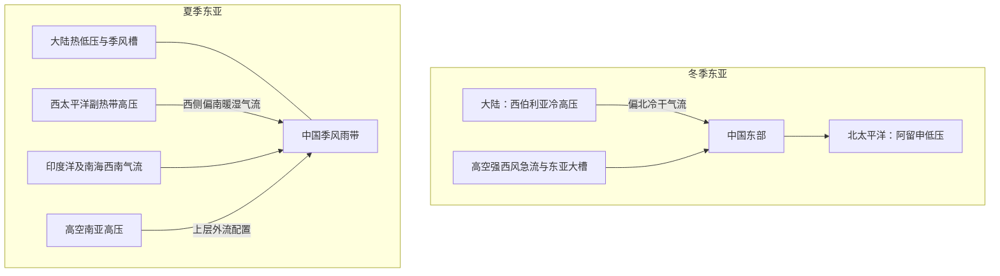
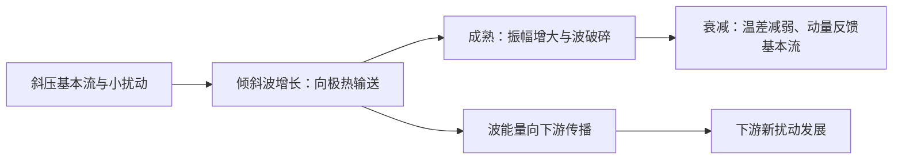
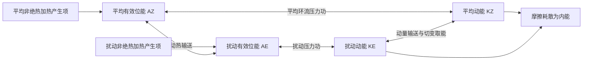
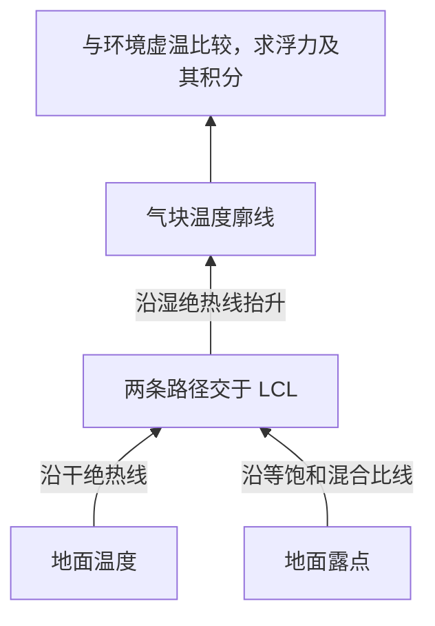

# 绘图分析题：常考必备知识点

> 按本题型考察年份数降序排列；同频次依跨题型总频次、最近出现年份排序。频次不是2027年命题概率。补充题均置于历史考点之后，不计入真题频次。

[[牢三样/动力气象课后习题/常考必备知识点/00_总目录与统计口径|总目录与统计口径]] ｜ [[牢三样/动力气象课后习题/常考必备知识点/08_考纲覆盖与补充清单|77项考纲覆盖检查]]

## 历史考点速查

| 排名 | 考点 | 本题型年份数 | 全题型年份数 | 重点 |
|---:|---|---:|---:|---|
| 1 | [[#K-geo 地转风|地转风]] | 1 | 12 | — |
| 2 | [[#K-fronts 锋及锋面类型|锋及锋面类型]] | 1 | 8 | — |
| 3 | [[#K-eastasia 东亚大气环流|东亚大气环流]] | 1 | 7 | — |
| 4 | [[#K-rossbylife 罗斯贝波生命史与演变|罗斯贝波生命史与演变]] | 1 | 3 | — |
| 5 | [[#K-energy 大气能量及转换|大气能量及转换]] | 1 | 2 | — |
| 6 | [[#K-gradient 梯度风|梯度风]] | 1 | 2 | — |
| 7 | [[#K-airfrontjet 气团、锋与急流的联系|气团、锋与急流的联系]] | 1 | 1 | — |

## K-geo 地转风

**本题型考察：1 次（1个年份）；全题型考察：12 次。**
**本题型：一般；跨题型：重点。**

本题型年份：2006。

### 原题问法与对应解答

> 按独立问法保留答案；同一多考点题可能在不同考点下交叉索引，这不增加年份频次。以下同时保留题目特有数据和条件，不能只背一个通用结论。

#### 问法 1

来源：[[牢三样/动力气象课后习题/试题解答/往年试题解析/2006_1#题目 2006_1-三-2|2006_1-三-2]]

**原题：**

画图说明在高、低压天气系统中梯度风与地转风的差异。

**评级参考：** 难度：★★☆☆☆（2/5）｜考试相关度：★★★★★（5/5）

**解答：**

1. 单位质量压力梯度力为 $-\nabla p/\rho$，从高压指向低压。局地北半球气旋圆流取半径 $r$ 向外、切向速度 $V$ 正值为逆时针，稳态径向平衡为
$$\frac{V^2}{r}+fV=\frac1\rho\frac{\partial p}{\partial r}.$$
这就是梯度风平衡：压力梯度、科氏作用共同提供曲率加速度。

2. 低压中心外侧 $p_r>0$，定义同半径地转风 $V_g=p_r/(\rho f)>0$，上式给 $V_g=V+V^2/(fr)>V$，故正常气旋梯度风次地转。

3. 高压正常反气旋支写 $V=-S$、$S>0$，$S_g=-p_r/(\rho f)$，则 $S_g=S-S^2/(fr)<S$，即超地转。判别式要求 $S_g\le fr/4$，反气旋正常支存在上限，不能把任意根均当作真实大气风。

4. 忽略曲率项即地转平衡；小尺度强涡旋若科氏项远小于曲率项，则 $V^2/r=p_r/\rho$，为旋衡平衡。惯性运动则无压力梯度。三种近似依尺度和受力大小选择。

| 北半球情况 | 指向中心的作用 | 指离中心的作用（旋转随流受力图） | 正常支风速 |
|---|---|---|---|
| 低压气旋 | 压力梯度力 | 科氏力、曲率离心惯性项 | 梯度风小于地转风 |
| 高压反气旋 | 科氏力 | 压力梯度力、曲率离心惯性项 | 梯度风大于地转风 |

曲率离心项是随流受力图中的惯性表示；在地球坐标动量方程中对应向心加速度，不能作为额外真实力重复加入。

1. 在局地直角坐标中，忽略摩擦时水平动量方程为 $Du/Dt-fv=-\Phi_x$、$Dv/Dt+fu=-\Phi_y$，这里的导数取在等压面上。
2. 对中纬度大尺度缓变运动，$Ro=U/(fL)\ll1$，惯性项相对较小，得到 $-fv_g=-\Phi_x$、$fu_g=-\Phi_y$。
3. 解得 $\boxed{u_g=-\Phi_y/f,\quad v_g=\Phi_x/f}$，即 $\mathbf V_g=\mathbf k\times\nabla_p\Phi/f$；大小为 $|\nabla_p\Phi|/|f|$。
4. 因叉积垂直于梯度，地转风平行于等高线；北半球背风而立时低值在左、高值在右，南半球相反。等高线越密风越强，但还受纬度 $f$ 影响。
5. 近赤道 $f\to0$、摩擦层、强曲率或快速变化的小尺度系统中不能直接采用地转近似。等高面上应改用 $\nabla_zp/\rho$，不要把两种坐标的梯度混用。

![[牢三样/动力气象课后习题/试题解答/往年试题解析/图解/梯度风受力.png]]

图示北半球圆形系统东侧的受力。曲率项画在加速度一侧，避免把向心加速度和随流离心惯性项同时计入。由 $V_g=V+V^2/(fr)$ 判断低压正常支次地转；高压正常支以风速大小写成 $S_g=S-S^2/(fr)$，所以超地转。

---

## K-fronts 锋及锋面类型

**本题型考察：1 次（1个年份）；全题型考察：8 次。**
**本题型：一般；跨题型：重点。**

本题型年份：2001。

### 原题问法与对应解答

> 按独立问法保留答案；同一多考点题可能在不同考点下交叉索引，这不增加年份频次。以下同时保留题目特有数据和条件，不能只背一个通用结论。

#### 问法 1

来源：[[牢三样/动力气象课后习题/试题解答/往年试题解析/2001#题目 2001-三-整题|2001-三-整题]]

**原题：**

给出锋区附近的气压场、风场、温度场的基本特征，并给出其垂直结构图。

**评级参考：** 难度：★★☆☆☆（2/5）｜考试相关度：★★★★★（5/5）

**解答：**

1. 气团是水平范围广、温度湿度等性质较均匀、在共同源地上形成的大块空气。冷暖气团之间的三维过渡带叫锋区，理想化为锋面，与地面的交线叫锋线。

2. **分类。** 冷气团主动推进为冷锋，锋后通常降温、转偏北风、气压升高，锋区可阵雨雷暴；暖气团主动推进为暖锋，暖空气沿冷气团上滑，常有锋前大范围层状云雨；冷暖势力相当、移动缓慢为准静止锋，易持续阴雨；冷锋追及暖锋使暖空气抬离地面形成锢囚锋，天气取决于两侧冷空气和水汽结构。

3. **要素场。** 锋区水平温度和密度梯度大，等温线密集；地面常表现为低压槽，风向有气旋式切变，锋面上升指向冷空气一侧。气压本身连续，其梯度可明显改变；“锋面处气压不连续”是不正确表述。

![[牢三样/动力气象课后习题/试题解答/往年试题解析/图解/锋面剖面.png]]

锋面上升方向指向冷侧；冷暖气团、锋面、上滑气流与地面锋线位置如图。实际冷锋与暖锋的移动方向、坡度和云系仍应分别说明。

---

## K-eastasia 东亚大气环流

**本题型考察：1 次（1个年份）；全题型考察：7 次。**
**本题型：一般；跨题型：重点。**

本题型年份：1992。

### 原题问法与对应解答

> 按独立问法保留答案；同一多考点题可能在不同考点下交叉索引，这不增加年份频次。以下同时保留题目特有数据和条件，不能只背一个通用结论。

#### 问法 1

来源：[[牢三样/动力气象课后习题/试题解答/往年试题解析/1992#题目 1992-三-4|1992-三-4]]

**原题：**

画出表明东亚地区冬季和夏季主要地面天气系统，并说明各个天气系统对中国冬夏天气的主要影响。

**评级参考：** 难度：★★☆☆☆（2/5）｜考试相关度：★★★★★（5/5）

**解答：**

1. 冬季北半球 500 hPa 等高线较密、西风强、长波振幅较大，东亚和北美东岸常有大槽，大陆冷、海洋相对暖；夏季中高纬梯度减小、西风带北移，副高北抬，大陆暖低压发展。冬季海平面亚洲冷高压、阿留申低压突出，夏季大陆热低压与海洋副高突出。

2. 东亚冬季受西伯利亚高压—阿留申低压、东亚大槽和强西风急流控制，偏北风冷干；夏季副高、季风低压、低空水汽输送和南亚高压配合，偏南风暖湿。春夏转换可发生分阶段突变，因海陆/高原加热、季风爆发和急流、副高位置跃变，而不只是平滑逐日北移。

**对应示意图（位置关系，不按比例）：**

---

## K-rossbylife 罗斯贝波生命史与演变

**本题型考察：1 次（1个年份）；全题型考察：3 次。**
**本题型：一般；跨题型：重点。**

本题型年份：2018。

### 原题问法与对应解答

> 按独立问法保留答案；同一多考点题可能在不同考点下交叉索引，这不增加年份频次。以下同时保留题目特有数据和条件，不能只背一个通用结论。

#### 问法 1

来源：[[牢三样/动力气象课后习题/试题解答/往年试题解析/2018#题目 2018-二-5|2018-二-5]]

**原题：**

画出罗斯贝波扰动发展的生命史过程，以及波结结构和基流相互作用过程

**评级参考：** 难度：★★★☆☆（3/5）｜考试相关度：★★★★★（5/5）

**解答：**

1. 西风带槽脊是流场的波动。典型发展中的斜压长波，高度槽轴随高度向西倾斜，槽前暖平流上升、槽后冷平流下沉；温度扰动与速度存在相位差，支持向极热输送和有效位能释放。

2. 成长阶段从平均有效位能取能，扰动增强；成熟阶段热量混合使温度梯度减弱，槽脊加大并可发生波破碎；衰减阶段扰动动量输送与基本流交换能量，气旋锢囚、场趋于较正压结构。并非每个中性线性罗斯贝波都必有增长和衰亡，这一“生命史”是典型不稳定波演变概念。

3. 罗斯贝波相速与群速不同，一维均匀西风上 $c_p=U-\beta/k^2$，$c_g=U+\beta/k^2$。能量包络可比槽脊向东传播更快，造成下游新波发展、上游旧波衰减，即下游发展。

4. 上下游效应泛指相邻波系通过传播和能量/动量交换相互影响；“上游效应”的教材用法需看其定义，不能以群速公式证明所有情况下影响只能单向向东。二维波和变化基本流中群速方向会变。

5. 动量通量 $\overline{u'v'}$ 的辐合可加速平均西风；平均流向扰动的正压动能转换为 $-\overline{u'v'}U_y$。不能用“地球自转不变”直接推出每一时刻所有输送都严格从东风带指向西风带，必须写出收支、外部摩擦转矩与统计稳态。

![[牢三样/动力气象课后习题/试题解答/往年试题解析/图解/罗斯贝波生命史.png]]

上排是水平槽脊振幅的概念演变，下排是槽轴随高度倾斜的结构；斜压增长时向西倾斜，成熟后趋于直立并不再有效从温差取能。该图针对典型斜压波生命史，并不声称所有线性中性罗斯贝波都自行增长。

---

## K-energy 大气能量及转换

**本题型考察：1 次（1个年份）；全题型考察：2 次。**
**本题型：一般；跨题型：一般。**

本题型年份：2025。

### 原题问法与对应解答

> 按独立问法保留答案；同一多考点题可能在不同考点下交叉索引，这不增加年份频次。以下同时保留题目特有数据和条件，不能只背一个通用结论。

#### 问法 1

来源：[[牢三样/动力气象课后习题/试题解答/往年试题解析/2025#题目 2025-三-1|2025-三-1]]

**原题：**

画能量转化在对流层的循环图

**评级参考：** 难度：★★★☆☆（3/5）｜考试相关度：★★★★☆（4/5）

**解答：**

1. 单位质量内能 $e=c_vT$，重力位能 $\Phi=gz$（常重力），动能 $K=|\mathbf V|^2/2$，水汽潜热能近似 $L_vq_v$。总量需对气团质量积分；动能不能漏掉 $1/2$。
2. “全位能”在大气能量学中通常指内能与重力位能之和，而非含动能的总能量。静力、平坦底面且顶边界压力趋零时，$\int\rho gz\,dz=-\int z\,dp=\int p\,dz=\int\rho RT\,dz$；加上内能得到 $\int c_pT\,dm$。
3. 有效位能是实际全位能相对绝热重排到参考最低能态后的可用部分。不是全部内能或重力位能都能转换为动能。差异加热维持水平温差，建立有效位能。
4. 暖上升冷下沉时，$C=-\int\alpha'\omega'\,dm>0$，有效位能转为扰动动能；摩擦最终把动能耗散成内能。凝结使潜热转入热力能库，但水汽能量本来主要来自地表蒸发和辐射收支。
5. 对流层常用 Lorenz 四能量库循环如下。双向箭头表示转换可正可负，方向由收支项决定；中纬度斜压波常沿 $A_Z\to A_E\to K_E$ 取能。$A_Z$ 与 $K_Z$ 的直接转换不能漏掉：平均经圈环流同样可通过压力功在平均有效位能和平均动能之间转换。

产生项也可能为负，图中不是所有加热都增加有效位能。若问完整收支，应分别写 $\dot A_Z=G_Z-C_A-C_Z$、$\dot A_E=G_E+C_A-C_E$、$\dot K_Z=C_Z+C_K-D_Z$、$\dot K_E=C_E-C_K-D_E$，这里 $C_K>0$ 约定为扰动动能转入平均动能。四式相加，内部转换项逐项抵消，只剩外部产生与耗散，可用作检查。

---

## K-gradient 梯度风

**本题型考察：1 次（1个年份）；全题型考察：2 次。**
**本题型：一般；跨题型：一般。**

本题型年份：2006。

### 原题问法与对应解答

> 按独立问法保留答案；同一多考点题可能在不同考点下交叉索引，这不增加年份频次。以下同时保留题目特有数据和条件，不能只背一个通用结论。

#### 问法 1

来源：[[牢三样/动力气象课后习题/试题解答/往年试题解析/2006_1#题目 2006_1-三-2|2006_1-三-2]]

**原题：**

画图说明在高、低压天气系统中梯度风与地转风的差异。

**评级参考：** 难度：★★☆☆☆（2/5）｜考试相关度：★★★★★（5/5）

**解答：**

1. 单位质量压力梯度力为 $-\nabla p/\rho$，从高压指向低压。局地北半球气旋圆流取半径 $r$ 向外、切向速度 $V$ 正值为逆时针，稳态径向平衡为
$$\frac{V^2}{r}+fV=\frac1\rho\frac{\partial p}{\partial r}.$$
这就是梯度风平衡：压力梯度、科氏作用共同提供曲率加速度。

2. 低压中心外侧 $p_r>0$，定义同半径地转风 $V_g=p_r/(\rho f)>0$，上式给 $V_g=V+V^2/(fr)>V$，故正常气旋梯度风次地转。

3. 高压正常反气旋支写 $V=-S$、$S>0$，$S_g=-p_r/(\rho f)$，则 $S_g=S-S^2/(fr)<S$，即超地转。判别式要求 $S_g\le fr/4$，反气旋正常支存在上限，不能把任意根均当作真实大气风。

4. 忽略曲率项即地转平衡；小尺度强涡旋若科氏项远小于曲率项，则 $V^2/r=p_r/\rho$，为旋衡平衡。惯性运动则无压力梯度。三种近似依尺度和受力大小选择。

| 北半球情况 | 指向中心的作用 | 指离中心的作用（旋转随流受力图） | 正常支风速 |
|---|---|---|---|
| 低压气旋 | 压力梯度力 | 科氏力、曲率离心惯性项 | 梯度风小于地转风 |
| 高压反气旋 | 科氏力 | 压力梯度力、曲率离心惯性项 | 梯度风大于地转风 |

曲率离心项是随流受力图中的惯性表示；在地球坐标动量方程中对应向心加速度，不能作为额外真实力重复加入。

1. 在局地直角坐标中，忽略摩擦时水平动量方程为 $Du/Dt-fv=-\Phi_x$、$Dv/Dt+fu=-\Phi_y$，这里的导数取在等压面上。
2. 对中纬度大尺度缓变运动，$Ro=U/(fL)\ll1$，惯性项相对较小，得到 $-fv_g=-\Phi_x$、$fu_g=-\Phi_y$。
3. 解得 $\boxed{u_g=-\Phi_y/f,\quad v_g=\Phi_x/f}$，即 $\mathbf V_g=\mathbf k\times\nabla_p\Phi/f$；大小为 $|\nabla_p\Phi|/|f|$。
4. 因叉积垂直于梯度，地转风平行于等高线；北半球背风而立时低值在左、高值在右，南半球相反。等高线越密风越强，但还受纬度 $f$ 影响。
5. 近赤道 $f\to0$、摩擦层、强曲率或快速变化的小尺度系统中不能直接采用地转近似。等高面上应改用 $\nabla_zp/\rho$，不要把两种坐标的梯度混用。

![[牢三样/动力气象课后习题/试题解答/往年试题解析/图解/梯度风受力.png]]

图示北半球圆形系统东侧的受力。曲率项画在加速度一侧，避免把向心加速度和随流离心惯性项同时计入。由 $V_g=V+V^2/(fr)$ 判断低压正常支次地转；高压正常支以风速大小写成 $S_g=S-S^2/(fr)$，所以超地转。

---

## K-airfrontjet 气团、锋与急流的联系

**本题型考察：1 次（1个年份）；全题型考察：1 次。**
**本题型：一般；跨题型：一般。**

本题型年份：1994。

### 原题问法与对应解答

> 按独立问法保留答案；同一多考点题可能在不同考点下交叉索引，这不增加年份频次。以下同时保留题目特有数据和条件，不能只背一个通用结论。

#### 问法 1

来源：[[牢三样/动力气象课后习题/试题解答/往年试题解析/1994#题目 1994-四-整题|1994-四-整题]]

**原题：**

给出北半球冬季主要气团，对流层顶和锋面，急流。以及低层风系特征示意图，并简述他们之间的关系。

**评级参考：** 难度：★★★☆☆（3/5）｜考试相关度：★★★★☆（4/5）

**解答：**

1. 气团是水平范围广、温度湿度等性质较均匀、在共同源地上形成的大块空气。冷暖气团之间的三维过渡带叫锋区，理想化为锋面，与地面的交线叫锋线。

2. **要素场。** 锋区水平温度和密度梯度大，等温线密集；地面常表现为低压槽，风向有气旋式切变，锋面上升指向冷空气一侧。气压本身连续，其梯度可明显改变；“锋面处气压不连续”是不正确表述。

3. **与急流、对流层顶联系。** 中纬度锋区强温度梯度经热成风关系形成高空强西风，极锋急流靠近高空锋区；副热带急流还受哈得莱环流角动量输送影响。极地对流层顶低、热带高，急流附近常有顶高陡变。

| 南北剖面 | 低纬暖区 | 中纬锋区 | 高纬冷区 |
|---|---|---|---|
| 对流层顶 | 高 | 过渡、可能折叠 | 低 |
| 高空 | 副热带急流附近 | 极锋急流、强温度梯度 | 极地气团 |
| 低层 | 暖湿气团 | 锋面向冷侧上倾 | 冷气团 |

该表给出应画的相对位置，实际急流和锋面位置随季节、天气变化。

![[牢三样/动力气象课后习题/试题解答/往年试题解析/图解/冬季纬向剖面.png]]

图中表示热带、极锋两处典型对流层顶过渡和急流位置，低层暖冷气团由倾斜锋区连接；这是概念剖面，不表示两急流每天始终完全分离。

---

## 考纲补充：当前题库未见对应细项的直接设问

以下只表示在本次收集的资料中未识别到该细项的直接独立设问；相关大主题可能已经考过，不能据此宣称所有历史试卷从未考过。补充题是自拟练习，不是预测真题。

### B16 温度—对数气压图的读图步骤

**本细项直接设问：0次（当前题库识别口径）｜考纲补充｜难度：★★★☆☆（3/5）｜考试相关度：★★★★☆（4/5，考纲明确相关）**

考纲依据：物理·热力学3。相关主题的已有覆盖见[[牢三样/动力气象课后习题/常考必备知识点/08_考纲覆盖与补充清单|覆盖清单]]。

**补充设问：** 在温度—对数气压图上标出凝结高度，并说明怎样判断对流潜能。

1. 纵坐标采用气压的对数且向上气压减小；温度轴是否倾斜依图种而定，不要把不同教材图的等温线画法混用。
2. 从地面温度沿干绝热线向上，从地面露点沿等饱和混合比线向上，两线交点给抬升凝结高度LCL。
3. LCL以上沿所选湿绝热线计算气块温度，与环境温度廓线比较；更严格的浮力使用虚温差 $B=g(T_{v,p}-T_{v,e})/T_{v,e}$。
4. 自由对流高度LFC以上到平衡高度EL的正浮力积分为 $CAPE=\int B\,dz$；达到LFC前的负浮力障碍对应CIN的大小，需声明CIN取负值还是绝对值约定。LCL不等于LFC。

此图说明作图流程；实际坐标曲线应使用教材所用热力图格，不能把流程图当成按比例的温压图。
