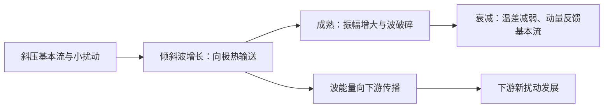

# 1989 年试题解析：逐题解答、考点与频次

> 本文件保留原题及频次，补充对应解答。星级为复习用主观评级；有缺题或排印疑点时，明确注明条件及可解范围。频次按考点出现的不同年份统计，不能视作命题概率。

原始记录：[[动力气象课后习题/往年试题分析/1989]]　｜　[[00_使用说明与年份索引|统计口径与目录]]

## 原卷第一部分

填空

## 题目 1989-一-1

### 原题

气象上风向为 90 度为**东**风，180 度为**南**风。

### 考点与考察频次

**考察频次：1 次（按年份去重）；一般。**

| 考点 | 频次 | 标记 | 对应年份 |
|---|---:|---|---|
| 风向判定 | 1 次 | 一般 | 1989 |

同考点的全部题号见 [[01_考点频次与证据总表|考点频次与证据总表]]。

### 难度与考试相关度

**难度：★☆☆☆☆（1/5）｜考试相关度：★★★★☆（4/5）**

评级依据：历史出现且直接对应所给考纲；频次用于区分复习优先级。

### 详细解答

**原记录填空值：** 东；南。下文核对其物理含义；出现修改意见时，以修改后的说明为准。

1. 气象风向按风**从哪里来**定义，从正北起顺时针计角：0°或360°北风、90°东风、180°南风、270°西风。若 $u$ 向东、$v$ 向北，东风对应 $u<0$，南风对应 $v>0$。

## 题目 1989-一-2

### 原题

气旋的平均直径为**1000~2000**公里，台风平均直径为**500~1000**公里，西南涡的平均直径为**200~500**公里。

### 考点与考察频次

**考察频次：4 次（按年份去重）；🔴 重点。**

| 考点 | 频次 | 标记 | 对应年份 |
|---|---:|---|---|
| 天气系统水平尺度 | 4 次 | 重点 | 1989、1990、1996、2003 |

同考点的全部题号见 [[01_考点频次与证据总表|考点频次与证据总表]]。

### 难度与考试相关度

**难度：★☆☆☆☆（1/5）｜考试相关度：★★★★★（5/5）**

评级依据：历史出现且直接对应所给考纲；频次用于区分复习优先级。

### 详细解答

**原记录填空值：** 1000~2000；500~1000；200~500。下文核对其物理含义；出现修改意见时，以修改后的说明为准。

1. 常用尺度分类：中α约 200—2000 km，中β约 20—200 km，中γ约 2—20 km；天气尺度温带气旋约千公里，台风约数百公里，西南涡约数百公里，龙卷常几十至几百米。这些是典型范围，系统边界和平均口径不同会有差异。

## 题目 1989-一-3

### 原题

850 毫巴平均高度为**1.5**公里，100 毫巴平均高度约为**16**公里，30 毫巴平均高度约**24**公里。

### 考点与考察频次

**考察频次：1 次（按年份去重）；一般。**

| 考点 | 频次 | 标记 | 对应年份 |
|---|---:|---|---|
| 等压面高度与高空天气图 | 1 次 | 一般 | 1989 |

同考点的全部题号见 [[01_考点频次与证据总表|考点频次与证据总表]]。

### 难度与考试相关度

**难度：★☆☆☆☆（1/5）｜考试相关度：★★★★☆（4/5）**

评级依据：历史出现且直接对应所给考纲；频次用于区分复习优先级。

### 详细解答

**原记录填空值：** 1.5；16；24。下文核对其物理含义；出现修改意见时，以修改后的说明为准。

1. 标准大气近似下，850 hPa 高度约 1.5 km，100 hPa 约 16 km，30 hPa 约 24 km；暖冷空气柱的实际高度不同，应由测高公式和温度廓线计算。

## 题目 1989-一-4

### 原题

长江流域梅雨发生时段为**6~7**月，华北雨季发生在**7~8**月。

### 考点与考察频次

**考察频次：9 次（按年份去重）；🔴 重点。**

| 考点 | 频次 | 标记 | 对应年份 |
|---|---:|---|---|
| 我国雨带季节活动 | 9 次 | 重点 | 1989、1990、1996、1998、2001、2002、2005、2006、2026 |

同考点的全部题号见 [[01_考点频次与证据总表|考点频次与证据总表]]。

### 难度与考试相关度

**难度：★☆☆☆☆（1/5）｜考试相关度：★★★★★（5/5）**

评级依据：历史出现且直接对应所给考纲；频次用于区分复习优先级。

### 详细解答

**原记录填空值：** 6~7；7~8。下文核对其物理含义；出现修改意见时，以修改后的说明为准。

1. 西太平洋副热带高压是副热带地区深厚、暖性的反气旋系统。中层常用 500 hPa 高度场描述，其内部下沉、对流受抑制，西北侧及北侧暖湿气流与中纬度系统相遇，是重要雨带区。
2. 形成与副热带下沉、行星波、海陆热力差异及热带加热有关，不能单说成“海面冷所以形成冷高压”。暖性结构使高压在较高层更明显，但不同层中心、脊线并不完全重合。
3. 春季至初夏副高偏南，华南锋面和季风雨活跃；6 月前后第一次北跳后，长江中下游进入梅雨，传统脊线经验约为 20°—25°N。
4. 进一步北抬至约 25°—30°N，雨带向江淮、淮河流域推进；7 月下旬至 8 月上旬前后脊线可在 30°—35°N，雨带到华北、东北，长江中下游较易受高压控制出现伏旱。秋季副高南撤，雨带随之南退。
5. 除南北移动，还要考虑西伸东退、强度和滞留时间。副高西伸使水汽输送路径和落区改变，长期稳定可造成一侧持续暴雨、另一侧持续高温。上述纬度和日期是复习用经验，不是每年的硬界线。
6. 原题若把 25°—30°N 直接与华北盛夏雨季对应，应另起行纠正：通常华北盛夏雨季对应更北的 30°—35°N 阶段。

## 原卷第二部分

给出下列物理量的数学表达式

## 题目 1989-二-1

### 原题

绝对涡度

### 考点与考察频次

**考察频次：7 次（按年份去重）；🔴 重点。**

| 考点 | 频次 | 标记 | 对应年份 |
|---|---:|---|---|
| 涡度 | 7 次 | 重点 | 1989、1996、1998、2002、2005、2006、2019 |

同考点的全部题号见 [[01_考点频次与证据总表|考点频次与证据总表]]。

### 难度与考试相关度

**难度：★★☆☆☆（2/5）｜考试相关度：★★★★★（5/5）**

评级依据：历史出现且直接对应所给考纲；频次用于区分复习优先级。

### 详细解答

1. 定义垂直相对涡度 $\zeta=v_x-u_y$，水平散度 $D=u_x+v_y$，单位均为 $\mathrm{s^{-1}}$。绝对涡度的垂直分量为 $\zeta_a=\zeta+f$；三维绝对涡度为 $\nabla\times\mathbf V+2\boldsymbol\Omega$。

## 题目 1989-二-2

### 原题

位温

### 考点与考察频次

**考察频次：7 次（按年份去重）；🔴 重点。**

| 考点 | 频次 | 标记 | 对应年份 |
|---|---:|---|---|
| 位温 | 7 次 | 重点 | 1989、1996、2001、2002、2003、2020、2022 |

同考点的全部题号见 [[01_考点频次与证据总表|考点频次与证据总表]]。

### 难度与考试相关度

**难度：★★☆☆☆（2/5）｜考试相关度：★★★★★（5/5）**

评级依据：历史出现且直接对应所给考纲；频次用于区分复习优先级。

### 详细解答

1. **定义。** 位温是干空气块沿干绝热线移到参考气压 $p_0$ 时的温度，通常取 $p_0=1000\ \mathrm{hPa}$。
2. **从第一定律出发。** 干绝热时 $c_p\,dT-\alpha\,dp=0$。由 $\alpha=RT/p$，得 $dT/T=(R/c_p)dp/p$。
3. **积分。** 记 $\kappa=R/c_p$，从 $(p,T)$ 积分到 $(p_0,\theta)$：$\ln(\theta/T)=\kappa\ln(p_0/p)$。
4. **结果。** $\boxed{\theta=T(p_0/p)^\kappa}$。干绝热运动中 $D\theta/Dt=0$；有潜热释放或其他加热时，不能直接假定干位温守恒。位温单位为 K。

## 题目 1989-二-3

### 原题

温度平流

### 考点与考察频次

**考察频次：5 次（按年份去重）；🔴 重点。**

| 考点 | 频次 | 标记 | 对应年份 |
|---|---:|---|---|
| 温度平流 | 5 次 | 重点 | 1989、1996、2001、2002、2026 |

同考点的全部题号见 [[01_考点频次与证据总表|考点频次与证据总表]]。

### 难度与考试相关度

**难度：★★☆☆☆（2/5）｜考试相关度：★★★★★（5/5）**

评级依据：历史出现且直接对应所给考纲；频次用于区分复习优先级。

### 详细解答

1. 水平温度平流为 $A_T=-\mathbf V_h\cdot\nabla T=-(uT_x+vT_y)$。风由暖区吹向冷区时，沿风向温度减小，点积为负，故 $A_T>0$，为暖平流；反之 $A_T<0$，为冷平流。
2. 由 $c_pDT/Dt-\alpha\omega=Q$ 和 $\alpha=RT/p$，得 $DT/Dt-\kappa T\omega/p=Q/c_p$。
3. 展开物质导数 $DT/Dt=\partial_tT+uT_x+vT_y+\omega T_p$，移项：
$$\boxed{\partial_tT=-\mathbf V_h\cdot\nabla_pT+\omega\left(\frac{\kappa T}{p}-T_p\right)+\frac Q{c_p}}.$$
4. 右侧依次为水平平流、垂直运动与绝热压缩膨胀的合成作用、非绝热加热。在稳定层结下，上升（$\omega<0$）的动力变温通常为冷却，下沉则增温。因此有暖平流不等于局地温度一定上升。

## 题目 1989-二-4

### 原题

地转风速

### 考点与考察频次

**考察频次：12 次（按年份去重）；🔴 重点。**

| 考点 | 频次 | 标记 | 对应年份 |
|---|---:|---|---|
| 地转风 | 12 次 | 重点 | 1989、1994、1997、1998、2001、2002、2003、2005、2006、2010、2019、2024 |

同考点的全部题号见 [[01_考点频次与证据总表|考点频次与证据总表]]。

### 难度与考试相关度

**难度：★★☆☆☆（2/5）｜考试相关度：★★★★★（5/5）**

评级依据：历史出现且直接对应所给考纲；频次用于区分复习优先级。

### 详细解答

1. 在局地直角坐标中，忽略摩擦时水平动量方程为 $Du/Dt-fv=-\Phi_x$、$Dv/Dt+fu=-\Phi_y$，这里的导数取在等压面上。
2. 对中纬度大尺度缓变运动，$Ro=U/(fL)\ll1$，惯性项相对较小，得到 $-fv_g=-\Phi_x$、$fu_g=-\Phi_y$。
3. 解得 $\boxed{u_g=-\Phi_y/f,\quad v_g=\Phi_x/f}$，即 $\mathbf V_g=\mathbf k\times\nabla_p\Phi/f$；大小为 $|\nabla_p\Phi|/|f|$。
4. 因叉积垂直于梯度，地转风平行于等高线；北半球背风而立时低值在左、高值在右，南半球相反。等高线越密风越强，但还受纬度 $f$ 影响。
5. 近赤道 $f\to0$、摩擦层、强曲率或快速变化的小尺度系统中不能直接采用地转近似。等高面上应改用 $\nabla_zp/\rho$，不要把两种坐标的梯度混用。

## 原卷第三部分

简答题

## 题目 1989-三-1

### 原题

试述大气长波系统的结构（热力，动力）。

### 考点与考察频次

**考察频次：3 次（按年份去重）；🔴 重点。**

| 考点 | 频次 | 标记 | 对应年份 |
|---|---:|---|---|
| 罗斯贝波生命史与演变 | 3 次 | 重点 | 1989、2018、2025 |

同考点的全部题号见 [[01_考点频次与证据总表|考点频次与证据总表]]。

### 难度与考试相关度

**难度：★★☆☆☆（2/5）｜考试相关度：★★★★★（5/5）**

评级依据：历史出现且直接对应所给考纲；频次用于区分复习优先级。

### 详细解答

1. 西风带槽脊是流场的波动。典型发展中的斜压长波，高度槽轴随高度向西倾斜，槽前暖平流上升、槽后冷平流下沉；温度扰动与速度存在相位差，支持向极热输送和有效位能释放。

2. 成长阶段从平均有效位能取能，扰动增强；成熟阶段热量混合使温度梯度减弱，槽脊加大并可发生波破碎；衰减阶段扰动动量输送与基本流交换能量，气旋锢囚、场趋于较正压结构。并非每个中性线性罗斯贝波都必有增长和衰亡，这一“生命史”是典型不稳定波演变概念。

3. 罗斯贝波相速与群速不同，一维均匀西风上 $c_p=U-\beta/k^2$，$c_g=U+\beta/k^2$。能量包络可比槽脊向东传播更快，造成下游新波发展、上游旧波衰减，即下游发展。

4. 上下游效应泛指相邻波系通过传播和能量/动量交换相互影响；“上游效应”的教材用法需看其定义，不能以群速公式证明所有情况下影响只能单向向东。二维波和变化基本流中群速方向会变。

5. 动量通量 $\overline{u'v'}$ 的辐合可加速平均西风；平均流向扰动的正压动能转换为 $-\overline{u'v'}U_y$。不能用“地球自转不变”直接推出每一时刻所有输送都严格从东风带指向西风带，必须写出收支、外部摩擦转矩与统计稳态。

## 题目 1989-三-2

### 原题

何为季风区，简述东亚季风的特点。

### 考点与考察频次

**考察频次：12 次（按年份去重）；🔴 重点。**

| 考点 | 频次 | 标记 | 对应年份 |
|---|---:|---|---|
| 季风 | 12 次 | 重点 | 1989、1994、1999、2000、2005、2014、2018、2020、2021、2022、2023、2025 |

同考点的全部题号见 [[01_考点频次与证据总表|考点频次与证据总表]]。

### 难度与考试相关度

**难度：★★★☆☆（3/5）｜考试相关度：★★★★★（5/5）**

评级依据：历史出现且直接对应所给考纲；频次用于区分复习优先级。

### 详细解答

1. **概念。** 季风是大范围盛行风向随季节发生显著转换的环流，通常伴有干湿季变化；季风区是这种季节性风向转换及其天气气候影响显著的地区。不能仅用一个地点冬夏偶然相反的风判定。

2. **基本因子。** 海陆热容量不同：冬季大陆冷却快、形成冷高压，夏季大陆增温快、形成热低压；压力配置改变，推动低层风季节反转。太阳直射点移动带动行星风带和热带辐合带移动，青藏高原热力及动力作用进一步重塑亚洲环流。

3. **冬季系统。** 亚洲大陆和高原为冷源，西伯利亚高压、阿留申低压、东亚大槽及强西风急流配合；我国大部盛行偏北风，带来寒冷干燥天气，沿海还受海陆和地形调制。

4. **夏季系统。** 大陆、高原感热及南亚—东亚降水潜热形成热源；低层印度季风槽、南海季风、西太平洋副高西侧偏南气流、跨赤道气流共同输送水汽，上层南亚高压及热带东风急流响应加热。

5. **东亚特点。** 既有热带季风也有副热带季风，冬季风尤其强；夏季水汽路径包括孟加拉湾—南海和西太平洋，雨带随季风推进分阶段北跳，又受中高纬冷空气影响。热源、环流、水汽辐合和潜热释放相互反馈，不能归结成单一海陆风的放大。

## 题目 1989-三-3

### 原题

怎样定义阻塞高压？它对下游地区环流形势的影响如何？

### 考点与考察频次

**考察频次：16 次（按年份去重）；🔴 重点。**

| 考点 | 频次 | 标记 | 对应年份 |
|---|---:|---|---|
| 阻塞高压 | 16 次 | 重点 | 1989、1992、1994、1996、1997、1998、2000、2003、2005、2006、2011、2013、2017、2019、2022、2023 |

同考点的全部题号见 [[01_考点频次与证据总表|考点频次与证据总表]]。

### 难度与考试相关度

**难度：★★☆☆☆（2/5）｜考试相关度：★★★★★（5/5）**

评级依据：历史出现且直接对应所给考纲；频次用于区分复习优先级。

### 详细解答

1. 阻塞高压是中高纬持续、移动缓慢的强高压脊或闭合高压，使西风气流绕行、分支，阻碍天气系统正常东移。关键是持续性和对西风带的阻挡，并非所有高压都叫阻塞。
2. 建立时，暖空气向极地输送使脊增强，经向振幅增大，波破碎、涡旋反馈可帮助维持。高压脊发展或与高纬高压合并，南侧可切出冷低压，形成偶极或Ω型等配置。
3. 维持时，阻高东侧偏北气流引导冷空气南下，西侧偏南气流输送暖空气。下游槽及冷暖空气交汇区可长期停留，造成持久冷凉、降雨；高压控制区下沉、少云，可造成干旱和高温，具体依季节和位置。
4. 衰退或崩溃时，维持高压的暖输送与涡旋反馈减弱，西风恢复，槽脊重新东移；其东侧积聚的冷空气可配合横槽转竖大举南下，触发我国寒潮。不能把每一次阻高衰退都等同于寒潮，仍需冷空气强度和路径配合。
5. 亚洲常关注乌拉尔山及鄂霍次克海等阻塞区，北大西洋—欧洲也是重要活动区；不同季节的优势位置不同，不应把某一季节经验说成全年固定不变。
6. 切断低压是从西风主槽分离出的闭合冷性低压，移动缓慢，可与北侧阻高配合。其冷空气及正涡度有利于下游不稳定和上升，但天气还依水汽供应。

## 题目 1989-三-4

### 原题

简述暴雨形成的主要物理条件。

### 考点与考察频次

**考察频次：5 次（按年份去重）；🔴 重点。**

| 考点 | 频次 | 标记 | 对应年份 |
|---|---:|---|---|
| 暴雨形成条件 | 5 次 | 重点 | 1989、1990、2012、2015、2021 |

同考点的全部题号见 [[01_考点频次与证据总表|考点频次与证据总表]]。

### 难度与考试相关度

**难度：★★★☆☆（3/5）｜考试相关度：★★★★★（5/5）**

评级依据：历史出现且直接对应所给考纲；频次用于区分复习优先级。

### 详细解答

1. 暴雨需要持续的水汽供应、有效抬升和较高降水效率，并常有不稳定能量与中尺度组织配合。水汽只是原料；没有辐合和抬升，湿空气未必产生暴雨。

2. 水汽由低空急流等输送至锋区或切变线，辐合后被迫抬升。锋面、低涡、切变线、地形及雷暴冷池出流均可触发上升；暖湿气块达到自由对流高度后释放不稳定能量。

3. 风切变使对流组织化，冷池和环境风配合可反复触发新单体；系统移动缓慢或单体沿相似路径连续经过同一区域，形成训练效应，增加累计雨量。层状降水也可产生暴雨，不能把强条件不稳定列为每场暴雨的绝对必要条件。

## 题目 1989-三-5

### 原题

说明温带气旋发展四个阶段特点。

### 考点与考察频次

**考察频次：9 次（按年份去重）；🔴 重点。**

| 考点 | 频次 | 标记 | 对应年份 |
|---|---:|---|---|
| 气旋及其发展 | 9 次 | 重点 | 1989、1992、1998、2003、2005、2020、2022、2023、2026 |

同考点的全部题号见 [[01_考点频次与证据总表|考点频次与证据总表]]。

### 难度与考试相关度

**难度：★★★☆☆（3/5）｜考试相关度：★★★★★（5/5）**

评级依据：历史出现且直接对应所给考纲；频次用于区分复习优先级。

### 详细解答

1. 气旋是低压及其气旋式环流系统，北半球逆时针、南半球顺时针；反气旋为高压及反气旋式环流。低层摩擦使气旋常辐合上升、反气旋常辐散下沉，但云雨仍依水汽和热力条件。

2. **温带锋面气旋四阶段。** 初生：静止锋上出现波动，暖空气向冷侧、冷空气向暖侧推进；发展：低压加深，冷暖锋清楚，暖区扩大，槽前正涡度平流和高空辐散配合；成熟/锢囚：冷锋追上暖锋，暖空气抬离地面，气旋范围较大且结构复杂；衰亡：近地面冷空气占据中心，水平温差和斜压取能减弱，低压逐渐填塞。

3. **主要发展因子。** 基本态温度梯度与垂直风切变提供有效位能，高低空槽与地面低压有利配置，低层暖平流、高层正涡度平流和辐散支持上升，凝结潜热可加强发展。并非每个实际气旋都严格走完同一理想阶段。

4. 我国温带气旋常活动于蒙古—东北、黄淮—江淮及东部沿海等区，路径随季节变化。冷反气旋多随冷空气从西北、北方或东北方向南下，冬半年强且广，暖季较弱；不能给出一条全年唯一入侵路线。

## 题目 1989-三-6

### 原题

什么叫$\theta$，夏季在作剖面分析时，为何要用$\theta_{se}$代替$\theta$？

### 考点与考察频次

**考察频次：7 次（本题所列考点的最高年份频次，不相加）；🔴 重点。**

| 考点 | 频次 | 标记 | 对应年份 |
|---|---:|---|---|
| 湿位温及相当位温 | 3 次 | 重点 | 1989、1992、2000 |
| 位温 | 7 次 | 重点 | 1989、1996、2001、2002、2003、2020、2022 |

同考点的全部题号见 [[01_考点频次与证据总表|考点频次与证据总表]]。

### 难度与考试相关度

**难度：★★☆☆☆（2/5）｜考试相关度：★★★★★（5/5）**

评级依据：历史出现且直接对应所给考纲；频次用于区分复习优先级。

### 详细解答

1. 干位温只表示干绝热压缩膨胀后的热力状态；夏季水汽多，凝结潜热显著，相同干位温的气块可有很不相同的对流潜能。

2. 假相当位温 $\theta_{se}$ 的概念定义：气块先干绝热抬升到凝结高度，再沿假绝热过程抬升，凝结物立即移出，直至水汽基本凝结完，再把剩余干空气沿干绝热线移到参考气压时的温度。它把温度、气压和水汽能量综合在一起。

3. 近似表达常写 $\theta_e\approx\theta\exp[L_vq_v/(c_pT_L)]$，$T_L$ 为凝结温度；精确教材公式可能还有干空气分压和热容修正。水汽越多，一般相当位温越高，适合追踪暖湿气团、梅雨锋和位势稳定度。

1. **定义。** 位温是干空气块沿干绝热线移到参考气压 $p_0$ 时的温度，通常取 $p_0=1000\ \mathrm{hPa}$。
2. **从第一定律出发。** 干绝热时 $c_p\,dT-\alpha\,dp=0$。由 $\alpha=RT/p$，得 $dT/T=(R/c_p)dp/p$。
3. **积分。** 记 $\kappa=R/c_p$，从 $(p,T)$ 积分到 $(p_0,\theta)$：$\ln(\theta/T)=\kappa\ln(p_0/p)$。
4. **结果。** $\boxed{\theta=T(p_0/p)^\kappa}$。干绝热运动中 $D\theta/Dt=0$；有潜热释放或其他加热时，不能直接假定干位温守恒。位温单位为 K。

