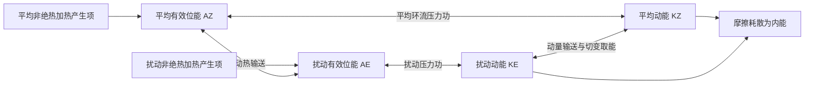

# 2003_1 年试题解析：逐题解答、考点与频次

> 本文件保留原题及频次，补充对应解答。星级为复习用主观评级；有缺题或排印疑点时，明确注明条件及可解范围。频次按考点出现的不同年份统计，不能视作命题概率。

原始记录：[[动力气象课后习题/往年试题分析/2003_1]]　｜　[[00_使用说明与年份索引|统计口径与目录]]

## 原卷第一部分

名词解释

## 题目 2003_1-一-1

### 原题

正压大气，斜压大气

### 考点与考察频次

**考察频次：6 次（按年份去重）；🔴 重点。**

| 考点 | 频次 | 标记 | 对应年份 |
|---|---:|---|---|
| 正压与斜压大气 | 6 次 | 重点 | 2003、2004、2005、2006、2016、2026 |

同考点的全部题号见 [[01_考点频次与证据总表|考点频次与证据总表]]。

### 难度与考试相关度

**难度：★☆☆☆☆（1/5）｜考试相关度：★★★★★（5/5）**

评级依据：历史出现且直接对应所给考纲；频次用于区分复习优先级。

### 详细解答

1. 正压大气满足 $\rho=\rho(p)$，等压面与等密度面重合，故 $\nabla\rho\times\nabla p=0$。对理想气体，在等压面上温度均匀。
2. 斜压大气中等压面与等密度面相交，$\nabla\rho\times\nabla p\ne0$，等压面上有水平温度梯度。
3. 斜压项可生成环流和涡度；在静力、地转条件下，水平温度梯度通过热成风关系对应地转风垂直切变。正压条件下地转风不随高度改变。
4. “正压”不意味着实际风必无任何垂直切变；上述切变结论还用了地转平衡。“斜压”也不等于“斜压不稳定”，后者需要扰动从基本态有效位能获得净能量。

## 题目 2003_1-一-2

### 原题

地转风和热成风

### 考点与考察频次

**考察频次：12 次（本题所列考点的最高年份频次，不相加）；🔴 重点。**

| 考点 | 频次 | 标记 | 对应年份 |
|---|---:|---|---|
| 地转风 | 12 次 | 重点 | 1989、1994、1997、1998、2001、2002、2003、2005、2006、2010、2019、2024 |
| 热成风 | 8 次 | 重点 | 1992、1994、1996、1997、2003、2005、2014、2021 |

同考点的全部题号见 [[01_考点频次与证据总表|考点频次与证据总表]]。

### 难度与考试相关度

**难度：★☆☆☆☆（1/5）｜考试相关度：★★★★★（5/5）**

评级依据：历史出现且直接对应所给考纲；频次用于区分复习优先级。

### 详细解答

1. 在局地直角坐标中，忽略摩擦时水平动量方程为 $Du/Dt-fv=-\Phi_x$、$Dv/Dt+fu=-\Phi_y$，这里的导数取在等压面上。
2. 对中纬度大尺度缓变运动，$Ro=U/(fL)\ll1$，惯性项相对较小，得到 $-fv_g=-\Phi_x$、$fu_g=-\Phi_y$。
3. 解得 $\boxed{u_g=-\Phi_y/f,\quad v_g=\Phi_x/f}$，即 $\mathbf V_g=\mathbf k\times\nabla_p\Phi/f$；大小为 $|\nabla_p\Phi|/|f|$。
4. 因叉积垂直于梯度，地转风平行于等高线；北半球背风而立时低值在左、高值在右，南半球相反。等高线越密风越强，但还受纬度 $f$ 影响。
5. 近赤道 $f\to0$、摩擦层、强曲率或快速变化的小尺度系统中不能直接采用地转近似。等高面上应改用 $\nabla_zp/\rho$，不要把两种坐标的梯度混用。

1. 热成风是两个高度或等压面之间的**地转风差**，不是独立的一股实际风。
2. 静力关系给出 $\Phi_{\ln p}=-RT$。对 $u_g=-\Phi_y/f$、$v_g=\Phi_x/f$ 分别作 $\ln p$ 导数（局地取 $f$ 固定），得
$$\frac{\partial u_g}{\partial\ln p}=\frac RfT_y,\qquad \frac{\partial v_g}{\partial\ln p}=-\frac RfT_x.$$
3. 从下层 $p_b$ 积到上层 $p_t<p_b$，若用对数气压平均温度 $\bar T$，则 $u_t-u_b=-(R/f)\ln(p_b/p_t)\bar T_y$、$v_t-v_b=(R/f)\ln(p_b/p_t)\bar T_x$。
4. 北半球向上的热成风沿平均等温线，冷空气在其左侧。温度向北降低时，西风一般随高度增强。该关系把水平温度梯度和垂直风切变连接起来。

## 题目 2003_1-一-3

### 原题

大气长波的频散

### 考点与考察频次

**考察频次：8 次（本题所列考点的最高年份频次，不相加）；🔴 重点。**

| 考点 | 频次 | 标记 | 对应年份 |
|---|---:|---|---|
| 罗斯贝波基本性质 | 8 次 | 重点 | 1990、2003、2005、2014、2016、2017、2019、2026 |
| 频散与非频散波 | 5 次 | 重点 | 2003、2005、2018、2020、2021 |

同考点的全部题号见 [[01_考点频次与证据总表|考点频次与证据总表]]。

### 难度与考试相关度

**难度：★☆☆☆☆（1/5）｜考试相关度：★★★★★（5/5）**

评级依据：历史出现且直接对应所给考纲；频次用于区分复习优先级。

### 详细解答

1. 正压无辐散β平面涡度方程为 $(\partial_t+u\partial_x+v\partial_y)(\zeta+f)=0$，$f=f_0+\beta y$。
2. 令 $u=U+u'$、$v=v'$，$U$ 为常数。减去基本态并舍弃 $u'\zeta'_x+v'\zeta'_y$ 等二阶项，得 $(\partial_t+U\partial_x)\zeta'+\beta v'=0$。
3. 引入 $u'=-\psi'_y$、$v'=\psi'_x$，所以 $\zeta'=\nabla_h^2\psi'$。代回得 $(\partial_t+U\partial_x)\nabla_h^2\psi'+\beta\psi'_x=0$。
4. 设 $\psi'=\hat\psi e^{i(kx+ly-\omega t)}$，有 $\nabla_h^2\psi'=-(k^2+l^2)\psi'$，故 $i(\omega-kU)(k^2+l^2)\psi'+i\beta k\psi'=0$。
5. 非零振幅给出 $\boxed{\omega=kU-\beta k/(k^2+l^2)}$；纬向相速 $c_x=\omega/k=U-\beta/(k^2+l^2)$。一维 $l=0$ 时 $c_x=U-\beta/k^2=U-\beta L^2/(4\pi^2)$。
6. 相对基本气流向西传播；短波西退修正小，常随西风向东，足够长的波可静止或向西。群速为 $c_{gx}=U+\beta(k^2-l^2)/(k^2+l^2)^2$、$c_{gy}=2\beta kl/(k^2+l^2)^2$。群速和相速不同，能量可向下游传播而单个槽脊较慢。

1. 简谐波写为 $A\cos(kx-\omega t)$。对等位相 $kx-\omega t=C$ 求导，得 $c_p=dx/dt=\omega/k$，它是波峰等位相点的速度。
2. 两列相近波叠加，利用和差化积得到 $2A\cos[(\Delta kx-\Delta\omega t)/2]\cos[(\bar kx-\bar\omega t)]$。第一项是缓变包络，故包络速度为 $\Delta\omega/\Delta k$。
3. 极限 $\Delta k\to0$ 时，群速度 $c_g=d\omega/dk$。多维形式为 $\mathbf c_g=\nabla_{\mathbf k}\omega$；在无耗散、缓变介质的线性波理论中，波包及波能量通常以群速度传播。
4. 若 $\omega=ck$ 且 $c$ 与 $k$ 无关，所有波数的相速相同，为非频散波；否则不同波数组分分离，波形和包络演变，称频散。因为 $\omega=kc_p(k)$，有 $c_g=c_p+k\,dc_p/dk$。
5. 频散的根本原因是恢复机制与惯性响应具有尺度依赖性，使频率对波数不呈简单线性关系；它不等于摩擦耗散。旋转浅水波和罗斯贝波有频散，无旋转均匀浅水长波近似非频散。

## 题目 2003_1-一-4

### 原题

有效位能

### 考点与考察频次

**考察频次：6 次（按年份去重）；🔴 重点。**

| 考点 | 频次 | 标记 | 对应年份 |
|---|---:|---|---|
| 有效位能 | 6 次 | 重点 | 1996、2003、2005、2016、2022、2025 |

同考点的全部题号见 [[01_考点频次与证据总表|考点频次与证据总表]]。

### 难度与考试相关度

**难度：★☆☆☆☆（1/5）｜考试相关度：★★★★★（5/5）**

评级依据：历史出现且直接对应所给考纲；频次用于区分复习优先级。

### 详细解答

1. 单位质量内能 $e=c_vT$，重力位能 $\Phi=gz$（常重力），动能 $K=|\mathbf V|^2/2$，水汽潜热能近似 $L_vq_v$。总量需对气团质量积分；动能不能漏掉 $1/2$。
2. “全位能”在大气能量学中通常指内能与重力位能之和，而非含动能的总能量。静力、平坦底面且顶边界压力趋零时，$\int\rho gz\,dz=-\int z\,dp=\int p\,dz=\int\rho RT\,dz$；加上内能得到 $\int c_pT\,dm$。
3. 有效位能是实际全位能相对绝热重排到参考最低能态后的可用部分。不是全部内能或重力位能都能转换为动能。差异加热维持水平温差，建立有效位能。
4. 暖上升冷下沉时，$C=-\int\alpha'\omega'\,dm>0$，有效位能转为扰动动能；摩擦最终把动能耗散成内能。凝结使潜热转入热力能库，但水汽能量本来主要来自地表蒸发和辐射收支。
5. 对流层常用 Lorenz 四能量库循环如下。双向箭头表示转换可正可负，方向由收支项决定；中纬度斜压波常沿 $A_Z\to A_E\to K_E$ 取能。$A_Z$ 与 $K_Z$ 的直接转换不能漏掉：平均经圈环流同样可通过压力功在平均有效位能和平均动能之间转换。

产生项也可能为负，图中不是所有加热都增加有效位能。若问完整收支，应分别写 $\dot A_Z=G_Z-C_A-C_Z$、$\dot A_E=G_E+C_A-C_E$、$\dot K_Z=C_Z+C_K-D_Z$、$\dot K_E=C_E-C_K-D_E$，这里 $C_K>0$ 约定为扰动动能转入平均动能。四式相加，内部转换项逐项抵消，只剩外部产生与耗散，可用作检查。

## 题目 2003_1-一-5

### 原题

位温

### 考点与考察频次

**考察频次：7 次（按年份去重）；🔴 重点。**

| 考点 | 频次 | 标记 | 对应年份 |
|---|---:|---|---|
| 位温 | 7 次 | 重点 | 1989、1996、2001、2002、2003、2020、2022 |

同考点的全部题号见 [[01_考点频次与证据总表|考点频次与证据总表]]。

### 难度与考试相关度

**难度：★☆☆☆☆（1/5）｜考试相关度：★★★★★（5/5）**

评级依据：历史出现且直接对应所给考纲；频次用于区分复习优先级。

### 详细解答

1. **定义。** 位温是干空气块沿干绝热线移到参考气压 $p_0$ 时的温度，通常取 $p_0=1000\ \mathrm{hPa}$。
2. **从第一定律出发。** 干绝热时 $c_p\,dT-\alpha\,dp=0$。由 $\alpha=RT/p$，得 $dT/T=(R/c_p)dp/p$。
3. **积分。** 记 $\kappa=R/c_p$，从 $(p,T)$ 积分到 $(p_0,\theta)$：$\ln(\theta/T)=\kappa\ln(p_0/p)$。
4. **结果。** $\boxed{\theta=T(p_0/p)^\kappa}$。干绝热运动中 $D\theta/Dt=0$；有潜热释放或其他加热时，不能直接假定干位温守恒。位温单位为 K。

## 题目 2003_1-一-6

### 原题

第二类条件不稳定

### 考点与考察频次

**考察频次：10 次（按年份去重）；🔴 重点。**

| 考点 | 频次 | 标记 | 对应年份 |
|---|---:|---|---|
| 第二类条件不稳定（CISK） | 10 次 | 重点 | 1997、2000、2003、2010、2014、2016、2020、2022、2025、2026 |

同考点的全部题号见 [[01_考点频次与证据总表|考点频次与证据总表]]。

### 难度与考试相关度

**难度：★☆☆☆☆（1/5）｜考试相关度：★★★★★（5/5）**

评级依据：历史出现且直接对应所给考纲；频次用于区分复习优先级。

### 详细解答

1. **初始扰动。** 季风槽、热带辐合带扰动、东风波、赤道罗斯贝波等可提供涡度、辐合和持续对流。多数初始扰动不会发展，环境与内部组织过程都重要。

2. **CISK 链条。** 初始低压旋转 → 边界层摩擦造成向中心的水汽辐合 → 对流凝结释放潜热 → 暖心及质量场调整、高层外流加强 → 低压和低层旋转增强 → 更强辐合。对流和大尺度环流相互反馈而非单独气块条件不稳定，因此称第二类条件不稳定。它是理想化解释，现代海气通量反馈等机制不可省略。

3. **能量。** 水汽主要由暖海蒸发补给，海面潜热和显热通量提供焓；凝结将潜热释放，暖升冷沉及压力功转化为动能，摩擦耗散动能。不能把凝结说成凭空制造能量。

## 题目 2003_1-一-7

### 原题

赤道波动

### 考点与考察频次

**考察频次：5 次（按年份去重）；🔴 重点。**

| 考点 | 频次 | 标记 | 对应年份 |
|---|---:|---|---|
| 赤道波动 | 5 次 | 重点 | 2003、2005、2020、2023、2024 |

同考点的全部题号见 [[01_考点频次与证据总表|考点频次与证据总表]]。

### 难度与考试相关度

**难度：★☆☆☆☆（1/5）｜考试相关度：★★★★★（5/5）**

评级依据：历史出现且直接对应所给考纲；频次用于区分复习优先级。

### 详细解答

1. 赤道附近 $f\approx\beta y$，科氏参数变号使若干波动被束缚在赤道附近。主要模态有赤道开尔文波、赤道罗斯贝波、混合罗斯贝—重力波及赤道惯性重力波。线性理论描述它们的动力骨架，实际云雨还受湿对流耦合。
2. **赤道开尔文波。** 取浅水等效波速 $c=\sqrt{gH}$，令 $v=0$。纬向动量与连续方程给 $u_t=-g\eta_x$、$\eta_t=-Hu_x$，组合得 $u_{tt}=c^2u_{xx}$，故 $\omega=\pm ck$。
3. 经向动量给 $\beta yu=-g\eta_y$。东传支有 $u=g\eta/c$，故 $\eta_y=-(\beta y/c)\eta$，积分得 $\eta\propto\exp[-\beta y^2/(2c)]$；西传支随远离赤道增长，不能满足有界条件。因此开尔文波为东传、近非频散，$u,\eta$ 关于赤道对称，$v=0$，束缚尺度 $L_e=\sqrt{c/\beta}$。
4. **混合波。** 兼具涡旋性与重力回复特征，经向风不为零；标准 $n=0$ 物理解可写 $\omega=ck/2+\sqrt{c^2k^2/4+\beta c}$（连同实场的共轭分支）。负波数一侧相速向西，群速可向东，不能把它当成单纯非频散东传波。
5. **赤道罗斯贝波。** 主要受位涡梯度约束，内禀相速向西，常表现为赤道两侧成对的涡旋；重力波分支较快，以辐散、质量场振荡显著。
6. 沿岸开尔文波与赤道开尔文波应区分：前者靠边界无穿透与地转横向平衡束缚，离岸按 $e^{-y/L_D}$ 衰减，$L_D=c/|f|$；北半球沿传播方向海岸在右侧。赤道波无需实体岸界。

## 题目 2003_1-一-8

### 原题

位涡度

### 考点与考察频次

**考察频次：3 次（按年份去重）；🔴 重点。**

| 考点 | 频次 | 标记 | 对应年份 |
|---|---:|---|---|
| 位涡 | 3 次 | 重点 | 2003、2011、2014 |

同考点的全部题号见 [[01_考点频次与证据总表|考点频次与证据总表]]。

### 难度与考试相关度

**难度：★★☆☆☆（2/5）｜考试相关度：★★★★★（5/5）**

评级依据：历史出现且直接对应所给考纲；频次用于区分复习优先级。

### 详细解答

1. 取完整无摩擦运动方程的旋度，定义绝对涡度 $\boldsymbol\omega_a=\nabla\times\mathbf V+2\boldsymbol\Omega$，得到
$$\frac{D\boldsymbol\omega_a}{Dt}=(\boldsymbol\omega_a\cdot\nabla)\mathbf V-\boldsymbol\omega_a\nabla\cdot\mathbf V+\frac{\nabla\rho\times\nabla p}{\rho^2}.$$
2. 连续方程给 $D\rho/Dt=-\rho\nabla\cdot\mathbf V$。对 $\mathbf B=\boldsymbol\omega_a/\rho$ 用商法则，膨胀项相消：$D\mathbf B/Dt=(\mathbf B\cdot\nabla)\mathbf V+(\nabla\rho\times\nabla p)/\rho^3$。
3. 绝热时 $D\theta/Dt=0$，对空间求导得 $D(\partial_i\theta)/Dt=-(\partial_iV_j)(\partial_j\theta)$。
4. 定义 $q=B_i\partial_i\theta$。其物质导数中，速度梯度两项分别为 $B_j\partial_jV_i\partial_i\theta$ 和 $-B_i\partial_iV_j\partial_j\theta$；交换虚指标后恰好相消。
5. 剩下 $Dq/Dt=(\nabla\rho\times\nabla p)\cdot\nabla\theta/\rho^3$。定组成理想气体的 $\theta=\theta(p,\rho)$，因此 $\nabla\theta$ 是 $\nabla p,\nabla\rho$ 的线性组合，三重积为零。
6. 故 $\boxed{D[(\boldsymbol\omega_a\cdot\nabla\theta)/\rho]/Dt=0}$，即 Ertel 位涡守恒。条件是绝热、无摩擦及适用的状态关系；用于气柱伸缩、越山响应和气团追踪时要选择与模型一致的位涡形式。浅水模型相应为 $(\zeta+f)/h$。

## 题目 2003_1-一-9

### 原题

Ekman 抽吸作用

### 考点与考察频次

**考察频次：5 次（按年份去重）；🔴 重点。**

| 考点 | 频次 | 标记 | 对应年份 |
|---|---:|---|---|
| 埃克曼抽吸 | 5 次 | 重点 | 2003、2010、2012、2016、2018 |

同考点的全部题号见 [[01_考点频次与证据总表|考点频次与证据总表]]。

### 难度与考试相关度

**难度：★☆☆☆☆（1/5）｜考试相关度：★★★★★（5/5）**

评级依据：历史出现且直接对应所给考纲；频次用于区分复习优先级。

### 详细解答

1. 气旋边界层摩擦辐合，经连续性在层顶产生上升，即埃克曼抽吸；反气旋常相反。若 $M$ 为积分边界层偏差输送、下边界 $w=0$，$w_E=-\nabla_h\cdot M$。明确应力为地面对空气的应力 $\boldsymbol\tau_s$，常数 $\rho,f$ 下 $M=-\mathbf k\times\boldsymbol\tau_s/(\rho f)$，故 $w_E=-\operatorname{curl}_z\boldsymbol\tau_s/(\rho f)$；若采用空气对地面应力，符号相反。

2. 抽吸将摩擦影响传入内区，使旋转流逐步衰减，称 spin down。理查森数 $Ri=N^2/[(\bar u_z)^2+(\bar v_z)^2]$ 比较稳定层结抑制与切变产湍，不能把常见的 $1/4$ 理论阈值当作所有大气湍流的开关。雷诺数 $Re=UL/\nu$ 衡量惯性与分子黏性；大气通常很大，湍流多尺度、随机且强混合，但仍服从守恒定律。

## 原卷第二部分

在 60°N 有一气柱，起始时相对涡度等于 0，从地面一直伸展到固定为 10 公里的对流层顶，假如这个气柱移到 30°N 并爬越一个高度为 5 公里的高原，问此气柱当越过高原顶部时的相对涡度与绝对涡度为多少？

## 题目 2003_1-二-整题

### 原题

在 60°N 有一气柱，起始时相对涡度等于 0，从地面一直伸展到固定为 10 公里的对流层顶，假如这个气柱移到 30°N 并爬越一个高度为 5 公里的高原，问此气柱当越过高原顶部时的相对涡度与绝对涡度为多少？

### 考点与考察频次

**考察频次：4 次（按年份去重）；🔴 重点。**

| 考点 | 频次 | 标记 | 对应年份 |
|---|---:|---|---|
| 气柱越山与位涡守恒应用 | 4 次 | 重点 | 1997、2003、2019、2021 |

同考点的全部题号见 [[01_考点频次与证据总表|考点频次与证据总表]]。

### 难度与考试相关度

**难度：★★★☆☆（3/5）｜考试相关度：★★★★★（5/5）**

评级依据：历史出现且直接对应所给考纲；频次用于区分复习优先级。

### 详细解答

1. 假设无摩擦、绝热，采用均匀浅水气柱模型，上界固定在海拔10 km。初始柱厚 $h_1=10\,000\ \mathrm m$，越过5 km高原时柱厚 $h_2=10\,000-5\,000=5\,000\ \mathrm m$。
2. 初始相对涡度 $\zeta_1=0$，故绝对涡度 $\zeta_{a1}=f_1=2\Omega\sin60°$。取 $\Omega=7.2921\times10^{-5}\ \mathrm{s^{-1}}$，$f_1=1.26303\times10^{-4}\ \mathrm{s^{-1}}$。
3. 位涡守恒 $\zeta_{a1}/h_1=\zeta_{a2}/h_2$，所以 $\boxed{\zeta_{a2}=(h_2/h_1)f_1=6.31515\times10^{-5}\ \mathrm{s^{-1}}}$。
4. 到30°N时 $f_2=2\Omega\sin30°=7.2921\times10^{-5}\ \mathrm{s^{-1}}$。相对涡度要减去当地行星涡度，得到
$$\boxed{\zeta_2=\zeta_{a2}-f_2=-9.7695\times10^{-6}\ \mathrm{s^{-1}}}.$$
5. 检查：绝对涡度仍为正，等于初始的一半，符合柱厚压缩一半；相对涡度为负，对应北半球反气旋性。不能把绝对涡度减半误写成相对涡度减半。

## 原卷第三部分

在绝热、无摩擦和无辐散的假定下，若在某一矩形区域D中有周期边界条件，试证明如下正压大气方程组在此区域中总动能守恒。

## 题目 2003_1-三-整题

### 原题

在绝热、无摩擦和无辐散的假定下，若在某一矩形区域D中有周期边界条件，试证明如下正压大气方程组在此区域中总动能守恒。

### 考点与考察频次

**考察频次：1 次（按年份去重）；一般。**

| 考点 | 频次 | 标记 | 对应年份 |
|---|---:|---|---|
| 总动能守恒 | 1 次 | 一般 | 2003 |

同考点的全部题号见 [[01_考点频次与证据总表|考点频次与证据总表]]。

### 难度与考试相关度

**难度：★★★★☆（4/5）｜考试相关度：★★★★☆（4/5）**

评级依据：历史出现且直接对应所给考纲；频次用于区分复习优先级。

### 详细解答

1. 取无摩擦水平动量方程 $D_tu-fv=-\Phi_x$、$D_tv+fu=-\Phi_y$，分别乘 $u,v$ 后相加。科氏项 $-fuv+fuv=0$，得 $D_tK=-\mathbf V\cdot\nabla\Phi$，$K=(u^2+v^2)/2$。
2. 无辐散时 $\nabla\cdot\mathbf V=0$，恒等式 $\mathbf V\cdot\nabla F=\nabla\cdot(F\mathbf V)$ 成立，故 $\partial_tK+\nabla\cdot[(K+\Phi)\mathbf V]=0$。
3. 在矩形区域 $D$ 积分并用散度定理：$d\int_DK\,dA/dt=-\oint_{\partial D}(K+\Phi)\mathbf V\cdot\mathbf n\,ds$。
4. 周期边界的相对两边场值相同、外法向相反，通量两两抵消，所以 $\boxed{d\int_DK\,dA/dt=0}$。均匀密度和恒定层厚只增加常数质量因子。
5. 该证明需要原题所指的无辐散正压模型；若自由层厚变化并存在辐散，守恒的一般是动能与位能之和，不能直接套用总动能单独守恒。

## 原卷第四部分

假定大气满足静力平衡，而且是均匀不可压缩流体；下边界为平坦地面、上边界为自由表面，自由表面高度为$h = h(x, y, t)$（如图所示）：

### 本部分共用题干

$$
\left\{ \begin{aligned} \frac{\partial u}{\partial t} + u \frac{\partial u}{\partial x} + v \frac{\partial u}{\partial y} - f v &= -\frac{1}{\rho} \frac{\partial p}{\partial x} \\ \frac{\partial v}{\partial t} + u \frac{\partial v}{\partial x} + v \frac{\partial v}{\partial y} + f u &= -\frac{1}{\rho} \frac{\partial p}{\partial y} \\ \end{aligned} \right.
$$

## 题目 2003_1-四-1

### 原题

试推出 "浅水模式"。

### 考点与考察频次

**考察频次：2 次（按年份去重）；一般。**

| 考点 | 频次 | 标记 | 对应年份 |
|---|---:|---|---|
| 浅水模式推导 | 2 次 | 一般 | 2003、2005 |

同考点的全部题号见 [[01_考点频次与证据总表|考点频次与证据总表]]。

### 难度与考试相关度

**难度：★★☆☆☆（2/5）｜考试相关度：★★★★☆（4/5）**

评级依据：历史出现且直接对应所给考纲；频次用于区分复习优先级。

### 详细解答

**第一步：竖直积分。** 设底面 $z=0$，自由面 $z=h(x,y,t)$，均匀密度 $\rho_0$，表面压力固定。由 $p_z=-\rho_0g$ 得 $p=p_s+\rho_0g(h-z)$，所以水平压力梯度力为 $-g\nabla_hh$。采用柱状水平速度，得
$$D_tu-fv=-gh_x,\qquad D_tv+fu=-gh_y,\qquad D_t=\partial_t+u\partial_x+v\partial_y.$$
**第二步：连续方程。** 由 $u_x+v_y+w_z=0$ 和 $w(0)=0$，有 $w(h)=-h(u_x+v_y)$。自由面的运动学条件为 $w(h)=h_t+uh_x+vh_y$，两式合并：$D_th=-hD$，其中 $D=u_x+v_y$。这三式构成浅水模式。

**第三步：取旋度。** 对第二个动量方程取 $x$ 导数，减去第一个方程的 $y$ 导数。加速度交叉项产生 $\zeta D$，科氏项产生 $fD+\beta v$，压力梯度交叉导数相消，得 $D_t\zeta+(\zeta+f)D+\beta v=0$。

**第四步：组合成位涡。** 因 $D_tf=\beta v$，有 $D_t(\zeta+f)=-(\zeta+f)D$。于是
$$D_t\frac{\zeta+f}{h}=\frac{-h(\zeta+f)D-(\zeta+f)(-hD)}{h^2}=0.$$
因此 $\boxed{q=(\zeta+f)/h\text{ 沿气柱守恒}}$，适用于上述无摩擦、无质量源汇的浅水模型。

**第五步：有基本流时的线性化。** 令 $u=U+u'$、$v=v'$、$h=H(y)+h'$，$U$ 为常数且 $gH_y=-f_0U$。代入后减去基本态，再删去两个扰动量相乘的二阶项，得到
$$\begin{aligned}(\partial_t+U\partial_x)u'-f_0v'&=-gh'_x,\\(\partial_t+U\partial_x)v'+f_0u'&=-gh'_y,\\(\partial_t+U\partial_x)h'+H(u'_x+v'_y)+H_yv'&=0.\end{aligned}$$
相应局地β平面涡度式为 $(\partial_t+U\partial_x)\zeta'+\beta v'+f_0D'=0$。若原题把层厚写成 $H(x)$ 却要求 $H_y$ 平衡，需改正为 $H(y)$ 后才可使用这一基本态。

## 题目 2003_1-四-2

### 原题

证明 "浅水模式" 具有位涡度守恒的性质。

### 考点与考察频次

**考察频次：3 次（按年份去重）；🔴 重点。**

| 考点 | 频次 | 标记 | 对应年份 |
|---|---:|---|---|
| 浅水位涡守恒 | 3 次 | 重点 | 2003、2005、2010 |

同考点的全部题号见 [[01_考点频次与证据总表|考点频次与证据总表]]。

### 难度与考试相关度

**难度：★★★★☆（4/5）｜考试相关度：★★★★★（5/5）**

评级依据：历史出现且直接对应所给考纲；频次用于区分复习优先级。

### 详细解答

**第一步：竖直积分。** 设底面 $z=0$，自由面 $z=h(x,y,t)$，均匀密度 $\rho_0$，表面压力固定。由 $p_z=-\rho_0g$ 得 $p=p_s+\rho_0g(h-z)$，所以水平压力梯度力为 $-g\nabla_hh$。采用柱状水平速度，得
$$D_tu-fv=-gh_x,\qquad D_tv+fu=-gh_y,\qquad D_t=\partial_t+u\partial_x+v\partial_y.$$
**第二步：连续方程。** 由 $u_x+v_y+w_z=0$ 和 $w(0)=0$，有 $w(h)=-h(u_x+v_y)$。自由面的运动学条件为 $w(h)=h_t+uh_x+vh_y$，两式合并：$D_th=-hD$，其中 $D=u_x+v_y$。这三式构成浅水模式。

**第三步：取旋度。** 对第二个动量方程取 $x$ 导数，减去第一个方程的 $y$ 导数。加速度交叉项产生 $\zeta D$，科氏项产生 $fD+\beta v$，压力梯度交叉导数相消，得 $D_t\zeta+(\zeta+f)D+\beta v=0$。

**第四步：组合成位涡。** 因 $D_tf=\beta v$，有 $D_t(\zeta+f)=-(\zeta+f)D$。于是
$$D_t\frac{\zeta+f}{h}=\frac{-h(\zeta+f)D-(\zeta+f)(-hD)}{h^2}=0.$$
因此 $\boxed{q=(\zeta+f)/h\text{ 沿气柱守恒}}$，适用于上述无摩擦、无质量源汇的浅水模型。

**第五步：有基本流时的线性化。** 令 $u=U+u'$、$v=v'$、$h=H(y)+h'$，$U$ 为常数且 $gH_y=-f_0U$。代入后减去基本态，再删去两个扰动量相乘的二阶项，得到
$$\begin{aligned}(\partial_t+U\partial_x)u'-f_0v'&=-gh'_x,\\(\partial_t+U\partial_x)v'+f_0u'&=-gh'_y,\\(\partial_t+U\partial_x)h'+H(u'_x+v'_y)+H_yv'&=0.\end{aligned}$$
相应局地β平面涡度式为 $(\partial_t+U\partial_x)\zeta'+\beta v'+f_0D'=0$。若原题把层厚写成 $H(x)$ 却要求 $H_y$ 平衡，需改正为 $H(y)$ 后才可使用这一基本态。

