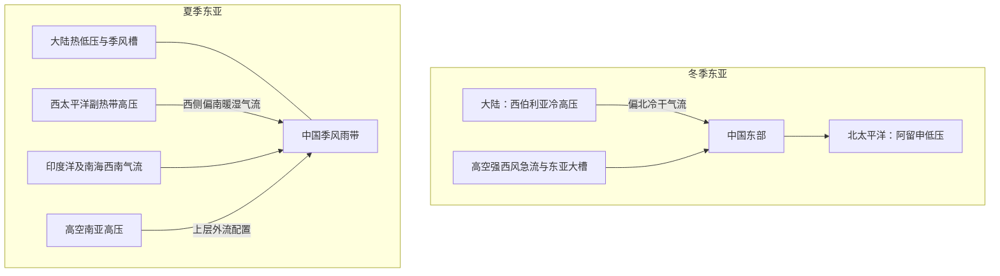

# 1992 年试题解析：逐题解答、考点与频次

> 本文件保留原题及频次，补充对应解答。星级为复习用主观评级；有缺题或排印疑点时，明确注明条件及可解范围。频次按考点出现的不同年份统计，不能视作命题概率。

原始记录：[[动力气象课后习题/往年试题分析/1992]]　｜　[[00_使用说明与年份索引|统计口径与目录]]

## 原卷第一部分

填空

## 题目 1992-一-1

### 原题

北半球冬季阻塞高压最常出现的地区是**乌拉尔山地区**、**鄂霍次克海地区**、**北大西洋东部**。

### 考点与考察频次

**考察频次：16 次（按年份去重）；🔴 重点。**

| 考点 | 频次 | 标记 | 对应年份 |
|---|---:|---|---|
| 阻塞高压 | 16 次 | 重点 | 1989、1992、1994、1996、1997、1998、2000、2003、2005、2006、2011、2013、2017、2019、2022、2023 |

同考点的全部题号见 [[01_考点频次与证据总表|考点频次与证据总表]]。

### 难度与考试相关度

**难度：★☆☆☆☆（1/5）｜考试相关度：★★★★★（5/5）**

评级依据：历史出现且直接对应所给考纲；频次用于区分复习优先级。

### 考场精简版与审校状态

**审校状态：尚未逐题学科审校。**

**相关高频考点复习摘要（须按本题设问取舍，不替代完整解答）：**

**阻塞高压：** 阻塞高压是中高纬持续、少动并使西风绕行的强脊或闭合高压。建立与暖输送、波破碎及涡旋反馈有关；其东侧偏北气流可蓄积和引导冷空气。衰退配合横槽转竖时可触发寒潮，但并非每次崩溃都必然造成寒潮。

> 以上摘要用于回忆答题主线，不是官方评分标准；推导、计算和多小问仍须完成下方步骤。

### 详细解答

**原记录填空值：** 乌拉尔山地区；鄂霍次克海地区；北大西洋东部。下文核对其物理含义；出现修改意见时，以修改后的说明为准。

1. 阻塞高压是中高纬持续、移动缓慢的强高压脊或闭合高压，使西风气流绕行、分支，阻碍天气系统正常东移。关键是持续性和对西风带的阻挡，并非所有高压都叫阻塞。
2. 建立时，暖空气向极地输送使脊增强，经向振幅增大，波破碎、涡旋反馈可帮助维持。高压脊发展或与高纬高压合并，南侧可切出冷低压，形成偶极或Ω型等配置。
3. 维持时，阻高东侧偏北气流引导冷空气南下，西侧偏南气流输送暖空气。下游槽及冷暖空气交汇区可长期停留，造成持久冷凉、降雨；高压控制区下沉、少云，可造成干旱和高温，具体依季节和位置。
4. 衰退或崩溃时，维持高压的暖输送与涡旋反馈减弱，西风恢复，槽脊重新东移；其东侧积聚的冷空气可配合横槽转竖大举南下，触发我国寒潮。不能把每一次阻高衰退都等同于寒潮，仍需冷空气强度和路径配合。
5. 亚洲常关注乌拉尔山及鄂霍次克海等阻塞区，北大西洋—欧洲也是重要活动区；不同季节的优势位置不同，不应把某一季节经验说成全年固定不变。
6. 切断低压是从西风主槽分离出的闭合冷性低压，移动缓慢，可与北侧阻高配合。其冷空气及正涡度有利于下游不稳定和上升，但天气还依水汽供应。

## 题目 1992-一-2

### 原题

北半球冬季副热带急流大致稳定在**25~30**°N 之间，夏季则北移**5~10**个纬距，在流域北侧等中风场为**反气旋式**切变。

### 考点与考察频次

**考察频次：8 次（按年份去重）；🔴 重点。**

| 考点 | 频次 | 标记 | 对应年份 |
|---|---:|---|---|
| 高空急流 | 8 次 | 重点 | 1990、1992、1997、2000、2004、2006、2013、2021 |

同考点的全部题号见 [[01_考点频次与证据总表|考点频次与证据总表]]。

### 难度与考试相关度

**难度：★☆☆☆☆（1/5）｜考试相关度：★★★★★（5/5）**

评级依据：历史出现且直接对应所给考纲；频次用于区分复习优先级。

### 考场精简版与审校状态

**审校状态：尚未逐题学科审校。**

**相关高频考点复习摘要（须按本题设问取舍，不替代完整解答）：**

**高空急流：** 高空急流是对流层上部狭长强风带，横向和垂直切变强。极锋急流与斜压锋区相关，副热带急流还受低纬角动量输送影响；冬强偏南、夏弱偏北。急流加减速与曲率引起非地转次级环流，可影响下方上升和气旋发展。

> 以上摘要用于回忆答题主线，不是官方评分标准；推导、计算和多小问仍须完成下方步骤。

### 详细解答

**原记录填空值：** 25~30；5~10；反气旋式。下文核对其物理含义；出现修改意见时，以修改后的说明为准。

1. 急流是狭长的强风带，横向和竖直风切变显著，急流轴是局地最大风速的位置。高空西风急流位于对流层上部，冬季更强、更偏南；夏季整体偏北、减弱。东亚日本附近冬季急流可很强，题中 70—80 m/s 是典型量级而非上限。

2. 极锋急流与中纬度锋区斜压性相联系；副热带急流还与低纬向极运动的角动量输送和热成风共同有关。强南北温度梯度通过热成风使西风随高度增强；不能只归因于地面风向上复制。

3. 急流入口、出口的加减速和曲率导致非地转次级环流，局部辐散有利于下方上升和气旋发展；简单直急流象限规则只在相应理想条件下适用。

**原填空修改意见：** 急流北侧通常为气旋性切变、南侧通常为反气旋性切变（北半球，取急流西风峰值的典型横向分布）。原记录“北侧为反气旋式切变”的表述疑似错误；由 $\zeta\approx-\partial u/\partial y$，北侧 $u_y<0$，所以 $\zeta>0$。

## 题目 1992-一-3

### 原题

夏季台风中心气压可低至**900**百帕以下，而冬季大陆冷高压可达**1060**百帕以上。

### 考点与考察频次

**考察频次：3 次（按年份去重）；🔴 重点。**

| 考点 | 频次 | 标记 | 对应年份 |
|---|---:|---|---|
| 地面气压极值 | 3 次 | 重点 | 1992、1998、2000 |

同考点的全部题号见 [[01_考点频次与证据总表|考点频次与证据总表]]。

### 难度与考试相关度

**难度：★☆☆☆☆（1/5）｜考试相关度：★★★★★（5/5）**

评级依据：历史出现且直接对应所给考纲；频次用于区分复习优先级。

### 考场精简版与审校状态

**审校状态：尚未逐题学科审校。**

**相关高频考点复习摘要（须按本题设问取舍，不替代完整解答）：**

**地面气压极值：** 1060 hPa以上大陆冷高压、950 hPa以下强热带气旋中心等是强事件量级，不是所有寒潮或台风的典型平均。极值还需说明海平面订正、地区和统计样本，不能拿填空中的例值当绝对上限或下限。

> 以上摘要用于回忆答题主线，不是官方评分标准；推导、计算和多小问仍须完成下方步骤。

### 详细解答

**原记录填空值：** 900；1060。下文核对其物理含义；出现修改意见时，以修改后的说明为准。

1. 强大陆冷高压可达到1060 hPa甚至更高，强热带气旋中心可低于950 hPa、极强个例低于900 hPa；这些是强事件量级，不是“所有寒潮或台风的一般气压”。原文给出的极值范围不应当作气候平均。

## 题目 1992-一-4

### 原题

平流层中存在着准**两**年的振荡现象，主要表现为赤道平流层**东西**风环流的交替。

### 考点与考察频次

**考察频次：1 次（按年份去重）；一般。**

| 考点 | 频次 | 标记 | 对应年份 |
|---|---:|---|---|
| 准两年振荡 | 1 次 | 一般 | 1992 |

同考点的全部题号见 [[01_考点频次与证据总表|考点频次与证据总表]]。

### 难度与考试相关度

**难度：★☆☆☆☆（1/5）｜考试相关度：★★★★☆（4/5）**

评级依据：历史出现且直接对应所给考纲；频次用于区分复习优先级。

### 考场精简版与审校状态

**审校状态：尚未逐题学科审校。**

> 以上摘要用于回忆答题主线，不是官方评分标准；推导、计算和多小问仍须完成下方步骤。

### 详细解答

**原记录填空值：** 两；东西。下文核对其物理含义；出现修改意见时，以修改后的说明为准。

1. 准两年振荡（QBO）是赤道平流层纬向风东、西风带交替的现象，“准”表示周期并非严格两年，平均约28个月。
2. 东西风剪切层通常从较高处逐渐向下传播，主要通过赤道波和重力波输送、沉积动量与平均流相互作用维持，而非地面季风直接延伸到平流层。
3. 对填空“准几年的振荡”，教材名称填“两”；若问准确周期，写“约28个月，存在变化”，不要把完整周期与半个东西风转换周期混淆。参考：[Met Office 的QBO说明](https://www.metoffice.gov.uk/services/government/contingency-planners/seasonal-forecasts-and-climate-drivers-resources)。

## 题目 1992-一-5

### 原题

影响大气环流形成的主要因素有：太阳辐射能随纬度分布的不均匀、基本气流的不稳定、太阳活动和**地球自转（海陆分布和地形）**。

### 考点与考察频次

**考察频次：3 次（按年份去重）；🔴 重点。**

| 考点 | 频次 | 标记 | 对应年份 |
|---|---:|---|---|
| 大气环流 | 3 次 | 重点 | 1992、2011、2019 |

同考点的全部题号见 [[01_考点频次与证据总表|考点频次与证据总表]]。

### 难度与考试相关度

**难度：★☆☆☆☆（1/5）｜考试相关度：★★★★★（5/5）**

评级依据：历史出现且直接对应所给考纲；频次用于区分复习优先级。

### 考场精简版与审校状态

**审校状态：尚未逐题学科审校。**

**相关高频考点复习摘要（须按本题设问取舍，不替代完整解答）：**

**大气环流：** 大气环流由辐射纬向不均提供能量，地球自转约束运动，海陆分布、地形和季节性加热塑造区域结构，涡旋输送维持平均风带。答题须把驱动、约束、区域调制与维持过程分清。

> 以上摘要用于回忆答题主线，不是官方评分标准；推导、计算和多小问仍须完成下方步骤。

### 详细解答

**原记录填空值：** 地球自转（海陆分布和地形）。下文核对其物理含义；出现修改意见时，以修改后的说明为准。

1. 大气环流的基本驱动是太阳辐射纬向分布不均造成低纬盈余、高纬亏损；地球自转约束运动并产生东西风带，海陆分布、地形、季节性加热及涡旋不稳定使环流偏离纬向对称。

2. 平均经圈环流中，哈得莱环流低纬上升、副热带下沉，近地面回流形成信风，属于热力直接环流；费雷尔环流在中纬度、平均上热力间接，依赖天气涡旋维持；极地环流较弱。三圈是统计平均，非每个经度同时存在三个封闭圈。

3. 沃克环流是热带沿东西方向的垂直环流。典型热带太平洋上暖西太平洋对流上升，东部较冷海区下沉，低层东风回流；与哈得莱环流的南北方向不同。

4. 冬季北半球 500 hPa 等高线较密、西风强、长波振幅较大，东亚和北美东岸常有大槽，大陆冷、海洋相对暖；夏季中高纬梯度减小、西风带北移，副高北抬，大陆暖低压发展。冬季海平面亚洲冷高压、阿留申低压突出，夏季大陆热低压与海洋副高突出。

## 原卷第二部分

名词解释

## 题目 1992-二-1

### 原题

Hadley 环流

### 考点与考察频次

**考察频次：8 次（按年份去重）；🔴 重点。**

| 考点 | 频次 | 标记 | 对应年份 |
|---|---:|---|---|
| 哈得莱环流 | 8 次 | 重点 | 1992、1994、1998、2002、2003、2016、2017、2019 |

同考点的全部题号见 [[01_考点频次与证据总表|考点频次与证据总表]]。

### 难度与考试相关度

**难度：★☆☆☆☆（1/5）｜考试相关度：★★★★★（5/5）**

评级依据：历史出现且直接对应所给考纲；频次用于区分复习优先级。

### 考场精简版与审校状态

**审校状态：尚未逐题学科审校。**

**相关高频考点复习摘要（须按本题设问取舍，不替代完整解答）：**

**哈得莱环流：** 哈得莱环流是低纬平均经圈环流：赤道附近暖区上升，高层向副热带流动，副热带下沉，近地面回流形成信风，属于热力直接环流。与中纬度涡旋维持的费雷尔环流、东西向沃克环流区别。

> 以上摘要用于回忆答题主线，不是官方评分标准；推导、计算和多小问仍须完成下方步骤。

### 详细解答

1. 平均经圈环流中，哈得莱环流低纬上升、副热带下沉，近地面回流形成信风，属于热力直接环流；费雷尔环流在中纬度、平均上热力间接，依赖天气涡旋维持；极地环流较弱。三圈是统计平均，非每个经度同时存在三个封闭圈。

## 题目 1992-二-2

### 原题

热成风

### 考点与考察频次

**考察频次：8 次（按年份去重）；🔴 重点。**

| 考点 | 频次 | 标记 | 对应年份 |
|---|---:|---|---|
| 热成风 | 8 次 | 重点 | 1992、1994、1996、1997、2003、2005、2014、2021 |

同考点的全部题号见 [[01_考点频次与证据总表|考点频次与证据总表]]。

### 难度与考试相关度

**难度：★☆☆☆☆（1/5）｜考试相关度：★★★★★（5/5）**

评级依据：历史出现且直接对应所给考纲；频次用于区分复习优先级。

### 考场精简版与审校状态

**审校状态：尚未逐题学科审校。**

**相关高频考点复习摘要（须按本题设问取舍，不替代完整解答）：**

**热成风：** 热成风是上下两层地转风之差。由静力关系 $\Phi_{\ln p}=-RT$ 与地转关系得 $\partial u_g/\partial\ln p=(R/f)T_y$、$\partial v_g/\partial\ln p=-(R/f)T_x$。北半球向上的热成风冷侧在左，表示温度梯度对应垂直风切变。

> 以上摘要用于回忆答题主线，不是官方评分标准；推导、计算和多小问仍须完成下方步骤。

### 详细解答

1. 热成风是两个高度或等压面之间的**地转风差**，不是独立的一股实际风。
2. 静力关系给出 $\Phi_{\ln p}=-RT$。对 $u_g=-\Phi_y/f$、$v_g=\Phi_x/f$ 分别作 $\ln p$ 导数（局地取 $f$ 固定），得
$$\frac{\partial u_g}{\partial\ln p}=\frac RfT_y,\qquad \frac{\partial v_g}{\partial\ln p}=-\frac RfT_x.$$
3. 从下层 $p_b$ 积到上层 $p_t<p_b$，若用对数气压平均温度 $\bar T$，则 $u_t-u_b=-(R/f)\ln(p_b/p_t)\bar T_y$、$v_t-v_b=(R/f)\ln(p_b/p_t)\bar T_x$。
4. 北半球向上的热成风沿平均等温线，冷空气在其左侧。温度向北降低时，西风一般随高度增强。该关系把水平温度梯度和垂直风切变连接起来。

## 题目 1992-二-3

### 原题

假相当位温

### 考点与考察频次

**考察频次：3 次（按年份去重）；🔴 重点。**

| 考点 | 频次 | 标记 | 对应年份 |
|---|---:|---|---|
| 湿位温及相当位温 | 3 次 | 重点 | 1989、1992、2000 |

同考点的全部题号见 [[01_考点频次与证据总表|考点频次与证据总表]]。

### 难度与考试相关度

**难度：★☆☆☆☆（1/5）｜考试相关度：★★★★★（5/5）**

评级依据：历史出现且直接对应所给考纲；频次用于区分复习优先级。

### 考场精简版与审校状态

**审校状态：尚未逐题学科审校。**

**相关高频考点复习摘要（须按本题设问取舍，不替代完整解答）：**

**湿位温及相当位温：** 假相当位温按先干绝热至饱和、再假绝热使水汽凝结移出、最后干绝热至参考气压定义，综合温度与水汽潜热信息。夏季适于追踪暖湿气团和分析位势稳定度；假绝热有凝结物移出，不能当成封闭可逆过程。

> 以上摘要用于回忆答题主线，不是官方评分标准；推导、计算和多小问仍须完成下方步骤。

### 详细解答

1. 干位温只表示干绝热压缩膨胀后的热力状态；夏季水汽多，凝结潜热显著，相同干位温的气块可有很不相同的对流潜能。

2. 假相当位温 $\theta_{se}$ 的概念定义：气块先干绝热抬升到凝结高度，再沿假绝热过程抬升，凝结物立即移出，直至水汽基本凝结完，再把剩余干空气沿干绝热线移到参考气压时的温度。它把温度、气压和水汽能量综合在一起。

3. 近似表达常写 $\theta_e\approx\theta\exp[L_vq_v/(c_pT_L)]$，$T_L$ 为凝结温度；精确教材公式可能还有干空气分压和热容修正。水汽越多，一般相当位温越高，适合追踪暖湿气团、梅雨锋和位势稳定度。

## 题目 1992-二-4

### 原题

低空急流

### 考点与考察频次

**考察频次：7 次（按年份去重）；🔴 重点。**

| 考点 | 频次 | 标记 | 对应年份 |
|---|---:|---|---|
| 低空急流 | 7 次 | 重点 | 1992、1996、1997、1999、2012、2015、2025 |

同考点的全部题号见 [[01_考点频次与证据总表|考点频次与证据总表]]。

### 难度与考试相关度

**难度：★☆☆☆☆（1/5）｜考试相关度：★★★★★（5/5）**

评级依据：历史出现且直接对应所给考纲；频次用于区分复习优先级。

### 考场精简版与审校状态

**审校状态：尚未逐题学科审校。**

**相关高频考点复习摘要（须按本题设问取舍，不替代完整解答）：**

**低空急流：** 低空急流是低层风速局地极大带，东亚夏季常在850—700 hPa附近。可由压力梯度、地形和夜间摩擦减弱后的惯性振荡形成；输送暖湿空气，在出口或与锋、切变线交汇处产生辐合，利于暴雨；对流加热亦可反馈加强急流。

> 以上摘要用于回忆答题主线，不是官方评分标准；推导、计算和多小问仍须完成下方步骤。

### 详细解答

1. 低空急流是对流层低层的局地风速极大带，东亚夏季常在 850—700 hPa 附近，题中的 12 m/s 或 12—15 m/s 属常用识别量级，具体标准随研究变化。

2. 形成机制包括大尺度压力梯度加强、地形通道和山坡热力差异；夜间地表稳定化削弱摩擦，残余风发生惯性振荡，也可产生夜间风速极大。不同类型低空急流机制并不相同。

3. 低空急流输送暖湿空气，出口附近或与锋、切变线相交处辐合，利于不稳定能量和水汽积聚、暴雨触发；对流加热也可反过来加强低层压力梯度及急流。

## 题目 1992-二-5

### 原题

指数循环

### 考点与考察频次

**考察频次：4 次（按年份去重）；🔴 重点。**

| 考点 | 频次 | 标记 | 对应年份 |
|---|---:|---|---|
| 环流指数 | 4 次 | 重点 | 1992、1994、1996、1997 |

同考点的全部题号见 [[01_考点频次与证据总表|考点频次与证据总表]]。

### 难度与考试相关度

**难度：★☆☆☆☆（1/5）｜考试相关度：★★★★★（5/5）**

评级依据：历史出现且直接对应所给考纲；频次用于区分复习优先级。

### 考场精简版与审校状态

**审校状态：尚未逐题学科审校。**

**相关高频考点复习摘要（须按本题设问取舍，不替代完整解答）：**

**环流指数：** 西风指数利用中高纬某层的南北高度差或平均纬向风衡量西风强弱；需注明采用的层次、纬带和公式。高指数偏纬向、低指数偏经向，指数循环描述槽脊振幅与流型演变，不是严格周期。

> 以上摘要用于回忆答题主线，不是官方评分标准；推导、计算和多小问仍须完成下方步骤。

### 详细解答

1. 西风指数用中高纬某层的南北位势高度差表征平均西风强度，例如 $I=\overline{Z}(35°N)-\overline{Z}(55°N)$，由地转关系换算纬带平均西风。具体层次、纬度带依课程定义，应写出采用的约定。高指数偏纬向、低指数偏经向，指数循环是两类状态及波幅的演变，不是严格周期。

## 题目 1992-二-6

### 原题

台风内力

### 考点与考察频次

**考察频次：2 次（按年份去重）；一般。**

| 考点 | 频次 | 标记 | 对应年份 |
|---|---:|---|---|
| 热带气旋移动 | 2 次 | 一般 | 1992、2013 |

同考点的全部题号见 [[01_考点频次与证据总表|考点频次与证据总表]]。

### 难度与考试相关度

**难度：★☆☆☆☆（1/5）｜考试相关度：★★★★☆（4/5）**

评级依据：历史出现且直接对应所给考纲；频次用于区分复习优先级。

### 考场精简版与审校状态

**审校状态：尚未逐题学科审校。**

> 以上摘要用于回忆答题主线，不是官方评分标准；推导、计算和多小问仍须完成下方步骤。

### 详细解答

1. **移动。** 环境深层平均引导气流是主要因素，副高南侧常引导西移，西缘可北上，遇中纬西风槽可转向东北。β漂移源于涡旋与行星涡度梯度相互作用，北半球常有向西北的分量；传统“内力”不能理解为违反系统整体动量守恒的凭空外力。双台风作用、地形及结构变化亦可修正路径。

## 题目 1992-二-7

### 原题

沃克环流

### 考点与考察频次

**考察频次：3 次（按年份去重）；🔴 重点。**

| 考点 | 频次 | 标记 | 对应年份 |
|---|---:|---|---|
| 沃克环流 | 3 次 | 重点 | 1992、1998、2002 |

同考点的全部题号见 [[01_考点频次与证据总表|考点频次与证据总表]]。

### 难度与考试相关度

**难度：★☆☆☆☆（1/5）｜考试相关度：★★★★★（5/5）**

评级依据：历史出现且直接对应所给考纲；频次用于区分复习优先级。

### 考场精简版与审校状态

**审校状态：尚未逐题学科审校。**

**相关高频考点复习摘要（须按本题设问取舍，不替代完整解答）：**

**沃克环流：** 沃克环流是热带东西向垂直环流，典型太平洋状态为暖西部上升、较冷东部下沉，高低层构成回流。它不同于南北向哈得莱环流，可随ENSO调整。

> 以上摘要用于回忆答题主线，不是官方评分标准；推导、计算和多小问仍须完成下方步骤。

### 详细解答

1. 沃克环流是热带沿东西方向的垂直环流。典型热带太平洋上暖西太平洋对流上升，东部较冷海区下沉，低层东风回流；与哈得莱环流的南北方向不同。

## 原卷第三部分

简答题

## 题目 1992-三-1

### 原题

江淮流域梅雨锋高、低空环流的基本特征。

### 考点与考察频次

**考察频次：13 次（按年份去重）；🔴 重点。**

| 考点 | 频次 | 标记 | 对应年份 |
|---|---:|---|---|
| 梅雨 | 13 次 | 重点 | 1990、1992、1997、2000、2002、2003、2004、2005、2013、2014、2020、2022、2024 |

同考点的全部题号见 [[01_考点频次与证据总表|考点频次与证据总表]]。

### 难度与考试相关度

**难度：★★☆☆☆（2/5）｜考试相关度：★★★★★（5/5）**

评级依据：历史出现且直接对应所给考纲；频次用于区分复习优先级。

### 考场精简版与审校状态

**审校状态：尚未逐题学科审校。**

**相关高频考点复习摘要（须按本题设问取舍，不替代完整解答）：**

**梅雨：** 梅雨是初夏江淮及长江中下游的持续阴雨过程。梅雨锋常以水汽和相当位温梯度、低层切变辐合突出；低层西南急流供水汽，中层副高北缘与中高纬槽脊维持冷暖交汇，高层合适辐散配合上升。北段锋区温差可明显，不能说梅雨锋完全无温度梯度。

> 以上摘要用于回忆答题主线，不是官方评分标准；推导、计算和多小问仍须完成下方步骤。

### 详细解答

1. **梅雨定义与天气。** 初夏江淮及长江中下游的持续阴雨期，常在 6 月中旬至 7 月上旬附近，但年际变化明显。天气高湿、云量多，层状云雨夹有对流和暴雨，日照少，雨带易持续。

2. **锋区结构。** 梅雨锋在南段常温度梯度较弱而水汽、相当位温梯度很强；低层有风向切变、辐合和正涡度，锋南暖湿偏南/西南风，锋北较冷偏东/偏北气流。北段温度梯度可更显著，不能概括为“完全无温度差”。

3. **高中低层配置。** 高层南亚高压与西风急流提供适宜的辐散背景；500 hPa 中高纬阻高、东亚槽和西太副高使冷暖气流维持；850—700 hPa 西南急流输送水汽，梅雨锋、切变线或低涡提供抬升。双阻型通常在欧亚中高纬形成两处阻塞、其间冷槽南伸，与低纬副高北侧暖湿气流相遇；两阻的精确中心依原教材图例而定。

4. **梅雨与极锋比较。** 极锋主要表现为强水平温度梯度及深厚斜压性，梅雨锋常以水汽差异和低层切变更突出；两者均可提供持续上升并组织降水。

## 题目 1992-三-2

### 原题

温带气旋发展各个阶段的主要特点。

### 考点与考察频次

**考察频次：9 次（按年份去重）；🔴 重点。**

| 考点 | 频次 | 标记 | 对应年份 |
|---|---:|---|---|
| 气旋及其发展 | 9 次 | 重点 | 1989、1992、1998、2003、2005、2020、2022、2023、2026 |

同考点的全部题号见 [[01_考点频次与证据总表|考点频次与证据总表]]。

### 难度与考试相关度

**难度：★★★☆☆（3/5）｜考试相关度：★★★★★（5/5）**

评级依据：历史出现且直接对应所给考纲；频次用于区分复习优先级。

### 考场精简版与审校状态

**审校状态：尚未逐题学科审校。**

**相关高频考点复习摘要（须按本题设问取舍，不替代完整解答）：**

**气旋及其发展：** 气旋是低压及气旋式环流。温带锋面气旋依次经历初生波动、发展加深、成熟锢囚、衰亡填塞；斜压有效位能、高空涡度平流和辐散、低层暖平流及潜热共同影响发展。不能把所有气旋都概括成轴对称冷心。

> 以上摘要用于回忆答题主线，不是官方评分标准；推导、计算和多小问仍须完成下方步骤。

### 详细解答

1. 气旋是低压及其气旋式环流系统，北半球逆时针、南半球顺时针；反气旋为高压及反气旋式环流。低层摩擦使气旋常辐合上升、反气旋常辐散下沉，但云雨仍依水汽和热力条件。

2. **温带锋面气旋四阶段。** 初生：静止锋上出现波动，暖空气向冷侧、冷空气向暖侧推进；发展：低压加深，冷暖锋清楚，暖区扩大，槽前正涡度平流和高空辐散配合；成熟/锢囚：冷锋追上暖锋，暖空气抬离地面，气旋范围较大且结构复杂；衰亡：近地面冷空气占据中心，水平温差和斜压取能减弱，低压逐渐填塞。

3. **主要发展因子。** 基本态温度梯度与垂直风切变提供有效位能，高低空槽与地面低压有利配置，低层暖平流、高层正涡度平流和辐散支持上升，凝结潜热可加强发展。并非每个实际气旋都严格走完同一理想阶段。

4. 我国温带气旋常活动于蒙古—东北、黄淮—江淮及东部沿海等区，路径随季节变化。冷反气旋多随冷空气从西北、北方或东北方向南下，冬半年强且广，暖季较弱；不能给出一条全年唯一入侵路线。

## 题目 1992-三-3

### 原题

温带气旋、台风、龙卷的主要差异。

### 考点与考察频次

**考察频次：3 次（按年份去重）；🔴 重点。**

| 考点 | 频次 | 标记 | 对应年份 |
|---|---:|---|---|
| 温带气旋与热带气旋比较 | 3 次 | 重点 | 1992、1997、2004 |

同考点的全部题号见 [[01_考点频次与证据总表|考点频次与证据总表]]。

### 难度与考试相关度

**难度：★★☆☆☆（2/5）｜考试相关度：★★★★★（5/5）**

评级依据：历史出现且直接对应所给考纲；频次用于区分复习优先级。

### 考场精简版与审校状态

**审校状态：尚未逐题学科审校。**

**相关高频考点复习摘要（须按本题设问取舍，不替代完整解答）：**

**温带气旋与热带气旋比较：** 温带气旋常有锋、非轴对称和斜压倾斜，主要利用基本态有效位能；成熟台风无典型锋、深厚暖心，依海气焓供应与湿对流。冷高压下层强且随高度减弱，副高暖性深厚；不能把气旋反气旋各自都归为同一种热力结构。

> 以上摘要用于回忆答题主线，不是官方评分标准；推导、计算和多小问仍须完成下方步骤。

### 详细解答

1. 气旋是低压及其气旋式环流系统，北半球逆时针、南半球顺时针；反气旋为高压及反气旋式环流。低层摩擦使气旋常辐合上升、反气旋常辐散下沉，但云雨仍依水汽和热力条件。

2. **温带锋面气旋四阶段。** 初生：静止锋上出现波动，暖空气向冷侧、冷空气向暖侧推进；发展：低压加深，冷暖锋清楚，暖区扩大，槽前正涡度平流和高空辐散配合；成熟/锢囚：冷锋追上暖锋，暖空气抬离地面，气旋范围较大且结构复杂；衰亡：近地面冷空气占据中心，水平温差和斜压取能减弱，低压逐渐填塞。

3. **与台风、龙卷比较。** 温带气旋通常千公里量级，常有锋、热力不对称、发展期向冷侧随高度倾斜；成熟热带气旋数百公里量级，深厚暖心、无典型冷暖锋，主要依海面焓通量与湿对流；龙卷是雷暴内或其下方的小尺度强旋转气柱，水平多为几十至几百米、生命较短，不能与温带气旋使用同一准地转模型。

4. **反气旋热力分类。** 大陆冷高压下层强、随高度减弱，常对应冷干大风；副热带暖高压较深厚，控制区下沉少云。按热力结构可说冷性、暖性系统，但实际锋面气旋和过渡系统可不对称，不能把所有气旋都称冷心。

## 题目 1992-三-4

### 原题

画出表明东亚地区冬季和夏季主要地面天气系统，并说明各个天气系统对中国冬夏天气的主要影响。

### 考点与考察频次

**考察频次：7 次（按年份去重）；🔴 重点。**

| 考点 | 频次 | 标记 | 对应年份 |
|---|---:|---|---|
| 东亚大气环流 | 7 次 | 重点 | 1992、1994、2001、2003、2004、2006、2024 |

同考点的全部题号见 [[01_考点频次与证据总表|考点频次与证据总表]]。

### 难度与考试相关度

**难度：★★☆☆☆（2/5）｜考试相关度：★★★★★（5/5）**

评级依据：历史出现且直接对应所给考纲；频次用于区分复习优先级。

### 考场精简版与审校状态

**审校状态：尚未逐题学科审校。**

**相关高频考点复习摘要（须按本题设问取舍，不替代完整解答）：**

**东亚大气环流：** 冬季北半球中高纬温度梯度和西风较强，槽脊较显著，东亚大槽突出；夏季西风减弱北移，副高北抬。回答500 hPa题应围绕中层高度场、风场、槽脊位置和季节温差展开，地面系统只作解释背景。

> 以上摘要用于回忆答题主线，不是官方评分标准；推导、计算和多小问仍须完成下方步骤。

### 详细解答

1. 冬季北半球 500 hPa 等高线较密、西风强、长波振幅较大，东亚和北美东岸常有大槽，大陆冷、海洋相对暖；夏季中高纬梯度减小、西风带北移，副高北抬，大陆暖低压发展。冬季海平面亚洲冷高压、阿留申低压突出，夏季大陆热低压与海洋副高突出。

2. 东亚冬季受西伯利亚高压—阿留申低压、东亚大槽和强西风急流控制，偏北风冷干；夏季副高、季风低压、低空水汽输送和南亚高压配合，偏南风暖湿。春夏转换可发生分阶段突变，因海陆/高原加热、季风爆发和急流、副高位置跃变，而不只是平滑逐日北移。

**对应示意图（位置关系，不按比例）：**

## 题目 1992-三-5

### 原题

什么叫锋生？写出锋生公式并解释各项的物理意义。

### 考点与考察频次

**考察频次：5 次（按年份去重）；🔴 重点。**

| 考点 | 频次 | 标记 | 对应年份 |
|---|---:|---|---|
| 锋生与锋消 | 5 次 | 重点 | 1992、1994、2016、2018、2023 |

同考点的全部题号见 [[01_考点频次与证据总表|考点频次与证据总表]]。

### 难度与考试相关度

**难度：★★☆☆☆（2/5）｜考试相关度：★★★★★（5/5）**

评级依据：历史出现且直接对应所给考纲；频次用于区分复习优先级。

### 考场精简版与审校状态

**审校状态：尚未逐题学科审校。**

**相关高频考点复习摘要（须按本题设问取舍，不替代完整解答）：**

**锋生与锋消：** 锋生是随气块运动的水平温度或位温梯度增强。令 $F=D|\nabla_h\theta|/Dt$，按链式法则可分为差异加热、水平变形辐合和竖直倾斜贡献。$F>0$ 锋生，$F<0$ 锋消；不能把所有水平辐合无条件视为锋生。

> 以上摘要用于回忆答题主线，不是官方评分标准；推导、计算和多小问仍须完成下方步骤。

### 详细解答

1. **锋生定义与推导。** 令 $\mathbf G=\nabla_h\theta$，$F=D|\mathbf G|/Dt$。由 $D\theta/Dt=\dot\theta$ 对 $x_i$ 求导：$DG_i/Dt=\partial_i\dot\theta-(\partial_i u_j)G_j-(\partial_iw)\theta_z$，这里 $i,j=x,y$。

2. 与 $G_i/|\mathbf G|$ 相乘求和，得
$$F=\frac{\mathbf G\cdot\nabla_h\dot\theta}{|\mathbf G|}-\frac{G_i(\partial_i u_j)G_j}{|\mathbf G|}-\frac{\theta_z\mathbf G\cdot\nabla_hw}{|\mathbf G|}.$$
三项分别是差异非绝热加热、水平变形/辐合、竖直倾斜作用；$F>0$ 锋生，$F<0$ 锋消。若温度梯度沿 $x$，绝热且无倾斜时 $F=-|G|u_x$，跨锋辐合 $u_x<0$ 加大梯度，直观说明动力锋生。

