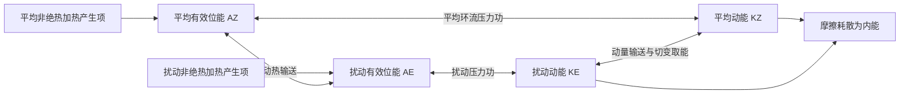

# 1996 年试题解析：逐题解答、考点与频次

> 本文件保留原题及频次，补充对应解答。星级为复习用主观评级；有缺题或排印疑点时，明确注明条件及可解范围。频次按考点出现的不同年份统计，不能视作命题概率。

原始记录：[[动力气象课后习题/往年试题分析/1996]]　｜　[[00_使用说明与年份索引|统计口径与目录]]

## 原卷第一部分

填空

## 题目 1996-一-1

### 原题

中尺度系统的尺度一般在**几十到几百**公里之间，其中 $\alpha$ 尺度系统为**200~2000**公里左右。

### 考点与考察频次

**考察频次：4 次（按年份去重）；🔴 重点。**

| 考点 | 频次 | 标记 | 对应年份 |
|---|---:|---|---|
| 天气系统水平尺度 | 4 次 | 重点 | 1989、1990、1996、2003 |

同考点的全部题号见 [[01_考点频次与证据总表|考点频次与证据总表]]。

### 难度与考试相关度

**难度：★☆☆☆☆（1/5）｜考试相关度：★★★★★（5/5）**

评级依据：历史出现且直接对应所给考纲；频次用于区分复习优先级。

### 考场精简版与审校状态

**审校状态：尚未逐题学科审校。**

**相关高频考点复习摘要（须按本题设问取舍，不替代完整解答）：**

**天气系统水平尺度：** 常用中α为200—2000 km、中β为20—200 km、中γ为2—20 km。温带气旋约千公里、台风数百公里、西南涡数百公里、龙卷常几十至几百米；这些是典型尺度范围，不是每个系统的固定直径。

> 以上摘要用于回忆答题主线，不是官方评分标准；推导、计算和多小问仍须完成下方步骤。

### 详细解答

**原记录填空值：** 几十到几百；200~2000。下文核对其物理含义；出现修改意见时，以修改后的说明为准。

1. 常用尺度分类：中α约 200—2000 km，中β约 20—200 km，中γ约 2—20 km；天气尺度温带气旋约千公里，台风约数百公里，西南涡约数百公里，龙卷常几十至几百米。这些是典型范围，系统边界和平均口径不同会有差异。

## 题目 1996-一-2

### 原题

热带气旋的主要能量来源是**凝结潜热释放**，而温带气旋主要能量来源则为**有效位能释放（斜压能量）**。

### 考点与考察频次

**考察频次：6 次（本题所列考点的最高年份频次，不相加）；🔴 重点。**

| 考点 | 频次 | 标记 | 对应年份 |
|---|---:|---|---|
| 热带气旋能量来源 | 1 次 | 一般 | 1996 |
| 有效位能 | 6 次 | 重点 | 1996、2003、2005、2016、2022、2025 |

同考点的全部题号见 [[01_考点频次与证据总表|考点频次与证据总表]]。

### 难度与考试相关度

**难度：★☆☆☆☆（1/5）｜考试相关度：★★★★★（5/5）**

评级依据：历史出现且直接对应所给考纲；频次用于区分复习优先级。

### 考场精简版与审校状态

**审校状态：尚未逐题学科审校。**

**相关高频考点复习摘要（须按本题设问取舍，不替代完整解答）：**

**有效位能：** 有效位能是实际全位能相对绝热重排后的最低参考态中可供转换的部分。差异加热维持温差，暖升冷沉可将其转为动能。全位能通常指内能与重力位能之和，不是全部都能被利用。

> 以上摘要用于回忆答题主线，不是官方评分标准；推导、计算和多小问仍须完成下方步骤。

### 详细解答

**原记录填空值：** 凝结潜热释放；有效位能释放（斜压能量）。下文核对其物理含义；出现修改意见时，以修改后的说明为准。

1. **能量。** 水汽主要由暖海蒸发补给，海面潜热和显热通量提供焓；凝结将潜热释放，暖升冷沉及压力功转化为动能，摩擦耗散动能。不能把凝结说成凭空制造能量。

1. 单位质量内能 $e=c_vT$，重力位能 $\Phi=gz$（常重力），动能 $K=|\mathbf V|^2/2$，水汽潜热能近似 $L_vq_v$。总量需对气团质量积分；动能不能漏掉 $1/2$。
2. “全位能”在大气能量学中通常指内能与重力位能之和，而非含动能的总能量。静力、平坦底面且顶边界压力趋零时，$\int\rho gz\,dz=-\int z\,dp=\int p\,dz=\int\rho RT\,dz$；加上内能得到 $\int c_pT\,dm$。
3. 有效位能是实际全位能相对绝热重排到参考最低能态后的可用部分。不是全部内能或重力位能都能转换为动能。差异加热维持水平温差，建立有效位能。
4. 暖上升冷下沉时，$C=-\int\alpha'\omega'\,dm>0$，有效位能转为扰动动能；摩擦最终把动能耗散成内能。凝结使潜热转入热力能库，但水汽能量本来主要来自地表蒸发和辐射收支。
5. 对流层常用 Lorenz 四能量库循环如下。双向箭头表示转换可正可负，方向由收支项决定；中纬度斜压波常沿 $A_Z\to A_E\to K_E$ 取能。$A_Z$ 与 $K_Z$ 的直接转换不能漏掉：平均经圈环流同样可通过压力功在平均有效位能和平均动能之间转换。

产生项也可能为负，图中不是所有加热都增加有效位能。若问完整收支，应分别写 $\dot A_Z=G_Z-C_A-C_Z$、$\dot A_E=G_E+C_A-C_E$、$\dot K_Z=C_Z+C_K-D_Z$、$\dot K_E=C_E-C_K-D_E$，这里 $C_K>0$ 约定为扰动动能转入平均动能。四式相加，内部转换项逐项抵消，只剩外部产生与耗散，可用作检查。

## 题目 1996-一-3

### 原题

热成风的风向与等压面上的**等温**线平行。

### 考点与考察频次

**考察频次：8 次（按年份去重）；🔴 重点。**

| 考点 | 频次 | 标记 | 对应年份 |
|---|---:|---|---|
| 热成风 | 8 次 | 重点 | 1992、1994、1996、1997、2003、2005、2014、2021 |

同考点的全部题号见 [[01_考点频次与证据总表|考点频次与证据总表]]。

### 难度与考试相关度

**难度：★☆☆☆☆（1/5）｜考试相关度：★★★★★（5/5）**

评级依据：历史出现且直接对应所给考纲；频次用于区分复习优先级。

### 考场精简版与审校状态

**审校状态：尚未逐题学科审校。**

**相关高频考点复习摘要（须按本题设问取舍，不替代完整解答）：**

**热成风：** 热成风是上下两层地转风之差。由静力关系 $\Phi_{\ln p}=-RT$ 与地转关系得 $\partial u_g/\partial\ln p=(R/f)T_y$、$\partial v_g/\partial\ln p=-(R/f)T_x$。北半球向上的热成风冷侧在左，表示温度梯度对应垂直风切变。

> 以上摘要用于回忆答题主线，不是官方评分标准；推导、计算和多小问仍须完成下方步骤。

### 详细解答

**原记录填空值：** 等温。下文核对其物理含义；出现修改意见时，以修改后的说明为准。

1. 热成风是两个高度或等压面之间的**地转风差**，不是独立的一股实际风。
2. 静力关系给出 $\Phi_{\ln p}=-RT$。对 $u_g=-\Phi_y/f$、$v_g=\Phi_x/f$ 分别作 $\ln p$ 导数（局地取 $f$ 固定），得
$$\frac{\partial u_g}{\partial\ln p}=\frac RfT_y,\qquad \frac{\partial v_g}{\partial\ln p}=-\frac RfT_x.$$
3. 从下层 $p_b$ 积到上层 $p_t<p_b$，若用对数气压平均温度 $\bar T$，则 $u_t-u_b=-(R/f)\ln(p_b/p_t)\bar T_y$、$v_t-v_b=(R/f)\ln(p_b/p_t)\bar T_x$。
4. 北半球向上的热成风沿平均等温线，冷空气在其左侧。温度向北降低时，西风一般随高度增强。该关系把水平温度梯度和垂直风切变连接起来。

## 题目 1996-一-4

### 原题

每年夏季的**7月下旬至8月上旬**时期为我国华北地区雨季，这时副热带高压脊线位于**30~35**°N 之间，全长江流域则进入**伏旱**天气。

### 考点与考察频次

**考察频次：9 次（按年份去重）；🔴 重点。**

| 考点 | 频次 | 标记 | 对应年份 |
|---|---:|---|---|
| 我国雨带季节活动 | 9 次 | 重点 | 1989、1990、1996、1998、2001、2002、2005、2006、2026 |

同考点的全部题号见 [[01_考点频次与证据总表|考点频次与证据总表]]。

### 难度与考试相关度

**难度：★☆☆☆☆（1/5）｜考试相关度：★★★★★（5/5）**

评级依据：历史出现且直接对应所给考纲；频次用于区分复习优先级。

### 考场精简版与审校状态

**审校状态：尚未逐题学科审校。**

**相关高频考点复习摘要（须按本题设问取舍，不替代完整解答）：**

**我国雨带季节活动：** 我国雨带一般由华南前汛期，推进到江淮梅雨，再到华北、东北盛夏雨季，秋季南撤。副高脊线20—25°N、25—30°N、30—35°N是常用阶段性经验范围，应结合西伸东退、冷空气和年份差异，不能当作硬界线。

> 以上摘要用于回忆答题主线，不是官方评分标准；推导、计算和多小问仍须完成下方步骤。

### 详细解答

**原记录填空值：** 7月下旬至8月上旬；30~35；伏旱。下文核对其物理含义；出现修改意见时，以修改后的说明为准。

1. 西太平洋副热带高压是副热带地区深厚、暖性的反气旋系统。中层常用 500 hPa 高度场描述，其内部下沉、对流受抑制，西北侧及北侧暖湿气流与中纬度系统相遇，是重要雨带区。
2. 形成与副热带下沉、行星波、海陆热力差异及热带加热有关，不能单说成“海面冷所以形成冷高压”。暖性结构使高压在较高层更明显，但不同层中心、脊线并不完全重合。
3. 春季至初夏副高偏南，华南锋面和季风雨活跃；6 月前后第一次北跳后，长江中下游进入梅雨，传统脊线经验约为 20°—25°N。
4. 进一步北抬至约 25°—30°N，雨带向江淮、淮河流域推进；7 月下旬至 8 月上旬前后脊线可在 30°—35°N，雨带到华北、东北，长江中下游较易受高压控制出现伏旱。秋季副高南撤，雨带随之南退。
5. 除南北移动，还要考虑西伸东退、强度和滞留时间。副高西伸使水汽输送路径和落区改变，长期稳定可造成一侧持续暴雨、另一侧持续高温。上述纬度和日期是复习用经验，不是每年的硬界线。
6. 原题若把 25°—30°N 直接与华北盛夏雨季对应，应另起行纠正：通常华北盛夏雨季对应更北的 30°—35°N 阶段。

## 题目 1996-一-5

### 原题

台风发生的最大频率区为**西北太平洋**区。台风大多数发生在**5~20**纬带之间。

### 考点与考察频次

**考察频次：3 次（按年份去重）；🔴 重点。**

| 考点 | 频次 | 标记 | 对应年份 |
|---|---:|---|---|
| 热带气旋分布 | 3 次 | 重点 | 1996、1997、2001 |

同考点的全部题号见 [[01_考点频次与证据总表|考点频次与证据总表]]。

### 难度与考试相关度

**难度：★☆☆☆☆（1/5）｜考试相关度：★★★★★（5/5）**

评级依据：历史出现且直接对应所给考纲；频次用于区分复习优先级。

### 考场精简版与审校状态

**审校状态：尚未逐题学科审校。**

**相关高频考点复习摘要（须按本题设问取舍，不替代完整解答）：**

**热带气旋分布：** 西北太平洋热带气旋活动频繁，通常在离赤道一定距离的暖海区生成。阿拉伯海也有热带气旋，南大西洋少见但并非绝对没有；“台风”是区域命名，不是判断其他洋盆是否存在同类系统的依据。

> 以上摘要用于回忆答题主线，不是官方评分标准；推导、计算和多小问仍须完成下方步骤。

### 详细解答

**原记录填空值：** 西北太平洋；5~20。下文核对其物理含义；出现修改意见时，以修改后的说明为准。

1. **分布。** 西北太平洋活动频繁，多在离赤道一定距离的热带海洋生成。阿拉伯海会发生热带气旋；不能因那里不使用“台风”这一地区名称，就说没有该类系统。南大西洋很少发生但并非绝对不发生，赤道附近通常不利于生成。

## 原卷第二部分

名词解释

## 题目 1996-二-1

### 原题

低空急流

### 考点与考察频次

**考察频次：7 次（按年份去重）；🔴 重点。**

| 考点 | 频次 | 标记 | 对应年份 |
|---|---:|---|---|
| 低空急流 | 7 次 | 重点 | 1992、1996、1997、1999、2012、2015、2025 |

同考点的全部题号见 [[01_考点频次与证据总表|考点频次与证据总表]]。

### 难度与考试相关度

**难度：★☆☆☆☆（1/5）｜考试相关度：★★★★★（5/5）**

评级依据：历史出现且直接对应所给考纲；频次用于区分复习优先级。

### 考场精简版与审校状态

**审校状态：尚未逐题学科审校。**

**相关高频考点复习摘要（须按本题设问取舍，不替代完整解答）：**

**低空急流：** 低空急流是低层风速局地极大带，东亚夏季常在850—700 hPa附近。可由压力梯度、地形和夜间摩擦减弱后的惯性振荡形成；输送暖湿空气，在出口或与锋、切变线交汇处产生辐合，利于暴雨；对流加热亦可反馈加强急流。

> 以上摘要用于回忆答题主线，不是官方评分标准；推导、计算和多小问仍须完成下方步骤。

### 详细解答

1. 低空急流是对流层低层的局地风速极大带，东亚夏季常在 850—700 hPa 附近，题中的 12 m/s 或 12—15 m/s 属常用识别量级，具体标准随研究变化。

2. 形成机制包括大尺度压力梯度加强、地形通道和山坡热力差异；夜间地表稳定化削弱摩擦，残余风发生惯性振荡，也可产生夜间风速极大。不同类型低空急流机制并不相同。

3. 低空急流输送暖湿空气，出口附近或与锋、切变线相交处辐合，利于不稳定能量和水汽积聚、暴雨触发；对流加热也可反过来加强低层压力梯度及急流。

## 题目 1996-二-2

### 原题

季节突变

### 考点与考察频次

**考察频次：1 次（按年份去重）；一般。**

| 考点 | 频次 | 标记 | 对应年份 |
|---|---:|---|---|
| 环流季节转换 | 1 次 | 一般 | 1996 |

同考点的全部题号见 [[01_考点频次与证据总表|考点频次与证据总表]]。

### 难度与考试相关度

**难度：★☆☆☆☆（1/5）｜考试相关度：★★★★☆（4/5）**

评级依据：历史出现且直接对应所给考纲；频次用于区分复习优先级。

### 考场精简版与审校状态

**审校状态：尚未逐题学科审校。**

> 以上摘要用于回忆答题主线，不是官方评分标准；推导、计算和多小问仍须完成下方步骤。

### 详细解答

1. 东亚冬季受西伯利亚高压—阿留申低压、东亚大槽和强西风急流控制，偏北风冷干；夏季副高、季风低压、低空水汽输送和南亚高压配合，偏南风暖湿。春夏转换可发生分阶段突变，因海陆/高原加热、季风爆发和急流、副高位置跃变，而不只是平滑逐日北移。

## 题目 1996-二-3

### 原题

上游效应

### 考点与考察频次

**考察频次：5 次（按年份去重）；🔴 重点。**

| 考点 | 频次 | 标记 | 对应年份 |
|---|---:|---|---|
| 上游效应 | 5 次 | 重点 | 1996、2013、2016、2019、2025 |

同考点的全部题号见 [[01_考点频次与证据总表|考点频次与证据总表]]。

### 难度与考试相关度

**难度：★☆☆☆☆（1/5）｜考试相关度：★★★★★（5/5）**

评级依据：历史出现且直接对应所给考纲；频次用于区分复习优先级。

### 考场精简版与审校状态

**审校状态：尚未逐题学科审校。**

**相关高频考点复习摘要（须按本题设问取舍，不替代完整解答）：**

**上游效应：** 槽脊之间通过波传播及能量、动量交换相互影响。罗斯贝波包的群速与槽脊相速不同，可出现上游波衰减、下游新波发展。“上游效应”“下游效应”的命名须与教材约定对应，不能假定所有背景流中传播方向都固定。

> 以上摘要用于回忆答题主线，不是官方评分标准；推导、计算和多小问仍须完成下方步骤。

### 详细解答

1. 罗斯贝波相速与群速不同，一维均匀西风上 $c_p=U-\beta/k^2$，$c_g=U+\beta/k^2$。能量包络可比槽脊向东传播更快，造成下游新波发展、上游旧波衰减，即下游发展。

2. 上下游效应泛指相邻波系通过传播和能量/动量交换相互影响；“上游效应”的教材用法需看其定义，不能以群速公式证明所有情况下影响只能单向向东。二维波和变化基本流中群速方向会变。

## 题目 1996-二-4

### 原题

阻塞高压

### 考点与考察频次

**考察频次：16 次（按年份去重）；🔴 重点。**

| 考点 | 频次 | 标记 | 对应年份 |
|---|---:|---|---|
| 阻塞高压 | 16 次 | 重点 | 1989、1992、1994、1996、1997、1998、2000、2003、2005、2006、2011、2013、2017、2019、2022、2023 |

同考点的全部题号见 [[01_考点频次与证据总表|考点频次与证据总表]]。

### 难度与考试相关度

**难度：★☆☆☆☆（1/5）｜考试相关度：★★★★★（5/5）**

评级依据：历史出现且直接对应所给考纲；频次用于区分复习优先级。

### 考场精简版与审校状态

**审校状态：尚未逐题学科审校。**

**相关高频考点复习摘要（须按本题设问取舍，不替代完整解答）：**

**阻塞高压：** 阻塞高压是中高纬持续、少动并使西风绕行的强脊或闭合高压。建立与暖输送、波破碎及涡旋反馈有关；其东侧偏北气流可蓄积和引导冷空气。衰退配合横槽转竖时可触发寒潮，但并非每次崩溃都必然造成寒潮。

> 以上摘要用于回忆答题主线，不是官方评分标准；推导、计算和多小问仍须完成下方步骤。

### 详细解答

1. 阻塞高压是中高纬持续、移动缓慢的强高压脊或闭合高压，使西风气流绕行、分支，阻碍天气系统正常东移。关键是持续性和对西风带的阻挡，并非所有高压都叫阻塞。
2. 建立时，暖空气向极地输送使脊增强，经向振幅增大，波破碎、涡旋反馈可帮助维持。高压脊发展或与高纬高压合并，南侧可切出冷低压，形成偶极或Ω型等配置。
3. 维持时，阻高东侧偏北气流引导冷空气南下，西侧偏南气流输送暖空气。下游槽及冷暖空气交汇区可长期停留，造成持久冷凉、降雨；高压控制区下沉、少云，可造成干旱和高温，具体依季节和位置。
4. 衰退或崩溃时，维持高压的暖输送与涡旋反馈减弱，西风恢复，槽脊重新东移；其东侧积聚的冷空气可配合横槽转竖大举南下，触发我国寒潮。不能把每一次阻高衰退都等同于寒潮，仍需冷空气强度和路径配合。
5. 亚洲常关注乌拉尔山及鄂霍次克海等阻塞区，北大西洋—欧洲也是重要活动区；不同季节的优势位置不同，不应把某一季节经验说成全年固定不变。
6. 切断低压是从西风主槽分离出的闭合冷性低压，移动缓慢，可与北侧阻高配合。其冷空气及正涡度有利于下游不稳定和上升，但天气还依水汽供应。

## 原卷第三部分

给出下列物理量的数学表达式

## 题目 1996-三-1

### 原题

绝对涡度

### 考点与考察频次

**考察频次：7 次（按年份去重）；🔴 重点。**

| 考点 | 频次 | 标记 | 对应年份 |
|---|---:|---|---|
| 涡度 | 7 次 | 重点 | 1989、1996、1998、2002、2005、2006、2019 |

同考点的全部题号见 [[01_考点频次与证据总表|考点频次与证据总表]]。

### 难度与考试相关度

**难度：★★☆☆☆（2/5）｜考试相关度：★★★★★（5/5）**

评级依据：历史出现且直接对应所给考纲；频次用于区分复习优先级。

### 考场精简版与审校状态

**审校状态：尚未逐题学科审校。**

**相关高频考点复习摘要（须按本题设问取舍，不替代完整解答）：**

**涡度：** 垂直相对涡度 $\zeta=v_x-u_y$，绝对涡度为 $\zeta+f$，单位 $\mathrm{s^{-1}}$。北半球正值通常表示气旋性旋转。取旋度能消去保守压力梯度，但涡度方程单独不能决定完整风场。

> 以上摘要用于回忆答题主线，不是官方评分标准；推导、计算和多小问仍须完成下方步骤。

### 详细解答

1. 定义垂直相对涡度 $\zeta=v_x-u_y$，水平散度 $D=u_x+v_y$，单位均为 $\mathrm{s^{-1}}$。绝对涡度的垂直分量为 $\zeta_a=\zeta+f$；三维绝对涡度为 $\nabla\times\mathbf V+2\boldsymbol\Omega$。

## 题目 1996-三-2

### 原题

散度

### 考点与考察频次

**考察频次：4 次（按年份去重）；🔴 重点。**

| 考点 | 频次 | 标记 | 对应年份 |
|---|---:|---|---|
| 散度 | 4 次 | 重点 | 1996、1998、2002、2005 |

同考点的全部题号见 [[01_考点频次与证据总表|考点频次与证据总表]]。

### 难度与考试相关度

**难度：★★☆☆☆（2/5）｜考试相关度：★★★★★（5/5）**

评级依据：历史出现且直接对应所给考纲；频次用于区分复习优先级。

### 考场精简版与审校状态

**审校状态：尚未逐题学科审校。**

**相关高频考点复习摘要（须按本题设问取舍，不替代完整解答）：**

**散度：** 水平散度 $D=u_x+v_y$，正为辐散、负为辐合，单位 $\mathrm{s^{-1}}$。静力气压坐标连续式 $D+\omega_p=0$，求垂直速度须沿气压积分并给边界条件，不能由单层辐合唯一确定整柱运动。

> 以上摘要用于回忆答题主线，不是官方评分标准；推导、计算和多小问仍须完成下方步骤。

### 详细解答

1. 定义垂直相对涡度 $\zeta=v_x-u_y$，水平散度 $D=u_x+v_y$，单位均为 $\mathrm{s^{-1}}$。绝对涡度的垂直分量为 $\zeta_a=\zeta+f$；三维绝对涡度为 $\nabla\times\mathbf V+2\boldsymbol\Omega$。

## 题目 1996-三-3

### 原题

温度平流

### 考点与考察频次

**考察频次：5 次（按年份去重）；🔴 重点。**

| 考点 | 频次 | 标记 | 对应年份 |
|---|---:|---|---|
| 温度平流 | 5 次 | 重点 | 1989、1996、2001、2002、2026 |

同考点的全部题号见 [[01_考点频次与证据总表|考点频次与证据总表]]。

### 难度与考试相关度

**难度：★★☆☆☆（2/5）｜考试相关度：★★★★★（5/5）**

评级依据：历史出现且直接对应所给考纲；频次用于区分复习优先级。

### 考场精简版与审校状态

**审校状态：尚未逐题学科审校。**

**相关高频考点复习摘要（须按本题设问取舍，不替代完整解答）：**

**温度平流：** 温度平流贡献为 $-\mathbf V_h\cdot\nabla T$。由暖处吹向冷处通常为暖平流、该项为正；反向为冷平流。局地变温还包含垂直运动与非绝热加热，不能把平流贡献等同最终变温。

> 以上摘要用于回忆答题主线，不是官方评分标准；推导、计算和多小问仍须完成下方步骤。

### 详细解答

1. 水平温度平流为 $A_T=-\mathbf V_h\cdot\nabla T=-(uT_x+vT_y)$。风由暖区吹向冷区时，沿风向温度减小，点积为负，故 $A_T>0$，为暖平流；反之 $A_T<0$，为冷平流。
2. 由 $c_pDT/Dt-\alpha\omega=Q$ 和 $\alpha=RT/p$，得 $DT/Dt-\kappa T\omega/p=Q/c_p$。
3. 展开物质导数 $DT/Dt=\partial_tT+uT_x+vT_y+\omega T_p$，移项：
$$\boxed{\partial_tT=-\mathbf V_h\cdot\nabla_pT+\omega\left(\frac{\kappa T}{p}-T_p\right)+\frac Q{c_p}}.$$
4. 右侧依次为水平平流、垂直运动与绝热压缩膨胀的合成作用、非绝热加热。在稳定层结下，上升（$\omega<0$）的动力变温通常为冷却，下沉则增温。因此有暖平流不等于局地温度一定上升。

## 题目 1996-三-4

### 原题

位温

### 考点与考察频次

**考察频次：7 次（按年份去重）；🔴 重点。**

| 考点 | 频次 | 标记 | 对应年份 |
|---|---:|---|---|
| 位温 | 7 次 | 重点 | 1989、1996、2001、2002、2003、2020、2022 |

同考点的全部题号见 [[01_考点频次与证据总表|考点频次与证据总表]]。

### 难度与考试相关度

**难度：★★☆☆☆（2/5）｜考试相关度：★★★★★（5/5）**

评级依据：历史出现且直接对应所给考纲；频次用于区分复习优先级。

### 考场精简版与审校状态

**审校状态：尚未逐题学科审校。**

**相关高频考点复习摘要（须按本题设问取舍，不替代完整解答）：**

**位温：** 位温是气块干绝热移至参考气压 $p_0$ 的温度。由 $c_p dT-RTdp/p=0$ 积分得 $\theta=T(p_0/p)^{R/c_p}$，单位K。理想干绝热时沿气块守恒，有加热时 $D\ln\theta/Dt=Q/(c_pT)$。

> 以上摘要用于回忆答题主线，不是官方评分标准；推导、计算和多小问仍须完成下方步骤。

### 详细解答

1. **定义。** 位温是干空气块沿干绝热线移到参考气压 $p_0$ 时的温度，通常取 $p_0=1000\ \mathrm{hPa}$。
2. **从第一定律出发。** 干绝热时 $c_p\,dT-\alpha\,dp=0$。由 $\alpha=RT/p$，得 $dT/T=(R/c_p)dp/p$。
3. **积分。** 记 $\kappa=R/c_p$，从 $(p,T)$ 积分到 $(p_0,\theta)$：$\ln(\theta/T)=\kappa\ln(p_0/p)$。
4. **结果。** $\boxed{\theta=T(p_0/p)^\kappa}$。干绝热运动中 $D\theta/Dt=0$；有潜热释放或其他加热时，不能直接假定干位温守恒。位温单位为 K。

## 原卷第四部分

回答问题

## 题目 1996-四-1

### 原题

太平洋副热带高压结构的主要特点是哪些？

### 考点与考察频次

**考察频次：7 次（按年份去重）；🔴 重点。**

| 考点 | 频次 | 标记 | 对应年份 |
|---|---:|---|---|
| 西太平洋副热带高压 | 7 次 | 重点 | 1996、1997、1998、2001、2005、2019、2021 |

同考点的全部题号见 [[01_考点频次与证据总表|考点频次与证据总表]]。

### 难度与考试相关度

**难度：★★★☆☆（3/5）｜考试相关度：★★★★★（5/5）**

评级依据：历史出现且直接对应所给考纲；频次用于区分复习优先级。

### 考场精简版与审校状态

**审校状态：尚未逐题学科审校。**

**相关高频考点复习摘要（须按本题设问取舍，不替代完整解答）：**

**西太平洋副热带高压：** 西太副高是深厚暖性反气旋系统。控制区下沉少云，北侧和西北侧的暖湿输送与冷空气交汇可形成雨带。其北跳南撤、西伸东退和强度变化共同调制我国雨季、伏旱与台风路径，不能只看一条脊线纬度。

> 以上摘要用于回忆答题主线，不是官方评分标准；推导、计算和多小问仍须完成下方步骤。

### 详细解答

1. 西太平洋副热带高压是副热带地区深厚、暖性的反气旋系统。中层常用 500 hPa 高度场描述，其内部下沉、对流受抑制，西北侧及北侧暖湿气流与中纬度系统相遇，是重要雨带区。
2. 形成与副热带下沉、行星波、海陆热力差异及热带加热有关，不能单说成“海面冷所以形成冷高压”。暖性结构使高压在较高层更明显，但不同层中心、脊线并不完全重合。
3. 春季至初夏副高偏南，华南锋面和季风雨活跃；6 月前后第一次北跳后，长江中下游进入梅雨，传统脊线经验约为 20°—25°N。
4. 进一步北抬至约 25°—30°N，雨带向江淮、淮河流域推进；7 月下旬至 8 月上旬前后脊线可在 30°—35°N，雨带到华北、东北，长江中下游较易受高压控制出现伏旱。秋季副高南撤，雨带随之南退。
5. 除南北移动，还要考虑西伸东退、强度和滞留时间。副高西伸使水汽输送路径和落区改变，长期稳定可造成一侧持续暴雨、另一侧持续高温。上述纬度和日期是复习用经验，不是每年的硬界线。
6. 原题若把 25°—30°N 直接与华北盛夏雨季对应，应另起行纠正：通常华北盛夏雨季对应更北的 30°—35°N 阶段。

## 题目 1996-四-2

### 原题

试述青藏高原对东亚地区环流及天气过程的主要影响（回答四种以上）。

### 考点与考察频次

**考察频次：6 次（按年份去重）；🔴 重点。**

| 考点 | 频次 | 标记 | 对应年份 |
|---|---:|---|---|
| 青藏高原天气气候效应 | 6 次 | 重点 | 1994、1996、2000、2010、2013、2025 |

同考点的全部题号见 [[01_考点频次与证据总表|考点频次与证据总表]]。

### 难度与考试相关度

**难度：★★★☆☆（3/5）｜考试相关度：★★★★★（5/5）**

评级依据：历史出现且直接对应所给考纲；频次用于区分复习优先级。

### 考场精简版与审校状态

**审校状态：尚未逐题学科审校。**

**相关高频考点复习摘要（须按本题设问取舍，不替代完整解答）：**

**青藏高原天气气候效应：** 高原动力作用包括阻挡分流、抬升、下游波列和改变冷空气路径；热力作用冬季偏冷源、夏季为高架热源，调制季风、南亚高压与副高配置。高原低涡、切变线及水汽输送还可影响长江流域降水。

> 以上摘要用于回忆答题主线，不是官方评分标准；推导、计算和多小问仍须完成下方步骤。

### 详细解答

1. **动力作用。** 高原作为巨大地形障碍，使西风绕流或爬升，分成南北支，改变下游槽脊、急流和定常行星波；山地抬升使迎风坡降水增加，背风坡下沉增温变干。实际响应取决于风向、层结、山高和阻塞程度。

2. **热力作用。** 冬季高原是重要冷源，近地层冷却有利于冷高压背景；夏季高原地表显热与对流凝结潜热使其成为高架热源，低层热低压、高层南亚高压及季风环流响应。注意近地层热低压和高空暖高压可同时存在，不能认为相互矛盾。

3. **对我国天气。** 冬季加强东亚下游槽和冷空气输送背景；春夏高原加热促进季风转换；夏季调节副高与南亚高压配置、水汽通道、梅雨雨带；高原低涡和切变线移出高原可触发下游降水；地形阻挡改变冷空气路径。这些作用满足“四种以上”的列举要求。

## 题目 1996-四-3

### 原题

叙述东亚典型寒潮过程（第二类）的特征是什么？

### 考点与考察频次

**考察频次：17 次（按年份去重）；🔴 重点。**

| 考点 | 频次 | 标记 | 对应年份 |
|---|---:|---|---|
| 寒潮及其天气过程 | 17 次 | 重点 | 1990、1996、2000、2001、2002、2006、2010、2011、2012、2014、2016、2017、2019、2021、2022、2024、2026 |

同考点的全部题号见 [[01_考点频次与证据总表|考点频次与证据总表]]。

### 难度与考试相关度

**难度：★★★☆☆（3/5）｜考试相关度：★★★★★（5/5）**

评级依据：历史出现且直接对应所给考纲；频次用于区分复习优先级。

### 考场精简版与审校状态

**审校状态：尚未逐题学科审校。**

**相关高频考点复习摘要（须按本题设问取舍，不替代完整解答）：**

**寒潮及其天气过程：** 寒潮是强冷空气大范围南下造成显著降温、大风及可能雨雪冻害的过程。答路径时分西路、西北路、东路；答发展时写冷空气蓄积→高空槽脊调整→地面冷高压和冷锋南下；是否达到业务等级须核对相应标准。

> 以上摘要用于回忆答题主线，不是官方评分标准；推导、计算和多小问仍须完成下方步骤。

### 详细解答

1. 寒潮是强冷空气大范围侵入中低纬，造成剧烈降温、大风，常伴雨雪或冻害的天气过程；达到业务寒潮等级还要按适用标准核对降温幅度和最低温度，不能把所有冷空气过程称为寒潮。
2. **源地和蓄积区。** 传统天气学源地归纳包括新地岛以西、新地岛以东和冰岛以南洋面；冷空气可在西伯利亚—蒙古一带进一步辐射冷却、蓄积。源地不同于进入我国的路径，不能混为一项。
3. **路径。** 西路经新疆及高原北侧影响西北、西南；西北路经蒙古、河套南下，常影响我国中东部大部；东路偏经东北、华北和东部沿海。多路冷空气汇合时范围和强度可增大，但不存在不问强度、地形、水汽就永远“最严重”的一路。
4. **环流演变。** 阻塞高压或暖脊建立，东侧冷空气积聚；亚洲极涡或横槽南压；短波发展、横槽转竖或大槽东移使槽后偏北气流加强，地面冷高压增强南下，冷锋迅速推进，随后东亚大槽重建。
5. **天气。** 锋前可回暖和增湿，锋过时风向突变、大风降温，水汽足时出现雨雪；锋后气压升高、天气转晴，夜间辐射降温及霜冻可加剧。干冷型雨雪少，湿冷型雨雪多，不能要求每次寒潮都具同样降水。
6. **倒Ω中期演变。** 两大洋北部脊向高纬发展，极涡分裂或偏心；乌拉尔与东亚东北侧脊发展，亚洲冷涡被夹持并南压，形成类似倒Ω的槽脊配置；随后横槽转竖或长波槽快速发展，槽后冷空气爆发南下。画图时应画“两侧高脊、中间冷槽/涡”，并用槽后偏北箭头表示冷空气路径。
7. **预报关键。** 同时监视阻高和脊、极涡/横槽、地面冷高压与冷锋。常见短中期型包括小槽发展、横槽转竖和低槽东移；不同教材的“第几类”编号不统一，未给分类表时不能凭编号唯一指定。

## 题目 1996-四-4

### 原题

叙述北半球大型环流总体分型的方法，并指出北半球总体可分为哪几种环流型？其各自的特点是什么？

### 考点与考察频次

**考察频次：2 次（按年份去重）；一般。**

| 考点 | 频次 | 标记 | 对应年份 |
|---|---:|---|---|
| 环流型 | 2 次 | 一般 | 1996、1998 |

同考点的全部题号见 [[01_考点频次与证据总表|考点频次与证据总表]]。

### 难度与考试相关度

**难度：★★★☆☆（3/5）｜考试相关度：★★★★☆（4/5）**

评级依据：历史出现且直接对应所给考纲；频次用于区分复习优先级。

### 考场精简版与审校状态

**审校状态：尚未逐题学科审校。**

> 以上摘要用于回忆答题主线，不是官方评分标准；推导、计算和多小问仍须完成下方步骤。

### 详细解答

1. 环流分型可依槽脊数目、振幅、位置和优势流向分为纬向型、经向型及过渡/混合型；其他教材还按区域槽脊位置作更细分类。大气活动中心是多年平均气压场中持续或季节性出现的主要高低压区，位置和强度的变化组织区域天气。

## 题目 1996-四-5

### 原题

什么叫西风环流指数？一般在哪一层次、哪一个纬度范围内计算？如何计算？什么叫指数循环？

### 考点与考察频次

**考察频次：4 次（按年份去重）；🔴 重点。**

| 考点 | 频次 | 标记 | 对应年份 |
|---|---:|---|---|
| 环流指数 | 4 次 | 重点 | 1992、1994、1996、1997 |

同考点的全部题号见 [[01_考点频次与证据总表|考点频次与证据总表]]。

### 难度与考试相关度

**难度：★★☆☆☆（2/5）｜考试相关度：★★★★★（5/5）**

评级依据：历史出现且直接对应所给考纲；频次用于区分复习优先级。

### 考场精简版与审校状态

**审校状态：已给明确约定，教材口径待核。**

**针对本题的精简作答：**

定义西风指数→注明本解采用500 hPa、35°—55°N高度差→用地转关系换算平均西风→解释高低指数及指数循环。

> 以上摘要用于回忆答题主线，不是官方评分标准；推导、计算和多小问仍须完成下方步骤。

### 详细解答

**定义：** 西风环流指数用中高纬平均纬向风强度，或与它相联系的南北位势高度差表示纬向环流强弱。

1. 本解明确采用一种常见的500 hPa、35°N—55°N高度差定义：$I_Z=\overline Z(35°N)-\overline Z(55°N)$。横线表示在选定经度范围的平均，使用半球或区域平均时须说明。
2. 由地转关系 $u_g=-(g_0/f)\partial Z/\partial y$，在纬带中以参考 $f$ 和有限差分估算：$\overline u_g\approx g_0I_Z/[f a(20\pi/180)]$。高度差指数的单位为m，换算风速指数的单位为m/s，不能混写。
3. 高指数通常偏强而平直的纬向西风，低指数偏弱而振幅较大的经向槽脊。指数循环指指数及相应波幅、流型的阶段演变，不是固定周期的正弦振荡。
4. 不同教材也有其他层次和纬带定义。上述是明确约定后的完整计算方法；若课程给定的层次或纬度不同，应按课程定义计算，不能把本例宣称为唯一标准。

## 题目 1996-四-6

### 原题

可压、旋转、层结、对流大气中借助于尺度分析可得到哪些表面大气上述各自特征的无量纲参数？它们的各自物理意义是什么？

### 考点与考察频次

**考察频次：1 次（按年份去重）；一般。**

| 考点 | 频次 | 标记 | 对应年份 |
|---|---:|---|---|
| 无量纲化 | 1 次 | 一般 | 1996 |

同考点的全部题号见 [[01_考点频次与证据总表|考点频次与证据总表]]。

### 难度与考试相关度

**难度：★★☆☆☆（2/5）｜考试相关度：★★★★☆（4/5）**

评级依据：历史出现且直接对应所给考纲；频次用于区分复习优先级。

### 考场精简版与审校状态

**审校状态：尚未逐题学科审校。**

> 以上摘要用于回忆答题主线，不是官方评分标准；推导、计算和多小问仍须完成下方步骤。

### 详细解答

1. 取水平长度 $L$、竖直长度 $H$、速度 $U,W$、时间 $T$，把变量写成尺度乘无量纲量。水平局地加速度量级 $U/T$，平流加速度 $U^2/L$，科氏项 $f_0U$，压力梯度项 $\Delta p/(\rho L)$。
2. 罗斯贝数 $Ro=U/(|f_0|L)$ 比较平流惯性和科氏作用；时间罗斯贝数 $Ro_t=1/(|f_0|T)$ 比较局地加速度和科氏作用。大尺度适应的快速阶段 $Ro_t$ 可为一阶，缓慢演变阶段两种罗斯贝数通常均小。
3. 马赫数 $Ma=U/c_s$ 衡量可压缩效应；弗劳德数 $Fr=U/(NH)$（采用层结竖直长度定义）比较运动和层结回复；Burger 数 $Bu=(NH/(f_0L))^2$ 比较变形尺度和水平尺度；纵横比 $\delta=H/L\ll1$ 表示薄层。雷诺数 $Re=UL/\nu$ 比较惯性和黏性。
4. 若 $Ro,Ro_t\ll1$，水平零阶为地转平衡；非地转风是一阶修正，承担散度和次级环流。$H/L\ll1$ 且竖直惯性远小于浮力、重力相关项时可取静力近似；薄层不自动排除每一种强对流。
5. 连续方程估算 $W/H\sim D$。一般辐散流 $D\sim U/L$，故 $W\sim UH/L$；准地转运动地转部分近无辐散，实际 $D$ 更小，$W$ 也更小。天气尺度 $w$ 常为厘米每秒量级，对流上升可达米每秒甚至更高。
6. 地转参数 $f=2\Omega\sin\varphi$；在参考纬度展开 $f=f_0+\beta y$，$\beta=2\Omega\cos\varphi_0/a$。$f$ 平面忽略 $\beta y$；赤道β平面取 $f_0=0$、$f=\beta y$，不能在赤道继续除以 $f_0$ 使用中纬地转近似。

