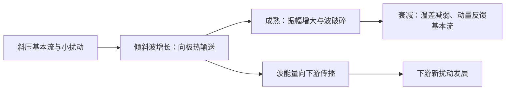

# 1997 年试题解析：逐题解答、考点与频次

> 本文件保留原题及频次，补充对应解答。星级为复习用主观评级；有缺题或排印疑点时，明确注明条件及可解范围。频次按考点出现的不同年份统计，不能视作命题概率。

原始记录：[[动力气象课后习题/往年试题分析/1997]]　｜　[[00_使用说明与年份索引|统计口径与目录]]

## 原卷第一部分

填空

## 题目 1997-一-1

### 原题

冬季东亚副热带急流轴平均高度在**200hPa（约12km）**，在 130°E 日本上空风速最大可至**70~80** m/s。

### 考点与考察频次

**考察频次：8 次（按年份去重）；🔴 重点。**

| 考点 | 频次 | 标记 | 对应年份 |
|---|---:|---|---|
| 高空急流 | 8 次 | 重点 | 1990、1992、1997、2000、2004、2006、2013、2021 |

同考点的全部题号见 [[01_考点频次与证据总表|考点频次与证据总表]]。

### 难度与考试相关度

**难度：★☆☆☆☆（1/5）｜考试相关度：★★★★★（5/5）**

评级依据：历史出现且直接对应所给考纲；频次用于区分复习优先级。

### 考场精简版与审校状态

**审校状态：尚未逐题学科审校。**

**相关高频考点复习摘要（须按本题设问取舍，不替代完整解答）：**

**高空急流：** 高空急流是对流层上部狭长强风带，横向和垂直切变强。极锋急流与斜压锋区相关，副热带急流还受低纬角动量输送影响；冬强偏南、夏弱偏北。急流加减速与曲率引起非地转次级环流，可影响下方上升和气旋发展。

> 以上摘要用于回忆答题主线，不是官方评分标准；推导、计算和多小问仍须完成下方步骤。

### 详细解答

**原记录填空值：** 200hPa（约12km）；70~80。下文核对其物理含义；出现修改意见时，以修改后的说明为准。

1. 急流是狭长的强风带，横向和竖直风切变显著，急流轴是局地最大风速的位置。高空西风急流位于对流层上部，冬季更强、更偏南；夏季整体偏北、减弱。东亚日本附近冬季急流可很强，题中 70—80 m/s 是典型量级而非上限。

2. 极锋急流与中纬度锋区斜压性相联系；副热带急流还与低纬向极运动的角动量输送和热成风共同有关。强南北温度梯度通过热成风使西风随高度增强；不能只归因于地面风向上复制。

3. 急流入口、出口的加减速和曲率导致非地转次级环流，局部辐散有利于下方上升和气旋发展；简单直急流象限规则只在相应理想条件下适用。

## 题目 1997-一-2

### 原题

夏季东亚地区低空急流轴高度一般在 **850~700 hPa**，风速约为**12~15** m/s，它对**暴雨**天气影响。

### 考点与考察频次

**考察频次：7 次（按年份去重）；🔴 重点。**

| 考点 | 频次 | 标记 | 对应年份 |
|---|---:|---|---|
| 低空急流 | 7 次 | 重点 | 1992、1996、1997、1999、2012、2015、2025 |

同考点的全部题号见 [[01_考点频次与证据总表|考点频次与证据总表]]。

### 难度与考试相关度

**难度：★☆☆☆☆（1/5）｜考试相关度：★★★★★（5/5）**

评级依据：历史出现且直接对应所给考纲；频次用于区分复习优先级。

### 考场精简版与审校状态

**审校状态：尚未逐题学科审校。**

**相关高频考点复习摘要（须按本题设问取舍，不替代完整解答）：**

**低空急流：** 低空急流是低层风速局地极大带，东亚夏季常在850—700 hPa附近。可由压力梯度、地形和夜间摩擦减弱后的惯性振荡形成；输送暖湿空气，在出口或与锋、切变线交汇处产生辐合，利于暴雨；对流加热亦可反馈加强急流。

> 以上摘要用于回忆答题主线，不是官方评分标准；推导、计算和多小问仍须完成下方步骤。

### 详细解答

**原记录填空值：** 850~700 hPa；12~15；暴雨。下文核对其物理含义；出现修改意见时，以修改后的说明为准。

1. 低空急流是对流层低层的局地风速极大带，东亚夏季常在 850—700 hPa 附近，题中的 12 m/s 或 12—15 m/s 属常用识别量级，具体标准随研究变化。

2. 形成机制包括大尺度压力梯度加强、地形通道和山坡热力差异；夜间地表稳定化削弱摩擦，残余风发生惯性振荡，也可产生夜间风速极大。不同类型低空急流机制并不相同。

3. 低空急流输送暖湿空气，出口附近或与锋、切变线相交处辐合，利于不稳定能量和水汽积聚、暴雨触发；对流加热也可反过来加强低层压力梯度及急流。

## 题目 1997-一-3

### 原题

全球台风发生频率以**西北太平洋**最高，而**南大西洋**、**东南太平洋**和**北印度洋（阿拉伯海）**地区则无台风发生。

### 考点与考察频次

**考察频次：3 次（按年份去重）；🔴 重点。**

| 考点 | 频次 | 标记 | 对应年份 |
|---|---:|---|---|
| 热带气旋分布 | 3 次 | 重点 | 1996、1997、2001 |

同考点的全部题号见 [[01_考点频次与证据总表|考点频次与证据总表]]。

### 难度与考试相关度

**难度：★☆☆☆☆（1/5）｜考试相关度：★★★★★（5/5）**

评级依据：历史出现且直接对应所给考纲；频次用于区分复习优先级。

### 考场精简版与审校状态

**审校状态：尚未逐题学科审校。**

**相关高频考点复习摘要（须按本题设问取舍，不替代完整解答）：**

**热带气旋分布：** 西北太平洋热带气旋活动频繁，通常在离赤道一定距离的暖海区生成。阿拉伯海也有热带气旋，南大西洋少见但并非绝对没有；“台风”是区域命名，不是判断其他洋盆是否存在同类系统的依据。

> 以上摘要用于回忆答题主线，不是官方评分标准；推导、计算和多小问仍须完成下方步骤。

### 详细解答

**原记录填空值：** 西北太平洋；南大西洋；东南太平洋；北印度洋（阿拉伯海）。下文核对其物理含义；出现修改意见时，以修改后的说明为准。

1. **分布。** 西北太平洋活动频繁，多在离赤道一定距离的热带海洋生成。阿拉伯海会发生热带气旋；不能因那里不使用“台风”这一地区名称，就说没有该类系统。南大西洋很少发生但并非绝对不发生，赤道附近通常不利于生成。

## 题目 1997-一-4

### 原题

当地气流越过山脉，环流系统绕强变化是：迎风面易使槽**减弱**，脊**加强**，而背风坡相反。

### 考点与考察频次

**考察频次：4 次（按年份去重）；🔴 重点。**

| 考点 | 频次 | 标记 | 对应年份 |
|---|---:|---|---|
| 气柱越山与位涡守恒应用 | 4 次 | 重点 | 1997、2003、2019、2021 |

同考点的全部题号见 [[01_考点频次与证据总表|考点频次与证据总表]]。

### 难度与考试相关度

**难度：★☆☆☆☆（1/5）｜考试相关度：★★★★★（5/5）**

评级依据：历史出现且直接对应所给考纲；频次用于区分复习优先级。

### 考场精简版与审校状态

**审校状态：尚未逐题学科审校。**

**相关高频考点复习摘要（须按本题设问取舍，不替代完整解答）：**

**气柱越山与位涡守恒应用：** 浅水柱位涡守恒为 $(\zeta+f)/h=\mathrm{常数}$。固定上界、同纬度时迎风柱压缩导致反气旋性变化，背风柱伸长导致气旋性变化。若纬度改变须重新算 $f$；远下游柱厚完全恢复时不能无条件推断永久留有低槽。

> 以上摘要用于回忆答题主线，不是官方评分标准；推导、计算和多小问仍须完成下方步骤。

### 详细解答

**原记录填空值：** 减弱；加强。下文核对其物理含义；出现修改意见时，以修改后的说明为准。

1. 在绝热、无摩擦、浅水柱近似下 $q=(\zeta+f)/h$ 守恒，故 $(\zeta_1+f_1)/h_1=(\zeta_2+f_2)/h_2$。
2. 解出 $\zeta_2=(h_2/h_1)(\zeta_1+f_1)-f_2$。若同纬度越过山脉且上界固定，迎风坡柱厚减小，绝对涡度减小，产生反气旋性变化；背风坡柱厚恢复增大，产生气旋性变化，有利于背风槽形成。
3. 必须说明上界和气柱厚度：若上下边界同时抬升而厚度不变，不能仅凭“越山”推断伸缩。若纬度变化，则还需计入 $f$ 变化。
4. 理想定常、对称山地、固定纬度模型中，若远下游厚度完全恢复到上游，且没有其他作用，远下游涡度也可恢复。背风坡气旋性涡度倾向并不意味着无条件留下永久低压槽；β效应、路径位移和下游波列可使实际响应更复杂。

## 原卷第二部分

名词解释

## 题目 1997-二-1

### 原题

大气活动中心

### 考点与考察频次

**考察频次：1 次（按年份去重）；一般。**

| 考点 | 频次 | 标记 | 对应年份 |
|---|---:|---|---|
| 大气活动中心 | 1 次 | 一般 | 1997 |

同考点的全部题号见 [[01_考点频次与证据总表|考点频次与证据总表]]。

### 难度与考试相关度

**难度：★☆☆☆☆（1/5）｜考试相关度：★★★★☆（4/5）**

评级依据：历史出现且直接对应所给考纲；频次用于区分复习优先级。

### 考场精简版与审校状态

**审校状态：尚未逐题学科审校。**

> 以上摘要用于回忆答题主线，不是官方评分标准；推导、计算和多小问仍须完成下方步骤。

### 详细解答

1. 环流分型可依槽脊数目、振幅、位置和优势流向分为纬向型、经向型及过渡/混合型；其他教材还按区域槽脊位置作更细分类。大气活动中心是多年平均气压场中持续或季节性出现的主要高低压区，位置和强度的变化组织区域天气。

## 题目 1997-二-2

### 原题

热成风

### 考点与考察频次

**考察频次：8 次（按年份去重）；🔴 重点。**

| 考点 | 频次 | 标记 | 对应年份 |
|---|---:|---|---|
| 热成风 | 8 次 | 重点 | 1992、1994、1996、1997、2003、2005、2014、2021 |

同考点的全部题号见 [[01_考点频次与证据总表|考点频次与证据总表]]。

### 难度与考试相关度

**难度：★☆☆☆☆（1/5）｜考试相关度：★★★★★（5/5）**

评级依据：历史出现且直接对应所给考纲；频次用于区分复习优先级。

### 考场精简版与审校状态

**审校状态：尚未逐题学科审校。**

**相关高频考点复习摘要（须按本题设问取舍，不替代完整解答）：**

**热成风：** 热成风是上下两层地转风之差。由静力关系 $\Phi_{\ln p}=-RT$ 与地转关系得 $\partial u_g/\partial\ln p=(R/f)T_y$、$\partial v_g/\partial\ln p=-(R/f)T_x$。北半球向上的热成风冷侧在左，表示温度梯度对应垂直风切变。

> 以上摘要用于回忆答题主线，不是官方评分标准；推导、计算和多小问仍须完成下方步骤。

### 详细解答

1. 热成风是两个高度或等压面之间的**地转风差**，不是独立的一股实际风。
2. 静力关系给出 $\Phi_{\ln p}=-RT$。对 $u_g=-\Phi_y/f$、$v_g=\Phi_x/f$ 分别作 $\ln p$ 导数（局地取 $f$ 固定），得
$$\frac{\partial u_g}{\partial\ln p}=\frac RfT_y,\qquad \frac{\partial v_g}{\partial\ln p}=-\frac RfT_x.$$
3. 从下层 $p_b$ 积到上层 $p_t<p_b$，若用对数气压平均温度 $\bar T$，则 $u_t-u_b=-(R/f)\ln(p_b/p_t)\bar T_y$、$v_t-v_b=(R/f)\ln(p_b/p_t)\bar T_x$。
4. 北半球向上的热成风沿平均等温线，冷空气在其左侧。温度向北降低时，西风一般随高度增强。该关系把水平温度梯度和垂直风切变连接起来。

## 题目 1997-二-3

### 原题

第二类条件不稳定

### 考点与考察频次

**考察频次：10 次（按年份去重）；🔴 重点。**

| 考点 | 频次 | 标记 | 对应年份 |
|---|---:|---|---|
| 第二类条件不稳定（CISK） | 10 次 | 重点 | 1997、2000、2003、2010、2014、2016、2020、2022、2025、2026 |

同考点的全部题号见 [[01_考点频次与证据总表|考点频次与证据总表]]。

### 难度与考试相关度

**难度：★☆☆☆☆（1/5）｜考试相关度：★★★★★（5/5）**

评级依据：历史出现且直接对应所给考纲；频次用于区分复习优先级。

### 考场精简版与审校状态

**审校状态：尚未逐题学科审校。**

**相关高频考点复习摘要（须按本题设问取舍，不替代完整解答）：**

**第二类条件不稳定（CISK）：** CISK是对流和大尺度环流的正反馈：初始旋转扰动→摩擦辐合和水汽输送→凝结潜热加热→暖心、质量场及高层外流调整→低压和辐合增强。能量依海气焓供应与湿对流转化，不能把凝结视作凭空产能。

> 以上摘要用于回忆答题主线，不是官方评分标准；推导、计算和多小问仍须完成下方步骤。

### 详细解答

1. **初始扰动。** 季风槽、热带辐合带扰动、东风波、赤道罗斯贝波等可提供涡度、辐合和持续对流。多数初始扰动不会发展，环境与内部组织过程都重要。

2. **CISK 链条。** 初始低压旋转 → 边界层摩擦造成向中心的水汽辐合 → 对流凝结释放潜热 → 暖心及质量场调整、高层外流加强 → 低压和低层旋转增强 → 更强辐合。对流和大尺度环流相互反馈而非单独气块条件不稳定，因此称第二类条件不稳定。它是理想化解释，现代海气通量反馈等机制不可省略。

3. **能量。** 水汽主要由暖海蒸发补给，海面潜热和显热通量提供焓；凝结将潜热释放，暖升冷沉及压力功转化为动能，摩擦耗散动能。不能把凝结说成凭空制造能量。

## 题目 1997-二-4

### 原题

飑线

### 考点与考察频次

**考察频次：7 次（按年份去重）；🔴 重点。**

| 考点 | 频次 | 标记 | 对应年份 |
|---|---:|---|---|
| 飑线 | 7 次 | 重点 | 1997、1999、2000、2010、2017、2019、2021 |

同考点的全部题号见 [[01_考点频次与证据总表|考点频次与证据总表]]。

### 难度与考试相关度

**难度：★☆☆☆☆（1/5）｜考试相关度：★★★★★（5/5）**

评级依据：历史出现且直接对应所给考纲；频次用于区分复习优先级。

### 考场精简版与审校状态

**审校状态：尚未逐题学科审校。**

**相关高频考点复习摘要（须按本题设问取舍，不替代完整解答）：**

**飑线：** 飑线是组织成狭长线状的强对流系统。冷池前缘辐合不断触发新单体，风切变帮助维持组织；过站常有阵风增强、风向突变、降温和升压，可伴雷雨、冰雹，后部可有层状降水。

> 以上摘要用于回忆答题主线，不是官方评分标准；推导、计算和多小问仍须完成下方步骤。

### 详细解答

1. 飑线是沿线状排列并组织成系统的强对流，前缘辐合与冷池推进触发新生对流，可有后部层状降水。过站时常风向突变、阵风增强、温度骤降、气压骤升，伴雷雨、冰雹等；地面升压主要与冷池密度增加及动力作用有关。

2. **环境条件。** 低层暖湿、具有可释放的不稳定能量，锋面/辐合线/地形等提供抬升；适宜的垂直风切变使上升和下沉气流分离，支持较长寿命。强切变有助组织化，但不能取代水汽和浮力。

## 题目 1997-二-5

### 原题

西风指数

### 考点与考察频次

**考察频次：4 次（按年份去重）；🔴 重点。**

| 考点 | 频次 | 标记 | 对应年份 |
|---|---:|---|---|
| 环流指数 | 4 次 | 重点 | 1992、1994、1996、1997 |

同考点的全部题号见 [[01_考点频次与证据总表|考点频次与证据总表]]。

### 难度与考试相关度

**难度：★☆☆☆☆（1/5）｜考试相关度：★★★★★（5/5）**

评级依据：历史出现且直接对应所给考纲；频次用于区分复习优先级。

### 考场精简版与审校状态

**审校状态：尚未逐题学科审校。**

**相关高频考点复习摘要（须按本题设问取舍，不替代完整解答）：**

**环流指数：** 西风指数利用中高纬某层的南北高度差或平均纬向风衡量西风强弱；需注明采用的层次、纬带和公式。高指数偏纬向、低指数偏经向，指数循环描述槽脊振幅与流型演变，不是严格周期。

> 以上摘要用于回忆答题主线，不是官方评分标准；推导、计算和多小问仍须完成下方步骤。

### 详细解答

1. 西风指数用中高纬某层的南北位势高度差表征平均西风强度，例如 $I=\overline{Z}(35°N)-\overline{Z}(55°N)$，由地转关系换算纬带平均西风。具体层次、纬度带依课程定义，应写出采用的约定。高指数偏纬向、低指数偏经向，指数循环是两类状态及波幅的演变，不是严格周期。

## 原卷第三部分

回答问题

## 题目 1997-三-1

### 原题

说明地转风关系的基本原理，它在天气分析中应用原则。

### 考点与考察频次

**考察频次：12 次（按年份去重）；🔴 重点。**

| 考点 | 频次 | 标记 | 对应年份 |
|---|---:|---|---|
| 地转风 | 12 次 | 重点 | 1989、1994、1997、1998、2001、2002、2003、2005、2006、2010、2019、2024 |

同考点的全部题号见 [[01_考点频次与证据总表|考点频次与证据总表]]。

### 难度与考试相关度

**难度：★★☆☆☆（2/5）｜考试相关度：★★★★★（5/5）**

评级依据：历史出现且直接对应所给考纲；频次用于区分复习优先级。

### 考场精简版与审校状态

**审校状态：尚未逐题学科审校。**

**相关高频考点复习摘要（须按本题设问取舍，不替代完整解答）：**

**地转风：** 中纬度大尺度缓变、摩擦可忽略时，水平气压梯度力与科氏力近似平衡：$u_g=-\Phi_y/f$、$v_g=\Phi_x/f$。风平行等高线，北半球低值在风向左侧。近赤道、摩擦层和强曲率快速运动中须检验适用性。

> 以上摘要用于回忆答题主线，不是官方评分标准；推导、计算和多小问仍须完成下方步骤。

### 详细解答

1. 在局地直角坐标中，忽略摩擦时水平动量方程为 $Du/Dt-fv=-\Phi_x$、$Dv/Dt+fu=-\Phi_y$，这里的导数取在等压面上。
2. 对中纬度大尺度缓变运动，$Ro=U/(fL)\ll1$，惯性项相对较小，得到 $-fv_g=-\Phi_x$、$fu_g=-\Phi_y$。
3. 解得 $\boxed{u_g=-\Phi_y/f,\quad v_g=\Phi_x/f}$，即 $\mathbf V_g=\mathbf k\times\nabla_p\Phi/f$；大小为 $|\nabla_p\Phi|/|f|$。
4. 因叉积垂直于梯度，地转风平行于等高线；北半球背风而立时低值在左、高值在右，南半球相反。等高线越密风越强，但还受纬度 $f$ 影响。
5. 近赤道 $f\to0$、摩擦层、强曲率或快速变化的小尺度系统中不能直接采用地转近似。等高面上应改用 $\nabla_zp/\rho$，不要把两种坐标的梯度混用。

## 题目 1997-三-2

### 原题

梅雨锋的基本特征是什么？它与极峰的差异是什么？

### 考点与考察频次

**考察频次：13 次（按年份去重）；🔴 重点。**

| 考点 | 频次 | 标记 | 对应年份 |
|---|---:|---|---|
| 梅雨 | 13 次 | 重点 | 1990、1992、1997、2000、2002、2003、2004、2005、2013、2014、2020、2022、2024 |

同考点的全部题号见 [[01_考点频次与证据总表|考点频次与证据总表]]。

### 难度与考试相关度

**难度：★★☆☆☆（2/5）｜考试相关度：★★★★★（5/5）**

评级依据：历史出现且直接对应所给考纲；频次用于区分复习优先级。

### 考场精简版与审校状态

**审校状态：尚未逐题学科审校。**

**相关高频考点复习摘要（须按本题设问取舍，不替代完整解答）：**

**梅雨：** 梅雨是初夏江淮及长江中下游的持续阴雨过程。梅雨锋常以水汽和相当位温梯度、低层切变辐合突出；低层西南急流供水汽，中层副高北缘与中高纬槽脊维持冷暖交汇，高层合适辐散配合上升。北段锋区温差可明显，不能说梅雨锋完全无温度梯度。

> 以上摘要用于回忆答题主线，不是官方评分标准；推导、计算和多小问仍须完成下方步骤。

### 详细解答

1. **梅雨定义与天气。** 初夏江淮及长江中下游的持续阴雨期，常在 6 月中旬至 7 月上旬附近，但年际变化明显。天气高湿、云量多，层状云雨夹有对流和暴雨，日照少，雨带易持续。

2. **锋区结构。** 梅雨锋在南段常温度梯度较弱而水汽、相当位温梯度很强；低层有风向切变、辐合和正涡度，锋南暖湿偏南/西南风，锋北较冷偏东/偏北气流。北段温度梯度可更显著，不能概括为“完全无温度差”。

3. **高中低层配置。** 高层南亚高压与西风急流提供适宜的辐散背景；500 hPa 中高纬阻高、东亚槽和西太副高使冷暖气流维持；850—700 hPa 西南急流输送水汽，梅雨锋、切变线或低涡提供抬升。双阻型通常在欧亚中高纬形成两处阻塞、其间冷槽南伸，与低纬副高北侧暖湿气流相遇；两阻的精确中心依原教材图例而定。

4. **梅雨与极锋比较。** 极锋主要表现为强水平温度梯度及深厚斜压性，梅雨锋常以水汽差异和低层切变更突出；两者均可提供持续上升并组织降水。

## 题目 1997-三-3

### 原题

说明成熟台风与温带气旋在结构上的主要差别。

### 考点与考察频次

**考察频次：3 次（按年份去重）；🔴 重点。**

| 考点 | 频次 | 标记 | 对应年份 |
|---|---:|---|---|
| 温带气旋与热带气旋比较 | 3 次 | 重点 | 1992、1997、2004 |

同考点的全部题号见 [[01_考点频次与证据总表|考点频次与证据总表]]。

### 难度与考试相关度

**难度：★★☆☆☆（2/5）｜考试相关度：★★★★★（5/5）**

评级依据：历史出现且直接对应所给考纲；频次用于区分复习优先级。

### 考场精简版与审校状态

**审校状态：尚未逐题学科审校。**

**相关高频考点复习摘要（须按本题设问取舍，不替代完整解答）：**

**温带气旋与热带气旋比较：** 温带气旋常有锋、非轴对称和斜压倾斜，主要利用基本态有效位能；成熟台风无典型锋、深厚暖心，依海气焓供应与湿对流。冷高压下层强且随高度减弱，副高暖性深厚；不能把气旋反气旋各自都归为同一种热力结构。

> 以上摘要用于回忆答题主线，不是官方评分标准；推导、计算和多小问仍须完成下方步骤。

### 详细解答

1. 气旋是低压及其气旋式环流系统，北半球逆时针、南半球顺时针；反气旋为高压及反气旋式环流。低层摩擦使气旋常辐合上升、反气旋常辐散下沉，但云雨仍依水汽和热力条件。

2. **温带锋面气旋四阶段。** 初生：静止锋上出现波动，暖空气向冷侧、冷空气向暖侧推进；发展：低压加深，冷暖锋清楚，暖区扩大，槽前正涡度平流和高空辐散配合；成熟/锢囚：冷锋追上暖锋，暖空气抬离地面，气旋范围较大且结构复杂；衰亡：近地面冷空气占据中心，水平温差和斜压取能减弱，低压逐渐填塞。

3. **与台风、龙卷比较。** 温带气旋通常千公里量级，常有锋、热力不对称、发展期向冷侧随高度倾斜；成熟热带气旋数百公里量级，深厚暖心、无典型冷暖锋，主要依海面焓通量与湿对流；龙卷是雷暴内或其下方的小尺度强旋转气柱，水平多为几十至几百米、生命较短，不能与温带气旋使用同一准地转模型。

4. **反气旋热力分类。** 大陆冷高压下层强、随高度减弱，常对应冷干大风；副热带暖高压较深厚，控制区下沉少云。按热力结构可说冷性、暖性系统，但实际锋面气旋和过渡系统可不对称，不能把所有气旋都称冷心。

## 题目 1997-三-4

### 原题

你认为急流、阻高、副高三者对我国冬季天气的影响，哪个是主要的？而夏季哪个是主要的？各说明理由。

### 考点与考察频次

**考察频次：16 次（本题所列考点的最高年份频次，不相加）；🔴 重点。**

| 考点 | 频次 | 标记 | 对应年份 |
|---|---:|---|---|
| 高空急流 | 8 次 | 重点 | 1990、1992、1997、2000、2004、2006、2013、2021 |
| 阻塞高压 | 16 次 | 重点 | 1989、1992、1994、1996、1997、1998、2000、2003、2005、2006、2011、2013、2017、2019、2022、2023 |
| 西太平洋副热带高压 | 7 次 | 重点 | 1996、1997、1998、2001、2005、2019、2021 |

同考点的全部题号见 [[01_考点频次与证据总表|考点频次与证据总表]]。

### 难度与考试相关度

**难度：★★☆☆☆（2/5）｜考试相关度：★★★★★（5/5）**

评级依据：历史出现且直接对应所给考纲；频次用于区分复习优先级。

### 考场精简版与审校状态

**审校状态：尚未逐题学科审校。**

**相关高频考点复习摘要（须按本题设问取舍，不替代完整解答）：**

**高空急流：** 高空急流是对流层上部狭长强风带，横向和垂直切变强。极锋急流与斜压锋区相关，副热带急流还受低纬角动量输送影响；冬强偏南、夏弱偏北。急流加减速与曲率引起非地转次级环流，可影响下方上升和气旋发展。

**阻塞高压：** 阻塞高压是中高纬持续、少动并使西风绕行的强脊或闭合高压。建立与暖输送、波破碎及涡旋反馈有关；其东侧偏北气流可蓄积和引导冷空气。衰退配合横槽转竖时可触发寒潮，但并非每次崩溃都必然造成寒潮。

**西太平洋副热带高压：** 西太副高是深厚暖性反气旋系统。控制区下沉少云，北侧和西北侧的暖湿输送与冷空气交汇可形成雨带。其北跳南撤、西伸东退和强度变化共同调制我国雨季、伏旱与台风路径，不能只看一条脊线纬度。

> 以上摘要用于回忆答题主线，不是官方评分标准；推导、计算和多小问仍须完成下方步骤。

### 详细解答

1. 急流是狭长的强风带，横向和竖直风切变显著，急流轴是局地最大风速的位置。高空西风急流位于对流层上部，冬季更强、更偏南；夏季整体偏北、减弱。东亚日本附近冬季急流可很强，题中 70—80 m/s 是典型量级而非上限。

2. 极锋急流与中纬度锋区斜压性相联系；副热带急流还与低纬向极运动的角动量输送和热成风共同有关。强南北温度梯度通过热成风使西风随高度增强；不能只归因于地面风向上复制。

3. 急流入口、出口的加减速和曲率导致非地转次级环流，局部辐散有利于下方上升和气旋发展；简单直急流象限规则只在相应理想条件下适用。

1. 阻塞高压是中高纬持续、移动缓慢的强高压脊或闭合高压，使西风气流绕行、分支，阻碍天气系统正常东移。关键是持续性和对西风带的阻挡，并非所有高压都叫阻塞。
2. 建立时，暖空气向极地输送使脊增强，经向振幅增大，波破碎、涡旋反馈可帮助维持。高压脊发展或与高纬高压合并，南侧可切出冷低压，形成偶极或Ω型等配置。
3. 维持时，阻高东侧偏北气流引导冷空气南下，西侧偏南气流输送暖空气。下游槽及冷暖空气交汇区可长期停留，造成持久冷凉、降雨；高压控制区下沉、少云，可造成干旱和高温，具体依季节和位置。
4. 衰退或崩溃时，维持高压的暖输送与涡旋反馈减弱，西风恢复，槽脊重新东移；其东侧积聚的冷空气可配合横槽转竖大举南下，触发我国寒潮。不能把每一次阻高衰退都等同于寒潮，仍需冷空气强度和路径配合。
5. 亚洲常关注乌拉尔山及鄂霍次克海等阻塞区，北大西洋—欧洲也是重要活动区；不同季节的优势位置不同，不应把某一季节经验说成全年固定不变。
6. 切断低压是从西风主槽分离出的闭合冷性低压，移动缓慢，可与北侧阻高配合。其冷空气及正涡度有利于下游不稳定和上升，但天气还依水汽供应。

1. 西太平洋副热带高压是副热带地区深厚、暖性的反气旋系统。中层常用 500 hPa 高度场描述，其内部下沉、对流受抑制，西北侧及北侧暖湿气流与中纬度系统相遇，是重要雨带区。
2. 形成与副热带下沉、行星波、海陆热力差异及热带加热有关，不能单说成“海面冷所以形成冷高压”。暖性结构使高压在较高层更明显，但不同层中心、脊线并不完全重合。
3. 春季至初夏副高偏南，华南锋面和季风雨活跃；6 月前后第一次北跳后，长江中下游进入梅雨，传统脊线经验约为 20°—25°N。
4. 进一步北抬至约 25°—30°N，雨带向江淮、淮河流域推进；7 月下旬至 8 月上旬前后脊线可在 30°—35°N，雨带到华北、东北，长江中下游较易受高压控制出现伏旱。秋季副高南撤，雨带随之南退。
5. 除南北移动，还要考虑西伸东退、强度和滞留时间。副高西伸使水汽输送路径和落区改变，长期稳定可造成一侧持续暴雨、另一侧持续高温。上述纬度和日期是复习用经验，不是每年的硬界线。
6. 原题若把 25°—30°N 直接与华北盛夏雨季对应，应另起行纠正：通常华北盛夏雨季对应更北的 30°—35°N 阶段。

**对应设问：** 冬季通常应突出中高纬阻高/大槽对冷空气蓄积与爆发的控制，并说明高空急流的动力配置；夏季应突出西太副高对雨带、水汽与高温的控制。不能把三个系统在任何地区和任一天机械排列成固定主次。

## 题目 1997-三-5

### 原题

在地球自转速度不变的事实前提下，大气中必有一种从东风带向西风带输送旋转动量的过程，试叙述这种过程是如何完成的。

### 考点与考察频次

**考察频次：2 次（按年份去重）；一般。**

| 考点 | 频次 | 标记 | 对应年份 |
|---|---:|---|---|
| 动量方程及力的作用 | 2 次 | 一般 | 1997、1999 |

同考点的全部题号见 [[01_考点频次与证据总表|考点频次与证据总表]]。

### 难度与考试相关度

**难度：★★★☆☆（3/5）｜考试相关度：★★★★☆（4/5）**

评级依据：历史出现且直接对应所给考纲；频次用于区分复习优先级。

### 考场精简版与审校状态

**审校状态：尚未逐题学科审校。**

> 以上摘要用于回忆答题主线，不是官方评分标准；推导、计算和多小问仍须完成下方步骤。

### 详细解答

1. 经向输送绝对角动量 $M=a\cos\varphi(\Omega a\cos\varphi+u)$ 的过程包括平均经圈环流、定常涡旋和瞬变天气涡旋。地表摩擦对东风带和西风带施加不同符号的转矩，内部经向与竖直输送把获得的动量重新分配，维持平均风带。

2. 动量通量 $\overline{u'v'}$ 的辐合可加速平均西风；平均流向扰动的正压动能转换为 $-\overline{u'v'}U_y$。不能用“地球自转不变”直接推出每一时刻所有输送都严格从东风带指向西风带，必须写出收支、外部摩擦转矩与统计稳态。

