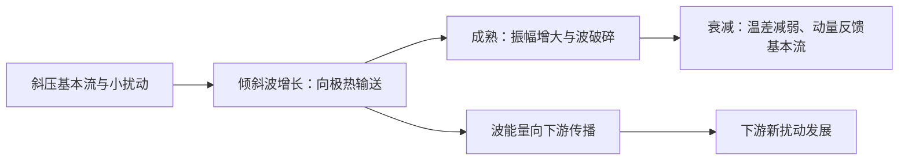

# 1999 年试题解析：逐题解答、考点与频次

> 本文件保留原题及频次，补充对应解答。星级为复习用主观评级；有缺题或排印疑点时，明确注明条件及可解范围。频次按考点出现的不同年份统计，不能视作命题概率。

原始记录：[[动力气象课后习题/往年试题分析/1999]]　｜　[[00_使用说明与年份索引|统计口径与目录]]

## 原卷第一部分

填空

## 题目 1999-一-1

### 原题

1998 年夏在我国东部**长江流域（长江中下游）**地区发生了特大洪涝灾害；我国历史上该地区发生过这类特大洪涝天气过程的还有**1954**年、**1991**年等。

### 考点与考察频次

**考察频次：1 次（按年份去重）；一般。**

| 考点 | 频次 | 标记 | 对应年份 |
|---|---:|---|---|
| 历史洪涝天气过程 | 1 次 | 一般 | 1999 |

同考点的全部题号见 [[01_考点频次与证据总表|考点频次与证据总表]]。

### 难度与考试相关度

**难度：★☆☆☆☆（1/5）｜考试相关度：★★★★☆（4/5）**

评级依据：历史出现且直接对应所给考纲；频次用于区分复习优先级。

### 考场精简版与审校状态

**审校状态：尚未逐题学科审校。**

> 以上摘要用于回忆答题主线，不是官方评分标准；推导、计算和多小问仍须完成下方步骤。

### 详细解答

**原记录填空值：** 长江流域（长江中下游）；1954；1991。下文核对其物理含义；出现修改意见时，以修改后的说明为准。

1. 1998年长江流域发生严重洪涝，1954年也是典型长江大洪水年；1991年突出的是江淮地区洪涝。答历史填空时应区分“长江干流流域”与更广泛“江淮地区”，避免把不同灾区完全等同。

## 题目 1999-一-2

### 原题

当飑线系统过境时本站的气象要素会发生如下变化：气压**骤升**，气温**骤降**，天气现象**狂风暴雨/雷暴大风冰雹**。

### 考点与考察频次

**考察频次：7 次（按年份去重）；🔴 重点。**

| 考点 | 频次 | 标记 | 对应年份 |
|---|---:|---|---|
| 飑线 | 7 次 | 重点 | 1997、1999、2000、2010、2017、2019、2021 |

同考点的全部题号见 [[01_考点频次与证据总表|考点频次与证据总表]]。

### 难度与考试相关度

**难度：★☆☆☆☆（1/5）｜考试相关度：★★★★★（5/5）**

评级依据：历史出现且直接对应所给考纲；频次用于区分复习优先级。

### 考场精简版与审校状态

**审校状态：尚未逐题学科审校。**

**相关高频考点复习摘要（须按本题设问取舍，不替代完整解答）：**

**飑线：** 飑线是组织成狭长线状的强对流系统。冷池前缘辐合不断触发新单体，风切变帮助维持组织；过站常有阵风增强、风向突变、降温和升压，可伴雷雨、冰雹，后部可有层状降水。

> 以上摘要用于回忆答题主线，不是官方评分标准；推导、计算和多小问仍须完成下方步骤。

### 详细解答

**原记录填空值：** 骤升；骤降；狂风暴雨/雷暴大风冰雹。下文核对其物理含义；出现修改意见时，以修改后的说明为准。

1. 飑线是沿线状排列并组织成系统的强对流，前缘辐合与冷池推进触发新生对流，可有后部层状降水。过站时常风向突变、阵风增强、温度骤降、气压骤升，伴雷雨、冰雹等；地面升压主要与冷池密度增加及动力作用有关。

2. **环境条件。** 低层暖湿、具有可释放的不稳定能量，锋面/辐合线/地形等提供抬升；适宜的垂直风切变使上升和下沉气流分离，支持较长寿命。强切变有助组织化，但不能取代水汽和浮力。

## 题目 1999-一-3

### 原题

气象常称的行星边界层，其顶层高度一般为**1000~1500**米。

### 考点与考察频次

**考察频次：4 次（按年份去重）；🔴 重点。**

| 考点 | 频次 | 标记 | 对应年份 |
|---|---:|---|---|
| 行星边界层 | 4 次 | 重点 | 1999、2015、2024、2026 |

同考点的全部题号见 [[01_考点频次与证据总表|考点频次与证据总表]]。

### 难度与考试相关度

**难度：★☆☆☆☆（1/5）｜考试相关度：★★★★★（5/5）**

评级依据：历史出现且直接对应所给考纲；频次用于区分复习优先级。

### 考场精简版与审校状态

**审校状态：尚未逐题学科审校。**

**相关高频考点复习摘要（须按本题设问取舍，不替代完整解答）：**

**行星边界层：** 行星边界层直接受地面摩擦和热湿交换影响，高度随日变化与稳定度改变。近地面层可近常通量，其上科氏作用更重要；夜间稳定层可浅薄且湍流间歇，上方残留层未必仍与地面耦合。

> 以上摘要用于回忆答题主线，不是官方评分标准；推导、计算和多小问仍须完成下方步骤。

### 详细解答

**原记录填空值：** 1000~1500。下文核对其物理含义；出现修改意见时，以修改后的说明为准。

1. 行星边界层是直接受地面摩擦、湍流热量和水汽交换影响，并在较短时间内响应的低层大气。高度随稳定度和时段变化，不能固定为某一个常数；白天对流层可较深，夜间稳定层常浅得多。

2. 近地面层中湍流通量随高度变化较小，可用常通量近似；其上外层科氏力逐渐重要，风速和风向向地转风过渡。稳定夜间边界层上可存在残留层，残留层不一定仍与地面有效交换。

## 题目 1999-一-4

### 原题

我国大陆上夏季低空急流一般高度为**850~700**hPa 左右，风速为**12**m/s 以上。

### 考点与考察频次

**考察频次：7 次（按年份去重）；🔴 重点。**

| 考点 | 频次 | 标记 | 对应年份 |
|---|---:|---|---|
| 低空急流 | 7 次 | 重点 | 1992、1996、1997、1999、2012、2015、2025 |

同考点的全部题号见 [[01_考点频次与证据总表|考点频次与证据总表]]。

### 难度与考试相关度

**难度：★☆☆☆☆（1/5）｜考试相关度：★★★★★（5/5）**

评级依据：历史出现且直接对应所给考纲；频次用于区分复习优先级。

### 考场精简版与审校状态

**审校状态：尚未逐题学科审校。**

**相关高频考点复习摘要（须按本题设问取舍，不替代完整解答）：**

**低空急流：** 低空急流是低层风速局地极大带，东亚夏季常在850—700 hPa附近。可由压力梯度、地形和夜间摩擦减弱后的惯性振荡形成；输送暖湿空气，在出口或与锋、切变线交汇处产生辐合，利于暴雨；对流加热亦可反馈加强急流。

> 以上摘要用于回忆答题主线，不是官方评分标准；推导、计算和多小问仍须完成下方步骤。

### 详细解答

**原记录填空值：** 850~700；12。下文核对其物理含义；出现修改意见时，以修改后的说明为准。

1. 低空急流是对流层低层的局地风速极大带，东亚夏季常在 850—700 hPa 附近，题中的 12 m/s 或 12—15 m/s 属常用识别量级，具体标准随研究变化。

2. 形成机制包括大尺度压力梯度加强、地形通道和山坡热力差异；夜间地表稳定化削弱摩擦，残余风发生惯性振荡，也可产生夜间风速极大。不同类型低空急流机制并不相同。

3. 低空急流输送暖湿空气，出口附近或与锋、切变线相交处辐合，利于不稳定能量和水汽积聚、暴雨触发；对流加热也可反过来加强低层压力梯度及急流。

## 原卷第二部分

简述以下问题

## 题目 1999-二-1

### 原题

给出天气动力分析中常用的连续方程表达式，并说明它的物理意义。

### 考点与考察频次

**考察频次：2 次（按年份去重）；一般。**

| 考点 | 频次 | 标记 | 对应年份 |
|---|---:|---|---|
| 连续方程 | 2 次 | 一般 | 1999、2001 |

同考点的全部题号见 [[01_考点频次与证据总表|考点频次与证据总表]]。

### 难度与考试相关度

**难度：★★☆☆☆（2/5）｜考试相关度：★★★★☆（4/5）**

评级依据：历史出现且直接对应所给考纲；频次用于区分复习优先级。

### 考场精简版与审校状态

**审校状态：尚未逐题学科审校。**

> 以上摘要用于回忆答题主线，不是官方评分标准；推导、计算和多小问仍须完成下方步骤。

### 详细解答

1. 对固定体积，质量变化率等于边界质量净流入，应用散度定理得 $\partial_t\rho+\nabla\cdot(\rho\mathbf V)=0$。
2. 展开后 $D\rho/Dt+\rho\nabla\cdot\mathbf V=0$；不可压缩条件下 $\nabla\cdot\mathbf V=0$。
3. 静力气压坐标中，单位水平面积、气压厚度 $dp$ 的质量为 $-dp/g$，质量连续方程化为 $u_x+v_y+\omega_p=0$。
4. 记 $D=u_x+v_y$，从给定边界 $p_b$ 积分，得到 $\boxed{\omega(p)=\omega(p_b)-\int_{p_b}^{p}D(p')\,dp'}$。这就是运动学法。边界可用地面运动学条件，或在模式顶取规定的 $\omega$。
5. $\omega<0$ 表示上升，$\omega>0$ 表示下沉。低层辐合高层辐散常配合上升，但必须满足整层质量连续性；风场误差会通过垂直积分累积，应作质量守恒修正。

## 题目 1999-二-2

### 原题

位势稳定度的定义及其表示式。

### 考点与考察频次

**考察频次：5 次（按年份去重）；🔴 重点。**

| 考点 | 频次 | 标记 | 对应年份 |
|---|---:|---|---|
| 位势不稳定 | 5 次 | 重点 | 1990、1999、2000、2004、2005 |

同考点的全部题号见 [[01_考点频次与证据总表|考点频次与证据总表]]。

### 难度与考试相关度

**难度：★★☆☆☆（2/5）｜考试相关度：★★★★★（5/5）**

评级依据：历史出现且直接对应所给考纲；频次用于区分复习优先级。

### 考场精简版与审校状态

**审校状态：尚未逐题学科审校。**

**相关高频考点复习摘要（须按本题设问取舍，不替代完整解答）：**

**位势不稳定：** 位势不稳定针对整层抬升，常以 $\partial\theta_e/\partial z<0$ 或教材的假相当位温梯度判断。整层抬升饱和后可转为不稳定。它不同于单气块条件不稳定 $\Gamma_m<\Gamma<\Gamma_d$，两者不能简单当同义词。

> 以上摘要用于回忆答题主线，不是官方评分标准；推导、计算和多小问仍须完成下方步骤。

### 详细解答

1. 干大气 $N^2=(g/\theta)d\theta/dz$。位温随高度增大为干静力稳定，等位温为中性，随高度减小为不稳定。这是对单个小气块竖直位移的判据。

2. 饱和上升时潜热释放使湿绝热直减率 $\Gamma_m<\Gamma_d$。若环境直减率满足 $\Gamma_m<\Gamma<\Gamma_d$，未饱和气块稳定而饱和气块不稳定，称条件不稳定。

3. 位势（对流）不稳定针对整层抬升：$d\theta_e/dz<0$（按教材也用假相当位温 $\theta_{se}$）时，抬升至饱和后低层更暖湿、释放更多潜热，整层可转为不稳定；位势稳定度可写成 $\partial\theta_e/\partial z$，在 $p$ 坐标符号相反。

4. 条件不稳定与位势不稳定并非同义，原题若写“条件（位势）不稳定”应分别说明。常见应用是雷暴：先由抬升克服抑制，气块达到自由对流高度后释放不稳定能量，并非有不稳定层结就必然立刻降雨。

## 原卷第三部分

回答问题

## 题目 1999-三-1

### 原题

用角动量输送理论说明大气中，东西风带维持的机制。

### 考点与考察频次

**考察频次：2 次（按年份去重）；一般。**

| 考点 | 频次 | 标记 | 对应年份 |
|---|---:|---|---|
| 动量方程及力的作用 | 2 次 | 一般 | 1997、1999 |

同考点的全部题号见 [[01_考点频次与证据总表|考点频次与证据总表]]。

### 难度与考试相关度

**难度：★★★☆☆（3/5）｜考试相关度：★★★★☆（4/5）**

评级依据：历史出现且直接对应所给考纲；频次用于区分复习优先级。

### 考场精简版与审校状态

**审校状态：尚未逐题学科审校。**

> 以上摘要用于回忆答题主线，不是官方评分标准；推导、计算和多小问仍须完成下方步骤。

### 详细解答

1. 经向输送绝对角动量 $M=a\cos\varphi(\Omega a\cos\varphi+u)$ 的过程包括平均经圈环流、定常涡旋和瞬变天气涡旋。地表摩擦对东风带和西风带施加不同符号的转矩，内部经向与竖直输送把获得的动量重新分配，维持平均风带。

2. 动量通量 $\overline{u'v'}$ 的辐合可加速平均西风；平均流向扰动的正压动能转换为 $-\overline{u'v'}U_y$。不能用“地球自转不变”直接推出每一时刻所有输送都严格从东风带指向西风带，必须写出收支、外部摩擦转矩与统计稳态。

## 题目 1999-三-2

### 原题

气象分析中用等压面代替等高面的基本原理是什么？有什么优越性？

### 考点与考察频次

**考察频次：2 次（按年份去重）；一般。**

| 考点 | 频次 | 标记 | 对应年份 |
|---|---:|---|---|
| 坐标变换与气压坐标 | 2 次 | 一般 | 1994、1999 |

同考点的全部题号见 [[01_考点频次与证据总表|考点频次与证据总表]]。

### 难度与考试相关度

**难度：★★☆☆☆（2/5）｜考试相关度：★★★★☆（4/5）**

评级依据：历史出现且直接对应所给考纲；频次用于区分复习优先级。

### 考场精简版与审校状态

**审校状态：尚未逐题学科审校。**

> 以上摘要用于回忆答题主线，不是官方评分标准；推导、计算和多小问仍须完成下方步骤。

### 详细解答

1. 静力条件 $p_z=-\rho g<0$ 使气压随高度单调减小，所以在同一柱中可用 $p$ 代替 $z$ 定位。
2. 对任意标量 $F(x,y,z,t)=\widetilde F(x,y,p,t)$，链式法则给出 $(F_x)_z=(\widetilde F_x)_p+F_p(p_x)_z$，以及 $F_z=F_pp_z$；时间导数同理。
3. 气压垂直速度定义为 $\omega=Dp/Dt=p_t+up_x+vp_y+wp_z$。因此物质导数在新坐标中为 $D/Dt=\partial_t+u\partial_x+v\partial_y+\omega\partial_p$。
4. 将链式法则与静力关系合用，水平压力梯度力变为 $-\nabla_p\Phi$；连续方程变为 $u_x+v_y+\omega_p=0$；静力方程为 $\Phi_p=-\alpha$。
5. 优点是等压面上质量层厚简单、连续方程不显含密度、探空和高空图资料易使用。局限是地面不是固定等压面，山地部分等压面可位于地下，需要地形边界处理。

## 原卷第四部分

叙述低纬度大气运动的基本特征。

## 题目 1999-四-整题

### 原题

叙述低纬度大气运动的基本特征。

### 考点与考察频次

**考察频次：5 次（按年份去重）；🔴 重点。**

| 考点 | 频次 | 标记 | 对应年份 |
|---|---:|---|---|
| 热带大气与天气系统 | 5 次 | 重点 | 1999、2006、2018、2022、2024 |

同考点的全部题号见 [[01_考点频次与证据总表|考点频次与证据总表]]。

### 难度与考试相关度

**难度：★★☆☆☆（2/5）｜考试相关度：★★★★★（5/5）**

评级依据：历史出现且直接对应所给考纲；频次用于区分复习优先级。

### 考场精简版与审校状态

**审校状态：尚未逐题学科审校。**

**相关高频考点复习摘要（须按本题设问取舍，不替代完整解答）：**

**热带大气与天气系统：** 低纬科氏参数小且跨赤道变号，不能直接套用中纬地转近似；大尺度水平温差常小，湿对流加热、辐合辐散与海气相互作用重要。主要有哈得莱、沃克环流及热带波动和涡旋，局部强涡旋仍可近梯度平衡。

> 以上摘要用于回忆答题主线，不是官方评分标准；推导、计算和多小问仍须完成下方步骤。

### 详细解答

1. 低纬度 $f$ 小且跨赤道变号，不能普遍使用中纬度地转和准地转近似。大尺度气压、温度水平差异常较小，但水汽与对流差异很大；垂直运动、辐合辐散和潜热加热在环流维持中更突出。

2. 中纬度系统常依赖强水平温度梯度、地转风和斜压能量转换；热带大尺度运动常以对流加热与辐散环流、波动和涡旋相互作用组织，热带气旋内又可有强旋转和梯度风平衡。

3. 低纬垂直环流包括经向哈得莱环流和纬向沃克环流。暖湿上升区常对应深对流，补偿下沉区较干，不能把热带描写成处处同样上升。

## 原卷第五部分

叙述东亚季风形成的基本因子。

## 题目 1999-五-整题

### 原题

叙述东亚季风形成的基本因子。

### 考点与考察频次

**考察频次：12 次（按年份去重）；🔴 重点。**

| 考点 | 频次 | 标记 | 对应年份 |
|---|---:|---|---|
| 季风 | 12 次 | 重点 | 1989、1994、1999、2000、2005、2014、2018、2020、2021、2022、2023、2025 |

同考点的全部题号见 [[01_考点频次与证据总表|考点频次与证据总表]]。

### 难度与考试相关度

**难度：★★★☆☆（3/5）｜考试相关度：★★★★★（5/5）**

评级依据：历史出现且直接对应所给考纲；频次用于区分复习优先级。

### 考场精简版与审校状态

**审校状态：尚未逐题学科审校。**

**相关高频考点复习摘要（须按本题设问取舍，不替代完整解答）：**

**季风：** 季风是大范围盛行风向随季节显著转换的环流。形成因子包括海陆热力差异、行星风带季节移动及高原作用。东亚冬季风联系大陆冷高压与东亚大槽；夏季风联系季风低压、副高边缘水汽输送和高空南亚高压，热带与副热带季风并存。

> 以上摘要用于回忆答题主线，不是官方评分标准；推导、计算和多小问仍须完成下方步骤。

### 详细解答

1. **概念。** 季风是大范围盛行风向随季节发生显著转换的环流，通常伴有干湿季变化；季风区是这种季节性风向转换及其天气气候影响显著的地区。不能仅用一个地点冬夏偶然相反的风判定。

2. **基本因子。** 海陆热容量不同：冬季大陆冷却快、形成冷高压，夏季大陆增温快、形成热低压；压力配置改变，推动低层风季节反转。太阳直射点移动带动行星风带和热带辐合带移动，青藏高原热力及动力作用进一步重塑亚洲环流。

3. **冬季系统。** 亚洲大陆和高原为冷源，西伯利亚高压、阿留申低压、东亚大槽及强西风急流配合；我国大部盛行偏北风，带来寒冷干燥天气，沿海还受海陆和地形调制。

4. **夏季系统。** 大陆、高原感热及南亚—东亚降水潜热形成热源；低层印度季风槽、南海季风、西太平洋副高西侧偏南气流、跨赤道气流共同输送水汽，上层南亚高压及热带东风急流响应加热。

5. **东亚特点。** 既有热带季风也有副热带季风，冬季风尤其强；夏季水汽路径包括孟加拉湾—南海和西太平洋，雨带随季风推进分阶段北跳，又受中高纬冷空气影响。热源、环流、水汽辐合和潜热释放相互反馈，不能归结成单一海陆风的放大。

