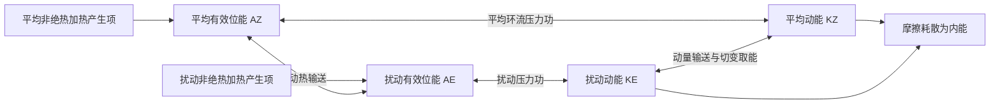

# 2005_1 年试题解析：逐题解答、考点与频次

> 本文件保留原题及频次，补充对应解答。星级为复习用主观评级；有缺题或排印疑点时，明确注明条件及可解范围。频次按考点出现的不同年份统计，不能视作命题概率。

原始记录：[[动力气象课后习题/往年试题分析/2005_1]]　｜　[[00_使用说明与年份索引|统计口径与目录]]

## 原卷第一部分

名词解释与简答

## 题目 2005_1-一-1

### 原题

正压大气和斜压大气

### 考点与考察频次

**考察频次：6 次（按年份去重）；🔴 重点。**

| 考点 | 频次 | 标记 | 对应年份 |
|---|---:|---|---|
| 正压与斜压大气 | 6 次 | 重点 | 2003、2004、2005、2006、2016、2026 |

同考点的全部题号见 [[01_考点频次与证据总表|考点频次与证据总表]]。

### 难度与考试相关度

**难度：★☆☆☆☆（1/5）｜考试相关度：★★★★★（5/5）**

评级依据：历史出现且直接对应所给考纲；频次用于区分复习优先级。

### 考场精简版与审校状态

**审校状态：尚未逐题学科审校。**

**相关高频考点复习摘要（须按本题设问取舍，不替代完整解答）：**

**正压与斜压大气：** 正压大气满足 $\rho=\rho(p)$，等压面与等密度面重合；斜压时两面相交，$\nabla\rho\times\nabla p\ne0$。在静力、地转条件下，等压面温度梯度对应地转风垂直切变。斜压状态不自动等于斜压不稳定。

> 以上摘要用于回忆答题主线，不是官方评分标准；推导、计算和多小问仍须完成下方步骤。

### 详细解答

1. 正压大气满足 $\rho=\rho(p)$，等压面与等密度面重合，故 $\nabla\rho\times\nabla p=0$。对理想气体，在等压面上温度均匀。
2. 斜压大气中等压面与等密度面相交，$\nabla\rho\times\nabla p\ne0$，等压面上有水平温度梯度。
3. 斜压项可生成环流和涡度；在静力、地转条件下，水平温度梯度通过热成风关系对应地转风垂直切变。正压条件下地转风不随高度改变。
4. “正压”不意味着实际风必无任何垂直切变；上述切变结论还用了地转平衡。“斜压”也不等于“斜压不稳定”，后者需要扰动从基本态有效位能获得净能量。

## 题目 2005_1-一-2

### 原题

涡度和散度，并写出其表达式

### 考点与考察频次

**考察频次：7 次（本题所列考点的最高年份频次，不相加）；🔴 重点。**

| 考点 | 频次 | 标记 | 对应年份 |
|---|---:|---|---|
| 涡度 | 7 次 | 重点 | 1989、1996、1998、2002、2005、2006、2019 |
| 散度 | 4 次 | 重点 | 1996、1998、2002、2005 |

同考点的全部题号见 [[01_考点频次与证据总表|考点频次与证据总表]]。

### 难度与考试相关度

**难度：★☆☆☆☆（1/5）｜考试相关度：★★★★★（5/5）**

评级依据：历史出现且直接对应所给考纲；频次用于区分复习优先级。

### 考场精简版与审校状态

**审校状态：尚未逐题学科审校。**

**相关高频考点复习摘要（须按本题设问取舍，不替代完整解答）：**

**涡度：** 垂直相对涡度 $\zeta=v_x-u_y$，绝对涡度为 $\zeta+f$，单位 $\mathrm{s^{-1}}$。北半球正值通常表示气旋性旋转。取旋度能消去保守压力梯度，但涡度方程单独不能决定完整风场。

**散度：** 水平散度 $D=u_x+v_y$，正为辐散、负为辐合，单位 $\mathrm{s^{-1}}$。静力气压坐标连续式 $D+\omega_p=0$，求垂直速度须沿气压积分并给边界条件，不能由单层辐合唯一确定整柱运动。

> 以上摘要用于回忆答题主线，不是官方评分标准；推导、计算和多小问仍须完成下方步骤。

### 详细解答

1. 定义垂直相对涡度 $\zeta=v_x-u_y$，水平散度 $D=u_x+v_y$，单位均为 $\mathrm{s^{-1}}$。绝对涡度的垂直分量为 $\zeta_a=\zeta+f$；三维绝对涡度为 $\nabla\times\mathbf V+2\boldsymbol\Omega$。

## 题目 2005_1-一-3

### 原题

大气长波的频散

### 考点与考察频次

**考察频次：8 次（本题所列考点的最高年份频次，不相加）；🔴 重点。**

| 考点 | 频次 | 标记 | 对应年份 |
|---|---:|---|---|
| 罗斯贝波基本性质 | 8 次 | 重点 | 1990、2003、2005、2014、2016、2017、2019、2026 |
| 频散与非频散波 | 5 次 | 重点 | 2003、2005、2018、2020、2021 |

同考点的全部题号见 [[01_考点频次与证据总表|考点频次与证据总表]]。

### 难度与考试相关度

**难度：★☆☆☆☆（1/5）｜考试相关度：★★★★★（5/5）**

评级依据：历史出现且直接对应所给考纲；频次用于区分复习优先级。

### 考场精简版与审校状态

**审校状态：尚未逐题学科审校。**

**相关高频考点复习摘要（须按本题设问取舍，不替代完整解答）：**

**罗斯贝波基本性质：** 罗斯贝波以位涡梯度为回复机制。均匀基本流正压β平面上 $\omega=kU-\beta k/(k^2+l^2)$，内禀纬向相速向西；地面参考系方向还依 $U$。频率对波数非线性，相速与群速一般不同。

**频散与非频散波：** 相速 $c_p=\omega/k$ 是等位相移动速度；群速 $c_g=d\omega/dk$ 是窄波包速度。不同波数的相速不同则有频散。由 $\omega=kc_p$ 得 $c_g=c_p+kdc_p/dk$，频散不等于能量耗散。

> 以上摘要用于回忆答题主线，不是官方评分标准；推导、计算和多小问仍须完成下方步骤。

### 详细解答

1. 正压无辐散β平面涡度方程为 $(\partial_t+u\partial_x+v\partial_y)(\zeta+f)=0$，$f=f_0+\beta y$。
2. 令 $u=U+u'$、$v=v'$，$U$ 为常数。减去基本态并舍弃 $u'\zeta'_x+v'\zeta'_y$ 等二阶项，得 $(\partial_t+U\partial_x)\zeta'+\beta v'=0$。
3. 引入 $u'=-\psi'_y$、$v'=\psi'_x$，所以 $\zeta'=\nabla_h^2\psi'$。代回得 $(\partial_t+U\partial_x)\nabla_h^2\psi'+\beta\psi'_x=0$。
4. 设 $\psi'=\hat\psi e^{i(kx+ly-\omega t)}$，有 $\nabla_h^2\psi'=-(k^2+l^2)\psi'$，故 $i(\omega-kU)(k^2+l^2)\psi'+i\beta k\psi'=0$。
5. 非零振幅给出 $\boxed{\omega=kU-\beta k/(k^2+l^2)}$；纬向相速 $c_x=\omega/k=U-\beta/(k^2+l^2)$。一维 $l=0$ 时 $c_x=U-\beta/k^2=U-\beta L^2/(4\pi^2)$。
6. 相对基本气流向西传播；短波西退修正小，常随西风向东，足够长的波可静止或向西。群速为 $c_{gx}=U+\beta(k^2-l^2)/(k^2+l^2)^2$、$c_{gy}=2\beta kl/(k^2+l^2)^2$。群速和相速不同，能量可向下游传播而单个槽脊较慢。

1. 简谐波写为 $A\cos(kx-\omega t)$。对等位相 $kx-\omega t=C$ 求导，得 $c_p=dx/dt=\omega/k$，它是波峰等位相点的速度。
2. 两列相近波叠加，利用和差化积得到 $2A\cos[(\Delta kx-\Delta\omega t)/2]\cos[(\bar kx-\bar\omega t)]$。第一项是缓变包络，故包络速度为 $\Delta\omega/\Delta k$。
3. 极限 $\Delta k\to0$ 时，群速度 $c_g=d\omega/dk$。多维形式为 $\mathbf c_g=\nabla_{\mathbf k}\omega$；在无耗散、缓变介质的线性波理论中，波包及波能量通常以群速度传播。
4. 若 $\omega=ck$ 且 $c$ 与 $k$ 无关，所有波数的相速相同，为非频散波；否则不同波数组分分离，波形和包络演变，称频散。因为 $\omega=kc_p(k)$，有 $c_g=c_p+k\,dc_p/dk$。
5. 频散的根本原因是恢复机制与惯性响应具有尺度依赖性，使频率对波数不呈简单线性关系；它不等于摩擦耗散。旋转浅水波和罗斯贝波有频散，无旋转均匀浅水长波近似非频散。

## 题目 2005_1-一-4

### 原题

有效位能

### 考点与考察频次

**考察频次：6 次（按年份去重）；🔴 重点。**

| 考点 | 频次 | 标记 | 对应年份 |
|---|---:|---|---|
| 有效位能 | 6 次 | 重点 | 1996、2003、2005、2016、2022、2025 |

同考点的全部题号见 [[01_考点频次与证据总表|考点频次与证据总表]]。

### 难度与考试相关度

**难度：★☆☆☆☆（1/5）｜考试相关度：★★★★★（5/5）**

评级依据：历史出现且直接对应所给考纲；频次用于区分复习优先级。

### 考场精简版与审校状态

**审校状态：尚未逐题学科审校。**

**相关高频考点复习摘要（须按本题设问取舍，不替代完整解答）：**

**有效位能：** 有效位能是实际全位能相对绝热重排后的最低参考态中可供转换的部分。差异加热维持温差，暖升冷沉可将其转为动能。全位能通常指内能与重力位能之和，不是全部都能被利用。

> 以上摘要用于回忆答题主线，不是官方评分标准；推导、计算和多小问仍须完成下方步骤。

### 详细解答

1. 单位质量内能 $e=c_vT$，重力位能 $\Phi=gz$（常重力），动能 $K=|\mathbf V|^2/2$，水汽潜热能近似 $L_vq_v$。总量需对气团质量积分；动能不能漏掉 $1/2$。
2. “全位能”在大气能量学中通常指内能与重力位能之和，而非含动能的总能量。静力、平坦底面且顶边界压力趋零时，$\int\rho gz\,dz=-\int z\,dp=\int p\,dz=\int\rho RT\,dz$；加上内能得到 $\int c_pT\,dm$。
3. 有效位能是实际全位能相对绝热重排到参考最低能态后的可用部分。不是全部内能或重力位能都能转换为动能。差异加热维持水平温差，建立有效位能。
4. 暖上升冷下沉时，$C=-\int\alpha'\omega'\,dm>0$，有效位能转为扰动动能；摩擦最终把动能耗散成内能。凝结使潜热转入热力能库，但水汽能量本来主要来自地表蒸发和辐射收支。
5. 对流层常用 Lorenz 四能量库循环如下。双向箭头表示转换可正可负，方向由收支项决定；中纬度斜压波常沿 $A_Z\to A_E\to K_E$ 取能。$A_Z$ 与 $K_Z$ 的直接转换不能漏掉：平均经圈环流同样可通过压力功在平均有效位能和平均动能之间转换。

产生项也可能为负，图中不是所有加热都增加有效位能。若问完整收支，应分别写 $\dot A_Z=G_Z-C_A-C_Z$、$\dot A_E=G_E+C_A-C_E$、$\dot K_Z=C_Z+C_K-D_Z$、$\dot K_E=C_E-C_K-D_E$，这里 $C_K>0$ 约定为扰动动能转入平均动能。四式相加，内部转换项逐项抵消，只剩外部产生与耗散，可用作检查。

## 题目 2005_1-一-5

### 原题

赤道波动

### 考点与考察频次

**考察频次：5 次（按年份去重）；🔴 重点。**

| 考点 | 频次 | 标记 | 对应年份 |
|---|---:|---|---|
| 赤道波动 | 5 次 | 重点 | 2003、2005、2020、2023、2024 |

同考点的全部题号见 [[01_考点频次与证据总表|考点频次与证据总表]]。

### 难度与考试相关度

**难度：★☆☆☆☆（1/5）｜考试相关度：★★★★★（5/5）**

评级依据：历史出现且直接对应所给考纲；频次用于区分复习优先级。

### 考场精简版与审校状态

**审校状态：尚未逐题学科审校。**

**相关高频考点复习摘要（须按本题设问取舍，不替代完整解答）：**

**赤道波动：** 赤道β平面存在开尔文波、赤道罗斯贝波、混合罗斯贝—重力波和惯性重力波。开尔文波东传、经向风为零且赤道束缚；罗斯贝模态内禀相速向西；混合波兼有涡旋与重力特征。实际云雨还依赖湿对流耦合。

> 以上摘要用于回忆答题主线，不是官方评分标准；推导、计算和多小问仍须完成下方步骤。

### 详细解答

1. 赤道附近 $f\approx\beta y$，科氏参数变号使若干波动被束缚在赤道附近。主要模态有赤道开尔文波、赤道罗斯贝波、混合罗斯贝—重力波及赤道惯性重力波。线性理论描述它们的动力骨架，实际云雨还受湿对流耦合。
2. **赤道开尔文波。** 取浅水等效波速 $c=\sqrt{gH}$，令 $v=0$。纬向动量与连续方程给 $u_t=-g\eta_x$、$\eta_t=-Hu_x$，组合得 $u_{tt}=c^2u_{xx}$，故 $\omega=\pm ck$。
3. 经向动量给 $\beta yu=-g\eta_y$。东传支有 $u=g\eta/c$，故 $\eta_y=-(\beta y/c)\eta$，积分得 $\eta\propto\exp[-\beta y^2/(2c)]$；西传支随远离赤道增长，不能满足有界条件。因此开尔文波为东传、近非频散，$u,\eta$ 关于赤道对称，$v=0$，束缚尺度 $L_e=\sqrt{c/\beta}$。
4. **混合波。** 兼具涡旋性与重力回复特征，经向风不为零；标准 $n=0$ 物理解可写 $\omega=ck/2+\sqrt{c^2k^2/4+\beta c}$（连同实场的共轭分支）。负波数一侧相速向西，群速可向东，不能把它当成单纯非频散东传波。
5. **赤道罗斯贝波。** 主要受位涡梯度约束，内禀相速向西，常表现为赤道两侧成对的涡旋；重力波分支较快，以辐散、质量场振荡显著。
6. 沿岸开尔文波与赤道开尔文波应区分：前者靠边界无穿透与地转横向平衡束缚，离岸按 $e^{-y/L_D}$ 衰减，$L_D=c/|f|$；北半球沿传播方向海岸在右侧。赤道波无需实体岸界。

## 题目 2005_1-一-6

### 原题

地转风和热成风，并写出其表达式

### 考点与考察频次

**考察频次：12 次（本题所列考点的最高年份频次，不相加）；🔴 重点。**

| 考点 | 频次 | 标记 | 对应年份 |
|---|---:|---|---|
| 地转风 | 12 次 | 重点 | 1989、1994、1997、1998、2001、2002、2003、2005、2006、2010、2019、2024 |
| 热成风 | 8 次 | 重点 | 1992、1994、1996、1997、2003、2005、2014、2021 |

同考点的全部题号见 [[01_考点频次与证据总表|考点频次与证据总表]]。

### 难度与考试相关度

**难度：★☆☆☆☆（1/5）｜考试相关度：★★★★★（5/5）**

评级依据：历史出现且直接对应所给考纲；频次用于区分复习优先级。

### 考场精简版与审校状态

**审校状态：尚未逐题学科审校。**

**相关高频考点复习摘要（须按本题设问取舍，不替代完整解答）：**

**地转风：** 中纬度大尺度缓变、摩擦可忽略时，水平气压梯度力与科氏力近似平衡：$u_g=-\Phi_y/f$、$v_g=\Phi_x/f$。风平行等高线，北半球低值在风向左侧。近赤道、摩擦层和强曲率快速运动中须检验适用性。

**热成风：** 热成风是上下两层地转风之差。由静力关系 $\Phi_{\ln p}=-RT$ 与地转关系得 $\partial u_g/\partial\ln p=(R/f)T_y$、$\partial v_g/\partial\ln p=-(R/f)T_x$。北半球向上的热成风冷侧在左，表示温度梯度对应垂直风切变。

> 以上摘要用于回忆答题主线，不是官方评分标准；推导、计算和多小问仍须完成下方步骤。

### 详细解答

1. 在局地直角坐标中，忽略摩擦时水平动量方程为 $Du/Dt-fv=-\Phi_x$、$Dv/Dt+fu=-\Phi_y$，这里的导数取在等压面上。
2. 对中纬度大尺度缓变运动，$Ro=U/(fL)\ll1$，惯性项相对较小，得到 $-fv_g=-\Phi_x$、$fu_g=-\Phi_y$。
3. 解得 $\boxed{u_g=-\Phi_y/f,\quad v_g=\Phi_x/f}$，即 $\mathbf V_g=\mathbf k\times\nabla_p\Phi/f$；大小为 $|\nabla_p\Phi|/|f|$。
4. 因叉积垂直于梯度，地转风平行于等高线；北半球背风而立时低值在左、高值在右，南半球相反。等高线越密风越强，但还受纬度 $f$ 影响。
5. 近赤道 $f\to0$、摩擦层、强曲率或快速变化的小尺度系统中不能直接采用地转近似。等高面上应改用 $\nabla_zp/\rho$，不要把两种坐标的梯度混用。

1. 热成风是两个高度或等压面之间的**地转风差**，不是独立的一股实际风。
2. 静力关系给出 $\Phi_{\ln p}=-RT$。对 $u_g=-\Phi_y/f$、$v_g=\Phi_x/f$ 分别作 $\ln p$ 导数（局地取 $f$ 固定），得
$$\frac{\partial u_g}{\partial\ln p}=\frac RfT_y,\qquad \frac{\partial v_g}{\partial\ln p}=-\frac RfT_x.$$
3. 从下层 $p_b$ 积到上层 $p_t<p_b$，若用对数气压平均温度 $\bar T$，则 $u_t-u_b=-(R/f)\ln(p_b/p_t)\bar T_y$、$v_t-v_b=(R/f)\ln(p_b/p_t)\bar T_x$。
4. 北半球向上的热成风沿平均等温线，冷空气在其左侧。温度向北降低时，西风一般随高度增强。该关系把水平温度梯度和垂直风切变连接起来。

## 原卷第二部分

假定大气满足静力平衡，而且是均匀不可压缩流体，下边界为平坦地面，上边界为自由表面，自由表面高度$h = h(x, y, t)$（如图所示）：

## 题目 2005_1-二-1

### 原题

试推出 "浅水模式"。

### 考点与考察频次

**考察频次：2 次（按年份去重）；一般。**

| 考点 | 频次 | 标记 | 对应年份 |
|---|---:|---|---|
| 浅水模式推导 | 2 次 | 一般 | 2003、2005 |

同考点的全部题号见 [[01_考点频次与证据总表|考点频次与证据总表]]。

### 难度与考试相关度

**难度：★★☆☆☆（2/5）｜考试相关度：★★★★☆（4/5）**

评级依据：历史出现且直接对应所给考纲；频次用于区分复习优先级。

### 考场精简版与审校状态

**审校状态：尚未逐题学科审校。**

> 以上摘要用于回忆答题主线，不是官方评分标准；推导、计算和多小问仍须完成下方步骤。

### 详细解答

**第一步：竖直积分。** 设底面 $z=0$，自由面 $z=h(x,y,t)$，均匀密度 $\rho_0$，表面压力固定。由 $p_z=-\rho_0g$ 得 $p=p_s+\rho_0g(h-z)$，所以水平压力梯度力为 $-g\nabla_hh$。采用柱状水平速度，得
$$D_tu-fv=-gh_x,\qquad D_tv+fu=-gh_y,\qquad D_t=\partial_t+u\partial_x+v\partial_y.$$
**第二步：连续方程。** 由 $u_x+v_y+w_z=0$ 和 $w(0)=0$，有 $w(h)=-h(u_x+v_y)$。自由面的运动学条件为 $w(h)=h_t+uh_x+vh_y$，两式合并：$D_th=-hD$，其中 $D=u_x+v_y$。这三式构成浅水模式。

**第三步：取旋度。** 对第二个动量方程取 $x$ 导数，减去第一个方程的 $y$ 导数。加速度交叉项产生 $\zeta D$，科氏项产生 $fD+\beta v$，压力梯度交叉导数相消，得 $D_t\zeta+(\zeta+f)D+\beta v=0$。

**第四步：组合成位涡。** 因 $D_tf=\beta v$，有 $D_t(\zeta+f)=-(\zeta+f)D$。于是
$$D_t\frac{\zeta+f}{h}=\frac{-h(\zeta+f)D-(\zeta+f)(-hD)}{h^2}=0.$$
因此 $\boxed{q=(\zeta+f)/h\text{ 沿气柱守恒}}$，适用于上述无摩擦、无质量源汇的浅水模型。

**第五步：有基本流时的线性化。** 令 $u=U+u'$、$v=v'$、$h=H(y)+h'$，$U$ 为常数且 $gH_y=-f_0U$。代入后减去基本态，再删去两个扰动量相乘的二阶项，得到
$$\begin{aligned}(\partial_t+U\partial_x)u'-f_0v'&=-gh'_x,\\(\partial_t+U\partial_x)v'+f_0u'&=-gh'_y,\\(\partial_t+U\partial_x)h'+H(u'_x+v'_y)+H_yv'&=0.\end{aligned}$$
相应局地β平面涡度式为 $(\partial_t+U\partial_x)\zeta'+\beta v'+f_0D'=0$。若原题把层厚写成 $H(x)$ 却要求 $H_y$ 平衡，需改正为 $H(y)$ 后才可使用这一基本态。

## 题目 2005_1-二-2

### 原题

证明 "浅水模式" 具有位涡度守恒的性质。

### 考点与考察频次

**考察频次：3 次（按年份去重）；🔴 重点。**

| 考点 | 频次 | 标记 | 对应年份 |
|---|---:|---|---|
| 浅水位涡守恒 | 3 次 | 重点 | 2003、2005、2010 |

同考点的全部题号见 [[01_考点频次与证据总表|考点频次与证据总表]]。

### 难度与考试相关度

**难度：★★★★☆（4/5）｜考试相关度：★★★★★（5/5）**

评级依据：历史出现且直接对应所给考纲；频次用于区分复习优先级。

### 考场精简版与审校状态

**审校状态：尚未逐题学科审校。**

**相关高频考点复习摘要（须按本题设问取舍，不替代完整解答）：**

**浅水位涡守恒：** 无摩擦浅水连续式 $D_th=-hD$，涡度式 $D_t(\zeta+f)=-(\zeta+f)D$。对 $(\zeta+f)/h$ 用商法则，两项恰好抵消，得到位涡沿气柱守恒。条件包括无质量源汇及模型假设。

> 以上摘要用于回忆答题主线，不是官方评分标准；推导、计算和多小问仍须完成下方步骤。

### 详细解答

**第一步：竖直积分。** 设底面 $z=0$，自由面 $z=h(x,y,t)$，均匀密度 $\rho_0$，表面压力固定。由 $p_z=-\rho_0g$ 得 $p=p_s+\rho_0g(h-z)$，所以水平压力梯度力为 $-g\nabla_hh$。采用柱状水平速度，得
$$D_tu-fv=-gh_x,\qquad D_tv+fu=-gh_y,\qquad D_t=\partial_t+u\partial_x+v\partial_y.$$
**第二步：连续方程。** 由 $u_x+v_y+w_z=0$ 和 $w(0)=0$，有 $w(h)=-h(u_x+v_y)$。自由面的运动学条件为 $w(h)=h_t+uh_x+vh_y$，两式合并：$D_th=-hD$，其中 $D=u_x+v_y$。这三式构成浅水模式。

**第三步：取旋度。** 对第二个动量方程取 $x$ 导数，减去第一个方程的 $y$ 导数。加速度交叉项产生 $\zeta D$，科氏项产生 $fD+\beta v$，压力梯度交叉导数相消，得 $D_t\zeta+(\zeta+f)D+\beta v=0$。

**第四步：组合成位涡。** 因 $D_tf=\beta v$，有 $D_t(\zeta+f)=-(\zeta+f)D$。于是
$$D_t\frac{\zeta+f}{h}=\frac{-h(\zeta+f)D-(\zeta+f)(-hD)}{h^2}=0.$$
因此 $\boxed{q=(\zeta+f)/h\text{ 沿气柱守恒}}$，适用于上述无摩擦、无质量源汇的浅水模型。

**第五步：有基本流时的线性化。** 令 $u=U+u'$、$v=v'$、$h=H(y)+h'$，$U$ 为常数且 $gH_y=-f_0U$。代入后减去基本态，再删去两个扰动量相乘的二阶项，得到
$$\begin{aligned}(\partial_t+U\partial_x)u'-f_0v'&=-gh'_x,\\(\partial_t+U\partial_x)v'+f_0u'&=-gh'_y,\\(\partial_t+U\partial_x)h'+H(u'_x+v'_y)+H_yv'&=0.\end{aligned}$$
相应局地β平面涡度式为 $(\partial_t+U\partial_x)\zeta'+\beta v'+f_0D'=0$。若原题把层厚写成 $H(x)$ 却要求 $H_y$ 平衡，需改正为 $H(y)$ 后才可使用这一基本态。

## 原卷第三部分

举例说明大气波动演变中有些哪些动力不稳定机制。

## 题目 2005_1-三-整题

### 原题

举例说明大气波动演变中有些哪些动力不稳定机制。

### 考点与考察频次

**考察频次：1 次（按年份去重）；一般。**

| 考点 | 频次 | 标记 | 对应年份 |
|---|---:|---|---|
| 大气动力不稳定类型 | 1 次 | 一般 | 2005 |

同考点的全部题号见 [[01_考点频次与证据总表|考点频次与证据总表]]。

### 难度与考试相关度

**难度：★★★☆☆（3/5）｜考试相关度：★★★★☆（4/5）**

评级依据：历史出现且直接对应所给考纲；频次用于区分复习优先级。

### 考场精简版与审校状态

**审校状态：尚未逐题学科审校。**

> 以上摘要用于回忆答题主线，不是官方评分标准；推导、计算和多小问仍须完成下方步骤。

### 详细解答

1. 先定义：对基本态施加小扰动，若扰动随时间增长（例如 $e^{\sigma t}$ 且 $\Re\sigma>0$），称该基本态对这类扰动不稳定；必须说明所考察的扰动及边界条件。
2. 静力不稳定：气块竖直位移后浮力推动它继续偏离，干空气 $N^2<0$；惯性不稳定：横向位移缺少角动量回复，平行流中 $f(f-U_y)<0$。
3. 正压不稳定：从基本流水平切变的动能取能，Rayleigh–Kuo必要条件为 $\beta-U_{yy}$ 变号；斜压不稳定：从基本态水平温差储存的有效位能取能，即使 $N^2>0$ 也可增长。
4. 对称不稳定：沿锋方向不变的斜向位移不稳定，在干静力、惯性稳定的背景下与 $fq<0$ 有关；湿对流和 CISK 则还涉及饱和潜热、摩擦辐合及尺度间反馈。
5. 例子分别可用地表受热的对流、中纬度急流切变扰动、温带气旋发展、锋区斜向云带、热带扰动组织。必要条件与充分条件、干机制与湿机制不能互换。

