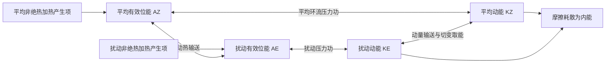

# 2016 年试题解析：逐题解答、考点与频次

> 本文件保留原题及频次，补充对应解答。星级为复习用主观评级；有缺题或排印疑点时，明确注明条件及可解范围。频次按考点出现的不同年份统计，不能视作命题概率。

原始记录：[[动力气象课后习题/往年试题分析/2016]]　｜　[[00_使用说明与年份索引|统计口径与目录]]

## 原卷第一部分

名词解释

## 题目 2016-一-1

### 原题

波的相速度

### 考点与考察频次

**考察频次：2 次（按年份去重）；一般。**

| 考点 | 频次 | 标记 | 对应年份 |
|---|---:|---|---|
| 相速度 | 2 次 | 一般 | 2004、2016 |

同考点的全部题号见 [[01_考点频次与证据总表|考点频次与证据总表]]。

### 难度与考试相关度

**难度：★☆☆☆☆（1/5）｜考试相关度：★★★★☆（4/5）**

评级依据：历史出现且直接对应所给考纲；频次用于区分复习优先级。

### 考场精简版与审校状态

**审校状态：尚未逐题学科审校。**

> 以上摘要用于回忆答题主线，不是官方评分标准；推导、计算和多小问仍须完成下方步骤。

### 详细解答

1. 简谐波写为 $A\cos(kx-\omega t)$。对等位相 $kx-\omega t=C$ 求导，得 $c_p=dx/dt=\omega/k$，它是波峰等位相点的速度。
2. 两列相近波叠加，利用和差化积得到 $2A\cos[(\Delta kx-\Delta\omega t)/2]\cos[(\bar kx-\bar\omega t)]$。第一项是缓变包络，故包络速度为 $\Delta\omega/\Delta k$。
3. 极限 $\Delta k\to0$ 时，群速度 $c_g=d\omega/dk$。多维形式为 $\mathbf c_g=\nabla_{\mathbf k}\omega$；在无耗散、缓变介质的线性波理论中，波包及波能量通常以群速度传播。
4. 若 $\omega=ck$ 且 $c$ 与 $k$ 无关，所有波数的相速相同，为非频散波；否则不同波数组分分离，波形和包络演变，称频散。因为 $\omega=kc_p(k)$，有 $c_g=c_p+k\,dc_p/dk$。
5. 频散的根本原因是恢复机制与惯性响应具有尺度依赖性，使频率对波数不呈简单线性关系；它不等于摩擦耗散。旋转浅水波和罗斯贝波有频散，无旋转均匀浅水长波近似非频散。

## 题目 2016-一-2

### 原题

锋生

### 考点与考察频次

**考察频次：5 次（按年份去重）；🔴 重点。**

| 考点 | 频次 | 标记 | 对应年份 |
|---|---:|---|---|
| 锋生与锋消 | 5 次 | 重点 | 1992、1994、2016、2018、2023 |

同考点的全部题号见 [[01_考点频次与证据总表|考点频次与证据总表]]。

### 难度与考试相关度

**难度：★☆☆☆☆（1/5）｜考试相关度：★★★★★（5/5）**

评级依据：历史出现且直接对应所给考纲；频次用于区分复习优先级。

### 考场精简版与审校状态

**审校状态：尚未逐题学科审校。**

**相关高频考点复习摘要（须按本题设问取舍，不替代完整解答）：**

**锋生与锋消：** 锋生是随气块运动的水平温度或位温梯度增强。令 $F=D|\nabla_h\theta|/Dt$，按链式法则可分为差异加热、水平变形辐合和竖直倾斜贡献。$F>0$ 锋生，$F<0$ 锋消；不能把所有水平辐合无条件视为锋生。

> 以上摘要用于回忆答题主线，不是官方评分标准；推导、计算和多小问仍须完成下方步骤。

### 详细解答

1. **锋生定义与推导。** 令 $\mathbf G=\nabla_h\theta$，$F=D|\mathbf G|/Dt$。由 $D\theta/Dt=\dot\theta$ 对 $x_i$ 求导：$DG_i/Dt=\partial_i\dot\theta-(\partial_i u_j)G_j-(\partial_iw)\theta_z$，这里 $i,j=x,y$。

2. 与 $G_i/|\mathbf G|$ 相乘求和，得
$$F=\frac{\mathbf G\cdot\nabla_h\dot\theta}{|\mathbf G|}-\frac{G_i(\partial_i u_j)G_j}{|\mathbf G|}-\frac{\theta_z\mathbf G\cdot\nabla_hw}{|\mathbf G|}.$$
三项分别是差异非绝热加热、水平变形/辐合、竖直倾斜作用；$F>0$ 锋生，$F<0$ 锋消。若温度梯度沿 $x$，绝热且无倾斜时 $F=-|G|u_x$，跨锋辐合 $u_x<0$ 加大梯度，直观说明动力锋生。

## 题目 2016-一-3

### 原题

寒潮

### 考点与考察频次

**考察频次：17 次（按年份去重）；🔴 重点。**

| 考点 | 频次 | 标记 | 对应年份 |
|---|---:|---|---|
| 寒潮及其天气过程 | 17 次 | 重点 | 1990、1996、2000、2001、2002、2006、2010、2011、2012、2014、2016、2017、2019、2021、2022、2024、2026 |

同考点的全部题号见 [[01_考点频次与证据总表|考点频次与证据总表]]。

### 难度与考试相关度

**难度：★☆☆☆☆（1/5）｜考试相关度：★★★★★（5/5）**

评级依据：历史出现且直接对应所给考纲；频次用于区分复习优先级。

### 考场精简版与审校状态

**审校状态：尚未逐题学科审校。**

**相关高频考点复习摘要（须按本题设问取舍，不替代完整解答）：**

**寒潮及其天气过程：** 寒潮是强冷空气大范围南下造成显著降温、大风及可能雨雪冻害的过程。答路径时分西路、西北路、东路；答发展时写冷空气蓄积→高空槽脊调整→地面冷高压和冷锋南下；是否达到业务等级须核对相应标准。

> 以上摘要用于回忆答题主线，不是官方评分标准；推导、计算和多小问仍须完成下方步骤。

### 详细解答

1. 寒潮是强冷空气大范围侵入中低纬，造成剧烈降温、大风，常伴雨雪或冻害的天气过程；达到业务寒潮等级还要按适用标准核对降温幅度和最低温度，不能把所有冷空气过程称为寒潮。
2. **源地和蓄积区。** 传统天气学源地归纳包括新地岛以西、新地岛以东和冰岛以南洋面；冷空气可在西伯利亚—蒙古一带进一步辐射冷却、蓄积。源地不同于进入我国的路径，不能混为一项。
3. **路径。** 西路经新疆及高原北侧影响西北、西南；西北路经蒙古、河套南下，常影响我国中东部大部；东路偏经东北、华北和东部沿海。多路冷空气汇合时范围和强度可增大，但不存在不问强度、地形、水汽就永远“最严重”的一路。
4. **环流演变。** 阻塞高压或暖脊建立，东侧冷空气积聚；亚洲极涡或横槽南压；短波发展、横槽转竖或大槽东移使槽后偏北气流加强，地面冷高压增强南下，冷锋迅速推进，随后东亚大槽重建。
5. **天气。** 锋前可回暖和增湿，锋过时风向突变、大风降温，水汽足时出现雨雪；锋后气压升高、天气转晴，夜间辐射降温及霜冻可加剧。干冷型雨雪少，湿冷型雨雪多，不能要求每次寒潮都具同样降水。
6. **倒Ω中期演变。** 两大洋北部脊向高纬发展，极涡分裂或偏心；乌拉尔与东亚东北侧脊发展，亚洲冷涡被夹持并南压，形成类似倒Ω的槽脊配置；随后横槽转竖或长波槽快速发展，槽后冷空气爆发南下。画图时应画“两侧高脊、中间冷槽/涡”，并用槽后偏北箭头表示冷空气路径。
7. **预报关键。** 同时监视阻高和脊、极涡/横槽、地面冷高压与冷锋。常见短中期型包括小槽发展、横槽转竖和低槽东移；不同教材的“第几类”编号不统一，未给分类表时不能凭编号唯一指定。

## 题目 2016-一-4

### 原题

气候模拟（略，不用写）

### 考点与考察频次

**考察频次：3 次（按年份去重）；🔴 重点。**

| 考点 | 频次 | 标记 | 对应年份 |
|---|---:|---|---|
| 气候模式 | 3 次 | 重点 | 2015、2016、2020 |

同考点的全部题号见 [[01_考点频次与证据总表|考点频次与证据总表]]。

### 难度与考试相关度

**难度：★☆☆☆☆（1/5）｜考试相关度：★★★☆☆（3/5）**

评级依据：历史曾考，但当前所给考纲未单列此类气候专题，作为扩展复习。

### 考场精简版与审校状态

**审校状态：尚未逐题学科审校。**

**相关高频考点复习摘要（须按本题设问取舍，不替代完整解答）：**

**气候模式：** 气候模式把动力、热力、辐射等方程数值离散，耦合海洋陆面冰雪并参数化未解析过程。给定强迫作长期积分和集合，研究统计气候及响应；不是准确预报几十年后某天的天气。

> 以上摘要用于回忆答题主线，不是官方评分标准；推导、计算和多小问仍须完成下方步骤。

### 详细解答

1. **模式。** 气候模式把流体、热力学、辐射等方程在网格上数值求解，耦合海洋、陆面、冰雪等，并参数化未解析过程。给定外强迫与初边值，作长期积分和集合，比较统计气候及响应；分辨率、参数化、情景和内部变率造成不确定性，气候模拟不等于准确预报几十年后某一天的天气。

## 题目 2016-一-5

### 原题

气候突变（略，不用写）

### 考点与考察频次

**考察频次：1 次（按年份去重）；一般。**

| 考点 | 频次 | 标记 | 对应年份 |
|---|---:|---|---|
| 气候突变 | 1 次 | 一般 | 2016 |

同考点的全部题号见 [[01_考点频次与证据总表|考点频次与证据总表]]。

### 难度与考试相关度

**难度：★☆☆☆☆（1/5）｜考试相关度：★★☆☆☆（2/5）**

评级依据：历史曾考，但当前所给考纲未单列此类气候专题，作为扩展复习。

### 考场精简版与审校状态

**审校状态：尚未逐题学科审校。**

> 以上摘要用于回忆答题主线，不是官方评分标准；推导、计算和多小问仍须完成下方步骤。

### 详细解答

1. 气候突变是相对背景时间尺度而言较快、且持续的气候状态转变，可涉及阈值与非线性反馈；极端气候事件是相对于特定地区和时段统计分布少见的事件，例如高温或极端降水，必须说明阈值、基准期和持续时间。二者并非同义。

## 题目 2016-一-6

### 原题

斜压大气

### 考点与考察频次

**考察频次：6 次（按年份去重）；🔴 重点。**

| 考点 | 频次 | 标记 | 对应年份 |
|---|---:|---|---|
| 正压与斜压大气 | 6 次 | 重点 | 2003、2004、2005、2006、2016、2026 |

同考点的全部题号见 [[01_考点频次与证据总表|考点频次与证据总表]]。

### 难度与考试相关度

**难度：★☆☆☆☆（1/5）｜考试相关度：★★★★★（5/5）**

评级依据：历史出现且直接对应所给考纲；频次用于区分复习优先级。

### 考场精简版与审校状态

**审校状态：尚未逐题学科审校。**

**相关高频考点复习摘要（须按本题设问取舍，不替代完整解答）：**

**正压与斜压大气：** 正压大气满足 $\rho=\rho(p)$，等压面与等密度面重合；斜压时两面相交，$\nabla\rho\times\nabla p\ne0$。在静力、地转条件下，等压面温度梯度对应地转风垂直切变。斜压状态不自动等于斜压不稳定。

> 以上摘要用于回忆答题主线，不是官方评分标准；推导、计算和多小问仍须完成下方步骤。

### 详细解答

1. 正压大气满足 $\rho=\rho(p)$，等压面与等密度面重合，故 $\nabla\rho\times\nabla p=0$。对理想气体，在等压面上温度均匀。
2. 斜压大气中等压面与等密度面相交，$\nabla\rho\times\nabla p\ne0$，等压面上有水平温度梯度。
3. 斜压项可生成环流和涡度；在静力、地转条件下，水平温度梯度通过热成风关系对应地转风垂直切变。正压条件下地转风不随高度改变。
4. “正压”不意味着实际风必无任何垂直切变；上述切变结论还用了地转平衡。“斜压”也不等于“斜压不稳定”，后者需要扰动从基本态有效位能获得净能量。

## 题目 2016-一-7

### 原题

有效位能

### 考点与考察频次

**考察频次：6 次（按年份去重）；🔴 重点。**

| 考点 | 频次 | 标记 | 对应年份 |
|---|---:|---|---|
| 有效位能 | 6 次 | 重点 | 1996、2003、2005、2016、2022、2025 |

同考点的全部题号见 [[01_考点频次与证据总表|考点频次与证据总表]]。

### 难度与考试相关度

**难度：★☆☆☆☆（1/5）｜考试相关度：★★★★★（5/5）**

评级依据：历史出现且直接对应所给考纲；频次用于区分复习优先级。

### 考场精简版与审校状态

**审校状态：尚未逐题学科审校。**

**相关高频考点复习摘要（须按本题设问取舍，不替代完整解答）：**

**有效位能：** 有效位能是实际全位能相对绝热重排后的最低参考态中可供转换的部分。差异加热维持温差，暖升冷沉可将其转为动能。全位能通常指内能与重力位能之和，不是全部都能被利用。

> 以上摘要用于回忆答题主线，不是官方评分标准；推导、计算和多小问仍须完成下方步骤。

### 详细解答

1. 单位质量内能 $e=c_vT$，重力位能 $\Phi=gz$（常重力），动能 $K=|\mathbf V|^2/2$，水汽潜热能近似 $L_vq_v$。总量需对气团质量积分；动能不能漏掉 $1/2$。
2. “全位能”在大气能量学中通常指内能与重力位能之和，而非含动能的总能量。静力、平坦底面且顶边界压力趋零时，$\int\rho gz\,dz=-\int z\,dp=\int p\,dz=\int\rho RT\,dz$；加上内能得到 $\int c_pT\,dm$。
3. 有效位能是实际全位能相对绝热重排到参考最低能态后的可用部分。不是全部内能或重力位能都能转换为动能。差异加热维持水平温差，建立有效位能。
4. 暖上升冷下沉时，$C=-\int\alpha'\omega'\,dm>0$，有效位能转为扰动动能；摩擦最终把动能耗散成内能。凝结使潜热转入热力能库，但水汽能量本来主要来自地表蒸发和辐射收支。
5. 对流层常用 Lorenz 四能量库循环如下。双向箭头表示转换可正可负，方向由收支项决定；中纬度斜压波常沿 $A_Z\to A_E\to K_E$ 取能。$A_Z$ 与 $K_Z$ 的直接转换不能漏掉：平均经圈环流同样可通过压力功在平均有效位能和平均动能之间转换。

产生项也可能为负，图中不是所有加热都增加有效位能。若问完整收支，应分别写 $\dot A_Z=G_Z-C_A-C_Z$、$\dot A_E=G_E+C_A-C_E$、$\dot K_Z=C_Z+C_K-D_Z$、$\dot K_E=C_E-C_K-D_E$，这里 $C_K>0$ 约定为扰动动能转入平均动能。四式相加，内部转换项逐项抵消，只剩外部产生与耗散，可用作检查。

## 题目 2016-一-8

### 原题

南方涛动

### 考点与考察频次

**考察频次：5 次（按年份去重）；🔴 重点。**

| 考点 | 频次 | 标记 | 对应年份 |
|---|---:|---|---|
| 南方涛动 | 5 次 | 重点 | 2012、2014、2016、2018、2020 |

同考点的全部题号见 [[01_考点频次与证据总表|考点频次与证据总表]]。

### 难度与考试相关度

**难度：★☆☆☆☆（1/5）｜考试相关度：★★★★★（5/5）**

评级依据：历史出现且直接对应所给考纲；频次用于区分复习优先级。

### 考场精简版与审校状态

**审校状态：尚未逐题学科审校。**

**相关高频考点复习摘要（须按本题设问取舍，不替代完整解答）：**

**南方涛动：** 南方涛动是热带太平洋东西部海平面气压的大范围反相变化，常用塔希提与达尔文标准化气压差表征。它是ENSO的大气侧表现，应与海温异常这一海洋侧指标区分。

> 以上摘要用于回忆答题主线，不是官方评分标准；推导、计算和多小问仍须完成下方步骤。

### 详细解答

1. 南方涛动是热带太平洋东西部大范围海平面气压的反相变化，常用塔希提与达尔文标准化气压差的指数表征。负位相通常对应厄尔尼诺相关的沃克环流减弱，但海洋和大气指标需综合判断。

## 原卷第二部分

简答题

## 题目 2016-二-1

### 原题

全球经圈环流及其组成。

### 考点与考察频次

**考察频次：8 次（按年份去重）；🔴 重点。**

| 考点 | 频次 | 标记 | 对应年份 |
|---|---:|---|---|
| 哈得莱环流 | 8 次 | 重点 | 1992、1994、1998、2002、2003、2016、2017、2019 |

同考点的全部题号见 [[01_考点频次与证据总表|考点频次与证据总表]]。

### 难度与考试相关度

**难度：★★☆☆☆（2/5）｜考试相关度：★★★★★（5/5）**

评级依据：历史出现且直接对应所给考纲；频次用于区分复习优先级。

### 考场精简版与审校状态

**审校状态：尚未逐题学科审校。**

**相关高频考点复习摘要（须按本题设问取舍，不替代完整解答）：**

**哈得莱环流：** 哈得莱环流是低纬平均经圈环流：赤道附近暖区上升，高层向副热带流动，副热带下沉，近地面回流形成信风，属于热力直接环流。与中纬度涡旋维持的费雷尔环流、东西向沃克环流区别。

> 以上摘要用于回忆答题主线，不是官方评分标准；推导、计算和多小问仍须完成下方步骤。

### 详细解答

1. 平均经圈环流中，哈得莱环流低纬上升、副热带下沉，近地面回流形成信风，属于热力直接环流；费雷尔环流在中纬度、平均上热力间接，依赖天气涡旋维持；极地环流较弱。三圈是统计平均，非每个经度同时存在三个封闭圈。

## 题目 2016-二-2

### 原题

按冷暖气团位置对锋分类并简要介绍。

### 考点与考察频次

**考察频次：8 次（按年份去重）；🔴 重点。**

| 考点 | 频次 | 标记 | 对应年份 |
|---|---:|---|---|
| 锋及锋面类型 | 8 次 | 重点 | 2001、2004、2010、2011、2016、2019、2020、2024 |

同考点的全部题号见 [[01_考点频次与证据总表|考点频次与证据总表]]。

### 难度与考试相关度

**难度：★★☆☆☆（2/5）｜考试相关度：★★★★★（5/5）**

评级依据：历史出现且直接对应所给考纲；频次用于区分复习优先级。

### 考场精简版与审校状态

**审校状态：尚未逐题学科审校。**

**相关高频考点复习摘要（须按本题设问取舍，不替代完整解答）：**

**锋及锋面类型：** 锋区是不同性质气团间的三维过渡带，锋面是其理想化面。按推进关系区分冷锋、暖锋、准静止锋及锢囚锋；锋面向冷侧上倾，温度梯度和气旋性风切变明显，气压本身连续。云雨须结合水汽、稳定度和移动速度。

> 以上摘要用于回忆答题主线，不是官方评分标准；推导、计算和多小问仍须完成下方步骤。

### 详细解答

1. 气团是水平范围广、温度湿度等性质较均匀、在共同源地上形成的大块空气。冷暖气团之间的三维过渡带叫锋区，理想化为锋面，与地面的交线叫锋线。

2. **分类。** 冷气团主动推进为冷锋，锋后通常降温、转偏北风、气压升高，锋区可阵雨雷暴；暖气团主动推进为暖锋，暖空气沿冷气团上滑，常有锋前大范围层状云雨；冷暖势力相当、移动缓慢为准静止锋，易持续阴雨；冷锋追及暖锋使暖空气抬离地面形成锢囚锋，天气取决于两侧冷空气和水汽结构。

3. **要素场。** 锋区水平温度和密度梯度大，等温线密集；地面常表现为低压槽，风向有气旋式切变，锋面上升指向冷空气一侧。气压本身连续，其梯度可明显改变；“锋面处气压不连续”是不正确表述。

## 题目 2016-二-3

### 原题

简述热盐环流及其重要性。

### 考点与考察频次

**考察频次：1 次（按年份去重）；一般。**

| 考点 | 频次 | 标记 | 对应年份 |
|---|---:|---|---|
| 温盐环流 | 1 次 | 一般 | 2016 |

同考点的全部题号见 [[01_考点频次与证据总表|考点频次与证据总表]]。

### 难度与考试相关度

**难度：★★☆☆☆（2/5）｜考试相关度：★★☆☆☆（2/5）**

评级依据：历史曾考，但当前所给考纲未单列此类气候专题，作为扩展复习。

### 考场精简版与审校状态

**审校状态：尚未逐题学科审校。**

> 以上摘要用于回忆答题主线，不是官方评分标准；推导、计算和多小问仍须完成下方步骤。

### 详细解答

1. 温盐环流指海水温度、盐度影响密度并与深水形成和大尺度翻转相联系的环流。高纬冷却或增盐使密度增大，下沉水沿深层输送，再经混合、上涌返回；真实全球翻转也受风和机械混合驱动，不是仅靠一条封闭“传送带”。

2. 海洋热容量大，可吸收、储存和缓慢释放热量，使气候响应具有惯性；海表温度改变海气温差、蒸发和对流，海冰又改变反照率及表面交换。

## 题目 2016-二-4

### 原题

简述上下游效应。

### 考点与考察频次

**考察频次：5 次（按年份去重）；🔴 重点。**

| 考点 | 频次 | 标记 | 对应年份 |
|---|---:|---|---|
| 上游效应 | 5 次 | 重点 | 1996、2013、2016、2019、2025 |

同考点的全部题号见 [[01_考点频次与证据总表|考点频次与证据总表]]。

### 难度与考试相关度

**难度：★★☆☆☆（2/5）｜考试相关度：★★★★★（5/5）**

评级依据：历史出现且直接对应所给考纲；频次用于区分复习优先级。

### 考场精简版与审校状态

**审校状态：尚未逐题学科审校。**

**相关高频考点复习摘要（须按本题设问取舍，不替代完整解答）：**

**上游效应：** 槽脊之间通过波传播及能量、动量交换相互影响。罗斯贝波包的群速与槽脊相速不同，可出现上游波衰减、下游新波发展。“上游效应”“下游效应”的命名须与教材约定对应，不能假定所有背景流中传播方向都固定。

> 以上摘要用于回忆答题主线，不是官方评分标准；推导、计算和多小问仍须完成下方步骤。

### 详细解答

1. 罗斯贝波相速与群速不同，一维均匀西风上 $c_p=U-\beta/k^2$，$c_g=U+\beta/k^2$。能量包络可比槽脊向东传播更快，造成下游新波发展、上游旧波衰减，即下游发展。

2. 上下游效应泛指相邻波系通过传播和能量/动量交换相互影响；“上游效应”的教材用法需看其定义，不能以群速公式证明所有情况下影响只能单向向东。二维波和变化基本流中群速方向会变。

## 题目 2016-二-5

### 原题

简述气旋的 Ekman 抽吸效应。

### 考点与考察频次

**考察频次：5 次（按年份去重）；🔴 重点。**

| 考点 | 频次 | 标记 | 对应年份 |
|---|---:|---|---|
| 埃克曼抽吸 | 5 次 | 重点 | 2003、2010、2012、2016、2018 |

同考点的全部题号见 [[01_考点频次与证据总表|考点频次与证据总表]]。

### 难度与考试相关度

**难度：★★☆☆☆（2/5）｜考试相关度：★★★★★（5/5）**

评级依据：历史出现且直接对应所给考纲；频次用于区分复习优先级。

### 考场精简版与审校状态

**审校状态：尚未逐题学科审校。**

**相关高频考点复习摘要（须按本题设问取舍，不替代完整解答）：**

**埃克曼抽吸：** 边界层摩擦造成水平输送辐合，经质量连续性在层顶形成垂直运动。设偏差风积分输送为 $\mathbf M$，下边界无穿透，则 $w_E=-\nabla_h\cdot\mathbf M$。气旋常对应上升；应力形式公式须先说明应力方向与 $w/\omega$ 约定。

> 以上摘要用于回忆答题主线，不是官方评分标准；推导、计算和多小问仍须完成下方步骤。

### 详细解答

1. 气旋边界层摩擦辐合，经连续性在层顶产生上升，即埃克曼抽吸；反气旋常相反。若 $M$ 为积分边界层偏差输送、下边界 $w=0$，$w_E=-\nabla_h\cdot M$。明确应力为地面对空气的应力 $\boldsymbol\tau_s$，常数 $\rho,f$ 下 $M=-\mathbf k\times\boldsymbol\tau_s/(\rho f)$，故 $w_E=-\operatorname{curl}_z\boldsymbol\tau_s/(\rho f)$；若采用空气对地面应力，符号相反。

2. 抽吸将摩擦影响传入内区，使旋转流逐步衰减，称 spin down。理查森数 $Ri=N^2/[(\bar u_z)^2+(\bar v_z)^2]$ 比较稳定层结抑制与切变产湍，不能把常见的 $1/4$ 理论阈值当作所有大气湍流的开关。雷诺数 $Re=UL/\nu$ 衡量惯性与分子黏性；大气通常很大，湍流多尺度、随机且强混合，但仍服从守恒定律。

## 原卷第三部分

论述题

## 题目 2016-三-1

### 原题

陆面过程对气候的重要作用（略，不用写）。

### 考点与考察频次

**考察频次：2 次（按年份去重）；一般。**

| 考点 | 频次 | 标记 | 对应年份 |
|---|---:|---|---|
| 陆面过程与气候 | 2 次 | 一般 | 2016、2018 |

同考点的全部题号见 [[01_考点频次与证据总表|考点频次与证据总表]]。

### 难度与考试相关度

**难度：★★★☆☆（3/5）｜考试相关度：★★☆☆☆（2/5）**

评级依据：历史曾考，但当前所给考纲未单列此类气候专题，作为扩展复习。

### 考场精简版与审校状态

**审校状态：尚未逐题学科审校。**

> 以上摘要用于回忆答题主线，不是官方评分标准；推导、计算和多小问仍须完成下方步骤。

### 详细解答

1. **陆面和地表气温。** 纬度及季节控制太阳入射，海拔、海陆距离、洋流、云和环流控制温度背景；植被、土壤湿度、反照率、粗糙度影响净辐射及显潜热分配。干土蒸发受限，显热比例较大，易增暖；湿土热量更多用于蒸发。积雪增加反照率，植被改变蒸散和碳循环。

## 题目 2016-三-2

### 原题

什么是 CISK？扰动来源是什么，用台风的发生发展为例论述。

### 考点与考察频次

**考察频次：10 次（按年份去重）；🔴 重点。**

| 考点 | 频次 | 标记 | 对应年份 |
|---|---:|---|---|
| 第二类条件不稳定（CISK） | 10 次 | 重点 | 1997、2000、2003、2010、2014、2016、2020、2022、2025、2026 |

同考点的全部题号见 [[01_考点频次与证据总表|考点频次与证据总表]]。

### 难度与考试相关度

**难度：★★★☆☆（3/5）｜考试相关度：★★★★★（5/5）**

评级依据：历史出现且直接对应所给考纲；频次用于区分复习优先级。

### 考场精简版与审校状态

**审校状态：尚未逐题学科审校。**

**相关高频考点复习摘要（须按本题设问取舍，不替代完整解答）：**

**第二类条件不稳定（CISK）：** CISK是对流和大尺度环流的正反馈：初始旋转扰动→摩擦辐合和水汽输送→凝结潜热加热→暖心、质量场及高层外流调整→低压和辐合增强。能量依海气焓供应与湿对流转化，不能把凝结视作凭空产能。

> 以上摘要用于回忆答题主线，不是官方评分标准；推导、计算和多小问仍须完成下方步骤。

### 详细解答

1. **初始扰动。** 季风槽、热带辐合带扰动、东风波、赤道罗斯贝波等可提供涡度、辐合和持续对流。多数初始扰动不会发展，环境与内部组织过程都重要。

2. **CISK 链条。** 初始低压旋转 → 边界层摩擦造成向中心的水汽辐合 → 对流凝结释放潜热 → 暖心及质量场调整、高层外流加强 → 低压和低层旋转增强 → 更强辐合。对流和大尺度环流相互反馈而非单独气块条件不稳定，因此称第二类条件不稳定。它是理想化解释，现代海气通量反馈等机制不可省略。

3. **能量。** 水汽主要由暖海蒸发补给，海面潜热和显热通量提供焓；凝结将潜热释放，暖升冷沉及压力功转化为动能，摩擦耗散动能。不能把凝结说成凭空制造能量。

## 原卷第四部分

推导题

## 题目 2016-四-整题

### 原题

给出大气长波的公式，求解频散方程。（前几年考过）

### 考点与考察频次

**考察频次：8 次（按年份去重）；🔴 重点。**

| 考点 | 频次 | 标记 | 对应年份 |
|---|---:|---|---|
| 罗斯贝波基本性质 | 8 次 | 重点 | 1990、2003、2005、2014、2016、2017、2019、2026 |

同考点的全部题号见 [[01_考点频次与证据总表|考点频次与证据总表]]。

### 难度与考试相关度

**难度：★★★★☆（4/5）｜考试相关度：★★★★★（5/5）**

评级依据：历史出现且直接对应所给考纲；频次用于区分复习优先级。

### 考场精简版与审校状态

**审校状态：尚未逐题学科审校。**

**相关高频考点复习摘要（须按本题设问取舍，不替代完整解答）：**

**罗斯贝波基本性质：** 罗斯贝波以位涡梯度为回复机制。均匀基本流正压β平面上 $\omega=kU-\beta k/(k^2+l^2)$，内禀纬向相速向西；地面参考系方向还依 $U$。频率对波数非线性，相速与群速一般不同。

> 以上摘要用于回忆答题主线，不是官方评分标准；推导、计算和多小问仍须完成下方步骤。

### 详细解答

1. 正压无辐散β平面涡度方程为 $(\partial_t+u\partial_x+v\partial_y)(\zeta+f)=0$，$f=f_0+\beta y$。
2. 令 $u=U+u'$、$v=v'$，$U$ 为常数。减去基本态并舍弃 $u'\zeta'_x+v'\zeta'_y$ 等二阶项，得 $(\partial_t+U\partial_x)\zeta'+\beta v'=0$。
3. 引入 $u'=-\psi'_y$、$v'=\psi'_x$，所以 $\zeta'=\nabla_h^2\psi'$。代回得 $(\partial_t+U\partial_x)\nabla_h^2\psi'+\beta\psi'_x=0$。
4. 设 $\psi'=\hat\psi e^{i(kx+ly-\omega t)}$，有 $\nabla_h^2\psi'=-(k^2+l^2)\psi'$，故 $i(\omega-kU)(k^2+l^2)\psi'+i\beta k\psi'=0$。
5. 非零振幅给出 $\boxed{\omega=kU-\beta k/(k^2+l^2)}$；纬向相速 $c_x=\omega/k=U-\beta/(k^2+l^2)$。一维 $l=0$ 时 $c_x=U-\beta/k^2=U-\beta L^2/(4\pi^2)$。
6. 相对基本气流向西传播；短波西退修正小，常随西风向东，足够长的波可静止或向西。群速为 $c_{gx}=U+\beta(k^2-l^2)/(k^2+l^2)^2$、$c_{gy}=2\beta kl/(k^2+l^2)^2$。群速和相速不同，能量可向下游传播而单个槽脊较慢。

