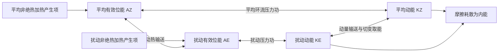

# 2023 年试题解析：逐题解答、考点与频次

> 本文件保留原题及频次，补充对应解答。星级为复习用主观评级；有缺题或排印疑点时，明确注明条件及可解范围。频次按考点出现的不同年份统计，不能视作命题概率。

原始记录：[[动力气象课后习题/往年试题分析/2023]]　｜　[[00_使用说明与年份索引|统计口径与目录]]

## 原卷第一部分

名词解释（共 10 题，每小题 3 分，共 30 分）

## 题目 2023-一-1

### 原题

赤道槽

### 考点与考察频次

**考察频次：4 次（按年份去重）；🔴 重点。**

| 考点 | 频次 | 标记 | 对应年份 |
|---|---:|---|---|
| 热带辐合带 | 4 次 | 重点 | 2000、2004、2014、2023 |

同考点的全部题号见 [[01_考点频次与证据总表|考点频次与证据总表]]。

### 难度与考试相关度

**难度：★☆☆☆☆（1/5）｜考试相关度：★★★★★（5/5）**

评级依据：历史出现且直接对应所给考纲；频次用于区分复习优先级。

### 考场精简版与审校状态

**审校状态：尚未逐题学科审校。**

**相关高频考点复习摘要（须按本题设问取舍，不替代完整解答）：**

**热带辐合带：** ITCZ是低纬信风和季风气流辐合、上升与深对流活跃的带状区域，随季节及海陆热力分布移动，不固定在地理赤道。赤道槽着重气压形态，ITCZ着重风场辐合与对流，二者不必逐点重合。

> 以上摘要用于回忆答题主线，不是官方评分标准；推导、计算和多小问仍须完成下方步骤。

### 详细解答

1. 热带辐合带（ITCZ）是低纬近地面信风及季风气流辐合、上升和深对流较活跃的带状区域，常与赤道附近低压槽相联系。

2. 太阳加热、海表温度及海陆分布使它并不总沿地理赤道，通常随季节向夏半球移动，并具有区域差异；海洋双辐合带等情况也可能出现。

3. 低层辐合持续补给暖湿空气，凝结潜热帮助维持上升和高层辐散，常带来云雨及热带扰动。赤道槽着重气压槽形态，ITCZ着重风场辐合和对流，两者密切相关但不是所有天气图上都逐点重合。

## 题目 2023-一-2

### 原题

赤道东风波

### 考点与考察频次

**考察频次：3 次（按年份去重）；🔴 重点。**

| 考点 | 频次 | 标记 | 对应年份 |
|---|---:|---|---|
| 东风波 | 3 次 | 重点 | 2006、2010、2023 |

同考点的全部题号见 [[01_考点频次与证据总表|考点频次与证据总表]]。

### 难度与考试相关度

**难度：★☆☆☆☆（1/5）｜考试相关度：★★★★★（5/5）**

评级依据：历史出现且直接对应所给考纲；频次用于区分复习优先级。

### 考场精简版与审校状态

**审校状态：尚未逐题学科审校。**

**相关高频考点复习摘要（须按本题设问取舍，不替代完整解答）：**

**东风波：** 东风波是热带东风气流中的槽脊波动，通常随背景东风向西传播，伴涡度、辐合和对流信号；部分可提供热带气旋初始扰动，但不是每个东风波都发展成台风。

> 以上摘要用于回忆答题主线，不是官方评分标准；推导、计算和多小问仍须完成下方步骤。

### 详细解答

1. 东风波是热带东风气流中的波状槽脊扰动，通常向西移动，具有风场、涡度和对流信号；其某些阶段可提供热带气旋初始扰动，但并非每个东风波都会发展成台风。

## 题目 2023-一-3

### 原题

线性振动

### 考点与考察频次

**考察频次：1 次（按年份去重）；一般。**

| 考点 | 频次 | 标记 | 对应年份 |
|---|---:|---|---|
| 线性振荡 | 1 次 | 一般 | 2023 |

同考点的全部题号见 [[01_考点频次与证据总表|考点频次与证据总表]]。

### 难度与考试相关度

**难度：★☆☆☆☆（1/5）｜考试相关度：★★★★☆（4/5）**

评级依据：历史出现且直接对应所给考纲；频次用于区分复习优先级。

### 考场精简版与审校状态

**审校状态：尚未逐题学科审校。**

> 以上摘要用于回忆答题主线，不是官方评分标准；推导、计算和多小问仍须完成下方步骤。

### 详细解答

1. 微小位移 $\xi$ 若满足 $\ddot\xi+N^2\xi=0$，在 $N^2>0$ 时解为 $A\cos Nt+B\sin Nt$，为有回复力的线性振荡；$N^2<0$ 时解含指数增长，表示静力不稳定。

## 题目 2023-一-4

### 原题

全位能

### 考点与考察频次

**考察频次：1 次（按年份去重）；一般。**

| 考点 | 频次 | 标记 | 对应年份 |
|---|---:|---|---|
| 总位能 | 1 次 | 一般 | 2023 |

同考点的全部题号见 [[01_考点频次与证据总表|考点频次与证据总表]]。

### 难度与考试相关度

**难度：★☆☆☆☆（1/5）｜考试相关度：★★★★☆（4/5）**

评级依据：历史出现且直接对应所给考纲；频次用于区分复习优先级。

### 考场精简版与审校状态

**审校状态：尚未逐题学科审校。**

> 以上摘要用于回忆答题主线，不是官方评分标准；推导、计算和多小问仍须完成下方步骤。

### 详细解答

1. 单位质量内能 $e=c_vT$，重力位能 $\Phi=gz$（常重力），动能 $K=|\mathbf V|^2/2$，水汽潜热能近似 $L_vq_v$。总量需对气团质量积分；动能不能漏掉 $1/2$。
2. “全位能”在大气能量学中通常指内能与重力位能之和，而非含动能的总能量。静力、平坦底面且顶边界压力趋零时，$\int\rho gz\,dz=-\int z\,dp=\int p\,dz=\int\rho RT\,dz$；加上内能得到 $\int c_pT\,dm$。
3. 有效位能是实际全位能相对绝热重排到参考最低能态后的可用部分。不是全部内能或重力位能都能转换为动能。差异加热维持水平温差，建立有效位能。
4. 暖上升冷下沉时，$C=-\int\alpha'\omega'\,dm>0$，有效位能转为扰动动能；摩擦最终把动能耗散成内能。凝结使潜热转入热力能库，但水汽能量本来主要来自地表蒸发和辐射收支。
5. 对流层常用 Lorenz 四能量库循环如下。双向箭头表示转换可正可负，方向由收支项决定；中纬度斜压波常沿 $A_Z\to A_E\to K_E$ 取能。$A_Z$ 与 $K_Z$ 的直接转换不能漏掉：平均经圈环流同样可通过压力功在平均有效位能和平均动能之间转换。

产生项也可能为负，图中不是所有加热都增加有效位能。若问完整收支，应分别写 $\dot A_Z=G_Z-C_A-C_Z$、$\dot A_E=G_E+C_A-C_E$、$\dot K_Z=C_Z+C_K-D_Z$、$\dot K_E=C_E-C_K-D_E$，这里 $C_K>0$ 约定为扰动动能转入平均动能。四式相加，内部转换项逐项抵消，只剩外部产生与耗散，可用作检查。

## 题目 2023-一-5

### 原题

锋生

### 考点与考察频次

**考察频次：5 次（按年份去重）；🔴 重点。**

| 考点 | 频次 | 标记 | 对应年份 |
|---|---:|---|---|
| 锋生与锋消 | 5 次 | 重点 | 1992、1994、2016、2018、2023 |

同考点的全部题号见 [[01_考点频次与证据总表|考点频次与证据总表]]。

### 难度与考试相关度

**难度：★☆☆☆☆（1/5）｜考试相关度：★★★★★（5/5）**

评级依据：历史出现且直接对应所给考纲；频次用于区分复习优先级。

### 考场精简版与审校状态

**审校状态：尚未逐题学科审校。**

**相关高频考点复习摘要（须按本题设问取舍，不替代完整解答）：**

**锋生与锋消：** 锋生是随气块运动的水平温度或位温梯度增强。令 $F=D|\nabla_h\theta|/Dt$，按链式法则可分为差异加热、水平变形辐合和竖直倾斜贡献。$F>0$ 锋生，$F<0$ 锋消；不能把所有水平辐合无条件视为锋生。

> 以上摘要用于回忆答题主线，不是官方评分标准；推导、计算和多小问仍须完成下方步骤。

### 详细解答

1. **锋生定义与推导。** 令 $\mathbf G=\nabla_h\theta$，$F=D|\mathbf G|/Dt$。由 $D\theta/Dt=\dot\theta$ 对 $x_i$ 求导：$DG_i/Dt=\partial_i\dot\theta-(\partial_i u_j)G_j-(\partial_iw)\theta_z$，这里 $i,j=x,y$。

2. 与 $G_i/|\mathbf G|$ 相乘求和，得
$$F=\frac{\mathbf G\cdot\nabla_h\dot\theta}{|\mathbf G|}-\frac{G_i(\partial_i u_j)G_j}{|\mathbf G|}-\frac{\theta_z\mathbf G\cdot\nabla_hw}{|\mathbf G|}.$$
三项分别是差异非绝热加热、水平变形/辐合、竖直倾斜作用；$F>0$ 锋生，$F<0$ 锋消。若温度梯度沿 $x$，绝热且无倾斜时 $F=-|G|u_x$，跨锋辐合 $u_x<0$ 加大梯度，直观说明动力锋生。

## 题目 2023-一-6

### 原题

辐射逆温

### 考点与考察频次

**考察频次：2 次（按年份去重）；一般。**

| 考点 | 频次 | 标记 | 对应年份 |
|---|---:|---|---|
| 逆温 | 2 次 | 一般 | 2023、2025 |

同考点的全部题号见 [[01_考点频次与证据总表|考点频次与证据总表]]。

### 难度与考试相关度

**难度：★☆☆☆☆（1/5）｜考试相关度：★★★★☆（4/5）**

评级依据：历史出现且直接对应所给考纲；频次用于区分复习优先级。

### 考场精简版与审校状态

**审校状态：尚未逐题学科审校。**

> 以上摘要用于回忆答题主线，不是官方评分标准；推导、计算和多小问仍须完成下方步骤。

### 详细解答

1. 逆温是气温随高度增加而升高的层，$dT/dz>0$，静力稳定，抑制竖直混合，易使水汽和污染物滞留。

2. 辐射逆温：晴空、弱风夜间地面长波辐射冷却，近地空气被冷却，上层相对暖，逆温自地面向上形成；日出后地表加热常逐渐破坏它。

3. 下沉逆温：高压下空气下沉压缩增温，上部空气可能下沉更多，在边界层顶形成暖盖；锋面逆温：暖空气位于冷空气上方；平流逆温：暖空气流到较冷地表后下部先冷却。形成位置和持续性各不相同。

## 题目 2023-一-7

### 原题

阻塞高压

### 考点与考察频次

**考察频次：16 次（按年份去重）；🔴 重点。**

| 考点 | 频次 | 标记 | 对应年份 |
|---|---:|---|---|
| 阻塞高压 | 16 次 | 重点 | 1989、1992、1994、1996、1997、1998、2000、2003、2005、2006、2011、2013、2017、2019、2022、2023 |

同考点的全部题号见 [[01_考点频次与证据总表|考点频次与证据总表]]。

### 难度与考试相关度

**难度：★☆☆☆☆（1/5）｜考试相关度：★★★★★（5/5）**

评级依据：历史出现且直接对应所给考纲；频次用于区分复习优先级。

### 考场精简版与审校状态

**审校状态：尚未逐题学科审校。**

**相关高频考点复习摘要（须按本题设问取舍，不替代完整解答）：**

**阻塞高压：** 阻塞高压是中高纬持续、少动并使西风绕行的强脊或闭合高压。建立与暖输送、波破碎及涡旋反馈有关；其东侧偏北气流可蓄积和引导冷空气。衰退配合横槽转竖时可触发寒潮，但并非每次崩溃都必然造成寒潮。

> 以上摘要用于回忆答题主线，不是官方评分标准；推导、计算和多小问仍须完成下方步骤。

### 详细解答

1. 阻塞高压是中高纬持续、移动缓慢的强高压脊或闭合高压，使西风气流绕行、分支，阻碍天气系统正常东移。关键是持续性和对西风带的阻挡，并非所有高压都叫阻塞。
2. 建立时，暖空气向极地输送使脊增强，经向振幅增大，波破碎、涡旋反馈可帮助维持。高压脊发展或与高纬高压合并，南侧可切出冷低压，形成偶极或Ω型等配置。
3. 维持时，阻高东侧偏北气流引导冷空气南下，西侧偏南气流输送暖空气。下游槽及冷暖空气交汇区可长期停留，造成持久冷凉、降雨；高压控制区下沉、少云，可造成干旱和高温，具体依季节和位置。
4. 衰退或崩溃时，维持高压的暖输送与涡旋反馈减弱，西风恢复，槽脊重新东移；其东侧积聚的冷空气可配合横槽转竖大举南下，触发我国寒潮。不能把每一次阻高衰退都等同于寒潮，仍需冷空气强度和路径配合。
5. 亚洲常关注乌拉尔山及鄂霍次克海等阻塞区，北大西洋—欧洲也是重要活动区；不同季节的优势位置不同，不应把某一季节经验说成全年固定不变。
6. 切断低压是从西风主槽分离出的闭合冷性低压，移动缓慢，可与北侧阻高配合。其冷空气及正涡度有利于下游不稳定和上升，但天气还依水汽供应。

## 题目 2023-一-8

### 原题

多单体风暴

### 考点与考察频次

**考察频次：1 次（按年份去重）；一般。**

| 考点 | 频次 | 标记 | 对应年份 |
|---|---:|---|---|
| 多单体风暴 | 1 次 | 一般 | 2023 |

同考点的全部题号见 [[01_考点频次与证据总表|考点频次与证据总表]]。

### 难度与考试相关度

**难度：★☆☆☆☆（1/5）｜考试相关度：★★★★☆（4/5）**

评级依据：历史出现且直接对应所给考纲；频次用于区分复习优先级。

### 考场精简版与审校状态

**审校状态：尚未逐题学科审校。**

> 以上摘要用于回忆答题主线，不是官方评分标准；推导、计算和多小问仍须完成下方步骤。

### 详细解答

1. **组织类型。** 多单体风暴由不同生命阶段单体组成，冷池边界不断触发新单体，整体比单个单体活得久；超级单体的识别核心是深厚、持续旋转的上升气流（中气旋），不是单纯雨量最大。[NWS 超级单体说明](https://www.weather.gov/ama/supercell)

2. **普通雷暴三阶段。** 积云阶段以上升为主、云滴增长；成熟阶段上升和降水拖曳/蒸发冷却产生的下沉共存，雷电、阵雨和阵风最活跃；消散阶段下沉与冷出流占据，切断暖湿入流，云体和降水逐渐减弱。

## 题目 2023-一-9

### 原题

米散射

### 考点与考察频次

**考察频次：1 次（按年份去重）；一般。**

| 考点 | 频次 | 标记 | 对应年份 |
|---|---:|---|---|
| 米散射 | 1 次 | 一般 | 2023 |

同考点的全部题号见 [[01_考点频次与证据总表|考点频次与证据总表]]。

### 难度与考试相关度

**难度：★☆☆☆☆（1/5）｜考试相关度：★★★★☆（4/5）**

评级依据：历史出现且直接对应所给考纲；频次用于区分复习优先级。

### 考场精简版与审校状态

**审校状态：尚未逐题学科审校。**

> 以上摘要用于回忆答题主线，不是官方评分标准；推导、计算和多小问仍须完成下方步骤。

### 详细解答

1. **米散射。** 对球形粒子求 Maxwell 方程的散射解；当天气学所说的粒子尺度与波长可比或更大时，不能再用简单 $\lambda^{-4}$ 律，前向散射常强，颜色选择减弱。云滴多重散射使云常呈白色，厚云因透射弱而底部暗；气溶胶也可造成霾与能见度降低。

## 题目 2023-一-10

### 原题

绝对环流加速度

### 考点与考察频次

**考察频次：1 次（按年份去重）；一般。**

| 考点 | 频次 | 标记 | 对应年份 |
|---|---:|---|---|
| 环流定理 | 1 次 | 一般 | 2023 |

同考点的全部题号见 [[01_考点频次与证据总表|考点频次与证据总表]]。

### 难度与考试相关度

**难度：★☆☆☆☆（1/5）｜考试相关度：★★★★☆（4/5）**

评级依据：历史出现且直接对应所给考纲；频次用于区分复习优先级。

### 考场精简版与审校状态

**审校状态：尚未逐题学科审校。**

> 以上摘要用于回忆答题主线，不是官方评分标准；推导、计算和多小问仍须完成下方步骤。

### 详细解答

1. 随体闭合曲线的相对环流为 $C=\oint\mathbf V\cdot d\mathbf l$；绝对环流 $C_a=C+2\boldsymbol\Omega\cdot\mathbf S$，其中 $\mathbf S$ 是有向面积矢量。
2. 对随体线积分求导，动能梯度沿闭合路径积分为零，保守重力同样为零；无摩擦时只剩压力项：$\boxed{DC_a/Dt=-\oint\alpha\,dp}$，即绝对环流加速度。
3. 用 Stokes 定理，$-\oint\alpha\nabla p\cdot d\mathbf l=-\iint(\nabla\alpha\times\nabla p)\cdot\mathbf n\,dS$。因此斜压力管矢量可按本约定定义为 $\nabla p\times\nabla\alpha$。
4. 等压面与等比容面交叉围成的管状区域称力管，其投影和方向表征斜压产生环流的作用；正压时两组面重合，叉积为零。正压、无摩擦条件下绝对环流守恒，但相对环流可因投影面积改变而变化。

## 原卷第二部分

简答题（每小题 10 分，共 60 分）

## 题目 2023-二-1

### 原题

影响东亚季风形成的基本因子。

### 考点与考察频次

**考察频次：12 次（按年份去重）；🔴 重点。**

| 考点 | 频次 | 标记 | 对应年份 |
|---|---:|---|---|
| 季风 | 12 次 | 重点 | 1989、1994、1999、2000、2005、2014、2018、2020、2021、2022、2023、2025 |

同考点的全部题号见 [[01_考点频次与证据总表|考点频次与证据总表]]。

### 难度与考试相关度

**难度：★★★☆☆（3/5）｜考试相关度：★★★★★（5/5）**

评级依据：历史出现且直接对应所给考纲；频次用于区分复习优先级。

### 考场精简版与审校状态

**审校状态：尚未逐题学科审校。**

**相关高频考点复习摘要（须按本题设问取舍，不替代完整解答）：**

**季风：** 季风是大范围盛行风向随季节显著转换的环流。形成因子包括海陆热力差异、行星风带季节移动及高原作用。东亚冬季风联系大陆冷高压与东亚大槽；夏季风联系季风低压、副高边缘水汽输送和高空南亚高压，热带与副热带季风并存。

> 以上摘要用于回忆答题主线，不是官方评分标准；推导、计算和多小问仍须完成下方步骤。

### 详细解答

1. **概念。** 季风是大范围盛行风向随季节发生显著转换的环流，通常伴有干湿季变化；季风区是这种季节性风向转换及其天气气候影响显著的地区。不能仅用一个地点冬夏偶然相反的风判定。

2. **基本因子。** 海陆热容量不同：冬季大陆冷却快、形成冷高压，夏季大陆增温快、形成热低压；压力配置改变，推动低层风季节反转。太阳直射点移动带动行星风带和热带辐合带移动，青藏高原热力及动力作用进一步重塑亚洲环流。

3. **冬季系统。** 亚洲大陆和高原为冷源，西伯利亚高压、阿留申低压、东亚大槽及强西风急流配合；我国大部盛行偏北风，带来寒冷干燥天气，沿海还受海陆和地形调制。

4. **夏季系统。** 大陆、高原感热及南亚—东亚降水潜热形成热源；低层印度季风槽、南海季风、西太平洋副高西侧偏南气流、跨赤道气流共同输送水汽，上层南亚高压及热带东风急流响应加热。

5. **东亚特点。** 既有热带季风也有副热带季风，冬季风尤其强；夏季水汽路径包括孟加拉湾—南海和西太平洋，雨带随季风推进分阶段北跳，又受中高纬冷空气影响。热源、环流、水汽辐合和潜热释放相互反馈，不能归结成单一海陆风的放大。

## 题目 2023-二-2

### 原题

赤道地区有哪些特有波动，阐述其特征。

### 考点与考察频次

**考察频次：5 次（按年份去重）；🔴 重点。**

| 考点 | 频次 | 标记 | 对应年份 |
|---|---:|---|---|
| 赤道波动 | 5 次 | 重点 | 2003、2005、2020、2023、2024 |

同考点的全部题号见 [[01_考点频次与证据总表|考点频次与证据总表]]。

### 难度与考试相关度

**难度：★★☆☆☆（2/5）｜考试相关度：★★★★★（5/5）**

评级依据：历史出现且直接对应所给考纲；频次用于区分复习优先级。

### 考场精简版与审校状态

**审校状态：尚未逐题学科审校。**

**相关高频考点复习摘要（须按本题设问取舍，不替代完整解答）：**

**赤道波动：** 赤道β平面存在开尔文波、赤道罗斯贝波、混合罗斯贝—重力波和惯性重力波。开尔文波东传、经向风为零且赤道束缚；罗斯贝模态内禀相速向西；混合波兼有涡旋与重力特征。实际云雨还依赖湿对流耦合。

> 以上摘要用于回忆答题主线，不是官方评分标准；推导、计算和多小问仍须完成下方步骤。

### 详细解答

1. 赤道附近 $f\approx\beta y$，科氏参数变号使若干波动被束缚在赤道附近。主要模态有赤道开尔文波、赤道罗斯贝波、混合罗斯贝—重力波及赤道惯性重力波。线性理论描述它们的动力骨架，实际云雨还受湿对流耦合。
2. **赤道开尔文波。** 取浅水等效波速 $c=\sqrt{gH}$，令 $v=0$。纬向动量与连续方程给 $u_t=-g\eta_x$、$\eta_t=-Hu_x$，组合得 $u_{tt}=c^2u_{xx}$，故 $\omega=\pm ck$。
3. 经向动量给 $\beta yu=-g\eta_y$。东传支有 $u=g\eta/c$，故 $\eta_y=-(\beta y/c)\eta$，积分得 $\eta\propto\exp[-\beta y^2/(2c)]$；西传支随远离赤道增长，不能满足有界条件。因此开尔文波为东传、近非频散，$u,\eta$ 关于赤道对称，$v=0$，束缚尺度 $L_e=\sqrt{c/\beta}$。
4. **混合波。** 兼具涡旋性与重力回复特征，经向风不为零；标准 $n=0$ 物理解可写 $\omega=ck/2+\sqrt{c^2k^2/4+\beta c}$（连同实场的共轭分支）。负波数一侧相速向西，群速可向东，不能把它当成单纯非频散东传波。
5. **赤道罗斯贝波。** 主要受位涡梯度约束，内禀相速向西，常表现为赤道两侧成对的涡旋；重力波分支较快，以辐散、质量场振荡显著。
6. 沿岸开尔文波与赤道开尔文波应区分：前者靠边界无穿透与地转横向平衡束缚，离岸按 $e^{-y/L_D}$ 衰减，$L_D=c/|f|$；北半球沿传播方向海岸在右侧。赤道波无需实体岸界。

## 题目 2023-二-3

### 原题

温带气旋发展的四个阶段及其特征。

### 考点与考察频次

**考察频次：9 次（按年份去重）；🔴 重点。**

| 考点 | 频次 | 标记 | 对应年份 |
|---|---:|---|---|
| 气旋及其发展 | 9 次 | 重点 | 1989、1992、1998、2003、2005、2020、2022、2023、2026 |

同考点的全部题号见 [[01_考点频次与证据总表|考点频次与证据总表]]。

### 难度与考试相关度

**难度：★★☆☆☆（2/5）｜考试相关度：★★★★★（5/5）**

评级依据：历史出现且直接对应所给考纲；频次用于区分复习优先级。

### 考场精简版与审校状态

**审校状态：尚未逐题学科审校。**

**相关高频考点复习摘要（须按本题设问取舍，不替代完整解答）：**

**气旋及其发展：** 气旋是低压及气旋式环流。温带锋面气旋依次经历初生波动、发展加深、成熟锢囚、衰亡填塞；斜压有效位能、高空涡度平流和辐散、低层暖平流及潜热共同影响发展。不能把所有气旋都概括成轴对称冷心。

> 以上摘要用于回忆答题主线，不是官方评分标准；推导、计算和多小问仍须完成下方步骤。

### 详细解答

1. 气旋是低压及其气旋式环流系统，北半球逆时针、南半球顺时针；反气旋为高压及反气旋式环流。低层摩擦使气旋常辐合上升、反气旋常辐散下沉，但云雨仍依水汽和热力条件。

2. **温带锋面气旋四阶段。** 初生：静止锋上出现波动，暖空气向冷侧、冷空气向暖侧推进；发展：低压加深，冷暖锋清楚，暖区扩大，槽前正涡度平流和高空辐散配合；成熟/锢囚：冷锋追上暖锋，暖空气抬离地面，气旋范围较大且结构复杂；衰亡：近地面冷空气占据中心，水平温差和斜压取能减弱，低压逐渐填塞。

3. **主要发展因子。** 基本态温度梯度与垂直风切变提供有效位能，高低空槽与地面低压有利配置，低层暖平流、高层正涡度平流和辐散支持上升，凝结潜热可加强发展。并非每个实际气旋都严格走完同一理想阶段。

4. 我国温带气旋常活动于蒙古—东北、黄淮—江淮及东部沿海等区，路径随季节变化。冷反气旋多随冷空气从西北、北方或东北方向南下，冬半年强且广，暖季较弱；不能给出一条全年唯一入侵路线。

## 题目 2023-二-4

### 原题

简述臭氧在大气中的空间分布特征。

### 考点与考察频次

**考察频次：2 次（按年份去重）；一般。**

| 考点 | 频次 | 标记 | 对应年份 |
|---|---:|---|---|
| 臭氧及其辐射作用 | 2 次 | 一般 | 2023、2024 |

同考点的全部题号见 [[01_考点频次与证据总表|考点频次与证据总表]]。

### 难度与考试相关度

**难度：★★☆☆☆（2/5）｜考试相关度：★★★★☆（4/5）**

评级依据：历史出现且直接对应所给考纲；频次用于区分复习优先级。

### 考场精简版与审校状态

**审校状态：尚未逐题学科审校。**

> 以上摘要用于回忆答题主线，不是官方评分标准；推导、计算和多小问仍须完成下方步骤。

### 详细解答

1. 臭氧多数位于平流层，浓度峰值高度依用数密度还是体积混合比表示而不同，不能只给一个绝对峰值高度；臭氧总量也受纬度、季节和输送影响。对流层臭氧含量较少但影响空气质量。

2. 平流层 Chapman 生成机制：$O_2+h\nu\to O+O$；$O+O_2+M\to O_3+M$。第三体 $M$ 带走过剩能量，使臭氧分子稳定。

3. 损耗包括 $O_3+h\nu\to O_2+O$、$O+O_3\to2O_2$，以及 HOx、NOx、ClOx、BrOx 等自由基的催化循环。催化剂在反应循环中再生，故少量活性物质可破坏较多臭氧；极地平流层云表面反应可促进卤素活化。

4. 臭氧吸收紫外并加热平流层，保护地表免受部分有害紫外；对流层臭氧则是二次污染物和温室气体。参考：[NOAA 臭氧评估问答](https://csl.noaa.gov/assessments/ozone/2022/twentyquestions/)。

## 题目 2023-二-5

### 原题

简述台风垂直向上的分层，并描述其气流特点。

### 考点与考察频次

**考察频次：2 次（按年份去重）；一般。**

| 考点 | 频次 | 标记 | 对应年份 |
|---|---:|---|---|
| 热带气旋结构 | 2 次 | 一般 | 2010、2023 |

同考点的全部题号见 [[01_考点频次与证据总表|考点频次与证据总表]]。

### 难度与考试相关度

**难度：★★★☆☆（3/5）｜考试相关度：★★★★☆（4/5）**

评级依据：历史出现且直接对应所给考纲；频次用于区分复习优先级。

### 考场精简版与审校状态

**审校状态：尚未逐题学科审校。**

> 以上摘要用于回忆答题主线，不是官方评分标准；推导、计算和多小问仍须完成下方步骤。

### 详细解答

1. **结构与分层。** 低层摩擦入流、气旋旋转和辐合；中层眼墙强上升、强风和强降水，外围有螺旋雨带；高层向外辐散，常带反气旋性外流。中心气压低、温度暖，最大风通常在眼墙附近而不在眼中心。眼区下沉增温、相对湿度低、风较弱，可有低云，不能绝对说完全无云。

## 题目 2023-二-6

### 原题

简述假绝热（湿绝热）过程，解释其不可逆的原因。

### 考点与考察频次

**考察频次：1 次（按年份去重）；一般。**

| 考点 | 频次 | 标记 | 对应年份 |
|---|---:|---|---|
| 假绝热过程 | 1 次 | 一般 | 2023 |

同考点的全部题号见 [[01_考点频次与证据总表|考点频次与证据总表]]。

### 难度与考试相关度

**难度：★★★☆☆（3/5）｜考试相关度：★★★★☆（4/5）**

评级依据：历史出现且直接对应所给考纲；频次用于区分复习优先级。

### 考场精简版与审校状态

**审校状态：尚未逐题学科审校。**

> 以上摘要用于回忆答题主线，不是官方评分标准；推导、计算和多小问仍须完成下方步骤。

### 详细解答

1. 假绝热过程中凝结潜热部分补偿膨胀冷却，故湿绝热直减率小于干绝热直减率。凝结物离开后气块已不是封闭系统，反向下沉时没有原来的液态水可完全蒸发恢复，因此不可逆。可逆湿绝热则假定凝结物保留，两者不可混称。

## 原卷第三部分

论述题（每小题 15 分，共 45 分）

## 题目 2023-三-1

### 原题

水汽通量和水汽通量散度的定义和物理含义，以及它们是如何计算的？

### 考点与考察频次

**考察频次：2 次（按年份去重）；一般。**

| 考点 | 频次 | 标记 | 对应年份 |
|---|---:|---|---|
| 水汽输送与收支 | 2 次 | 一般 | 2001、2023 |

同考点的全部题号见 [[01_考点频次与证据总表|考点频次与证据总表]]。

### 难度与考试相关度

**难度：★★★☆☆（3/5）｜考试相关度：★★★★☆（4/5）**

评级依据：历史出现且直接对应所给考纲；频次用于区分复习优先级。

### 考场精简版与审校状态

**审校状态：尚未逐题学科审校。**

> 以上摘要用于回忆答题主线，不是官方评分标准；推导、计算和多小问仍须完成下方步骤。

### 详细解答

1. 水汽通量是单位时间通过单位面积的水汽质量，三维为 $\rho q\mathbf V$，水平形式为 $\rho q\mathbf V_h$，其中 $q$ 为比湿。天气图上也常画 $q\mathbf V_h$，此时是单位空气质量的输送表征，应交代约定。
2. 通量散度 $\nabla_h\cdot(\rho q\mathbf V_h)>0$ 表示净流出，负值表示辐合。若使用等压面诊断，常计算 $\nabla_p\cdot(q\mathbf V_h)=q\nabla_p\cdot\mathbf V_h+\mathbf V_h\cdot\nabla_pq$，包含风辐合和水汽平流两部分。
3. 整层水平水汽输送为 $\mathbf Q=(1/g)\int_{p_t}^{p_s}q\mathbf V_h\,dp$，单位 $\mathrm{kg\,m^{-1}\,s^{-1}}$。用逐层 $q,u,v$ 与气压厚度积分，再对水平位置求散度；地面气压随空间变化时积分下限不能无条件视为常数。
4. 柱水汽量 $W=(1/g)\int q\,dp$ 满足 $\partial_tW+\nabla_h\cdot\mathbf Q=E-P$（忽略上边界通量等），所以 $P=E-\partial_tW-\nabla\cdot\mathbf Q$。水汽辐合有利于降水，但一部分可先储存为柱水汽，不能把瞬时辐合直接等同降水量。

## 题目 2023-三-2

### 原题

正压不稳定和斜压不稳定的特征以及区别，简述斜压不稳定波动的空间结构。

### 考点与考察频次

**考察频次：10 次（本题所列考点的最高年份频次，不相加）；🔴 重点。**

| 考点 | 频次 | 标记 | 对应年份 |
|---|---:|---|---|
| 正压不稳定 | 10 次 | 重点 | 2006、2010、2011、2013、2015、2018、2020、2022、2023、2025 |
| 斜压不稳定 | 4 次 | 重点 | 2006、2012、2017、2023 |

同考点的全部题号见 [[01_考点频次与证据总表|考点频次与证据总表]]。

### 难度与考试相关度

**难度：★★★☆☆（3/5）｜考试相关度：★★★★★（5/5）**

评级依据：历史出现且直接对应所给考纲；频次用于区分复习优先级。

### 考场精简版与审校状态

**审校状态：已逐题复核（按所列模型与条件）。**

**针对本题的考场作答版（非官方评分标准）：**

正压不稳定主要抽取基本流水平切变动能，斜压不稳定主要抽取基本流有效位能。典型北半球西风带成长斜压波高度槽脊随高度向西倾斜，伴向极热输送及暖升冷沉；空间结构、波长及增长率依模型和阶段而变。

> 推导题须保留必要推演，简答与论述须按小问展开；精简版只用于回忆作答主线。

### 详细解答

**修改意见（2026-10-04）：**

原答案偏重正压必要条件长推导；改为对照回答两类能量来源，并把斜压波的高度倾斜、热量输送、垂直运动和成长阶段逐项对应。

**核对依据：** [[牢三样/动力气象/不稳定理论/正压和斜压不稳定|正压和斜压不稳定]]。本地资料为学习笔记，不视作官方标准答案；冲突处依据下列方程推导与量纲检查作出判断。

**复核后详细解答：**

1. **共同定义。** 不稳定指基本态上的扰动能够增长；“正压/斜压”两类区分的核心是主要取能机制，不应只背某个固定天气系统或增长天数。

| 比较项 | 正压不稳定 | 斜压不稳定 |
|---|---|---|
| 主要基本态特征 | 水平风切变 | 水平温度梯度及相应地转风垂直切变 |
| 主要能量来源 | 基本流动能 | 基本流有效位能 |
| 主要转换联系 | 动量通量与平均水平切变 | 热量输送及扰动压力功 |
| 典型约束 | 理想平行流中$\beta-U_{yy}$变号为必要条件 | 需结合内部位涡梯度、边界热力梯度及模型条件 |

2. **正压取能符号。** 对$U(y)$，纬向扰动方程含$v'U_y$；乘$u'$并构造扰动动能收支，移项得到$C_{\mathrm{BT}}=-\overline{u'v'}U_y$。合适积分后该项为正，才表示基本流向扰动提供动能。不能按参考笔记某段的正号误写为速度协方差与切变同号即取能。
3. **斜压取能的两步。** 在北冷南暖背景下，暖空气偏向极地、冷空气偏向赤道的输送，使平均温差所储有效位能转入扰动有效位能；扰动中的暖升冷沉再使扰动有效位能转为动能。气压坐标下转换项$C_E=-\int\alpha'\omega'\,dm$：暖区$\alpha'>0,\omega'<0$，冷区$\alpha'<0,\omega'>0$，两者均给$-\alpha'\omega'>0$。
4. **垂直结构。** 典型中纬度西风带成长斜压波的位势高度槽脊轴随高度向西倾斜，即高层槽位于低层槽以西。温度扰动与高度扰动存在支持热输送和压力功的相位关系，不能将各物理量的槽轴都画成完全重合。
5. **水平配置与垂直运动。** 在常见成长阶段，槽前暖平流、暖空气上升与槽后冷平流、冷空气下沉相配合；这是有条件的典型结构，不是仅凭“槽前”二字即可诊断任一个例降水的充分条件。
6. **演变与限制。** 波动成熟后垂直倾斜和能量转换可改变；可用能被释放、耗散及向平均流反馈会限制增长。静力稳定大气仍可斜压不稳定；实际扰动可同时含正压和斜压转换，不能机械地判作互斥。

两种能量来源的区分亦与[Read等关于正压、斜压不稳定能量学的研究](https://npg.copernicus.org/articles/27/147/2020/npg-27-147-2020.html)相符。这里不采用未给基本态、边界及参数时的固定临界波长或增长率。

## 题目 2023-三-3

### 原题

描述冰雹水分累积带理论，解释人工抑制冰雹的原理。

### 考点与考察频次

**考察频次：1 次（按年份去重）；一般。**

| 考点 | 频次 | 标记 | 对应年份 |
|---|---:|---|---|
| 冰雹形成机制 | 1 次 | 一般 | 2023 |

同考点的全部题号见 [[01_考点频次与证据总表|考点频次与证据总表]]。

### 难度与考试相关度

**难度：★★★☆☆（3/5）｜考试相关度：★★★★☆（4/5）**

评级依据：历史出现且直接对应所给考纲；频次用于区分复习优先级。

### 考场精简版与审校状态

**审校状态：尚未逐题学科审校。**

> 以上摘要用于回忆答题主线，不是官方评分标准；推导、计算和多小问仍须完成下方步骤。

### 详细解答

1. **水分累积带。** 强上升可使含水量高的过冷水区域维持，雹胚在其中碰并水滴，水滴冻结使冰雹增长。增长率可示意为 $dm/dt\sim E\,A\,L\,|V_t-w|$，其中 $E$ 是收集效率，$A$ 是截面积，$L$ 是液态含水量，相对速度决定扫掠量；轨迹和停留时间同样重要。冰雹不必每颗都反复完整上下循环才能形成。

2. 人工防雹的经典竞争假说是引入成冰粒子、增加冰粒数目，使有限过冷水被更多粒子分享，减少个别雹胚长成大雹的机会；也有提前降水等设想。应写“作用机理假说及适用条件”，不能保证任意播撒都有效或给出未经验证的防雹效果。效果不确定性参见[WMO人工影响天气声明](https://public.wmo.int/content/wmo-statement-weather-modification)。

## 原卷第四部分

推导题 对水平运动方程

### 本部分共用题干

$$ \left\{ \begin{aligned} \frac{du}{dt} - \beta v &= -\frac{1}{\rho} \frac{\partial p}{\partial x} \\\frac{dv}{dt} + \beta u &= -\frac{1}{\rho} \frac{\partial p}{\partial y}  \end{aligned} \right. $$ 
进行尺度分析 时间尺度 $I$，速度尺度 $U, W$，气压变化尺度 $\frac{\Delta p}{\pi}$，层结系数 $N$，厚度尺度 $H$

## 题目 2023-四-1

### 原题

平衡简化方程组的含义

### 考点与考察频次

**考察频次：5 次（按年份去重）；🔴 重点。**

| 考点 | 频次 | 标记 | 对应年份 |
|---|---:|---|---|
| 尺度分析与运动分类 | 5 次 | 重点 | 2010、2014、2020、2022、2023 |

同考点的全部题号见 [[01_考点频次与证据总表|考点频次与证据总表]]。

### 难度与考试相关度

**难度：★★★★★（5/5）｜考试相关度：★★★★★（5/5）**

评级依据：历史出现且直接对应所给考纲；频次用于区分复习优先级。

### 考场精简版与审校状态

**审校状态：条件解，须核对原题及教材。**

**相关高频考点复习摘要（须按本题设问取舍，不替代完整解答）：**

**尺度分析与运动分类：** 先定 $L,H,U,W,T$，列局地加速度 $U/T$、平流 $U^2/L$、科氏 $fU$、压力梯度 $\Delta p/(\rho L)$，再比较。$Ro=U/(fL)$ 小支持地转近似，薄层与小竖直惯性支持静力近似；赤道和强对流须另检验。

> 以上摘要用于回忆答题主线，不是官方评分标准；推导、计算和多小问仍须完成下方步骤。

### 详细解答

平衡简化不是把所有时间导数一概设为零，而是先根据尺度比较删去高阶小项，保留风场与质量场的主导约束，并用下一阶方程描述缓慢演变。中纬度大尺度中零阶水平是地转平衡、竖直通常为静力平衡；一阶非地转风驱动辐合辐散与垂直运动。适用前提是对应的无量纲参数足够小，强对流、近赤道及快速适应过程不能直接套用。

原卷科氏项写成 $\beta v,\beta u$，若 $\beta$ 指 $df/dy$，量纲与加速度不一致，需改作 $fv,fu$；若作者把β另定义为频率系数则须先确认。以下尺度表按通常的 $f_0$ 解释，保留原题不静默改写。

## 题目 2023-四-2

### 原题

给出两个运动方程组进行尺度分析，另计近似和一级近似，给出一个表，进行物理量的尺度分析

### 考点与考察频次

**考察频次：5 次（按年份去重）；🔴 重点。**

| 考点 | 频次 | 标记 | 对应年份 |
|---|---:|---|---|
| 尺度分析与运动分类 | 5 次 | 重点 | 2010、2014、2020、2022、2023 |

同考点的全部题号见 [[01_考点频次与证据总表|考点频次与证据总表]]。

### 难度与考试相关度

**难度：★★★★★（5/5）｜考试相关度：★★★★★（5/5）**

评级依据：历史出现且直接对应所给考纲；频次用于区分复习优先级。

### 考场精简版与审校状态

**审校状态：条件解，须核对原题及教材。**

**相关高频考点复习摘要（须按本题设问取舍，不替代完整解答）：**

**尺度分析与运动分类：** 先定 $L,H,U,W,T$，列局地加速度 $U/T$、平流 $U^2/L$、科氏 $fU$、压力梯度 $\Delta p/(\rho L)$，再比较。$Ro=U/(fL)$ 小支持地转近似，薄层与小竖直惯性支持静力近似；赤道和强对流须另检验。

> 以上摘要用于回忆答题主线，不是官方评分标准；推导、计算和多小问仍须完成下方步骤。

### 详细解答

**题干说明。** 原题长度、气压尺度记号有缺失。以下补充并明确约定水平长度 $L$、竖直长度 $H$、时间 $T$、水平速度 $U$、竖直速度 $W$、水平气压扰动 $\Delta p$，科氏参数用 $f_0$。

1. 代换 $x=Lx^*,y=Ly^*,z=Hz^*,t=Tt^*,u=Uu^*,v=Uv^*,w=Ww^*,p'=\Delta p\,p^*$。水平动量每项量级为：

| 项 | 尺度 | 除以 $f_0U$ 后 |
|---|---|---|
| 局地加速度 | $U/T$ | $1/(f_0T)$ |
| 水平平流 | $U^2/L$ | $U/(f_0L)$ |
| 竖直平流 | $WU/H$ | $W/(f_0H)$ |
| 科氏项 | $f_0U$ | $1$ |
| 水平压力梯度 | $\Delta p/(\rho_0L)$ | $\Delta p/(\rho_0Lf_0U)$ |

2. 取地转压力尺度 $\Delta p=\rho_0f_0UL$，使科氏项与压力项同阶。定义 $\epsilon=U/(f_0L)$，若 $T=L/U$ 且 $W/H\sim U/L$，惯性各项均为 $O(\epsilon)$。
3. 写 $u^*=u_0+\epsilon u_1+\cdots$，$v^*=v_0+\epsilon v_1+\cdots$，$p^*=p_0+\epsilon p_1+\cdots$，代入并比较阶次。零阶：$-v_0=-p_{0x}$、$u_0=-p_{0y}$，即地转平衡。
4. 一阶：$D_0u_0-v_1=-p_{1x}$、$D_0v_0+u_1=-p_{1y}$。移项得 $v_1=D_0u_0+p_{1x}$、$u_1=-D_0v_0-p_{1y}$，表明一阶包含非地转加速度修正。若保留β变化，还需在本阶增加相应项。
5. 竖直方程须另比较竖直惯性与浮力/压力梯度；稳定层结、薄层大尺度满足相应小参数时采用静力平衡，不能仅由两个水平方程直接“推出”静力。$N$ 可进入 $Fr=U/(NH)$、$Bu=(NH/(f_0L))^2$。
6. 原题没有给数值，故只能完成符号尺度表和明确假设下的阶次展开，无法补出唯一的数值量级表。

