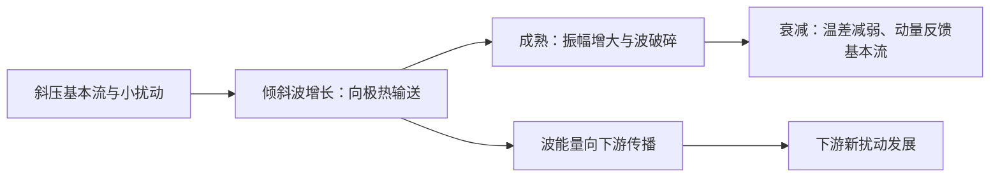
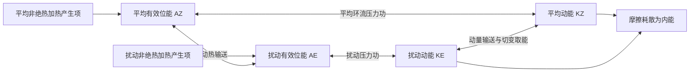

# 论述题：常考必备知识点

> 按本题型考察年份数降序排列；同频次依跨题型总频次、最近出现年份排序。频次不是2027年命题概率。补充题均置于历史考点之后，不计入真题频次。

[[牢三样/动力气象课后习题/常考必备知识点/00_总目录与统计口径|总目录与统计口径]] ｜ [[牢三样/动力气象课后习题/常考必备知识点/08_考纲覆盖与补充清单|77项考纲覆盖检查]]

## 历史考点速查

| 排名 | 考点 | 本题型年份数 | 全题型年份数 | 近10年（本题型） | 近5年（本题型） | 重点 |
|---:|---|---:|---:|---:|---:|---|
| 1 | [[#K-meiyu 梅雨|梅雨]] | 5 | 13 | 2 | 1 | 重点 |
| 2 | [[#K-monsoon 季风|季风]] | 4 | 12 | 1 | 0 | 重点 |
| 3 | [[#K-block 阻塞高压|阻塞高压]] | 3 | 16 | 1 | 0 | 重点 |
| 4 | [[#K-tropical 热带大气与天气系统|热带大气与天气系统]] | 3 | 5 | 1 | 1 | 重点 |
| 5 | [[#K-ocean 海洋对气候的作用|海洋对气候的作用]] | 3 | 4 | 1 | 0 | 重点 |
| 6 | [[#K-cold 寒潮及其天气过程|寒潮及其天气过程]] | 2 | 17 | 1 | 0 | — |
| 7 | [[#K-cisk 第二类条件不稳定（CISK）|第二类条件不稳定（CISK）]] | 2 | 10 | 1 | 1 | — |
| 8 | [[#K-cyclone 气旋及其发展|气旋及其发展]] | 2 | 9 | 0 | 0 | — |
| 9 | [[#K-tcgen 热带气旋生成条件|热带气旋生成条件]] | 2 | 7 | 2 | 1 | — |
| 10 | [[#K-eastasia 东亚大气环流|东亚大气环流]] | 2 | 7 | 0 | 0 | — |
| 11 | [[#K-mountainpv 气柱越山与位涡守恒应用|气柱越山与位涡守恒应用]] | 2 | 4 | 2 | 0 | — |
| 12 | [[#K-anticyclone 反气旋|反气旋]] | 2 | 4 | 0 | 0 | — |
| 13 | [[#K-aerosol 气溶胶的作用|气溶胶的作用]] | 2 | 2 | 2 | 2 | — |
| 14 | [[#K-barotropicinst 正压不稳定|正压不稳定]] | 1 | 10 | 1 | 1 | — |
| 15 | [[#K-rainband 我国雨带季节活动|我国雨带季节活动]] | 1 | 9 | 0 | 0 | — |
| 16 | [[#K-upperjet 高空急流|高空急流]] | 1 | 8 | 0 | 0 | — |
| 17 | [[#K-lowjet 低空急流|低空急流]] | 1 | 7 | 0 | 0 | — |
| 18 | [[#K-subtropical 西太平洋副热带高压|西太平洋副热带高压]] | 1 | 7 | 0 | 0 | — |
| 19 | [[#K-plateau 青藏高原天气气候效应|青藏高原天气气候效应]] | 1 | 6 | 0 | 0 | — |
| 20 | [[#K-equatorial 赤道波动|赤道波动]] | 1 | 5 | 1 | 1 | — |
| 21 | [[#K-greenhouse 温室效应|温室效应]] | 1 | 5 | 1 | 1 | — |
| 22 | [[#K-scale 尺度分析与运动分类|尺度分析与运动分类]] | 1 | 5 | 1 | 1 | — |
| 23 | [[#K-baroclinicinst 斜压不稳定|斜压不稳定]] | 1 | 4 | 1 | 1 | — |
| 24 | [[#K-rossbylife 罗斯贝波生命史与演变|罗斯贝波生命史与演变]] | 1 | 3 | 1 | 1 | — |
| 25 | [[#K-humanclimate 人类活动对气候的影响|人类活动对气候的影响]] | 1 | 3 | 1 | 0 | — |
| 26 | [[#K-tc 热带气旋概念|热带气旋概念]] | 1 | 3 | 1 | 0 | — |
| 27 | [[#K-climatechange 气候变化|气候变化]] | 1 | 3 | 0 | 0 | — |
| 28 | [[#K-comparison 温带气旋与热带气旋比较|温带气旋与热带气旋比较]] | 1 | 3 | 0 | 0 | — |
| 29 | [[#K-innerwave 重力内波|重力内波]] | 1 | 2 | 1 | 1 | — |
| 30 | [[#K-inversion 逆温|逆温]] | 1 | 2 | 1 | 1 | — |
| 31 | [[#K-mixing 混合过程|混合过程]] | 1 | 2 | 1 | 1 | — |
| 32 | [[#K-moisture 水汽输送与收支|水汽输送与收支]] | 1 | 2 | 1 | 1 | — |
| 33 | [[#K-energy 大气能量及转换|大气能量及转换]] | 1 | 2 | 1 | 0 | — |
| 34 | [[#K-land 陆面过程与气候|陆面过程与气候]] | 1 | 2 | 0 | 0 | — |
| 35 | [[#K-jianghuai 江淮气旋|江淮气旋]] | 1 | 2 | 0 | 0 | — |
| 36 | [[#K-thunder 雷暴形成条件|雷暴形成条件]] | 1 | 2 | 0 | 0 | — |
| 37 | [[#K-longwave 地气长波辐射|地气长波辐射]] | 1 | 1 | 1 | 1 | — |
| 38 | [[#K-hail 冰雹形成机制|冰雹形成机制]] | 1 | 1 | 1 | 1 | — |
| 39 | [[#K-airsea 海气相互作用|海气相互作用]] | 1 | 1 | 1 | 0 | — |
| 40 | [[#K-surfaceclimate 近地面气候特征|近地面气候特征]] | 1 | 1 | 0 | 0 | — |
| 41 | [[#K-terrain 地形对天气的影响|地形对天气的影响]] | 1 | 1 | 0 | 0 | — |
| 42 | [[#K-stability 静力稳定度|静力稳定度]] | 1 | 1 | 0 | 0 | — |

## K-meiyu 梅雨

**本题型考察：5 次（5个年份）；全题型考察：13 次。**
**本题型：重点；跨题型：重点。**

本题型年份：2003、2004、2005、2020、2022。

### 原题问法与对应解答

> 按相同解答合并展示原题（不代表题干相同）；同一多考点题可能在不同考点下交叉索引，这不增加年份频次。以下同时保留题目特有数据和条件，不能只背一个通用结论。

#### 解答组 1

来源：[[牢三样/动力气象课后习题/试题解答/往年试题解析/2003#题目 2003-四-整题|2003-四-整题]]、[[牢三样/动力气象课后习题/试题解答/往年试题解析/2003#题目 2003-七-整题|2003-七-整题]]、[[牢三样/动力气象课后习题/试题解答/往年试题解析/2004#题目 2004-五-整题|2004-五-整题]]、[[牢三样/动力气象课后习题/试题解答/往年试题解析/2005#题目 2005-四-整题|2005-四-整题]]、[[牢三样/动力气象课后习题/试题解答/往年试题解析/2020#题目 2020-三-1|2020-三-1]]、[[牢三样/动力气象课后习题/试题解答/往年试题解析/2022#题目 2022-三-1|2022-三-1]]

**原题：**

梅雨锋区附近气象要素场的分布特征（15 分）

**原题：**

叙述我国长江流域梅雨时，500 毫巴上东亚大气环流特征，指出支配梅雨的关键系统及其相互配置的关系（25 分）

叙述我国长江流域梅雨时，500 毫巴上东亚大气环流特征，指出支配梅雨的关键系统及其相互配置的关系（25 分）

**原题：**

叙述江淮梅雨环流特征

**原题：**

叙述典型梅雨的环流特征（只叙述双阻型的情况）。

**原题：**

什么是江淮梅雨？梅雨期天气特征是什么？长江中下游典型梅雨底层环流特点？

**原题：**

梅雨期间的天气特征？梅雨锋的结构特点？梅雨期间高中低层的环流特征？

**评级参考：** 难度：★★☆☆☆（2/5）｜考试相关度：★★★★★（5/5）

**2003-四-整题：尚未逐题学科审校。**

规范化题干一致：1个年份；年份：2003。

**相关高频考点复习摘要（须按本题设问取舍，不替代完整解答）：**

**梅雨：** 梅雨是初夏江淮及长江中下游的持续阴雨过程。梅雨锋常以水汽和相当位温梯度、低层切变辐合突出；低层西南急流供水汽，中层副高北缘与中高纬槽脊维持冷暖交汇，高层合适辐散配合上升。北段锋区温差可明显，不能说梅雨锋完全无温度梯度。

**2003-七-整题：尚未逐题学科审校。**

规范化题干一致：1个年份；年份：2003。

**相关高频考点复习摘要（须按本题设问取舍，不替代完整解答）：**

**梅雨：** 梅雨是初夏江淮及长江中下游的持续阴雨过程。梅雨锋常以水汽和相当位温梯度、低层切变辐合突出；低层西南急流供水汽，中层副高北缘与中高纬槽脊维持冷暖交汇，高层合适辐散配合上升。北段锋区温差可明显，不能说梅雨锋完全无温度梯度。

**2004-五-整题：尚未逐题学科审校。**

规范化题干一致：1个年份；年份：2004。

**相关高频考点复习摘要（须按本题设问取舍，不替代完整解答）：**

**梅雨：** 梅雨是初夏江淮及长江中下游的持续阴雨过程。梅雨锋常以水汽和相当位温梯度、低层切变辐合突出；低层西南急流供水汽，中层副高北缘与中高纬槽脊维持冷暖交汇，高层合适辐散配合上升。北段锋区温差可明显，不能说梅雨锋完全无温度梯度。

**2005-四-整题：尚未逐题学科审校。**

规范化题干一致：1个年份；年份：2005。

**相关高频考点复习摘要（须按本题设问取舍，不替代完整解答）：**

**梅雨：** 梅雨是初夏江淮及长江中下游的持续阴雨过程。梅雨锋常以水汽和相当位温梯度、低层切变辐合突出；低层西南急流供水汽，中层副高北缘与中高纬槽脊维持冷暖交汇，高层合适辐散配合上升。北段锋区温差可明显，不能说梅雨锋完全无温度梯度。

**2020-三-1：尚未逐题学科审校。**

规范化题干一致：1个年份；年份：2020。

**相关高频考点复习摘要（须按本题设问取舍，不替代完整解答）：**

**梅雨：** 梅雨是初夏江淮及长江中下游的持续阴雨过程。梅雨锋常以水汽和相当位温梯度、低层切变辐合突出；低层西南急流供水汽，中层副高北缘与中高纬槽脊维持冷暖交汇，高层合适辐散配合上升。北段锋区温差可明显，不能说梅雨锋完全无温度梯度。

**2022-三-1：尚未逐题学科审校。**

规范化题干一致：1个年份；年份：2022。

**相关高频考点复习摘要（须按本题设问取舍，不替代完整解答）：**

**梅雨：** 梅雨是初夏江淮及长江中下游的持续阴雨过程。梅雨锋常以水汽和相当位温梯度、低层切变辐合突出；低层西南急流供水汽，中层副高北缘与中高纬槽脊维持冷暖交汇，高层合适辐散配合上升。北段锋区温差可明显，不能说梅雨锋完全无温度梯度。

**解答：**

1. **梅雨定义与天气。** 初夏江淮及长江中下游的持续阴雨期，常在 6 月中旬至 7 月上旬附近，但年际变化明显。天气高湿、云量多，层状云雨夹有对流和暴雨，日照少，雨带易持续。

2. **锋区结构。** 梅雨锋在南段常温度梯度较弱而水汽、相当位温梯度很强；低层有风向切变、辐合和正涡度，锋南暖湿偏南/西南风，锋北较冷偏东/偏北气流。北段温度梯度可更显著，不能概括为“完全无温度差”。

3. **高中低层配置。** 高层南亚高压与西风急流提供适宜的辐散背景；500 hPa 中高纬阻高、东亚槽和西太副高使冷暖气流维持；850—700 hPa 西南急流输送水汽，梅雨锋、切变线或低涡提供抬升。双阻型通常在欧亚中高纬形成两处阻塞、其间冷槽南伸，与低纬副高北侧暖湿气流相遇；两阻的精确中心依原教材图例而定。

4. **梅雨与极锋比较。** 极锋主要表现为强水平温度梯度及深厚斜压性，梅雨锋常以水汽差异和低层切变更突出；两者均可提供持续上升并组织降水。

---

## K-monsoon 季风

**本题型考察：4 次（4个年份）；全题型考察：12 次。**
**本题型：重点；跨题型：重点。**

本题型年份：1999、2005、2014、2018。

### 原题问法与对应解答

> 按相同解答合并展示原题（不代表题干相同）；同一多考点题可能在不同考点下交叉索引，这不增加年份频次。以下同时保留题目特有数据和条件，不能只背一个通用结论。

#### 解答组 1

来源：[[牢三样/动力气象课后习题/试题解答/往年试题解析/1999#题目 1999-五-整题|1999-五-整题]]、[[牢三样/动力气象课后习题/试题解答/往年试题解析/2005#题目 2005-五-整题|2005-五-整题]]、[[牢三样/动力气象课后习题/试题解答/往年试题解析/2014#题目 2014-四-1|2014-四-1]]、[[牢三样/动力气象课后习题/试题解答/往年试题解析/2018#题目 2018-三-2|2018-三-2]]

**原题：**

叙述东亚季风形成的基本因子。

**原题：**

论述东亚夏季风的组成部分和相互机制。

**原题：**

东亚季风形成因子以及东亚冬夏季风系统的热源（汇）的主要特征

**评级参考：** 难度：★★★☆☆（3/5）｜考试相关度：★★★★★（5/5）

**1999-五-整题：尚未逐题学科审校。**

规范化题干一致：2个年份；年份：1999、2005。

**相关高频考点复习摘要（须按本题设问取舍，不替代完整解答）：**

**季风：** 季风是大范围盛行风向随季节显著转换的环流。形成因子包括海陆热力差异、行星风带季节移动及高原作用。东亚冬季风联系大陆冷高压与东亚大槽；夏季风联系季风低压、副高边缘水汽输送和高空南亚高压，热带与副热带季风并存。

**2005-五-整题：尚未逐题学科审校。**

规范化题干一致：2个年份；年份：1999、2005。

**相关高频考点复习摘要（须按本题设问取舍，不替代完整解答）：**

**季风：** 季风是大范围盛行风向随季节显著转换的环流。形成因子包括海陆热力差异、行星风带季节移动及高原作用。东亚冬季风联系大陆冷高压与东亚大槽；夏季风联系季风低压、副高边缘水汽输送和高空南亚高压，热带与副热带季风并存。

**2014-四-1：尚未逐题学科审校。**

规范化题干一致：1个年份；年份：2014。

**相关高频考点复习摘要（须按本题设问取舍，不替代完整解答）：**

**季风：** 季风是大范围盛行风向随季节显著转换的环流。形成因子包括海陆热力差异、行星风带季节移动及高原作用。东亚冬季风联系大陆冷高压与东亚大槽；夏季风联系季风低压、副高边缘水汽输送和高空南亚高压，热带与副热带季风并存。

**2018-三-2：尚未逐题学科审校。**

规范化题干一致：1个年份；年份：2018。

**相关高频考点复习摘要（须按本题设问取舍，不替代完整解答）：**

**季风：** 季风是大范围盛行风向随季节显著转换的环流。形成因子包括海陆热力差异、行星风带季节移动及高原作用。东亚冬季风联系大陆冷高压与东亚大槽；夏季风联系季风低压、副高边缘水汽输送和高空南亚高压，热带与副热带季风并存。

**解答：**

1. **概念。** 季风是大范围盛行风向随季节发生显著转换的环流，通常伴有干湿季变化；季风区是这种季节性风向转换及其天气气候影响显著的地区。不能仅用一个地点冬夏偶然相反的风判定。

2. **基本因子。** 海陆热容量不同：冬季大陆冷却快、形成冷高压，夏季大陆增温快、形成热低压；压力配置改变，推动低层风季节反转。太阳直射点移动带动行星风带和热带辐合带移动，青藏高原热力及动力作用进一步重塑亚洲环流。

3. **冬季系统。** 亚洲大陆和高原为冷源，西伯利亚高压、阿留申低压、东亚大槽及强西风急流配合；我国大部盛行偏北风，带来寒冷干燥天气，沿海还受海陆和地形调制。

4. **夏季系统。** 大陆、高原感热及南亚—东亚降水潜热形成热源；低层印度季风槽、南海季风、西太平洋副高西侧偏南气流、跨赤道气流共同输送水汽，上层南亚高压及热带东风急流响应加热。

5. **东亚特点。** 既有热带季风也有副热带季风，冬季风尤其强；夏季水汽路径包括孟加拉湾—南海和西太平洋，雨带随季风推进分阶段北跳，又受中高纬冷空气影响。热源、环流、水汽辐合和潜热释放相互反馈，不能归结成单一海陆风的放大。

---

## K-block 阻塞高压

**本题型考察：3 次（3个年份）；全题型考察：16 次。**
**本题型：重点；跨题型：重点。**

本题型年份：2003、2006、2019。

### 原题问法与对应解答

> 按相同解答合并展示原题（不代表题干相同）；同一多考点题可能在不同考点下交叉索引，这不增加年份频次。以下同时保留题目特有数据和条件，不能只背一个通用结论。

#### 解答组 1

来源：[[牢三样/动力气象课后习题/试题解答/往年试题解析/2003#题目 2003-三-整题|2003-三-整题]]、[[牢三样/动力气象课后习题/试题解答/往年试题解析/2006#题目 2006-六-整题|2006-六-整题]]、[[牢三样/动力气象课后习题/试题解答/往年试题解析/2019#题目 2019-三-3|2019-三-3]]

**原题：**

阻塞高压的定义是什么？它的建立与崩溃对下游天气会有怎样影响？（15 分）

阻塞高压的定义是什么？它的建立与崩溃对下游天气会有怎样影响？（15 分）

**原题：**

叙述欧亚地区阻高的建立与崩溃对我国天气的影响。

**原题：**

什么是阻塞高压，简述其建立和崩溃过程，亚欧大陆阻塞高压崩溃对我国天气会产生什么样的影响

**评级参考：** 难度：★★☆☆☆（2/5）｜考试相关度：★★★★★（5/5）

**2003-三-整题：尚未逐题学科审校。**

规范化题干一致：1个年份；年份：2003。

**相关高频考点复习摘要（须按本题设问取舍，不替代完整解答）：**

**阻塞高压：** 阻塞高压是中高纬持续、少动并使西风绕行的强脊或闭合高压。建立与暖输送、波破碎及涡旋反馈有关；其东侧偏北气流可蓄积和引导冷空气。衰退配合横槽转竖时可触发寒潮，但并非每次崩溃都必然造成寒潮。

**2006-六-整题：尚未逐题学科审校。**

规范化题干一致：1个年份；年份：2006。

**相关高频考点复习摘要（须按本题设问取舍，不替代完整解答）：**

**阻塞高压：** 阻塞高压是中高纬持续、少动并使西风绕行的强脊或闭合高压。建立与暖输送、波破碎及涡旋反馈有关；其东侧偏北气流可蓄积和引导冷空气。衰退配合横槽转竖时可触发寒潮，但并非每次崩溃都必然造成寒潮。

**2019-三-3：尚未逐题学科审校。**

规范化题干一致：1个年份；年份：2019。

**相关高频考点复习摘要（须按本题设问取舍，不替代完整解答）：**

**阻塞高压：** 阻塞高压是中高纬持续、少动并使西风绕行的强脊或闭合高压。建立与暖输送、波破碎及涡旋反馈有关；其东侧偏北气流可蓄积和引导冷空气。衰退配合横槽转竖时可触发寒潮，但并非每次崩溃都必然造成寒潮。

**解答：**

1. 阻塞高压是中高纬持续、移动缓慢的强高压脊或闭合高压，使西风气流绕行、分支，阻碍天气系统正常东移。关键是持续性和对西风带的阻挡，并非所有高压都叫阻塞。
2. 建立时，暖空气向极地输送使脊增强，经向振幅增大，波破碎、涡旋反馈可帮助维持。高压脊发展或与高纬高压合并，南侧可切出冷低压，形成偶极或Ω型等配置。
3. 维持时，阻高东侧偏北气流引导冷空气南下，西侧偏南气流输送暖空气。下游槽及冷暖空气交汇区可长期停留，造成持久冷凉、降雨；高压控制区下沉、少云，可造成干旱和高温，具体依季节和位置。
4. 衰退或崩溃时，维持高压的暖输送与涡旋反馈减弱，西风恢复，槽脊重新东移；其东侧积聚的冷空气可配合横槽转竖大举南下，触发我国寒潮。不能把每一次阻高衰退都等同于寒潮，仍需冷空气强度和路径配合。
5. 亚洲常关注乌拉尔山及鄂霍次克海等阻塞区，北大西洋—欧洲也是重要活动区；不同季节的优势位置不同，不应把某一季节经验说成全年固定不变。
6. 切断低压是从西风主槽分离出的闭合冷性低压，移动缓慢，可与北侧阻高配合。其冷空气及正涡度有利于下游不稳定和上升，但天气还依水汽供应。

---

## K-tropical 热带大气与天气系统

**本题型考察：3 次（3个年份）；全题型考察：5 次。**
**本题型：重点；跨题型：重点。**

本题型年份：1999、2006、2022。

### 原题问法与对应解答

> 按相同解答合并展示原题（不代表题干相同）；同一多考点题可能在不同考点下交叉索引，这不增加年份频次。以下同时保留题目特有数据和条件，不能只背一个通用结论。

#### 解答组 1

来源：[[牢三样/动力气象课后习题/试题解答/往年试题解析/1999#题目 1999-四-整题|1999-四-整题]]、[[牢三样/动力气象课后习题/试题解答/往年试题解析/2006#题目 2006-四-整题|2006-四-整题]]

**原题：**

叙述低纬度大气运动的基本特征。

**评级参考：** 难度：★★☆☆☆（2/5）｜考试相关度：★★★★★（5/5）

**1999-四-整题：尚未逐题学科审校。**

规范化题干一致：2个年份；年份：1999、2006。

**相关高频考点复习摘要（须按本题设问取舍，不替代完整解答）：**

**热带大气与天气系统：** 低纬科氏参数小且跨赤道变号，不能直接套用中纬地转近似；大尺度水平温差常小，湿对流加热、辐合辐散与海气相互作用重要。主要有哈得莱、沃克环流及热带波动和涡旋，局部强涡旋仍可近梯度平衡。

**2006-四-整题：尚未逐题学科审校。**

规范化题干一致：2个年份；年份：1999、2006。

**相关高频考点复习摘要（须按本题设问取舍，不替代完整解答）：**

**热带大气与天气系统：** 低纬科氏参数小且跨赤道变号，不能直接套用中纬地转近似；大尺度水平温差常小，湿对流加热、辐合辐散与海气相互作用重要。主要有哈得莱、沃克环流及热带波动和涡旋，局部强涡旋仍可近梯度平衡。

**解答：**

1. 低纬度 $f$ 小且跨赤道变号，不能普遍使用中纬度地转和准地转近似。大尺度气压、温度水平差异常较小，但水汽与对流差异很大；垂直运动、辐合辐散和潜热加热在环流维持中更突出。

2. 中纬度系统常依赖强水平温度梯度、地转风和斜压能量转换；热带大尺度运动常以对流加热与辐散环流、波动和涡旋相互作用组织，热带气旋内又可有强旋转和梯度风平衡。

3. 低纬垂直环流包括经向哈得莱环流和纬向沃克环流。暖湿上升区常对应深对流，补偿下沉区较干，不能把热带描写成处处同样上升。

#### 解答组 2

来源：[[牢三样/动力气象课后习题/试题解答/往年试题解析/2022#题目 2022-三-3|2022-三-3]]

**原题：**

根据尺度分析的结果，论述中纬度大尺度大气运动的基本特征。根据运动方程和热力学方程的结果解释低纬度大尺度大气运动与中纬度大尺度大气运动的差异。

**评级参考：** 难度：★★★☆☆（3/5）｜考试相关度：★★★★★（5/5）

**2022-三-3：尚未逐题学科审校。**

规范化题干一致：1个年份；年份：2022。

**相关高频考点复习摘要（须按本题设问取舍，不替代完整解答）：**

**尺度分析与运动分类：** 先定 $L,H,U,W,T$，列局地加速度 $U/T$、平流 $U^2/L$、科氏 $fU$、压力梯度 $\Delta p/(\rho L)$，再比较。$Ro=U/(fL)$ 小支持地转近似，薄层与小竖直惯性支持静力近似；赤道和强对流须另检验。

**热带大气与天气系统：** 低纬科氏参数小且跨赤道变号，不能直接套用中纬地转近似；大尺度水平温差常小，湿对流加热、辐合辐散与海气相互作用重要。主要有哈得莱、沃克环流及热带波动和涡旋，局部强涡旋仍可近梯度平衡。

**解答：**

1. 取水平长度 $L$、竖直长度 $H$、速度 $U,W$、时间 $T$，把变量写成尺度乘无量纲量。水平局地加速度量级 $U/T$，平流加速度 $U^2/L$，科氏项 $f_0U$，压力梯度项 $\Delta p/(\rho L)$。
2. 罗斯贝数 $Ro=U/(|f_0|L)$ 比较平流惯性和科氏作用；时间罗斯贝数 $Ro_t=1/(|f_0|T)$ 比较局地加速度和科氏作用。大尺度适应的快速阶段 $Ro_t$ 可为一阶，缓慢演变阶段两种罗斯贝数通常均小。
3. 马赫数 $Ma=U/c_s$ 衡量可压缩效应；弗劳德数 $Fr=U/(NH)$（采用层结竖直长度定义）比较运动和层结回复；Burger 数 $Bu=(NH/(f_0L))^2$ 比较变形尺度和水平尺度；纵横比 $\delta=H/L\ll1$ 表示薄层。雷诺数 $Re=UL/\nu$ 比较惯性和黏性。
4. 若 $Ro,Ro_t\ll1$，水平零阶为地转平衡；非地转风是一阶修正，承担散度和次级环流。$H/L\ll1$ 且竖直惯性远小于浮力、重力相关项时可取静力近似；薄层不自动排除每一种强对流。
5. 连续方程估算 $W/H\sim D$。一般辐散流 $D\sim U/L$，故 $W\sim UH/L$；准地转运动地转部分近无辐散，实际 $D$ 更小，$W$ 也更小。天气尺度 $w$ 常为厘米每秒量级，对流上升可达米每秒甚至更高。
6. 地转参数 $f=2\Omega\sin\varphi$；在参考纬度展开 $f=f_0+\beta y$，$\beta=2\Omega\cos\varphi_0/a$。$f$ 平面忽略 $\beta y$；赤道β平面取 $f_0=0$、$f=\beta y$，不能在赤道继续除以 $f_0$ 使用中纬地转近似。

1. 低纬度 $f$ 小且跨赤道变号，不能普遍使用中纬度地转和准地转近似。大尺度气压、温度水平差异常较小，但水汽与对流差异很大；垂直运动、辐合辐散和潜热加热在环流维持中更突出。

2. 中纬度系统常依赖强水平温度梯度、地转风和斜压能量转换；热带大尺度运动常以对流加热与辐散环流、波动和涡旋相互作用组织，热带气旋内又可有强旋转和梯度风平衡。

3. 低纬垂直环流包括经向哈得莱环流和纬向沃克环流。暖湿上升区常对应深对流，补偿下沉区较干，不能把热带描写成处处同样上升。

---

## K-ocean 海洋对气候的作用

**本题型考察：3 次（3个年份）；全题型考察：4 次。**
**本题型：重点；跨题型：重点。**

本题型年份：2013、2015、2019。

### 原题问法与对应解答

> 按相同解答合并展示原题（不代表题干相同）；同一多考点题可能在不同考点下交叉索引，这不增加年份频次。以下同时保留题目特有数据和条件，不能只背一个通用结论。

#### 解答组 1

来源：[[牢三样/动力气象课后习题/试题解答/往年试题解析/2013#题目 2013-四-1|2013-四-1]]、[[牢三样/动力气象课后习题/试题解答/往年试题解析/2015#题目 2015-三-1|2015-三-1]]、[[牢三样/动力气象课后习题/试题解答/往年试题解析/2019#题目 2019-三-2|2019-三-2]]

**原题：**

海洋对气候系统的作用（略，不用写）

**原题：**

论述海洋在气候系统中的作用（略，不用写）

**原题：**

海洋对气候变化的作用（略，不用写）

**评级参考：** 难度：★★★☆☆（3/5）｜考试相关度：★★★☆☆（3/5）

**2013-四-1：尚未逐题学科审校。**

规范化题干一致：1个年份；年份：2013。

**相关高频考点复习摘要（须按本题设问取舍，不替代完整解答）：**

**海洋对气候的作用：** 海洋通过大热容量储热、海流输热、显潜热及辐射交换影响气候，并通过海温和海冰反馈大气。真实翻转环流受密度差、风和混合共同驱动；海气影响是双向的，不是海洋单向给大气加热。

**2015-三-1：尚未逐题学科审校。**

规范化题干一致：1个年份；年份：2015。

**相关高频考点复习摘要（须按本题设问取舍，不替代完整解答）：**

**海洋对气候的作用：** 海洋通过大热容量储热、海流输热、显潜热及辐射交换影响气候，并通过海温和海冰反馈大气。真实翻转环流受密度差、风和混合共同驱动；海气影响是双向的，不是海洋单向给大气加热。

**2019-三-2：尚未逐题学科审校。**

规范化题干一致：1个年份；年份：2019。

**相关高频考点复习摘要（须按本题设问取舍，不替代完整解答）：**

**海洋对气候的作用：** 海洋通过大热容量储热、海流输热、显潜热及辐射交换影响气候，并通过海温和海冰反馈大气。真实翻转环流受密度差、风和混合共同驱动；海气影响是双向的，不是海洋单向给大气加热。

**解答：**

1. 海洋热容量大，可吸收、储存和缓慢释放热量，使气候响应具有惯性；海表温度改变海气温差、蒸发和对流，海冰又改变反照率及表面交换。

2. 海气能量交换包括短长波辐射、显热和潜热通量。体积经验式可写 $H=\rho_ac_pC_HU(T_s-T_a)$、$LE=\rho_aL_vC_EU(q_s-q_a)$（向上为正）；风速、温湿差及稳定度决定交换强弱，海洋蒸发失去潜热，水汽凝结后将能量释放到大气。

3. 风应力向海洋输送动量，驱动表层流和上升流；海温、海冰反过来改变边界层与压力场，构成双向耦合。热带气旋可搅拌冷却海面并削弱后续供能，不能只描述海洋单向加热大气。

4. 温盐环流指海水温度、盐度影响密度并与深水形成和大尺度翻转相联系的环流。高纬冷却或增盐使密度增大，下沉水沿深层输送，再经混合、上涌返回；真实全球翻转也受风和机械混合驱动，不是仅靠一条封闭“传送带”。

5. 地气系统低纬辐射盈余、高纬亏损，需要大气和海洋共同向极输送能量。大气通过干静力能和潜热输送，海洋通过流动输送热量。南北半球海陆分布、海洋通道和环流不同，分担比例与跨赤道输送不同；不能脱离具体纬度和资料笼统断言某半球各处都更强。

---

## K-cold 寒潮及其天气过程

**本题型考察：2 次（2个年份）；全题型考察：17 次。**
**本题型：一般；跨题型：重点。**

本题型年份：2011、2021。

### 原题问法与对应解答

> 按相同解答合并展示原题（不代表题干相同）；同一多考点题可能在不同考点下交叉索引，这不增加年份频次。以下同时保留题目特有数据和条件，不能只背一个通用结论。

#### 解答组 1

来源：[[牢三样/动力气象课后习题/试题解答/往年试题解析/2011#题目 2011-四-2|2011-四-2]]、[[牢三样/动力气象课后习题/试题解答/往年试题解析/2021#题目 2021-三-3|2021-三-3]]

**原题：**

影响我国寒潮的冷空气路径和寒潮天气系统。

**原题：**

寒潮的定义及我国寒潮天气发展过程中的主要异同点；预报我国寒潮天气的关键天气系统是什么？该天气系统有哪几类？

**评级参考：** 难度：★★★☆☆（3/5）｜考试相关度：★★★★★（5/5）

**2011-四-2：尚未逐题学科审校。**

规范化题干一致：1个年份；年份：2011。

**相关高频考点复习摘要（须按本题设问取舍，不替代完整解答）：**

**寒潮及其天气过程：** 寒潮是强冷空气大范围南下造成显著降温、大风及可能雨雪冻害的过程。答路径时分西路、西北路、东路；答发展时写冷空气蓄积→高空槽脊调整→地面冷高压和冷锋南下；是否达到业务等级须核对相应标准。

**2021-三-3：尚未逐题学科审校。**

规范化题干一致：1个年份；年份：2021。

**相关高频考点复习摘要（须按本题设问取舍，不替代完整解答）：**

**寒潮及其天气过程：** 寒潮是强冷空气大范围南下造成显著降温、大风及可能雨雪冻害的过程。答路径时分西路、西北路、东路；答发展时写冷空气蓄积→高空槽脊调整→地面冷高压和冷锋南下；是否达到业务等级须核对相应标准。

**解答：**

1. 寒潮是强冷空气大范围侵入中低纬，造成剧烈降温、大风，常伴雨雪或冻害的天气过程；达到业务寒潮等级还要按适用标准核对降温幅度和最低温度，不能把所有冷空气过程称为寒潮。
2. **源地和蓄积区。** 传统天气学源地归纳包括新地岛以西、新地岛以东和冰岛以南洋面；冷空气可在西伯利亚—蒙古一带进一步辐射冷却、蓄积。源地不同于进入我国的路径，不能混为一项。
3. **路径。** 西路经新疆及高原北侧影响西北、西南；西北路经蒙古、河套南下，常影响我国中东部大部；东路偏经东北、华北和东部沿海。多路冷空气汇合时范围和强度可增大，但不存在不问强度、地形、水汽就永远“最严重”的一路。
4. **环流演变。** 阻塞高压或暖脊建立，东侧冷空气积聚；亚洲极涡或横槽南压；短波发展、横槽转竖或大槽东移使槽后偏北气流加强，地面冷高压增强南下，冷锋迅速推进，随后东亚大槽重建。
5. **天气。** 锋前可回暖和增湿，锋过时风向突变、大风降温，水汽足时出现雨雪；锋后气压升高、天气转晴，夜间辐射降温及霜冻可加剧。干冷型雨雪少，湿冷型雨雪多，不能要求每次寒潮都具同样降水。
6. **倒Ω中期演变。** 两大洋北部脊向高纬发展，极涡分裂或偏心；乌拉尔与东亚东北侧脊发展，亚洲冷涡被夹持并南压，形成类似倒Ω的槽脊配置；随后横槽转竖或长波槽快速发展，槽后冷空气爆发南下。画图时应画“两侧高脊、中间冷槽/涡”，并用槽后偏北箭头表示冷空气路径。
7. **预报关键。** 同时监视阻高和脊、极涡/横槽、地面冷高压与冷锋。常见短中期型包括小槽发展、横槽转竖和低槽东移；不同教材的“第几类”编号不统一，未给分类表时不能凭编号唯一指定。

---

## K-cisk 第二类条件不稳定（CISK）

**本题型考察：2 次（2个年份）；全题型考察：10 次。**
**本题型：一般；跨题型：重点。**

本题型年份：2016、2026。

### 原题问法与对应解答

> 按相同解答合并展示原题（不代表题干相同）；同一多考点题可能在不同考点下交叉索引，这不增加年份频次。以下同时保留题目特有数据和条件，不能只背一个通用结论。

#### 解答组 1

来源：[[牢三样/动力气象课后习题/试题解答/往年试题解析/2016#题目 2016-三-2|2016-三-2]]

**原题：**

什么是 CISK？扰动来源是什么，用台风的发生发展为例论述。

**评级参考：** 难度：★★★☆☆（3/5）｜考试相关度：★★★★★（5/5）

**2016-三-2：尚未逐题学科审校。**

规范化题干一致：1个年份；年份：2016。

**相关高频考点复习摘要（须按本题设问取舍，不替代完整解答）：**

**第二类条件不稳定（CISK）：** CISK是对流和大尺度环流的正反馈：初始旋转扰动→摩擦辐合和水汽输送→凝结潜热加热→暖心、质量场及高层外流调整→低压和辐合增强。能量依海气焓供应与湿对流转化，不能把凝结视作凭空产能。

**解答：**

1. **初始扰动。** 季风槽、热带辐合带扰动、东风波、赤道罗斯贝波等可提供涡度、辐合和持续对流。多数初始扰动不会发展，环境与内部组织过程都重要。

2. **CISK 链条。** 初始低压旋转 → 边界层摩擦造成向中心的水汽辐合 → 对流凝结释放潜热 → 暖心及质量场调整、高层外流加强 → 低压和低层旋转增强 → 更强辐合。对流和大尺度环流相互反馈而非单独气块条件不稳定，因此称第二类条件不稳定。它是理想化解释，现代海气通量反馈等机制不可省略。

3. **能量。** 水汽主要由暖海蒸发补给，海面潜热和显热通量提供焓；凝结将潜热释放，暖升冷沉及压力功转化为动能，摩擦耗散动能。不能把凝结说成凭空制造能量。

#### 解答组 2

来源：[[牢三样/动力气象课后习题/试题解答/往年试题解析/2026#题目 2026-三-1|2026-三-1]]

**原题：**

台风发生发展过程中所需必要条件，不稳定 CISK 机制，及初始扰动类型

**评级参考：** 难度：★★★☆☆（3/5）｜考试相关度：★★★★★（5/5）

**2026-三-1：已逐题复核（按所列模型与条件）。**

规范化题干一致：1个年份；年份：2026。

**针对本题的考场作答版（非官方评分标准）：**

按三个小问作答：环境条件及其作用；辐合—对流加热—质量调整—环流增强的CISK反馈；东风波、季风槽/ITCZ扰动及赤道波调制的旋转云团等初始扰动。

**解答：**

**修改意见（2026-10-04，第二批）：**

旧答案将初始扰动及CISK整段重复两遍；按原题三问重组，补每项条件的机制，保留能量和质量约束。

**核对依据：** [[牢三样/动力气象/低纬度大气动力学/台风发展的第二类条件不稳定（CISK）理论|台风发展的第二类条件不稳定（CISK）理论]]；[[牢三样/天气学分析原理/低纬度和青藏高原环流系统/云团、台风、热带波动和热带涡旋运动|云团、台风、热带波动和热带涡旋运动]]。本地资料为学习笔记，不视作官方标准答案；冲突处依据下列方程推导与量纲检查作出判断。

**复核后详细解答：**

**发生发展的有利环境及原因：**

1. **暖海及持续焓供应。** 海面蒸发与显热交换补给空气能量，较深暖水层有助于抵抗风暴搅拌造成的海面冷却。常用约26.5℃是经验参考，不能脱离整层海洋热含量和大气热力状态当绝对阈值。
2. **适于深对流的热力状态和湿度。** 低层暖湿、一定的对流潜能及较湿中层，使凝结加热能持续组织；干空气卷入可导致蒸发冷却并削弱对流组织。
3. **低层初始旋转与辐合。** 已有扰动提供气旋性涡度和低层汇流，使分散对流更容易集中为涡旋。不能仅凭海水暖就凭空生成闭合气旋。
4. **可用的地球旋转作用。** 通常离赤道有一定距离，科氏作用有利于组织环流；“约5°以外”是常见经验，而不是数学上的绝对禁区，仍须看实际绝对涡度及扰动。
5. **较弱的深层垂直风切变。** 有利于低层中心、深对流及暖心在垂直方向保持耦合；过强切变容易使涡旋倾斜并把加热区移离中心。具体影响还依切变方向、结构和涡旋强度。
6. **与对流相配合的高层外流。** 上升空气能在上层向外输送，配合整柱质量调整和持续深对流；外流既是环流响应也可受环境促进，不能孤立地当作一个永远预先存在的开关。

这些条件是传统“必要条件”问法下应说明的环境因素，满足若干条不保证形成或增强。关于海温经验值与暖水层作用，可交叉参阅[NOAA海洋条件说明](https://www.aoml.noaa.gov/phod/goos/gliders/ocean_conditions.php)；不把统计经验改写成无例外定律。

**CISK反馈（第二问）：** 初始弱低压旋转→摩擦使低层气流向中心汇入→水汽辐合与抬升组织积云→凝结加热及暖心发展→上层外流、整柱质量和压力场调整→低压及环流增强→再次加强汇流。需要反馈超过耗散；加热本身并非地面必降压的充分条件。水汽能量先由海气焓交换补给，再经热力过程及压力功转为动能。

**初始扰动类型（第三问）：**

1. 热带东风波中的气旋性扰动，可提供低层涡度、辐合及对流组织。
2. 季风槽、热带辐合带内的低压涡旋或有组织云团，具有气流汇聚及旋转背景。
3. 赤道罗斯贝波等热带波动的气旋性部分，以及多尺度相互作用形成的旋转扰动，可提供或增强胚胎涡旋。
4. 这些类别可能重叠：一个云团可同时处在季风槽及东风波环境内。不是所有热带波动都能直接演变成台风，不填写缺乏样本依据的各类生成百分比。

---

## K-cyclone 气旋及其发展

**本题型考察：2 次（2个年份）；全题型考察：9 次。**
**本题型：一般；跨题型：重点。**

本题型年份：2003、2005。

### 原题问法与对应解答

> 按相同解答合并展示原题（不代表题干相同）；同一多考点题可能在不同考点下交叉索引，这不增加年份频次。以下同时保留题目特有数据和条件，不能只背一个通用结论。

#### 解答组 1

来源：[[牢三样/动力气象课后习题/试题解答/往年试题解析/2003#题目 2003-六-整题|2003-六-整题]]

**原题：**

叙述温带气旋的生命史及温带气旋发展的过程及主要影响因子（25 分）

**评级参考：** 难度：★★★☆☆（3/5）｜考试相关度：★★★★★（5/5）

**2003-六-整题：尚未逐题学科审校。**

规范化题干一致：1个年份；年份：2003。

**相关高频考点复习摘要（须按本题设问取舍，不替代完整解答）：**

**气旋及其发展：** 气旋是低压及气旋式环流。温带锋面气旋依次经历初生波动、发展加深、成熟锢囚、衰亡填塞；斜压有效位能、高空涡度平流和辐散、低层暖平流及潜热共同影响发展。不能把所有气旋都概括成轴对称冷心。

**解答：**

1. 气旋是低压及其气旋式环流系统，北半球逆时针、南半球顺时针；反气旋为高压及反气旋式环流。低层摩擦使气旋常辐合上升、反气旋常辐散下沉，但云雨仍依水汽和热力条件。

2. **温带锋面气旋四阶段。** 初生：静止锋上出现波动，暖空气向冷侧、冷空气向暖侧推进；发展：低压加深，冷暖锋清楚，暖区扩大，槽前正涡度平流和高空辐散配合；成熟/锢囚：冷锋追上暖锋，暖空气抬离地面，气旋范围较大且结构复杂；衰亡：近地面冷空气占据中心，水平温差和斜压取能减弱，低压逐渐填塞。

3. **主要发展因子。** 基本态温度梯度与垂直风切变提供有效位能，高低空槽与地面低压有利配置，低层暖平流、高层正涡度平流和辐散支持上升，凝结潜热可加强发展。并非每个实际气旋都严格走完同一理想阶段。

4. 我国温带气旋常活动于蒙古—东北、黄淮—江淮及东部沿海等区，路径随季节变化。冷反气旋多随冷空气从西北、北方或东北方向南下，冬半年强且广，暖季较弱；不能给出一条全年唯一入侵路线。

#### 解答组 2

来源：[[牢三样/动力气象课后习题/试题解答/往年试题解析/2005#题目 2005-三-整题|2005-三-整题]]

**原题：**

试从形成条件和天气特征比较气旋和反气旋的不同点。

**评级参考：** 难度：★★★☆☆（3/5）｜考试相关度：★★★★★（5/5）

**2005-三-整题：尚未逐题学科审校。**

规范化题干一致：1个年份；年份：2005。

**相关高频考点复习摘要（须按本题设问取舍，不替代完整解答）：**

**气旋及其发展：** 气旋是低压及气旋式环流。温带锋面气旋依次经历初生波动、发展加深、成熟锢囚、衰亡填塞；斜压有效位能、高空涡度平流和辐散、低层暖平流及潜热共同影响发展。不能把所有气旋都概括成轴对称冷心。

**反气旋：** 反气旋为高压及反气旋式环流，北半球顺时针。大陆冷高压下层强、随高度减弱；副热带暖高压较深厚，常下沉少云。移动性冷高压路径随高空引导、源地与地形变化，冬半年通常更强。

**解答：**

1. 气旋是低压及其气旋式环流系统，北半球逆时针、南半球顺时针；反气旋为高压及反气旋式环流。低层摩擦使气旋常辐合上升、反气旋常辐散下沉，但云雨仍依水汽和热力条件。

2. **温带锋面气旋四阶段。** 初生：静止锋上出现波动，暖空气向冷侧、冷空气向暖侧推进；发展：低压加深，冷暖锋清楚，暖区扩大，槽前正涡度平流和高空辐散配合；成熟/锢囚：冷锋追上暖锋，暖空气抬离地面，气旋范围较大且结构复杂；衰亡：近地面冷空气占据中心，水平温差和斜压取能减弱，低压逐渐填塞。

3. **主要发展因子。** 基本态温度梯度与垂直风切变提供有效位能，高低空槽与地面低压有利配置，低层暖平流、高层正涡度平流和辐散支持上升，凝结潜热可加强发展。并非每个实际气旋都严格走完同一理想阶段。

4. 我国温带气旋常活动于蒙古—东北、黄淮—江淮及东部沿海等区，路径随季节变化。冷反气旋多随冷空气从西北、北方或东北方向南下，冬半年强且广，暖季较弱；不能给出一条全年唯一入侵路线。

1. 气旋是低压及其气旋式环流系统，北半球逆时针、南半球顺时针；反气旋为高压及反气旋式环流。低层摩擦使气旋常辐合上升、反气旋常辐散下沉，但云雨仍依水汽和热力条件。

2. **反气旋热力分类。** 大陆冷高压下层强、随高度减弱，常对应冷干大风；副热带暖高压较深厚，控制区下沉少云。按热力结构可说冷性、暖性系统，但实际锋面气旋和过渡系统可不对称，不能把所有气旋都称冷心。

3. 我国温带气旋常活动于蒙古—东北、黄淮—江淮及东部沿海等区，路径随季节变化。冷反气旋多随冷空气从西北、北方或东北方向南下，冬半年强且广，暖季较弱；不能给出一条全年唯一入侵路线。

---

## K-tcgen 热带气旋生成条件

**本题型考察：2 次（2个年份）；全题型考察：7 次。**
**本题型：一般；跨题型：重点。**

本题型年份：2018、2026。

### 原题问法与对应解答

> 按相同解答合并展示原题（不代表题干相同）；同一多考点题可能在不同考点下交叉索引，这不增加年份频次。以下同时保留题目特有数据和条件，不能只背一个通用结论。

#### 解答组 1

来源：[[牢三样/动力气象课后习题/试题解答/往年试题解析/2018#题目 2018-三-1|2018-三-1]]

**原题：**

什么是台风？以及台风发生发展的有利条件

**评级参考：** 难度：★★★☆☆（3/5）｜考试相关度：★★★★★（5/5）

**2018-三-1：尚未逐题学科审校。**

规范化题干一致：1个年份；年份：2018。

**相关高频考点复习摘要（须按本题设问取舍，不替代完整解答）：**

**热带气旋概念：** 热带气旋是在热带或副热带海洋形成、具闭合低层气旋环流和有组织对流的非锋面暖心系统。台风是西北太平洋等区域达到规定强度的名称；低层入流、中层眼墙上升、高层外流是其典型结构。

**热带气旋生成条件：** 热带气旋生成需暖海焓供应、暖湿且有对流潜能的环境、较弱垂直风切变、可用科氏作用、初始低层旋转扰动和高层外流。季风槽、东风波等可提供初始扰动；有利条件不等于保证生成。

**解答：**

1. **定义。** 热带气旋是在热带或副热带海洋形成、具有闭合低层气旋环流和有组织深对流的非锋面暖心系统；台风是西北太平洋等区域达到规定强度的热带气旋称谓，不能把所有热带低压直接叫台风。

2. **结构与分层。** 低层摩擦入流、气旋旋转和辐合；中层眼墙强上升、强风和强降水，外围有螺旋雨带；高层向外辐散，常带反气旋性外流。中心气压低、温度暖，最大风通常在眼墙附近而不在眼中心。眼区下沉增温、相对湿度低、风较弱，可有低云，不能绝对说完全无云。

1. **生成条件。** 较深的暖海水供给焓，低层暖湿、对流潜能和中层湿度较充足，垂直风切变较弱，有初始低层旋转扰动及高层有效外流；离赤道要足够远以有可用科氏作用。常用约 26.5℃ 是经验参考，并非脱离海洋热含量和大气状态的绝对门槛。

2. **初始扰动。** 季风槽、热带辐合带扰动、东风波、赤道罗斯贝波等可提供涡度、辐合和持续对流。多数初始扰动不会发展，环境与内部组织过程都重要。

3. **CISK 链条。** 初始低压旋转 → 边界层摩擦造成向中心的水汽辐合 → 对流凝结释放潜热 → 暖心及质量场调整、高层外流加强 → 低压和低层旋转增强 → 更强辐合。对流和大尺度环流相互反馈而非单独气块条件不稳定，因此称第二类条件不稳定。它是理想化解释，现代海气通量反馈等机制不可省略。

4. **能量。** 水汽主要由暖海蒸发补给，海面潜热和显热通量提供焓；凝结将潜热释放，暖升冷沉及压力功转化为动能，摩擦耗散动能。不能把凝结说成凭空制造能量。

#### 解答组 2

来源：[[牢三样/动力气象课后习题/试题解答/往年试题解析/2026#题目 2026-三-1|2026-三-1]]

**原题：**

台风发生发展过程中所需必要条件，不稳定 CISK 机制，及初始扰动类型

**评级参考：** 难度：★★★☆☆（3/5）｜考试相关度：★★★★★（5/5）

**2026-三-1：已逐题复核（按所列模型与条件）。**

规范化题干一致：1个年份；年份：2026。

**针对本题的考场作答版（非官方评分标准）：**

按三个小问作答：环境条件及其作用；辐合—对流加热—质量调整—环流增强的CISK反馈；东风波、季风槽/ITCZ扰动及赤道波调制的旋转云团等初始扰动。

**解答：**

**修改意见（2026-10-04，第二批）：**

旧答案将初始扰动及CISK整段重复两遍；按原题三问重组，补每项条件的机制，保留能量和质量约束。

**核对依据：** [[牢三样/动力气象/低纬度大气动力学/台风发展的第二类条件不稳定（CISK）理论|台风发展的第二类条件不稳定（CISK）理论]]；[[牢三样/天气学分析原理/低纬度和青藏高原环流系统/云团、台风、热带波动和热带涡旋运动|云团、台风、热带波动和热带涡旋运动]]。本地资料为学习笔记，不视作官方标准答案；冲突处依据下列方程推导与量纲检查作出判断。

**复核后详细解答：**

**发生发展的有利环境及原因：**

1. **暖海及持续焓供应。** 海面蒸发与显热交换补给空气能量，较深暖水层有助于抵抗风暴搅拌造成的海面冷却。常用约26.5℃是经验参考，不能脱离整层海洋热含量和大气热力状态当绝对阈值。
2. **适于深对流的热力状态和湿度。** 低层暖湿、一定的对流潜能及较湿中层，使凝结加热能持续组织；干空气卷入可导致蒸发冷却并削弱对流组织。
3. **低层初始旋转与辐合。** 已有扰动提供气旋性涡度和低层汇流，使分散对流更容易集中为涡旋。不能仅凭海水暖就凭空生成闭合气旋。
4. **可用的地球旋转作用。** 通常离赤道有一定距离，科氏作用有利于组织环流；“约5°以外”是常见经验，而不是数学上的绝对禁区，仍须看实际绝对涡度及扰动。
5. **较弱的深层垂直风切变。** 有利于低层中心、深对流及暖心在垂直方向保持耦合；过强切变容易使涡旋倾斜并把加热区移离中心。具体影响还依切变方向、结构和涡旋强度。
6. **与对流相配合的高层外流。** 上升空气能在上层向外输送，配合整柱质量调整和持续深对流；外流既是环流响应也可受环境促进，不能孤立地当作一个永远预先存在的开关。

这些条件是传统“必要条件”问法下应说明的环境因素，满足若干条不保证形成或增强。关于海温经验值与暖水层作用，可交叉参阅[NOAA海洋条件说明](https://www.aoml.noaa.gov/phod/goos/gliders/ocean_conditions.php)；不把统计经验改写成无例外定律。

**CISK反馈（第二问）：** 初始弱低压旋转→摩擦使低层气流向中心汇入→水汽辐合与抬升组织积云→凝结加热及暖心发展→上层外流、整柱质量和压力场调整→低压及环流增强→再次加强汇流。需要反馈超过耗散；加热本身并非地面必降压的充分条件。水汽能量先由海气焓交换补给，再经热力过程及压力功转为动能。

**初始扰动类型（第三问）：**

1. 热带东风波中的气旋性扰动，可提供低层涡度、辐合及对流组织。
2. 季风槽、热带辐合带内的低压涡旋或有组织云团，具有气流汇聚及旋转背景。
3. 赤道罗斯贝波等热带波动的气旋性部分，以及多尺度相互作用形成的旋转扰动，可提供或增强胚胎涡旋。
4. 这些类别可能重叠：一个云团可同时处在季风槽及东风波环境内。不是所有热带波动都能直接演变成台风，不填写缺乏样本依据的各类生成百分比。

---

## K-eastasia 东亚大气环流

**本题型考察：2 次（2个年份）；全题型考察：7 次。**
**本题型：一般；跨题型：重点。**

本题型年份：2003、2006。

### 原题问法与对应解答

> 按相同解答合并展示原题（不代表题干相同）；同一多考点题可能在不同考点下交叉索引，这不增加年份频次。以下同时保留题目特有数据和条件，不能只背一个通用结论。

#### 解答组 1

来源：[[牢三样/动力气象课后习题/试题解答/往年试题解析/2003#题目 2003-五-整题|2003-五-整题]]、[[牢三样/动力气象课后习题/试题解答/往年试题解析/2006#题目 2006-二-整题|2006-二-整题]]

**原题：**

叙述夏季和冬季 500 毫巴上大气平均流场特征及高度场分布特征（5 分）

叙述夏季和冬季 500 毫巴上大气平均流场特征及高度场分布特征（5 分）

**原题：**

叙述冬、夏 500 百帕上北半球大气环流的基本特征。

**评级参考：** 难度：★★☆☆☆（2/5）｜考试相关度：★★★★★（5/5）

**2003-五-整题：尚未逐题学科审校。**

规范化题干一致：1个年份；年份：2003。

**相关高频考点复习摘要（须按本题设问取舍，不替代完整解答）：**

**东亚大气环流：** 冬季北半球中高纬温度梯度和西风较强，槽脊较显著，东亚大槽突出；夏季西风减弱北移，副高北抬。回答500 hPa题应围绕中层高度场、风场、槽脊位置和季节温差展开，地面系统只作解释背景。

**2006-二-整题：尚未逐题学科审校。**

规范化题干一致：1个年份；年份：2006。

**相关高频考点复习摘要（须按本题设问取舍，不替代完整解答）：**

**东亚大气环流：** 冬季北半球中高纬温度梯度和西风较强，槽脊较显著，东亚大槽突出；夏季西风减弱北移，副高北抬。回答500 hPa题应围绕中层高度场、风场、槽脊位置和季节温差展开，地面系统只作解释背景。

**解答：**

1. 冬季北半球 500 hPa 等高线较密、西风强、长波振幅较大，东亚和北美东岸常有大槽，大陆冷、海洋相对暖；夏季中高纬梯度减小、西风带北移，副高北抬，大陆暖低压发展。冬季海平面亚洲冷高压、阿留申低压突出，夏季大陆热低压与海洋副高突出。

2. 东亚冬季受西伯利亚高压—阿留申低压、东亚大槽和强西风急流控制，偏北风冷干；夏季副高、季风低压、低空水汽输送和南亚高压配合，偏南风暖湿。春夏转换可发生分阶段突变，因海陆/高原加热、季风爆发和急流、副高位置跃变，而不只是平滑逐日北移。

---

## K-mountainpv 气柱越山与位涡守恒应用

**本题型考察：2 次（2个年份）；全题型考察：4 次。**
**本题型：一般；跨题型：重点。**

本题型年份：2019、2021。

### 原题问法与对应解答

> 按相同解答合并展示原题（不代表题干相同）；同一多考点题可能在不同考点下交叉索引，这不增加年份频次。以下同时保留题目特有数据和条件，不能只背一个通用结论。

#### 解答组 1

来源：[[牢三样/动力气象课后习题/试题解答/往年试题解析/2019#题目 2019-三-1|2019-三-1]]、[[牢三样/动力气象课后习题/试题解答/往年试题解析/2021#题目 2021-三-1|2021-三-1]]

**原题：**

气流过山后产生什么样的环流（在位涡守恒的条件下）？条件：气流绝热，层结稳定，定常，山脉东西对称，南北无限。

**原题：**

用位涡守恒原理说明绝热水平气流越过山脉在背风坡处形成低压槽的原因。

**评级参考：** 难度：★★☆☆☆（2/5）｜考试相关度：★★★★★（5/5）

**2019-三-1：尚未逐题学科审校。**

规范化题干一致：1个年份；年份：2019。

**相关高频考点复习摘要（须按本题设问取舍，不替代完整解答）：**

**气柱越山与位涡守恒应用：** 浅水柱位涡守恒为 $(\zeta+f)/h=\mathrm{常数}$。固定上界、同纬度时迎风柱压缩导致反气旋性变化，背风柱伸长导致气旋性变化。若纬度改变须重新算 $f$；远下游柱厚完全恢复时不能无条件推断永久留有低槽。

**2021-三-1：尚未逐题学科审校。**

规范化题干一致：1个年份；年份：2021。

**相关高频考点复习摘要（须按本题设问取舍，不替代完整解答）：**

**气柱越山与位涡守恒应用：** 浅水柱位涡守恒为 $(\zeta+f)/h=\mathrm{常数}$。固定上界、同纬度时迎风柱压缩导致反气旋性变化，背风柱伸长导致气旋性变化。若纬度改变须重新算 $f$；远下游柱厚完全恢复时不能无条件推断永久留有低槽。

**解答：**

1. 在绝热、无摩擦、浅水柱近似下 $q=(\zeta+f)/h$ 守恒，故 $(\zeta_1+f_1)/h_1=(\zeta_2+f_2)/h_2$。
2. 解出 $\zeta_2=(h_2/h_1)(\zeta_1+f_1)-f_2$。若同纬度越过山脉且上界固定，迎风坡柱厚减小，绝对涡度减小，产生反气旋性变化；背风坡柱厚恢复增大，产生气旋性变化，有利于背风槽形成。
3. 必须说明上界和气柱厚度：若上下边界同时抬升而厚度不变，不能仅凭“越山”推断伸缩。若纬度变化，则还需计入 $f$ 变化。
4. 理想定常、对称山地、固定纬度模型中，若远下游厚度完全恢复到上游，且没有其他作用，远下游涡度也可恢复。背风坡气旋性涡度倾向并不意味着无条件留下永久低压槽；β效应、路径位移和下游波列可使实际响应更复杂。

---

## K-anticyclone 反气旋

**本题型考察：2 次（2个年份）；全题型考察：4 次。**
**本题型：一般；跨题型：重点。**

本题型年份：2004、2005。

### 原题问法与对应解答

> 按相同解答合并展示原题（不代表题干相同）；同一多考点题可能在不同考点下交叉索引，这不增加年份频次。以下同时保留题目特有数据和条件，不能只背一个通用结论。

#### 解答组 1

来源：[[牢三样/动力气象课后习题/试题解答/往年试题解析/2004#题目 2004-三-整题|2004-三-整题]]

**原题：**

试比较台风和温带气旋，冷高压和副热带高压的异同点。

**评级参考：** 难度：★★★☆☆（3/5）｜考试相关度：★★★★★（5/5）

**2004-三-整题：已按设问复核。**

规范化题干一致：1个年份；年份：2004。

**针对本题的精简作答：**

两张对照：台风/温带气旋按环境能量、温度锋面、竖直结构、尺度；冷高压/副高按温度、深度、形成背景、天气。先讲共同点，再讲差异。

**解答：**

本题有两组比较，必须分别完成，不能只写台风。

| 比较维度 | 成熟台风 | 典型发展期温带气旋 |
|---|---|---|
| 共同点 | 均为低压和气旋性环流，可有上升、降水、大风 | 同左 |
| 环境与能量 | 暖海、较弱垂直风切变，海气焓供应及湿对流重要 | 中纬度锋区与垂直切变，基本态有效位能转换重要 |
| 温度与锋 | 深厚暖心，无典型冷暖锋 | 热力不对称，常有冷暖锋与显著斜压性 |
| 竖直结构 | 成熟时较直立，低层入流、眼墙上升、高层外流 | 成长时轴线通常随高度向冷侧/向西倾斜 |
| 典型尺度 | 数百公里量级 | 千公里量级 |

| 比较维度 | 大陆冷高压 | 副热带暖高压 |
|---|---|---|
| 共同点 | 高压及反气旋式环流，控制区常有下沉 | 同左 |
| 热力结构 | 下层冷密空气积聚，地面强，随高度减弱 | 暖性、较深厚，中高层表现明显 |
| 形成背景 | 冷却、冷空气输送及高空环流配合 | 大尺度下沉、海陆热力与热带加热、行星波共同作用 |
| 天气影响 | 可带来冷空气过程、大风、降温 | 控制区常晴热干燥，边缘可输送水汽产生降水 |

以上是典型模型；温带气旋成熟锢囚或热带气旋变性时结构会变化，不宜把表格概括成没有例外的分类定律。

#### 解答组 2

来源：[[牢三样/动力气象课后习题/试题解答/往年试题解析/2005#题目 2005-三-整题|2005-三-整题]]

**原题：**

试从形成条件和天气特征比较气旋和反气旋的不同点。

**评级参考：** 难度：★★★☆☆（3/5）｜考试相关度：★★★★★（5/5）

**2005-三-整题：尚未逐题学科审校。**

规范化题干一致：1个年份；年份：2005。

**相关高频考点复习摘要（须按本题设问取舍，不替代完整解答）：**

**气旋及其发展：** 气旋是低压及气旋式环流。温带锋面气旋依次经历初生波动、发展加深、成熟锢囚、衰亡填塞；斜压有效位能、高空涡度平流和辐散、低层暖平流及潜热共同影响发展。不能把所有气旋都概括成轴对称冷心。

**反气旋：** 反气旋为高压及反气旋式环流，北半球顺时针。大陆冷高压下层强、随高度减弱；副热带暖高压较深厚，常下沉少云。移动性冷高压路径随高空引导、源地与地形变化，冬半年通常更强。

**解答：**

1. 气旋是低压及其气旋式环流系统，北半球逆时针、南半球顺时针；反气旋为高压及反气旋式环流。低层摩擦使气旋常辐合上升、反气旋常辐散下沉，但云雨仍依水汽和热力条件。

2. **温带锋面气旋四阶段。** 初生：静止锋上出现波动，暖空气向冷侧、冷空气向暖侧推进；发展：低压加深，冷暖锋清楚，暖区扩大，槽前正涡度平流和高空辐散配合；成熟/锢囚：冷锋追上暖锋，暖空气抬离地面，气旋范围较大且结构复杂；衰亡：近地面冷空气占据中心，水平温差和斜压取能减弱，低压逐渐填塞。

3. **主要发展因子。** 基本态温度梯度与垂直风切变提供有效位能，高低空槽与地面低压有利配置，低层暖平流、高层正涡度平流和辐散支持上升，凝结潜热可加强发展。并非每个实际气旋都严格走完同一理想阶段。

4. 我国温带气旋常活动于蒙古—东北、黄淮—江淮及东部沿海等区，路径随季节变化。冷反气旋多随冷空气从西北、北方或东北方向南下，冬半年强且广，暖季较弱；不能给出一条全年唯一入侵路线。

1. 气旋是低压及其气旋式环流系统，北半球逆时针、南半球顺时针；反气旋为高压及反气旋式环流。低层摩擦使气旋常辐合上升、反气旋常辐散下沉，但云雨仍依水汽和热力条件。

2. **反气旋热力分类。** 大陆冷高压下层强、随高度减弱，常对应冷干大风；副热带暖高压较深厚，控制区下沉少云。按热力结构可说冷性、暖性系统，但实际锋面气旋和过渡系统可不对称，不能把所有气旋都称冷心。

3. 我国温带气旋常活动于蒙古—东北、黄淮—江淮及东部沿海等区，路径随季节变化。冷反气旋多随冷空气从西北、北方或东北方向南下，冬半年强且广，暖季较弱；不能给出一条全年唯一入侵路线。

---

## K-aerosol 气溶胶的作用

**本题型考察：2 次（2个年份）；全题型考察：2 次。**
**本题型：一般；跨题型：一般。**

本题型年份：2022、2026。

### 原题问法与对应解答

> 按相同解答合并展示原题（不代表题干相同）；同一多考点题可能在不同考点下交叉索引，这不增加年份频次。以下同时保留题目特有数据和条件，不能只背一个通用结论。

#### 解答组 1

来源：[[牢三样/动力气象课后习题/试题解答/往年试题解析/2022#题目 2022-三-2|2022-三-2]]、[[牢三样/动力气象课后习题/试题解答/往年试题解析/2026#题目 2026-三-2|2026-三-2]]

**原题：**

运用大气物理知识解释气溶胶在云雾降水及大气辐射中的作用？

**原题：**

气溶胶粒子在大气过程中的作用

**评级参考：** 难度：★★★☆☆（3/5）｜考试相关度：★★★★☆（4/5）

**2022-三-2：尚未逐题学科审校。**

规范化题干一致：1个年份；年份：2022。

**2026-三-2：尚未逐题学科审校。**

规范化题干一致：1个年份；年份：2026。

**解答：**

1. **气溶胶与云雨。** 悬浮固液粒子可作云凝结核或冰核，影响液滴和冰晶数目、谱宽与碰并效率。水汽、过饱和度及粒子吸湿性决定能否激活；增加凝结核并不保证增加降水，可能使滴谱更窄、暖雨碰并延迟，也可能在不同环境下改变深对流。

2. **辐射作用。** 散射气溶胶把部分太阳辐射反射回太空，常使地表减热，称阳伞效应；黑碳等吸收粒子可加热所在层并改变稳定度，沉降到雪冰又降低反照率。气溶胶还通过改变云反照率、寿命和覆盖影响辐射，总效果依粒子性质、云和下垫面而定。

3. **米散射。** 对球形粒子求 Maxwell 方程的散射解；当天气学所说的粒子尺度与波长可比或更大时，不能再用简单 $\lambda^{-4}$ 律，前向散射常强，颜色选择减弱。云滴多重散射使云常呈白色，厚云因透射弱而底部暗；气溶胶也可造成霾与能见度降低。

---

## K-barotropicinst 正压不稳定

**本题型考察：1 次（1个年份）；全题型考察：10 次。**
**本题型：一般；跨题型：重点。**

本题型年份：2023。

### 原题问法与对应解答

> 按相同解答合并展示原题（不代表题干相同）；同一多考点题可能在不同考点下交叉索引，这不增加年份频次。以下同时保留题目特有数据和条件，不能只背一个通用结论。

#### 解答组 1

来源：[[牢三样/动力气象课后习题/试题解答/往年试题解析/2023#题目 2023-三-2|2023-三-2]]

**原题：**

正压不稳定和斜压不稳定的特征以及区别，简述斜压不稳定波动的空间结构。

**评级参考：** 难度：★★★☆☆（3/5）｜考试相关度：★★★★★（5/5）

**2023-三-2：已逐题复核（按所列模型与条件）。**

规范化题干一致：1个年份；年份：2023。

**针对本题的考场作答版（非官方评分标准）：**

正压不稳定主要抽取基本流水平切变动能，斜压不稳定主要抽取基本流有效位能。典型北半球西风带成长斜压波高度槽脊随高度向西倾斜，伴向极热输送及暖升冷沉；空间结构、波长及增长率依模型和阶段而变。

**解答：**

**修改意见（2026-10-04）：**

原答案偏重正压必要条件长推导；改为对照回答两类能量来源，并把斜压波的高度倾斜、热量输送、垂直运动和成长阶段逐项对应。

**核对依据：** [[牢三样/动力气象/不稳定理论/正压和斜压不稳定|正压和斜压不稳定]]。本地资料为学习笔记，不视作官方标准答案；冲突处依据下列方程推导与量纲检查作出判断。

**复核后详细解答：**

1. **共同定义。** 不稳定指基本态上的扰动能够增长；“正压/斜压”两类区分的核心是主要取能机制，不应只背某个固定天气系统或增长天数。

| 比较项 | 正压不稳定 | 斜压不稳定 |
|---|---|---|
| 主要基本态特征 | 水平风切变 | 水平温度梯度及相应地转风垂直切变 |
| 主要能量来源 | 基本流动能 | 基本流有效位能 |
| 主要转换联系 | 动量通量与平均水平切变 | 热量输送及扰动压力功 |
| 典型约束 | 理想平行流中$\beta-U_{yy}$变号为必要条件 | 需结合内部位涡梯度、边界热力梯度及模型条件 |

2. **正压取能符号。** 对$U(y)$，纬向扰动方程含$v'U_y$；乘$u'$并构造扰动动能收支，移项得到$C_{\mathrm{BT}}=-\overline{u'v'}U_y$。合适积分后该项为正，才表示基本流向扰动提供动能。不能按参考笔记某段的正号误写为速度协方差与切变同号即取能。
3. **斜压取能的两步。** 在北冷南暖背景下，暖空气偏向极地、冷空气偏向赤道的输送，使平均温差所储有效位能转入扰动有效位能；扰动中的暖升冷沉再使扰动有效位能转为动能。气压坐标下转换项$C_E=-\int\alpha'\omega'\,dm$：暖区$\alpha'>0,\omega'<0$，冷区$\alpha'<0,\omega'>0$，两者均给$-\alpha'\omega'>0$。
4. **垂直结构。** 典型中纬度西风带成长斜压波的位势高度槽脊轴随高度向西倾斜，即高层槽位于低层槽以西。温度扰动与高度扰动存在支持热输送和压力功的相位关系，不能将各物理量的槽轴都画成完全重合。
5. **水平配置与垂直运动。** 在常见成长阶段，槽前暖平流、暖空气上升与槽后冷平流、冷空气下沉相配合；这是有条件的典型结构，不是仅凭“槽前”二字即可诊断任一个例降水的充分条件。
6. **演变与限制。** 波动成熟后垂直倾斜和能量转换可改变；可用能被释放、耗散及向平均流反馈会限制增长。静力稳定大气仍可斜压不稳定；实际扰动可同时含正压和斜压转换，不能机械地判作互斥。

两种能量来源的区分亦与[Read等关于正压、斜压不稳定能量学的研究](https://npg.copernicus.org/articles/27/147/2020/npg-27-147-2020.html)相符。这里不采用未给基本态、边界及参数时的固定临界波长或增长率。

---

## K-rainband 我国雨带季节活动

**本题型考察：1 次（1个年份）；全题型考察：9 次。**
**本题型：一般；跨题型：重点。**

本题型年份：2006。

### 原题问法与对应解答

> 按相同解答合并展示原题（不代表题干相同）；同一多考点题可能在不同考点下交叉索引，这不增加年份频次。以下同时保留题目特有数据和条件，不能只背一个通用结论。

#### 解答组 1

来源：[[牢三样/动力气象课后习题/试题解答/往年试题解析/2006#题目 2006-三-整题|2006-三-整题]]

**原题：**

叙述东亚环流的季节变化与雨带活动的关系。

**评级参考：** 难度：★★☆☆☆（2/5）｜考试相关度：★★★★★（5/5）

**2006-三-整题：尚未逐题学科审校。**

规范化题干一致：1个年份；年份：2006。

**相关高频考点复习摘要（须按本题设问取舍，不替代完整解答）：**

**我国雨带季节活动：** 我国雨带一般由华南前汛期，推进到江淮梅雨，再到华北、东北盛夏雨季，秋季南撤。副高脊线20—25°N、25—30°N、30—35°N是常用阶段性经验范围，应结合西伸东退、冷空气和年份差异，不能当作硬界线。

**解答：**

1. 西太平洋副热带高压是副热带地区深厚、暖性的反气旋系统。中层常用 500 hPa 高度场描述，其内部下沉、对流受抑制，西北侧及北侧暖湿气流与中纬度系统相遇，是重要雨带区。
2. 形成与副热带下沉、行星波、海陆热力差异及热带加热有关，不能单说成“海面冷所以形成冷高压”。暖性结构使高压在较高层更明显，但不同层中心、脊线并不完全重合。
3. 春季至初夏副高偏南，华南锋面和季风雨活跃；6 月前后第一次北跳后，长江中下游进入梅雨，传统脊线经验约为 20°—25°N。
4. 进一步北抬至约 25°—30°N，雨带向江淮、淮河流域推进；7 月下旬至 8 月上旬前后脊线可在 30°—35°N，雨带到华北、东北，长江中下游较易受高压控制出现伏旱。秋季副高南撤，雨带随之南退。
5. 除南北移动，还要考虑西伸东退、强度和滞留时间。副高西伸使水汽输送路径和落区改变，长期稳定可造成一侧持续暴雨、另一侧持续高温。上述纬度和日期是复习用经验，不是每年的硬界线。
6. 原题若把 25°—30°N 直接与华北盛夏雨季对应，应另起行纠正：通常华北盛夏雨季对应更北的 30°—35°N 阶段。

---

## K-upperjet 高空急流

**本题型考察：1 次（1个年份）；全题型考察：8 次。**
**本题型：一般；跨题型：重点。**

本题型年份：2004。

### 原题问法与对应解答

> 按相同解答合并展示原题（不代表题干相同）；同一多考点题可能在不同考点下交叉索引，这不增加年份频次。以下同时保留题目特有数据和条件，不能只背一个通用结论。

#### 解答组 1

来源：[[牢三样/动力气象课后习题/试题解答/往年试题解析/2004#题目 2004-四-整题|2004-四-整题]]

**原题：**

叙述急流的基本特征。

**评级参考：** 难度：★★☆☆☆（2/5）｜考试相关度：★★★★★（5/5）

**2004-四-整题：尚未逐题学科审校。**

规范化题干一致：1个年份；年份：2004。

**相关高频考点复习摘要（须按本题设问取舍，不替代完整解答）：**

**高空急流：** 高空急流是对流层上部狭长强风带，横向和垂直切变强。极锋急流与斜压锋区相关，副热带急流还受低纬角动量输送影响；冬强偏南、夏弱偏北。急流加减速与曲率引起非地转次级环流，可影响下方上升和气旋发展。

**解答：**

1. 急流是狭长的强风带，横向和竖直风切变显著，急流轴是局地最大风速的位置。高空西风急流位于对流层上部，冬季更强、更偏南；夏季整体偏北、减弱。东亚日本附近冬季急流可很强，题中 70—80 m/s 是典型量级而非上限。

2. 极锋急流与中纬度锋区斜压性相联系；副热带急流还与低纬向极运动的角动量输送和热成风共同有关。强南北温度梯度通过热成风使西风随高度增强；不能只归因于地面风向上复制。

3. 急流入口、出口的加减速和曲率导致非地转次级环流，局部辐散有利于下方上升和气旋发展；简单直急流象限规则只在相应理想条件下适用。

---

## K-lowjet 低空急流

**本题型考察：1 次（1个年份）；全题型考察：7 次。**
**本题型：一般；跨题型：重点。**

本题型年份：2015。

### 原题问法与对应解答

> 按相同解答合并展示原题（不代表题干相同）；同一多考点题可能在不同考点下交叉索引，这不增加年份频次。以下同时保留题目特有数据和条件，不能只背一个通用结论。

#### 解答组 1

来源：[[牢三样/动力气象课后习题/试题解答/往年试题解析/2015#题目 2015-三-2|2015-三-2]]

**原题：**

低空急流的形成、维持机制及与暴雨的关系。

**评级参考：** 难度：★★★☆☆（3/5）｜考试相关度：★★★★★（5/5）

**2015-三-2：尚未逐题学科审校。**

规范化题干一致：1个年份；年份：2015。

**相关高频考点复习摘要（须按本题设问取舍，不替代完整解答）：**

**低空急流：** 低空急流是低层风速局地极大带，东亚夏季常在850—700 hPa附近。可由压力梯度、地形和夜间摩擦减弱后的惯性振荡形成；输送暖湿空气，在出口或与锋、切变线交汇处产生辐合，利于暴雨；对流加热亦可反馈加强急流。

**解答：**

1. 低空急流是对流层低层的局地风速极大带，东亚夏季常在 850—700 hPa 附近，题中的 12 m/s 或 12—15 m/s 属常用识别量级，具体标准随研究变化。

2. 形成机制包括大尺度压力梯度加强、地形通道和山坡热力差异；夜间地表稳定化削弱摩擦，残余风发生惯性振荡，也可产生夜间风速极大。不同类型低空急流机制并不相同。

3. 低空急流输送暖湿空气，出口附近或与锋、切变线相交处辐合，利于不稳定能量和水汽积聚、暴雨触发；对流加热也可反过来加强低层压力梯度及急流。

---

## K-subtropical 西太平洋副热带高压

**本题型考察：1 次（1个年份）；全题型考察：7 次。**
**本题型：一般；跨题型：重点。**

本题型年份：2001。

### 原题问法与对应解答

> 按相同解答合并展示原题（不代表题干相同）；同一多考点题可能在不同考点下交叉索引，这不增加年份频次。以下同时保留题目特有数据和条件，不能只背一个通用结论。

#### 解答组 1

来源：[[牢三样/动力气象课后习题/试题解答/往年试题解析/2001#题目 2001-五-整题|2001-五-整题]]

**原题：**

叙述西太平洋副热带高压的成因及对我国天气的影响。

**评级参考：** 难度：★★☆☆☆（2/5）｜考试相关度：★★★★★（5/5）

**2001-五-整题：尚未逐题学科审校。**

规范化题干一致：1个年份；年份：2001。

**相关高频考点复习摘要（须按本题设问取舍，不替代完整解答）：**

**西太平洋副热带高压：** 西太副高是深厚暖性反气旋系统。控制区下沉少云，北侧和西北侧的暖湿输送与冷空气交汇可形成雨带。其北跳南撤、西伸东退和强度变化共同调制我国雨季、伏旱与台风路径，不能只看一条脊线纬度。

**解答：**

1. 西太平洋副热带高压是副热带地区深厚、暖性的反气旋系统。中层常用 500 hPa 高度场描述，其内部下沉、对流受抑制，西北侧及北侧暖湿气流与中纬度系统相遇，是重要雨带区。
2. 形成与副热带下沉、行星波、海陆热力差异及热带加热有关，不能单说成“海面冷所以形成冷高压”。暖性结构使高压在较高层更明显，但不同层中心、脊线并不完全重合。
3. 春季至初夏副高偏南，华南锋面和季风雨活跃；6 月前后第一次北跳后，长江中下游进入梅雨，传统脊线经验约为 20°—25°N。
4. 进一步北抬至约 25°—30°N，雨带向江淮、淮河流域推进；7 月下旬至 8 月上旬前后脊线可在 30°—35°N，雨带到华北、东北，长江中下游较易受高压控制出现伏旱。秋季副高南撤，雨带随之南退。
5. 除南北移动，还要考虑西伸东退、强度和滞留时间。副高西伸使水汽输送路径和落区改变，长期稳定可造成一侧持续暴雨、另一侧持续高温。上述纬度和日期是复习用经验，不是每年的硬界线。
6. 原题若把 25°—30°N 直接与华北盛夏雨季对应，应另起行纠正：通常华北盛夏雨季对应更北的 30°—35°N 阶段。

---

## K-plateau 青藏高原天气气候效应

**本题型考察：1 次（1个年份）；全题型考察：6 次。**
**本题型：一般；跨题型：重点。**

本题型年份：2013。

### 原题问法与对应解答

> 按相同解答合并展示原题（不代表题干相同）；同一多考点题可能在不同考点下交叉索引，这不增加年份频次。以下同时保留题目特有数据和条件，不能只背一个通用结论。

#### 解答组 1

来源：[[牢三样/动力气象课后习题/试题解答/往年试题解析/2013#题目 2013-四-2|2013-四-2]]

**原题：**

青藏高原对大气环流的作用。

**评级参考：** 难度：★★★☆☆（3/5）｜考试相关度：★★★★★（5/5）

**2013-四-2：尚未逐题学科审校。**

规范化题干一致：1个年份；年份：2013。

**相关高频考点复习摘要（须按本题设问取舍，不替代完整解答）：**

**青藏高原天气气候效应：** 高原动力作用包括阻挡分流、抬升、下游波列和改变冷空气路径；热力作用冬季偏冷源、夏季为高架热源，调制季风、南亚高压与副高配置。高原低涡、切变线及水汽输送还可影响长江流域降水。

**解答：**

1. **动力作用。** 高原作为巨大地形障碍，使西风绕流或爬升，分成南北支，改变下游槽脊、急流和定常行星波；山地抬升使迎风坡降水增加，背风坡下沉增温变干。实际响应取决于风向、层结、山高和阻塞程度。

2. **热力作用。** 冬季高原是重要冷源，近地层冷却有利于冷高压背景；夏季高原地表显热与对流凝结潜热使其成为高架热源，低层热低压、高层南亚高压及季风环流响应。注意近地层热低压和高空暖高压可同时存在，不能认为相互矛盾。

3. **对我国天气。** 冬季加强东亚下游槽和冷空气输送背景；春夏高原加热促进季风转换；夏季调节副高与南亚高压配置、水汽通道、梅雨雨带；高原低涡和切变线移出高原可触发下游降水；地形阻挡改变冷空气路径。这些作用满足“四种以上”的列举要求。

---

## K-equatorial 赤道波动

**本题型考察：1 次（1个年份）；全题型考察：5 次。**
**本题型：一般；跨题型：重点。**

本题型年份：2024。

### 原题问法与对应解答

> 按相同解答合并展示原题（不代表题干相同）；同一多考点题可能在不同考点下交叉索引，这不增加年份频次。以下同时保留题目特有数据和条件，不能只背一个通用结论。

#### 解答组 1

来源：[[牢三样/动力气象课后习题/试题解答/往年试题解析/2024#题目 2024-三-2|2024-三-2]]

**原题：**

举例热带地区的波动和涡旋，说出他们的结构及天气特征

**评级参考：** 难度：★★★☆☆（3/5）｜考试相关度：★★★★★（5/5）

**2024-三-2：尚未逐题学科审校。**

规范化题干一致：1个年份；年份：2024。

**相关高频考点复习摘要（须按本题设问取舍，不替代完整解答）：**

**赤道波动：** 赤道β平面存在开尔文波、赤道罗斯贝波、混合罗斯贝—重力波和惯性重力波。开尔文波东传、经向风为零且赤道束缚；罗斯贝模态内禀相速向西；混合波兼有涡旋与重力特征。实际云雨还依赖湿对流耦合。

**解答：**

1. 赤道附近 $f\approx\beta y$，科氏参数变号使若干波动被束缚在赤道附近。主要模态有赤道开尔文波、赤道罗斯贝波、混合罗斯贝—重力波及赤道惯性重力波。线性理论描述它们的动力骨架，实际云雨还受湿对流耦合。
2. **赤道开尔文波。** 取浅水等效波速 $c=\sqrt{gH}$，令 $v=0$。纬向动量与连续方程给 $u_t=-g\eta_x$、$\eta_t=-Hu_x$，组合得 $u_{tt}=c^2u_{xx}$，故 $\omega=\pm ck$。
3. 经向动量给 $\beta yu=-g\eta_y$。东传支有 $u=g\eta/c$，故 $\eta_y=-(\beta y/c)\eta$，积分得 $\eta\propto\exp[-\beta y^2/(2c)]$；西传支随远离赤道增长，不能满足有界条件。因此开尔文波为东传、近非频散，$u,\eta$ 关于赤道对称，$v=0$，束缚尺度 $L_e=\sqrt{c/\beta}$。
4. **混合波。** 兼具涡旋性与重力回复特征，经向风不为零；标准 $n=0$ 物理解可写 $\omega=ck/2+\sqrt{c^2k^2/4+\beta c}$（连同实场的共轭分支）。负波数一侧相速向西，群速可向东，不能把它当成单纯非频散东传波。
5. **赤道罗斯贝波。** 主要受位涡梯度约束，内禀相速向西，常表现为赤道两侧成对的涡旋；重力波分支较快，以辐散、质量场振荡显著。
6. 沿岸开尔文波与赤道开尔文波应区分：前者靠边界无穿透与地转横向平衡束缚，离岸按 $e^{-y/L_D}$ 衰减，$L_D=c/|f|$；北半球沿传播方向海岸在右侧。赤道波无需实体岸界。

---

## K-greenhouse 温室效应

**本题型考察：1 次（1个年份）；全题型考察：5 次。**
**本题型：一般；跨题型：重点。**

本题型年份：2024。

### 原题问法与对应解答

> 按相同解答合并展示原题（不代表题干相同）；同一多考点题可能在不同考点下交叉索引，这不增加年份频次。以下同时保留题目特有数据和条件，不能只背一个通用结论。

#### 解答组 1

来源：[[牢三样/动力气象课后习题/试题解答/往年试题解析/2024#题目 2024-三-3|2024-三-3]]

**原题：**

长波辐射的传播特征，并用来解释温室效应

**评级参考：** 难度：★★★☆☆（3/5）｜考试相关度：★★★★★（5/5）

**2024-三-3：尚未逐题学科审校。**

规范化题干一致：1个年份；年份：2024。

**相关高频考点复习摘要（须按本题设问取舍，不替代完整解答）：**

**温室效应：** 温室气体选择性吸收、发射地气红外辐射，增加其含量可使原温度场下向外能量收支失衡，地表和对流层调整升温。不是热量永远不能逃逸，也不是臭氧空洞的同义说法。

**解答：**

1. 地表吸收太阳短波后升温，主要以红外长波释放能量。水汽、CO₂、CH₄、N₂O、臭氧及部分含卤气体在不同红外谱带吸收并发射辐射；N₂、O₂在主要地气红外波段的直接作用较弱。
2. 长波传输具有强烈选择性：吸收带与相对透明窗口并存；通常大气自身发射不可忽略，不能只套太阳直射束的指数衰减。无散射、局地热力平衡时沿路径有 $dI_\nu/ds=-k_\nu\rho I_\nu+k_\nu\rho B_\nu(T)$。
3. 设光学厚度从入射端向前增长，积分形式为 $I_\nu(\tau)=I_\nu(0)e^{-\tau}+\int_0^\tau B_\nu[T(t)]e^{-(\tau-t)}dt$。第一项是衰减的边界辐射，第二项是路径上各层发射及其后续衰减。
4. 增加温室气体使若干谱带更不透明，在原温度场下减少向外净散热或改变有效辐射高度，形成能量不平衡；地表和对流层调整升温，直到向外能量重新与吸收太阳能平衡。大气向下长波也参与地表收支。
5. “温室效应”不是辐射永远无法逃逸，也不违背热量净从暖到冷的定律；更不是臭氧空洞让更多太阳能漏入的同义说法。水汽通常构成增暖反馈，长寿命CO₂增加可作为外部强迫。机制核对：[NOAA 温室气体说明](https://www.climate.gov/ghg/what-are-greenhouse-gases-and-why-do-they-matter)。

---

## K-scale 尺度分析与运动分类

**本题型考察：1 次（1个年份）；全题型考察：5 次。**
**本题型：一般；跨题型：重点。**

本题型年份：2022。

### 原题问法与对应解答

> 按相同解答合并展示原题（不代表题干相同）；同一多考点题可能在不同考点下交叉索引，这不增加年份频次。以下同时保留题目特有数据和条件，不能只背一个通用结论。

#### 解答组 1

来源：[[牢三样/动力气象课后习题/试题解答/往年试题解析/2022#题目 2022-三-3|2022-三-3]]

**原题：**

根据尺度分析的结果，论述中纬度大尺度大气运动的基本特征。根据运动方程和热力学方程的结果解释低纬度大尺度大气运动与中纬度大尺度大气运动的差异。

**评级参考：** 难度：★★★☆☆（3/5）｜考试相关度：★★★★★（5/5）

**2022-三-3：尚未逐题学科审校。**

规范化题干一致：1个年份；年份：2022。

**相关高频考点复习摘要（须按本题设问取舍，不替代完整解答）：**

**尺度分析与运动分类：** 先定 $L,H,U,W,T$，列局地加速度 $U/T$、平流 $U^2/L$、科氏 $fU$、压力梯度 $\Delta p/(\rho L)$，再比较。$Ro=U/(fL)$ 小支持地转近似，薄层与小竖直惯性支持静力近似；赤道和强对流须另检验。

**热带大气与天气系统：** 低纬科氏参数小且跨赤道变号，不能直接套用中纬地转近似；大尺度水平温差常小，湿对流加热、辐合辐散与海气相互作用重要。主要有哈得莱、沃克环流及热带波动和涡旋，局部强涡旋仍可近梯度平衡。

**解答：**

1. 取水平长度 $L$、竖直长度 $H$、速度 $U,W$、时间 $T$，把变量写成尺度乘无量纲量。水平局地加速度量级 $U/T$，平流加速度 $U^2/L$，科氏项 $f_0U$，压力梯度项 $\Delta p/(\rho L)$。
2. 罗斯贝数 $Ro=U/(|f_0|L)$ 比较平流惯性和科氏作用；时间罗斯贝数 $Ro_t=1/(|f_0|T)$ 比较局地加速度和科氏作用。大尺度适应的快速阶段 $Ro_t$ 可为一阶，缓慢演变阶段两种罗斯贝数通常均小。
3. 马赫数 $Ma=U/c_s$ 衡量可压缩效应；弗劳德数 $Fr=U/(NH)$（采用层结竖直长度定义）比较运动和层结回复；Burger 数 $Bu=(NH/(f_0L))^2$ 比较变形尺度和水平尺度；纵横比 $\delta=H/L\ll1$ 表示薄层。雷诺数 $Re=UL/\nu$ 比较惯性和黏性。
4. 若 $Ro,Ro_t\ll1$，水平零阶为地转平衡；非地转风是一阶修正，承担散度和次级环流。$H/L\ll1$ 且竖直惯性远小于浮力、重力相关项时可取静力近似；薄层不自动排除每一种强对流。
5. 连续方程估算 $W/H\sim D$。一般辐散流 $D\sim U/L$，故 $W\sim UH/L$；准地转运动地转部分近无辐散，实际 $D$ 更小，$W$ 也更小。天气尺度 $w$ 常为厘米每秒量级，对流上升可达米每秒甚至更高。
6. 地转参数 $f=2\Omega\sin\varphi$；在参考纬度展开 $f=f_0+\beta y$，$\beta=2\Omega\cos\varphi_0/a$。$f$ 平面忽略 $\beta y$；赤道β平面取 $f_0=0$、$f=\beta y$，不能在赤道继续除以 $f_0$ 使用中纬地转近似。

1. 低纬度 $f$ 小且跨赤道变号，不能普遍使用中纬度地转和准地转近似。大尺度气压、温度水平差异常较小，但水汽与对流差异很大；垂直运动、辐合辐散和潜热加热在环流维持中更突出。

2. 中纬度系统常依赖强水平温度梯度、地转风和斜压能量转换；热带大尺度运动常以对流加热与辐散环流、波动和涡旋相互作用组织，热带气旋内又可有强旋转和梯度风平衡。

3. 低纬垂直环流包括经向哈得莱环流和纬向沃克环流。暖湿上升区常对应深对流，补偿下沉区较干，不能把热带描写成处处同样上升。

---

## K-baroclinicinst 斜压不稳定

**本题型考察：1 次（1个年份）；全题型考察：4 次。**
**本题型：一般；跨题型：重点。**

本题型年份：2023。

### 原题问法与对应解答

> 按相同解答合并展示原题（不代表题干相同）；同一多考点题可能在不同考点下交叉索引，这不增加年份频次。以下同时保留题目特有数据和条件，不能只背一个通用结论。

#### 解答组 1

来源：[[牢三样/动力气象课后习题/试题解答/往年试题解析/2023#题目 2023-三-2|2023-三-2]]

**原题：**

正压不稳定和斜压不稳定的特征以及区别，简述斜压不稳定波动的空间结构。

**评级参考：** 难度：★★★☆☆（3/5）｜考试相关度：★★★★★（5/5）

**2023-三-2：已逐题复核（按所列模型与条件）。**

规范化题干一致：1个年份；年份：2023。

**针对本题的考场作答版（非官方评分标准）：**

正压不稳定主要抽取基本流水平切变动能，斜压不稳定主要抽取基本流有效位能。典型北半球西风带成长斜压波高度槽脊随高度向西倾斜，伴向极热输送及暖升冷沉；空间结构、波长及增长率依模型和阶段而变。

**解答：**

**修改意见（2026-10-04）：**

原答案偏重正压必要条件长推导；改为对照回答两类能量来源，并把斜压波的高度倾斜、热量输送、垂直运动和成长阶段逐项对应。

**核对依据：** [[牢三样/动力气象/不稳定理论/正压和斜压不稳定|正压和斜压不稳定]]。本地资料为学习笔记，不视作官方标准答案；冲突处依据下列方程推导与量纲检查作出判断。

**复核后详细解答：**

1. **共同定义。** 不稳定指基本态上的扰动能够增长；“正压/斜压”两类区分的核心是主要取能机制，不应只背某个固定天气系统或增长天数。

| 比较项 | 正压不稳定 | 斜压不稳定 |
|---|---|---|
| 主要基本态特征 | 水平风切变 | 水平温度梯度及相应地转风垂直切变 |
| 主要能量来源 | 基本流动能 | 基本流有效位能 |
| 主要转换联系 | 动量通量与平均水平切变 | 热量输送及扰动压力功 |
| 典型约束 | 理想平行流中$\beta-U_{yy}$变号为必要条件 | 需结合内部位涡梯度、边界热力梯度及模型条件 |

2. **正压取能符号。** 对$U(y)$，纬向扰动方程含$v'U_y$；乘$u'$并构造扰动动能收支，移项得到$C_{\mathrm{BT}}=-\overline{u'v'}U_y$。合适积分后该项为正，才表示基本流向扰动提供动能。不能按参考笔记某段的正号误写为速度协方差与切变同号即取能。
3. **斜压取能的两步。** 在北冷南暖背景下，暖空气偏向极地、冷空气偏向赤道的输送，使平均温差所储有效位能转入扰动有效位能；扰动中的暖升冷沉再使扰动有效位能转为动能。气压坐标下转换项$C_E=-\int\alpha'\omega'\,dm$：暖区$\alpha'>0,\omega'<0$，冷区$\alpha'<0,\omega'>0$，两者均给$-\alpha'\omega'>0$。
4. **垂直结构。** 典型中纬度西风带成长斜压波的位势高度槽脊轴随高度向西倾斜，即高层槽位于低层槽以西。温度扰动与高度扰动存在支持热输送和压力功的相位关系，不能将各物理量的槽轴都画成完全重合。
5. **水平配置与垂直运动。** 在常见成长阶段，槽前暖平流、暖空气上升与槽后冷平流、冷空气下沉相配合；这是有条件的典型结构，不是仅凭“槽前”二字即可诊断任一个例降水的充分条件。
6. **演变与限制。** 波动成熟后垂直倾斜和能量转换可改变；可用能被释放、耗散及向平均流反馈会限制增长。静力稳定大气仍可斜压不稳定；实际扰动可同时含正压和斜压转换，不能机械地判作互斥。

两种能量来源的区分亦与[Read等关于正压、斜压不稳定能量学的研究](https://npg.copernicus.org/articles/27/147/2020/npg-27-147-2020.html)相符。这里不采用未给基本态、边界及参数时的固定临界波长或增长率。

---

## K-rossbylife 罗斯贝波生命史与演变

**本题型考察：1 次（1个年份）；全题型考察：3 次。**
**本题型：一般；跨题型：重点。**

本题型年份：2025。

### 原题问法与对应解答

> 按相同解答合并展示原题（不代表题干相同）；同一多考点题可能在不同考点下交叉索引，这不增加年份频次。以下同时保留题目特有数据和条件，不能只背一个通用结论。

#### 解答组 1

来源：[[牢三样/动力气象课后习题/试题解答/往年试题解析/2025#题目 2025-三-3|2025-三-3]]

**原题：**

简述罗斯贝波结构特征以及波动和基本流的相互作用过程

**评级参考：** 难度：★★★☆☆（3/5）｜考试相关度：★★★★★（5/5）

**2025-三-3：尚未逐题学科审校。**

规范化题干一致：1个年份；年份：2025。

**相关高频考点复习摘要（须按本题设问取舍，不替代完整解答）：**

**罗斯贝波生命史与演变：** 典型斜压罗斯贝扰动经历取能增长、振幅增大与波破碎、混合和动量反馈后的衰减。成长时槽轴常随高度向西倾斜，暖升冷沉取能；成熟后倾斜减弱。该生命史不是所有中性线性罗斯贝波的必然演变。

**解答：**

1. 西风带槽脊是流场的波动。典型发展中的斜压长波，高度槽轴随高度向西倾斜，槽前暖平流上升、槽后冷平流下沉；温度扰动与速度存在相位差，支持向极热输送和有效位能释放。

2. 成长阶段从平均有效位能取能，扰动增强；成熟阶段热量混合使温度梯度减弱，槽脊加大并可发生波破碎；衰减阶段扰动动量输送与基本流交换能量，气旋锢囚、场趋于较正压结构。并非每个中性线性罗斯贝波都必有增长和衰亡，这一“生命史”是典型不稳定波演变概念。

3. 罗斯贝波相速与群速不同，一维均匀西风上 $c_p=U-\beta/k^2$，$c_g=U+\beta/k^2$。能量包络可比槽脊向东传播更快，造成下游新波发展、上游旧波衰减，即下游发展。

4. 上下游效应泛指相邻波系通过传播和能量/动量交换相互影响；“上游效应”的教材用法需看其定义，不能以群速公式证明所有情况下影响只能单向向东。二维波和变化基本流中群速方向会变。

5. 动量通量 $\overline{u'v'}$ 的辐合可加速平均西风；平均流向扰动的正压动能转换为 $-\overline{u'v'}U_y$。不能用“地球自转不变”直接推出每一时刻所有输送都严格从东风带指向西风带，必须写出收支、外部摩擦转矩与统计稳态。

---

## K-humanclimate 人类活动对气候的影响

**本题型考察：1 次（1个年份）；全题型考察：3 次。**
**本题型：一般；跨题型：重点。**

本题型年份：2020。

### 原题问法与对应解答

> 按相同解答合并展示原题（不代表题干相同）；同一多考点题可能在不同考点下交叉索引，这不增加年份频次。以下同时保留题目特有数据和条件，不能只背一个通用结论。

#### 解答组 1

来源：[[牢三样/动力气象课后习题/试题解答/往年试题解析/2020#题目 2020-三-3|2020-三-3]]

**原题：**

人类活动对气候的影响方式及过程。（略，不用写）

**评级参考：** 难度：★★★☆☆（3/5）｜考试相关度：★★★☆☆（3/5）

**2020-三-3：尚未逐题学科审校。**

规范化题干一致：1个年份；年份：2020。

**相关高频考点复习摘要（须按本题设问取舍，不替代完整解答）：**

**人类活动对气候的影响：** 人为影响主要通过温室气体改变红外收支、气溶胶改变辐射与云、土地利用改变反照率和显潜热分配等途径。机制罗列不等于定量归因；局地城市热岛不能单独解释全球气候变化。

**解答：**

1. **驱动。** 太阳和轨道变化、火山气溶胶等自然外部强迫，人为温室气体、气溶胶和土地利用变化，以及海气耦合内部变率共同影响气候；区分“可能机制”和实际时段的归因，不是列出机制就证明每项贡献相同。

2. **反馈。** 初始增暖使空气可容纳更多水汽，增强红外吸收，形成正反馈；冰雪减少降低反照率，也是正反馈；温度升高使向外长波增加，是基本负反馈。云反馈需同时考虑短波反射和长波保温，其符号依云高、云量和云相态。

3. **陆面和地表气温。** 纬度及季节控制太阳入射，海拔、海陆距离、洋流、云和环流控制温度背景；植被、土壤湿度、反照率、粗糙度影响净辐射及显潜热分配。干土蒸发受限，显热比例较大，易增暖；湿土热量更多用于蒸发。积雪增加反照率，植被改变蒸散和碳循环。

4. **城市热岛。** 建筑储热、蒸散减少、人为热排放、街谷辐射和通风变化使城区常比郊区暖，晴静夜间尤明显。热岛是局地土地利用效应，不能用它单独解释全球海陆增暖。

---

## K-tc 热带气旋概念

**本题型考察：1 次（1个年份）；全题型考察：3 次。**
**本题型：一般；跨题型：重点。**

本题型年份：2018。

### 原题问法与对应解答

> 按相同解答合并展示原题（不代表题干相同）；同一多考点题可能在不同考点下交叉索引，这不增加年份频次。以下同时保留题目特有数据和条件，不能只背一个通用结论。

#### 解答组 1

来源：[[牢三样/动力气象课后习题/试题解答/往年试题解析/2018#题目 2018-三-1|2018-三-1]]

**原题：**

什么是台风？以及台风发生发展的有利条件

**评级参考：** 难度：★★★☆☆（3/5）｜考试相关度：★★★★★（5/5）

**2018-三-1：尚未逐题学科审校。**

规范化题干一致：1个年份；年份：2018。

**相关高频考点复习摘要（须按本题设问取舍，不替代完整解答）：**

**热带气旋概念：** 热带气旋是在热带或副热带海洋形成、具闭合低层气旋环流和有组织对流的非锋面暖心系统。台风是西北太平洋等区域达到规定强度的名称；低层入流、中层眼墙上升、高层外流是其典型结构。

**热带气旋生成条件：** 热带气旋生成需暖海焓供应、暖湿且有对流潜能的环境、较弱垂直风切变、可用科氏作用、初始低层旋转扰动和高层外流。季风槽、东风波等可提供初始扰动；有利条件不等于保证生成。

**解答：**

1. **定义。** 热带气旋是在热带或副热带海洋形成、具有闭合低层气旋环流和有组织深对流的非锋面暖心系统；台风是西北太平洋等区域达到规定强度的热带气旋称谓，不能把所有热带低压直接叫台风。

2. **结构与分层。** 低层摩擦入流、气旋旋转和辐合；中层眼墙强上升、强风和强降水，外围有螺旋雨带；高层向外辐散，常带反气旋性外流。中心气压低、温度暖，最大风通常在眼墙附近而不在眼中心。眼区下沉增温、相对湿度低、风较弱，可有低云，不能绝对说完全无云。

1. **生成条件。** 较深的暖海水供给焓，低层暖湿、对流潜能和中层湿度较充足，垂直风切变较弱，有初始低层旋转扰动及高层有效外流；离赤道要足够远以有可用科氏作用。常用约 26.5℃ 是经验参考，并非脱离海洋热含量和大气状态的绝对门槛。

2. **初始扰动。** 季风槽、热带辐合带扰动、东风波、赤道罗斯贝波等可提供涡度、辐合和持续对流。多数初始扰动不会发展，环境与内部组织过程都重要。

3. **CISK 链条。** 初始低压旋转 → 边界层摩擦造成向中心的水汽辐合 → 对流凝结释放潜热 → 暖心及质量场调整、高层外流加强 → 低压和低层旋转增强 → 更强辐合。对流和大尺度环流相互反馈而非单独气块条件不稳定，因此称第二类条件不稳定。它是理想化解释，现代海气通量反馈等机制不可省略。

4. **能量。** 水汽主要由暖海蒸发补给，海面潜热和显热通量提供焓；凝结将潜热释放，暖升冷沉及压力功转化为动能，摩擦耗散动能。不能把凝结说成凭空制造能量。

---

## K-climatechange 气候变化

**本题型考察：1 次（1个年份）；全题型考察：3 次。**
**本题型：一般；跨题型：重点。**

本题型年份：2011。

### 原题问法与对应解答

> 按相同解答合并展示原题（不代表题干相同）；同一多考点题可能在不同考点下交叉索引，这不增加年份频次。以下同时保留题目特有数据和条件，不能只背一个通用结论。

#### 解答组 1

来源：[[牢三样/动力气象课后习题/试题解答/往年试题解析/2011#题目 2011-四-1|2011-四-1]]

**原题：**

近百年全球气候变化的可能机制（略，不用写）

**评级参考：** 难度：★★★☆☆（3/5）｜考试相关度：★★★☆☆（3/5）

**2011-四-1：尚未逐题学科审校。**

规范化题干一致：1个年份；年份：2011。

**相关高频考点复习摘要（须按本题设问取舍，不替代完整解答）：**

**气候变化：** 气候变化指均值、变率等统计属性的持续变化，不以单次天气判定。区分外部强迫、内部变率与反馈，并结合观测及模式做归因；列出太阳、火山、温室气体等机制不代表它们实际贡献相同。

**解答：**

1. 气候系统由大气圈、水圈、冰雪圈、陆地表面和生物圈构成，通过能量、水和碳等物质交换相互作用。气候是天气长期统计特征，气候变化是均值、变率或其他统计属性的持续变化，不由一次冷暖天气直接判定。

2. **驱动。** 太阳和轨道变化、火山气溶胶等自然外部强迫，人为温室气体、气溶胶和土地利用变化，以及海气耦合内部变率共同影响气候；区分“可能机制”和实际时段的归因，不是列出机制就证明每项贡献相同。

3. **反馈。** 初始增暖使空气可容纳更多水汽，增强红外吸收，形成正反馈；冰雪减少降低反照率，也是正反馈；温度升高使向外长波增加，是基本负反馈。云反馈需同时考虑短波反射和长波保温，其符号依云高、云量和云相态。

---

## K-comparison 温带气旋与热带气旋比较

**本题型考察：1 次（1个年份）；全题型考察：3 次。**
**本题型：一般；跨题型：重点。**

本题型年份：2004。

### 原题问法与对应解答

> 按相同解答合并展示原题（不代表题干相同）；同一多考点题可能在不同考点下交叉索引，这不增加年份频次。以下同时保留题目特有数据和条件，不能只背一个通用结论。

#### 解答组 1

来源：[[牢三样/动力气象课后习题/试题解答/往年试题解析/2004#题目 2004-三-整题|2004-三-整题]]

**原题：**

试比较台风和温带气旋，冷高压和副热带高压的异同点。

**评级参考：** 难度：★★★☆☆（3/5）｜考试相关度：★★★★★（5/5）

**2004-三-整题：已按设问复核。**

规范化题干一致：1个年份；年份：2004。

**针对本题的精简作答：**

两张对照：台风/温带气旋按环境能量、温度锋面、竖直结构、尺度；冷高压/副高按温度、深度、形成背景、天气。先讲共同点，再讲差异。

**解答：**

本题有两组比较，必须分别完成，不能只写台风。

| 比较维度 | 成熟台风 | 典型发展期温带气旋 |
|---|---|---|
| 共同点 | 均为低压和气旋性环流，可有上升、降水、大风 | 同左 |
| 环境与能量 | 暖海、较弱垂直风切变，海气焓供应及湿对流重要 | 中纬度锋区与垂直切变，基本态有效位能转换重要 |
| 温度与锋 | 深厚暖心，无典型冷暖锋 | 热力不对称，常有冷暖锋与显著斜压性 |
| 竖直结构 | 成熟时较直立，低层入流、眼墙上升、高层外流 | 成长时轴线通常随高度向冷侧/向西倾斜 |
| 典型尺度 | 数百公里量级 | 千公里量级 |

| 比较维度 | 大陆冷高压 | 副热带暖高压 |
|---|---|---|
| 共同点 | 高压及反气旋式环流，控制区常有下沉 | 同左 |
| 热力结构 | 下层冷密空气积聚，地面强，随高度减弱 | 暖性、较深厚，中高层表现明显 |
| 形成背景 | 冷却、冷空气输送及高空环流配合 | 大尺度下沉、海陆热力与热带加热、行星波共同作用 |
| 天气影响 | 可带来冷空气过程、大风、降温 | 控制区常晴热干燥，边缘可输送水汽产生降水 |

以上是典型模型；温带气旋成熟锢囚或热带气旋变性时结构会变化，不宜把表格概括成没有例外的分类定律。

---

## K-innerwave 重力内波

**本题型考察：1 次（1个年份）；全题型考察：2 次。**
**本题型：一般；跨题型：一般。**

本题型年份：2026。

### 原题问法与对应解答

> 按相同解答合并展示原题（不代表题干相同）；同一多考点题可能在不同考点下交叉索引，这不增加年份频次。以下同时保留题目特有数据和条件，不能只背一个通用结论。

#### 解答组 1

来源：[[牢三样/动力气象课后习题/试题解答/往年试题解析/2026#题目 2026-三-3|2026-三-3]]

**原题：**

重力内波方程组
$$
\left\{ \begin{aligned} \frac{du}{dt} + \frac{1}{\rho_0} \cdot \frac{\partial p'}{\partial x} &= 0 \\ \frac{dw}{dt} + \frac{1}{\rho_0} \cdot \frac{\partial p'}{\partial z} - \frac{\theta'}{\theta} g &= 0 \\ \lambda \frac{\partial u}{\partial x} + \frac{\partial w}{\partial z} &= 0 \\ \frac{d\theta'}{dt} + \omega \frac{\partial \bar{\theta}}{\partial z} &= 0 \\ \end{aligned} \right.
$$

（1）两个条件下排除纯重力内波的情形
（2）纯重力内波的特点

**评级参考：** 难度：★★★★★（5/5）｜考试相关度：★★★★☆（4/5）

**2026-三-3：已复核条件解（λ、ω及两个条件的指代待核）。**

规范化题干一致：1个年份；年份：2026。

**针对本题的考场作答版（非官方评分标准）：**

按原λ位于连续式、热力式ω解释为竖直速度w，取频率σ，得$\sigma^2=\lambda N^2k^2/(\lambda k^2+m^2)$。$N^2=0$去掉浮力回复；$\lambda=0$时还须结合$m\ne0$或无穿透边界排除w。标准λ=1波有频散，相位与群传播正交。

**解答：**

**修改意见（2026-10-04，第二批）：**

旧条件解基本方向正确，但把刚性上下边界作为排除内波的说明容易误读；改为保留原λ位置逐步消元，并证明刚盖、静力近似均不自动排除内波。

**核对依据：** [[牢三样/动力气象/大气中的基本波动/重力内波和重力惯性内波|重力内波和重力惯性内波]]。本地资料为学习笔记，不视作官方标准答案；冲突处依据下列方程推导与量纲检查作出判断。

**复核后详细解答：**

1. **先处理歧义。** 原题热力式中的$\omega\bar\theta_z$若以$\omega$表示气压速度，量纲不符；以下按竖直速度$w$解释。波动频率另记$\sigma$，避免同符号。保留原题$\lambda u_x+w_z=0$，不擅自把λ移到竖直加速度前。取静止基本态、小扰动、无旋转、局地常$N^2=(g/\bar\theta)\bar\theta_z$与参考密度，定义$b=g\theta'/\bar\theta$、$\pi=p'/\rho_0$。
2. **线性系统。**
$$u_t=-\pi_x,\quad w_t=-\pi_z+b,\quad\lambda u_x+w_z=0,\quad b_t+N^2w=0.$$
设振幅乘$e^{i(kx+mz-\sigma t)}$，有$\sigma\hat u=k\hat\pi$、$-i\sigma\hat w=-im\hat\pi+\hat b$、$\lambda k\hat u+m\hat w=0$、$-i\sigma\hat b+N^2\hat w=0$。
3. **对非退化传播模态消元。** 当$\lambda k\sigma\ne0$，连续式给$\hat u=-m\hat w/(\lambda k)$；水平式给$\hat\pi=-\sigma m\hat w/(\lambda k^2)$；浮力式给$\hat b=-iN^2\hat w/\sigma$。代入竖直式并乘$i\sigma$：
$$\sigma^2\hat w=-\frac{\sigma^2m^2}{\lambda k^2}\hat w+N^2\hat w.$$
非零$\hat w$要求$\sigma^2(\lambda k^2+m^2)=\lambda N^2k^2$，因此
$$\boxed{\sigma^2=\frac{\lambda N^2k^2}{\lambda k^2+m^2}}.$$
4. **第一种排除条件。** $N^2=0$去掉浮力回复，在原题无旋转模型中不再有非零频率的纯重力内波。应回看退化系统，而不是把零频扰动误叫传播内波。
5. **第二种条件必须带限制。** 直接令原连续式$\lambda=0$，得$w_z=0$。若考虑$m\ne0$的傅里叶模态，则$im\hat w=0$要求$\hat w=0$；若有限层存在一个固定无穿透边界，$w$又与$z$无关，也迫使整层$w=0$。但无边界、$m=0$时仍可有竖直均匀浮力振荡，不能无条件声称λ=0消除一切振荡。
6. **刚盖与静力的区别。** 普通$\lambda=1$下，刚性上下边界仅要求$w(0)=w(H)=0$，仍允许$w\propto\sin(n\pi z/H)$的非零内部模态，并不排除内波。若只将竖直式改为静力$0=-\pi_z+b$，用$\pi=-\sigma m w/k^2$和$b=-iN^2w/\sigma$代入，也得到$\sigma^2=N^2k^2/m^2$（$m\ne0$）；静力内波仍存在。[MIT内波讲义](https://ocw.mit.edu/courses/12-810-dynamics-of-the-atmosphere-spring-2023/mit12_810_s23_intro_igw.pdf)亦给出该静力分支。
7. **标准纯重力内波的特点。** 取$\lambda=1$、$N^2>0$，得$\sigma^2=N^2k^2/(k^2+m^2)$，$0<|\sigma|\le N$；恢复机制为稳定层结浮力，波发生在内部，不要求自由表面。频率依波矢方向，波有频散。
8. **相位和能量传播。** 取$k>0$、正频支$\sigma=Nk/K$，$K=\sqrt{k^2+m^2}$。定义相速度向量$\mathbf c_p=\sigma(k,m)/K^2$，求导得
$$\mathbf c_g=\left(\frac{Nm^2}{K^3},-\frac{Nkm}{K^3}\right).$$
因$km^2-mkm=0$，$\mathbf c_p\cdot\mathbf c_g=0$；当$m\ne0$时，两者竖直分量符号相反。此处须区分向量分量与沿坐标轴追踪相位的$\sigma/m$。
9. **答案边界。** “两个条件”的原始指代、λ定义和边界未给全；上述是按记录可验证的条件解，不能当成唯一标准答案。参考笔记关于“静力或刚盖自动滤除内波”的概括不采用。

---

## K-inversion 逆温

**本题型考察：1 次（1个年份）；全题型考察：2 次。**
**本题型：一般；跨题型：一般。**

本题型年份：2025。

### 原题问法与对应解答

> 按相同解答合并展示原题（不代表题干相同）；同一多考点题可能在不同考点下交叉索引，这不增加年份频次。以下同时保留题目特有数据和条件，不能只背一个通用结论。

#### 解答组 1

来源：[[牢三样/动力气象课后习题/试题解答/往年试题解析/2025#题目 2025-三-2|2025-三-2]]

**原题：**

逆温层形成过程，不同逆温层特征

**评级参考：** 难度：★★★☆☆（3/5）｜考试相关度：★★★★☆（4/5）

**2025-三-2：尚未逐题学科审校。**

规范化题干一致：1个年份；年份：2025。

**解答：**

1. 逆温是气温随高度增加而升高的层，$dT/dz>0$，静力稳定，抑制竖直混合，易使水汽和污染物滞留。

2. 辐射逆温：晴空、弱风夜间地面长波辐射冷却，近地空气被冷却，上层相对暖，逆温自地面向上形成；日出后地表加热常逐渐破坏它。

3. 下沉逆温：高压下空气下沉压缩增温，上部空气可能下沉更多，在边界层顶形成暖盖；锋面逆温：暖空气位于冷空气上方；平流逆温：暖空气流到较冷地表后下部先冷却。形成位置和持续性各不相同。

---

## K-mixing 混合过程

**本题型考察：1 次（1个年份）；全题型考察：2 次。**
**本题型：一般；跨题型：一般。**

本题型年份：2024。

### 原题问法与对应解答

> 按相同解答合并展示原题（不代表题干相同）；同一多考点题可能在不同考点下交叉索引，这不增加年份频次。以下同时保留题目特有数据和条件，不能只背一个通用结论。

#### 解答组 1

来源：[[牢三样/动力气象课后习题/试题解答/往年试题解析/2024#题目 2024-三-1|2024-三-1]]

**原题：**

混合长理论定义，在湍流中的运用及缺陷

**评级参考：** 难度：★★★☆☆（3/5）｜考试相关度：★★★★☆（4/5）

**2024-三-1：尚未逐题学科审校。**

规范化题干一致：1个年份；年份：2024。

**解答：**

1. 雷诺分解 $u=\bar u+u'$、$w=\bar w+w'$ 后，平均动量方程出现 $-\partial_z\overline{u'w'}$。混合长假设把涡团看作在距离 $l$ 内保留原动量，估计 $u'\sim-l\bar u_z$，并用 $w'\sim l|\bar u_z|$，得 $\overline{u'w'}=-K_m\bar u_z$、$K_m\sim l^2|\bar u_z|$。

2. 中性近地层常取 $l=\kappa z$，常应力 $-\overline{u'w'}=u_*^2$ 给 $\bar u_z=u_*/(\kappa z)$，积分为 $\bar u=(u_*/\kappa)\ln(z/z_0)$。局地闭合不能准确描述大涡非局地输送、间歇湍流、强非定常和反梯度通量。

---

## K-moisture 水汽输送与收支

**本题型考察：1 次（1个年份）；全题型考察：2 次。**
**本题型：一般；跨题型：一般。**

本题型年份：2023。

### 原题问法与对应解答

> 按相同解答合并展示原题（不代表题干相同）；同一多考点题可能在不同考点下交叉索引，这不增加年份频次。以下同时保留题目特有数据和条件，不能只背一个通用结论。

#### 解答组 1

来源：[[牢三样/动力气象课后习题/试题解答/往年试题解析/2023#题目 2023-三-1|2023-三-1]]

**原题：**

水汽通量和水汽通量散度的定义和物理含义，以及它们是如何计算的？

**评级参考：** 难度：★★★☆☆（3/5）｜考试相关度：★★★★☆（4/5）

**2023-三-1：尚未逐题学科审校。**

规范化题干一致：1个年份；年份：2023。

**解答：**

1. 水汽通量是单位时间通过单位面积的水汽质量，三维为 $\rho q\mathbf V$，水平形式为 $\rho q\mathbf V_h$，其中 $q$ 为比湿。天气图上也常画 $q\mathbf V_h$，此时是单位空气质量的输送表征，应交代约定。
2. 通量散度 $\nabla_h\cdot(\rho q\mathbf V_h)>0$ 表示净流出，负值表示辐合。若使用等压面诊断，常计算 $\nabla_p\cdot(q\mathbf V_h)=q\nabla_p\cdot\mathbf V_h+\mathbf V_h\cdot\nabla_pq$，包含风辐合和水汽平流两部分。
3. 整层水平水汽输送为 $\mathbf Q=(1/g)\int_{p_t}^{p_s}q\mathbf V_h\,dp$，单位 $\mathrm{kg\,m^{-1}\,s^{-1}}$。用逐层 $q,u,v$ 与气压厚度积分，再对水平位置求散度；地面气压随空间变化时积分下限不能无条件视为常数。
4. 柱水汽量 $W=(1/g)\int q\,dp$ 满足 $\partial_tW+\nabla_h\cdot\mathbf Q=E-P$（忽略上边界通量等），所以 $P=E-\partial_tW-\nabla\cdot\mathbf Q$。水汽辐合有利于降水，但一部分可先储存为柱水汽，不能把瞬时辐合直接等同降水量。

---

## K-energy 大气能量及转换

**本题型考察：1 次（1个年份）；全题型考察：2 次。**
**本题型：一般；跨题型：一般。**

本题型年份：2020。

### 原题问法与对应解答

> 按相同解答合并展示原题（不代表题干相同）；同一多考点题可能在不同考点下交叉索引，这不增加年份频次。以下同时保留题目特有数据和条件，不能只背一个通用结论。

#### 解答组 1

来源：[[牢三样/动力气象课后习题/试题解答/往年试题解析/2020#题目 2020-三-2|2020-三-2]]

**原题：**

写出大气内能、重力位能、动能、潜热能的表达式，并叙述它们主要来源及相互转化。

**评级参考：** 难度：★★★☆☆（3/5）｜考试相关度：★★★★☆（4/5）

**2020-三-2：尚未逐题学科审校。**

规范化题干一致：1个年份；年份：2020。

**解答：**

1. 单位质量内能 $e=c_vT$，重力位能 $\Phi=gz$（常重力），动能 $K=|\mathbf V|^2/2$，水汽潜热能近似 $L_vq_v$。总量需对气团质量积分；动能不能漏掉 $1/2$。
2. “全位能”在大气能量学中通常指内能与重力位能之和，而非含动能的总能量。静力、平坦底面且顶边界压力趋零时，$\int\rho gz\,dz=-\int z\,dp=\int p\,dz=\int\rho RT\,dz$；加上内能得到 $\int c_pT\,dm$。
3. 有效位能是实际全位能相对绝热重排到参考最低能态后的可用部分。不是全部内能或重力位能都能转换为动能。差异加热维持水平温差，建立有效位能。
4. 暖上升冷下沉时，$C=-\int\alpha'\omega'\,dm>0$，有效位能转为扰动动能；摩擦最终把动能耗散成内能。凝结使潜热转入热力能库，但水汽能量本来主要来自地表蒸发和辐射收支。
5. 对流层常用 Lorenz 四能量库循环如下。双向箭头表示转换可正可负，方向由收支项决定；中纬度斜压波常沿 $A_Z\to A_E\to K_E$ 取能。$A_Z$ 与 $K_Z$ 的直接转换不能漏掉：平均经圈环流同样可通过压力功在平均有效位能和平均动能之间转换。

产生项也可能为负，图中不是所有加热都增加有效位能。若问完整收支，应分别写 $\dot A_Z=G_Z-C_A-C_Z$、$\dot A_E=G_E+C_A-C_E$、$\dot K_Z=C_Z+C_K-D_Z$、$\dot K_E=C_E-C_K-D_E$，这里 $C_K>0$ 约定为扰动动能转入平均动能。四式相加，内部转换项逐项抵消，只剩外部产生与耗散，可用作检查。

---

## K-land 陆面过程与气候

**本题型考察：1 次（1个年份）；全题型考察：2 次。**
**本题型：一般；跨题型：一般。**

本题型年份：2016。

### 原题问法与对应解答

> 按相同解答合并展示原题（不代表题干相同）；同一多考点题可能在不同考点下交叉索引，这不增加年份频次。以下同时保留题目特有数据和条件，不能只背一个通用结论。

#### 解答组 1

来源：[[牢三样/动力气象课后习题/试题解答/往年试题解析/2016#题目 2016-三-1|2016-三-1]]

**原题：**

陆面过程对气候的重要作用（略，不用写）。

**评级参考：** 难度：★★★☆☆（3/5）｜考试相关度：★★☆☆☆（2/5）

**2016-三-1：尚未逐题学科审校。**

规范化题干一致：1个年份；年份：2016。

**解答：**

1. **陆面和地表气温。** 纬度及季节控制太阳入射，海拔、海陆距离、洋流、云和环流控制温度背景；植被、土壤湿度、反照率、粗糙度影响净辐射及显潜热分配。干土蒸发受限，显热比例较大，易增暖；湿土热量更多用于蒸发。积雪增加反照率，植被改变蒸散和碳循环。

---

## K-jianghuai 江淮气旋

**本题型考察：1 次（1个年份）；全题型考察：2 次。**
**本题型：一般；跨题型：一般。**

本题型年份：2012。

### 原题问法与对应解答

> 按相同解答合并展示原题（不代表题干相同）；同一多考点题可能在不同考点下交叉索引，这不增加年份频次。以下同时保留题目特有数据和条件，不能只背一个通用结论。

#### 解答组 1

来源：[[牢三样/动力气象课后习题/试题解答/往年试题解析/2012#题目 2012-四-1|2012-四-1]]

**原题：**

论述江淮气旋的形成过程及其对江淮地区天气的影响。

**评级参考：** 难度：★★★☆☆（3/5）｜考试相关度：★★★★☆（4/5）

**2012-四-1：尚未逐题学科审校。**

规范化题干一致：1个年份；年份：2012。

**解答：**

1. **江淮气旋。** 高空槽东移、江淮锋区波动、低层西南暖湿急流与北侧冷空气交汇，触发锋生和地面低压；高空辐散、涡度平流与潜热反馈使其加深并向东或东北移动。暖锋北侧常持续降水，冷锋及暖区易强对流，系统发展可造成大风、暴雨和区域性降温。

2. **主要发展因子。** 基本态温度梯度与垂直风切变提供有效位能，高低空槽与地面低压有利配置，低层暖平流、高层正涡度平流和辐散支持上升，凝结潜热可加强发展。并非每个实际气旋都严格走完同一理想阶段。

---

## K-thunder 雷暴形成条件

**本题型考察：1 次（1个年份）；全题型考察：2 次。**
**本题型：一般；跨题型：一般。**

本题型年份：2006。

### 原题问法与对应解答

> 按相同解答合并展示原题（不代表题干相同）；同一多考点题可能在不同考点下交叉索引，这不增加年份频次。以下同时保留题目特有数据和条件，不能只背一个通用结论。

#### 解答组 1

来源：[[牢三样/动力气象课后习题/试题解答/往年试题解析/2006#题目 2006-五-整题|2006-五-整题]]

**原题：**

叙述强雷暴发生、发展的有利条件。

**评级参考：** 难度：★★☆☆☆（2/5）｜考试相关度：★★★★☆（4/5）

**2006-五-整题：尚未逐题学科审校。**

规范化题干一致：1个年份；年份：2006。

**解答：**

1. **环境条件。** 低层暖湿、具有可释放的不稳定能量，锋面/辐合线/地形等提供抬升；适宜的垂直风切变使上升和下沉气流分离，支持较长寿命。强切变有助组织化，但不能取代水汽和浮力。

2. **普通雷暴三阶段。** 积云阶段以上升为主、云滴增长；成熟阶段上升和降水拖曳/蒸发冷却产生的下沉共存，雷电、阵雨和阵风最活跃；消散阶段下沉与冷出流占据，切断暖湿入流，云体和降水逐渐减弱。

---

## K-longwave 地气长波辐射

**本题型考察：1 次（1个年份）；全题型考察：1 次。**
**本题型：一般；跨题型：一般。**

本题型年份：2024。

### 原题问法与对应解答

> 按相同解答合并展示原题（不代表题干相同）；同一多考点题可能在不同考点下交叉索引，这不增加年份频次。以下同时保留题目特有数据和条件，不能只背一个通用结论。

#### 解答组 1

来源：[[牢三样/动力气象课后习题/试题解答/往年试题解析/2024#题目 2024-三-3|2024-三-3]]

**原题：**

长波辐射的传播特征，并用来解释温室效应

**评级参考：** 难度：★★★☆☆（3/5）｜考试相关度：★★★★★（5/5）

**2024-三-3：尚未逐题学科审校。**

规范化题干一致：1个年份；年份：2024。

**相关高频考点复习摘要（须按本题设问取舍，不替代完整解答）：**

**温室效应：** 温室气体选择性吸收、发射地气红外辐射，增加其含量可使原温度场下向外能量收支失衡，地表和对流层调整升温。不是热量永远不能逃逸，也不是臭氧空洞的同义说法。

**解答：**

1. 地表吸收太阳短波后升温，主要以红外长波释放能量。水汽、CO₂、CH₄、N₂O、臭氧及部分含卤气体在不同红外谱带吸收并发射辐射；N₂、O₂在主要地气红外波段的直接作用较弱。
2. 长波传输具有强烈选择性：吸收带与相对透明窗口并存；通常大气自身发射不可忽略，不能只套太阳直射束的指数衰减。无散射、局地热力平衡时沿路径有 $dI_\nu/ds=-k_\nu\rho I_\nu+k_\nu\rho B_\nu(T)$。
3. 设光学厚度从入射端向前增长，积分形式为 $I_\nu(\tau)=I_\nu(0)e^{-\tau}+\int_0^\tau B_\nu[T(t)]e^{-(\tau-t)}dt$。第一项是衰减的边界辐射，第二项是路径上各层发射及其后续衰减。
4. 增加温室气体使若干谱带更不透明，在原温度场下减少向外净散热或改变有效辐射高度，形成能量不平衡；地表和对流层调整升温，直到向外能量重新与吸收太阳能平衡。大气向下长波也参与地表收支。
5. “温室效应”不是辐射永远无法逃逸，也不违背热量净从暖到冷的定律；更不是臭氧空洞让更多太阳能漏入的同义说法。水汽通常构成增暖反馈，长寿命CO₂增加可作为外部强迫。机制核对：[NOAA 温室气体说明](https://www.climate.gov/ghg/what-are-greenhouse-gases-and-why-do-they-matter)。

---

## K-hail 冰雹形成机制

**本题型考察：1 次（1个年份）；全题型考察：1 次。**
**本题型：一般；跨题型：一般。**

本题型年份：2023。

### 原题问法与对应解答

> 按相同解答合并展示原题（不代表题干相同）；同一多考点题可能在不同考点下交叉索引，这不增加年份频次。以下同时保留题目特有数据和条件，不能只背一个通用结论。

#### 解答组 1

来源：[[牢三样/动力气象课后习题/试题解答/往年试题解析/2023#题目 2023-三-3|2023-三-3]]

**原题：**

描述冰雹水分累积带理论，解释人工抑制冰雹的原理。

**评级参考：** 难度：★★★☆☆（3/5）｜考试相关度：★★★★☆（4/5）

**2023-三-3：尚未逐题学科审校。**

规范化题干一致：1个年份；年份：2023。

**解答：**

1. **水分累积带。** 强上升可使含水量高的过冷水区域维持，雹胚在其中碰并水滴，水滴冻结使冰雹增长。增长率可示意为 $dm/dt\sim E\,A\,L\,|V_t-w|$，其中 $E$ 是收集效率，$A$ 是截面积，$L$ 是液态含水量，相对速度决定扫掠量；轨迹和停留时间同样重要。冰雹不必每颗都反复完整上下循环才能形成。

2. 人工防雹的经典竞争假说是引入成冰粒子、增加冰粒数目，使有限过冷水被更多粒子分享，减少个别雹胚长成大雹的机会；也有提前降水等设想。应写“作用机理假说及适用条件”，不能保证任意播撒都有效或给出未经验证的防雹效果。效果不确定性参见[WMO人工影响天气声明](https://public.wmo.int/content/wmo-statement-weather-modification)。

---

## K-airsea 海气相互作用

**本题型考察：1 次（1个年份）；全题型考察：1 次。**
**本题型：一般；跨题型：一般。**

本题型年份：2021。

### 原题问法与对应解答

> 按相同解答合并展示原题（不代表题干相同）；同一多考点题可能在不同考点下交叉索引，这不增加年份频次。以下同时保留题目特有数据和条件，不能只背一个通用结论。

#### 解答组 1

来源：[[牢三样/动力气象课后习题/试题解答/往年试题解析/2021#题目 2021-三-2|2021-三-2]]

**原题：**

阐述海气能量转化的物理过程及主要影响因素。（略，不用写）

**评级参考：** 难度：★★★☆☆（3/5）｜考试相关度：★★★★☆（4/5）

**2021-三-2：尚未逐题学科审校。**

规范化题干一致：1个年份；年份：2021。

**解答：**

1. 海气能量交换包括短长波辐射、显热和潜热通量。体积经验式可写 $H=\rho_ac_pC_HU(T_s-T_a)$、$LE=\rho_aL_vC_EU(q_s-q_a)$（向上为正）；风速、温湿差及稳定度决定交换强弱，海洋蒸发失去潜热，水汽凝结后将能量释放到大气。

2. 风应力向海洋输送动量，驱动表层流和上升流；海温、海冰反过来改变边界层与压力场，构成双向耦合。热带气旋可搅拌冷却海面并削弱后续供能，不能只描述海洋单向加热大气。

---

## K-surfaceclimate 近地面气候特征

**本题型考察：1 次（1个年份）；全题型考察：1 次。**
**本题型：一般；跨题型：一般。**

本题型年份：2014。

### 原题问法与对应解答

> 按相同解答合并展示原题（不代表题干相同）；同一多考点题可能在不同考点下交叉索引，这不增加年份频次。以下同时保留题目特有数据和条件，不能只背一个通用结论。

#### 解答组 1

来源：[[牢三样/动力气象课后习题/试题解答/往年试题解析/2014#题目 2014-四-2|2014-四-2]]

**原题：**

论述地球表面气温的主要影响因子及其机制（略，不用写）

**评级参考：** 难度：★★★☆☆（3/5）｜考试相关度：★★☆☆☆（2/5）

**2014-四-2：尚未逐题学科审校。**

规范化题干一致：1个年份；年份：2014。

**解答：**

1. **陆面和地表气温。** 纬度及季节控制太阳入射，海拔、海陆距离、洋流、云和环流控制温度背景；植被、土壤湿度、反照率、粗糙度影响净辐射及显潜热分配。干土蒸发受限，显热比例较大，易增暖；湿土热量更多用于蒸发。积雪增加反照率，植被改变蒸散和碳循环。

2. **城市热岛。** 建筑储热、蒸散减少、人为热排放、街谷辐射和通风变化使城区常比郊区暖，晴静夜间尤明显。热岛是局地土地利用效应，不能用它单独解释全球海陆增暖。

---

## K-terrain 地形对天气的影响

**本题型考察：1 次（1个年份）；全题型考察：1 次。**
**本题型：一般；跨题型：一般。**

本题型年份：2012。

### 原题问法与对应解答

> 按相同解答合并展示原题（不代表题干相同）；同一多考点题可能在不同考点下交叉索引，这不增加年份频次。以下同时保留题目特有数据和条件，不能只背一个通用结论。

#### 解答组 1

来源：[[牢三样/动力气象课后习题/试题解答/往年试题解析/2012#题目 2012-四-2|2012-四-2]]

**原题：**

论述大地形对气候的影响，并举例说明（略，不用写）

**评级参考：** 难度：★★★☆☆（3/5）｜考试相关度：★★★★☆（4/5）

**2012-四-2：尚未逐题学科审校。**

规范化题干一致：1个年份；年份：2012。

**解答：**

1. **动力作用。** 高原作为巨大地形障碍，使西风绕流或爬升，分成南北支，改变下游槽脊、急流和定常行星波；山地抬升使迎风坡降水增加，背风坡下沉增温变干。实际响应取决于风向、层结、山高和阻塞程度。

2. **热力作用。** 冬季高原是重要冷源，近地层冷却有利于冷高压背景；夏季高原地表显热与对流凝结潜热使其成为高架热源，低层热低压、高层南亚高压及季风环流响应。注意近地层热低压和高空暖高压可同时存在，不能认为相互矛盾。

3. **对我国天气。** 冬季加强东亚下游槽和冷空气输送背景；春夏高原加热促进季风转换；夏季调节副高与南亚高压配置、水汽通道、梅雨雨带；高原低涡和切变线移出高原可触发下游降水；地形阻挡改变冷空气路径。这些作用满足“四种以上”的列举要求。

4. **云物理路径。** 迎风抬升使气块降温至饱和，凝结物增长；若达到冷云层，可有冰相增长和播撒效应。地形引起的辐合、驻留和重复对流增大累积雨量；背风下沉促蒸发。降水大小还受水汽、粒子微物理和云相态控制，不能只按海拔单调增加。

---

## K-stability 静力稳定度

**本题型考察：1 次（1个年份）；全题型考察：1 次。**
**本题型：一般；跨题型：一般。**

本题型年份：2004。

### 原题问法与对应解答

> 按相同解答合并展示原题（不代表题干相同）；同一多考点题可能在不同考点下交叉索引，这不增加年份频次。以下同时保留题目特有数据和条件，不能只背一个通用结论。

#### 解答组 1

来源：[[牢三样/动力气象课后习题/试题解答/往年试题解析/2004_1#题目 2004_1-三-整题|2004_1-三-整题]]

**原题：**

叙述稳定度的基本概念，并举出一个常见的大气现象说明不稳定的作用。

**评级参考：** 难度：★★☆☆☆（2/5）｜考试相关度：★★★★☆（4/5）

**2004_1-三-整题：尚未逐题学科审校。**

规范化题干一致：1个年份；年份：2004。

**解答：**

1. 微小位移 $\xi$ 若满足 $\ddot\xi+N^2\xi=0$，在 $N^2>0$ 时解为 $A\cos Nt+B\sin Nt$，为有回复力的线性振荡；$N^2<0$ 时解含指数增长，表示静力不稳定。

2. 干大气 $N^2=(g/\theta)d\theta/dz$。位温随高度增大为干静力稳定，等位温为中性，随高度减小为不稳定。这是对单个小气块竖直位移的判据。

3. 饱和上升时潜热释放使湿绝热直减率 $\Gamma_m<\Gamma_d$。若环境直减率满足 $\Gamma_m<\Gamma<\Gamma_d$，未饱和气块稳定而饱和气块不稳定，称条件不稳定。

4. 位势（对流）不稳定针对整层抬升：$d\theta_e/dz<0$（按教材也用假相当位温 $\theta_{se}$）时，抬升至饱和后低层更暖湿、释放更多潜热，整层可转为不稳定；位势稳定度可写成 $\partial\theta_e/\partial z$，在 $p$ 坐标符号相反。

5. 条件不稳定与位势不稳定并非同义，原题若写“条件（位势）不稳定”应分别说明。常见应用是雷暴：先由抬升克服抑制，气块达到自由对流高度后释放不稳定能量，并非有不稳定层结就必然立刻降雨。

---

## 考纲补充：当前题库未见对应细项的直接设问

以下只表示在本次收集的资料中未识别到该细项的直接独立设问；相关大主题可能已经考过，不能据此宣称所有历史试卷从未考过。补充题是自拟练习，不是预测真题。

### B12 暖云、冷云降水的微物理链条

**本细项直接设问：0次（当前题库识别口径）｜考纲补充｜难度：★★★☆☆（3/5）｜考试相关度：★★★★☆（4/5，考纲明确相关）**

考纲依据：物理·云降水7、8、9。相关主题的已有覆盖见[[牢三样/动力气象课后习题/常考必备知识点/08_考纲覆盖与补充清单|覆盖清单]]。

**补充设问：** 比较层状冷云与暖积云降水形成，说明凝结增长为何不够。

1. 暖云先由凝结核活化形成云滴，水汽扩散使小滴增长；半径增长速率随粒径增大而减慢，需要滴谱展宽出现较大滴，借不同末速度碰并小滴，才可迅速长成雨滴。
2. 冷云中，水面饱和水汽压大于同温冰面饱和水汽压。若环境接近水面饱和，则对冰过饱和，冰晶可凝华增长，同时液滴可蒸发供水汽；还可发生冰晶聚合和过冷水滴淞附。
3. 冰粒长大下落，经过暖层融化成雨，若全程足够冷则形成雪等固态降水。层状云常上升较弱但范围大、作用时间长，冰相过程重要；暖积云中碰并常重要，深对流也可包含强冰相过程。
4. “层状云全靠冰晶、积云全靠暖雨”均过于绝对。需结合温度廓线、液态水、冰核和上升速度说明各过程所处位置与相对重要性。

### B20 天气诊断方法与多场交叉验证

**本细项直接设问：0次（当前题库识别口径）｜考纲补充｜难度：★★★☆☆（3/5）｜考试相关度：★★★★☆（4/5，考纲明确相关）**

考纲依据：天气·天气诊断分析1。相关主题的已有覆盖见[[牢三样/动力气象课后习题/常考必备知识点/08_考纲覆盖与补充清单|覆盖清单]]。

**补充设问：** 对一个暴雨过程，如何形成可以检验的诊断而非只罗列天气系统？

第一步，用地面、高空、雷达和卫星资料确定时段、区域及降水实况，检查资料时空一致性。第二步，分析环流与水汽通道，并用整层水汽通量辐合和水汽储存解释水源；不能把瞬时辐合等同累计雨量。第三步，查温湿廓线、不稳定能量和抑制，判断触发条件。第四步，结合锋生、涡度平流、准地转ω或其他适用动力诊断定位上升强迫，说明各近似的尺度限制。第五步，用雷达对流演变和实际降水落区验证，考察移动速度、训练效应与地形作用。最后区分相关、必要条件和可支持的因果链，并记录缺测和边界误差。
