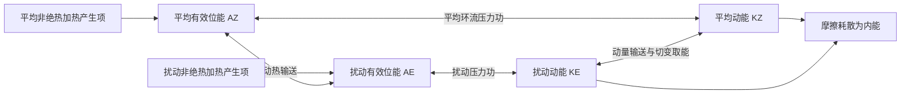

# 2025 年试题解析：逐题解答、考点与频次

> 本文件保留原题及频次，补充对应解答。星级为复习用主观评级；有缺题或排印疑点时，明确注明条件及可解范围。频次按考点出现的不同年份统计，不能视作命题概率。

原始记录：[[动力气象课后习题/往年试题分析/2025]]　｜　[[00_使用说明与年份索引|统计口径与目录]]

## 原卷第一部分

名词解释（共 10 题，每小题 3 分，共 30 分）

## 题目 2025-一-1

### 原题

准静止锋

### 考点与考察频次

**考察频次：2 次（按年份去重）；一般。**

| 考点 | 频次 | 标记 | 对应年份 |
|---|---:|---|---|
| 准静止锋 | 2 次 | 一般 | 2022、2025 |

同考点的全部题号见 [[01_考点频次与证据总表|考点频次与证据总表]]。

### 难度与考试相关度

**难度：★☆☆☆☆（1/5）｜考试相关度：★★★★☆（4/5）**

评级依据：历史出现且直接对应所给考纲；频次用于区分复习优先级。

### 考场精简版与审校状态

**审校状态：尚未逐题学科审校。**

> 以上摘要用于回忆答题主线，不是官方评分标准；推导、计算和多小问仍须完成下方步骤。

### 详细解答

1. 气团是水平范围广、温度湿度等性质较均匀、在共同源地上形成的大块空气。冷暖气团之间的三维过渡带叫锋区，理想化为锋面，与地面的交线叫锋线。

2. **分类。** 冷气团主动推进为冷锋，锋后通常降温、转偏北风、气压升高，锋区可阵雨雷暴；暖气团主动推进为暖锋，暖空气沿冷气团上滑，常有锋前大范围层状云雨；冷暖势力相当、移动缓慢为准静止锋，易持续阴雨；冷锋追及暖锋使暖空气抬离地面形成锢囚锋，天气取决于两侧冷空气和水汽结构。

3. **要素场。** 锋区水平温度和密度梯度大，等温线密集；地面常表现为低压槽，风向有气旋式切变，锋面上升指向冷空气一侧。气压本身连续，其梯度可明显改变；“锋面处气压不连续”是不正确表述。

## 题目 2025-一-2

### 原题

极涡

### 考点与考察频次

**考察频次：1 次（按年份去重）；一般。**

| 考点 | 频次 | 标记 | 对应年份 |
|---|---:|---|---|
| 极涡 | 1 次 | 一般 | 2025 |

同考点的全部题号见 [[01_考点频次与证据总表|考点频次与证据总表]]。

### 难度与考试相关度

**难度：★☆☆☆☆（1/5）｜考试相关度：★★★★☆（4/5）**

评级依据：历史出现且直接对应所给考纲；频次用于区分复习优先级。

### 考场精简版与审校状态

**审校状态：尚未逐题学科审校。**

> 以上摘要用于回忆答题主线，不是官方评分标准；推导、计算和多小问仍须完成下方步骤。

### 详细解答

1. 极涡是高纬大尺度气旋性环流，对流层极涡与冬季平流层极涡应区分；尺度为行星或大尺度，不能写成普遍小于 1000 km。偏心、分裂、槽脊变化可影响冷空气路径，但不等于每次极涡减弱都会在中国发生寒潮。

## 题目 2025-一-3

### 原题

低空急流

### 考点与考察频次

**考察频次：7 次（按年份去重）；🔴 重点。**

| 考点 | 频次 | 标记 | 对应年份 |
|---|---:|---|---|
| 低空急流 | 7 次 | 重点 | 1992、1996、1997、1999、2012、2015、2025 |

同考点的全部题号见 [[01_考点频次与证据总表|考点频次与证据总表]]。

### 难度与考试相关度

**难度：★☆☆☆☆（1/5）｜考试相关度：★★★★★（5/5）**

评级依据：历史出现且直接对应所给考纲；频次用于区分复习优先级。

### 考场精简版与审校状态

**审校状态：尚未逐题学科审校。**

**相关高频考点复习摘要（须按本题设问取舍，不替代完整解答）：**

**低空急流：** 低空急流是低层风速局地极大带，东亚夏季常在850—700 hPa附近。可由压力梯度、地形和夜间摩擦减弱后的惯性振荡形成；输送暖湿空气，在出口或与锋、切变线交汇处产生辐合，利于暴雨；对流加热亦可反馈加强急流。

> 以上摘要用于回忆答题主线，不是官方评分标准；推导、计算和多小问仍须完成下方步骤。

### 详细解答

1. 低空急流是对流层低层的局地风速极大带，东亚夏季常在 850—700 hPa 附近，题中的 12 m/s 或 12—15 m/s 属常用识别量级，具体标准随研究变化。

2. 形成机制包括大尺度压力梯度加强、地形通道和山坡热力差异；夜间地表稳定化削弱摩擦，残余风发生惯性振荡，也可产生夜间风速极大。不同类型低空急流机制并不相同。

3. 低空急流输送暖湿空气，出口附近或与锋、切变线相交处辐合，利于不稳定能量和水汽积聚、暴雨触发；对流加热也可反过来加强低层压力梯度及急流。

## 题目 2025-一-4

### 原题

高原低涡

### 考点与考察频次

**考察频次：1 次（按年份去重）；一般。**

| 考点 | 频次 | 标记 | 对应年份 |
|---|---:|---|---|
| 高原涡 | 1 次 | 一般 | 2025 |

同考点的全部题号见 [[01_考点频次与证据总表|考点频次与证据总表]]。

### 难度与考试相关度

**难度：★☆☆☆☆（1/5）｜考试相关度：★★★★☆（4/5）**

评级依据：历史出现且直接对应所给考纲；频次用于区分复习优先级。

### 考场精简版与审校状态

**审校状态：尚未逐题学科审校。**

> 以上摘要用于回忆答题主线，不是官方评分标准；推导、计算和多小问仍须完成下方步骤。

### 详细解答

1. 高原低涡常在高原近地中低层出现，水平较小，受地形、边界层加热和潜热作用影响；移出高原需合适引导气流及下游水汽。西南涡多活动于高原东南侧、四川盆地附近的低层，是气旋性小尺度低压环流，常在 700 hPa 分析，配合暖湿输送可造成暴雨。

## 题目 2025-一-5

### 原题

光化学烟雾

### 考点与考察频次

**考察频次：1 次（按年份去重）；一般。**

| 考点 | 频次 | 标记 | 对应年份 |
|---|---:|---|---|
| 烟雾与污染天气 | 1 次 | 一般 | 2025 |

同考点的全部题号见 [[01_考点频次与证据总表|考点频次与证据总表]]。

### 难度与考试相关度

**难度：★☆☆☆☆（1/5）｜考试相关度：★★★★☆（4/5）**

评级依据：历史出现且直接对应所给考纲；频次用于区分复习优先级。

### 考场精简版与审校状态

**审校状态：尚未逐题学科审校。**

> 以上摘要用于回忆答题主线，不是官方评分标准；推导、计算和多小问仍须完成下方步骤。

### 详细解答

1. 光化学烟雾由 NOx、挥发性有机物等前体物在阳光下发生反应产生臭氧、过氧乙酰硝酸酯等氧化性污染物，常在日照强、空气停滞条件下累积。关键在于有机过氧自由基把NO转为NO₂而不消耗臭氧，使净臭氧生成；它与仅由燃煤烟尘、雾滴组成的传统烟雾不同。

## 题目 2025-一-6

### 原题

抬升凝结高度

### 考点与考察频次

**考察频次：1 次（按年份去重）；一般。**

| 考点 | 频次 | 标记 | 对应年份 |
|---|---:|---|---|
| 抬升凝结高度 | 1 次 | 一般 | 2025 |

同考点的全部题号见 [[01_考点频次与证据总表|考点频次与证据总表]]。

### 难度与考试相关度

**难度：★☆☆☆☆（1/5）｜考试相关度：★★★★☆（4/5）**

评级依据：历史出现且直接对应所给考纲；频次用于区分复习优先级。

### 考场精简版与审校状态

**审校状态：尚未逐题学科审校。**

> 以上摘要用于回忆答题主线，不是官方评分标准；推导、计算和多小问仍须完成下方步骤。

### 详细解答

1. 抬升凝结高度 LCL 是未饱和气块干绝热上升首次达到饱和的高度，近地层经验 $z_{LCL}\approx125(T-T_d)$ m（温差用℃）来自温度与露点随高度接近的速率差。它是近似估算，不能等同自由对流高度 LFC。

## 题目 2025-一-7

### 原题

有效位能

### 考点与考察频次

**考察频次：6 次（按年份去重）；🔴 重点。**

| 考点 | 频次 | 标记 | 对应年份 |
|---|---:|---|---|
| 有效位能 | 6 次 | 重点 | 1996、2003、2005、2016、2022、2025 |

同考点的全部题号见 [[01_考点频次与证据总表|考点频次与证据总表]]。

### 难度与考试相关度

**难度：★☆☆☆☆（1/5）｜考试相关度：★★★★★（5/5）**

评级依据：历史出现且直接对应所给考纲；频次用于区分复习优先级。

### 考场精简版与审校状态

**审校状态：已逐题复核（按所列模型与条件）。**

**针对本题的考场作答版（非官方评分标准）：**

有效位能是实际大气全位能与保持各气块熵、质量等约束作绝热重排所能达到的最小全位能之差，$A=P-P_{\min}\ge0$。全位能指内能与重力位能之和；有效位能是其中可用于转换为动能的部分。

> 推导题须保留必要推演，简答与论述须按小问展开；精简版只用于回忆作答主线。

### 详细解答

**修改意见（2026-10-04）：**

原答案把名词解释扩成完整能量循环；改为定义—参考态—物理意义，另用量纲正确的小位移公式说明。参考笔记的位温扰动表达式漏了一个g，已在此题单列说明。

**核对依据：** [[牢三样/动力气象/大气能量学/有效位能|有效位能]]。本地资料为学习笔记，不视作官方标准答案；冲突处依据下列方程推导与量纲检查作出判断。

**复核后详细解答：**

1. **定义。** 在干大气Lorenz框架中，$P$为内能与重力位能的总和，$P_{\min}$为保持空气微团质量、熵等约束，经绝热重排可达到的最低全位能。有效位能为$A=P-P_{\min}\ge0$。
2. **参考态。** 经典参考态具有稳定层结及水平一致的热力分布。它是用来比较的能量最低状态，不是随意指定“全球平均温度”，也不要求实际大气已经运动到该状态。
3. **物理意义。** 巨大的全位能不能全部转成动能；有效位能衡量给定约束下可供转换的能量。差异加热可维持水平温差，斜压扰动通过热量输送及暖升冷沉等过程取能。并非任意加热都增加有效位能，实际能量转换也未必耗尽全部有效位能。
4. **可选的定量说明。** 对稳定参考态中的小位移$\xi$，近似取常数$N^2>0$，浮力回复加速度为$-N^2\xi$。单位质量反抗回复力所做的功为
$$a=\int_0^\xi N^2s\,ds=\frac12N^2\xi^2.$$
由$\theta'=-\xi\bar\theta_z$及$N^2=g\bar\theta_z/\bar\theta$，先得$\xi=-g\theta'/(N^2\bar\theta)$，再代入：
$$a=\frac{g^2}{2N^2}\left(\frac{\theta'}{\bar\theta}\right)^2=\frac{b'^2}{2N^2},\qquad b'=g\theta'/\bar\theta.$$
这是小扰动局地近似，不替代全球APE的约束定义。$g^2/N^2$单位为$\mathrm{m^2/s^2}$，符合单位质量能量；参考笔记中$g/(2N^2)$的写法少了一个$g$，不能照抄。$N^2\to0$时该稳定小扰动展开失去适用性，不能简单宣称实际能量无穷大。

## 题目 2025-一-8

### 原题

埃克曼层

### 考点与考察频次

**考察频次：2 次（按年份去重）；一般。**

| 考点 | 频次 | 标记 | 对应年份 |
|---|---:|---|---|
| 埃克曼层 | 2 次 | 一般 | 2020、2025 |

同考点的全部题号见 [[01_考点频次与证据总表|考点频次与证据总表]]。

### 难度与考试相关度

**难度：★☆☆☆☆（1/5）｜考试相关度：★★★★☆（4/5）**

评级依据：历史出现且直接对应所给考纲；频次用于区分复习优先级。

### 考场精简版与审校状态

**审校状态：已逐题复核（按所列模型与条件）。**

**针对本题的考场作答版（非官方评分标准）：**

埃克曼层是湍流摩擦、科氏力与气压梯度力共同控制风场的旋转边界层。经典常系数定常模型中，偏差风随高度旋转衰减，标高$\delta_E=\sqrt{2K_m/|f|}$；其值与惯用的$\pi\delta_E$厚度定义不同。

> 推导题须保留必要推演，简答与论述须按小问展开；精简版只用于回忆作答主线。

### 详细解答

**修改意见（2026-10-04）：**

原方程正确；补定义、假设和标高与惯用厚度的区别。无滑移边界风速为零时风向无定义，45°仅指理想解趋近地面时的方向极限。

**核对依据：** [[牢三样/动力气象/大气行星边界层/埃克曼层|埃克曼层]]。本地资料为学习笔记，不视作官方标准答案；冲突处依据下列方程推导与量纲检查作出判断。

**复核后详细解答：**

1. **定义。** 埃克曼层是旋转流体中摩擦影响风场的边界层；大气经典模型中，水平气压梯度力、科氏力及湍流摩擦共同平衡，使实际风随高度趋近地转风。
2. **模型条件与方程。** 取定常、水平动量平流可忽略、常数$f\ne0$、常涡黏系数$K_m>0$和不随高度改变的地转风：
$$-f(v-v_g)=K_mu_{zz},\qquad f(u-u_g)=K_mv_{zz}.$$
3. **解的尺度。** 北半球$f>0$，令$W=(u-u_g)+i(v-v_g)$，两式合并为$K_mW_{zz}=ifW$。试$W\propto e^{rz}$，得$r^2=if/K_m$，所以$r=\pm(1+i)/\delta_E$，其中$\delta_E=\sqrt{2K_m/f}$。取随高度衰减的负号，再用$u(0)=v(0)=0$、上方趋地转，得
$$W=-(u_g+iv_g)e^{-(1+i)z/\delta_E}.$$
4. **风廓线。** 若$v_g=0,u_g=U_g>0$，则$u=U_g[1-e^{-z/\delta_E}\cos(z/\delta_E)]$，$v=U_ge^{-z/\delta_E}\sin(z/\delta_E)$。偏差幅度按$e^{-z/\delta_E}$减小，方向随高度旋转。$\delta_E$是衰减标高，$\pi\delta_E$常按首次与地转风同向来定义厚度，两者不要混写。
5. **地面角度及限制。** 当$z\to0^+$，展开指数与三角函数得$u\approx U_gz/\delta_E$、$v\approx U_gz/\delta_E$，方向极限为45°；恰在无滑移边界$z=0$，风速为零，风向无定义。实际大气的$K_m$、稳定度与时间变化使风廓线偏离此理想解。
6. **天气意义。** 摩擦使低层风穿越等压线，并可产生水平输送辐合；经连续性在层顶形成垂直运动，联系边界层与自由大气。严格水平均匀的单柱螺线本身无水平辐合，讨论抽吸还需允许背景风随水平位置缓变。

## 题目 2025-一-9

### 原题

正压不稳定

### 考点与考察频次

**考察频次：10 次（按年份去重）；🔴 重点。**

| 考点 | 频次 | 标记 | 对应年份 |
|---|---:|---|---|
| 正压不稳定 | 10 次 | 重点 | 2006、2010、2011、2013、2015、2018、2020、2022、2023、2025 |

同考点的全部题号见 [[01_考点频次与证据总表|考点频次与证据总表]]。

### 难度与考试相关度

**难度：★★☆☆☆（2/5）｜考试相关度：★★★★★（5/5）**

评级依据：历史出现且直接对应所给考纲；频次用于区分复习优先级。

### 考场精简版与审校状态

**审校状态：已逐题复核（按所列模型与条件）。**

**针对本题的考场作答版（非官方评分标准）：**

正压不稳定是扰动从基本流水平切变动能取能而增长的动力不稳定。平行流$U(y)$的转换项为$-\overline{u^{\prime}v^{\prime}}U_y$；在无黏正压无辐散β平面模型中，$\beta-U_{yy}$变号是增长模态的必要而非充分条件。

> 推导题须保留必要推演，简答与论述须按小问展开；精简版只用于回忆作答主线。

### 详细解答

**修改意见（2026-10-04）：**

原必要条件推导正确；删去无题干依据的余弦基本流例子，补上定义、能量转换符号及必要条件的适用范围。

**核对依据：** [[牢三样/动力气象/不稳定理论/正压和斜压不稳定|正压和斜压不稳定]]。本地资料为学习笔记，不视作官方标准答案；冲突处依据下列方程推导与量纲检查作出判断。

**复核后详细解答：**

1. **定义。** 扰动通过与基本流的水平切变相互作用，从基本流动能取能并增长，称正压不稳定；它是动力不稳定，与单气块浮力不稳定不同。
2. **取能符号。** 对基本流$(U(y),0)$，线性纬向扰动动量式含$v'U_y$。将其乘$u'$并与经向动量能量式相加，移项后出现$-u'v'U_y$。适当平均及积分、去掉边界输送后，基本流向扰动的动能转换为$-\overline{u'v'}U_y$。它为正时扰动取能；参考笔记中写成正号且声称“同号取能”的段落，与此速度协方差约定不一致。
3. **必要条件的来由。** 无黏、正压、无辐散β平面平行流中，基本绝对涡度为$\bar q=f_0+\beta y-U_y$，其梯度才是$\bar q_y=\beta-U_{yy}$。不要把$U_{yy}$直接写入$\bar q$本身。
4. **模态方程。** 取$\psi'=\phi(y)e^{ik(x-ct)}$、$k>0$，线性涡度方程给
$$(U-c)(\phi_{yy}-k^2\phi)+(\beta-U_{yy})\phi=0.$$
取两侧边界$\phi=0$，除以$U-c$、乘$\phi^*$并积分，分部积分去掉边界项：
$$-\int(|\phi_y|^2+k^2|\phi|^2)dy+\int\frac{\beta-U_{yy}}{U-c}|\phi|^2dy=0.$$
令$c=c_r+ic_i$，用$1/(U-c)=(U-c_r+ic_i)/[(U-c_r)^2+c_i^2]$取虚部：
$$c_i\int\frac{(\beta-U_{yy})|\phi|^2}{(U-c_r)^2+c_i^2}dy=0.$$
5. **判断。** 增长要求$c_i>0$；除位涡梯度外权重非负，要使积分抵消，通常要求梯度在域内变号。这是Rayleigh–Kuo必要条件，不能单凭变号就声称已求得不稳定模态或临界风速。名词解释只需前述定义、取能来源及必要条件，完整推导供复习。

## 题目 2025-一-10

### 原题

上游效应

### 考点与考察频次

**考察频次：5 次（按年份去重）；🔴 重点。**

| 考点 | 频次 | 标记 | 对应年份 |
|---|---:|---|---|
| 上游效应 | 5 次 | 重点 | 1996、2013、2016、2019、2025 |

同考点的全部题号见 [[01_考点频次与证据总表|考点频次与证据总表]]。

### 难度与考试相关度

**难度：★☆☆☆☆（1/5）｜考试相关度：★★★★★（5/5）**

评级依据：历史出现且直接对应所给考纲；频次用于区分复习优先级。

### 考场精简版与审校状态

**审校状态：尚未逐题学科审校。**

**相关高频考点复习摘要（须按本题设问取舍，不替代完整解答）：**

**上游效应：** 槽脊之间通过波传播及能量、动量交换相互影响。罗斯贝波包的群速与槽脊相速不同，可出现上游波衰减、下游新波发展。“上游效应”“下游效应”的命名须与教材约定对应，不能假定所有背景流中传播方向都固定。

> 以上摘要用于回忆答题主线，不是官方评分标准；推导、计算和多小问仍须完成下方步骤。

### 详细解答

1. 罗斯贝波相速与群速不同，一维均匀西风上 $c_p=U-\beta/k^2$，$c_g=U+\beta/k^2$。能量包络可比槽脊向东传播更快，造成下游新波发展、上游旧波衰减，即下游发展。

2. 上下游效应泛指相邻波系通过传播和能量/动量交换相互影响；“上游效应”的教材用法需看其定义，不能以群速公式证明所有情况下影响只能单向向东。二维波和变化基本流中群速方向会变。

## 原卷第二部分

简答题（每小题 10 分，共 60 分）

## 题目 2025-二-1

### 原题

青藏高原的热力作用

### 考点与考察频次

**考察频次：6 次（按年份去重）；🔴 重点。**

| 考点 | 频次 | 标记 | 对应年份 |
|---|---:|---|---|
| 青藏高原天气气候效应 | 6 次 | 重点 | 1994、1996、2000、2010、2013、2025 |

同考点的全部题号见 [[01_考点频次与证据总表|考点频次与证据总表]]。

### 难度与考试相关度

**难度：★★☆☆☆（2/5）｜考试相关度：★★★★★（5/5）**

评级依据：历史出现且直接对应所给考纲；频次用于区分复习优先级。

### 考场精简版与审校状态

**审校状态：已逐题复核（按所列模型与条件）。**

**针对本题的考场作答版（非官方评分标准）：**

冬季高原总体偏冷源，春夏转为高架热源，感热、凝结潜热和辐射共同决定热收支；加热改变厚度与环流，影响季风转换、南亚高压、水汽输送和下游降水。

> 推导题须保留必要推演，简答与论述须按小问展开；精简版只用于回忆作答主线。

### 详细解答

**修改意见（2026-10-04，第二批）：**

旧答案首先讲动力阻挡，偏离“热力作用”；改为季节性热源冷源、加热方式、垂直响应及季风影响，不再加入题目未要求的“四种以上”。

**核对依据：** [[牢三样/天气学分析原理/低纬度和青藏高原环流系统/青藏高原的影响及环流系统|青藏高原的影响及环流系统]]；[[牢三样/天气学分析原理/低纬度和青藏高原环流系统/南亚高压|南亚高压]]。本地资料为学习笔记，不视作官方标准答案；冲突处依据下列方程推导与量纲检查作出判断。

**复核后详细解答：**

1. **热力作用的含义。** 指高原与大气之间热量交换及大气非绝热加热对环流的影响，不是绕流、阻挡等纯机械作用。高原高海拔使地表热交换直接作用于较高的大气层。
2. **冬季冷源。** 在季节平均概括中，高原及邻近大陆冷却有利于低层冷空气和冬季环流维持；强弱受积雪、云、辐射和下垫面影响，不能说高原每处、每时刻热源项都为负。
3. **春夏高架热源。** 地表吸收太阳辐射后通过感热向空气供热；季风水汽到达并凝结后，潜热释放也重要，辐射项参与净热收支。仅说“直接把太阳晒热的地面等同整柱加热”不完整。
4. **垂直响应。** 气柱加热使相同气压层间厚度增加，配合质量调整形成低层热低压及高层暖性反气旋的响应，南亚高压可加强。低层低压和高层高压并不矛盾，但单由厚度增加也不能独立确定地面气压变化。
5. **亚洲季风影响。** 热源季节变化调整海陆及南北热力差异，促进环流季节转换，影响南亚、东亚季风水汽通道和上升分布；降水潜热又反馈高原周边加热与环流。
6. **答题边界。** 高原不是唯一季风热源，海陆分布、海温及周边对流都需配合。此问以热收支及环流响应为主，不用山地绕流的长段文字替代热力分析。

## 题目 2025-二-2

### 原题

湍流的特征

### 考点与考察频次

**考察频次：1 次（按年份去重）；一般。**

| 考点 | 频次 | 标记 | 对应年份 |
|---|---:|---|---|
| 大气湍流 | 1 次 | 一般 | 2025 |

同考点的全部题号见 [[01_考点频次与证据总表|考点频次与证据总表]]。

### 难度与考试相关度

**难度：★★☆☆☆（2/5）｜考试相关度：★★★★☆（4/5）**

评级依据：历史出现且直接对应所给考纲；频次用于区分复习优先级。

### 考场精简版与审校状态

**审校状态：尚未逐题学科审校。**

> 以上摘要用于回忆答题主线，不是官方评分标准；推导、计算和多小问仍须完成下方步骤。

### 详细解答

1. 大气湍流是具有不规则、多尺度涡旋和三维速度脉动的流动，常在高雷诺数、风切变或浮力作用下发生。瞬时运动难以逐点确定，但统计量可以有规律。
2. 用雷诺分解 $u=\bar u+u'$ 等区分平均量和脉动。湍流输送由协方差表示，例如 $\overline{u'w'}$ 为垂直动量通量，$\overline{w'T'}$ 为热量输送的重要部分，平均速度小不意味着脉动输送也小。
3. 能量可由平均切变转入湍动能，也可由不稳定浮力供给；不同尺度间相互作用并向小尺度传递，最终经分子黏性耗散为热。湍流显著混合动量、热量、水汽和污染物。
4. 稳定层结抑制竖直交换，可形成各向异性和间歇湍流；近地面、自由对流和自由大气中的湍流统计不同，不能假定处处均匀各向同性。

## 题目 2025-二-3

### 原题

影响东亚季风的基本因子

### 考点与考察频次

**考察频次：12 次（按年份去重）；🔴 重点。**

| 考点 | 频次 | 标记 | 对应年份 |
|---|---:|---|---|
| 季风 | 12 次 | 重点 | 1989、1994、1999、2000、2005、2014、2018、2020、2021、2022、2023、2025 |

同考点的全部题号见 [[01_考点频次与证据总表|考点频次与证据总表]]。

### 难度与考试相关度

**难度：★★☆☆☆（2/5）｜考试相关度：★★★★★（5/5）**

评级依据：历史出现且直接对应所给考纲；频次用于区分复习优先级。

### 考场精简版与审校状态

**审校状态：已逐题复核（按所列模型与条件）。**

**针对本题的考场作答版（非官方评分标准）：**

基本因子是海陆热力差异、太阳加热与行星环流的季节移动、青藏高原热力和动力作用；海温、积雪土壤状态及中高纬环流等调制强弱和进退。

> 推导题须保留必要推演，简答与论述须按小问展开；精简版只用于回忆作答主线。

### 详细解答

**修改意见（2026-10-04，第二批）：**

原内容大体正确；将冬夏系统罗列改为“因子—作用—环流响应”，区分季节形成原因和年际调制。

**核对依据：** [[牢三样/天气学分析原理/东亚季风环流/东亚季风环流系统主要特征与成因|东亚季风环流系统主要特征与成因]]；[[牢三样/天气学分析原理/低纬度和青藏高原环流系统/青藏高原的影响及环流系统|青藏高原的影响及环流系统]]。本地资料为学习笔记，不视作官方标准答案；冲突处依据下列方程推导与量纲检查作出判断。

**复核后详细解答：**

1. **海陆热力差异。** 欧亚大陆和邻近海洋热容量及热交换不同：冬季大陆较快冷却，夏季较快增暖，使低层气压配置及盛行气流季节变化。大范围三维环流、潜热和自转共同作用，不能把季风只当作局地海陆风放大。
2. **太阳加热与行星环流季节移动。** 太阳辐射分布变化带动热带上升区、信风、副热带高压和跨赤道气流调整，为夏季暖湿输送和冬季冷干输送提供大尺度背景。
3. **青藏高原。** 冬夏热源冷源转换改变高层厚度、南亚高压及低层环流；巨大地形的阻挡、绕流改变西风带和冷空气、水汽路径。热力与动力作用应分别说明。
4. **东亚区域配置。** 冬季大陆冷高压、东亚大槽和海洋低压的相互配置有利偏北气流；夏季西太副高边缘、南海和印度洋方向水汽输送及上层环流相配合。东亚含热带与副热带季风部分，还与中高纬冷空气紧密相连。
5. **强弱及年际变化。** 海温异常、海气相互作用、陆面湿度和积雪以及中高纬波动，可通过改变热源和环流调制季风。这些是变化因素，不应替代前述解释季节转换的基本因子，也不能单靠一个指数预言每年旱涝。

## 题目 2025-二-4

### 原题

江淮气旋形成过程

### 考点与考察频次

**考察频次：2 次（按年份去重）；一般。**

| 考点 | 频次 | 标记 | 对应年份 |
|---|---:|---|---|
| 江淮气旋 | 2 次 | 一般 | 2012、2025 |

同考点的全部题号见 [[01_考点频次与证据总表|考点频次与证据总表]]。

### 难度与考试相关度

**难度：★★★☆☆（3/5）｜考试相关度：★★★★☆（4/5）**

评级依据：历史出现且直接对应所给考纲；频次用于区分复习优先级。

### 考场精简版与审校状态

**审校状态：已逐题复核（按所列模型与条件）。**

**针对本题的考场作答版（非官方评分标准）：**

江淮锋区与暖湿输送提供背景，高空扰动及低层辐合使锋面起波、低压生成；有利的高低空相位、整柱质量净流出及潜热反馈促其加深，随后常向东或东北移动，条件减弱时填塞。

> 推导题须保留必要推演，简答与论述须按小问展开；精简版只用于回忆作答主线。

### 详细解答

**修改意见（2026-10-04，第二批）：**

原两段过于概括；补锋区准备、波动生成、质量收支、潜热反馈和移出衰变的完整过程，不把任意槽前正涡度平流都等同地面加深。

**核对依据：** [[牢三样/天气学分析原理/气旋与反气旋/温带和东亚气旋与反气旋|温带和东亚气旋与反气旋]]；[[牢三样/天气学分析原理/气旋与反气旋/锋面气旋和爆发性气旋|锋面气旋和爆发性气旋]]。本地资料为学习笔记，不视作官方标准答案；冲突处依据下列方程推导与量纲检查作出判断。

**复核后详细解答：**

1. **背景准备。** 江淮地区冷暖气流交汇形成锋区或切变带，低层偏南、西南暖湿输送提供水汽，水平温度梯度提供可供斜压转换的能量。
2. **初始波动。** 西风带高空槽或短波东移到有利位置，低层锋区出现波动和气旋性环流；暖空气在低压前侧向北伸展，冷空气在后侧南下，冷暖锋结构逐渐建立。
3. **加深机制。** 成长时地面低压常在高空槽前，高低层相位差支持热输送和上升。若整柱质量净流出，地面气压下降；低层辐合本身带入质量，并不单独造成降压。涡度平流、温度平流及其垂直结构共同参与动力诊断，不能仅由某层正涡度平流直接判定加深。
4. **潜热反馈。** 持续水汽输送与抬升使降水释放潜热，进一步调整温度、位涡及环流，可增强气旋。但增长仍取决于加热位置、背景斜压性及耗散。
5. **移动和天气。** 在偏西引导气流及发展区配置下，系统常向东或东北移；暖锋附近可有连续降水，冷锋或暖区在不稳定条件下可有强对流，气压梯度增强可带来大风。
6. **后期。** 高低层趋于垂直重叠、有效位能供应减少或移入不利环境时，系统可能锢囚、填塞；出海后也可能再发展。西南涡移出可参与江淮气旋生成，但不是每个江淮气旋都必须经历这一来源。

## 题目 2025-二-5

### 原题

地转偏差对大气运动的演变作用

### 考点与考察频次

**考察频次：3 次（按年份去重）；🔴 重点。**

| 考点 | 频次 | 标记 | 对应年份 |
|---|---:|---|---|
| 非地转风 | 3 次 | 重点 | 2010、2012、2025 |

同考点的全部题号见 [[01_考点频次与证据总表|考点频次与证据总表]]。

### 难度与考试相关度

**难度：★★☆☆☆（2/5）｜考试相关度：★★★★★（5/5）**

评级依据：历史出现且直接对应所给考纲；频次用于区分复习优先级。

### 考场精简版与审校状态

**审校状态：已逐题复核（按所列模型与条件）。**

**针对本题的考场作答版（非官方评分标准）：**

地转偏差$\mathbf V_a=\mathbf V-\mathbf V_g$满足$\mathbf V_a=\mathbf k\times(D\mathbf V/Dt-\mathbf F)/f$。它联系加速度与摩擦，产生辐合辐散及垂直运动，调整质量、温度场，并使气压梯度力能够做功。

> 推导题须保留必要推演，简答与论述须按小问展开；精简版只用于回忆作答主线。

### 详细解答

**修改意见（2026-10-04）：**

原偏差风公式正确；按题意突出加速度、质量调整和能量转换，补β平面地转散度限制，并指出本地笔记摩擦项符号问题。

**核对依据：** [[牢三样/动力气象/自由大气中的平衡流场、环流定理和涡度方程/平衡流场的基本特征与性质|平衡流场的基本特征与性质]]。本地资料为学习笔记，不视作官方标准答案；冲突处依据下列方程推导与量纲检查作出判断。

**复核后详细解答：**

1. **定义。** 水平实际风与同一质量场对应的地转风之差为$\mathbf V_a=\mathbf V-\mathbf V_g$。采用气压坐标，$f\mathbf k\times\mathbf V_g=-\nabla_p\Phi$。
2. **由动量方程求偏差。** 实际运动满足$D\mathbf V/Dt+f\mathbf k\times\mathbf V=-\nabla_p\Phi+\mathbf F$，其中$\mathbf F$为摩擦加速度。减去地转关系得$D\mathbf V/Dt+f\mathbf k\times\mathbf V_a=\mathbf F$。左乘$\mathbf k\times$，利用水平向量恒等式$\mathbf k\times(\mathbf k\times\mathbf V_a)=-\mathbf V_a$：
$$\boxed{\mathbf V_a=\frac1f\mathbf k\times\left(\frac{D\mathbf V}{Dt}-\mathbf F\right)}.$$
无摩擦时偏差风在加速度左侧（北半球）；定常无惯性时为$-\mathbf k\times\mathbf F/f$，在摩擦力右侧。参考笔记的摩擦公式若写正号，应按其力定义核对；按“作用于空气的摩擦力”约定须为上述负号。
3. **质量与垂直运动。** 常数$f$下$u_g=-\Phi_y/f,v_g=\Phi_x/f$，混合偏导相消，$\nabla_p\cdot\mathbf V_g=0$。于是实际散度来自偏差风，连续方程$\nabla_p\cdot\mathbf V+\omega_p=0$把它与垂直运动联系。给定边界及整层散度后才能确定$\omega$，不能只凭一个层次的辐散断定全柱上升。
4. **热力与系统演变。** 垂直运动改变绝热冷却增温及水汽凝结，反过来调整温度和位势场；急流加减速、曲率和摩擦可产生次级环流，因此近地转的大尺度系统仍能发展。
5. **能量联系。** 水平气压梯度功率为$-\mathbf V\cdot\nabla_p\Phi$。地转风与$\nabla_p\Phi$垂直，其贡献为零；故压力功由$-\mathbf V_a\cdot\nabla_p\Phi$承担，非地转分量联系质量场与动能转换。
6. **适用限制。** 在β平面，$\nabla_p\cdot\mathbf V_g=-\beta v_g/f$一般不为零；“地转风无散度”须注明$f$平面或相应近似阶次。近赤道$f$趋零时，不可直接套用含$1/f$的中纬度近似。

## 题目 2025-二-6

### 原题

热带扰动发生发展的 CISK 机制

### 考点与考察频次

**考察频次：10 次（按年份去重）；🔴 重点。**

| 考点 | 频次 | 标记 | 对应年份 |
|---|---:|---|---|
| 第二类条件不稳定（CISK） | 10 次 | 重点 | 1997、2000、2003、2010、2014、2016、2020、2022、2025、2026 |

同考点的全部题号见 [[01_考点频次与证据总表|考点频次与证据总表]]。

### 难度与考试相关度

**难度：★★★☆☆（3/5）｜考试相关度：★★★★★（5/5）**

评级依据：历史出现且直接对应所给考纲；频次用于区分复习优先级。

### 考场精简版与审校状态

**审校状态：已逐题复核（按所列模型与条件）。**

**针对本题的考场作答版（非官方评分标准）：**

CISK指大尺度低压环流与积云对流相互加强：低层摩擦辐合及水汽集中→对流凝结加热→暖心与高层外流、质量场调整→低压环流增强→更强辐合。海面焓通量补给能量；潜热释放是转换环节，不是凭空产能。

> 推导题须保留必要推演，简答与论述须按小问展开；精简版只用于回忆作答主线。

### 详细解答

**修改意见（2026-10-04）：**

原反馈主线正确；补质量收支环节，避免把“加热”直接等同“地面降压”，并区分能量供应和能量转换。

**核对依据：** [[牢三样/动力气象/低纬度大气动力学/台风发展的第二类条件不稳定（CISK）理论|台风发展的第二类条件不稳定（CISK）理论]]。本地资料为学习笔记，不视作官方标准答案；冲突处依据下列方程推导与量纲检查作出判断。

**复核后详细解答：**

1. **概念。** 第二类条件不稳定强调有组织的大尺度环流与积云对流之间的反馈，区别于仅讨论单气块在环境中浮力增长的第一类条件不稳定。
2. **初始旋转扰动。** 环境中先有弱低压或气旋性扰动；边界层摩擦削弱切向风，使空气产生向低压的入流，组织水汽辐合与抬升。初始扰动可由东风波、季风槽等提供，但并非任一扰动都会发展。
3. **积云响应。** 暖湿空气抬升到饱和，对流凝结释放潜热，增加气柱热力能并形成有组织的加热；加热的位置、湿度和垂直风切变影响其是否能有效作用于涡旋。
4. **环流反馈。** 加热促使厚度和压力场调整、暖心及上层外流发展。在整柱质量净流出等条件下，地面气压降低，低层压力梯度与气旋环流增强，进一步加强摩擦入流。地面气压取决于柱质量；单凭“气柱变暖”不能无条件推出地面降压。
5. **闭合反馈链。** 弱扰动→低层辐合及水汽供应→对流加热→暖心、外流及质量场调整→扰动增强→辐合增强。只有反馈增长能克服耗散和不利环境作用时，才会发展。
6. **能量来源与局限。** 暖海通过蒸发潜热及显热通量补给空气焓，对流把水汽所携能量释放为热力能，适当热力—环流配置再将部分能量转为动能。CISK是理想化反馈框架，不能以它替代所有热带气旋发展机制，也不能把经验海温或切变数值当成无例外的充分条件。

## 原卷第三部分

论述题（每小题 15 分，共 45 分）

## 题目 2025-三-1

### 原题

画能量转化在对流层的循环图

### 考点与考察频次

**考察频次：2 次（按年份去重）；一般。**

| 考点 | 频次 | 标记 | 对应年份 |
|---|---:|---|---|
| 大气能量及转换 | 2 次 | 一般 | 2020、2025 |

同考点的全部题号见 [[01_考点频次与证据总表|考点频次与证据总表]]。

### 难度与考试相关度

**难度：★★★☆☆（3/5）｜考试相关度：★★★★☆（4/5）**

评级依据：历史出现且直接对应所给考纲；频次用于区分复习优先级。

### 考场精简版与审校状态

**审校状态：已逐题复核（按所列模型与条件）。**

**针对本题的考场作答版（非官方评分标准）：**

画$A_Z,A_E,K_Z,K_E$四库；标$A_Z\to A_E$的$C_A$、$A_E\to K_E$的$C_E$、$A_Z\to K_Z$的$C_Z$、$K_E\to K_Z$的$C_K$，再补$G_Z,G_E,D_Z,D_E$。箭头规定正方向，不表示转换恒正。

> 推导题须保留必要推演，简答与论述须按小问展开；精简版只用于回忆作答主线。

### 详细解答

**修改意见（2026-10-04）：**

现有四能量库图已含平均有效位能与平均动能转换；保留图及预算式，补绘图顺序、箭头符号和逐项守恒检查。

**核对依据：** [[牢三样/动力气象/大气能量学/有效位能|有效位能]]。本地资料为学习笔记，不视作官方标准答案；冲突处依据下列方程推导与量纲检查作出判断。

**复核后详细解答：**

1. 单位质量内能 $e=c_vT$，重力位能 $\Phi=gz$（常重力），动能 $K=|\mathbf V|^2/2$，水汽潜热能近似 $L_vq_v$。总量需对气团质量积分；动能不能漏掉 $1/2$。
2. “全位能”在大气能量学中通常指内能与重力位能之和，而非含动能的总能量。静力、平坦底面且顶边界压力趋零时，$\int\rho gz\,dz=-\int z\,dp=\int p\,dz=\int\rho RT\,dz$；加上内能得到 $\int c_pT\,dm$。
3. 有效位能是实际全位能相对绝热重排到参考最低能态后的可用部分。不是全部内能或重力位能都能转换为动能。差异加热维持水平温差，建立有效位能。
4. 暖上升冷下沉时，$C=-\int\alpha'\omega'\,dm>0$，有效位能转为扰动动能；摩擦最终把动能耗散成内能。凝结使潜热转入热力能库，但水汽能量本来主要来自地表蒸发和辐射收支。
5. 对流层常用 Lorenz 四能量库循环如下。双向箭头表示转换可正可负，方向由收支项决定；中纬度斜压波常沿 $A_Z\to A_E\to K_E$ 取能。$A_Z$ 与 $K_Z$ 的直接转换不能漏掉：平均经圈环流同样可通过压力功在平均有效位能和平均动能之间转换。

产生项也可能为负，图中不是所有加热都增加有效位能。若问完整收支，应分别写 $\dot A_Z=G_Z-C_A-C_Z$、$\dot A_E=G_E+C_A-C_E$、$\dot K_Z=C_Z+C_K-D_Z$、$\dot K_E=C_E-C_K-D_E$，这里 $C_K>0$ 约定为扰动动能转入平均动能。四式相加，内部转换项逐项抵消，只剩外部产生与耗散，可用作检查。

**按题意落笔的顺序：** 先画四个能量库（下标$Z$表示纬向平均，$E$表示涡动），再画四条内部转换线，最后画非绝热产生与摩擦耗散。不得漏掉$A_Z\leftrightarrow K_Z$，也不把“加热产生项”当作第五个储能库。

**逐条解释：** $C_A$由扰动热输送联系平均与扰动有效位能；$C_E$由扰动压力功联系扰动有效位能与动能；$C_Z$由平均环流压力功联系平均两能量库；$C_K$由动量输送与平均切变联系两动能库。这里$C_K$定义的正方向为$K_E\to K_Z$，正压不稳定取基本流动能时可以表现为$C_K<0$。

**守恒检查展开：** 将四式相加，$-C_A+C_A=0$，$-C_E+C_E=0$，$-C_Z+C_Z=0$，$+C_K-C_K=0$，因此
$$\frac{d}{dt}(A_Z+A_E+K_Z+K_E)=G_Z+G_E-D_Z-D_E.$$
这适用于图示的全球或已忽略边界净输送的预算；区域预算还须加边界能量通量。摩擦耗散表示动能离开图中动能库、转为内能，不表示宇宙总能量消失。

## 题目 2025-三-2

### 原题

逆温层形成过程，不同逆温层特征

### 考点与考察频次

**考察频次：2 次（按年份去重）；一般。**

| 考点 | 频次 | 标记 | 对应年份 |
|---|---:|---|---|
| 逆温 | 2 次 | 一般 | 2023、2025 |

同考点的全部题号见 [[01_考点频次与证据总表|考点频次与证据总表]]。

### 难度与考试相关度

**难度：★★★☆☆（3/5）｜考试相关度：★★★★☆（4/5）**

评级依据：历史出现且直接对应所给考纲；频次用于区分复习优先级。

### 考场精简版与审校状态

**审校状态：尚未逐题学科审校。**

> 以上摘要用于回忆答题主线，不是官方评分标准；推导、计算和多小问仍须完成下方步骤。

### 详细解答

1. 逆温是气温随高度增加而升高的层，$dT/dz>0$，静力稳定，抑制竖直混合，易使水汽和污染物滞留。

2. 辐射逆温：晴空、弱风夜间地面长波辐射冷却，近地空气被冷却，上层相对暖，逆温自地面向上形成；日出后地表加热常逐渐破坏它。

3. 下沉逆温：高压下空气下沉压缩增温，上部空气可能下沉更多，在边界层顶形成暖盖；锋面逆温：暖空气位于冷空气上方；平流逆温：暖空气流到较冷地表后下部先冷却。形成位置和持续性各不相同。

## 题目 2025-三-3

### 原题

简述罗斯贝波结构特征以及波动和基本流的相互作用过程

### 考点与考察频次

**考察频次：3 次（按年份去重）；🔴 重点。**

| 考点 | 频次 | 标记 | 对应年份 |
|---|---:|---|---|
| 罗斯贝波生命史与演变 | 3 次 | 重点 | 1989、2018、2025 |

同考点的全部题号见 [[01_考点频次与证据总表|考点频次与证据总表]]。

### 难度与考试相关度

**难度：★★★☆☆（3/5）｜考试相关度：★★★★★（5/5）**

评级依据：历史出现且直接对应所给考纲；频次用于区分复习优先级。

### 考场精简版与审校状态

**审校状态：尚未逐题学科审校。**

**相关高频考点复习摘要（须按本题设问取舍，不替代完整解答）：**

**罗斯贝波生命史与演变：** 典型斜压罗斯贝扰动经历取能增长、振幅增大与波破碎、混合和动量反馈后的衰减。成长时槽轴常随高度向西倾斜，暖升冷沉取能；成熟后倾斜减弱。该生命史不是所有中性线性罗斯贝波的必然演变。

> 以上摘要用于回忆答题主线，不是官方评分标准；推导、计算和多小问仍须完成下方步骤。

### 详细解答

1. 西风带槽脊是流场的波动。典型发展中的斜压长波，高度槽轴随高度向西倾斜，槽前暖平流上升、槽后冷平流下沉；温度扰动与速度存在相位差，支持向极热输送和有效位能释放。

2. 成长阶段从平均有效位能取能，扰动增强；成熟阶段热量混合使温度梯度减弱，槽脊加大并可发生波破碎；衰减阶段扰动动量输送与基本流交换能量，气旋锢囚、场趋于较正压结构。并非每个中性线性罗斯贝波都必有增长和衰亡，这一“生命史”是典型不稳定波演变概念。

3. 罗斯贝波相速与群速不同，一维均匀西风上 $c_p=U-\beta/k^2$，$c_g=U+\beta/k^2$。能量包络可比槽脊向东传播更快，造成下游新波发展、上游旧波衰减，即下游发展。

4. 上下游效应泛指相邻波系通过传播和能量/动量交换相互影响；“上游效应”的教材用法需看其定义，不能以群速公式证明所有情况下影响只能单向向东。二维波和变化基本流中群速方向会变。

5. 动量通量 $\overline{u'v'}$ 的辐合可加速平均西风；平均流向扰动的正压动能转换为 $-\overline{u'v'}U_y$。不能用“地球自转不变”直接推出每一时刻所有输送都严格从东风带指向西风带，必须写出收支、外部摩擦转矩与统计稳态。

## 原卷第四部分

推导题

### 本部分共用题干

题干给出动能平衡方程、位能平衡方程、内能平衡方程

## 题目 2025-四-1

### 原题

推导伯努利方程

### 考点与考察频次

**考察频次：1 次（按年份去重）；一般。**

| 考点 | 频次 | 标记 | 对应年份 |
|---|---:|---|---|
| 伯努利方程 | 1 次 | 一般 | 2025 |

同考点的全部题号见 [[01_考点频次与证据总表|考点频次与证据总表]]。

### 难度与考试相关度

**难度：★★★★☆（4/5）｜考试相关度：★★★★☆（4/5）**

评级依据：历史出现且直接对应所给考纲；频次用于区分复习优先级。

### 考场精简版与审校状态

**审校状态：已复核条件解（原卷所给能量三式缺录）。**

**针对本题的考场作答版（非官方评分标准）：**

稳态、无摩擦、保守重力下，动量式点乘速度得$d(K+\Phi)+\alpha dp=0$。正压流体积分为$K+\Phi+\int^p\alpha(s)ds=B$；均质不可压时为$K+\Phi+p/\rho=B$；理想干空气沿流线等熵时为$K+\Phi+c_pT=B_d$。

> 推导题须保留必要推演，简答与论述须按小问展开；精简版只用于回忆作答主线。

### 详细解答

**修改意见（2026-10-04，第二批）：**

原三小问复用同一答案。本问改为从动能和位能式推导机械伯努利积分，并明确正压或沿流线等熵条件；记录未抄出原题所给三式，不声称恢复唯一原卷形式。

**核对依据：** [[牢三样/动力气象/大气能量学/大气中的基本能量形式和平衡方程|大气中的基本能量形式和平衡方程]]。本地资料为学习笔记，不视作官方标准答案；冲突处依据下列方程推导与量纲检查作出判断。

**复核后详细解答：**

1. **先说明缺失与模型。** 当前原题记录仅写“给出动能、位能、内能平衡方程”，没有抄出具体方程。以下用三维速度$\mathbf V$、$K=|\mathbf V|^2/2$、比容$\alpha=1/\rho$、不显含时间的重力位势$\Phi$推导；静力大尺度模式若仅保留水平动能，应对应使用其近似方程。
2. **运动方程点乘速度。** 无摩擦时
$$\frac{D\mathbf V}{Dt}+2\boldsymbol\Omega\times\mathbf V=-\alpha\nabla p-\nabla\Phi.$$
利用$\mathbf V\cdot D\mathbf V/Dt=DK/Dt$和$\mathbf V\cdot(\boldsymbol\Omega\times\mathbf V)=0$，得到$DK/Dt=-\alpha\mathbf V\cdot\nabla p-\mathbf V\cdot\nabla\Phi$。
3. **合并位能。** 因$\partial_t\Phi=0$，$D\Phi/Dt=\mathbf V\cdot\nabla\Phi$，故$D(K+\Phi)/Dt=-\alpha\mathbf V\cdot\nabla p$。
4. **转为稳态流线微分。** 稳态时$D/Dt=\mathbf V\cdot\nabla$。以$s$表示流线弧长，$\mathbf V\cdot\nabla=Vd/ds$；在$V\ne0$的流线段除以$V$，得$d(K+\Phi)/ds=-\alpha dp/ds$，即$d(K+\Phi)+\alpha dp=0$。
5. **积分。** 正压流体$\alpha=\alpha(p)$，定义压力势$\Pi(p)=\int_{p_*}^{p}\alpha(s)ds$，则$d\Pi=\alpha dp$。于是$d(K+\Phi+\Pi)=0$，积分得
$$\boxed{K+\Phi+\int_{p_*}^{p}\alpha(s)ds=B}.$$
$B$沿每条流线为常数，不必在不同流线间相同。$p_*$改变只改变常数基准。
6. **两个特例。** 均质不可压时$\alpha$为常数，压力势可写$p/\rho$并把积分常数并入$B$，得到$V^2/2+gz+p/\rho=B$。理想干空气沿流线可逆绝热时$c_p dT=\alpha dp$，直接代入第4步，得$V^2/2+\Phi+c_pT=B_d$；这个特例不要求整个大气具有统一熵值。
7. **核对含义。** 每项单位为$\mathrm{J/kg}$。伯努利量含焓或压力功项，不等于“一个气块的内能、位能、动能之和在所有绝热运动中均不变”。下一问通过保留局地压力变化项说明这个区别。

## 题目 2025-四-2

### 原题

给出约束条件，并在约束条件下推出单位质量干湿空气微团能量守恒方程

### 考点与考察频次

**考察频次：1 次（按年份去重）；一般。**

| 考点 | 频次 | 标记 | 对应年份 |
|---|---:|---|---|
| 湿静力能 | 1 次 | 一般 | 2025 |

同考点的全部题号见 [[01_考点频次与证据总表|考点频次与证据总表]]。

### 难度与考试相关度

**难度：★★★★☆（4/5）｜考试相关度：★★★★☆（4/5）**

评级依据：历史出现且直接对应所给考纲；频次用于区分复习优先级。

### 考场精简版与审校状态

**审校状态：已复核条件解（原卷所给能量三式缺录）。**

**针对本题的考场作答版（非官方评分标准）：**

固定重力场中$D(K+\Phi+c_pT)/Dt=\alpha\partial_tp+\dot Q+\mathbf V\cdot\mathbf F$。无摩擦、绝热且局地压力不变时干伯努利量守恒。稀薄湿空气近似中再加$L_vq_v$；忽略动能变化后才得到干、湿静力能近守恒。

> 推导题须保留必要推演，简答与论述须按小问展开；精简版只用于回忆作答主线。

### 详细解答

**修改意见（2026-10-04，第二批）：**

按本问重新从三类能量方程求和，显式保留局地压力变化项；分别写干空气与湿空气约束，避免将湿静力能当作一般严格守恒量。

**核对依据：** [[牢三样/动力气象/大气能量学/大气中的基本能量形式和平衡方程|大气中的基本能量形式和平衡方程]]；[[牢三样/动力气象/大气运动的基本方程组/热力学能量方程及其在球坐标系和局地直角坐标系中的表述|热力学能量方程及其在球坐标系和局地直角坐标系中的表述]]。本地资料为学习笔记，不视作官方标准答案；冲突处依据下列方程推导与量纲检查作出判断。

**复核后详细解答：**

1. **符号与前提。** $e=c_vT$为单位质量内能，$K=|\mathbf V|^2/2$，$\Phi$为固定重力场位势，$\mathbf F$为摩擦加速度，$\dot Q$为单位质量加热率。先用定组成理想干空气、常比热，暂不假定稳态。
2. **机械能式。** 动能式与位能式相加：
$$\frac{D(K+\Phi)}{Dt}=-\alpha\mathbf V\cdot\nabla p+\mathbf V\cdot\mathbf F.$$
3. **加上内能。** 第一律$De/Dt=-pD\alpha/Dt+\dot Q$，因此
$$\frac{D(K+\Phi+e)}{Dt}=-\alpha\mathbf V\cdot\nabla p-p\frac{D\alpha}{Dt}+\dot Q+\mathbf V\cdot\mathbf F.$$
右端一般不为零，说明气块可以与周围发生压力功交换。
4. **加上压力功项。** 对$p\alpha$用乘积求导，$D(p\alpha)/Dt=pD\alpha/Dt+\alpha Dp/Dt$；加到上一式两端，$pD\alpha/Dt$抵消。又因$Dp/Dt=\partial_tp+\mathbf V\cdot\nabla p$，空间平流项相消：
$$\frac{D(K+\Phi+e+p\alpha)}{Dt}=\alpha\partial_tp+\dot Q+\mathbf V\cdot\mathbf F.$$
5. **干空气守恒式。** $e+p\alpha=c_vT+R_dT=c_pT$，故
$$\boxed{\frac{D(K+\Phi+c_pT)}{Dt}=\alpha\partial_tp+\dot Q+\mathbf V\cdot\mathbf F}.$$
在无摩擦、绝热且$\partial_tp=0$时，$B_d=K+\Phi+c_pT$沿气块守恒；稳态流是满足压力条件的充分情形。若进一步$DK/Dt$可忽略，才有$s_d=c_pT+\Phi$近似守恒。
6. **湿空气的额外近似。** 取稀薄水汽、常$c_p,L_v$，忽略凝结物显热及负载、降水携带的能量和质量损失，并无混合补给。把外部加热记$\dot Q_{\rm ext}$，凝结贡献写$-L_vDq_v/Dt$，于是
$$c_p\frac{DT}{Dt}-\alpha\frac{Dp}{Dt}=\dot Q_{\rm ext}-L_v\frac{Dq_v}{Dt}.$$
凝结时$Dq_v/Dt<0$，该项为正，符号符合释放潜热。
7. **与机械能式相加。** 移水汽项到左侧，使用$Dp/Dt-\mathbf V\cdot\nabla p=\partial_tp$，得
$$\boxed{\frac{D(K+\Phi+c_pT+L_vq_v)}{Dt}\approx\alpha\partial_tp+\dot Q_{\rm ext}+\mathbf V\cdot\mathbf F}.$$
因此在对应零源汇及压力条件下$B_m=K+\Phi+c_pT+L_vq_v$近守恒；再忽略动能变化，湿静力能$s_m=\Phi+c_pT+L_vq_v$近守恒。
8. **不能省略的限制。** 湿过程式用了上述近似，非完整多相能量方程；假绝热降水离开气块时尤其不能称严格封闭系统守恒。干式的$\alpha\partial_tp$也不能仅凭“无摩擦、绝热”就删去。本记录未给原卷三式，采用的方程与条件已明确列出。

## 题目 2025-四-3

### 原题

给出能量守恒方程的适用范围

### 考点与考察频次

**考察频次：1 次（按年份去重）；一般。**

| 考点 | 频次 | 标记 | 对应年份 |
|---|---:|---|---|
| 湿静力能 | 1 次 | 一般 | 2025 |

同考点的全部题号见 [[01_考点频次与证据总表|考点频次与证据总表]]。

### 难度与考试相关度

**难度：★★★★☆（4/5）｜考试相关度：★★★★☆（4/5）**

评级依据：历史出现且直接对应所给考纲；频次用于区分复习优先级。

### 考场精简版与审校状态

**审校状态：已复核条件解（原卷所给能量三式缺录）。**

**针对本题的考场作答版（非官方评分标准）：**

稳态无摩擦流可用相应伯努利积分；干式需相应热力条件，湿式还需水物质与潜热近似。干、湿静力能再要求动能变化可忽略。非定常压力、加热、摩擦、混合和降水使这些简化量不守恒，但完整系统能量预算仍成立。

> 推导题须保留必要推演，简答与论述须按小问展开；精简版只用于回忆作答主线。

### 详细解答

**修改意见（2026-10-04，第二批）：**

不再重复前两问推导，逐一说明流线伯努利量、静力能和全系统总能量的适用范围，区分“守恒式失效”与“能量守恒定律失效”。

**核对依据：** [[牢三样/动力气象/大气能量学/大气中的基本能量形式和平衡方程|大气中的基本能量形式和平衡方程]]。本地资料为学习笔记，不视作官方标准答案；冲突处依据下列方程推导与量纲检查作出判断。

**复核后详细解答：**

1. **机械伯努利式。** $K+\Phi+\int\alpha dp=B$用于稳态、无摩擦、保守重力且压力积分有明确热力约束的流动；正压流体可把积分写成压力的函数。一般只沿同一流线保持常数。
2. **干空气式。** 对定组成理想干空气，$B_d=K+\Phi+c_pT$的变化率为$\alpha\partial_tp+\dot Q+\mathbf V\cdot\mathbf F$。三项为零时可作气块守恒量；不能把任意随时间变化的绝热流都称为稳态伯努利流。
3. **湿空气式。** $B_m\approx K+\Phi+c_pT+L_vq_v$需采用前问的常比热、常潜热及稀薄水汽等假设。若有冰相转换、凝结物热容、降水沉降、夹卷混合或地表通量，须补相关收支，不能直接套用简式。
4. **静力能式。** 从$B_d,B_m$删去$K$还需要动能变化相对其他项小；名称含“静力”并不意味着仅假定静力平衡就足以保证守恒。在强加速气流、强对流或激波等场合，应重新检查被忽略项。
5. **总体总能量。** 封闭、绝热且边界不做净功的整个系统可以具有总能量守恒；单个空气块仍可通过压力功与邻近气块交换能量。“气块伯努利常数”“静力能近守恒”和“整个封闭系统总能量守恒”是不同层次的结论。
6. **实际应用。** 可用作理想气流、干绝热升降和湿对流的近似诊断，但必须先列过程条件。若简化量不守恒，应追查源汇和边界通量，而不是认为基本能量守恒定律被破坏。具体原卷形式仍受所给三式缺录的限制。

