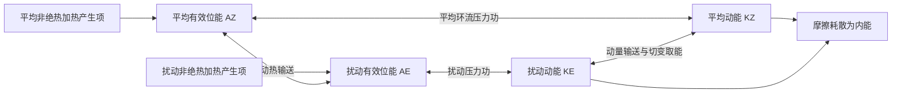

# 2022 年试题解析：逐题解答、考点与频次

> 本文件保留原题及频次，补充对应解答。星级为复习用主观评级；有缺题或排印疑点时，明确注明条件及可解范围。频次按考点出现的不同年份统计，不能视作命题概率。

原始记录：[[动力气象课后习题/往年试题分析/2022]]　｜　[[00_使用说明与年份索引|统计口径与目录]]

## 原卷第一部分

名词解释（每个 3 分，共 30 分）

## 题目 2022-一-1

### 原题

惯性运动

### 考点与考察频次

**考察频次：3 次（按年份去重）；🔴 重点。**

| 考点 | 频次 | 标记 | 对应年份 |
|---|---:|---|---|
| 惯性运动 | 3 次 | 重点 | 2019、2022、2026 |

同考点的全部题号见 [[01_考点频次与证据总表|考点频次与证据总表]]。

### 难度与考试相关度

**难度：★☆☆☆☆（1/5）｜考试相关度：★★★★★（5/5）**

评级依据：历史出现且直接对应所给考纲；频次用于区分复习优先级。

### 考场精简版与审校状态

**审校状态：尚未逐题学科审校。**

**相关高频考点复习摘要（须按本题设问取舍，不替代完整解答）：**

**惯性运动：** 无水平压力梯度和摩擦、常数f时，$\dot u-fv=0$、$\dot v+fu=0$，故 $\ddot u+f^2u=0$。周期为 $2\pi/|f|$，半径 $V/|f|$；北半球顺时针、南半球逆时针。

> 以上摘要用于回忆答题主线，不是官方评分标准；推导、计算和多小问仍须完成下方步骤。

### 详细解答

1. 无水平气压梯度、无摩擦、常数 $f$ 时，$\dot u-fv=0$、$\dot v+fu=0$。第一式再对时间求导并用第二式消去 $v$，得 $\ddot u+f^2u=0$。

2. 初值 $u(0)=U_0,v(0)=0$ 给 $u=U_0\cos ft$、$v=-U_0\sin ft$。积分得惯性圆半径 $U_0/|f|$，周期 $2\pi/|f|$。北半球顺时针、南半球逆时针；旋转坐标中科氏力提供曲线运动的法向加速度。

## 题目 2022-一-2

### 原题

有效位能

### 考点与考察频次

**考察频次：6 次（按年份去重）；🔴 重点。**

| 考点 | 频次 | 标记 | 对应年份 |
|---|---:|---|---|
| 有效位能 | 6 次 | 重点 | 1996、2003、2005、2016、2022、2025 |

同考点的全部题号见 [[01_考点频次与证据总表|考点频次与证据总表]]。

### 难度与考试相关度

**难度：★☆☆☆☆（1/5）｜考试相关度：★★★★★（5/5）**

评级依据：历史出现且直接对应所给考纲；频次用于区分复习优先级。

### 考场精简版与审校状态

**审校状态：尚未逐题学科审校。**

**相关高频考点复习摘要（须按本题设问取舍，不替代完整解答）：**

**有效位能：** 有效位能是实际全位能相对绝热重排后的最低参考态中可供转换的部分。差异加热维持温差，暖升冷沉可将其转为动能。全位能通常指内能与重力位能之和，不是全部都能被利用。

> 以上摘要用于回忆答题主线，不是官方评分标准；推导、计算和多小问仍须完成下方步骤。

### 详细解答

1. 单位质量内能 $e=c_vT$，重力位能 $\Phi=gz$（常重力），动能 $K=|\mathbf V|^2/2$，水汽潜热能近似 $L_vq_v$。总量需对气团质量积分；动能不能漏掉 $1/2$。
2. “全位能”在大气能量学中通常指内能与重力位能之和，而非含动能的总能量。静力、平坦底面且顶边界压力趋零时，$\int\rho gz\,dz=-\int z\,dp=\int p\,dz=\int\rho RT\,dz$；加上内能得到 $\int c_pT\,dm$。
3. 有效位能是实际全位能相对绝热重排到参考最低能态后的可用部分。不是全部内能或重力位能都能转换为动能。差异加热维持水平温差，建立有效位能。
4. 暖上升冷下沉时，$C=-\int\alpha'\omega'\,dm>0$，有效位能转为扰动动能；摩擦最终把动能耗散成内能。凝结使潜热转入热力能库，但水汽能量本来主要来自地表蒸发和辐射收支。
5. 对流层常用 Lorenz 四能量库循环如下。双向箭头表示转换可正可负，方向由收支项决定；中纬度斜压波常沿 $A_Z\to A_E\to K_E$ 取能。$A_Z$ 与 $K_Z$ 的直接转换不能漏掉：平均经圈环流同样可通过压力功在平均有效位能和平均动能之间转换。

产生项也可能为负，图中不是所有加热都增加有效位能。若问完整收支，应分别写 $\dot A_Z=G_Z-C_A-C_Z$、$\dot A_E=G_E+C_A-C_E$、$\dot K_Z=C_Z+C_K-D_Z$、$\dot K_E=C_E-C_K-D_E$，这里 $C_K>0$ 约定为扰动动能转入平均动能。四式相加，内部转换项逐项抵消，只剩外部产生与耗散，可用作检查。

## 题目 2022-一-3

### 原题

正压不稳定

### 考点与考察频次

**考察频次：10 次（按年份去重）；🔴 重点。**

| 考点 | 频次 | 标记 | 对应年份 |
|---|---:|---|---|
| 正压不稳定 | 10 次 | 重点 | 2006、2010、2011、2013、2015、2018、2020、2022、2023、2025 |

同考点的全部题号见 [[01_考点频次与证据总表|考点频次与证据总表]]。

### 难度与考试相关度

**难度：★★☆☆☆（2/5）｜考试相关度：★★★★★（5/5）**

评级依据：历史出现且直接对应所给考纲；频次用于区分复习优先级。

### 考场精简版与审校状态

**审校状态：尚未逐题学科审校。**

**相关高频考点复习摘要（须按本题设问取舍，不替代完整解答）：**

**正压不稳定：** 正压不稳定从基本流的水平切变动能取能。平行流的Rayleigh–Kuo必要条件为 $\beta-U_{yy}$ 在域内变号；它不是充分条件。推导应写模态方程、乘共轭积分并取虚部；求临界风速仍需基本流与边界。

> 以上摘要用于回忆答题主线，不是官方评分标准；推导、计算和多小问仍须完成下方步骤。

### 详细解答

1. 正压不稳定是扰动从具有水平切变的基本流动能获得能量而增长。设基本流 $U(y)$，扰动流函数为 $\psi'=\phi(y)e^{ik(x-ct)}$。
2. 线性涡度方程为 $(\partial_t+U\partial_x)\nabla^2\psi'+(\beta-U'')\partial_x\psi'=0$。代入模态并除以 $ik$，得 $(U-c)(\phi''-k^2\phi)+(\beta-U'')\phi=0$。
3. 设边界 $\phi=0$，除以 $U-c$，乘 $\phi^*$ 后在通道上积分。对 $\phi^*\phi''$ 分部积分，边界项为零：
$$-\int(|\phi'|^2+k^2|\phi|^2)dy+\int\frac{\beta-U''}{U-c}|\phi|^2dy=0.$$
4. 写 $c=c_r+ic_i$，取虚部：$c_i\int(\beta-U'')|\phi|^2/[(U-c_r)^2+c_i^2]dy=0$。若增长 $kc_i>0$，积分中的权重非负，故 $\boxed{\beta-U''\text{ 必须在域内变号}}$，这只是必要条件。
5. 扰动能量转换率含 $-\overline{u'v'}U_y$；扰动向平均切变反方向输送动量时可取能。若要求具体临界风速，必须给 $U(y)$、边界和波数，不能由必要条件唯一决定。
6. 例：仅在额外假定 $U=U_0\cos(my)$ 且区域含完整正负峰时，变号要求 $|U_0|m^2>\beta$；这个幅度界限仍不是该流动必定不稳定的充分临界值。

## 题目 2022-一-4

### 原题

准地转运动

### 考点与考察频次

**考察频次：2 次（按年份去重）；一般。**

| 考点 | 频次 | 标记 | 对应年份 |
|---|---:|---|---|
| 准地转近似 | 2 次 | 一般 | 2015、2022 |

同考点的全部题号见 [[01_考点频次与证据总表|考点频次与证据总表]]。

### 难度与考试相关度

**难度：★☆☆☆☆（1/5）｜考试相关度：★★★★☆（4/5）**

评级依据：历史出现且直接对应所给考纲；频次用于区分复习优先级。

### 考场精简版与审校状态

**审校状态：尚未逐题学科审校。**

> 以上摘要用于回忆答题主线，不是官方评分标准；推导、计算和多小问仍须完成下方步骤。

### 详细解答

1. 取水平长度 $L$、竖直长度 $H$、速度 $U,W$、时间 $T$，把变量写成尺度乘无量纲量。水平局地加速度量级 $U/T$，平流加速度 $U^2/L$，科氏项 $f_0U$，压力梯度项 $\Delta p/(\rho L)$。

2. 罗斯贝数 $Ro=U/(|f_0|L)$ 比较平流惯性和科氏作用；时间罗斯贝数 $Ro_t=1/(|f_0|T)$ 比较局地加速度和科氏作用。大尺度适应的快速阶段 $Ro_t$ 可为一阶，缓慢演变阶段两种罗斯贝数通常均小。

3. 若 $Ro,Ro_t\ll1$，水平零阶为地转平衡；非地转风是一阶修正，承担散度和次级环流。$H/L\ll1$ 且竖直惯性远小于浮力、重力相关项时可取静力近似；薄层不自动排除每一种强对流。

## 题目 2022-一-5

### 原题

准静止锋

### 考点与考察频次

**考察频次：2 次（按年份去重）；一般。**

| 考点 | 频次 | 标记 | 对应年份 |
|---|---:|---|---|
| 准静止锋 | 2 次 | 一般 | 2022、2025 |

同考点的全部题号见 [[01_考点频次与证据总表|考点频次与证据总表]]。

### 难度与考试相关度

**难度：★☆☆☆☆（1/5）｜考试相关度：★★★★☆（4/5）**

评级依据：历史出现且直接对应所给考纲；频次用于区分复习优先级。

### 考场精简版与审校状态

**审校状态：尚未逐题学科审校。**

> 以上摘要用于回忆答题主线，不是官方评分标准；推导、计算和多小问仍须完成下方步骤。

### 详细解答

1. 气团是水平范围广、温度湿度等性质较均匀、在共同源地上形成的大块空气。冷暖气团之间的三维过渡带叫锋区，理想化为锋面，与地面的交线叫锋线。

2. **分类。** 冷气团主动推进为冷锋，锋后通常降温、转偏北风、气压升高，锋区可阵雨雷暴；暖气团主动推进为暖锋，暖空气沿冷气团上滑，常有锋前大范围层状云雨；冷暖势力相当、移动缓慢为准静止锋，易持续阴雨；冷锋追及暖锋使暖空气抬离地面形成锢囚锋，天气取决于两侧冷空气和水汽结构。

3. **要素场。** 锋区水平温度和密度梯度大，等温线密集；地面常表现为低压槽，风向有气旋式切变，锋面上升指向冷空气一侧。气压本身连续，其梯度可明显改变；“锋面处气压不连续”是不正确表述。

## 题目 2022-一-6

### 原题

气旋

### 考点与考察频次

**考察频次：9 次（按年份去重）；🔴 重点。**

| 考点 | 频次 | 标记 | 对应年份 |
|---|---:|---|---|
| 气旋及其发展 | 9 次 | 重点 | 1989、1992、1998、2003、2005、2020、2022、2023、2026 |

同考点的全部题号见 [[01_考点频次与证据总表|考点频次与证据总表]]。

### 难度与考试相关度

**难度：★☆☆☆☆（1/5）｜考试相关度：★★★★★（5/5）**

评级依据：历史出现且直接对应所给考纲；频次用于区分复习优先级。

### 考场精简版与审校状态

**审校状态：尚未逐题学科审校。**

**相关高频考点复习摘要（须按本题设问取舍，不替代完整解答）：**

**气旋及其发展：** 气旋是低压及气旋式环流。温带锋面气旋依次经历初生波动、发展加深、成熟锢囚、衰亡填塞；斜压有效位能、高空涡度平流和辐散、低层暖平流及潜热共同影响发展。不能把所有气旋都概括成轴对称冷心。

> 以上摘要用于回忆答题主线，不是官方评分标准；推导、计算和多小问仍须完成下方步骤。

### 详细解答

1. 气旋是低压及其气旋式环流系统，北半球逆时针、南半球顺时针；反气旋为高压及反气旋式环流。低层摩擦使气旋常辐合上升、反气旋常辐散下沉，但云雨仍依水汽和热力条件。

2. **温带锋面气旋四阶段。** 初生：静止锋上出现波动，暖空气向冷侧、冷空气向暖侧推进；发展：低压加深，冷暖锋清楚，暖区扩大，槽前正涡度平流和高空辐散配合；成熟/锢囚：冷锋追上暖锋，暖空气抬离地面，气旋范围较大且结构复杂；衰亡：近地面冷空气占据中心，水平温差和斜压取能减弱，低压逐渐填塞。

3. **主要发展因子。** 基本态温度梯度与垂直风切变提供有效位能，高低空槽与地面低压有利配置，低层暖平流、高层正涡度平流和辐散支持上升，凝结潜热可加强发展。并非每个实际气旋都严格走完同一理想阶段。

4. 我国温带气旋常活动于蒙古—东北、黄淮—江淮及东部沿海等区，路径随季节变化。冷反气旋多随冷空气从西北、北方或东北方向南下，冬半年强且广，暖季较弱；不能给出一条全年唯一入侵路线。

## 题目 2022-一-7

### 原题

季风

### 考点与考察频次

**考察频次：12 次（按年份去重）；🔴 重点。**

| 考点 | 频次 | 标记 | 对应年份 |
|---|---:|---|---|
| 季风 | 12 次 | 重点 | 1989、1994、1999、2000、2005、2014、2018、2020、2021、2022、2023、2025 |

同考点的全部题号见 [[01_考点频次与证据总表|考点频次与证据总表]]。

### 难度与考试相关度

**难度：★☆☆☆☆（1/5）｜考试相关度：★★★★★（5/5）**

评级依据：历史出现且直接对应所给考纲；频次用于区分复习优先级。

### 考场精简版与审校状态

**审校状态：尚未逐题学科审校。**

**相关高频考点复习摘要（须按本题设问取舍，不替代完整解答）：**

**季风：** 季风是大范围盛行风向随季节显著转换的环流。形成因子包括海陆热力差异、行星风带季节移动及高原作用。东亚冬季风联系大陆冷高压与东亚大槽；夏季风联系季风低压、副高边缘水汽输送和高空南亚高压，热带与副热带季风并存。

> 以上摘要用于回忆答题主线，不是官方评分标准；推导、计算和多小问仍须完成下方步骤。

### 详细解答

1. **概念。** 季风是大范围盛行风向随季节发生显著转换的环流，通常伴有干湿季变化；季风区是这种季节性风向转换及其天气气候影响显著的地区。不能仅用一个地点冬夏偶然相反的风判定。

2. **基本因子。** 海陆热容量不同：冬季大陆冷却快、形成冷高压，夏季大陆增温快、形成热低压；压力配置改变，推动低层风季节反转。太阳直射点移动带动行星风带和热带辐合带移动，青藏高原热力及动力作用进一步重塑亚洲环流。

3. **冬季系统。** 亚洲大陆和高原为冷源，西伯利亚高压、阿留申低压、东亚大槽及强西风急流配合；我国大部盛行偏北风，带来寒冷干燥天气，沿海还受海陆和地形调制。

4. **夏季系统。** 大陆、高原感热及南亚—东亚降水潜热形成热源；低层印度季风槽、南海季风、西太平洋副高西侧偏南气流、跨赤道气流共同输送水汽，上层南亚高压及热带东风急流响应加热。

5. **东亚特点。** 既有热带季风也有副热带季风，冬季风尤其强；夏季水汽路径包括孟加拉湾—南海和西太平洋，雨带随季风推进分阶段北跳，又受中高纬冷空气影响。热源、环流、水汽辐合和潜热释放相互反馈，不能归结成单一海陆风的放大。

## 题目 2022-一-8

### 原题

寒潮

### 考点与考察频次

**考察频次：17 次（按年份去重）；🔴 重点。**

| 考点 | 频次 | 标记 | 对应年份 |
|---|---:|---|---|
| 寒潮及其天气过程 | 17 次 | 重点 | 1990、1996、2000、2001、2002、2006、2010、2011、2012、2014、2016、2017、2019、2021、2022、2024、2026 |

同考点的全部题号见 [[01_考点频次与证据总表|考点频次与证据总表]]。

### 难度与考试相关度

**难度：★☆☆☆☆（1/5）｜考试相关度：★★★★★（5/5）**

评级依据：历史出现且直接对应所给考纲；频次用于区分复习优先级。

### 考场精简版与审校状态

**审校状态：尚未逐题学科审校。**

**相关高频考点复习摘要（须按本题设问取舍，不替代完整解答）：**

**寒潮及其天气过程：** 寒潮是强冷空气大范围南下造成显著降温、大风及可能雨雪冻害的过程。答路径时分西路、西北路、东路；答发展时写冷空气蓄积→高空槽脊调整→地面冷高压和冷锋南下；是否达到业务等级须核对相应标准。

> 以上摘要用于回忆答题主线，不是官方评分标准；推导、计算和多小问仍须完成下方步骤。

### 详细解答

1. 寒潮是强冷空气大范围侵入中低纬，造成剧烈降温、大风，常伴雨雪或冻害的天气过程；达到业务寒潮等级还要按适用标准核对降温幅度和最低温度，不能把所有冷空气过程称为寒潮。
2. **源地和蓄积区。** 传统天气学源地归纳包括新地岛以西、新地岛以东和冰岛以南洋面；冷空气可在西伯利亚—蒙古一带进一步辐射冷却、蓄积。源地不同于进入我国的路径，不能混为一项。
3. **路径。** 西路经新疆及高原北侧影响西北、西南；西北路经蒙古、河套南下，常影响我国中东部大部；东路偏经东北、华北和东部沿海。多路冷空气汇合时范围和强度可增大，但不存在不问强度、地形、水汽就永远“最严重”的一路。
4. **环流演变。** 阻塞高压或暖脊建立，东侧冷空气积聚；亚洲极涡或横槽南压；短波发展、横槽转竖或大槽东移使槽后偏北气流加强，地面冷高压增强南下，冷锋迅速推进，随后东亚大槽重建。
5. **天气。** 锋前可回暖和增湿，锋过时风向突变、大风降温，水汽足时出现雨雪；锋后气压升高、天气转晴，夜间辐射降温及霜冻可加剧。干冷型雨雪少，湿冷型雨雪多，不能要求每次寒潮都具同样降水。
6. **倒Ω中期演变。** 两大洋北部脊向高纬发展，极涡分裂或偏心；乌拉尔与东亚东北侧脊发展，亚洲冷涡被夹持并南压，形成类似倒Ω的槽脊配置；随后横槽转竖或长波槽快速发展，槽后冷空气爆发南下。画图时应画“两侧高脊、中间冷槽/涡”，并用槽后偏北箭头表示冷空气路径。
7. **预报关键。** 同时监视阻高和脊、极涡/横槽、地面冷高压与冷锋。常见短中期型包括小槽发展、横槽转竖和低槽东移；不同教材的“第几类”编号不统一，未给分类表时不能凭编号唯一指定。

## 题目 2022-一-9

### 原题

雷诺数

### 考点与考察频次

**考察频次：1 次（按年份去重）；一般。**

| 考点 | 频次 | 标记 | 对应年份 |
|---|---:|---|---|
| 雷诺数 | 1 次 | 一般 | 2022 |

同考点的全部题号见 [[01_考点频次与证据总表|考点频次与证据总表]]。

### 难度与考试相关度

**难度：★☆☆☆☆（1/5）｜考试相关度：★★★★☆（4/5）**

评级依据：历史出现且直接对应所给考纲；频次用于区分复习优先级。

### 考场精简版与审校状态

**审校状态：已逐题复核（按所列模型与条件）。**

**针对本题的考场作答版（非官方评分标准）：**

$Re=UL/\nu=\rho UL/\mu$，表示惯性作用相对于分子黏性作用的量级比。转捩阈值依赖流动、边界与扰动，不能统一取2300。

> 推导题须保留必要推演，简答与论述须按小问展开；精简版只用于回忆作答主线。

### 详细解答

**修改意见（2026-10-05，第三批）：**

补充惯性项与黏性项的尺度推导；不把圆管临界雷诺数直接用于大气。

**核对依据：** [[牢三样/大气物理学/大气边界层/湍流及大气湍流的基本特征|湍流及大气湍流的基本特征]]。本地资料为学习笔记，不视作官方标准答案；冲突处依据下列物理条件、方程推导和所列外部依据判断。

**复核后详细解答：**

1. 雷诺数是无量纲量：$Re=UL/\nu=\rho UL/\mu$。$U$为特征速度，$L$为特征长度，$\rho$为密度，$\mu$为动力黏度，$\nu=\mu/\rho$为运动黏度。
2. 在常黏度不可压动量方程中，平流惯性项$(\mathbf V\cdot\nabla)\mathbf V$的量级为$U^2/L$，分子黏性项$\nu\nabla^2\mathbf V$的量级为$\nu U/L^2$。两者相除：
$$\frac{U^2/L}{\nu U/L^2}=\frac{UL}{\nu}=Re.$$
3. 因$[\nu]=\mathrm{m^2/s}$，故$[UL/\nu]=(\mathrm{m/s})\mathrm m/(\mathrm{m^2/s})=1$。注意$\mu$的单位为$\mathrm{Pa\,s}$，不能不乘密度就与$\nu$互换。
4. $Re$很小时黏性相对重要；很大时大尺度惯性相对重要，并为湍流发展提供条件，但是否出现、维持湍流还受层结、切变、边界及初始扰动影响。大气大尺度运动即使$Re$很大，小尺度最终仍由分子黏性耗散动能。
5. 某些管流的经验临界数并非所有流动的普遍阈值。本题只要求名词解释时，写定义、物理意义和量纲即可；不要额外写错误的通用转捩判据。

## 题目 2022-一-10

### 原题

光学厚度

### 考点与考察频次

**考察频次：1 次（按年份去重）；一般。**

| 考点 | 频次 | 标记 | 对应年份 |
|---|---:|---|---|
| 光学厚度 | 1 次 | 一般 | 2022 |

同考点的全部题号见 [[01_考点频次与证据总表|考点频次与证据总表]]。

### 难度与考试相关度

**难度：★☆☆☆☆（1/5）｜考试相关度：★★★★☆（4/5）**

评级依据：历史出现且直接对应所给考纲；频次用于区分复习优先级。

### 考场精简版与审校状态

**审校状态：已逐题复核（按所列模型与条件）。**

**针对本题的考场作答版（非官方评分标准）：**

沿光路$s$的消光光学厚度$\tau_\lambda=\int\beta_{e,\lambda}ds=\int\rho\kappa_{e,\lambda}ds$，无量纲；无入射到该束的源项时$I=I_0e^{-\tau}$。

> 推导题须保留必要推演，简答与论述须按小问展开；精简版只用于回忆作答主线。

### 详细解答

**修改意见（2026-10-05，第三批）：**

区分消光光学厚度、几何厚度与垂直/斜程光学厚度，说明指数衰减的适用条件。

**核对依据：** [[牢三样/大气物理学/大气辐射学/太阳辐射在地球大气中的传输|太阳辐射在地球大气中的传输]]。本地资料为学习笔记，不视作官方标准答案；冲突处依据下列物理条件、方程推导和所列外部依据判断。

**复核后详细解答：**

1. 光学厚度表示辐射沿给定路径受到消光的累积程度。对波长$\lambda$，定义
$$\tau_\lambda(s_0,s)=\int_{s_0}^{s}\beta_{e,\lambda}(s')\,ds',\qquad\beta_e=\beta_a+\beta_s.$$
这里$\beta_a,\beta_s$分别为体吸收、散射系数，单位$\mathrm{m^{-1}}$；若用质量消光系数$\kappa_e$，则$\beta_e=\rho\kappa_e$。光学厚度没有长度单位。
2. 窄直射光束因吸收和散射出束而减少，且忽略向束内散射与自身发射时，$dI_\lambda/ds=-\beta_{e,\lambda}I_\lambda$。分离变量：$dI/I=-\beta_e ds$；积分得$\ln(I/I_0)=-\tau$，所以$I=I_0e^{-\tau}$。
3. $\tau\ll1$称光学薄，直射透射率接近1；$\tau\gg1$称光学厚，直射透射率很小；$\tau=1$时$I/I_0=e^{-1}\approx0.368$。有发射或多次散射时，总辐射不能仅用直射衰减式描述。
4. 水平均匀平行平面层内，天顶角为$\theta$的直线满足$ds=|dz|/|\cos\theta|$，所以穿过同一层的斜程光学厚度为$\tau_{\rm slant}=\tau_{\rm vertical}/|\cos\theta|$。近地平线需考虑曲率等，不能无限套用该式。
5. 光学厚度随波长、物质含量及粒子性质变化；相同几何厚度不保证相同光学厚度。

## 原卷第二部分

简答题（每小题 10 分，共 60 分）

## 题目 2022-二-1

### 原题

热带波动开尔文的基本特征

### 考点与考察频次

**考察频次：3 次（按年份去重）；🔴 重点。**

| 考点 | 频次 | 标记 | 对应年份 |
|---|---:|---|---|
| 赤道开尔文波 | 3 次 | 重点 | 2006、2020、2022 |

同考点的全部题号见 [[01_考点频次与证据总表|考点频次与证据总表]]。

### 难度与考试相关度

**难度：★★☆☆☆（2/5）｜考试相关度：★★★★★（5/5）**

评级依据：历史出现且直接对应所给考纲；频次用于区分复习优先级。

### 考场精简版与审校状态

**审校状态：已逐题复核（按所列模型与条件）。**

**针对本题的考场作答版（非官方评分标准）：**

理想赤道浅水开尔文波$v=0$，纬向为重力波传播、经向为地转平衡。远离赤道有界选择东传支$\omega=ck$，$c=\sqrt{gH}$，相速群速相等；振幅$\propto e^{-\beta y^2/(2c)}$，束缚尺度$L_e=\sqrt{c/\beta}$。

> 推导题须保留必要推演，简答与论述须按小问展开；精简版只用于回忆作答主线。

### 详细解答

**修改意见（2026-10-04）：**

原答案混入混合波和罗斯贝波的大段内容；改为只围绕赤道开尔文波，并补有界条件选择东传支的完整过程。参考笔记的束缚尺度漏外层平方根，已核正。

**核对依据：** [[牢三样/动力气象/低纬度大气动力学/热带波动|热带波动]]。本地资料为学习笔记，不视作官方标准答案；冲突处依据下列方程推导与量纲检查作出判断。

**复核后详细解答：**

1. **模型与定义。** 赤道附近取$f=\beta y$、$\beta>0$，静止基本态的线性浅水模型深度为$H$；对大气竖直模态，$H$可理解为等效深度。赤道开尔文模态的经向速度$v=0$。
2. **保留三个约束。** 令自由面位移为$\eta$，有$u_t=-g\eta_x$、$\beta yu=-g\eta_y$、$\eta_t+Hu_x=0$。第一、三式描述纬向重力传播，第二式是经向平衡，不能因$v=0$就把经向方程丢掉。
3. **求纬向波速。** 第一式对时间求导，第三式对$x$求导后代入：$u_{tt}=-g\eta_{xt}=gHu_{xx}$。令$u,\eta\propto e^{i(kx-\omega t)}$，得$-\omega^2u=-gHk^2u$，所以$\omega=\pm ck$，$c=\sqrt{gH}>0$。
4. **东传支的束缚。** 纬向动量式给$\omega u=kg\eta$；取$\omega=ck$，则$u=g\eta/c$。代入经向式，$\eta_y=-(\beta y/c)\eta$。分离变量、从赤道积分：
$$\ln\frac{\eta(y)}{\eta(0)}=-\frac{\beta}{c}\int_0^y y'\,dy'=-\frac{\beta y^2}{2c},$$
故$\eta(y)=\eta(0)e^{-\beta y^2/(2c)}$，$u$也按相同规律衰减。
5. **排除西传支。** 若$\omega=-ck$，则$u=-g\eta/c$，经向式给$\eta_y=(\beta y/c)\eta$，解随$|y|$指数增大。要求远离赤道振幅有界，只能舍去该非零西传解，因此物理解东传。
6. **结构与频散。** $u,\eta$关于赤道对称，东传支二者同相，$v=0$。令包络为$e^{-y^2/(2L_e^2)}$，比较系数得到$L_e=\sqrt{c/\beta}$。$c/\beta$单位是$\mathrm{m^2}$，需开平方才是长度；参考笔记若写$\sqrt{gH}/\beta$作为长度，量纲不对。理想模型中$c_p=\omega/k=c$、$c_g=d\omega/dk=c$，非频散。
7. **实际天气联系。** 大气中的湿对流耦合开尔文波可组织东移云雨，其等效波速和热力结构受湿过程影响；不应把干浅水波的每个结论无条件用于实际对流，也不应把它与MJO直接当同义词。

## 题目 2022-二-2

### 原题

什么是第二类条件性不稳定（CISK）？能量来源是什么？

### 考点与考察频次

**考察频次：10 次（按年份去重）；🔴 重点。**

| 考点 | 频次 | 标记 | 对应年份 |
|---|---:|---|---|
| 第二类条件不稳定（CISK） | 10 次 | 重点 | 1997、2000、2003、2010、2014、2016、2020、2022、2025、2026 |

同考点的全部题号见 [[01_考点频次与证据总表|考点频次与证据总表]]。

### 难度与考试相关度

**难度：★★☆☆☆（2/5）｜考试相关度：★★★★★（5/5）**

评级依据：历史出现且直接对应所给考纲；频次用于区分复习优先级。

### 考场精简版与审校状态

**审校状态：已逐题复核（按所列模型与条件）。**

**针对本题的考场作答版（非官方评分标准）：**

CISK是大尺度环流与积云对流的正反馈。低层辐合供水汽和抬升，对流潜热加热及质量场调整反过来增强涡旋；海面焓通量供应能量，凝结释放潜热并非凭空产能。

> 推导题须保留必要推演，简答与论述须按小问展开；精简版只用于回忆作答主线。

### 详细解答

**修改意见（2026-10-04，第二批）：**

原答案基本正确，但定义未在开头，且能量来源写得过短；补从海面供应到压力功的能量链和质量调整条件。

**核对依据：** [[牢三样/动力气象/低纬度大气动力学/台风发展的第二类条件不稳定（CISK）理论|台风发展的第二类条件不稳定（CISK）理论]]。本地资料为学习笔记，不视作官方标准答案；冲突处依据下列方程推导与量纲检查作出判断。

**复核后详细解答：**

1. **定义。** 第二类条件不稳定是大尺度环流与积云对流相互促进的理想化机制；第一类条件不稳定主要讨论单气块的浮力，而CISK强调环流组织与对流反馈。
2. **环流促进对流。** 初始低压和旋转扰动产生边界层入流、摩擦辐合，集中水汽并提供抬升，使对流能持续地组织在扰动附近。
3. **对流反馈环流。** 凝结加热促使暖心和上层外流发展，经过压力及整柱质量调整，低压环流可以加强，进一步增强低层汇流。加热不能单独保证地面降压，尚需质量收支配合。
4. **能量来源。** 水汽所携能量主要由暖海蒸发等海气交换提供；凝结把这部分潜热转成热力能，适当的暖升冷沉及压力功把其中一部分转为动能，动能又有摩擦耗散。完整回答应写“海面供应→潜热释放→热力与压力功转换→动能”，不只写“能量来自凝结”。
5. **条件和局限。** 湿度、风切变、初始涡旋及对流位置决定反馈能否胜过耗散。CISK不是全部台风发展过程的唯一解释，也不等于每次对流都会增强台风。

## 题目 2022-二-3

### 原题

台风发生发展的必要条件

### 考点与考察频次

**考察频次：7 次（按年份去重）；🔴 重点。**

| 考点 | 频次 | 标记 | 对应年份 |
|---|---:|---|---|
| 热带气旋生成条件 | 7 次 | 重点 | 1994、1998、2010、2015、2018、2022、2026 |

同考点的全部题号见 [[01_考点频次与证据总表|考点频次与证据总表]]。

### 难度与考试相关度

**难度：★★☆☆☆（2/5）｜考试相关度：★★★★★（5/5）**

评级依据：历史出现且直接对应所给考纲；频次用于区分复习优先级。

### 考场精简版与审校状态

**审校状态：已逐题复核（按所列模型与条件）。**

**针对本题的考场作答版（非官方评分标准）：**

依次回答暖海焓供应、湿润并适于深对流的大气、初始旋转扰动、可用科氏作用、弱深层切变及高层外流；每条写出作用，经验海温或纬度阈值不等于充分条件。

> 推导题须保留必要推演，简答与论述须按小问展开；精简版只用于回忆作答主线。

### 详细解答

**修改意见（2026-10-04，第二批）：**

删去本问不要求的整段CISK，逐项补环境条件为何有利，并区分经验阈值与严格必要条件。

**核对依据：** [[牢三样/动力气象/低纬度大气动力学/台风发展的第二类条件不稳定（CISK）理论|台风发展的第二类条件不稳定（CISK）理论]]；[[牢三样/天气学分析原理/低纬度和青藏高原环流系统/云团、台风、热带波动和热带涡旋运动|云团、台风、热带波动和热带涡旋运动]]。本地资料为学习笔记，不视作官方标准答案；冲突处依据下列方程推导与量纲检查作出判断。

**复核后详细解答：**

**发生发展的有利环境及原因：**

1. **暖海及持续焓供应。** 海面蒸发与显热交换补给空气能量，较深暖水层有助于抵抗风暴搅拌造成的海面冷却。常用约26.5℃是经验参考，不能脱离整层海洋热含量和大气热力状态当绝对阈值。
2. **适于深对流的热力状态和湿度。** 低层暖湿、一定的对流潜能及较湿中层，使凝结加热能持续组织；干空气卷入可导致蒸发冷却并削弱对流组织。
3. **低层初始旋转与辐合。** 已有扰动提供气旋性涡度和低层汇流，使分散对流更容易集中为涡旋。不能仅凭海水暖就凭空生成闭合气旋。
4. **可用的地球旋转作用。** 通常离赤道有一定距离，科氏作用有利于组织环流；“约5°以外”是常见经验，而不是数学上的绝对禁区，仍须看实际绝对涡度及扰动。
5. **较弱的深层垂直风切变。** 有利于低层中心、深对流及暖心在垂直方向保持耦合；过强切变容易使涡旋倾斜并把加热区移离中心。具体影响还依切变方向、结构和涡旋强度。
6. **与对流相配合的高层外流。** 上升空气能在上层向外输送，配合整柱质量调整和持续深对流；外流既是环流响应也可受环境促进，不能孤立地当作一个永远预先存在的开关。

这些条件是传统“必要条件”问法下应说明的环境因素，满足若干条不保证形成或增强。关于海温经验值与暖水层作用，可交叉参阅[NOAA海洋条件说明](https://www.aoml.noaa.gov/phod/goos/gliders/ocean_conditions.php)；不把统计经验改写成无例外定律。

## 题目 2022-二-4

### 原题

阻塞高压的特点？其出现在亚洲的地区和时间是怎样的？

### 考点与考察频次

**考察频次：16 次（按年份去重）；🔴 重点。**

| 考点 | 频次 | 标记 | 对应年份 |
|---|---:|---|---|
| 阻塞高压 | 16 次 | 重点 | 1989、1992、1994、1996、1997、1998、2000、2003、2005、2006、2011、2013、2017、2019、2022、2023 |

同考点的全部题号见 [[01_考点频次与证据总表|考点频次与证据总表]]。

### 难度与考试相关度

**难度：★★★☆☆（3/5）｜考试相关度：★★★★★（5/5）**

评级依据：历史出现且直接对应所给考纲；频次用于区分复习优先级。

### 考场精简版与审校状态

**审校状态：尚未逐题学科审校。**

**相关高频考点复习摘要（须按本题设问取舍，不替代完整解答）：**

**阻塞高压：** 阻塞高压是中高纬持续、少动并使西风绕行的强脊或闭合高压。建立与暖输送、波破碎及涡旋反馈有关；其东侧偏北气流可蓄积和引导冷空气。衰退配合横槽转竖时可触发寒潮，但并非每次崩溃都必然造成寒潮。

> 以上摘要用于回忆答题主线，不是官方评分标准；推导、计算和多小问仍须完成下方步骤。

### 详细解答

1. 阻塞高压是中高纬持续、移动缓慢的强高压脊或闭合高压，使西风气流绕行、分支，阻碍天气系统正常东移。关键是持续性和对西风带的阻挡，并非所有高压都叫阻塞。
2. 建立时，暖空气向极地输送使脊增强，经向振幅增大，波破碎、涡旋反馈可帮助维持。高压脊发展或与高纬高压合并，南侧可切出冷低压，形成偶极或Ω型等配置。
3. 维持时，阻高东侧偏北气流引导冷空气南下，西侧偏南气流输送暖空气。下游槽及冷暖空气交汇区可长期停留，造成持久冷凉、降雨；高压控制区下沉、少云，可造成干旱和高温，具体依季节和位置。
4. 衰退或崩溃时，维持高压的暖输送与涡旋反馈减弱，西风恢复，槽脊重新东移；其东侧积聚的冷空气可配合横槽转竖大举南下，触发我国寒潮。不能把每一次阻高衰退都等同于寒潮，仍需冷空气强度和路径配合。
5. 亚洲常关注乌拉尔山及鄂霍次克海等阻塞区，北大西洋—欧洲也是重要活动区；不同季节的优势位置不同，不应把某一季节经验说成全年固定不变。
6. 切断低压是从西风主槽分离出的闭合冷性低压，移动缓慢，可与北侧阻高配合。其冷空气及正涡度有利于下游不稳定和上升，但天气还依水汽供应。

## 题目 2022-二-5

### 原题

雷暴云发展不同阶段的云体特征

### 考点与考察频次

**考察频次：1 次（按年份去重）；一般。**

| 考点 | 频次 | 标记 | 对应年份 |
|---|---:|---|---|
| 雷暴生命史 | 1 次 | 一般 | 2022 |

同考点的全部题号见 [[01_考点频次与证据总表|考点频次与证据总表]]。

### 难度与考试相关度

**难度：★★☆☆☆（2/5）｜考试相关度：★★★★☆（4/5）**

评级依据：历史出现且直接对应所给考纲；频次用于区分复习优先级。

### 考场精简版与审校状态

**审校状态：已逐题复核（按所列模型与条件）。**

**针对本题的考场作答版（非官方评分标准）：**

普通单体依次经历积云阶段（上升气流、云体增高）、成熟阶段（上升与下沉并存、降水雷电活跃）、消散阶段（下沉占优、暖湿补给减弱、降水消退）。多单体整体不能机械套用单个单体的时间顺序。

> 推导题须保留必要推演，简答与论述须按小问展开；精简版只用于回忆作答主线。

### 详细解答

**修改意见（2026-10-05，第三批）：**

按普通单体的积云、成熟、消散三阶段逐项比较云体、气流与降水，限定适用对象。

**核对依据：** [[牢三样/天气学分析原理/天气系统和过程/雷暴结构和雷暴天气成因、中小尺度天气系统|雷暴结构和雷暴天气成因、中小尺度天气系统]]。本地资料为学习笔记，不视作官方标准答案；冲突处依据下列物理条件、方程推导和所列外部依据判断。

**复核后详细解答：**

1. **对象与分期依据。** 以下为普通雷暴单体，主要依据云内气流和降水的发展分期。不同教材可能用“发展期”对应“积云阶段”。
2. **积云阶段。** 近地面暖湿空气受抬升后，凝结释放潜热，有利于浮力上升；云内以上升气流为主，云体从积云向浓积云发展，垂直厚度增大，顶部常呈菜花状。水滴、冰粒不断增长，但尚未形成显著到地面的降水及有组织的下沉气流。
3. **转入成熟。** 降水粒子长大到足以相对气流下落，水成物负载、降水拖曳以及云外较干空气卷入后的蒸发冷却促成下沉气流。到地面的降水是普通单体进入成熟期的重要标志。
4. **成熟阶段。** 云体成为深厚积雨云，云顶可展成砧状；上升区与下沉区并存。暖湿入流继续供给上升气流，而降水区下沉气流到地面后扩散成冷池和阵风锋。雷电、阵雨、短时强降水最活跃，适宜条件下可出现冰雹、强阵风，但并非每个单体均有全部现象。
5. **消散阶段。** 下沉气流逐渐占优势，近地面冷空气外流削弱或切断原单体的暖湿补给。上升气流减弱，降水粒子逐渐落尽，降水减弱，云体蒸发破碎；高处砧状云可保留较久。
6. **避免混淆。** 阵风锋还可能触发新单体，使多单体雷暴系统维持更久；此时老单体消散不等于整个系统消散。超级单体有持续旋转的上升气流，也不能简单等同于上述短寿命普通单体。

## 题目 2022-二-6

### 原题

用瑞利散射规律解释晴天状况下大气为什么呈蓝色？

### 考点与考察频次

**考察频次：2 次（按年份去重）；一般。**

| 考点 | 频次 | 标记 | 对应年份 |
|---|---:|---|---|
| 瑞利散射与天空颜色 | 2 次 | 一般 | 2022、2026 |

同考点的全部题号见 [[01_考点频次与证据总表|考点频次与证据总表]]。

### 难度与考试相关度

**难度：★★☆☆☆（2/5）｜考试相关度：★★★★☆（4/5）**

评级依据：历史出现且直接对应所给考纲；频次用于区分复习优先级。

### 考场精简版与审校状态

**审校状态：已逐题复核（按所列模型与条件）。**

**针对本题的考场作答版（非官方评分标准）：**

分子尺度远小于可见光波长，瑞利散射强度近似与$\lambda^{-4}$成正比；看远离太阳的晴空，蓝光被较强地散射进视线，综合太阳光谱和人眼响应形成蓝色天空。

> 推导题须保留必要推演，简答与论述须按小问展开；精简版只用于回忆作答主线。

### 详细解答

**修改意见（2026-10-05，第三批）：**

补足波长关系、观察方向和天空非紫色的解释，不用海洋反射解释蓝天。

**核对依据：** [[牢三样/大气物理学/大气辐射学/大气粒子对辐射的散射理论|大气粒子对辐射的散射理论]]；[[牢三样/补充内容/臭氧与大气散射|臭氧与大气散射]]。本地资料为学习笔记，不视作官方标准答案；冲突处依据下列物理条件、方程推导和所列外部依据判断。

**复核后详细解答：**

1. **适用尺度。** 大气分子的尺度远小于可见光波长，满足尺度参数$x=2\pi r/\lambda\ll1$，可用瑞利散射近似。它描述入射电磁波激发分子偶极响应后向其他方向再辐射的过程。
2. **波长依赖。** 在粒子性质不变、可见波段折射率变化相对较小时，散射强度满足$I_s\propto\lambda^{-4}$。因此短波蓝光比长波红光更容易从太阳直射束中散射到旁侧方向。举例仅为说明比例：取蓝光450 nm、红光650 nm，有$I_{450}/I_{650}\approx(650/450)^4\approx4.35$。
3. **视线含义。** 看晴空中远离太阳的方向，进入眼睛的主要是空气分子向该视线散射的太阳光；其中蓝光相对增强，所以晴空常呈蓝色。不是“空气分子本身呈蓝色”，也不是海洋反射造成普遍的蓝天。
4. **为什么不是纯紫色。** 散射光的感知颜色由太阳各波长能量、沿途透射、各波长散射以及人眼颜色响应共同决定；人眼对短波紫光的响应较弱，最终呈蓝色而非只取波长最短的一种颜色。不能仅凭$\lambda^{-4}$断定天空应为紫色。
5. **相关现象与边界。** 日出日落时直射光穿过的大气路径较长，短波更多散射出直射束，太阳和近太阳方向趋红；这是观察直射光，与看侧向散射光的蓝天不同。云雾大粒子和较多气溶胶的散射会改变颜色，天空可变白、灰或浑浊。

## 原卷第三部分

论述题（每小题 15 分，共 45 分）

## 题目 2022-三-1

### 原题

梅雨期间的天气特征？梅雨锋的结构特点？梅雨期间高中低层的环流特征？

### 考点与考察频次

**考察频次：13 次（按年份去重）；🔴 重点。**

| 考点 | 频次 | 标记 | 对应年份 |
|---|---:|---|---|
| 梅雨 | 13 次 | 重点 | 1990、1992、1997、2000、2002、2003、2004、2005、2013、2014、2020、2022、2024 |

同考点的全部题号见 [[01_考点频次与证据总表|考点频次与证据总表]]。

### 难度与考试相关度

**难度：★★★☆☆（3/5）｜考试相关度：★★★★★（5/5）**

评级依据：历史出现且直接对应所给考纲；频次用于区分复习优先级。

### 考场精简版与审校状态

**审校状态：尚未逐题学科审校。**

**相关高频考点复习摘要（须按本题设问取舍，不替代完整解答）：**

**梅雨：** 梅雨是初夏江淮及长江中下游的持续阴雨过程。梅雨锋常以水汽和相当位温梯度、低层切变辐合突出；低层西南急流供水汽，中层副高北缘与中高纬槽脊维持冷暖交汇，高层合适辐散配合上升。北段锋区温差可明显，不能说梅雨锋完全无温度梯度。

> 以上摘要用于回忆答题主线，不是官方评分标准；推导、计算和多小问仍须完成下方步骤。

### 详细解答

1. **梅雨定义与天气。** 初夏江淮及长江中下游的持续阴雨期，常在 6 月中旬至 7 月上旬附近，但年际变化明显。天气高湿、云量多，层状云雨夹有对流和暴雨，日照少，雨带易持续。

2. **锋区结构。** 梅雨锋在南段常温度梯度较弱而水汽、相当位温梯度很强；低层有风向切变、辐合和正涡度，锋南暖湿偏南/西南风，锋北较冷偏东/偏北气流。北段温度梯度可更显著，不能概括为“完全无温度差”。

3. **高中低层配置。** 高层南亚高压与西风急流提供适宜的辐散背景；500 hPa 中高纬阻高、东亚槽和西太副高使冷暖气流维持；850—700 hPa 西南急流输送水汽，梅雨锋、切变线或低涡提供抬升。双阻型通常在欧亚中高纬形成两处阻塞、其间冷槽南伸，与低纬副高北侧暖湿气流相遇；两阻的精确中心依原教材图例而定。

4. **梅雨与极锋比较。** 极锋主要表现为强水平温度梯度及深厚斜压性，梅雨锋常以水汽差异和低层切变更突出；两者均可提供持续上升并组织降水。

## 题目 2022-三-2

### 原题

运用大气物理知识解释气溶胶在云雾降水及大气辐射中的作用？

### 考点与考察频次

**考察频次：2 次（按年份去重）；一般。**

| 考点 | 频次 | 标记 | 对应年份 |
|---|---:|---|---|
| 气溶胶的作用 | 2 次 | 一般 | 2022、2026 |

同考点的全部题号见 [[01_考点频次与证据总表|考点频次与证据总表]]。

### 难度与考试相关度

**难度：★★★☆☆（3/5）｜考试相关度：★★★★☆（4/5）**

评级依据：历史出现且直接对应所给考纲；频次用于区分复习优先级。

### 考场精简版与审校状态

**审校状态：已逐题复核（按所列模型与条件）。**

**针对本题的考场作答版（非官方评分标准）：**

气溶胶可作为云凝结核和冰核，改变云滴、冰晶谱及降水过程；可直接散射、吸收辐射，也可通过云滴大小、云量等改变辐射。效应取决于粒子性质和云环境，不能仅按数量给出固定增雨或减雨结论。

> 推导题须保留必要推演，简答与论述须按小问展开；精简版只用于回忆作答主线。

### 详细解答

**修改意见（2026-10-05，第三批）：**

将成核、降水、直接辐射与云介导作用分开，明确降水响应的条件性。

**核对依据：** [[牢三样/大气物理学/地球大气的成分与分布/大气气溶胶的概念、谱分布、来源及在大气过程中的作用|大气气溶胶的概念、谱分布、来源及在大气过程中的作用]]。本地资料为学习笔记，不视作官方标准答案；冲突处依据下列物理条件、方程推导和所列外部依据判断。

**复核后详细解答：**

1. **定义。** 大气气溶胶是悬浮于空气中的固态或液态微粒及其与气体构成的分散体系。常见来源包括海盐、沙尘、燃烧颗粒以及气态前体物生成的二次颗粒；云滴、雨滴通常在云物理中另归为水成物。
2. **云雾凝结。** 部分可吸湿颗粒可充当云凝结核。空气冷却使相对湿度升高后，合适的粒子先吸水，达到相应临界过饱和度便可活化成云滴。曲率效应使小纯水滴较难稳定，溶质效应降低平衡水汽压，两者共同决定活化；因此不是任何粒子在任何湿度下都能成为云滴。
3. **冰相成核。** 某些颗粒在适宜低温与湿度下可充当冰核，参与浸没冻结、接触冻结等过程，影响冰晶数目和混合相云演变。冰核与云凝结核的有效性不同，不能把所有颗粒等同为冰核。
4. **降水过程。** 气溶胶改变初始云滴数目、大小和谱宽，进而改变碰并、冰相增长和降水。若液态水总量相同而活化云滴更多，平均云滴偏小，暖雨碰并可能延迟；巨型凝结核也可能形成较大水滴、促进碰并。冰核多少会影响冰晶竞争水汽及混合相过程。最终降水响应还依赖水汽、云动力和云寿命，不能写“气溶胶越多降水一定越多/越少”。
5. **直接辐射作用。** 颗粒对太阳短波散射，使一部分辐射返回太空、减少到达地面的短波；吸收性颗粒还可吸收辐射、加热所在空气层。净效应依赖成分、粒径、地表反照率和垂直位置，不能把所有气溶胶都归为单纯冷却。
6. **通过云的辐射作用。** 在液水路径相同的比较条件下，较多较小云滴通常使云光学厚度和反照率增大；粒子也能改变降水效率、云量与云寿命。吸收性颗粒引起的层结变化还会改变云。这些响应带有环境依赖，不能由第一项效应直接推断全部净气候作用。
7. **综合关系。** 成核改变微物理，微物理影响降水与云光学性质，辐射加热又反馈云动力。答题按“云雾—冰相与降水—直接辐射—云介导辐射”的顺序展开即可。

## 题目 2022-三-3

### 原题

根据尺度分析的结果，论述中纬度大尺度大气运动的基本特征。根据运动方程和热力学方程的结果解释低纬度大尺度大气运动与中纬度大尺度大气运动的差异。

### 考点与考察频次

**考察频次：5 次（本题所列考点的最高年份频次，不相加）；🔴 重点。**

| 考点 | 频次 | 标记 | 对应年份 |
|---|---:|---|---|
| 尺度分析与运动分类 | 5 次 | 重点 | 2010、2014、2020、2022、2023 |
| 热带大气与天气系统 | 5 次 | 重点 | 1999、2006、2018、2022、2024 |

同考点的全部题号见 [[01_考点频次与证据总表|考点频次与证据总表]]。

### 难度与考试相关度

**难度：★★★☆☆（3/5）｜考试相关度：★★★★★（5/5）**

评级依据：历史出现且直接对应所给考纲；频次用于区分复习优先级。

### 考场精简版与审校状态

**审校状态：尚未逐题学科审校。**

**相关高频考点复习摘要（须按本题设问取舍，不替代完整解答）：**

**尺度分析与运动分类：** 先定 $L,H,U,W,T$，列局地加速度 $U/T$、平流 $U^2/L$、科氏 $fU$、压力梯度 $\Delta p/(\rho L)$，再比较。$Ro=U/(fL)$ 小支持地转近似，薄层与小竖直惯性支持静力近似；赤道和强对流须另检验。

**热带大气与天气系统：** 低纬科氏参数小且跨赤道变号，不能直接套用中纬地转近似；大尺度水平温差常小，湿对流加热、辐合辐散与海气相互作用重要。主要有哈得莱、沃克环流及热带波动和涡旋，局部强涡旋仍可近梯度平衡。

> 以上摘要用于回忆答题主线，不是官方评分标准；推导、计算和多小问仍须完成下方步骤。

### 详细解答

1. 取水平长度 $L$、竖直长度 $H$、速度 $U,W$、时间 $T$，把变量写成尺度乘无量纲量。水平局地加速度量级 $U/T$，平流加速度 $U^2/L$，科氏项 $f_0U$，压力梯度项 $\Delta p/(\rho L)$。
2. 罗斯贝数 $Ro=U/(|f_0|L)$ 比较平流惯性和科氏作用；时间罗斯贝数 $Ro_t=1/(|f_0|T)$ 比较局地加速度和科氏作用。大尺度适应的快速阶段 $Ro_t$ 可为一阶，缓慢演变阶段两种罗斯贝数通常均小。
3. 马赫数 $Ma=U/c_s$ 衡量可压缩效应；弗劳德数 $Fr=U/(NH)$（采用层结竖直长度定义）比较运动和层结回复；Burger 数 $Bu=(NH/(f_0L))^2$ 比较变形尺度和水平尺度；纵横比 $\delta=H/L\ll1$ 表示薄层。雷诺数 $Re=UL/\nu$ 比较惯性和黏性。
4. 若 $Ro,Ro_t\ll1$，水平零阶为地转平衡；非地转风是一阶修正，承担散度和次级环流。$H/L\ll1$ 且竖直惯性远小于浮力、重力相关项时可取静力近似；薄层不自动排除每一种强对流。
5. 连续方程估算 $W/H\sim D$。一般辐散流 $D\sim U/L$，故 $W\sim UH/L$；准地转运动地转部分近无辐散，实际 $D$ 更小，$W$ 也更小。天气尺度 $w$ 常为厘米每秒量级，对流上升可达米每秒甚至更高。
6. 地转参数 $f=2\Omega\sin\varphi$；在参考纬度展开 $f=f_0+\beta y$，$\beta=2\Omega\cos\varphi_0/a$。$f$ 平面忽略 $\beta y$；赤道β平面取 $f_0=0$、$f=\beta y$，不能在赤道继续除以 $f_0$ 使用中纬地转近似。

1. 低纬度 $f$ 小且跨赤道变号，不能普遍使用中纬度地转和准地转近似。大尺度气压、温度水平差异常较小，但水汽与对流差异很大；垂直运动、辐合辐散和潜热加热在环流维持中更突出。

2. 中纬度系统常依赖强水平温度梯度、地转风和斜压能量转换；热带大尺度运动常以对流加热与辐散环流、波动和涡旋相互作用组织，热带气旋内又可有强旋转和梯度风平衡。

3. 低纬垂直环流包括经向哈得莱环流和纬向沃克环流。暖湿上升区常对应深对流，补偿下沉区较干，不能把热带描写成处处同样上升。

## 原卷第四部分

推导题

## 题目 2022-四-1

### 原题

位温的定义

### 考点与考察频次

**考察频次：7 次（按年份去重）；🔴 重点。**

| 考点 | 频次 | 标记 | 对应年份 |
|---|---:|---|---|
| 位温 | 7 次 | 重点 | 1989、1996、2001、2002、2003、2020、2022 |

同考点的全部题号见 [[01_考点频次与证据总表|考点频次与证据总表]]。

### 难度与考试相关度

**难度：★★★★☆（4/5）｜考试相关度：★★★★★（5/5）**

评级依据：历史出现且直接对应所给考纲；频次用于区分复习优先级。

### 考场精简版与审校状态

**审校状态：已逐题复核（按所列模型与条件）。**

**针对本题的考场作答版（非官方评分标准）：**

位温是干空气块经可逆干绝热过程移至规定参考气压$p_0$时的温度，常取$p_0=1000\ \mathrm{hPa}$；单位K，$\theta=T(p_0/p)^{R_d/c_p}$。

> 推导题须保留必要推演，简答与论述须按小问展开；精简版只用于回忆作答主线。

### 详细解答

**修改意见（2026-10-04）：**

原答案正确；按第一小问突出定义和参考气压，不把第三问的推导混作本问必答内容。

**核对依据：** [[牢三样/动力气象/大气运动的基本方程组/热力学能量方程及其在球坐标系和局地直角坐标系中的表述|热力学能量方程及其在球坐标系和局地直角坐标系中的表述]]。本地资料为学习笔记，不视作官方标准答案；冲突处依据下列方程推导与量纲检查作出判断。

**复核后详细解答：**

1. 位温$\theta$定义为干空气块经可逆干绝热过程移到参考气压$p_0$时所具有的温度。通常$p_0=1000\ \mathrm{hPa}$，它是固定参考值，不是气块当前的地面气压。
2. 定组成理想干空气、常比热近似下，$\theta=T(p_0/p)^{R_d/c_p}$，$T$和$\theta$均用K，压力比两端单位一致。推导见本大题第三小问。
3. 位温消除了理想干绝热压缩或膨胀引起的温度变化：沿干绝热路径温度可变而位温不变。水汽凝结加热、辐射或混合存在时，不能一般地令干位温守恒。未饱和湿空气常采用干空气常数近似计算，需明确这是近似。

## 题目 2022-四-2

### 原题

已知热力学能量方程为
$$
c_V \frac{\mathrm{d}T}{\mathrm{d}t} + p \frac{\mathrm{d}\alpha}{\mathrm{d}t} = \dot{Q}
$$
且 $c_p = c_V + R$，干空气状态方程 $p = \rho R T$，$\alpha = \frac{1}{\rho}$。试推出另一种形式的热力学能量方程：
$$
c_p \frac{\mathrm{d}T}{\mathrm{d}t} - \alpha \frac{\mathrm{d}p}{\mathrm{d}t} = Q
$$

### 考点与考察频次

**考察频次：1 次（按年份去重）；一般。**

| 考点 | 频次 | 标记 | 对应年份 |
|---|---:|---|---|
| 热力学方程 | 1 次 | 一般 | 2022 |

同考点的全部题号见 [[01_考点频次与证据总表|考点频次与证据总表]]。

### 难度与考试相关度

**难度：★★★★☆（4/5）｜考试相关度：★★★★☆（4/5）**

评级依据：历史出现且直接对应所给考纲；频次用于区分复习优先级。

### 考场精简版与审校状态

**审校状态：已逐题复核（按所列模型与条件）。**

**针对本题的考场作答版（非官方评分标准）：**

由$p\alpha=R_dT$得$pD\alpha/Dt=R_dDT/Dt-\alpha Dp/Dt$，代入$c_vDT/Dt+pD\alpha/Dt=\dot Q$，再用$c_p=c_v+R_d$，得$c_pDT/Dt-\alpha Dp/Dt=\dot Q$。

> 推导题须保留必要推演，简答与论述须按小问展开；精简版只用于回忆作答主线。

### 详细解答

**修改意见（2026-10-04）：**

原变形正确；按题目完整写出乘积求导及逐项代入，并统一题干Q与Q点的加热率含义，移除本问不要求的熵推导。

**核对依据：** [[牢三样/动力气象/大气运动的基本方程组/热力学能量方程及其在球坐标系和局地直角坐标系中的表述|热力学能量方程及其在球坐标系和局地直角坐标系中的表述]]。本地资料为学习笔记，不视作官方标准答案；冲突处依据下列方程推导与量纲检查作出判断。

**复核后详细解答：**

1. **统一符号。** 题干首式写$\dot Q$、目标式写$Q$，此处均应表示单位质量单位时间的加热率，单位$\mathrm{J\,kg^{-1}\,s^{-1}}$。以下统一记$\dot Q$；不能把目标式右端理解成累计热量。
2. **整理状态方程。** 由$p=\rho R_dT$和$\alpha=1/\rho$，得$p\alpha=R_dT$。
3. **沿气块求导。** $R_d$为常数，乘积求导给
$$\frac{D(p\alpha)}{Dt}=p\frac{D\alpha}{Dt}+\alpha\frac{Dp}{Dt}=R_d\frac{DT}{Dt}.$$
移去第二项：$pD\alpha/Dt=R_dDT/Dt-\alpha Dp/Dt$。
4. **代回题给第一定律。**
$$c_v\frac{DT}{Dt}+\left(R_d\frac{DT}{Dt}-\alpha\frac{Dp}{Dt}\right)=\dot Q.$$
合并温度导数项：$(c_v+R_d)DT/Dt-\alpha Dp/Dt=\dot Q$。
5. **使用比热关系。** 代入$c_p=c_v+R_d$，得
$$\boxed{c_p\frac{DT}{Dt}-\alpha\frac{Dp}{Dt}=\dot Q}.$$
6. **检验。** 两个左端项均为单位质量每秒能量。定压时$Dp/Dt=0$，方程化为$c_pDT/Dt=\dot Q$；绝热压缩时$Dp/Dt>0$且$\dot Q=0$，得$DT/Dt>0$，符号合理。

## 题目 2022-四-3

### 原题

根据第二问结果，利用干绝热过程推导位温在干绝热状况下的表达式。

### 考点与考察频次

**考察频次：7 次（按年份去重）；🔴 重点。**

| 考点 | 频次 | 标记 | 对应年份 |
|---|---:|---|---|
| 位温 | 7 次 | 重点 | 1989、1996、2001、2002、2003、2020、2022 |

同考点的全部题号见 [[01_考点频次与证据总表|考点频次与证据总表]]。

### 难度与考试相关度

**难度：★★★★☆（4/5）｜考试相关度：★★★★★（5/5）**

评级依据：历史出现且直接对应所给考纲；频次用于区分复习优先级。

### 考场精简版与审校状态

**审校状态：已逐题复核（按所列模型与条件）。**

**针对本题的考场作答版（非官方评分标准）：**

干绝热时$c_pdT-\alpha dp=0$，代入$\alpha=R_dT/p$，得$dT/T=(R_d/c_p)dp/p$。从$(T,p)$积到$(\theta,p_0)$，得$\ln(\theta/T)=(R_d/c_p)\ln(p_0/p)$，故$\theta=T(p_0/p)^{R_d/c_p}$。

> 推导题须保留必要推演，简答与论述须按小问展开；精简版只用于回忆作答主线。

### 详细解答

**修改意见（2026-10-04）：**

原公式正确但积分较简略；补变量分离、定积分上下限、指数化及守恒验证，不再与第一小问共用整段答案。

**核对依据：** [[牢三样/动力气象/大气运动的基本方程组/热力学能量方程及其在球坐标系和局地直角坐标系中的表述|热力学能量方程及其在球坐标系和局地直角坐标系中的表述]]。本地资料为学习笔记，不视作官方标准答案；冲突处依据下列方程推导与量纲检查作出判断。

**复核后详细解答：**

1. **采用第二问结果。** 对定组成理想干空气、常$c_p,R_d$，可逆干绝热过程$\dot Q=0$，故$c_pDT/Dt-\alpha Dp/Dt=0$，沿路径写成$c_p\,dT=\alpha\,dp$。
2. **消去比容。** 状态方程给$\alpha=R_dT/p$，代入：$c_p\,dT=(R_dT/p)\,dp$。
3. **变量分离。** 因$T>0,p>0$，两边除以$c_pT$，得$dT/T=(R_d/c_p)dp/p$。记$\kappa=R_d/c_p$。
4. **按定义选择积分终点。** 从当前状态$(T,p)$沿同一干绝热线移至$(\theta,p_0)$：
$$\int_T^\theta\frac{dT'}{T'}=\kappa\int_p^{p_0}\frac{dp'}{p'}.$$
积分后$\ln\theta-\ln T=\kappa(\ln p_0-\ln p)$，等价于$\ln(\theta/T)=\kappa\ln(p_0/p)$。
5. **指数化。** 两边取指数：$\theta/T=(p_0/p)^\kappa$，所以
$$\boxed{\theta=T\left(\frac{p_0}{p}\right)^{R_d/c_p}}.$$
6. **验证守恒。** 对$\ln\theta=\ln T-\kappa\ln p+\kappa\ln p_0$求物质导数，固定$p_0$使最后一项导数为零；第一、二项由干绝热关系抵消，得$D\ln\theta/Dt=0$，即$D\theta/Dt=0$。若$p=p_0$，公式还应给$\theta=T$，与定义一致。

