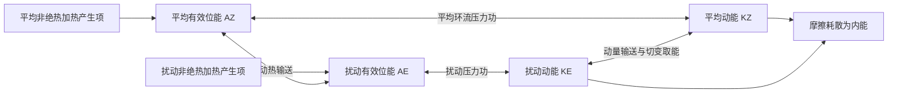

# 2023 年试题解析：逐题解答、考点与频次

> 本文件保留原题及频次，补充对应解答。星级为复习用主观评级；有缺题或排印疑点时，明确注明条件及可解范围。频次按考点出现的不同年份统计，不能视作命题概率。

原始记录：[[动力气象课后习题/往年试题分析/2023]]　｜　[[00_使用说明与年份索引|统计口径与目录]]

## 原卷第一部分

名词解释（共 10 题，每小题 3 分，共 30 分）

## 题目 2023-一-1

### 原题

赤道槽

### 考点与考察频次

**考察频次：4 次（按年份去重）；🔴 重点。**

| 考点 | 频次 | 标记 | 对应年份 |
|---|---:|---|---|
| 热带辐合带 | 4 次 | 重点 | 2000、2004、2014、2023 |

同考点的全部题号见 [[01_考点频次与证据总表|考点频次与证据总表]]。

### 难度与考试相关度

**难度：★☆☆☆☆（1/5）｜考试相关度：★★★★★（5/5）**

评级依据：历史出现且直接对应所给考纲；频次用于区分复习优先级。

### 考场精简版与审校状态

**审校状态：尚未逐题学科审校。**

**相关高频考点复习摘要（须按本题设问取舍，不替代完整解答）：**

**热带辐合带：** ITCZ是低纬信风和季风气流辐合、上升与深对流活跃的带状区域，随季节及海陆热力分布移动，不固定在地理赤道。赤道槽着重气压形态，ITCZ着重风场辐合与对流，二者不必逐点重合。

> 以上摘要用于回忆答题主线，不是官方评分标准；推导、计算和多小问仍须完成下方步骤。

### 详细解答

1. 热带辐合带（ITCZ）是低纬近地面信风及季风气流辐合、上升和深对流较活跃的带状区域，常与赤道附近低压槽相联系。

2. 太阳加热、海表温度及海陆分布使它并不总沿地理赤道，通常随季节向夏半球移动，并具有区域差异；海洋双辐合带等情况也可能出现。

3. 低层辐合持续补给暖湿空气，凝结潜热帮助维持上升和高层辐散，常带来云雨及热带扰动。赤道槽着重气压槽形态，ITCZ着重风场辐合和对流，两者密切相关但不是所有天气图上都逐点重合。

## 题目 2023-一-2

### 原题

赤道东风波

### 考点与考察频次

**考察频次：3 次（按年份去重）；🔴 重点。**

| 考点 | 频次 | 标记 | 对应年份 |
|---|---:|---|---|
| 东风波 | 3 次 | 重点 | 2006、2010、2023 |

同考点的全部题号见 [[01_考点频次与证据总表|考点频次与证据总表]]。

### 难度与考试相关度

**难度：★☆☆☆☆（1/5）｜考试相关度：★★★★★（5/5）**

评级依据：历史出现且直接对应所给考纲；频次用于区分复习优先级。

### 考场精简版与审校状态

**审校状态：尚未逐题学科审校。**

**相关高频考点复习摘要（须按本题设问取舍，不替代完整解答）：**

**东风波：** 东风波是热带东风气流中的槽脊波动，通常随背景东风向西传播，伴涡度、辐合和对流信号；部分可提供热带气旋初始扰动，但不是每个东风波都发展成台风。

> 以上摘要用于回忆答题主线，不是官方评分标准；推导、计算和多小问仍须完成下方步骤。

### 详细解答

1. 东风波是热带东风气流中的波状槽脊扰动，通常向西移动，具有风场、涡度和对流信号；其某些阶段可提供热带气旋初始扰动，但并非每个东风波都会发展成台风。

## 题目 2023-一-3

### 原题

线性振动

### 考点与考察频次

**考察频次：1 次（按年份去重）；一般。**

| 考点 | 频次 | 标记 | 对应年份 |
|---|---:|---|---|
| 线性振荡 | 1 次 | 一般 | 2023 |

同考点的全部题号见 [[01_考点频次与证据总表|考点频次与证据总表]]。

### 难度与考试相关度

**难度：★☆☆☆☆（1/5）｜考试相关度：★★★★☆（4/5）**

评级依据：历史出现且直接对应所给考纲；频次用于区分复习优先级。

### 考场精简版与审校状态

**审校状态：尚未逐题学科审校。**

> 以上摘要用于回忆答题主线，不是官方评分标准；推导、计算和多小问仍须完成下方步骤。

### 详细解答

1. 微小位移 $\xi$ 若满足 $\ddot\xi+N^2\xi=0$，在 $N^2>0$ 时解为 $A\cos Nt+B\sin Nt$，为有回复力的线性振荡；$N^2<0$ 时解含指数增长，表示静力不稳定。

## 题目 2023-一-4

### 原题

全位能

### 考点与考察频次

**考察频次：1 次（按年份去重）；一般。**

| 考点 | 频次 | 标记 | 对应年份 |
|---|---:|---|---|
| 总位能 | 1 次 | 一般 | 2023 |

同考点的全部题号见 [[01_考点频次与证据总表|考点频次与证据总表]]。

### 难度与考试相关度

**难度：★☆☆☆☆（1/5）｜考试相关度：★★★★☆（4/5）**

评级依据：历史出现且直接对应所给考纲；频次用于区分复习优先级。

### 考场精简版与审校状态

**审校状态：尚未逐题学科审校。**

> 以上摘要用于回忆答题主线，不是官方评分标准；推导、计算和多小问仍须完成下方步骤。

### 详细解答

1. 单位质量内能 $e=c_vT$，重力位能 $\Phi=gz$（常重力），动能 $K=|\mathbf V|^2/2$，水汽潜热能近似 $L_vq_v$。总量需对气团质量积分；动能不能漏掉 $1/2$。
2. “全位能”在大气能量学中通常指内能与重力位能之和，而非含动能的总能量。静力、平坦底面且顶边界压力趋零时，$\int\rho gz\,dz=-\int z\,dp=\int p\,dz=\int\rho RT\,dz$；加上内能得到 $\int c_pT\,dm$。
3. 有效位能是实际全位能相对绝热重排到参考最低能态后的可用部分。不是全部内能或重力位能都能转换为动能。差异加热维持水平温差，建立有效位能。
4. 暖上升冷下沉时，$C=-\int\alpha'\omega'\,dm>0$，有效位能转为扰动动能；摩擦最终把动能耗散成内能。凝结使潜热转入热力能库，但水汽能量本来主要来自地表蒸发和辐射收支。
5. 对流层常用 Lorenz 四能量库循环如下。双向箭头表示转换可正可负，方向由收支项决定；中纬度斜压波常沿 $A_Z\to A_E\to K_E$ 取能。$A_Z$ 与 $K_Z$ 的直接转换不能漏掉：平均经圈环流同样可通过压力功在平均有效位能和平均动能之间转换。

产生项也可能为负，图中不是所有加热都增加有效位能。若问完整收支，应分别写 $\dot A_Z=G_Z-C_A-C_Z$、$\dot A_E=G_E+C_A-C_E$、$\dot K_Z=C_Z+C_K-D_Z$、$\dot K_E=C_E-C_K-D_E$，这里 $C_K>0$ 约定为扰动动能转入平均动能。四式相加，内部转换项逐项抵消，只剩外部产生与耗散，可用作检查。

## 题目 2023-一-5

### 原题

锋生

### 考点与考察频次

**考察频次：5 次（按年份去重）；🔴 重点。**

| 考点 | 频次 | 标记 | 对应年份 |
|---|---:|---|---|
| 锋生与锋消 | 5 次 | 重点 | 1992、1994、2016、2018、2023 |

同考点的全部题号见 [[01_考点频次与证据总表|考点频次与证据总表]]。

### 难度与考试相关度

**难度：★☆☆☆☆（1/5）｜考试相关度：★★★★★（5/5）**

评级依据：历史出现且直接对应所给考纲；频次用于区分复习优先级。

### 考场精简版与审校状态

**审校状态：尚未逐题学科审校。**

**相关高频考点复习摘要（须按本题设问取舍，不替代完整解答）：**

**锋生与锋消：** 锋生是随气块运动的水平温度或位温梯度增强。令 $F=D|\nabla_h\theta|/Dt$，按链式法则可分为差异加热、水平变形辐合和竖直倾斜贡献。$F>0$ 锋生，$F<0$ 锋消；不能把所有水平辐合无条件视为锋生。

> 以上摘要用于回忆答题主线，不是官方评分标准；推导、计算和多小问仍须完成下方步骤。

### 详细解答

1. **锋生定义与推导。** 令 $\mathbf G=\nabla_h\theta$，$F=D|\mathbf G|/Dt$。由 $D\theta/Dt=\dot\theta$ 对 $x_i$ 求导：$DG_i/Dt=\partial_i\dot\theta-(\partial_i u_j)G_j-(\partial_iw)\theta_z$，这里 $i,j=x,y$。

2. 与 $G_i/|\mathbf G|$ 相乘求和，得
$$F=\frac{\mathbf G\cdot\nabla_h\dot\theta}{|\mathbf G|}-\frac{G_i(\partial_i u_j)G_j}{|\mathbf G|}-\frac{\theta_z\mathbf G\cdot\nabla_hw}{|\mathbf G|}.$$
三项分别是差异非绝热加热、水平变形/辐合、竖直倾斜作用；$F>0$ 锋生，$F<0$ 锋消。若温度梯度沿 $x$，绝热且无倾斜时 $F=-|G|u_x$，跨锋辐合 $u_x<0$ 加大梯度，直观说明动力锋生。

## 题目 2023-一-6

### 原题

辐射逆温

### 考点与考察频次

**考察频次：2 次（按年份去重）；一般。**

| 考点 | 频次 | 标记 | 对应年份 |
|---|---:|---|---|
| 逆温 | 2 次 | 一般 | 2023、2025 |

同考点的全部题号见 [[01_考点频次与证据总表|考点频次与证据总表]]。

### 难度与考试相关度

**难度：★☆☆☆☆（1/5）｜考试相关度：★★★★☆（4/5）**

评级依据：历史出现且直接对应所给考纲；频次用于区分复习优先级。

### 考场精简版与审校状态

**审校状态：已逐题复核（按所列模型与条件）。**

**针对本题的考场作答版（非官方评分标准）：**

晴朗、弱风夜间地面净长波辐射冷却，接触地面的空气先降温，使近地面出现$dT/dz>0$的逆温层，称辐射逆温。

> 推导题须保留必要推演，简答与论述须按小问展开；精简版只用于回忆作答主线。

### 详细解答

**修改意见（2026-10-05，第三批）：**

明确定义为温度随高度增加，区分等温层，补夜间形成与日出后消退条件。

**核对依据：** [[牢三样/大气物理学/大气热力学/形成大气逆温层的原因|形成大气逆温层的原因]]。本地资料为学习笔记，不视作官方标准答案；冲突处依据下列物理条件、方程推导和所列外部依据判断。

**复核后详细解答：**

1. 正常对流层中温度常随高度下降，逆温则指某层内温度随高度增加，即$dT/dz>0$。$dT/dz=0$是等温层，不应并入严格的逆温定义。
2. 夜间地面失去太阳短波输入，向上长波通常大于向下长波，发生净辐射冷却。地面先变冷，再通过分子传导及弱湍流交换使紧贴地面的空气降温。
3. 冷却影响由下向上传递，近地面降温一般比稍高处大，形成“下冷上暖”的浅层逆温。它是地表辐射收支改变后经地气交换形成的，不是仅由大气在每个高度直接辐射造成。
4. 晴空减少云的向下长波补偿，弱风减少上下混合，因此晴朗、弱风、较长夜晚有利；强风混合或云量增加通常使其减弱。完全无风也不是唯一必要条件。
5. 日出后地面受热，感热向上输送，逆温通常从下部逐渐被侵蚀。辐射逆温能抑制近地面浮力混合，利于污染物积聚；水汽足够、降温至露点时可形成辐射雾，但有逆温不一定有雾。

## 题目 2023-一-7

### 原题

阻塞高压

### 考点与考察频次

**考察频次：16 次（按年份去重）；🔴 重点。**

| 考点 | 频次 | 标记 | 对应年份 |
|---|---:|---|---|
| 阻塞高压 | 16 次 | 重点 | 1989、1992、1994、1996、1997、1998、2000、2003、2005、2006、2011、2013、2017、2019、2022、2023 |

同考点的全部题号见 [[01_考点频次与证据总表|考点频次与证据总表]]。

### 难度与考试相关度

**难度：★☆☆☆☆（1/5）｜考试相关度：★★★★★（5/5）**

评级依据：历史出现且直接对应所给考纲；频次用于区分复习优先级。

### 考场精简版与审校状态

**审校状态：尚未逐题学科审校。**

**相关高频考点复习摘要（须按本题设问取舍，不替代完整解答）：**

**阻塞高压：** 阻塞高压是中高纬持续、少动并使西风绕行的强脊或闭合高压。建立与暖输送、波破碎及涡旋反馈有关；其东侧偏北气流可蓄积和引导冷空气。衰退配合横槽转竖时可触发寒潮，但并非每次崩溃都必然造成寒潮。

> 以上摘要用于回忆答题主线，不是官方评分标准；推导、计算和多小问仍须完成下方步骤。

### 详细解答

1. 阻塞高压是中高纬持续、移动缓慢的强高压脊或闭合高压，使西风气流绕行、分支，阻碍天气系统正常东移。关键是持续性和对西风带的阻挡，并非所有高压都叫阻塞。
2. 建立时，暖空气向极地输送使脊增强，经向振幅增大，波破碎、涡旋反馈可帮助维持。高压脊发展或与高纬高压合并，南侧可切出冷低压，形成偶极或Ω型等配置。
3. 维持时，阻高东侧偏北气流引导冷空气南下，西侧偏南气流输送暖空气。下游槽及冷暖空气交汇区可长期停留，造成持久冷凉、降雨；高压控制区下沉、少云，可造成干旱和高温，具体依季节和位置。
4. 衰退或崩溃时，维持高压的暖输送与涡旋反馈减弱，西风恢复，槽脊重新东移；其东侧积聚的冷空气可配合横槽转竖大举南下，触发我国寒潮。不能把每一次阻高衰退都等同于寒潮，仍需冷空气强度和路径配合。
5. 亚洲常关注乌拉尔山及鄂霍次克海等阻塞区，北大西洋—欧洲也是重要活动区；不同季节的优势位置不同，不应把某一季节经验说成全年固定不变。
6. 切断低压是从西风主槽分离出的闭合冷性低压，移动缓慢，可与北侧阻高配合。其冷空气及正涡度有利于下游不稳定和上升，但天气还依水汽供应。

## 题目 2023-一-8

### 原题

多单体风暴

### 考点与考察频次

**考察频次：1 次（按年份去重）；一般。**

| 考点 | 频次 | 标记 | 对应年份 |
|---|---:|---|---|
| 多单体风暴 | 1 次 | 一般 | 2023 |

同考点的全部题号见 [[01_考点频次与证据总表|考点频次与证据总表]]。

### 难度与考试相关度

**难度：★☆☆☆☆（1/5）｜考试相关度：★★★★☆（4/5）**

评级依据：历史出现且直接对应所给考纲；频次用于区分复习优先级。

### 考场精简版与审校状态

**审校状态：尚未逐题学科审校。**

> 以上摘要用于回忆答题主线，不是官方评分标准；推导、计算和多小问仍须完成下方步骤。

### 详细解答

1. **组织类型。** 多单体风暴由不同生命阶段单体组成，冷池边界不断触发新单体，整体比单个单体活得久；超级单体的识别核心是深厚、持续旋转的上升气流（中气旋），不是单纯雨量最大。[NWS 超级单体说明](https://www.weather.gov/ama/supercell)

2. **普通雷暴三阶段。** 积云阶段以上升为主、云滴增长；成熟阶段上升和降水拖曳/蒸发冷却产生的下沉共存，雷电、阵雨和阵风最活跃；消散阶段下沉与冷出流占据，切断暖湿入流，云体和降水逐渐减弱。

## 题目 2023-一-9

### 原题

米散射

### 考点与考察频次

**考察频次：1 次（按年份去重）；一般。**

| 考点 | 频次 | 标记 | 对应年份 |
|---|---:|---|---|
| 米散射 | 1 次 | 一般 | 2023 |

同考点的全部题号见 [[01_考点频次与证据总表|考点频次与证据总表]]。

### 难度与考试相关度

**难度：★☆☆☆☆（1/5）｜考试相关度：★★★★☆（4/5）**

评级依据：历史出现且直接对应所给考纲；频次用于区分复习优先级。

### 考场精简版与审校状态

**审校状态：已逐题复核（按所列模型与条件）。**

**针对本题的考场作答版（非官方评分标准）：**

米散射理论是均匀球形粒子散射电磁波的解，气象中常用来描述粒径与波长相当的气溶胶及云滴散射；角分布通常明显前向，波长依赖取决于粒径谱和复折射率。

> 推导题须保留必要推演，简答与论述须按小问展开；精简版只用于回忆作答主线。

### 详细解答

**修改意见（2026-10-05，第三批）：**

说明球形粒子米理论的范围，不把所有大粒子散射概括成严格波长无关。

**核对依据：** [[牢三样/大气物理学/大气辐射学/大气粒子对辐射的散射理论|大气粒子对辐射的散射理论]]。本地资料为学习笔记，不视作官方标准答案；冲突处依据下列物理条件、方程推导和所列外部依据判断。

**复核后详细解答：**

1. 米散射指球形粒子对电磁波散射的严格电磁理论描述；常见基本模型为均匀、各向同性球体，给定粒子半径、波长以及粒子相对环境介质的复折射率。
2. 以$x=2\pi r/\lambda$刻画尺寸。$x\ll1$可退化到瑞利近似；$x$约为1或更大时，不能继续简单用瑞利的$\lambda^{-4}$律，气象学通常把这一范围的粒子散射称为米散射。
3. 与分子瑞利散射相比，米散射的角分布一般更不对称，较大粒子常显著前向散射，且强度、偏振及吸收都与$x$和复折射率有关。不能断言所有粒子的前后散射相等。
4. 对覆盖可见光尺度的实际粒径谱，多种粒径的响应叠加，颜色依赖可比瑞利散射弱，云雾因而常呈白色或灰色；米理论本身并不意味着“完全不随波长变化”。较厚云的灰暗还涉及多次散射及透射减弱。
5. 沙尘等非球形粒子的精细散射未必能由球形米模型准确表达；在考试名词解释中保留球形假设和主要适用对象即可。

## 题目 2023-一-10

### 原题

绝对环流加速度

### 考点与考察频次

**考察频次：1 次（按年份去重）；一般。**

| 考点 | 频次 | 标记 | 对应年份 |
|---|---:|---|---|
| 环流定理 | 1 次 | 一般 | 2023 |

同考点的全部题号见 [[01_考点频次与证据总表|考点频次与证据总表]]。

### 难度与考试相关度

**难度：★☆☆☆☆（1/5）｜考试相关度：★★★★☆（4/5）**

评级依据：历史出现且直接对应所给考纲；频次用于区分复习优先级。

### 考场精简版与审校状态

**审校状态：尚未逐题学科审校。**

> 以上摘要用于回忆答题主线，不是官方评分标准；推导、计算和多小问仍须完成下方步骤。

### 详细解答

1. 随体闭合曲线的相对环流为 $C=\oint\mathbf V\cdot d\mathbf l$；绝对环流 $C_a=C+2\boldsymbol\Omega\cdot\mathbf S$，其中 $\mathbf S$ 是有向面积矢量。
2. 对随体线积分求导，动能梯度沿闭合路径积分为零，保守重力同样为零；无摩擦时只剩压力项：$\boxed{DC_a/Dt=-\oint\alpha\,dp}$，即绝对环流加速度。
3. 用 Stokes 定理，$-\oint\alpha\nabla p\cdot d\mathbf l=-\iint(\nabla\alpha\times\nabla p)\cdot\mathbf n\,dS$。因此斜压力管矢量可按本约定定义为 $\nabla p\times\nabla\alpha$。
4. 等压面与等比容面交叉围成的管状区域称力管，其投影和方向表征斜压产生环流的作用；正压时两组面重合，叉积为零。正压、无摩擦条件下绝对环流守恒，但相对环流可因投影面积改变而变化。

## 原卷第二部分

简答题（每小题 10 分，共 60 分）

## 题目 2023-二-1

### 原题

影响东亚季风形成的基本因子。

### 考点与考察频次

**考察频次：12 次（按年份去重）；🔴 重点。**

| 考点 | 频次 | 标记 | 对应年份 |
|---|---:|---|---|
| 季风 | 12 次 | 重点 | 1989、1994、1999、2000、2005、2014、2018、2020、2021、2022、2023、2025 |

同考点的全部题号见 [[01_考点频次与证据总表|考点频次与证据总表]]。

### 难度与考试相关度

**难度：★★★☆☆（3/5）｜考试相关度：★★★★★（5/5）**

评级依据：历史出现且直接对应所给考纲；频次用于区分复习优先级。

### 考场精简版与审校状态

**审校状态：尚未逐题学科审校。**

**相关高频考点复习摘要（须按本题设问取舍，不替代完整解答）：**

**季风：** 季风是大范围盛行风向随季节显著转换的环流。形成因子包括海陆热力差异、行星风带季节移动及高原作用。东亚冬季风联系大陆冷高压与东亚大槽；夏季风联系季风低压、副高边缘水汽输送和高空南亚高压，热带与副热带季风并存。

> 以上摘要用于回忆答题主线，不是官方评分标准；推导、计算和多小问仍须完成下方步骤。

### 详细解答

1. **概念。** 季风是大范围盛行风向随季节发生显著转换的环流，通常伴有干湿季变化；季风区是这种季节性风向转换及其天气气候影响显著的地区。不能仅用一个地点冬夏偶然相反的风判定。

2. **基本因子。** 海陆热容量不同：冬季大陆冷却快、形成冷高压，夏季大陆增温快、形成热低压；压力配置改变，推动低层风季节反转。太阳直射点移动带动行星风带和热带辐合带移动，青藏高原热力及动力作用进一步重塑亚洲环流。

3. **冬季系统。** 亚洲大陆和高原为冷源，西伯利亚高压、阿留申低压、东亚大槽及强西风急流配合；我国大部盛行偏北风，带来寒冷干燥天气，沿海还受海陆和地形调制。

4. **夏季系统。** 大陆、高原感热及南亚—东亚降水潜热形成热源；低层印度季风槽、南海季风、西太平洋副高西侧偏南气流、跨赤道气流共同输送水汽，上层南亚高压及热带东风急流响应加热。

5. **东亚特点。** 既有热带季风也有副热带季风，冬季风尤其强；夏季水汽路径包括孟加拉湾—南海和西太平洋，雨带随季风推进分阶段北跳，又受中高纬冷空气影响。热源、环流、水汽辐合和潜热释放相互反馈，不能归结成单一海陆风的放大。

## 题目 2023-二-2

### 原题

赤道地区有哪些特有波动，阐述其特征。

### 考点与考察频次

**考察频次：5 次（按年份去重）；🔴 重点。**

| 考点 | 频次 | 标记 | 对应年份 |
|---|---:|---|---|
| 赤道波动 | 5 次 | 重点 | 2003、2005、2020、2023、2024 |

同考点的全部题号见 [[01_考点频次与证据总表|考点频次与证据总表]]。

### 难度与考试相关度

**难度：★★☆☆☆（2/5）｜考试相关度：★★★★★（5/5）**

评级依据：历史出现且直接对应所给考纲；频次用于区分复习优先级。

### 考场精简版与审校状态

**审校状态：尚未逐题学科审校。**

**相关高频考点复习摘要（须按本题设问取舍，不替代完整解答）：**

**赤道波动：** 赤道β平面存在开尔文波、赤道罗斯贝波、混合罗斯贝—重力波和惯性重力波。开尔文波东传、经向风为零且赤道束缚；罗斯贝模态内禀相速向西；混合波兼有涡旋与重力特征。实际云雨还依赖湿对流耦合。

> 以上摘要用于回忆答题主线，不是官方评分标准；推导、计算和多小问仍须完成下方步骤。

### 详细解答

1. 赤道附近 $f\approx\beta y$，科氏参数变号使若干波动被束缚在赤道附近。主要模态有赤道开尔文波、赤道罗斯贝波、混合罗斯贝—重力波及赤道惯性重力波。线性理论描述它们的动力骨架，实际云雨还受湿对流耦合。
2. **赤道开尔文波。** 取浅水等效波速 $c=\sqrt{gH}$，令 $v=0$。纬向动量与连续方程给 $u_t=-g\eta_x$、$\eta_t=-Hu_x$，组合得 $u_{tt}=c^2u_{xx}$，故 $\omega=\pm ck$。
3. 经向动量给 $\beta yu=-g\eta_y$。东传支有 $u=g\eta/c$，故 $\eta_y=-(\beta y/c)\eta$，积分得 $\eta\propto\exp[-\beta y^2/(2c)]$；西传支随远离赤道增长，不能满足有界条件。因此开尔文波为东传、近非频散，$u,\eta$ 关于赤道对称，$v=0$，束缚尺度 $L_e=\sqrt{c/\beta}$。
4. **混合波。** 兼具涡旋性与重力回复特征，经向风不为零；标准 $n=0$ 物理解可写 $\omega=ck/2+\sqrt{c^2k^2/4+\beta c}$（连同实场的共轭分支）。负波数一侧相速向西，群速可向东，不能把它当成单纯非频散东传波。
5. **赤道罗斯贝波。** 主要受位涡梯度约束，内禀相速向西，常表现为赤道两侧成对的涡旋；重力波分支较快，以辐散、质量场振荡显著。
6. 沿岸开尔文波与赤道开尔文波应区分：前者靠边界无穿透与地转横向平衡束缚，离岸按 $e^{-y/L_D}$ 衰减，$L_D=c/|f|$；北半球沿传播方向海岸在右侧。赤道波无需实体岸界。

## 题目 2023-二-3

### 原题

温带气旋发展的四个阶段及其特征。

### 考点与考察频次

**考察频次：9 次（按年份去重）；🔴 重点。**

| 考点 | 频次 | 标记 | 对应年份 |
|---|---:|---|---|
| 气旋及其发展 | 9 次 | 重点 | 1989、1992、1998、2003、2005、2020、2022、2023、2026 |

同考点的全部题号见 [[01_考点频次与证据总表|考点频次与证据总表]]。

### 难度与考试相关度

**难度：★★☆☆☆（2/5）｜考试相关度：★★★★★（5/5）**

评级依据：历史出现且直接对应所给考纲；频次用于区分复习优先级。

### 考场精简版与审校状态

**审校状态：已逐题复核（按所列模型与条件）。**

**针对本题的考场作答版（非官方评分标准）：**

按波动初生—发展青年—成熟锢囚—衰亡填塞作答；分别说明冷暖锋、暖区、气压趋势及云雨变化。锢囚不等于立刻衰亡，四阶段是理想模型。

> 推导题须保留必要推演，简答与论述须按小问展开；精简版只用于回忆作答主线。

### 详细解答

**修改意见（2026-10-04，第二批）：**

原答案混入反气旋和地区路径；改按理想锋面气旋四阶段，纠正“青年必最强、锢囚必立即填塞”等过度概括。

**核对依据：** [[牢三样/天气学分析原理/气旋与反气旋/锋面气旋和爆发性气旋|锋面气旋和爆发性气旋]]。本地资料为学习笔记，不视作官方标准答案；冲突处依据下列方程推导与量纲检查作出判断。

**复核后详细解答：**

1. **波动初生阶段。** 锋区出现波动，暖空气一侧向冷侧推进，冷空气另一侧向暖侧推进，形成暖锋、冷锋雏形及弱低压环流。高空扰动与低层锋区的配合有利生成，但不能把一项单层指标当充分条件。
2. **发展或青年阶段。** 低压加深、环流加强，冷暖锋与暖区逐渐清楚；高低层有利相位与暖升冷沉支持有效位能向动能转换。暖锋附近可有较广连续降水，冷锋和暖区在不稳定条件下可有对流。暖区不必在整个发展阶段持续扩大。
3. **成熟、锢囚阶段。** 在经典挪威气旋模式中，冷锋赶上暖锋，近中心暖空气被抬离地面，暖区逐渐收窄，形成锢囚锋，系统范围及云雨结构可很复杂。最深气压或最强风出现的时刻因个例而异，锢囚初期仍可能继续加深。
4. **衰亡阶段。** 当可利用斜压能量减少、高低层趋于重叠且耗散占优时，气旋填塞，锋区及云雨逐渐减弱。存在再发展或锢囚点新生等情形，不能把“锢囚”直接等同“生命结束”。
5. **模型范围。** 此四阶段用于经典温带锋面气旋生命史；实际气旋可能中途消散，或遵循不同结构演变。答题不必加入与本问无关的反气旋路径。

## 题目 2023-二-4

### 原题

简述臭氧在大气中的空间分布特征。

### 考点与考察频次

**考察频次：2 次（按年份去重）；一般。**

| 考点 | 频次 | 标记 | 对应年份 |
|---|---:|---|---|
| 臭氧及其辐射作用 | 2 次 | 一般 | 2023、2024 |

同考点的全部题号见 [[01_考点频次与证据总表|考点频次与证据总表]]。

### 难度与考试相关度

**难度：★★☆☆☆（2/5）｜考试相关度：★★★★☆（4/5）**

评级依据：历史出现且直接对应所给考纲；频次用于区分复习优先级。

### 考场精简版与审校状态

**审校状态：已逐题复核（按所列模型与条件）。**

**针对本题的考场作答版（非官方评分标准）：**

臭氧约九成位于平流层；数密度峰值通常在约20—25 km附近而非所有纬度固定同高。柱总量受光化学和输送共同控制，热带虽生成强却不必柱总量最大；高纬季节变化和南极春季臭氧损耗需单独说明。

> 推导题须保留必要推演，简答与论述须按小问展开；精简版只用于回忆作答主线。

### 详细解答

**修改意见（2026-10-05，第三批）：**

按垂直、纬向及季节分布回答；区分臭氧数密度、混合比和柱总量。

**核对依据：** [[牢三样/补充内容/臭氧与大气散射|臭氧与大气散射]]。本地资料为学习笔记，不视作官方标准答案；冲突处依据下列物理条件、方程推导和所列外部依据判断。

**复核后详细解答：**

1. **先规定描述量。** 臭氧数密度表示单位体积的臭氧分子数，混合比表示臭氧相对于空气的比例，柱总量是从地面到高空的垂直积分。空气密度随高度减小，所以三者不能共用一个“峰值高度”。
2. **垂直分布。** 大气臭氧约九成位于平流层，臭氧层是富集区而非一道实心薄层。臭氧数密度通常在约20—25 km附近达到较大值，但高度随纬度和季节变化；按体积混合比描述的峰值可更高。对流层臭氧份额较小，却对近地面空气质量与辐射具有意义。
3. **为什么存在垂直峰值。** 较高处紫外辐射较强，却因空气和氧分子稀少不利于大量三体结合；较低处氧分子多，但能分解氧分子的短波紫外已被上层吸收。生成、损耗和输送的共同平衡，使臭氧富集在平流层某一高度范围。
4. **纬向分布。** 热带受强日照、光化学生成活跃，但平流层环流将臭氧输送至中高纬，故柱总量通常并非热带最大。不能只按太阳辐射强弱由赤道到极地单调推断臭氧总量。
5. **时间与特殊区域。** 中高纬柱总量常有明显季节变化，受环流和化学过程共同控制；南极春季在冷极涡、极地平流层云和日照恢复条件下可发生显著化学损耗，形成臭氧洞。该异常不能代表全年、所有高纬地区均缺臭氧。
6. **近地面补充。** 对流层臭氧既受平流层交换影响，也可由前体物光化学反应生成，所以污染地区近地面高臭氧不能解释为“臭氧层整体下沉”。

分布与描述量另参照[NOAA/WMO臭氧问答，Q1与Q3](https://csl.noaa.gov/assessments/ozone/2022/downloads/twentyquestions.pdf)。上述高度为概括范围，不能替代原教材某一纬度的指定曲线。

## 题目 2023-二-5

### 原题

简述台风垂直向上的分层，并描述其气流特点。

### 考点与考察频次

**考察频次：2 次（按年份去重）；一般。**

| 考点 | 频次 | 标记 | 对应年份 |
|---|---:|---|---|
| 热带气旋结构 | 2 次 | 一般 | 2010、2023 |

同考点的全部题号见 [[01_考点频次与证据总表|考点频次与证据总表]]。

### 难度与考试相关度

**难度：★★★☆☆（3/5）｜考试相关度：★★★★☆（4/5）**

评级依据：历史出现且直接对应所给考纲；频次用于区分复习优先级。

### 考场精简版与审校状态

**审校状态：已逐题复核（按所列模型与条件）。**

**针对本题的考场作答版（非官方评分标准）：**

台风低层以摩擦入流、气旋性旋转和辐合为主；中间层主要保持强旋转，眼墙及雨带上升、眼内下沉；上层以向外辐散为主，常转为反气旋性外流。各层高度随台风而变。

> 推导题须保留必要推演，简答与论述须按小问展开；精简版只用于回忆作答主线。

### 详细解答

**修改意见（2026-10-04，第二批）：**

原答案把“中层”几乎等同眼墙；改按入流层—中间层—流出层，并明确眼、眼墙与雨带是径向结构，眼墙上升贯穿多层。

**核对依据：** [[牢三样/天气学分析原理/低纬度和青藏高原环流系统/云团、台风、热带波动和热带涡旋运动|云团、台风、热带波动和热带涡旋运动]]。本地资料为学习笔记，不视作官方标准答案；冲突处依据下列方程推导与量纲检查作出判断。

**复核后详细解答：**

1. **分层依据。** 按径向质量输送常概括为低层流入层、中间层和上层流出层。这是环流功能分层，不应与径向的眼、眼墙、外围螺旋雨带混成同一分类。
2. **低层流入层。** 近海面摩擦削弱切向风，空气有向低压中心的径向入流，在眼墙附近及雨带中辐合、转为上升。北半球仍有强气旋性切向风，径向入流不是取代旋转风。
3. **中间层。** 摩擦直接作用减弱，气旋性旋转仍显著，整体径向输送相对低层入流较小；眼墙的强上升把热量、水汽和质量向上输送，外围雨带有局地升降，眼内常有补偿下沉。不能说整个中层都一致强上升。
4. **上层流出层。** 眼墙上升气流到上对流层后向外辐散，随半径及角动量调整，外流常具有反气旋性成分，并可呈不对称外流通道。不是每一个高度、每一个半径处都立刻变成反气旋风。
5. **闭合次级环流。** 低层入流→眼墙及对流区上升→高层流出，并与眼内、外围下沉等过程配合。眼墙贯穿低中高多个高度，不是仅占一个“中间层”。
6. **高度与天气。** 本地笔记有以0—3 km、3—8 km及8 km以上概括的示意，但真实边界层及流出层高度随强度和环境变化，不作硬界线。最大风常在眼墙附近，眼内风较弱、下沉增温，仍可有低云，不能绝对说眼内完全无云。

## 题目 2023-二-6

### 原题

简述假绝热（湿绝热）过程，解释其不可逆的原因。

### 考点与考察频次

**考察频次：1 次（按年份去重）；一般。**

| 考点 | 频次 | 标记 | 对应年份 |
|---|---:|---|---|
| 假绝热过程 | 1 次 | 一般 | 2023 |

同考点的全部题号见 [[01_考点频次与证据总表|考点频次与证据总表]]。

### 难度与考试相关度

**难度：★★★☆☆（3/5）｜考试相关度：★★★★☆（4/5）**

评级依据：历史出现且直接对应所给考纲；频次用于区分复习优先级。

### 考场精简版与审校状态

**审校状态：已逐题复核（按所列模型与条件）。**

**针对本题的考场作答版（非官方评分标准）：**

假绝热过程指饱和气块绝热上升、凝结物随形成随移出的理想过程。潜热释放使降温慢于干绝热；因降水移走水分及其携带的能量，反向下沉不能恢复原状态，不能把所有湿绝热过程都称为不可逆。

> 推导题须保留必要推演，简答与论述须按小问展开；精简版只用于回忆作答主线。

### 详细解答

**修改意见（2026-10-05，第三批）：**

严格区分假绝热与可逆湿绝热，利用凝结物逸出解释不可逆。

**核对依据：** [[牢三样/大气物理学/大气热力学/大气中的干绝热过程|大气中的干绝热过程]]。本地资料为学习笔记，不视作官方标准答案；冲突处依据下列物理条件、方程推导和所列外部依据判断。

**复核后详细解答：**

1. **原题术语。** 若题干用括号把“假绝热”和“湿绝热”等同，应按假绝热模型作答，同时注明湿绝热是较宽泛概念，还包括凝结物保留在气块中的可逆饱和绝热理想过程。
2. **过程设定。** 气块先达到饱和，再继续上升；与外界无热量交换，水汽凝结释放潜热，生成的凝结物立即落出。由于有物质逸出，跟随气块的系统是开放的，“无外界热交换”不等于气块组成和总能量均不变。
3. **降温为何较慢。** 用稀薄水汽、忽略凝结物热容等近似，热力学式可写$c_p dT-\alpha dp=-L_vdq_v$。上升时$dp<0$引起膨胀降温；饱和水汽减少，$dq_v<0$，所以右端$-L_vdq_v>0$，潜热释放部分抵消降温。同等条件下假绝热温度递减率通常小于干绝热递减率。
4. **反向操作。** 若让已降水的气块沿原路径下降，原先落出的液水不在气块内，不能同步蒸发以恢复原有水汽与消耗相同潜热；气块通常很快转为未饱和并按干绝热率增温。因此仅把位移方向反过来，不能恢复原温度、水汽和凝结物状态。
5. **结论。** 不可逆性关键在于凝结物移出及系统状态无法沿原途径恢复。保留凝结物、准静态无耗散的可逆湿绝热理想化是另一模型；两者不能混用。

## 原卷第三部分

论述题（每小题 15 分，共 45 分）

## 题目 2023-三-1

### 原题

水汽通量和水汽通量散度的定义和物理含义，以及它们是如何计算的？

### 考点与考察频次

**考察频次：2 次（按年份去重）；一般。**

| 考点 | 频次 | 标记 | 对应年份 |
|---|---:|---|---|
| 水汽输送与收支 | 2 次 | 一般 | 2001、2023 |

同考点的全部题号见 [[01_考点频次与证据总表|考点频次与证据总表]]。

### 难度与考试相关度

**难度：★★★☆☆（3/5）｜考试相关度：★★★★☆（4/5）**

评级依据：历史出现且直接对应所给考纲；频次用于区分复习优先级。

### 考场精简版与审校状态

**审校状态：已逐题复核（按所列模型与条件）。**

**针对本题的考场作答版（非官方评分标准）：**

单位面积质量通量为$\rho q\mathbf V$；气象压力坐标常用$q\mathbf V_h$及整层$\mathbf Q=g^{-1}\int q\mathbf V_hdp$。$\nabla_h\cdot\mathbf Q<0$为整层水汽辐合。以Pa、kg/kg积分；变动地面气压下不能漏莱布尼茨边界项。

> 推导题须保留必要推演，简答与论述须按小问展开；精简版只用于回忆作答主线。

### 详细解答

**修改意见（2026-10-05，第三批）：**

补单位、离散积分和水汽收支；区分ρqV与qV，并保留地形造成的积分边界项。

**核对依据：** [[牢三样/补充内容/水汽通量与水汽通量散度|水汽通量与水汽通量散度]]。本地资料为学习笔记，不视作官方标准答案；冲突处依据下列物理条件、方程推导和所列外部依据判断。

**复核后详细解答：**

1. **定义及约定。** $q$取比湿（kg/kg），$\rho$取湿空气密度，$\mathbf V_h=(u,v)$取水平风。穿过单位面积的水汽质量通量为$\rho q\mathbf V$，单位$\mathrm{kg\,m^{-2}\,s^{-1}}$。压力坐标业务中常将$q\mathbf V_h$简称水汽通量，但它没有乘密度，单位可写$\mathrm{m/s}$，不要与前者的单位混写。
2. **整层输送。** 静力关系$dp=-\rho gdz$，所以从层底$z_s$到层顶$z_t$积分：
$$\mathbf Q=\int_{z_s}^{z_t}\rho q\mathbf V_h dz=\frac1g\int_{p_t}^{p_s}q\mathbf V_hdp.$$
气压向下增大，交换积分上下限消去负号。$Q_x,Q_y$分别表示穿过南北、东西取向的单位宽度竖直截面的水汽输送率，单位$\mathrm{kg\,m^{-1}\,s^{-1}}$。
3. **散度。** 在局地直角坐标中，等压面通量散度为
$$D_q=\partial_x(qu)+\partial_y(qv)=u\partial_xq+v\partial_yq+q(\partial_xu+\partial_yv).$$
这是乘积求导，显示散度同时涉及水汽梯度和风场辐散，不能只算$q\nabla_h\cdot\mathbf V_h$。整层散度$D_Q=\partial_xQ_x+\partial_yQ_y$的单位为$\mathrm{kg\,m^{-2}\,s^{-1}}$；负值表示净流入，正值表示净流出。
4. **实际逐层计算。** 将各等压层$q$由g/kg除以1000转为kg/kg，将气压由hPa乘100转为Pa，按$p_1<p_2<\cdots<p_n$排列；分别形成$q_ku_k$、$q_kv_k$。梯形积分例如
$$Q_x\approx\frac1g\sum_{k=1}^{n-1}\frac{q_ku_k+q_{k+1}u_{k+1}}2(p_{k+1}-p_k),$$
$Q_y$同理。去除地下等压面数据，并以真实地面及选定层顶为边界；不能把地下缺测当作有效空气层。
5. **水平差分。** 内点可用$D_Q\approx[Q_x(i+1,j)-Q_x(i-1,j)]/(2\Delta x)+[Q_y(i,j+1)-Q_y(i,j-1)]/(2\Delta y)$，其中距离用m。经纬网格需转球面度量：
$$D_Q=\frac1{a\cos\varphi}\partial_\lambda Q_\lambda+\frac1{a\cos\varphi}\partial_\varphi(Q_\varphi\cos\varphi),$$
角度取弧度，不能直接用“度”作距离。
6. **变积分边界。** 若先散度后积分，应用莱布尼茨公式：
$$\nabla_h\cdot\mathbf Q=\frac1g\int_{p_t}^{p_s}\nabla_h\cdot(q\mathbf V_h)dp+\frac{(q\mathbf V_h)_s\cdot\nabla_hp_s}g-\frac{(q\mathbf V_h)_t\cdot\nabla_hp_t}g.$$
固定等压层顶的最后一项为零，起伏地形下地面项不一定为零。先算完整整层输送再取散度可在数值上包含边界变化，但仍需正确处理地形和缺测。
7. **天气意义。** 令$W=g^{-1}\int qdp$为整层水汽质量，忽略层顶水汽通量、凝结物储存与水平输送等时，整层预算近似为$\partial_tW+\nabla_h\cdot\mathbf Q=E-P$，因此$P-E=-\nabla_h\cdot\mathbf Q-\partial_tW$。水汽辐合可供给降水，也可先增加水汽储存，不能直接认定“辐合量等于降水量”；抬升和凝结条件同样重要。

## 题目 2023-三-2

### 原题

正压不稳定和斜压不稳定的特征以及区别，简述斜压不稳定波动的空间结构。

### 考点与考察频次

**考察频次：10 次（本题所列考点的最高年份频次，不相加）；🔴 重点。**

| 考点 | 频次 | 标记 | 对应年份 |
|---|---:|---|---|
| 正压不稳定 | 10 次 | 重点 | 2006、2010、2011、2013、2015、2018、2020、2022、2023、2025 |
| 斜压不稳定 | 4 次 | 重点 | 2006、2012、2017、2023 |

同考点的全部题号见 [[01_考点频次与证据总表|考点频次与证据总表]]。

### 难度与考试相关度

**难度：★★★☆☆（3/5）｜考试相关度：★★★★★（5/5）**

评级依据：历史出现且直接对应所给考纲；频次用于区分复习优先级。

### 考场精简版与审校状态

**审校状态：已逐题复核（按所列模型与条件）。**

**针对本题的考场作答版（非官方评分标准）：**

正压不稳定主要抽取基本流水平切变动能，斜压不稳定主要抽取基本流有效位能。典型北半球西风带成长斜压波高度槽脊随高度向西倾斜，伴向极热输送及暖升冷沉；空间结构、波长及增长率依模型和阶段而变。

> 推导题须保留必要推演，简答与论述须按小问展开；精简版只用于回忆作答主线。

### 详细解答

**修改意见（2026-10-04）：**

原答案偏重正压必要条件长推导；改为对照回答两类能量来源，并把斜压波的高度倾斜、热量输送、垂直运动和成长阶段逐项对应。

**核对依据：** [[牢三样/动力气象/不稳定理论/正压和斜压不稳定|正压和斜压不稳定]]。本地资料为学习笔记，不视作官方标准答案；冲突处依据下列方程推导与量纲检查作出判断。

**复核后详细解答：**

1. **共同定义。** 不稳定指基本态上的扰动能够增长；“正压/斜压”两类区分的核心是主要取能机制，不应只背某个固定天气系统或增长天数。

| 比较项 | 正压不稳定 | 斜压不稳定 |
|---|---|---|
| 主要基本态特征 | 水平风切变 | 水平温度梯度及相应地转风垂直切变 |
| 主要能量来源 | 基本流动能 | 基本流有效位能 |
| 主要转换联系 | 动量通量与平均水平切变 | 热量输送及扰动压力功 |
| 典型约束 | 理想平行流中$\beta-U_{yy}$变号为必要条件 | 需结合内部位涡梯度、边界热力梯度及模型条件 |

2. **正压取能符号。** 对$U(y)$，纬向扰动方程含$v'U_y$；乘$u'$并构造扰动动能收支，移项得到$C_{\mathrm{BT}}=-\overline{u'v'}U_y$。合适积分后该项为正，才表示基本流向扰动提供动能。不能按参考笔记某段的正号误写为速度协方差与切变同号即取能。
3. **斜压取能的两步。** 在北冷南暖背景下，暖空气偏向极地、冷空气偏向赤道的输送，使平均温差所储有效位能转入扰动有效位能；扰动中的暖升冷沉再使扰动有效位能转为动能。气压坐标下转换项$C_E=-\int\alpha'\omega'\,dm$：暖区$\alpha'>0,\omega'<0$，冷区$\alpha'<0,\omega'>0$，两者均给$-\alpha'\omega'>0$。
4. **垂直结构。** 典型中纬度西风带成长斜压波的位势高度槽脊轴随高度向西倾斜，即高层槽位于低层槽以西。温度扰动与高度扰动存在支持热输送和压力功的相位关系，不能将各物理量的槽轴都画成完全重合。
5. **水平配置与垂直运动。** 在常见成长阶段，槽前暖平流、暖空气上升与槽后冷平流、冷空气下沉相配合；这是有条件的典型结构，不是仅凭“槽前”二字即可诊断任一个例降水的充分条件。
6. **演变与限制。** 波动成熟后垂直倾斜和能量转换可改变；可用能被释放、耗散及向平均流反馈会限制增长。静力稳定大气仍可斜压不稳定；实际扰动可同时含正压和斜压转换，不能机械地判作互斥。

两种能量来源的区分亦与[Read等关于正压、斜压不稳定能量学的研究](https://npg.copernicus.org/articles/27/147/2020/npg-27-147-2020.html)相符。这里不采用未给基本态、边界及参数时的固定临界波长或增长率。

## 题目 2023-三-3

### 原题

描述冰雹水分累积带理论，解释人工抑制冰雹的原理。

### 考点与考察频次

**考察频次：1 次（按年份去重）；一般。**

| 考点 | 频次 | 标记 | 对应年份 |
|---|---:|---|---|
| 冰雹形成机制 | 1 次 | 一般 | 2023 |

同考点的全部题号见 [[01_考点频次与证据总表|考点频次与证据总表]]。

### 难度与考试相关度

**难度：★★★☆☆（3/5）｜考试相关度：★★★★☆（4/5）**

评级依据：历史出现且直接对应所给考纲；频次用于区分复习优先级。

### 考场精简版与审校状态

**审校状态：已逐题复核（按所列模型与条件）。**

**针对本题的考场作答版（非官方评分标准）：**

上升气流输送水分，输送减速与水成物积聚可形成富过冷水区；雹胚在其中碰冻增长。增长率取$ELA|v_h-v_d|$而非$ELA|V_t-w|$。抑雹竞争假说试图增加冰晶以分配过冷水，但不能据假说保证实际减雹。

> 推导题须保留必要推演，简答与论述须按小问展开；精简版只用于回忆作答主线。

### 详细解答

**修改意见（2026-10-05，第三批）：**

修正冰雹与云滴碰并相对速度；解释水分累积、驻留和竞争假说，标明人工抑雹效果不确定。

**核对依据：** [[牢三样/补充内容/强对流与冰雹|强对流与冰雹]]。本地资料为学习笔记，不视作官方标准答案；冲突处依据下列物理条件、方程推导和所列外部依据判断。

**复核后详细解答：**

1. **理论主线。** 冰雹的大量增长需有雹胚、过冷液态水和足够的停留时间。水分累积带理论强调强上升气流中的水分输送与积聚，使某些云区具有较高液水含量，成为雹胚碰冻增长的有利区域。它是对特定云内结构的概括，不是所有雹云都具备一条固定高度的水平带。
2. **为何积聚。** 暖湿入流上升冷却、凝结并不断供给水分。不同水成物的向上对地速度为$w-V_t$；当气流随高度改变，某类粒子的向上输送减慢，或由向上转为向下，可增加其局地驻留与浓度。用一维示意收支$\partial_tL=-\partial_z[(w-V_t)L]+S-C$表示，其中$S$是凝结等源、$C$是碰并移出等汇；输送通量辐合及源大于汇时液水可增加。这是解释结构的简化模型，不能只由$w=V_t$就推出所有尺寸液滴同时积聚。
3. **雹胚如何增长。** 雹胚穿过过冷云滴区并碰获液滴；液水在雹体上冻结，释放潜热，由通风换热等带走。较容易排出潜热时可近似干增长；若供水快、散热不足，可形成表面液膜并进入湿增长，还可能发生水膜甩落。透明/不透明层与增长条件变化有关，不要求雹体必然多次完整上下循环。
4. **正确的碰并率。** 设$A$为雹体有效截面积，$L$为液水质量浓度，$E$为碰获效率，则扫过体积每秒为$A|v_h-v_d|$，其中液水质量为$LA|v_h-v_d|$，乘效率得
$$\left(\frac{dm}{dt}\right)_{\rm collected}\simeq ELA|v_h-v_d|.$$
若雹与滴处于同一局地上升气流，$v_h=w-V_{t,h}$、$v_d=w-V_{t,d}$，相减得到$|v_h-v_d|=|V_{t,h}-V_{t,d}|$。小云滴终速很小时约为$V_{t,h}$，不能改写成雹的对地速度$|w-V_{t,h}|$。即使雹对地悬浮，它与随气流上升的云滴仍可碰并。
5. **量纲和脱离云区。** $ELA\Delta v$的单位为$(\mathrm{kg/m^3})\mathrm{m^2}(\mathrm{m/s})=\mathrm{kg/s}$；若并非全部碰获水都冻结保留，还需加入冻结/保留效率。雹体长大、终速增加，或移出强上升区后向下运动；是否到地面仍为冰雹还受融化层厚度和粒径影响。
6. **人工抑雹的教材假说。** 在合适云区催化产生更多冰晶，使更多粒子竞争有限水汽与过冷水，从而尝试减少单个雹胚可获得的水量、限制其长大；较小冰粒下降时也更易融化。操作时间、位置和原有云动力会影响这一链条，不能把“增加冰核”直接等同于“必然消除冰雹”。
7. **证据边界。** 以上竞争机制可作为原理题说明；复杂雹云自然变率大，实际效应必须另行评估。[WMO人工影响天气声明的冰雹部分](https://public.wmo.int/content/wmo-statement-weather-modification)指出现有试验尚不足以令人信服地普遍确认相应抑雹科学假说。教材原理与效果证明须分开。

## 原卷第四部分

推导题 对水平运动方程

### 本部分共用题干

$$ \left\{ \begin{aligned} \frac{du}{dt} - \beta v &= -\frac{1}{\rho} \frac{\partial p}{\partial x} \\\frac{dv}{dt} + \beta u &= -\frac{1}{\rho} \frac{\partial p}{\partial y}  \end{aligned} \right. $$ 
进行尺度分析 时间尺度 $I$，速度尺度 $U, W$，气压变化尺度 $\frac{\Delta p}{\pi}$，层结系数 $N$，厚度尺度 $H$

## 题目 2023-四-1

### 原题

平衡简化方程组的含义

### 考点与考察频次

**考察频次：5 次（按年份去重）；🔴 重点。**

| 考点 | 频次 | 标记 | 对应年份 |
|---|---:|---|---|
| 尺度分析与运动分类 | 5 次 | 重点 | 2010、2014、2020、2022、2023 |

同考点的全部题号见 [[01_考点频次与证据总表|考点频次与证据总表]]。

### 难度与考试相关度

**难度：★★★★★（5/5）｜考试相关度：★★★★★（5/5）**

评级依据：历史出现且直接对应所给考纲；频次用于区分复习优先级。

### 考场精简版与审校状态

**审校状态：已复核条件解（β及尺度记号待原卷确认）。**

**针对本题的考场作答版（非官方评分标准）：**

平衡简化是按无量纲参数比较阶次，零阶保留地转等主平衡，下一阶保留缓变演变。它不等于所有时间导数为零。若β通常指$df/dy$，原科氏项量纲错误；条件解将其解释为$f$。

> 推导题须保留必要推演，简答与论述须按小问展开；精简版只用于回忆作答主线。

### 详细解答

**修改意见（2026-10-04，第二批）：**

保留原题β记号疑点，补出量纲检查及平衡简化与稳态的区别；两个水平方程不能单独构成完整准地转方程组。

**核对依据：** [[牢三样/动力气象/大气运动的基本方程组/尺度分析和基本方程组的简化|尺度分析和基本方程组的简化]]。本地资料为学习笔记，不视作官方标准答案；冲突处依据下列方程推导与量纲检查作出判断。

**复核后详细解答：**

1. **题干符号检查。** 加速度$du/dt$单位为$\mathrm{m/s^2}$。通常$\beta=df/dy$单位为$\mathrm{m^{-1}s^{-1}}$，乘$v$后为$\mathrm{s^{-2}}$，不能与加速度相加；科氏项应为$fv$。若原作者另以β表示频率系数，须有定义。以下按科氏参数$f$解读，保留原题原文。
2. **尺度分析含义。** 先给水平长度$L$、时间$T$、速度$U$等尺度，再估计局地惯性$U/T$、水平平流$U^2/L$、科氏$f_0U$和压力梯度$\Delta p/(\rho_0L)$。比较的是比值，不是仅凭某项数值“看上去小”。
3. **主平衡。** 若$1/(f_0T)\ll1$、$Ro=U/(f_0L)\ll1$且摩擦小，科氏与压力梯度成为主导项；零阶得到$-f_0v_0=-p_{0x}/\rho_0$、$f_0u_0=-p_{0y}/\rho_0$。
4. **演变仍存在。** 下一阶保留较小加速度及非地转修正，借助连续、热力和边界条件描述缓慢发展。地转关系是风压之间的诊断约束，不表示所有场随时间恒定。
5. **竖直和适用范围。** 静力近似还要比较竖直惯性与重力、压力梯度，不能只从两条水平式推出。近赤道、强摩擦、快速波动或强对流中，上述小参数假设可能不成立。题干未给足尺度和完整方程，不能唯一恢复原卷数值表或完整准地转系统。

## 题目 2023-四-2

### 原题

给出两个运动方程组进行尺度分析，另计近似和一级近似，给出一个表，进行物理量的尺度分析

### 考点与考察频次

**考察频次：5 次（按年份去重）；🔴 重点。**

| 考点 | 频次 | 标记 | 对应年份 |
|---|---:|---|---|
| 尺度分析与运动分类 | 5 次 | 重点 | 2010、2014、2020、2022、2023 |

同考点的全部题号见 [[01_考点频次与证据总表|考点频次与证据总表]]。

### 难度与考试相关度

**难度：★★★★★（5/5）｜考试相关度：★★★★★（5/5）**

评级依据：历史出现且直接对应所给考纲；频次用于区分复习优先级。

### 考场精简版与审校状态

**审校状态：已复核条件解（β及尺度记号待原卷确认）。**

**针对本题的考场作答版（非官方评分标准）：**

取$T=L/U$、$\Delta p=\rho_0f_0UL$、$\epsilon=U/(f_0L)\ll1$；准地转内部取$W=O(\epsilon UH/L)$。零阶为地转平衡，一阶保留水平随体加速度、压力与风修正；若$\beta L/f_0=O(\epsilon)$，β项也须进入一阶。

> 推导题须保留必要推演，简答与论述须按小问展开；精简版只用于回忆作答主线。

### 详细解答

**修改意见（2026-10-04，第二批）：**

旧答案的通用垂直速度尺度与准地转展开未充分区分；改用自洽的准地转垂直速度阶次，显式写出β修正及两分量零阶、一阶方程。

**核对依据：** [[牢三样/动力气象/大气运动的基本方程组/尺度分析和基本方程组的简化|尺度分析和基本方程组的简化]]。本地资料为学习笔记，不视作官方标准答案；冲突处依据下列方程推导与量纲检查作出判断。

**复核后详细解答：**

1. **统一约定。** 原题“另计”按“零级”理解；通常β应改为科氏$f$，原气压尺度记号不完整。以下补$L,H,T,U,W,\rho_0,\Delta p$，使用常参考密度的局地模型，静力背景压强不含水平梯度。数值缺失，所以只给符号表。

| 水平动量项 | 特征尺度 | 除以$f_0U$ |
|---|---|---|
| 局地加速度 | $U/T$ | $1/(f_0T)$ |
| 水平平流 | $U^2/L$ | $Ro=U/(f_0L)$ |
| 竖直平流 | $WU/H$ | $W/(f_0H)$ |
| 科氏项 | $f_0U$ | $1$ |
| 水平压力梯度 | $\Delta p/(\rho_0L)$ | $\Delta p/(\rho_0Lf_0U)$ |

2. **压力与时间尺度。** 取中纬度$f_0>0$，$T=L/U$，使局地与水平平流同阶；取$\Delta p=\rho_0f_0UL$，使压力梯度与科氏项同阶。记$\epsilon=Ro\ll1$。
3. **垂直速度阶次。** 在准地转内区，零阶地转风近无散度，剩余水平散度为$O(\epsilon U/L)$。连续性给$W/H=O(\epsilon U/L)$，取$W=\epsilon UH/L$，则竖直平流除以$f_0U$为$O(\epsilon^2)$。一般流的$W\sim UH/L$只是另一种尺度选取，不能无说明地当成准地转余散度结果。
4. **无量纲代换。** 取$x=Lx^*,y=Ly^*,z=Hz^*,t=(L/U)t^*$，$u=Uu^*,v=Uv^*,w=(\epsilon UH/L)w^*$，$p_h'=\rho_0f_0UL\,\pi$。若$\beta L/f_0=\epsilon b$且$b=O(1)$，则$f=f_0(1+\epsilon by^*)$。除以$f_0U$后：
$$\epsilon(\partial_{t^*}+u^*\partial_{x^*}+v^*\partial_{y^*}+\epsilon w^*\partial_{z^*})u^*-(1+\epsilon by^*)v^*=-\pi_{x^*},$$
$$\epsilon(\partial_{t^*}+u^*\partial_{x^*}+v^*\partial_{y^*}+\epsilon w^*\partial_{z^*})v^*+(1+\epsilon by^*)u^*=-\pi_{y^*}.$$
5. **逐阶展开。** 省略星号，令$u=u_0+\epsilon u_1+\cdots$、$v=v_0+\epsilon v_1+\cdots$、$\pi=\pi_0+\epsilon\pi_1+\cdots$。零阶为$-v_0=-\pi_{0x}$、$u_0=-\pi_{0y}$，即$v_0=\pi_{0x},u_0=-\pi_{0y}$。
6. **一阶。** 记$D_0=\partial_t+u_0\partial_x+v_0\partial_y$，收集$O(\epsilon)$：
$$D_0u_0-v_1-byv_0=-\pi_{1x},\qquad D_0v_0+u_1+byu_0=-\pi_{1y}.$$
移项得$v_1=D_0u_0-byv_0+\pi_{1x}$、$u_1=-D_0v_0-byu_0-\pi_{1y}$。常$f$平面取$b=0$。一阶风含压力修正及加速度修正，不能把整个$(u_1,v_1)$都不加区分地叫纯非地转风。
7. **$N,H$的作用。** 分层强度可通过$Fr=U/(NH)$、$Bu=[NH/(f_0L)]^2$等参数进入完整系统；几何薄层参数为$H/L$。要得到静力、热力及涡度演变式，仍需相应原方程和边界，不能从这两条水平式凭空补出唯一答案。

