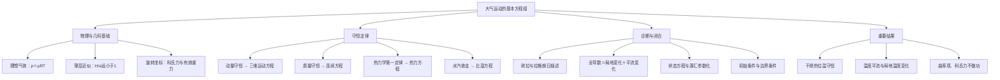

# 作业一：题目与答案讲解

## 一、名词解释

### ① 全导数与局地导数

**答案讲解**

全导数描述跟随一个气块观测到的变化；局地导数描述固定空间位置的变化。设 $T=T(x,y,z,t)$，气块轨迹为 $x(t),y(t),z(t)$，由链式法则：
$$\frac{DT}{Dt}=\frac{\partial T}{\partial t}+\frac{dx}{dt}T_x+\frac{dy}{dt}T_y+\frac{dz}{dt}T_z=\frac{\partial T}{\partial t}+uT_x+vT_y+wT_z.$$
因此，全导数等于局地变化与随气块运动所经历的平流变化之和。

### ② 拉格朗日观点与欧拉观点

**答案讲解**

拉格朗日观点是研究某一个质点的运动轨迹，其状态函数是与流体质点的起始位置和时间有关的函数
欧拉观点是研究某一个位置，其状态函数与流体的位置和时间有关

### ③ 冷暖平流

**答案讲解**

水平温度平流项为 $A_T=-\mathbf V_h\cdot\nabla_hT$。$A_T>0$ 为暖平流，$A_T<0$ 为冷平流；它只是局地温度变化的一项贡献，可与非绝热加热、绝热升降温同时存在。

### ④ 重力

**答案讲解**

万有引力和惯性离心力的合力

### ⑤ 科氏力

**答案讲解**

科氏力是旋转参考系中的惯性力，单位质量表达式为 $\mathbf a_C=-2\boldsymbol\Omega\times\mathbf V$。它与速度垂直，所以 $\mathbf a_C\cdot\mathbf V=0$，不做功。它作用于相对旋转系运动的物体，不要求运动轨迹为直线。北半球水平运动的水平科氏加速度在速度右侧，南半球在左侧。

### ⑥ 局地直角坐标系

**答案讲解**

在研究地点建立局地标架，$x$ 向东、$y$ 向北、$z$ 沿当地铅直向上。忽略区域内地球曲率时，可将当地切平面作为水平面。若保留标架随位置的转动，则运动方程会出现曲率项。局地平面近似的依据是区域尺度足够小；极点附近应选择无经纬奇点的局地标架。

### ⑦ 薄层近似

**答案讲解**

大气的厚度相对于地球半径而言非常小，此时将
$$r=z+a \approx a$$
z=为距离地面的铅直高度
a=地球半径

### ⑧ 科氏参数或地转参数

**答案讲解**

科氏参数定义为 $f=2\Omega\sin\varphi$，单位 $\mathrm{s^{-1}}$，表示地球自转涡度在当地铅直方向上的分量。北半球 $f>0$、南半球 $f<0$、赤道 $f=0$。

在东、北、上坐标中，$\boldsymbol\Omega=\Omega(0,\cos\varphi,\sin\varphi)$。将它与 $\mathbf V=(u,v,w)$ 作叉乘，得到
$$-2\boldsymbol\Omega\times\mathbf V=(fv-\widetilde f w,-fu,\widetilde f u),\qquad\widetilde f=2\Omega\cos\varphi.$$
传统近似下，水平科氏加速度为 $(fv,-fu)$。

## 二、简答题

### ① 地球大气的基本特征有哪些？请简单举例说明各个特征对大气运动的影响。

**答案讲解**

大气具有以下主要特征。

1. **气体且可压缩。** 近似满足 $p=\rho R_dT_v$，密度通常随高度增加而减小。气块上升时膨胀冷却，下沉时压缩增温。
2. **垂直分层明显。** 温度随高度的变化使大气分为对流层、平流层、中间层等；稳定层结抑制垂直位移，不稳定层结有利于对流。
3. **厚度远小于地球半径。** $H/a\ll1$ 支持薄层近似。中纬度天气尺度的 $W\ll U$，运动近似准水平、准静力；强对流和龙卷不能直接沿用静力近似。
4. **处于旋转地球上。** 科氏力使中纬度大尺度水平运动接近地转平衡，并使运动具有南北半球差异。
5. **含水汽并受不均匀加热。** 水汽凝结释放潜热，地表及纬向加热差异形成温度梯度，驱动环流和能量转换。

静力气柱中，某高度以下质量占比为 $1-p(z)/p_s$，说明质量集中在低层。以 $p_s=1013.25$ hPa 为例，500 hPa 以下约占总质量的 $50.65\%$。标准状态附近的 $1.293\ \mathrm{kg/m^3}$ 只是一种地面密度参考值。

### ② 大气运动遵守那些定律？并由这些定律推导出哪些基本方程？

**答案讲解**

牛顿第二定律给出动量方程；质量守恒给出连续方程；热力学第一定律给出热力方程；水汽收支给出水汽方程。理想气体状态方程再联系压力、密度、温度，组成控制方程组。

在局地固定切平面中，矢量动量方程为
$$\frac{D\mathbf V}{Dt}=-\frac1\rho\nabla p-2\boldsymbol\Omega\times\mathbf V+\mathbf g+\mathbf F,$$
其中 $\mathbf g$ 是有效重力加速度矢量，$\mathbf F$ 为摩擦加速度。其余方程为
$$\frac{D\rho}{Dt}+\rho\nabla\cdot\mathbf V=0,\qquad c_p\frac{DT}{Dt}-\frac1\rho\frac{Dp}{Dt}=\dot Q,$$
$$\frac{Dq}{Dt}=S_q,\qquad p=\rho R_dT_v,\quad T_v\simeq T(1+0.608q).$$
这里 $q$ 为比湿，$S_q$ 为水汽源汇；热力式采用课程常用常比热近似，潜热等作用计入加热项。

### ③ 局地直角坐标系的适用范围如何？与球坐标系有何联系与区别，并对比说明局地直角坐标系与笛卡尔直角坐标系的联系与区别。

**答案讲解**

局地直角坐标用于地球曲率影响可忽略的局部区域，其水平面是研究地点的切平面。球坐标 $(\lambda,\varphi,r)$ 描述整个球面几何，局地东西、南北微小距离分别满足 $dx=r\cos\varphi\,d\lambda$、$dy=r\,d\varphi$。

固定切平面近似下，局地坐标可按普通笛卡尔坐标使用。球面上的东、北基矢则随位置变化，保留这种变化会产生曲率项。对光滑标量，真正坐标偏导可以交换；球面方向算子 $D_x=(r\cos\varphi)^{-1}\partial_\lambda$ 与 $D_y=r^{-1}\partial_\varphi$ 并不是一组全局笛卡尔偏导，满足 $[D_y,D_x]=(\tan\varphi/r)D_x$。适用性取决于研究区域与曲率尺度，不能单凭纬度作绝对限制。

## 三、计算推导题

### ① 推导位温公式：$\frac {\mathrm{d} ln\theta}{\mathrm{d}t}=\frac{\dot{Q}}{c_p T}$，并说明位温的性质

**答案讲解**

令 $\alpha=1/\rho$，干空气比热取常数。热力学第一定律和状态方程分别为
$$c_v\frac{DT}{Dt}+p\frac{D\alpha}{Dt}=\dot Q,\qquad p\alpha=RT.$$
对状态方程求全导数，得到
$$p\frac{D\alpha}{Dt}+\alpha\frac{Dp}{Dt}=R\frac{DT}{Dt}.$$
将第一项代回热力学方程，利用 $c_p=c_v+R$：
$$c_p\frac{DT}{Dt}-\alpha\frac{Dp}{Dt}=\dot Q.$$
两端除以 $c_pT$，再代入 $\alpha/T=R/p$：
$$\frac{D\ln T}{Dt}-\frac{R}{c_p}\frac{D\ln p}{Dt}=\frac{\dot Q}{c_pT}.$$
取固定参考气压 $p_0$，定义
$$\theta=T\left(\frac{p_0}{p}\right)^{R/c_p},$$
便有 $\ln\theta=\ln T+(R/c_p)(\ln p_0-\ln p)$，从而
$$\boxed{\frac{D\ln\theta}{Dt}=\frac{\dot Q}{c_pT}}.$$
干绝热时 $\dot Q=0$，位温随气块守恒。位温是气块干绝热移至参考气压时的温度；干空气熵满足 $ds=c_p\,d\ln\theta$。对未饱和气块，$\theta_z>0,=0,<0$ 分别对应静力稳定、中性、不稳定。非绝热时应积分为 $\ln[\theta(t)/\theta(t_0)]=\int_{t_0}^t\dot Q/(c_pT)\,dt$。

### ② 请在欧拉观点下，由质量守恒定律出发，推导连续性方程
$$\frac{\partial\rho}{\partial t}=-\nabla\cdot(\rho\mathbf V),$$
其中 $\mathbf V=u\mathbf i+v\mathbf j+w\mathbf k$ 为三维速度，并说明物理意义。

**答案讲解**

在固定位置取小长方体 $dV=dx\,dy\,dz$。穿过左侧面的流入质量率为 $\rho u\,dy\,dz$。右侧面流出质量率的一阶展开为
$$[\rho u+\partial_x(\rho u)dx]dy\,dz.$$
右侧流出减左侧流入，得到 $x$ 方向净流出率 $\partial_x(\rho u)dV$。同理，$y,z$ 方向为 $\partial_y(\rho v)dV$、$\partial_z(\rho w)dV$。

控制体固定，内部质量增加率为 $\partial_t\rho\,dV$。质量守恒要求内部增加等于净流入，即
$$\partial_t\rho\,dV=-[\partial_x(\rho u)+\partial_y(\rho v)+\partial_z(\rho w)]dV.$$
约去体积得到
$$\boxed{\partial_t\rho=-\nabla\cdot(\rho\mathbf V)}.$$
展开散度还得到 $D\rho/Dt+\rho\nabla\cdot\mathbf V=0$。固定体积内密度增加，对应质量通量辐合；密度减少，对应质量通量辐散。

### ③ 请默写出局地直角坐标系下地球大气的控制方程，并指出方程组有哪些控制变量，讨论方程的闭合性。

**答案讲解**

取局地固定切平面，忽略地球曲率，$x,y,z$ 分别向东、北、上，$f=2\Omega\sin\varphi$，$\widetilde f=2\Omega\cos\varphi$。全导数为
$$\frac D{Dt}=\partial_t+u\partial_x+v\partial_y+w\partial_z.$$
三条动量方程为
$$\begin{aligned}
Du/Dt-fv&=-p_x/\rho-\widetilde f w+F_x,\\
Dv/Dt+fu&=-p_y/\rho+F_y,\\
Dw/Dt&=-p_z/\rho-g+\widetilde f u+F_z.
\end{aligned}$$
质量守恒、热力学第一定律、水汽收支及状态方程可分别写成
$$D\rho/Dt+\rho(u_x+v_y+w_z)=0,$$
$$c_pDT/Dt-\alpha Dp/Dt=\dot Q,$$
$$Dq/Dt=S_q,\qquad p=\rho R_dT_v.$$
这里 $F_x,F_y,F_z$ 是摩擦加速度，$\dot Q$ 是单位质量加热率，$S_q$ 是比湿源汇；湿空气热力式采用课程常用近似，潜热等作用计入加热项。

控制变量为 $u,v,w,p,\rho,T,q$，共七个，对应七个标量方程。摩擦、加热、水汽源汇须已给定或通过参数化确定，并给出相容的初始与边界条件，系统才闭合。进一步忽略 $\widetilde f$ 项是传统近似；只有再忽略垂直加速度及相应小项，才得到静力方程 $p_z=-\rho g$。

### ④ 假定运动是水平的，对于均质流体，证明水平运动方程可以改写为
$$u_t-(f+\zeta)v=-P_x,\qquad v_t+(f+\zeta)u=-P_y,$$
其中 $\zeta=v_x-u_y$，$P=p/\rho+(u^2+v^2)/2$。

**答案讲解**

水平无摩擦运动方程为
$$u_t+uu_x+vu_y-fv=-p_x/\rho,\qquad v_t+uv_x+vv_y+fu=-p_y/\rho.$$
令 $K=(u^2+v^2)/2$、$\zeta=v_x-u_y$，逐项整理：
$$K_x-v\zeta=uu_x+vv_x-v(v_x-u_y)=uu_x+vu_y,$$
$$K_y+u\zeta=uu_y+vv_y+u(v_x-u_y)=uv_x+vv_y.$$
代回原方程得到
$$u_t-(f+\zeta)v=-p_x/\rho-K_x,\quad v_t+(f+\zeta)u=-p_y/\rho-K_y.$$
均质流体 $\rho$ 为常数，$p_x/\rho=(p/\rho)_x$、$p_y/\rho=(p/\rho)_y$。令 $P=p/\rho+K$ 即得所证两式。若密度随位置变化，必须另保留商求导产生的密度梯度项。

### ⑤ 在球坐标系下，曲率项为
$$\mathbf C=\left(-\frac{uv\tan\varphi}{r}+\frac{uw}{r}\right)\mathbf i+\left(\frac{u^2\tan\varphi}{r}+\frac{vw}{r}\right)\mathbf j-\frac{u^2+v^2}{r}\mathbf k.$$
证明曲率项不做功。

**答案讲解**

单位质量力的瞬时功率等于加速度与速度点乘。取 $\mathbf V=u\mathbf i+v\mathbf j+w\mathbf k$：
$$\begin{aligned}
\mathbf V\cdot\mathbf C
&=-\frac{u^2v\tan\varphi}{r}+\frac{u^2w}{r}+\frac{u^2v\tan\varphi}{r}+\frac{v^2w}{r}-\frac{w(u^2+v^2)}{r}\\
&=0.
\end{aligned}$$
两项含 $\tan\varphi$ 的项抵消，另外四项展开后也成对抵消，故曲率项不改变动能，不做功。

### ⑥ 一个人造卫星从南半球飞向北半球，通过赤道时飞行方向与赤道成60°交角，相对水平速度为 10 km/s ，试求它的科里奥利加速度。

**答案讲解**

在赤道取 $x$ 向东、$y$ 向北、$z$ 向上，地球自转角速度为 $\boldsymbol\Omega=\Omega\mathbf j$。题给水平速度大小为 $10^4\ \mathrm{m/s}$，故
$$v=10^4\sin60^\circ=8660.3\ \mathrm{m/s},\quad u=\pm10^4\cos60^\circ=\pm5000\ \mathrm{m/s},\quad w=0.$$
北向速度与自转轴平行，不产生科氏加速度。叉乘给出
$$\mathbf a_C=-2\Omega\mathbf j\times(u\mathbf i+v\mathbf j)=2\Omega u\mathbf k.$$
代入 $\Omega=7.292\times10^{-5}\ \mathrm{s^{-1}}$，得到
$$|\mathbf a_C|=2\times7.292\times10^{-5}\times5000=0.7292\ \mathrm{m/s^2}.$$
向东北飞时向上，向西北飞时向下；赤道处水平科氏加速度为零。题目未说明东西分量符号，因此不能只给一个竖直方向。

## 四、开放题

### ① 假如地球停止了自转，地球大气有哪些变化？（可通过网络查阅相关资料）

**答案讲解**

须先声明情景：若地面突然停止而大气保持原角动量，初始相对东向速度约 $\Omega a\cos\varphi$，赤道约465 m/s，向极区递减，并非全球都超音速。若讨论长期不自转的理想环流，则科氏力和自转离心力消失，原有地转平衡及旋转约束的环流需重建，主要受热力差异驱动。若仍公转且相对惯性空间不自转，太阳日约一年，不能等同于潮汐锁定或固定昼夜。停止自转本身不足以推出磁场必然消失或大气必然被剥离。

### ② 请根据自己的理解，绘制第二章《大气运动的基本方程组》的知识框图（或思维导图）。

**答案讲解**

