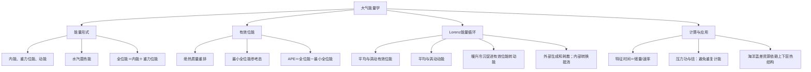

# 作业七：题目与答案讲解

## 二、名词解释

### ① 有效位能

**答案讲解**

系统的全位能与按绝热过程调整后系统所具有的最小全位能之差。

### ② 潜热能

**答案讲解**

系统中所有水汽全部凝结所释放的热量。

### ③ 内能

**答案讲解**

大气近似理想气体、定容比热近似常数时，单位质量内能 $e=c_vT$（相对于选定零点）；一般物质的内能不一定只依赖温度，也不只有分子平动动能。

### ④ 位能

**答案讲解**

因所在的位置不同而具有的能量,等于克服重力把该空气块抬升到Z高度所作的功,简称为位能。

### ⑤ 动能

**答案讲解**

大气由于运动而具有的能量。

## 三、简答题

### ① 大气能量有哪些基本形式？数量占比是多少？

**答案讲解**

基本形式为内能、重力位能、动能及水汽潜热能。单位质量分别可写 $c_vT$、$\Phi$、$V^2/2$、$L_vq$，总量为相应质量积分。

对平坦零高度下边界、上界气压趋零的静力理想气柱，重力位能为
$$\Phi^*=\int\rho gz\,dV=\int p\,dV=R_d\int T\,dm.$$
其中第一步用 $dp/dz=-\rho g$ 分部积分且边界项消失。因此全位能 $P^*=I^*+\Phi^*=c_p\int T\,dm$，有
$$I^*/P^*=c_v/c_p\simeq0.714,\qquad\Phi^*/P^*=R_d/c_p\simeq0.286.$$
潜热能及动能的比例依赖实际水汽、温度和风场：
$$H^*/P^*=\frac{L_v\langle q\rangle_m}{c_p\langle T\rangle_m},\qquad K^*/P^*=\frac{\langle V^2/2\rangle_m}{c_p\langle T\rangle_m}.$$
这些不是普适常数。例如仅为估算而取 $\langle q\rangle_m=0.0025$、$\langle T\rangle_m=250$ K，可得潜热比约 $0.025$；不能把这一示例当作任何气柱固定的能量占比。

### ② 如何理解——大气为斜压状态时，有效位能总是正值？

**答案讲解**

定义有效位能 $A=P-P_{\min}$，其中 $P_{\min}$ 是在规定约束下，经绝热质量重排所能达到的最小全位能，故必有 $A\ge0$。通常 Lorenz 框架中的斜压状态仍可通过绝热重排降低全位能，因此 $P>P_{\min}$，有效位能为正。

在稳定参考态附近、小振幅条件下，单位质量有效位能近似为
$$a\simeq\frac{g^2}{2N^2}\left(\frac{\theta'}{\bar\theta}\right)^2,\qquad N^2>0.$$
该式直观体现平方项的非负性，但不能代替任意大气状态下的严格定义。

### ③ 结合Hadley环流，试描述纬向平均动能与纬向平均有效位能的转换过程。

**答案讲解**

Hadley 环流中，低纬相对暖空气上升、较高纬相对冷空气下沉，质量重排降低可释放的全位能，使纬向平均有效位能转化为纬向平均动能。

用比容 $\alpha$ 和 $p$ 速度 $\omega$ 表示，平均有效位能向平均动能的转换率含 $-\int\bar\alpha\bar\omega\,dm$。暖升冷沉使比容与 $\omega$ 呈负相关，因而转换率为正。差异加热可持续补充有效位能，摩擦则耗散动能，两者共同维持环流能量收支。

## 四、计算推导题

### ① 利用观测资料计算得到的北半球平均大尺度环流能量循环图，计算：

A．产生纬向平均有效位能所需时间；

B．在没有其他大气能量转换的情况下，耗散尽涡动动能所需要的时间；

C．如切断大气外界能源，由于各种形式能量的散失，耗散尽北半球总能量储存所需的时间。

图中能量储量单位为 $10^5\ \mathrm{J/m^2}$，能量转换率单位为 $\mathrm{W/m^2}$，时间以天表示。

题图在原资料中使用已失效的临时图片路径。以下按现存文字记录的数值解答；箭头代表内部转换还是外部损失，尚不能由题图确认。

**答案讲解**

采用现存文字记录的储量和速率。基本关系为
$$t=\frac{\text{能量储量（J/m²）}}{\text{生成或损失率（J/(s·m²)）}},\qquad1\ \mathrm d=86400\ \mathrm s.$$

**A．纬向平均有效位能。** 储量为 $40\times10^5=4.0\times10^6\ \mathrm{J/m^2}$，生成率取 $3.1\ \mathrm{W/m^2}$：
$$t_A=\frac{4.0\times10^6}{3.1}=1.2903\times10^6\ \mathrm s=14.93\ \mathrm d.$$

**B．涡动动能。** 储量为 $7\times10^5\ \mathrm{J/m^2}$，摩擦耗散率取 $1.8\ \mathrm{W/m^2}$：
$$t_{K'}=\frac{7.0\times10^5}{1.8}=3.8889\times10^5\ \mathrm s=4.50\ \mathrm d.$$

**C．四个能量库之和。** 记录值为 $(40+15+7+8)\times10^5=7.0\times10^6\ \mathrm{J/m^2}$。若 $0.8,1.8,0.5\ \mathrm{W/m^2}$ 均为系统外部损失，且没有外部补给，则总损失率为 $3.1\ \mathrm{W/m^2}$：
$$t=\frac{7.0\times10^6}{3.1}=2.2581\times10^6\ \mathrm s=26.14\ \mathrm d.$$
若其中某项是内部能量转换，则不能计入总损失，C 的数值应重新计算。由于题图缺失，26.14 d 仅是上述条件下的答案。

三个时间均为“储量除以当前速率”的特征时间。把它解释为实际耗尽时间，还需速率恒定等假设；四个 Lorenz 能量库之和也不等于大气全部内能与重力位能。

## 五、开放题

### ① 请就”全球变暖对大气（海洋）能量和能量转换的影响”这一主题，通过谷歌学术等工具下载1篇相关的**英文**文献，翻译其摘要，并简单阐述自己的理解和认识。

**答案讲解**

选用文献：Du T, Jing Z, Wu L, et al. (2022). *Growth of ocean thermal energy conversion resources under greenhouse warming regulated by oceanic eddies*. Nature Communications. [论文链接](https://doi.org/10.1038/s41467-022-34835-z)。

**摘要译文：** 利用海表与深层海水之间较大的温差（大于 20°C）发电，即海洋温差能发电（OTEC），为未来提供了一种可再生能源方案。然而，对于 OTEC 资源如何响应未来气候变化的评估仍不充分。研究发现，在高碳排放情景下，到本世纪末，全球 OTEC 发电潜力预计比当前水平增加 46%。海表增暖带来的潜力增加会被深海增暖部分抵消；这种抵消效应在大西洋比太平洋和印度洋更明显。这主要与中尺度涡旋引起的向上热输送减弱有关，说明中尺度涡旋在调节海洋热分层和 OTEC 潜力对温室增暖的响应中发挥重要作用。

**理解：** 温差能发电依赖上下层温差，因此海表升温并不意味着潜力同比例增加，还必须考虑深层海水是否同步变暖以及涡旋如何改变热输送。46% 是特定高排放情景下的全球技术资源潜力变化，不能直接等同于实际装机或经济收益。该研究提示资源评估需要考虑三维海洋热结构；具体选址还需要区域海况、成本和环境证据。

### ② 请根据自己的理解，绘制第八章《大气能量学》的知识框图（手绘，也可用思维导图软件，如MindMaster）。

**答案讲解**

