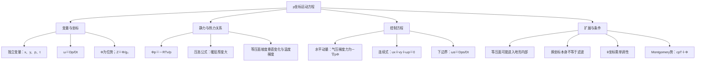

# 作业三：题目与答案讲解

## 一、名词解释

### ① p坐标系

**答案讲解**

以（x,y,p,t）作为独立变量的坐标系

### ② 重力位势

**答案讲解**

等于单位质量相对于海平面的位能，数值上等于单位质量空气由海平面上升到z高度是克服重力做的功（$J/kg$）

### ③ 位势高度

**答案讲解**

$\Phi=\int_0^z g\,dz$，单位J/kg；$Z=\Phi/g_0$，单位m，气象中常称位势米（gpm）。几何高度是距离；位势高度将重力位能折算为标准重力下的高度。

### ④ 压高公式

**答案讲解**

静力平衡与理想气体关系给出 $d\Phi=-R_dT_v\,d\ln p$。若 $p_0>p_1$，则
$$Z_1-Z_0=\frac{R_d}{g_0}\int_{p_1}^{p_0}T_v\,d\ln p=\frac{R_d\overline{T_v}}{g_0}\ln\frac{p_0}{p_1}.$$
这里 $\overline{T_v}$ 是按对数气压加权的层平均虚温。干空气可取 $T_v=T$；当 $g\simeq g_0$ 时，位势厚度可近似为几何厚度。

## 二、简答题

### ① 几何高度z和位势高度Z有什么异同?

**答案讲解**

几何高度 $z$ 是相对基准面的实际垂直距离。重力位势 $\Phi=\int_0^z g(z')dz'$ 是单位质量的重力位能，单位 $\mathrm{J/kg}$；位势高度 $Z=\Phi/g_0$ 是将该能量折算到标准重力 $g_0$ 下的高度，单位 m，常称位势米。两种高度都有长度量纲；当 $g\simeq g_0$ 时 $Z\simeq z$，重力变化显著时二者有差别。

### ② 试说明静力平衡大气中气压场与温度场之间的关系、等压面高度与温度的关系。

**答案讲解**

静力方程与理想气体状态方程联立：$dp/dz=-\rho g$、$p=\rho R_dT_v$，得到
$$d\Phi=-R_dT_v\,d\ln p.$$
因此 $p_0>p_1$ 两等压面间的位势差为
$$\Phi_1-\Phi_0=R_d\int_{p_1}^{p_0}T_v\,d\ln p=R_d\overline{T_v}\ln(p_0/p_1).$$
气层越暖，两等压面间厚度越大。若下边界等压面的位势相同，暖气柱上层等压面更高。等高面气压还依赖基准气压和整层温度分布，不能仅由某点温度判定高低。

### ③ 说明$(\partial A/\partial x)_z$与$(\partial A/\partial x)_p$的区别

**答案讲解**

$(\partial A/\partial x)_z$表示等高面上变量A随着x的变化率
$(\partial A/\partial x)_p$表示等压面上变量A随着x的变化率

### ④ 请根据压高公式，试说明静力平衡大气中气压场与温度场之间的关系、等压面高度与温度的关系。

**答案讲解**

压高公式为
$$Z_1-Z_0=\frac{R_d\overline{T_v}}{g_0}\ln\frac{p_0}{p_1},\qquad p_0>p_1.$$
固定上下等压面的气压值时，对数因子为正，因此厚度与气层平均虚温成正比。若两个气柱的下边界等压面同高，则较暖气柱的上层等压面较高。

对等温静力气柱，还可写 $p(z)=p(z_0)\exp[-g(z-z_0)/(R_dT_v)]$。在基准气压和基准高度相同的条件下，暖气柱的气压随高度下降较慢，故同一上层高度处气压较高。这些比较均需要相同基准条件。

### ⑤ 与_z_坐标系进行对比，讨论_p_坐标系的优缺点。

**答案讲解**

静力 $p$ 坐标用气压代替几何高度，优点是静力关系 $\Phi_p=-\alpha$、水平气压梯度力 $-\nabla_p\Phi$、连续方程 $u_x+v_y+\omega_p=0$ 形式简洁，且便于使用等压面天气图。

局限是地表气压 $p_s(x,y,t)$ 随地形和时间变化，使下边界复杂，部分等压面可能位于地下；使用气压作为坐标还要求气压在所研究垂直区间单调。强非静力运动不能直接套用课程中的静力 $p$ 坐标方程，但原则上可另建非静力形式。滤去某类快波来自附加动力近似，不由坐标变换本身自动实现。

### ⑥ 什么是铅直 _p_ 速度($w$)？为什么$\omega> 0$常表示有下沉运动,$\omega<0$常表示有上升运动？对于中纬度大尺度运动,$\omega$的量级有多大？

**答案讲解**

铅直 $p$ 速度定义为 $\omega=Dp/Dt$，单位 Pa/s。按链式法则并用静力关系：
$$\omega=p_t+up_x+vp_y+wp_z=p_t+up_x+vp_y-\rho gw.$$
当气压的局地变化和水平平流相对较小时，$\omega\simeq-\rho gw$。因此上升 $w>0$ 常对应 $\omega<0$，下沉常对应 $\omega>0$。这是一种近似判别，而非任意条件下的严格等价。

中纬度天气尺度取 $W\sim10^{-2}\ \mathrm{m/s}$、$\rho\sim1\ \mathrm{kg/m^3}$、$g\sim10\ \mathrm{m/s^2}$，得到 $|\omega|\sim0.1\ \mathrm{Pa/s}=10^{-3}\ \mathrm{hPa/s}$。

## 三、计算推导题

### ① 证明热力对称系统（气压系统中心与冷或暖中心重合）中等压面坡度随高度变化满足
$$\frac{\partial}{\partial z}\left(\frac{\partial z}{\partial x}\right)_p=\frac1T\left(\frac{\partial T}{\partial x}\right)_p.$$

**答案讲解**

取干空气、静力平衡且 $g$ 近似常数，由 $p_z=-\rho g$、$\rho=p/(RT)$ 得
$$z_p=-\frac1{\rho g}=-\frac{RT}{gp}.$$
在等压面上对 $x$ 求导，且交换光滑函数 $z(x,y,p,t)$ 的混合偏导：
$$\partial_p(z_x)_p=\partial_x(z_p)_p=-\frac{R}{gp}(T_x)_p.$$
固定 $x,y,t$ 时，$\partial_z=p_z\partial_p=-\rho g\partial_p$。作用于等压面坡度：
$$\partial_z(z_x)_p=(-\rho g)\left[-\frac{R}{gp}(T_x)_p\right]=\frac{\rho R}{p}(T_x)_p.$$
状态方程给出 $\rho R/p=1/T$，故
$$\boxed{\partial_z(z_x)_p=\frac1T(T_x)_p}.$$
它说明等压面坡度的垂直变化由等压面上的温度梯度控制；热力对称条件用于解释冷暖中心与气压系统的对应结构。

### ② 以位温 $\theta$ 作为铅直坐标，建立 $(x,y,\theta,t)$ 坐标系的条件是什么？证明水平气压梯度力可写为
$$-\frac1\rho(p_x)_z=-\left(\frac{\partial}{\partial x}\right)_\theta(c_pT+\Phi),\qquad-\frac1\rho(p_y)_z=-\left(\frac{\partial}{\partial y}\right)_\theta(c_pT+\Phi).$$

**答案讲解**

首先要求 $\theta$ 在选定垂直区间单调且 $\theta_z\ne0$，以保证坐标变换可逆；通常选取静力稳定层结 $\theta_z>0$。

由 $\theta=T(p_0/p)^{R_d/c_p}$，在等位温面上有
$$0=d\ln\theta=d\ln T-\frac{R_d}{c_p}d\ln p.$$
乘以 $c_pT$ 并利用 $R_dT/p=\alpha$：
$$c_p(T_x)_\theta=\alpha(p_x)_\theta.$$
坐标变换的链式法则及静力关系给出
$$ (p_x)_\theta=(p_x)_z+p_z(z_x)_\theta=(p_x)_z-\rho g(z_x)_\theta.$$
移项后乘以 $-\alpha$：
$$-\alpha(p_x)_z=-\alpha(p_x)_\theta-g(z_x)_\theta.$$
再利用 $\Phi_z=g$ 与上面的位温关系，得到
$$-\alpha(p_x)_z=-c_p(T_x)_\theta-(\Phi_x)_\theta=-\partial_{x|\theta}(c_pT+\Phi).$$
把 $x$ 换成 $y$ 完全同理。$M=c_pT+\Phi$ 称为 Montgomery 势；整个推导不要求等温大气。

## 四、开放题

### ① 请根据自己的理解，绘制第四章《p坐标系下的运动方程组》的知识框图（手绘，也可用思维导图软件，如MindMaster）。

**答案讲解**

