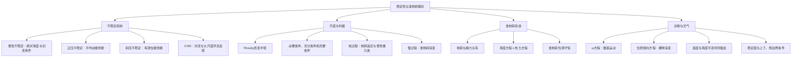

# 作业九：题目与答案讲解

## 一、名词解释

### ① 不稳定判据

**答案讲解**

不稳定判据是判断给定基本态是否允许扰动增长的条件。对时间因子 $e^{-i\omega t}$，若 $\omega=\omega_r+i\omega_i$，振幅为 $e^{\omega_i t}$，故 $\omega_i>0$ 表示指数增长。若写 $\omega=kc$ 且 $k>0$，等价于 $\operatorname{Im}c>0$。某个理论给出的判据可能是必要条件、充分条件或充要条件，须注明适用模型及条件性质。

### ② 惯性不稳定

**答案讲解**

惯性不稳定指水平位移后，旋转与基本流切变所产生的力不能使气块回到原平衡位置，反而使偏离增长。对局地直线纬向基流 $U(y)$，$\bar\zeta=-U_y$，经向位移满足
$$\ddot\eta+f(f-U_y)\eta=0.$$
若 $f(f-U_y)>0$，系数为正，产生振荡；若 $f(f-U_y)<0$，解有指数增长分支，发生惯性不稳定。$U$ 为常数时系数为 $f^2>0$，所以存在基本风本身不意味着不稳定。

### ③ 正压不稳定与斜压不稳定

**答案讲解**

在具有水平切变的基流中产生的大气长波不稳定称为正压不稳定。正压大气扰动发展的能量来自基本气流的动能。
在具有铅直切变基流中产生的大气长波不稳定称为斜压不稳定，大气长波（Rossby波）不稳定能量来源主要是有效位能。

### ④ 罗斯贝（Rossby）形变半径

**答案讲解**

单层均质浅水系统 $L_D=\sqrt{gH}/|f_0|$，典型取值约3000 km；分层内模更一般为 $L_{D,n}=c_n/|f_0|$，常用数量级 $NH/|f_0|$，具体系数取决于垂直模态及边界条件。$Ro\sim[gH/(f_0^2L^2)](\Delta_hT/\overline T)$ 需热成风尺度等假设，不能无条件写等号；赤道不适用除以f的形式。

### ⑤ 地转适应

**答案讲解**

地转适应过程:大气通过风场和气压场相互调整,削弱地转偏差,恢复 运动的准地转平衡的过程。

### ⑥ 地转演变

**答案讲解**

准地转演变是气压场、温度场和风场在保持近似地转及静力平衡的同时缓慢变化的过程，典型时间尺度为平流时间 $L/U$。它主要由涡度、温度或位涡平流及相应二级环流描述，可具有非线性；与惯性重力波主导的快速地转适应属于不同时间尺度。

### ⑦ CISK机制

**答案讲解**

第二类条件性不稳定是指天气尺度的低压扰动和小尺度积云对流间的相互促进，通过这种正反馈作用，使得天气尺度的低压扰动不稳定发展，同时积云对流也得到加强。

## 二、简答题

### ① 为什么说中纬度大气大尺度运动呈现准地转运动是其固有特征？

**答案讲解**

中纬度自由大气天气尺度 $Ro\ll1$、$1/(|f|\tau)\ll1$ 且摩擦弱时，水平气压梯度力与科氏力领先平衡，惯性项描述较慢演变。快的失衡部分可通过惯性重力波调整或辐射离开，因此慢变部分常呈准地转；不意味着任意大尺度初始扰动都立即地转。

### ② 对于正压适应过程，适应方向与初始非地转扰动的水平尺度有何关系？涉及的主要波动过程是什么？

**答案讲解**

通过比较罗斯贝变形半径当初始水平尺度大于罗斯贝半径时，表示流场的变化大于气压的变化，流场向气压场适应，相反则反。当两者近似时表示风场和气压场重新建立地转平衡。
主要波动过程为惯性重力波。

### ③ 什么是地转适应过程？什么是准地转演变过程？什么说准地转演变过程和地转适应过程具有可分性？

**答案讲解**

地转适应过程:风场与气压场不满足地转平衡关系时，通过波动能量的频散，快速调整并重新建立准地转平衡的动力过程。
准地转演变过程:准地转平衡态下的缓慢变化过程。
时间尺度不一致，初始状态不一致，平流项过程不一致，运动形式不同

### ④ 第一类和第二类准地转运动出现的条件是什么？各自有何特点？

**答案讲解**

第一类按课程尺度取 $S=L/a\lesssim Ro\ll1$，涡旋分量领先、水平散度较小、缓慢演变；第二类 $S\sim1\gg Ro$，行星尺度中可有 $\beta v\simeq-fD_h$（Sverdrup型）领先平衡，散度不能像第一类那样略去。静力稳定度和垂直速度仍需热力方程及选定尺度确定，不能单凭分类断言“高度稳定”或严格不随水平尺度变。

### ⑤ 什么是位势倾向？通过准地转位势倾向方程来研究准地转运动就有怎么样的优势？准地转位势倾向方程包含哪几项？各自对应的物理意义如何？

**答案讲解**

位势倾向为 $\chi=\partial\Phi/\partial t$，位势高度倾向为 $\chi/g_0$。设稳定度 $\sigma=\sigma(p)>0$，则
$$[\nabla_h^2+f_0^2\partial_p(\sigma^{-1}\partial_p)]\chi=-f_0\mathbf V_g\cdot\nabla_p(\zeta_g+f)-f_0^2\partial_p[\sigma^{-1}\mathbf V_g\cdot\nabla_p\Phi_p].$$
左端是位势倾向的空间微分算子；右端依次为绝对涡度平流强迫、与温度平流垂直变化有关的强迫。给定位势场、稳定度和边界条件，即可反演 $\chi$，从而诊断系统移动、加深或减弱，这是该方程的主要优势。

均匀基流上的单个线性正压 Rossby 波可只传播不增长，但非均匀基流或非线性平流也会改变振幅，不能普遍说涡度平流只影响移动。局地 $\chi$ 由完整空间强迫和边界共同决定，不能与某一个局地强迫直接画等号。

### ⑥ 在准地转环流上必叠加有二级环流，试说明这种二级环流产生的原因是什么?有何重要作用?

**答案讲解**

涡度平流与温度平流造成的变化若不能自行保持热成风关系，非地转水平辐合辐散与垂直运动就会共同调整涡度、温度，形成二级环流，使演变中的场保持近似地转和静力平衡。

其作用包括：通过水平辐合辐散改变涡柱伸展，通过上升冷却、下沉增温改变温度，并联系天气系统的云雨和能量转换。一般强迫情形需要这种环流；特殊稳态、无强迫的平衡流可有 $\omega=0$ 和零二级环流，所以“必叠加”不能作为无条件命题。

### ⑦ 分析天气图上，温度场与高度场的不同配置对高空槽脊影响很大。请问温度场与高度场在什么情况下有利于高空槽、脊加强？并说明原因。

**答案讲解**

在北半球西风背景的典型发展波中，温度槽轴在高度槽轴以西（温度场位相落后），可使高度槽附近冷平流、脊附近暖平流；若这些平流随高度减弱，热力贡献使高空槽变低加深、脊变高增强。判断发展应检查槽、脊轴附近的倾向；检查槽前后异号倾向主要解释移动。实际还需叠加涡度平流及其他强迫，不能仅由位相关系保证发展。

### ⑧ 通过对准地转ω方程的分析，请说明有哪些运动或流场配置会导致上升运动的出现？

**答案讲解**

在北半球稳定层结、通常齐次边界的理想诊断下，正绝对涡度平流随高度增强，以及水平上有局地极大值的暖平流，都是常见上升强迫；等价地，Q矢量辐合有利于 $\omega<0$。扩展方程还可含凝结加热、地形抬升和边界层抽吸。低压中心本身不保证上升，暖平流也需看空间分布及其他强迫，最终由椭圆方程和边界条件共同确定。

## 三、计算推导题

### ① 根据斜压准地转方程组
$$\frac{\partial\zeta_g}{\partial t}+\mathbf V_g\cdot\nabla_p(\zeta_g+f)=f_0\frac{\partial\omega}{\partial p},\tag{1}$$
$$\frac{\partial}{\partial t}\left(\frac{\partial\Phi}{\partial p}\right)+\mathbf V_g\cdot\nabla_p\left(\frac{\partial\Phi}{\partial p}\right)+\bar\sigma_s\omega=0,\tag{2}$$
（1）推导准地转位涡守恒方程；

（2）推导准地转 $\omega$ 方程，解释各项物理含义；

（3）推导准地转位势倾向方程，解释各项物理含义。

**答案讲解**

设 $\sigma=\bar\sigma_s=\sigma(p)>0$，采用无摩擦、绝热准地转近似。记
$$\chi=\Phi_t,\quad A=\mathbf V_g\cdot\nabla_p(\zeta_g+f),\quad B=\mathbf V_g\cdot\nabla_p\Phi_p,$$
并用 $\mathbf V_g=\mathbf k\times\nabla_p\Phi/f_0$、$\zeta_g=\nabla_h^2\Phi/f_0$。题给两式分别变为
$$\nabla_h^2\chi=-f_0A+f_0^2\omega_p,\tag{3}$$
$$\chi_p=-B-\sigma\omega.\tag{4}$$

**（1）准地转位涡守恒。** 用式（4）解出 $\omega=-\sigma^{-1}(\chi_p+B)$，代入涡度方程得到
$$\zeta_{g,t}+A+f_0\partial_p[\sigma^{-1}(\chi_p+B)]=0.$$
时间部分可合并为 $\partial_t[\zeta_g+f_0\partial_p(\sigma^{-1}\Phi_p)]$。整理平流部分前，需要验证
$$\partial_p\mathbf V_g=\frac1{f_0}\mathbf k\times\nabla_p\Phi_p,\qquad(\partial_p\mathbf V_g)\cdot\nabla_p\Phi_p=0.$$
后一个点积为零，因为一个向量与其旋转 $90^\circ$ 的向量正交。又因 $\sigma$ 仅随 $p$ 变，故
$$\partial_p[\sigma^{-1}\mathbf V_g\cdot\nabla_p\Phi_p]=\mathbf V_g\cdot\nabla_p[\partial_p(\sigma^{-1}\Phi_p)].$$
定义
$$q_g=\zeta_g+f+f_0\partial_p(\sigma^{-1}\Phi_p),$$
便得到 $\boxed{\partial_tq_g+\mathbf V_g\cdot\nabla_pq_g=0}$。这是准地转位涡定义，不能与原始 Ertel 位涡数值表达式混同。

**（2）$\omega$ 方程。** 对式（3）取 $p$ 导数：
$$\nabla_h^2\chi_p=-f_0A_p+f_0^2\omega_{pp}.$$
对式（4）取水平拉普拉斯，因 $\sigma$ 水平无变化：
$$\nabla_h^2\chi_p=-\nabla_h^2B-\sigma\nabla_h^2\omega.$$
令右端相等并移项，得到
$$\boxed{\sigma\nabla_h^2\omega+f_0^2\omega_{pp}=f_0A_p-\nabla_h^2B}.$$
右端第一项是绝对涡度平流的垂直变化强迫。由静力式 $\Phi_p=-R_dT/p$，第二项可写成 $\nabla_h^2[(R_d/p)\mathbf V_g\cdot\nabla_pT]$，与温度平流的水平分布有关。左端体现稳定度、旋转约束及垂直运动空间结构。给出上下和侧边界后才能求解 $\omega$；$\omega<0$ 通常代表上升。

**（3）位势倾向方程。** 将式（4）乘以 $f_0^2/\sigma$ 后取 $p$ 导数：
$$f_0^2\partial_p(\sigma^{-1}\chi_p)=-f_0^2\partial_p(\sigma^{-1}B)-f_0^2\omega_p.$$
与式（3）相加消去 $\omega_p$，得到
$$\boxed{[\nabla_h^2+f_0^2\partial_p(\sigma^{-1}\partial_p)]\chi=-f_0A-f_0^2\partial_p(\sigma^{-1}B)}.$$
常 $\sigma$ 时，左端简化为 $(\nabla_h^2+f_0^2\sigma^{-1}\partial_{pp})\chi$。右端分别表示绝对涡度平流及温度平流垂直变化的贡献；$\chi>0$ 表示等压面位势升高，$\chi<0$ 表示降低。局地倾向由整个椭圆方程及边界反演决定。

稳定度与高度坐标中的量可联系为
$$\sigma=-\bar\alpha\,\partial_p\ln\bar\theta=\frac{\gamma_d-\gamma}{\rho^2gT}=\frac{N^2}{\rho^2g^2}.$$
这里使用静力关系 $\partial_p=-(\rho g)^{-1}\partial_z$；稳定层结使 $\sigma>0$，有助于保证诊断算子的椭圆性质。

## 四、开放题

### ① 请根据自己的理解，绘制第十章《大气运动的稳定性理论》第十一章《中纬度大尺度运动的准地转理论》的知识框图（可手绘，也可用思维导图软件，如MindMaster）。

**答案讲解**

