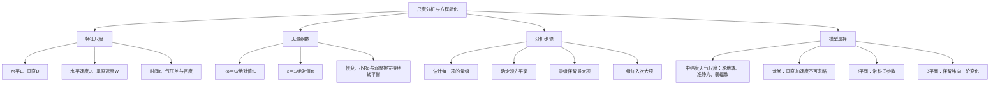

# 作业二：题目与答案讲解

## 一、名词解释

### ① 罗斯贝数

**答案讲解**

罗斯贝数 $Ro=U/(|f_0|L)$ 是平流加速度尺度 $U^2/L$ 与科氏加速度尺度 $|f_0|U$ 的比值，衡量惯性平流相对于旋转效应的重要性。$Ro\ll1$ 只说明平流加速度小；还需局地变化缓慢、摩擦较弱等条件，才能建立领先阶地转平衡。

### ② 基别尔数

**答案讲解**

基别尔数 $\varepsilon=1/(|f_0|\tau)$ 是局地加速度尺度 $U/\tau$ 与科氏加速度尺度 $|f_0|U$ 的比值。$\tau$ 为运动变化的独立时间尺度；只有另取 $\tau=L/U$，才有 $\varepsilon=Ro$。慢变准地转运动通常要求两者均远小于 1。

### ③ $f$平面近似

**答案讲解**

在中纬度地区，运动的水平尺度远小于地球半径时，取$f \approx f_0$
将$f$视为常数

### ④ $\beta$平面近似

**答案讲解**

$$
f\simeq f_0+\beta_0y,\qquad \beta_0=2\Omega\cos\varphi_0/a.
$$

 在参考纬度附近保留一阶变化，适用于所研究区域内高阶项较小的情况；中纬度Rossby波广泛采用此近似。赤道β平面是 $f_0=0$ 的特例。

### ⑤ 地转平衡

**答案讲解**

地转平衡是水平气压梯度力与科氏力的平衡。在东、北、上坐标中：
$$-\frac{p_x}{\rho}+fv_g=0,\qquad-\frac{p_y}{\rho}-fu_g=0.$$
所以 $u_g=-p_y/(\rho f)$，$v_g=p_x/(\rho f)$。北半球背风而立，低压在左；南半球相反。此诊断关系不意味着实际流场必须不随时间变化。

### ⑥ 静力平衡

**答案讲解**

静力平衡指垂直气压梯度力与重力平衡。取 $z$ 向上、$g>0$，有
$$-\frac1\rho\frac{\partial p}{\partial z}-g=0,\qquad \frac{\partial p}{\partial z}=-\rho g.$$
因此气压随高度增加而减小。静力近似要求垂直加速度相对于两项主要力足够小，并不要求垂直速度严格为零。

## 二、简答题

### ① 什么是运动的尺度？什么是尺度分析方法？

**答案讲解**

尺度：某一类特征运动系统中各个物理量具有代表意义的量值称为该物理量的特征值（尺度）
空间尺度：
1.水平尺度L
2.垂直尺度H，D
时间尺度T
特征速度U
尺度分析方法：
在某种尺度的运动中依据各物理量实际尺度的 大小(即特征值),估计其运动方程中对应各项的大小, 保留贡献较大项,略去贡献较小项,从而使方程得到简化 的一种方法。
目的:简化方程,突出主要特征,便于数学处理。 
方法:通过对方程中变量与各项尺度的合理估计与分析, 略去次要项,保留主要项,从而正确区分影响运动 过程的主要因素和次要因素。

### ② 根据尺度分析的结果，说明中纬度大尺度运动有哪些基本特征。

**答案讲解**

取 $L\sim10^6\ \mathrm m,D\sim10^4\ \mathrm m,U\sim10\ \mathrm{m/s},W\sim10^{-2}\ \mathrm{m/s},\tau\sim10^5\ \mathrm s$，$f_0\sim10^{-4}\ \mathrm{s^{-1}},\rho\sim1\ \mathrm{kg/m^3}$。

水平局地、水平平流、垂直平流分别为 $U/\tau\sim10^{-4}$、$U^2/L\sim10^{-4}$、$UW/D\sim10^{-5}\ \mathrm{m/s^2}$；科氏项 $f_0U\sim10^{-3}$，水平压差 $10^3$ Pa 对应气压梯度项 $\Delta_hP/(\rho L)\sim10^{-3}\ \mathrm{m/s^2}$。最大两项平衡给出准地转性。

垂直局地、水平平流、垂直平流分别为 $W/\tau\sim10^{-7}$、$UW/L\sim10^{-7}$、$W^2/D\sim10^{-8}\ \mathrm{m/s^2}$，远小于 $g\sim10$ 及 $\Delta_zP/(\rho D)\sim10\ \mathrm{m/s^2}$，所以准静力。

$W/U\sim10^{-3}$，表明运动准水平。连续方程给出的实际水平散度约 $W/D\sim10^{-6}\ \mathrm{s^{-1}}$，小于单独水平速度梯度的 $U/L\sim10^{-5}\ \mathrm{s^{-1}}$，表明弱辐散。分子粘性系数 $\kappa\sim10^{-5}\ \mathrm{m^2/s}$ 对应水平、垂直粘性加速度约 $10^{-12}$、$10^{-15}\ \mathrm{m/s^2}$；自由大气中很小，但不能据此忽略边界层湍流摩擦。

### ③ 何谓零级近似？何谓一级近似？中高纬度地区，自由大气的大尺度水平运动方程的零级近似和一级近似的结果得到了什么结论？（力的特征是什么？）

**答案讲解**

零级近似保留尺度分析中的最大项；一级近似在此基础上保留小一级的项，用于描述领先平衡上的缓慢变化。

按本题水平最大项 $10^{-3}\ \mathrm{m/s^2}$，零级为地转平衡：
$$-fv=-p_x/\rho,\qquad fu=-p_y/\rho.$$
再保留 $10^{-4}\ \mathrm{m/s^2}$ 的局地和水平平流加速度，得到一级方程：
$$u_t+uu_x+vu_y-fv=-p_x/\rho,$$
$$v_t+uv_x+vv_y+fu=-p_y/\rho.$$
本组尺度中 $wu_z,wv_z\sim10^{-5}$，故不在该截断中保留。零级突出科氏力与气压梯度力的平衡；一级允许惯性加速度造成地转偏差和系统演变。

## 三、计算推导题

### ① 估计典型龙卷风运动的运动方程各项量级。取
$$L=10^2\ \mathrm m,\quad D=10^3\ \mathrm m,\quad U=10^2\ \mathrm{m/s},\quad W=10\ \mathrm{m/s},\quad\tau=10\ \mathrm s,\quad\Delta_zP=10^4\ \mathrm{Pa}.$$
说明此时静力平衡能否成立。

**答案讲解**

取空气密度尺度 $\rho\sim1\ \mathrm{kg/m^3}$。各加速度单位均为 $\mathrm{m/s^2}$。

| 项 | 水平方向尺度 | 垂直方向尺度 |
|---|---:|---:|
| 局地加速度 | $U/\tau=10$ | $W/\tau=1$ |
| 每一项水平平流 | $U^2/L=100$ | $UW/L=10$ |
| 垂直平流 | $WU/D=1$ | $W^2/D=0.1$ |
| 气压梯度 | $\Delta_hP/(\rho L)$，水平压差未给定 | $\Delta_zP/(\rho D)=10$ |
| 重力 | 0 | $g\sim10$ |

若用典型中纬度 $f\sim10^{-4}\ \mathrm{s^{-1}}$ 补充估算，水平科氏加速度为 $fU\sim10^{-2}$；非传统科氏分量尺度至多分别约 $10^{-3}$（水平）和 $10^{-2}$（垂直）。题目未给纬度、湍流系数，不能唯一给出这些项的精确数值或湍流粘性量级。

垂直方程为 $Dw/Dt=-p_z/\rho-g$ 加上科氏、摩擦等项。垂直速度的水平平流尺度达到 $10$，与重力和垂直气压梯度力同量级，因此不能略去垂直加速度，**静力近似不成立**。注意 $L/U=1$ s 与题给 $\tau=10$ s 不同，局地项应使用题给 $\tau$。

### ② 如果一个棒球运动员在纬度30°的地方，在4s内投球水平距离为100m，那么由于地球自转，球横向偏转了多少？

**答案讲解**

忽略空气阻力等对水平速度的变化，取 $V=100/4=25\ \mathrm{m/s}$。纬度绝对值 $30^\circ$ 时
$$|f|=2\Omega\sin30^\circ=7.292\times10^{-5}\ \mathrm{s^{-1}}.$$
因 $|f|t\ll1$，可把横向科氏加速度近似视为常量：
$$a_\perp=|f|V=1.823\times10^{-3}\ \mathrm{m/s^2}.$$
初始横向速度为零，故
$$d=\frac12a_\perp t^2=\frac12(1.823\times10^{-3})\times4^2=0.014584\ \mathrm m\simeq1.46\ \mathrm{cm}.$$
北半球向运动方向右侧偏，南半球向左侧偏。

## 四、开放题

### ① 请根据自己的理解，绘制第三章《大气运动方程组的简化》的知识框图（手绘，也可用思维导图软件，如MindMaster）。

**答案讲解**

