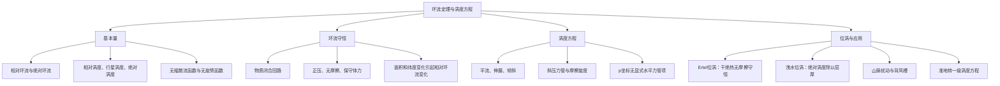

# 作业五：题目与答案讲解

## 一、名词解释

### ① 绝对环流，相对环流

**答案讲解**

沿闭合曲线的速度切向积分称为环流。相对环流 $C_r=\oint\mathbf V\cdot d\mathbf l$；绝对环流 $C_a=\oint\mathbf V_a\cdot d\mathbf l$，其中 $\mathbf V_a=\mathbf V+\boldsymbol\Omega\times\mathbf r$。由 Stokes 定理，局地水平回路近似有 $C_a=C_r+fA$，$A$ 为按向上法向确定的面积。

### ② 开尔文环流定理

**答案讲解**

开尔文环流定理：在无摩擦、正压、保守体力条件下，沿随流体运动的闭合物质曲线，绝对环流守恒，即 $DC_a/Dt=0$。一般无摩擦情形有 $DC_a/Dt=-\oint\alpha\,dp$；正压时 $\alpha$ 只是 $p$ 的函数，闭路积分为零，便得到守恒结论。

### ③ 绝对涡度，相对涡度，行星涡度

**答案讲解**

绝对速度等于相对速度加上牵连速度
$$\vec{V_{a}}=\vec{V_{3}}+\vec{\Omega}\times  \vec{r}$$
绝对涡度
$$\vec{\omega_{a}}=\nabla_{3} \times \vec{V_{a}}$$
相对涡度
$$\vec{\omega}=\nabla_{3}\times \vec{V_{3}}$$
行星涡度
$$\nabla_{3}\times (\vec{\Omega}\times  \vec{r})$$
根据矢量运算关系
$$\nabla \times (\vec{A} \times\vec{B})=(\vec{B}·\nabla )\vec{A}+\vec{A}(\nabla ·\vec{B})-(\vec{A}·\nabla )\vec{B}-\vec{B}(\nabla ·\vec{A})$$
$$\nabla_{3}\times (\vec{\Omega}\times  \vec{r})=0+3\Omega-\Omega-0=2\Omega$$

### ④ 流函数，势函数

**答案讲解**

二维水平无辐散流在适当区域可写 $u=-\psi_y,v=\psi_x$，因而 $\zeta=\nabla_h^2\psi$；无旋流在单连通区域可写 $u=\chi_x,v=\chi_y$，$D=\nabla_h^2\chi$。一般流场可作旋转分量与辐散分量的分解。

### ⑤ 位势涡度

**答案讲解**

$$
q_E=\rho^{-1}(\nabla\times\mathbf V+2\boldsymbol\Omega)\cdot\nabla\theta.
$$

 干绝热、无摩擦且满足相应热力条件时 $Dq_E/Dt=0$，不要求大气均质。均质浅水单层模型另有 $q_{SW}=(\zeta+f)/h$，无摩擦、无质量源汇时守恒；两者单位和物理定义不同。

### ⑥ Taylor-Proudman定理

**答案讲解**

均质，不可压，无摩擦的流体中，缓慢定常的运动在旋转轴的方向上不变，即运动是二维的

## 二、简答题

### ① 对于正压大气来说，大气环流的面积变化及南北移动会对其相对环流大小有何影响？并以此解释北抬脊和南伸槽的变化。

**答案讲解**

北半球局地水平物质回路的绝对环流为 $C_a=C_r+fA$，其中 $A$ 为回路面积，采用向上法向。正压、无摩擦及保守体力条件下，$DC_a/Dt=0$，所以
$$\frac{DC_r}{Dt}=-f\frac{DA}{Dt}-A\frac{Df}{Dt}=-f\frac{DA}{Dt}-A\beta v_c.$$
面积不变时，北移使 $f$ 增大，相对环流减小，产生反气旋倾向，对应北抬的脊；南移使相对环流增大，产生气旋倾向，对应南伸的槽。面积增大还会独立产生负环流倾向，面积减小产生正倾向；面积和纬度同时变化时，须按两项合成判断。

### ② 在z坐标系下，影响垂直涡度的因素有哪些？对应着怎样的物理意义？

**答案讲解**

在局地直角坐标、传统科氏近似下，垂直相对涡度 $\zeta=v_x-u_y$ 满足
$$\frac{D\zeta}{Dt}=-\beta v-(\zeta+f)(u_x+v_y)+w_yu_z-w_xv_z+\frac{\rho_xp_y-\rho_yp_x}{\rho^2}+\partial_xF_y-\partial_yF_x.$$
其中 $D/Dt=\partial_t+u\partial_x+v\partial_y+w\partial_z$。

- 左端：沿气块的相对涡度变化，包含局地变化和三维平流。
- $-\beta v$：南北运动改变行星涡度，相对涡度作相应调整。
- $-(\zeta+f)(u_x+v_y)$：伸展项；正绝对涡度的气柱受水平辐合而增强，辐散而减弱。
- $w_yu_z-w_xv_z$：倾斜项，把水平涡度转化为垂直涡度。
- 密度、压力梯度叉乘项：力管项，反映斜压性产生的涡度源。
- 摩擦加速度旋度：可在局部生成或减小涡度，符号不必总是耗散。

### ③ 请描述山谷风形成的物理过程。

**答案讲解**

白天坡面受热，贴坡空气相对同高度谷中空气较暖，形成沿坡上升的谷风，并在较高处形成回流；夜间坡面辐射冷却，较冷较密空气沿坡下滑形成山风。热力差异产生斜压性和环流，闭合环流的压力梯度方向随高度不同。

### ④ 位涡守恒的条件是什么？如何用位涡守恒解释北美大陆落基山脉东侧槽的生成？（请绘制示意图讲述）

**答案讲解**

Ertel 位涡 $q_E=\rho^{-1}\boldsymbol\zeta_a\cdot\nabla\theta$ 在干绝热、无摩擦及相应热力条件下守恒。解释越山气柱时，采用理想均质浅水层的位涡 $q=(\zeta+f)/h$，要求无摩擦、无质量源汇。

设西风气柱上界近似固定。迎风爬坡时层厚 $h$ 减小，位涡守恒使绝对涡度减小，出现反气旋倾向并向南偏；越过山顶后层厚恢复，气柱伸长。若此时已偏南，$f$ 比原来小，则 $\zeta=q_0h-f>0$，形成气旋性背风槽，并可激发下游 Rossby 波列。

该图表示压缩、偏转、伸展的顺序。若严格采用 $f$ 平面，且层厚完全恢复、初始相对涡度为零，则最终相对涡度也恢复零，不能只靠层厚恢复解释持续背风槽。

## 三、计算推导题

### ① 已知无摩擦 $p$ 坐标水平运动方程
$$\begin{cases}u_t+uu_x+vu_y+\omega u_p=-\Phi_x+fv,\\v_t+uv_x+vv_y+\omega v_p=-\Phi_y-fu.\end{cases}$$

a. 推导涡度方程，并说明各项的物理意义。

b. 方程中不含力管项，斜压性对涡度变化的作用表现在哪些项中？

c. 针对中纬度大尺度运动，进行尺度分析，写出一级近似后的简化结果。

d. 证明正压水平无辐散条件下绝对涡度守恒。

**答案讲解**

**a．交叉求导。** 记 $\zeta=v_x-u_y$、$D_h=u_x+v_y$。对 $v$ 方程取 $\partial_x$，对 $u$ 方程取 $\partial_y$，前者减后者。位势交叉导数抵消。局地项成为 $\zeta_t$；水平平流展开为
$$\begin{aligned}
\partial_x(uv_x+vv_y)-\partial_y(uu_x+vu_y)
&=u\zeta_x+v\zeta_y+(u_x+v_y)(v_x-u_y)\\
&=u\zeta_x+v\zeta_y+D_h\zeta.
\end{aligned}$$
垂直输送项为
$$\partial_x(\omega v_p)-\partial_y(\omega u_p)=\omega\zeta_p+\omega_xv_p-\omega_yu_p.$$
科氏项为 $-\partial_x(fu)-\partial_y(fv)=-fD_h-\beta v$，这里 $f=f(y)$。合并得到
$$\frac{D\zeta}{Dt}=-(\zeta+f)D_h-\beta v+\omega_yu_p-\omega_xv_p.$$
再用连续式 $D_h=-\omega_p$，得到
$$\boxed{\frac{D\zeta}{Dt}+\beta v=(\zeta+f)\omega_p+\omega_yu_p-\omega_xv_p}.$$
其中全导数为 $\partial_t+u\partial_x+v\partial_y+\omega\partial_p$。左端包含局地变化、水平与垂直输送及行星涡度变化；右端第一项为伸展项，后两项为倾斜项。

**b．斜压性的体现。** 等压面上的气压梯度力写成 $-\nabla_p\Phi$，其水平旋度为零，因此没有单独的力管项。斜压性与垂直风切变、温度梯度及垂直运动相联系，其作用可通过伸展项和倾斜项体现；没有显式力管项不意味着斜压性不起作用。

**c．尺度分析。** 取 $U=10\ \mathrm{m/s},L=10^6\ \mathrm m,\tau=10^5\ \mathrm s,P=10^5\ \mathrm{Pa}$、$f_0=10^{-4}\ \mathrm{s^{-1}},\beta\sim10^{-11}\ \mathrm{m^{-1}s^{-1}}$。由 $W\sim10^{-2}\ \mathrm{m/s}$ 估计 $\Omega_p\equiv|\omega|\sim\rho gW\sim0.1\ \mathrm{Pa/s}$，则 $Z_\zeta=U/L=10^{-5}\ \mathrm{s^{-1}}$。

| 项 | 尺度表达式 | 量级 $\mathrm{s^{-2}}$ |
|---|---|---:|
| 局地变化 | $Z_\zeta/\tau$ | $10^{-10}$ |
| 水平平流 | $UZ_\zeta/L$ | $10^{-10}$ |
| 垂直平流 | $\Omega_pZ_\zeta/P$ | $10^{-11}$ |
| 行星涡度平流 | $\beta U$ | $10^{-10}$ |
| 行星涡度伸展 | $f_0\Omega_p/P$ | $10^{-10}$ |
| 相对涡度伸展 | $Z_\zeta\Omega_p/P$ | $10^{-11}$ |
| 每一倾斜项 | $(\Omega_p/L)(U/P)$ | $10^{-11}$ |

保留领先非零阶并使用地转风，得到课程准地转一级涡度方程
$$\boxed{\partial_t\zeta_g+\mathbf V_g\cdot\nabla_p(\zeta_g+f)=f_0\omega_p}.$$

**d．绝对涡度守恒。** 对无摩擦、水平无辐散、无垂直切变的二维正压模型，伸展、倾斜和垂直输送项消失，因此
$$\partial_t\zeta+u\zeta_x+v\zeta_y=-\beta v.$$
又因 $D_hf/Dt=\beta v$，两式相加得到
$$\boxed{D_h(\zeta+f)/Dt=0}.$$
一般斜压准地转运动仍保留 $f_0\omega_p$，不能据水平准地转平衡直接断言绝对涡度守恒。

### ② 请由p坐标系下的运动方程推导得到正压涡度方程和满足地转风平衡关系的方程，并说明大气的大尺度运动具有什么样的特点？

**答案讲解**

从 $Du/Dt=-\Phi_x+fv$、$Dv/Dt=-\Phi_y-fu$ 出发，对后一式求 $x$ 导数、前一式求 $y$ 导数并相减，得到
$$\frac{D\zeta}{Dt}+\beta v=-(\zeta+f)(u_x+v_y)+\omega_yu_p-\omega_xv_p.$$
在无摩擦、无垂直切变的二维正压无辐散模型中，$u_x+v_y=0$、$u_p=v_p=\zeta_p=0$，于是
$$\zeta_t+u\zeta_x+v\zeta_y+\beta v=0.$$
慢变、小 $Ro$ 的零级水平动量平衡给出
$$u_g=-\Phi_y/f_0,\qquad v_g=\Phi_x/f_0.$$
定义 $\psi=\Phi/f_0$，则 $u_g=-\psi_y,v_g=\psi_x,\zeta_g=\nabla_h^2\psi$。代回正压涡度式：
$$\boxed{\partial_t\nabla_h^2\psi+J(\psi,\nabla_h^2\psi+f)=0},$$
其中 $J(A,B)=A_xB_y-A_yB_x$。中纬度自由大气天气尺度通常准地转、准水平、准静力并弱辐散；严格无辐散正压是进一步的理想化，斜压准地转情形需保留涡柱伸展项。

## 四、开放题

### ① 请根据自己的理解，绘制第六章《环流定理与涡度方程》的知识框图（手绘，也可用思维导图软件，如MindMaster）。

**答案讲解**

