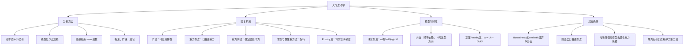

# 作业八：题目与答案讲解

## 二、名词解释

### ① 群波、波包迹

**答案讲解**

波群（波包）由波数、频率相近的简谐波叠加形成。叠加后快速振荡的波形外面具有缓慢变化的振幅包络；包络描述波群在空间中的强弱分布。

### ② 相速度、群速度

**答案讲解**

相速度描述等位相面移动。一维简谐波 $\cos(kx-\omega t)$ 满足 $kx-\omega t=\mathrm{const}$，故 $c_p=\omega/k$。群速度描述窄谱波包的传播，一维为 $c_g=d\omega/dk$，多维为 $\mathbf c_g=\nabla_{\mathbf k}\omega$。适当线性、无耗散条件下群速度对应能量传播速度；不能用任意同振幅点的移动定义群速度。

### ③ 上游效应

**答案讲解**

按本课程“上游效应”的用法，上游扰动可通过能量频散影响下游：当群速度大于相应位相速度时，波包的能量传播会领先于单个槽脊，导致下游出现新的发展。判断时应比较群速度与相速度，而不只追踪某一槽线位置。

### ④ 标准波形法

**答案讲解**

标准波形法（正规模法）把线性扰动设为 $s'=\hat s(z)e^{i(kx+ly-\omega t)}$ 等形式，代入线性方程后将水平、时间微分转为 $ik,il,-i\omega$，结合边界条件求频散关系或特征值。只有基本态和边界具有相应均匀性时，才能直接使用对应方向的 Fourier 模态；不同波数的频率、相速和增长率一般不同。

### ⑤ 惯性重力外波、惯性重力内波

**答案讲解**

外波的回复机制与自由表面重力及旋转有关，内波与内部稳定层结浮力及旋转有关。旋转浅水外波 $\hat\omega^2=f^2+gHK_h^2$；长波极限下f可主导。内波的低频端也由惯性频率约束。$\hat\omega$ 为随均匀基流的内禀频率。

### ⑥ 静力稳定度

**答案讲解**

静力稳定度 $$ N^2 = - \frac{g}{T} (\bar{\gamma} - \gamma_d)$$且  
$$ w = \frac{d \delta z}{dt} \Rightarrow \frac{d^2 \delta z}{dt^2} = -N^2 \delta z $$  
若稳定层结$$ \bar{\gamma} < \gamma_d \Rightarrow N^2 > 0 $$

### ⑦ 包辛内斯克近似（Boussinesq approximation）

**答案讲解**

滞弹性（anelastic）连续式是 $\nabla\cdot(\overline\rho\mathbf V)=0$，即 $\overline\rho(u_x+v_y+w_z)+w\overline\rho_z=0$。它是忽略连续式中密度扰动时间导数，不是把所有方程中的 $\partial_t\rho'$ 都强制设零。浅层Boussinesq近似再取非浮力项密度为常数，得 $\nabla\cdot\mathbf V=0$，浮力仍为 $b\simeq g\theta'/\overline\theta=-g\rho'/\rho_0$。它滤除声学可压缩分支，保留浮力内波；不可笼统说真实的高频重力内波就是声波。

### ⑧ β效应

**答案讲解**

在无摩擦、水平无辐散的正压模型中，$D(\zeta+f)/Dt=0$，所以 $D\zeta/Dt=-\beta v$：北移使 $f$ 增大、相对涡度减小，南移相反；由此构成经典行星Rossby波的回复及传播机制。更一般Rossby波由背景位涡梯度支持，也可存在地形β效应。

### ⑨ 气象“噪音”

**答案讲解**

在求解数值预报原始方程组时遇到的一些不希望有的小尺度振荡，这些小尺度振荡能混淆所希望得到的大气环流的天气尺度特征。

### ⑩ 大气滤波

**答案讲解**

根据波动形成的物理机制而采用一定的假设条件，以消除气象意义不大的波动(噪音)而保留有气象意义的波动的方法。

## 三、简答题

### ① 微扰动的基本思想是什么？为什么说用微扰动法得到的扰动方程，只能用于描写小振幅波动？

**答案讲解**

先将各变量分成基本态和扰动：$s=\bar s+s'$。基本态满足自身方程，将分解代入完整方程后减去基本态方程，再略去扰动乘积等高阶项，便得到线性扰动方程。

例如 $uu_x=(U+u')\partial_x(U+u')$，若 $U$ 为均匀基本流，则展开为 $Uu'_x+u'u'_x$，线性化仅保留第一项。热力变量通常要求 $|p'|\ll\bar p,|\rho'|\ll\bar\rho,|T'|\ll\bar T$；基本风可为零，因此不能一律要求 $|u'|\ll|U|$，而应比较非线性项与保留的线性项。扰动增长到非线性项不可忽略时，线性方程即失效，所以只适用于相应意义的小振幅阶段。

### ② 什么叫频散波？什么叫非频散波？为什么说频散波中能量是相对波移动的？

**答案讲解**

一维波的相速度为 $c_p=\omega/k$。若它随波数变化，不同波长以不同相速度传播，称为频散波；若在所研究分支上相速度不依赖波数，则称为非频散波。

因为 $\omega=kc_p(k)$，求导得
$$c_g=\frac{d\omega}{dk}=c_p+k\frac{dc_p}{dk}.$$
当 $dc_p/dk\ne0$ 时，$c_g\ne c_p$，波包及其能量相对单个位相移动。非频散分支上 $dc_p/dk=0$，所以 $c_g=c_p$。这些关系针对一维传播及适用的线性无耗散波包；多维情形需区分群速度矢量与波法向相速度。

### ③ 大气声波、重力外波、重力内波、惯性波产生的物理机制是什么？主要物理特征是什么？滤去相应波动的方式有哪些？

**答案讲解**

均匀介质声波由压缩弹性回复，$c_s=\sqrt{\gamma R_dT}$；无旋转浅水重力外波在 $KH\ll1$ 时 $\hat\omega^2=gHK^2$、非频散，速度随H变，有限水深时一般频散。稳定层结内波由浮力回复，三维均匀Boussinesq模型中其内禀相速与群速正交。均匀惯性振荡周期 $2\pi/|f|$，17小时仅约对应45°纬度。可靠滤波对应为：anelastic/Boussinesq去声学分支；刚盖去自由表面外波；$N^2=0$去纯浮力内波回复；$f=0$去旋转分支；准地转慢流模型去惯性重力快模。静力近似仍保留静力重力波，且不能独自排除水平声学模式。

### ④ 重力波与重力惯性波物理特征有何异同点？

**答案讲解**

在无剪切均匀Boussinesq层结、传统旋转近似下，令 $K_h^2=k^2+l^2$：

$$
\hat\omega^2=\frac{N^2K_h^2+f^2m^2}{K_h^2+m^2}.
$$

 纯内重力波f=0时 $0\le|\hat\omega|\le N$；惯性重力内波在 $N>|f|$ 时 $|f|\le|\hat\omega|\le N$。f、N及波数方向共同决定频率，不是各由一个参数单独决定。波能传播方向依波矢而定，不能统一称“准水平”；质点振动也不能笼统写“沿传播方向”。外波另用 $\hat\omega^2=f^2+gHK_h^2$，没有上述N上界。[MIT内重力波讲义](https://pog.mit.edu/src/810/igw_intro.pdf)给出非旋转内波的推导。

### ⑤ 为什么说Rossby波传播和振荡机制，都是β效应。

**答案讲解**

在无摩擦、正压水平无辐散模型中，绝对涡度守恒：$D_h(\zeta+f)/Dt=0$。因 $f=f_0+\beta y$，有
$$D_h\zeta/Dt=-\beta v.$$
气块北移时行星涡度增加，相对涡度必须减小；南移时相反。产生的相对涡度扰动改变周围速度场，进一步改变气块南北位移，使扰动形成 Rossby 波的振荡与传播。经典行星 Rossby 波的这一机制依赖 $\beta$；更一般的 Rossby 波依赖背景位涡梯度，也可以由地形等因素提供。

### ⑥ 大气长波（Rossby波）的传播特征有哪些？其频散特征有哪些？

**答案讲解**

$$
\omega=Uk-\frac{\beta k}{k^2+l^2},\quad c_x=U-\frac{\beta}{k^2+l^2},\quad c_{gx}=U+\frac{\beta(k^2-l^2)}{(k^2+l^2)^2}.
$$

 相对基流位相向西；对地位相可东移、西移或静止。$c_{gx}$不必为正。仅在 $l=0,U\ge0$ 时，$c_{gx}=U+\beta/k^2>0$，且短波的群速较小、趋近U。一般仍有 $c_{gx}-c_x=2\beta k^2/(k^2+l^2)^2\ge0$，表示能量相对纬向位相向下游移动。

### ⑦ 对超长波来说，正压Rossby波移动公式失效。为什么？

**答案讲解**

简单 $c=U-\beta/k^2$ 使用平面、正压、水平无辐散等假设。行星尺度中球面几何与伸展项 $-fD_h$ 可能不可忽略，甚至与 $\beta v$ 领先平衡，原模型便不适合定量预报。可用含形变半径的模型 $c_x=U-\beta/(k^2+l^2+L_D^{-2})$ 展示有限层厚伸展对长波的修正；真实行星波还需球面、背景流和边界条件。

## 四、计算推导题

### ① 基于大气运动方程组，推导均质不可压（$\rho=\rho_0=\mathrm{const}$）、具有自由面且满足静力平衡的流体的浅水方程组。

**答案讲解**

采用平底 $z=0$、自由面 $z=h(x,y,t)$、表面压力 $p_0$ 为常数、无摩擦且水平流速随高度均匀的单层模型。

**第一步：求压力。** 静力式 $p_z=-\rho g$ 从 $z$ 积分至 $h$，结合 $p(h)=p_0$，得到 $p=p_0+\rho g(h-z)$。固定 $z$ 求水平偏导得 $p_x=\rho gh_x,p_y=\rho gh_y$。

**第二步：水平动量。** 水平速度不随高度变化，因而 $u_z=v_z=0$，因此
$$u_t+uu_x+vu_y-fv=-gh_x,$$
$$v_t+uv_x+vv_y+fu=-gh_y.$$

**第三步：质量守恒。** 不可压连续式为 $u_x+v_y+w_z=0$。在 $0$ 至 $h$ 积分，因 $u,v$ 随 $z$ 不变且底部 $w(0)=0$，有 $w(h)=-h(u_x+v_y)$。自由面运动学条件为 $w(h)=h_t+uh_x+vh_y$。两式相等得到
$$h_t+uh_x+vh_y+h(u_x+v_y)=0,$$
用乘积求导改写为
$$\boxed{h_t+(hu)_x+(hv)_y=0}.$$
这条厚度方程与两条水平动量方程构成浅水方程组。压力梯度项中的 $g$ 保证其量纲为加速度。

### ② 请从水平运动方程推导出正压水平无辐散涡度方程，并证明在此情况下，绝对涡度守恒。

**答案讲解**

采用无摩擦、二维水平正压模型：
$$u_t+uu_x+vu_y-fv=-p_x/\rho,\quad v_t+uv_x+vv_y+fu=-p_y/\rho.$$
令 $\zeta=v_x-u_y$。取第二式的 $x$ 导数减第一式的 $y$ 导数，水平平流项整理为 $u\zeta_x+v\zeta_y+\zeta(u_x+v_y)$。科氏项给出 $-f(u_x+v_y)-\beta v$，压力项给出
$$-\partial_x(p_y/\rho)+\partial_y(p_x/\rho)=\frac{\rho_xp_y-\rho_yp_x}{\rho^2}.$$
正压时 $\rho=\rho(p)$，所以分子为零。再取水平无辐散 $u_x+v_y=0$，得到
$$\boxed{\zeta_t+u\zeta_x+v\zeta_y=-\beta v}.$$
由 $D_hf/Dt=\beta v$，立刻得到 $D_h(\zeta+f)/Dt=0$。若采用一般三维运动，还须处理垂直输送和倾斜项，不能仅凭正压条件直接略去。

### ③ 正压水平无辐散涡度方程为
$$\frac{D_h\zeta}{Dt}=-\beta v.$$
设基本气流为均匀西风，$u=U+u'$、$v=v'$，将方程线性化，求波动相速度和群速度，并说明波动性质。

**答案讲解**

令 $u=U+u',v=v'$，其中 $U$ 为常数；基本相对涡度为零。略去扰动乘积，得到
$$\partial_t\zeta'+U\partial_x\zeta'+\beta v'=0.$$
无辐散扰动可写 $u'=-\psi'_y,v'=\psi'_x$，因此 $\zeta'=\nabla_h^2\psi'$。代入并设
$$\psi'=\hat\psi e^{i(kx+ly-\omega t)},\qquad K^2=k^2+l^2,$$
有 $\nabla_h^2\psi'=-K^2\psi'$、$\partial_t\psi'=-i\omega\psi'$、$\partial_x\psi'=ik\psi'$。所以
$$(-i\omega+iUk)(-K^2)\psi'+i\beta k\psi'=0.$$
约去 $i\psi'$ 后解得
$$\boxed{\omega=Uk-\frac{\beta k}{k^2+l^2}}.$$
固定 $y$ 观察的纬向相速度为 $c_x=\omega/k=U-\beta/K^2$（$k\ne0$）。波法向相速度矢量为 $\mathbf c_p=\omega(k,l)/K^2$，而非简单拼接 $(\omega/k,\omega/l)$。

对频率分别求波数偏导：
$$c_{gx}=U-\beta\frac{K^2-2k^2}{K^4}=U+\frac{\beta(k^2-l^2)}{K^4},$$
$$c_{gy}=-\beta k\frac{-2l}{K^4}=\frac{2\beta kl}{K^4}.$$
因此波动具有频散性，相位相对基本流向西传播，对地可东移、西移或静止；群速度方向取决于波数与基本流。只有在 $l=0,U\ge0$ 等条件下，才可断言纬向群速度总为正。

## 五、开放题

### ① 请根据自己的理解，绘制第九章《大气波动学》的知识框图（手绘，也可用思维导图软件，如MindMaster）。

**答案讲解**

