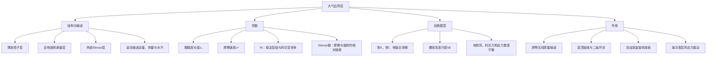

# 作业六：题目与答案讲解

## 一、名词解释

### ① 大气行星边界层

**答案讲解**

行星边界层是靠近地表、通过湍流输送直接受地面摩擦和热力作用影响的大气层。厚度随稳定度、昼夜、天气及下垫面而变，1—2 km 只是典型尺度。边界层主体的动量和热量交换主要依靠湍流，分子粘性主要影响紧贴表面的很薄区域。

### ② 粗糙度与摩擦速度

**答案讲解**

粗糙度长度 $z_0$ 是中性对数风廓线外推到零平均风速时的参数，不等于实际地物高度，也不一定对应真实零风速所在高度。摩擦速度定义为
$$u_*=\sqrt{|\boldsymbol\tau_0|/\rho},$$
其中 $\boldsymbol\tau_0$ 为地表切应力。水平齐一、近中性且处于常应力层时，平均风速近似满足
$$\overline u(z)=\frac{u_*}{\kappa}\ln\frac{z-d}{z_0},$$
其中 $d$ 为零平面位移、$\kappa$ 为 von Kármán 常数。$u_*$ 具有速度量纲，但本身不是某个实际风分量，也不是在所有时空条件下不变的常量。

### ③ 梯度风高度

**答案讲解**

梯度风高度:第一次风向与地转风方向重合的高度。通常取梯度风 高度为边界层顶的高度。

### ④ 二级环流

**答案讲解**

二级环流(次级环流):由自由大气中涡旋环流和边界层湍流摩擦作用而产生的,叠加在涡旋(水平)环流上并受其制约的环流。

### ⑤ 理查森（Richardson）数 与 Ekman数

**答案讲解**

梯度 Richardson 数比较稳定层结与垂直风切变：
$$Ri=\frac{(g/\bar\theta)\bar\theta_z}{\bar u_z^2+\bar v_z^2}=\frac{N^2}{\bar u_z^2+\bar v_z^2}.$$
采用梯度扩散闭合时，通量 Richardson 数为 $R_f=-B/P=(K_h/K_m)Ri$，其中 $B$ 是浮力湍能项、$P$ 是切变生成项。$R_f<1$ 仅意味着 $P+B>0$，湍流是否增强还取决于耗散和输送。在无粘、平行、稳定层结等条件下，处处 $Ri\ge1/4$ 可排除指数增长的线性剪切不稳定；某处 $Ri<1/4$ 并不保证不稳定。

Ekman 数为
$$E=\frac{K_m}{|f|D^2}=\frac{1/|f|}{D^2/K_m},$$
比较粘性加速度 $K_mU/D^2$ 与科氏加速度 $|f|U$。时间比中，分子是旋转时间尺度，分母是垂直动量扩散时间；它与整个涡旋旋转减弱的时间不是同一概念。

## 二、简答题

### ① 什么是大气行星边界层？大气行星边界层可分为几个层次？说明各层次的主要特点。

**答案讲解**

行星边界层是通过湍流直接受地表摩擦和热力作用影响的近地大气层，可按课程的理想划分说明如下。

| 层次 | 主要特点 |
|---|---|
| 紧贴表面的粘性子层 | 很薄，分子粘性和分子扩散可能重要；厚度与表面粗糙状况有关 |
| 近地面层 | 常取边界层底部约 10%，通量随高度变化较小；中性、水平齐一条件下近似对数风廓线 |
| 上部 Ekman 层 | 气压梯度力、科氏力与湍流应力散度共同作用，风向随高度旋转并趋于自由大气风 |

这些是物理特征的划分，不是固定高度界面。粗糙地面上 2 m 高度通常已有明显湍流，不能把整个这一高度范围都视作分子扩散主导区。

### ② 经典Ekman螺线解是什么？随高度有什么样的变化特征？Ekman层中的风压关系如何？

**答案讲解**

北半球、常 $K$、常 $f>0$，地转风沿 $x$ 正向，地面无滑移时，经典解为
$$u=u_g(1-e^{-z/h_E}\cos(z/h_E)),\quad v=u_ge^{-z/h_E}\sin(z/h_E),\quad h_E=\sqrt{2K/f}.$$
地面 $u=v=0$，风向没有定义。当 $z\to0^+$ 时，展开指数和三角函数得到 $u\simeq v\simeq u_gz/h_E$，故风向趋于与等压线成 $45^\circ$。

随高度增加，非地转风的振幅按 $e^{-z/h_E}$ 衰减，风矢量逐渐旋转并趋向地转风。在 $0<z<\pi h_E$ 内 $v>0$，跨等压线流向低压；第一次与地转风同向的高度是 $h_B=\pi h_E$。更高处可能有微弱反向穿越，最终趋于地转平衡。

### ③ 什么叫“埃克曼抽吸”？什么叫“旋转减弱”？埃克曼抽吸是怎样影响自由大气的？请从受力分析和动量输送两个角度阐述。

**答案讲解**

Ekman 抽吸指边界层水平质量输送的辐合、辐散在层顶产生垂直运动，从而与自由大气交换质量。设底部 $w=0$，自由大气地转流近似无辐散，则
$$w_e=-\nabla_h\cdot\int_0^\infty(\mathbf V-\mathbf V_g)dz=\frac{h_E}{2}\zeta_g=\sqrt{\frac K{2f}}\zeta_g$$
（北半球常 $K,f$）。气旋对应上升，反气旋对应下沉。

从受力看，摩擦减小气旋边界层的切向风速，科氏力不足以平衡内向气压梯度，因而形成向内跨等压线流动和辐合。层顶抽吸通过自由大气中的补偿环流和涡柱伸缩，使涡旋减弱，这称为旋转减弱。

从动量输送看，湍流把水平动量向地面传递；由抽吸形成的二级环流把自由大气与摩擦层耦合，使自由大气中的动量也受地表摩擦影响，动能最终耗散。以上积分采用边界层输送的渐近值，不能与任意有限层顶积分完全等同。

### ④ 请阐述海洋中Ekman过程，并对比分析与大气中的异同。

**答案讲解**

大气Ekman层主要由大尺度气压梯度驱动，地表摩擦制约并耗散动量；海洋表层Ekman分量由海面风应力驱动。北半球经典深海模型海表流相对风应力右偏约45°，垂直积分输送向右90°；南半球相反。大气边界层的净非地转输送则跨等压线向低压。两者都由科氏力与湍流动量输送共同产生随深度／高度转向。

### ⑤ 如图是Ekman螺线，$u_g$为地转风矢量，请绘出图中空气微团速度$V$与等压线夹角为30°和60°时的受力分析，请注意满足三力平衡的矢量合成。

**答案讲解**

取北半球 $f>0$，地转风 $u_g>0$ 沿 $x$ 方向，低压在 $+y$。若风与等压线夹角为 $\alpha$，则 $u=V\cos\alpha,v=V\sin\alpha$。单位质量三力为
$$\mathbf F_P=(0,fu_g),\quad\mathbf F_C=(fV\sin\alpha,-fV\cos\alpha),$$
$$\mathbf F_r=-\mathbf F_P-\mathbf F_C=(-fV\sin\alpha,fV\cos\alpha-fu_g).$$
所以三者逐分量相加严格为零。画图时先画向低压的气压梯度力，再从其终点画科氏力，最后用摩擦力连接回起点，即为闭合受力三角形。

左图采用经典螺线上夹角为 $30^\circ$ 的点。右图仅演示给定 $60^\circ$ 风向、取 $V/u_g=1$ 时的形式三力平衡：经典常 $K$ 无滑移 Ekman 螺线的正向跨等压线夹角不达到 $60^\circ$，所以右图不能解释为该螺线上的实际点。湍流摩擦加速度是应力散度，一般不必与当地风严格反向。

## 三、计算推导题

### ① 取 $u_g=10\ \mathrm{m/s}$、$K=k_z=5\ \mathrm{m^2/s}$，根据埃克曼螺线解
$$u(z)=u_g[1-e^{-z/h_E}\cos(z/h_E)],\qquad v(z)=u_ge^{-z/h_E}\sin(z/h_E),$$
针对 $40^\circ\mathrm N$ 估算 $h_E$，用程序绘制 Ekman 螺线，给出 100、200、400、1000 m 高度的 $u,v$。

**答案讲解**

先算科氏参数和 Ekman 高度尺度：
$$f=2\Omega\sin40^\circ=2(7.292\times10^{-5})\sin40^\circ\simeq9.3744\times10^{-5}\ \mathrm{s^{-1}},$$
$$h_E=\sqrt{\frac{2K}{f}}=\sqrt{\frac{10}{9.3744\times10^{-5}}}\simeq326.61\ \mathrm m.$$
令 $s=z/h_E$，对每个高度依次求 $s,e^{-s},\cos s,\sin s$，再代入 $u=10(1-e^{-s}\cos s)$、$v=10e^{-s}\sin s$。

| $z$（m） | $s=z/h_E$ | $u$（m/s） | $v$（m/s） |
|---:|---:|---:|---:|
| 100 | 0.3062 | 2.980 | 2.219 |
| 200 | 0.6123 | 5.564 | 3.116 |
| 400 | 1.2247 | 9.003 | 2.764 |
| 1000 | 3.0617 | 10.467 | 0.037 |

例如 100 m 处，$e^{-s}\simeq0.7363$、$\cos s\simeq0.9535$、$\sin s\simeq0.3014$，所以 $u\simeq10(1-0.7363\times0.9535)=2.980$，$v\simeq10\times0.7363\times0.3014=2.219\ \mathrm{m/s}$。其余高度按相同顺序计算。

左图是 $u-v$ 平面内的风矢量端点轨迹，右图是两分量随高度的变化；高空逐渐趋向 $(u_g,0)=(10,0)$。

### ② 位于$45^{\circ}N$处有一正压气旋性涡旋，其地转涡度$\zeta_{g}=8\times 10^{-15}s^{-1}$，湍流粘性系数$k_{z}=5m^2 /s$，试根据公式，求埃克曼层顶处的铅直速度和涡旋旋转减弱时间（设涡旋厚度$H=10^4m$）。

**答案讲解**

保留题给地转涡度 $\zeta_g=8\times10^{-15}\ \mathrm{s^{-1}}$。先计算
$$f=2\Omega\sin45^\circ\simeq1.0312\times10^{-4}\ \mathrm{s^{-1}}.$$
采用经典边界层输送给出的抽吸公式：
$$w_e=\sqrt{\frac K{2f}}\zeta_g=\sqrt{\frac5{2\times1.0312\times10^{-4}}}\,(8\times10^{-15})\simeq1.246\times10^{-12}\ \mathrm{m/s}.$$
结果为正，代表气旋上方的上升运动。设自由涡旋厚度 $H$、顶部垂直速度为零，由连续式得层平均散度 $D_h\simeq w_e/H$。在线性旋转减弱近似下
$$\frac{d\zeta_g}{dt}=-fD_h=-\frac1H\sqrt{\frac{fK}{2}}\zeta_g.$$
积分得 $\zeta_g(t)=\zeta_g(0)e^{-t/\tau_s}$，因此
$$\tau_s=H\sqrt{\frac2{fK}}=10^4\sqrt{\frac2{(1.0312\times10^{-4})5}}\simeq6.23\times10^5\ \mathrm s\simeq7.21\ \mathrm d.$$
这是涡度衰减到初值 $1/e$ 的时间。题给涡度异常小，但不能擅改；若确认题干本应为 $8\times10^{-5}\ \mathrm{s^{-1}}$，抽吸速度才为 $0.01246\ \mathrm{m/s}$，而上述线性衰减时间不变。

## 四、开放题

### ① 请根据自己的理解，绘制第七章《大气边界层》的知识框图（手绘，也可用思维导图软件，如MindMaster）。

**答案讲解**

