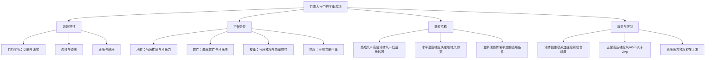

# 作业四：题目与答案讲解

## 一、名词解释

### ① 自然坐标系

**答案讲解**

自然坐标系是以质点运动轨迹建立的坐标系，原点固接于质点，坐标轴的分别是运动轨迹的切向和法向，其中法向在运动方向的左边。

### ② 正压大气与斜压大气

**答案讲解**

正压：$\rho=\rho(p)$，$\nabla\rho\times\nabla p=0$；斜压：$\nabla\rho\times\nabla p\ne0$，即等压、等密度面不重合。干空气或成分固定时可用等温面解释；湿空气严格说应使用虚温。

### ③ 地转风与地转偏差

**答案讲解**

地转风满足瞬时水平气压梯度力与科氏力平衡：$u_g=-\Phi_y/f$、$v_g=\Phi_x/f$。它可以随位置、时间变化。地转偏差（非地转风）为 $\mathbf V_a=\mathbf V_h-\mathbf V_g$，反映实际风偏离地转平衡的部分。

### ④ 热成风

**答案讲解**

热成风高层地转风与低层地转风的矢量差

### ⑤ 迹线、流线

**答案讲解**

流线是在同一时刻处处与速度方向相切的曲线；迹线是单个气块随时间运动所走过的轨迹。定常流场中两者重合，非定常流场中通常不重合。

## 二、简答题

### ① 请列表对比说明惯性风、旋衡风、梯度风、地转风、热成风。（提示：定义、特征、条件、性质、意义等）

**答案讲解**

| 类型 | 定义与平衡关系 | 适用条件与特征 | 意义 |
|---|---|---|---|
| 惯性风 | 无水平气压梯度和摩擦时，科氏作用提供向心加速度 | $f$ 平面惯性圆半径 $V/\vert f\vert $，周期 $2\pi/\vert f\vert $；北半球顺时针 | 描述失去外部压强驱动后的惯性运动 |
| 旋衡风 | 气压梯度与曲率惯性项平衡，$V^2/r=\vert \partial_rp\vert /\rho$ | 曲率惯性远大于科氏项；可绕低压顺、逆时针旋转 | 适用于小尺度强涡旋 |
| 梯度风 | 气压梯度、科氏项、曲率惯性三者平衡 | 无摩擦、近似定常曲线流；北半球正常高压支有 $V_g\le V_G\le2V_g$ | 描述弯曲等压线上的近似平衡风 |
| 地转风 | 水平气压梯度与科氏力平衡 | $Ro\ll1$、慢变、摩擦弱；风平行等压线，速度 $\lvert\nabla_hp\rvert/(\rho\lvert f\rvert)$ | 中纬度自由大气领先平衡 |
| 热成风 | 高低两层地转风矢量之差 | 静力、地转近似下与层平均水平温度梯度相联系 | 诊断垂直风切变和温度平流 |

地转风在固定压力梯度和密度下与 $|\sin\varphi|$ 成反比；旋衡近似不要求一定处于低纬。高压梯度风的异常支是另一数学根，不属于上述正常支上限。

### ② 有经验的预报员，在无气象资料时，将地面风向与高空云层移动方向进行比较就能决定气层中是暖平流还是冷平流，你能对此作出解释吗？

**答案讲解**

北半球近地转条件下，风随高度顺时针转向通常对应暖平流，逆时针对应冷平流；南半球相反。热成风为 $\mathbf V_T=(R_d/f)\ln(p_\mathrm{下}/p_\mathrm{上})\,\mathbf k\times\nabla_p\overline T$。地面受摩擦、地形等影响时，单凭地面风和云移方向不能严格判定。

### ③ 为什么高层地转风（等高线）会与等温线那么一致？并解释西风急流的成因。

**答案讲解**

北半球两层热成风关系为
$$\mathbf V_T=\frac{R_d}{f}\ln\frac{p_{\rm 下}}{p_{\rm 上}}\,\mathbf k\times\nabla_p\overline T.$$
若层平均温度向北降低，则 $\partial_y\overline T<0$，于是
$$u_T=-\frac{R_d}{f}\ln\frac{p_{\rm 下}}{p_{\rm 上}}\partial_y\overline T>0.$$
因此西风随高度增强。累积热成风占优势时，高空风更接近平行层平均等温线，等高线与等温线也趋于一致。强水平温度梯度带可对应强西风垂直切变及高空急流；副热带急流还与 Hadley 环流角动量输送有关，不能把所有急流都归结为同一温差机制。

### ④ 何谓地转偏差？它对大气运动的演变发展有何重要作用？

**答案讲解**

无摩擦时 $D\mathbf V_h/Dt=-f\mathbf k\times\mathbf V_a$，$\mathbf V_a=\mathbf V_h-\mathbf V_g$，故加速度大小为 $|f|\,|\mathbf V_a|$。非地转风的辐合辐散联系垂直运动、质量重新分配和气压变化，使系统能够演变并维持近似平衡。

### ⑤ 为什么低压中心的风可以很大？为什么高压中心的风不能很大？为什么赤道上有反气旋的可能性很小？冬季大陆上的反气旋等压线更密一些？

**答案讲解**

北半球取曲率半径大小 $r>0$。低压气压梯度力向内，平衡为 $G=fV+V^2/r$，随 $V$ 单调增加，因而没有高压情形那样的判别式上限。

高压气压梯度力向外，平衡为 $G=fV-V^2/r$。配方得
$$G=\frac{f^2r}{4}-\frac1r\left(V-\frac{fr}{2}\right)^2\le\frac{f^2r}{4}.$$
所以高压允许的压力梯度受到限制，正常支风速也有限。赤道 $f=0$ 时无法用此平衡支持 $G>0$ 的高压，故平衡反气旋难形成；这不排除非平衡反气旋涡度。

压力梯度限制为 $|\partial_rp|\le\rho f^2r/4$。其他条件相同时，冬季大陆冷空气密度较大，可允许较大的压强梯度，但不保证实际等压线必然变密。题中“中心风”宜理解为系统内风速；光滑轴对称涡旋的精确中心风速通常为零。

## 三、计算推导题

### ① 试从物理上说明，在梯度风平衡条件下，高压中的水平气压梯度的大小要受到限制，相应的梯度风VG也要受到限制，且有VG ≤2Vg

**答案讲解**

北半球 $f>0$，取高压曲率半径大小 $r>0$，外向气压梯度加速度为 $G=fV_g$。径向平衡要求
$$fV_G=G+V_G^2/r,$$
移项后得到 $V_G^2-frV_G+frV_g=0$。实根条件为 $f^2r^2-4frV_g\ge0$，即
$$V_g\le fr/4,\qquad G\le f^2r/4.$$
正常支要求 $V_g\to0$ 时 $V_G\to0$，因此选负号根：
$$V_G=\frac{fr}{2}\left(1-\sqrt{1-\frac{4V_g}{fr}}\right).$$
根号在 $[0,1]$ 内，故 $0\le V_G\le fr/2$。由原二次方程得到
$$V_g=V_G\left(1-\frac{V_G}{fr}\right)\ge\frac12V_G,$$
从而 $\boxed{V_G\le2V_g}$，临界时取等号。物理上，增大的风速既增大向内科氏力，也以平方速率增大外向曲率惯性项，因此可平衡的外向压力梯度存在最大值。加号根为异常支，不满足本题正常支的上限。

### ② 当$R_0=\frac{V_c}{fR_T}=0.1$时，对于梯度风，取地转风近似的相对误差是多大？

**答案讲解**

把题中 $V_c$ 理解为实际梯度风速 $V_G$，由梯度风关系得到
$$V_g=V_G\left(1+\frac{V_G}{fR_T}\right).$$
以实际风速为分母的相对误差为
$$\epsilon=\frac{|V_G-V_g|}{|V_G|}=\left|1-\left(1+\frac{V_G}{fR_T}\right)\right|=\left|\frac{V_G}{fR_T}\right|=0.1.$$
因此相对误差为 **10%**。这里采用有符号曲率半径，取绝对值后适用于相应曲率方向。

## 四、开放题

### ① 请根据自己的理解，绘制第五章《自由大气中的平衡流场》的知识框图（手绘，也可用思维导图软件，如MindMaster）。

**答案讲解**

