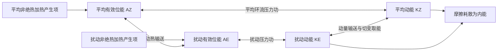

# 2025 年试题解析：逐题解答、考点与频次

> 本文件保留原题及频次，补充对应解答。星级为复习用主观评级；有缺题或排印疑点时，明确注明条件及可解范围。频次按考点出现的不同年份统计，不能视作命题概率。

原始记录：[[动力气象课后习题/往年试题分析/2025]]　｜　[[00_使用说明与年份索引|统计口径与目录]]

## 原卷第一部分

名词解释（共 10 题，每小题 3 分，共 30 分）

## 题目 2025-一-1

### 原题

准静止锋

### 考点与考察频次

**考察频次：2 次（按年份去重）；一般。**

| 考点 | 频次 | 标记 | 对应年份 |
|---|---:|---|---|
| 准静止锋 | 2 次 | 一般 | 2022、2025 |

同考点的全部题号见 [[01_考点频次与证据总表|考点频次与证据总表]]。

### 难度与考试相关度

**难度：★☆☆☆☆（1/5）｜考试相关度：★★★★☆（4/5）**

评级依据：历史出现且直接对应所给考纲；频次用于区分复习优先级。

### 考场精简版与审校状态

**审校状态：已逐题复核（按所列模型与条件）。**

**针对本题的考场作答版（非官方评分标准）：**

准静止锋指冷暖空气交界的锋区移动缓慢或往复摆动、净位移较小；两侧气流仍可活动，有水汽与持续抬升时易出现长时间云雨。

> 推导题须保留必要推演，简答与论述须按小问展开；精简版只用于回忆作答主线。

### 详细解答

**修改意见（2026-10-07，第四批）：**

把原先整套锋面分类改为直接解释准静止锋，区分锋静止和空气静止。

**核对依据：** [[牢三样/天气学分析原理/气团与锋/气团和锋面的基本概念和气象要素场的主要特征|气团和锋面的基本概念和气象要素场的主要特征]]。本地资料为学习笔记，不视作官方标准答案；冲突处依据下列物理条件、方程推导和所列外部依据判断。

**复核后详细解答：**

1. 准静止锋是冷暖气团交界锋区的地面位置变化很慢，或在某一区域往复摆动而净位移较小的锋。它通常反映跨锋推进的冷暖势力相对接近，也可能受地形和稳定环流约束。
2. “准静止”描述锋区位置的移动，不表示锋两侧空气静止。气流可主要沿锋流动，并持续输送水汽和热量；锋上还可出现波动、低涡及局部移动。
3. 水汽和抬升充足时，缓慢移动使云雨影响同一区域较久，可产生连阴雨或持续强降水；缺水时不一定下雨，所以持续降水是有条件的天气后果。
4. 锋面一般向冷空气一侧倾斜，暖湿空气沿锋面上升。与冷锋、暖锋相比，分类关键是锋的相对移动，而非简单按雨大雨小分类。江淮梅雨锋、华南或昆明附近的准静止锋可作例子，但它们结构和季节背景并不完全相同。

## 题目 2025-一-2

### 原题

极涡

### 考点与考察频次

**考察频次：1 次（按年份去重）；一般。**

| 考点 | 频次 | 标记 | 对应年份 |
|---|---:|---|---|
| 极涡 | 1 次 | 一般 | 2025 |

同考点的全部题号见 [[01_考点频次与证据总表|考点频次与证据总表]]。

### 难度与考试相关度

**难度：★☆☆☆☆（1/5）｜考试相关度：★★★★☆（4/5）**

评级依据：历史出现且直接对应所给考纲；频次用于区分复习优先级。

### 考场精简版与审校状态

**审校状态：已逐题复核（按所列模型与条件）。**

**针对本题的考场作答版（非官方评分标准）：**

极涡是极地及附近高纬地区的大尺度气旋性环流；对流层极涡与冬季平流层极涡处在不同高度、形成和变化机制不同，不能混为单个小尺度低涡。

> 推导题须保留必要推演，简答与论述须按小问展开；精简版只用于回忆作答主线。

### 详细解答

**修改意见（2026-10-07，第四批）：**

区分对流层与平流层极涡，说明尺度和冷空气影响的非唯一性。

**核对依据：** [[牢三样/天气学分析原理/大气环流/极地和热带环流、西风带大型扰动|极地和热带环流、西风带大型扰动]]。本地资料为学习笔记，不视作官方标准答案；冲突处依据下列物理条件、方程推导和所列外部依据判断。

**复核后详细解答：**

1. 极涡指围绕极地或高纬低位势高度区域的大尺度气旋性环流，通常具有冷性背景；北半球为逆时针、南半球为顺时针旋转。
2. 对流层极涡是高纬大尺度环流的一部分，可有多个中心或偏离极点，与中纬槽脊和冷空气活动相联系；不能将其限定为某个固定位置的小于千公里低压。
3. 冬季平流层极涡与极夜辐射冷却、极区温度梯度及强西风相关，暖季显著减弱。它与对流层通过波动等耦合，但不等于天气图上的每一个冷涡。
4. 极涡偏心、分裂或槽向低纬伸展可影响冷空气路径。某地是否出现寒潮，还取决于槽脊、近地面冷高压、气流路径等，不能断言极涡任何一次减弱都导致中国寒潮。

## 题目 2025-一-3

### 原题

低空急流

### 考点与考察频次

**考察频次：7 次（按年份去重）；🔴 重点。**

| 考点 | 频次 | 标记 | 对应年份 |
|---|---:|---|---|
| 低空急流 | 7 次 | 重点 | 1992、1996、1997、1999、2012、2015、2025 |

同考点的全部题号见 [[01_考点频次与证据总表|考点频次与证据总表]]。

### 难度与考试相关度

**难度：★☆☆☆☆（1/5）｜考试相关度：★★★★★（5/5）**

评级依据：历史出现且直接对应所给考纲；频次用于区分复习优先级。

### 考场精简版与审校状态

**审校状态：已逐题复核（按所列模型与条件）。**

**针对本题的考场作答版（非官方评分标准）：**

低空急流是对流层低层出现的显著风速极大带；可由天气尺度压力梯度、地形或夜间边界层调整等形成，能加强水汽与动量输送，但急流本身不等于必然辐合。

> 推导题须保留必要推演，简答与论述须按小问展开；精简版只用于回忆作答主线。

### 详细解答

**修改意见（2026-10-07，第四批）：**

以低层风速极大定义低空急流，区分天气尺度输送急流和夜间边界层急流。

**核对依据：** [[牢三样/天气学分析原理/天气系统和过程/大型降水天气过程的主要环流特征、暴雨中尺度系统|大型降水天气过程的主要环流特征、暴雨中尺度系统]]。本地资料为学习笔记，不视作官方标准答案；冲突处依据下列物理条件、方程推导和所列外部依据判断。

**复核后详细解答：**

1. 低空急流指对流层低层的显著强风带，通常在垂直风速廓线上可识别局地最大值，上下风速较小。分析高度和阈值应依具体类型、资料与题目规定。
2. 东亚暴雨相关的天气尺度低空急流常在850—700 hPa附近分析，输送暖湿空气；夜间边界层急流则可在更低高度形成，不能把两者一律限制在相同等压面。
3. 形成机制包括大尺度气压梯度增强、地形通道或阻挡作用、坡面热力差异，以及夜间摩擦耦合减弱后的惯性调整。不同个例中各机制贡献不同。
4. 急流使水汽输送$q\mathbf V$增大，若输送在出口、锋面或切变线附近辐合，可配合抬升形成强降水。风速大只表示输送可能强，不能由风速大直接推出通量散度为负。
5. 降水潜热和环流调整还可反馈低空急流；强切变对飞行及对流组织也有影响。名词解释重点是“低层、风速极大、输送作用”，不额外伪造通用阈值。

## 题目 2025-一-4

### 原题

高原低涡

### 考点与考察频次

**考察频次：1 次（按年份去重）；一般。**

| 考点 | 频次 | 标记 | 对应年份 |
|---|---:|---|---|
| 高原涡 | 1 次 | 一般 | 2025 |

同考点的全部题号见 [[01_考点频次与证据总表|考点频次与证据总表]]。

### 难度与考试相关度

**难度：★☆☆☆☆（1/5）｜考试相关度：★★★★☆（4/5）**

评级依据：历史出现且直接对应所给考纲；频次用于区分复习优先级。

### 考场精简版与审校状态

**审校状态：已逐题复核（按所列模型与条件）。**

**针对本题的考场作答版（非官方评分标准）：**

高原低涡是发生于青藏高原上的中小尺度低压气旋性涡旋，常在500 hPa附近识别，受高原加热、地形及背景环流共同影响；移出并获得水汽时可造成下游降水。

> 推导题须保留必要推演，简答与论述须按小问展开；精简版只用于回忆作答主线。

### 详细解答

**修改意见（2026-10-07，第四批）：**

明确高原低涡常见500 hPa分析高度，与700 hPa西南涡区分。

**核对依据：** [[牢三样/天气学分析原理/低纬度和青藏高原环流系统/青藏高原的影响及环流系统|青藏高原的影响及环流系统]]。本地资料为学习笔记，不视作官方标准答案；冲突处依据下列物理条件、方程推导和所列外部依据判断。

**复核后详细解答：**

1. 高原低涡指在青藏高原地区生成或活动的中小尺度低压气旋性涡旋。由于高原地面海拔高，500 hPa附近可接近其上方低层，不能用平原上的“中层”概念误判其相对地表高度。
2. 暖季高原地面加热、地形造成的气流调整、背景切变与辐合等可促进生成，湿过程和凝结潜热也可参与发展；不宜将全部个例归因于单一背风降压。
3. 低涡附近辐合、上升可形成云雨，受引导气流和下游环境影响，有些东移或移出高原后继续发展；也有很多在高原上减弱。水汽输送和高低层配置决定其降水影响。
4. 西南涡多在高原东南侧及四川盆地附近分析，常看700 hPa；它与高原低涡来源、常用分析高度和地形环境不同，虽可相互影响，不能当成完全同一系统。

## 题目 2025-一-5

### 原题

光化学烟雾

### 考点与考察频次

**考察频次：1 次（按年份去重）；一般。**

| 考点 | 频次 | 标记 | 对应年份 |
|---|---:|---|---|
| 烟雾与污染天气 | 1 次 | 一般 | 2025 |

同考点的全部题号见 [[01_考点频次与证据总表|考点频次与证据总表]]。

### 难度与考试相关度

**难度：★☆☆☆☆（1/5）｜考试相关度：★★★★☆（4/5）**

评级依据：历史出现且直接对应所给考纲；频次用于区分复习优先级。

### 考场精简版与审校状态

**审校状态：已逐题复核（按所列模型与条件）。**

**针对本题的考场作答版（非官方评分标准）：**

光化学烟雾是NOx、挥发性有机物等前体物在阳光下反应形成的含臭氧、PAN及二次颗粒物等的复合污染；关键是光化学二次生成，不是直接排放的烟尘总称。

> 推导题须保留必要推演，简答与论述须按小问展开；精简版只用于回忆作答主线。

### 详细解答

**修改意见（2026-10-05，第三批）：**

区分一次排放与二次污染，用自由基反应说明净臭氧生成。

**核对依据：** [[牢三样/补充内容/臭氧与大气散射|臭氧与大气散射]]。本地资料为学习笔记，不视作官方标准答案；冲突处依据下列物理条件、方程推导和所列外部依据判断。

**复核后详细解答：**

1. 光化学烟雾指氮氧化物（NOx）、挥发性有机物（VOCs）等前体物在较强太阳辐射下经历光化学反应，形成臭氧、过氧酰基硝酸酯（如PAN）及部分二次颗粒物等的复合污染现象。
2. 臭氧生成的基本步骤为$NO_2+h\nu\rightarrow NO+O$，再经$O+O_2+M\rightarrow O_3+M$形成臭氧。但若随后$NO+O_3\rightarrow NO_2+O_2$，三式相加无臭氧净积累，所以只写这三步不能解释净生成。
3. VOCs被氧化可产生$RO_2$、$HO_2$等自由基，它们可将NO转成NO₂而不消耗一分子臭氧，例如$RO_2+NO\rightarrow RO+NO_2$。新增NO₂光解后又生成臭氧，使循环有可能产生净臭氧。实际净产率还受自由基终止、NOx及VOCs配比影响。
4. 强日照、较高温度、前体物充足及扩散不利的条件常利于积累；它不是任何天气下都出现，也不应与以一次煤烟、二氧化硫为主的烟雾简单等同。
5. 本题作为名词解释，抓住“前体物—太阳辐射—二次反应—臭氧等产物”四项即可，不必把所有反应逐一背出。

## 题目 2025-一-6

### 原题

抬升凝结高度

### 考点与考察频次

**考察频次：1 次（按年份去重）；一般。**

| 考点 | 频次 | 标记 | 对应年份 |
|---|---:|---|---|
| 抬升凝结高度 | 1 次 | 一般 | 2025 |

同考点的全部题号见 [[01_考点频次与证据总表|考点频次与证据总表]]。

### 难度与考试相关度

**难度：★☆☆☆☆（1/5）｜考试相关度：★★★★☆（4/5）**

评级依据：历史出现且直接对应所给考纲；频次用于区分复习优先级。

### 考场精简版与审校状态

**审校状态：已逐题复核（按所列模型与条件）。**

**针对本题的考场作答版（非官方评分标准）：**

抬升凝结高度LCL是未饱和气块按干绝热抬升首次达到饱和的高度。近地面可粗估$z_{LCL}-z_0\approx125(T_0-T_{d0})$ m，温露差用K或℃，该式有近似条件。

> 推导题须保留必要推演，简答与论述须按小问展开；精简版只用于回忆作答主线。

### 详细解答

**修改意见（2026-10-05，第三批）：**

区分LCL、自由对流高度和实际云底，补125倍温露差估算的来源。

**核对依据：** [[牢三样/大气物理学/大气热力学/大气中的干绝热过程|大气中的干绝热过程]]。本地资料为学习笔记，不视作官方标准答案；冲突处依据下列物理条件、方程推导和所列外部依据判断。

**复核后详细解答：**

1. 取初始未饱和气块，不与环境混合、未凝结前无水汽损失，使其干绝热抬升。气温降低、饱和水汽压降低，首次达到相对湿度100%的位置称抬升凝结高度，记LCL。
2. 干绝热阶段温度近似按$T(z)=T_0-\Gamma_d(z-z_0)$变化，$\Gamma_d\approx9.8\ \mathrm{K/km}$。实际水汽混合比近守恒，但气压下降使水汽压也降低，故露点不是常数，可粗估$T_d(z)=T_{d0}-\Gamma_{Td}(z-z_0)$，近地面$\Gamma_{Td}$约为$1.8$—$2\ \mathrm{K/km}$。
3. 在LCL令$T=T_d$：$T_0-\Gamma_d\Delta z=T_{d0}-\Gamma_{Td}\Delta z$；移项得$T_0-T_{d0}=(\Gamma_d-\Gamma_{Td})\Delta z$，故
$$\Delta z=\frac{T_0-T_{d0}}{\Gamma_d-\Gamma_{Td}}\approx\frac{T_0-T_{d0}}{8\ \mathrm{K/km}}\approx125(T_0-T_{d0})\ \mathrm m.$$
4. 此处高度是相对初始高度$z_0$的抬升距离。温露差可用K或℃；若初始已饱和，温露差为0，LCL就在初始位置，符合检验。高温、低压或很大温露差时应采用更准确的热力计算。
5. LCL回答“何时达到饱和”，自由对流高度LFC回答“何时相对环境获得自由上升浮力”，两者不相同。实际云底还受混合、层结及云形成机制影响，不能无条件认定所有云底都等于地面气块LCL。

## 题目 2025-一-7

### 原题

有效位能

### 考点与考察频次

**考察频次：6 次（按年份去重）；🔴 重点。**

| 考点 | 频次 | 标记 | 对应年份 |
|---|---:|---|---|
| 有效位能 | 6 次 | 重点 | 1996、2003、2005、2016、2022、2025 |

同考点的全部题号见 [[01_考点频次与证据总表|考点频次与证据总表]]。

### 难度与考试相关度

**难度：★☆☆☆☆（1/5）｜考试相关度：★★★★★（5/5）**

评级依据：历史出现且直接对应所给考纲；频次用于区分复习优先级。

### 考场精简版与审校状态

**审校状态：已逐题复核（按所列模型与条件）。**

**针对本题的考场作答版（非官方评分标准）：**

有效位能是实际大气全位能与保持各气块熵、质量等约束作绝热重排所能达到的最小全位能之差，$A=P-P_{\min}\ge0$。全位能指内能与重力位能之和；有效位能是其中可用于转换为动能的部分。

> 推导题须保留必要推演，简答与论述须按小问展开；精简版只用于回忆作答主线。

### 详细解答

**修改意见（2026-10-04）：**

原答案把名词解释扩成完整能量循环；改为定义—参考态—物理意义，另用量纲正确的小位移公式说明。参考笔记的位温扰动表达式漏了一个g，已在此题单列说明。

**核对依据：** [[牢三样/动力气象/大气能量学/有效位能|有效位能]]。本地资料为学习笔记，不视作官方标准答案；冲突处依据下列方程推导与量纲检查作出判断。

**复核后详细解答：**

1. **定义。** 在干大气Lorenz框架中，$P$为内能与重力位能的总和，$P_{\min}$为保持空气微团质量、熵等约束，经绝热重排可达到的最低全位能。有效位能为$A=P-P_{\min}\ge0$。
2. **参考态。** 经典参考态具有稳定层结及水平一致的热力分布。它是用来比较的能量最低状态，不是随意指定“全球平均温度”，也不要求实际大气已经运动到该状态。
3. **物理意义。** 巨大的全位能不能全部转成动能；有效位能衡量给定约束下可供转换的能量。差异加热可维持水平温差，斜压扰动通过热量输送及暖升冷沉等过程取能。并非任意加热都增加有效位能，实际能量转换也未必耗尽全部有效位能。
4. **可选的定量说明。** 对稳定参考态中的小位移$\xi$，近似取常数$N^2>0$，浮力回复加速度为$-N^2\xi$。单位质量反抗回复力所做的功为
$$a=\int_0^\xi N^2s\,ds=\frac12N^2\xi^2.$$
由$\theta'=-\xi\bar\theta_z$及$N^2=g\bar\theta_z/\bar\theta$，先得$\xi=-g\theta'/(N^2\bar\theta)$，再代入：
$$a=\frac{g^2}{2N^2}\left(\frac{\theta'}{\bar\theta}\right)^2=\frac{b'^2}{2N^2},\qquad b'=g\theta'/\bar\theta.$$
这是小扰动局地近似，不替代全球APE的约束定义。$g^2/N^2$单位为$\mathrm{m^2/s^2}$，符合单位质量能量；参考笔记中$g/(2N^2)$的写法少了一个$g$，不能照抄。$N^2\to0$时该稳定小扰动展开失去适用性，不能简单宣称实际能量无穷大。

## 题目 2025-一-8

### 原题

埃克曼层

### 考点与考察频次

**考察频次：2 次（按年份去重）；一般。**

| 考点 | 频次 | 标记 | 对应年份 |
|---|---:|---|---|
| 埃克曼层 | 2 次 | 一般 | 2020、2025 |

同考点的全部题号见 [[01_考点频次与证据总表|考点频次与证据总表]]。

### 难度与考试相关度

**难度：★☆☆☆☆（1/5）｜考试相关度：★★★★☆（4/5）**

评级依据：历史出现且直接对应所给考纲；频次用于区分复习优先级。

### 考场精简版与审校状态

**审校状态：已逐题复核（按所列模型与条件）。**

**针对本题的考场作答版（非官方评分标准）：**

埃克曼层是湍流摩擦、科氏力与气压梯度力共同控制风场的旋转边界层。经典常系数定常模型中，偏差风随高度旋转衰减，标高$\delta_E=\sqrt{2K_m/|f|}$；其值与惯用的$\pi\delta_E$厚度定义不同。

> 推导题须保留必要推演，简答与论述须按小问展开；精简版只用于回忆作答主线。

### 详细解答

**修改意见（2026-10-04）：**

原方程正确；补定义、假设和标高与惯用厚度的区别。无滑移边界风速为零时风向无定义，45°仅指理想解趋近地面时的方向极限。

**核对依据：** [[牢三样/动力气象/大气行星边界层/埃克曼层|埃克曼层]]。本地资料为学习笔记，不视作官方标准答案；冲突处依据下列方程推导与量纲检查作出判断。

**复核后详细解答：**

1. **定义。** 埃克曼层是旋转流体中摩擦影响风场的边界层；大气经典模型中，水平气压梯度力、科氏力及湍流摩擦共同平衡，使实际风随高度趋近地转风。
2. **模型条件与方程。** 取定常、水平动量平流可忽略、常数$f\ne0$、常涡黏系数$K_m>0$和不随高度改变的地转风：
$$-f(v-v_g)=K_mu_{zz},\qquad f(u-u_g)=K_mv_{zz}.$$
3. **解的尺度。** 北半球$f>0$，令$W=(u-u_g)+i(v-v_g)$，两式合并为$K_mW_{zz}=ifW$。试$W\propto e^{rz}$，得$r^2=if/K_m$，所以$r=\pm(1+i)/\delta_E$，其中$\delta_E=\sqrt{2K_m/f}$。取随高度衰减的负号，再用$u(0)=v(0)=0$、上方趋地转，得
$$W=-(u_g+iv_g)e^{-(1+i)z/\delta_E}.$$
4. **风廓线。** 若$v_g=0,u_g=U_g>0$，则$u=U_g[1-e^{-z/\delta_E}\cos(z/\delta_E)]$，$v=U_ge^{-z/\delta_E}\sin(z/\delta_E)$。偏差幅度按$e^{-z/\delta_E}$减小，方向随高度旋转。$\delta_E$是衰减标高，$\pi\delta_E$常按首次与地转风同向来定义厚度，两者不要混写。
5. **地面角度及限制。** 当$z\to0^+$，展开指数与三角函数得$u\approx U_gz/\delta_E$、$v\approx U_gz/\delta_E$，方向极限为45°；恰在无滑移边界$z=0$，风速为零，风向无定义。实际大气的$K_m$、稳定度与时间变化使风廓线偏离此理想解。
6. **天气意义。** 摩擦使低层风穿越等压线，并可产生水平输送辐合；经连续性在层顶形成垂直运动，联系边界层与自由大气。严格水平均匀的单柱螺线本身无水平辐合，讨论抽吸还需允许背景风随水平位置缓变。

## 题目 2025-一-9

### 原题

正压不稳定

### 考点与考察频次

**考察频次：10 次（按年份去重）；🔴 重点。**

| 考点 | 频次 | 标记 | 对应年份 |
|---|---:|---|---|
| 正压不稳定 | 10 次 | 重点 | 2006、2010、2011、2013、2015、2018、2020、2022、2023、2025 |

同考点的全部题号见 [[01_考点频次与证据总表|考点频次与证据总表]]。

### 难度与考试相关度

**难度：★★☆☆☆（2/5）｜考试相关度：★★★★★（5/5）**

评级依据：历史出现且直接对应所给考纲；频次用于区分复习优先级。

### 考场精简版与审校状态

**审校状态：已逐题复核（按所列模型与条件）。**

**针对本题的考场作答版（非官方评分标准）：**

正压不稳定是扰动从基本流水平切变动能取能而增长的动力不稳定。平行流$U(y)$的转换项为$-\overline{u^{\prime}v^{\prime}}U_y$；在无黏正压无辐散β平面模型中，$\beta-U_{yy}$变号是增长模态的必要而非充分条件。

> 推导题须保留必要推演，简答与论述须按小问展开；精简版只用于回忆作答主线。

### 详细解答

**修改意见（2026-10-04）：**

原必要条件推导正确；删去无题干依据的余弦基本流例子，补上定义、能量转换符号及必要条件的适用范围。

**核对依据：** [[牢三样/动力气象/不稳定理论/正压和斜压不稳定|正压和斜压不稳定]]。本地资料为学习笔记，不视作官方标准答案；冲突处依据下列方程推导与量纲检查作出判断。

**复核后详细解答：**

1. **定义。** 扰动通过与基本流的水平切变相互作用，从基本流动能取能并增长，称正压不稳定；它是动力不稳定，与单气块浮力不稳定不同。
2. **取能符号。** 对基本流$(U(y),0)$，线性纬向扰动动量式含$v'U_y$。将其乘$u'$并与经向动量能量式相加，移项后出现$-u'v'U_y$。适当平均及积分、去掉边界输送后，基本流向扰动的动能转换为$-\overline{u'v'}U_y$。它为正时扰动取能；参考笔记中写成正号且声称“同号取能”的段落，与此速度协方差约定不一致。
3. **必要条件的来由。** 无黏、正压、无辐散β平面平行流中，基本绝对涡度为$\bar q=f_0+\beta y-U_y$，其梯度才是$\bar q_y=\beta-U_{yy}$。不要把$U_{yy}$直接写入$\bar q$本身。
4. **模态方程。** 取$\psi'=\phi(y)e^{ik(x-ct)}$、$k>0$，线性涡度方程给
$$(U-c)(\phi_{yy}-k^2\phi)+(\beta-U_{yy})\phi=0.$$
取两侧边界$\phi=0$，除以$U-c$、乘$\phi^*$并积分，分部积分去掉边界项：
$$-\int(|\phi_y|^2+k^2|\phi|^2)dy+\int\frac{\beta-U_{yy}}{U-c}|\phi|^2dy=0.$$
令$c=c_r+ic_i$，用$1/(U-c)=(U-c_r+ic_i)/[(U-c_r)^2+c_i^2]$取虚部：
$$c_i\int\frac{(\beta-U_{yy})|\phi|^2}{(U-c_r)^2+c_i^2}dy=0.$$
5. **判断。** 增长要求$c_i>0$；除位涡梯度外权重非负，要使积分抵消，通常要求梯度在域内变号。这是Rayleigh–Kuo必要条件，不能单凭变号就声称已求得不稳定模态或临界风速。名词解释只需前述定义、取能来源及必要条件，完整推导供复习。

## 题目 2025-一-10

### 原题

上游效应

### 考点与考察频次

**考察频次：5 次（按年份去重）；🔴 重点。**

| 考点 | 频次 | 标记 | 对应年份 |
|---|---:|---|---|
| 上游效应 | 5 次 | 重点 | 1996、2013、2016、2019、2025 |

同考点的全部题号见 [[01_考点频次与证据总表|考点频次与证据总表]]。

### 难度与考试相关度

**难度：★☆☆☆☆（1/5）｜考试相关度：★★★★★（5/5）**

评级依据：历史出现且直接对应所给考纲；频次用于区分复习优先级。

### 考场精简版与审校状态

**审校状态：已逐题复核（按所列模型与条件）。**

**针对本题的考场作答版（非官方评分标准）：**

本地教材中的上游效应指上游扰动通过能量频散等影响下游，使下游波动在上游槽脊尚未移到之前发展。均匀正压模型$c_{gx}-c_{px}=2\beta k^2/(k^2+l^2)^2>0$，但绝对群速方向仍取决于基本流和波数。

> 推导题须保留必要推演，简答与论述须按小问展开；精简版只用于回忆作答主线。

### 详细解答

**修改意见（2026-10-07，第四批）：**

按本地资料明确定义为上游变化影响下游，推导二维群相速差；不把它误称必然向上游传播。

**核对依据：** [[牢三样/动力气象/大气中的基本波动/罗斯贝波、罗斯贝波的传播|罗斯贝波、罗斯贝波的传播]]。本地资料为学习笔记，不视作官方标准答案；冲突处依据下列物理条件、方程推导和所列外部依据判断。

**复核后详细解答：**

1. **术语口径。** 本地《罗斯贝波、罗斯贝波的传播》将“上游效应”用于上游系统变化较快影响下游系统，即能量频散与下游发展。这里“上游”说明影响来源，不表示波能量必须向上游传播。
2. **给定模型。** 均匀西风$U$、正压无辐散β平面上，频散关系$\omega=Uk-\beta k/(k^2+l^2)$。令$K^2=k^2+l^2$，$k\ne0$，相速度$c_{px}=\omega/k=U-\beta/K^2$。
3. **求群速度。** 对$k$求偏导且保持$l$不变：$\partial_k[k/(k^2+l^2)]=[(k^2+l^2)-2k^2]/(k^2+l^2)^2=(l^2-k^2)/K^4$，所以$c_{gx}=U+\beta(k^2-l^2)/K^4$。
4. **比较。** $c_{gx}-c_{px}=\beta(k^2-l^2)/K^4+\beta K^2/K^4=2\beta k^2/K^4>0$。这个相对快慢不要求$k^2>l^2$；后者只决定$c_{gx}$是否大于$U$。一维$l=0$时，$c_{px}=U-\beta/k^2$、$c_{gx}=U+\beta/k^2$。
5. **天气含义。** 在向东传播的波包中，能量包络可领先槽脊位相到达下游，帮助下游扰动增强，上游波包部分衰减；这不是同一个槽中心瞬间跳到下游。
6. **限制。** 二维波、变化基本流或波导可改变群速方向；上述关系不证明所有天气影响只能向东，也不证明任何下游发展都只有一个机制。若原教材另有同名定义，应按其语境核对。

## 原卷第二部分

简答题（每小题 10 分，共 60 分）

## 题目 2025-二-1

### 原题

青藏高原的热力作用

### 考点与考察频次

**考察频次：6 次（按年份去重）；🔴 重点。**

| 考点 | 频次 | 标记 | 对应年份 |
|---|---:|---|---|
| 青藏高原天气气候效应 | 6 次 | 重点 | 1994、1996、2000、2010、2013、2025 |

同考点的全部题号见 [[01_考点频次与证据总表|考点频次与证据总表]]。

### 难度与考试相关度

**难度：★★☆☆☆（2/5）｜考试相关度：★★★★★（5/5）**

评级依据：历史出现且直接对应所给考纲；频次用于区分复习优先级。

### 考场精简版与审校状态

**审校状态：已逐题复核（按所列模型与条件）。**

**针对本题的考场作答版（非官方评分标准）：**

冬季高原总体偏冷源，春夏转为高架热源，感热、凝结潜热和辐射共同决定热收支；加热改变厚度与环流，影响季风转换、南亚高压、水汽输送和下游降水。

> 推导题须保留必要推演，简答与论述须按小问展开；精简版只用于回忆作答主线。

### 详细解答

**修改意见（2026-10-04，第二批）：**

旧答案首先讲动力阻挡，偏离“热力作用”；改为季节性热源冷源、加热方式、垂直响应及季风影响，不再加入题目未要求的“四种以上”。

**核对依据：** [[牢三样/天气学分析原理/低纬度和青藏高原环流系统/青藏高原的影响及环流系统|青藏高原的影响及环流系统]]；[[牢三样/天气学分析原理/低纬度和青藏高原环流系统/南亚高压|南亚高压]]。本地资料为学习笔记，不视作官方标准答案；冲突处依据下列方程推导与量纲检查作出判断。

**复核后详细解答：**

1. **热力作用的含义。** 指高原与大气之间热量交换及大气非绝热加热对环流的影响，不是绕流、阻挡等纯机械作用。高原高海拔使地表热交换直接作用于较高的大气层。
2. **冬季冷源。** 在季节平均概括中，高原及邻近大陆冷却有利于低层冷空气和冬季环流维持；强弱受积雪、云、辐射和下垫面影响，不能说高原每处、每时刻热源项都为负。
3. **春夏高架热源。** 地表吸收太阳辐射后通过感热向空气供热；季风水汽到达并凝结后，潜热释放也重要，辐射项参与净热收支。仅说“直接把太阳晒热的地面等同整柱加热”不完整。
4. **垂直响应。** 气柱加热使相同气压层间厚度增加，配合质量调整形成低层热低压及高层暖性反气旋的响应，南亚高压可加强。低层低压和高层高压并不矛盾，但单由厚度增加也不能独立确定地面气压变化。
5. **亚洲季风影响。** 热源季节变化调整海陆及南北热力差异，促进环流季节转换，影响南亚、东亚季风水汽通道和上升分布；降水潜热又反馈高原周边加热与环流。
6. **答题边界。** 高原不是唯一季风热源，海陆分布、海温及周边对流都需配合。此问以热收支及环流响应为主，不用山地绕流的长段文字替代热力分析。

## 题目 2025-二-2

### 原题

湍流的特征

### 考点与考察频次

**考察频次：1 次（按年份去重）；一般。**

| 考点 | 频次 | 标记 | 对应年份 |
|---|---:|---|---|
| 大气湍流 | 1 次 | 一般 | 2025 |

同考点的全部题号见 [[01_考点频次与证据总表|考点频次与证据总表]]。

### 难度与考试相关度

**难度：★★☆☆☆（2/5）｜考试相关度：★★★★☆（4/5）**

评级依据：历史出现且直接对应所给考纲；频次用于区分复习优先级。

### 考场精简版与审校状态

**审校状态：已逐题复核（按所列模型与条件）。**

**针对本题的考场作答版（非官方评分标准）：**

湍流具有不规则脉动、多尺度三维涡旋、强混合输送、能量级联与黏性耗散，以及间歇性和各向异性；常由切变和不稳定浮力产生，需用统计量描述。

> 推导题须保留必要推演，简答与论述须按小问展开；精简版只用于回忆作答主线。

### 详细解答

**修改意见（2026-10-05，第三批）：**

补统计描述和能量来源/耗散，删除大气通用临界Re与Ri绝对判据。

**核对依据：** [[牢三样/大气物理学/大气边界层/湍流及大气湍流的基本特征|湍流及大气湍流的基本特征]]。本地资料为学习笔记，不视作官方标准答案；冲突处依据下列物理条件、方程推导和所列外部依据判断。

**复核后详细解答：**

1. **不规则与统计性。** 大气湍流中速度、温度、水汽等随时间和空间发生复杂脉动。可用$u=\overline u+u'$且$\overline{u'}=0$作雷诺分解；随机外观不代表不受动力学规律约束，而是通常以均值、方差、协方差和谱刻画。
2. **三维、多尺度、涡旋性。** 湍流包含不同尺度的涡旋与强度不同的脉动。单位质量湍流动能$e=\tfrac12(\overline{u'^2}+\overline{v'^2}+\overline{w'^2})$，三项均不能随意省去；强层结、旋转等可使各方向差别显著。
3. **混合与输送。** 垂直脉动与性质脉动相关时产生通量，如水平动量$\rho\overline{u'w'}$、感热$\rho c_p\overline{w'T'}$、水汽$\rho\overline{w'q'}$。单独$\overline{w'}=0$不意味着协方差为零，也不意味着没有净湍流输送。
4. **产生与维持。** 平均风切变可向湍流提供动能，地面加热形成的不稳定浮力也可供能；稳定层结中的浮力通常抑制垂直湍动。存在湍流还需产生、输送与耗散的收支，不能说能量级联本身创造能量。
5. **级联与耗散。** 普通三维湍流中，能量从含能大涡经非线性相互作用传至小尺度，最后由分子黏性变为内能。大气雷诺数很大不代表分子黏性最终无作用；旋转、层结强时能量传递可更复杂。
6. **间歇性与各向异性。** 湍流并非时时处处同样强，强稳定边界层尤其可间歇爆发；地面、浮力和切变使统计量依方向不同，不能假定全层各向同性。仅在适当尺度及条件下可采用局地各向同性近似。
7. **判据边界。** 圆管经验临界雷诺数不是大气通用常数；$Ri=1/4$涉及特定理想化剪切流稳定性定理，也不能改写成真实大气中“超过后湍流完全消失”。本题应列特征并解释，不必增加不适用的绝对阈值。

## 题目 2025-二-3

### 原题

影响东亚季风的基本因子

### 考点与考察频次

**考察频次：12 次（按年份去重）；🔴 重点。**

| 考点 | 频次 | 标记 | 对应年份 |
|---|---:|---|---|
| 季风 | 12 次 | 重点 | 1989、1994、1999、2000、2005、2014、2018、2020、2021、2022、2023、2025 |

同考点的全部题号见 [[01_考点频次与证据总表|考点频次与证据总表]]。

### 难度与考试相关度

**难度：★★☆☆☆（2/5）｜考试相关度：★★★★★（5/5）**

评级依据：历史出现且直接对应所给考纲；频次用于区分复习优先级。

### 考场精简版与审校状态

**审校状态：已逐题复核（按所列模型与条件）。**

**针对本题的考场作答版（非官方评分标准）：**

基本因子是海陆热力差异、太阳加热与行星环流的季节移动、青藏高原热力和动力作用；海温、积雪土壤状态及中高纬环流等调制强弱和进退。

> 推导题须保留必要推演，简答与论述须按小问展开；精简版只用于回忆作答主线。

### 详细解答

**修改意见（2026-10-04，第二批）：**

原内容大体正确；将冬夏系统罗列改为“因子—作用—环流响应”，区分季节形成原因和年际调制。

**核对依据：** [[牢三样/天气学分析原理/东亚季风环流/东亚季风环流系统主要特征与成因|东亚季风环流系统主要特征与成因]]；[[牢三样/天气学分析原理/低纬度和青藏高原环流系统/青藏高原的影响及环流系统|青藏高原的影响及环流系统]]。本地资料为学习笔记，不视作官方标准答案；冲突处依据下列方程推导与量纲检查作出判断。

**复核后详细解答：**

1. **海陆热力差异。** 欧亚大陆和邻近海洋热容量及热交换不同：冬季大陆较快冷却，夏季较快增暖，使低层气压配置及盛行气流季节变化。大范围三维环流、潜热和自转共同作用，不能把季风只当作局地海陆风放大。
2. **太阳加热与行星环流季节移动。** 太阳辐射分布变化带动热带上升区、信风、副热带高压和跨赤道气流调整，为夏季暖湿输送和冬季冷干输送提供大尺度背景。
3. **青藏高原。** 冬夏热源冷源转换改变高层厚度、南亚高压及低层环流；巨大地形的阻挡、绕流改变西风带和冷空气、水汽路径。热力与动力作用应分别说明。
4. **东亚区域配置。** 冬季大陆冷高压、东亚大槽和海洋低压的相互配置有利偏北气流；夏季西太副高边缘、南海和印度洋方向水汽输送及上层环流相配合。东亚含热带与副热带季风部分，还与中高纬冷空气紧密相连。
5. **强弱及年际变化。** 海温异常、海气相互作用、陆面湿度和积雪以及中高纬波动，可通过改变热源和环流调制季风。这些是变化因素，不应替代前述解释季节转换的基本因子，也不能单靠一个指数预言每年旱涝。

## 题目 2025-二-4

### 原题

江淮气旋形成过程

### 考点与考察频次

**考察频次：2 次（按年份去重）；一般。**

| 考点 | 频次 | 标记 | 对应年份 |
|---|---:|---|---|
| 江淮气旋 | 2 次 | 一般 | 2012、2025 |

同考点的全部题号见 [[01_考点频次与证据总表|考点频次与证据总表]]。

### 难度与考试相关度

**难度：★★★☆☆（3/5）｜考试相关度：★★★★☆（4/5）**

评级依据：历史出现且直接对应所给考纲；频次用于区分复习优先级。

### 考场精简版与审校状态

**审校状态：已逐题复核（按所列模型与条件）。**

**针对本题的考场作答版（非官方评分标准）：**

江淮锋区与暖湿输送提供背景，高空扰动及低层辐合使锋面起波、低压生成；有利的高低空相位、整柱质量净流出及潜热反馈促其加深，随后常向东或东北移动，条件减弱时填塞。

> 推导题须保留必要推演，简答与论述须按小问展开；精简版只用于回忆作答主线。

### 详细解答

**修改意见（2026-10-04，第二批）：**

原两段过于概括；补锋区准备、波动生成、质量收支、潜热反馈和移出衰变的完整过程，不把任意槽前正涡度平流都等同地面加深。

**核对依据：** [[牢三样/天气学分析原理/气旋与反气旋/温带和东亚气旋与反气旋|温带和东亚气旋与反气旋]]；[[牢三样/天气学分析原理/气旋与反气旋/锋面气旋和爆发性气旋|锋面气旋和爆发性气旋]]。本地资料为学习笔记，不视作官方标准答案；冲突处依据下列方程推导与量纲检查作出判断。

**复核后详细解答：**

1. **背景准备。** 江淮地区冷暖气流交汇形成锋区或切变带，低层偏南、西南暖湿输送提供水汽，水平温度梯度提供可供斜压转换的能量。
2. **初始波动。** 西风带高空槽或短波东移到有利位置，低层锋区出现波动和气旋性环流；暖空气在低压前侧向北伸展，冷空气在后侧南下，冷暖锋结构逐渐建立。
3. **加深机制。** 成长时地面低压常在高空槽前，高低层相位差支持热输送和上升。若整柱质量净流出，地面气压下降；低层辐合本身带入质量，并不单独造成降压。涡度平流、温度平流及其垂直结构共同参与动力诊断，不能仅由某层正涡度平流直接判定加深。
4. **潜热反馈。** 持续水汽输送与抬升使降水释放潜热，进一步调整温度、位涡及环流，可增强气旋。但增长仍取决于加热位置、背景斜压性及耗散。
5. **移动和天气。** 在偏西引导气流及发展区配置下，系统常向东或东北移；暖锋附近可有连续降水，冷锋或暖区在不稳定条件下可有强对流，气压梯度增强可带来大风。
6. **后期。** 高低层趋于垂直重叠、有效位能供应减少或移入不利环境时，系统可能锢囚、填塞；出海后也可能再发展。西南涡移出可参与江淮气旋生成，但不是每个江淮气旋都必须经历这一来源。

## 题目 2025-二-5

### 原题

地转偏差对大气运动的演变作用

### 考点与考察频次

**考察频次：3 次（按年份去重）；🔴 重点。**

| 考点 | 频次 | 标记 | 对应年份 |
|---|---:|---|---|
| 非地转风 | 3 次 | 重点 | 2010、2012、2025 |

同考点的全部题号见 [[01_考点频次与证据总表|考点频次与证据总表]]。

### 难度与考试相关度

**难度：★★☆☆☆（2/5）｜考试相关度：★★★★★（5/5）**

评级依据：历史出现且直接对应所给考纲；频次用于区分复习优先级。

### 考场精简版与审校状态

**审校状态：已逐题复核（按所列模型与条件）。**

**针对本题的考场作答版（非官方评分标准）：**

地转偏差$\mathbf V_a=\mathbf V-\mathbf V_g$满足$\mathbf V_a=\mathbf k\times(D\mathbf V/Dt-\mathbf F)/f$。它联系加速度与摩擦，产生辐合辐散及垂直运动，调整质量、温度场，并使气压梯度力能够做功。

> 推导题须保留必要推演，简答与论述须按小问展开；精简版只用于回忆作答主线。

### 详细解答

**修改意见（2026-10-04）：**

原偏差风公式正确；按题意突出加速度、质量调整和能量转换，补β平面地转散度限制，并指出本地笔记摩擦项符号问题。

**核对依据：** [[牢三样/动力气象/自由大气中的平衡流场、环流定理和涡度方程/平衡流场的基本特征与性质|平衡流场的基本特征与性质]]。本地资料为学习笔记，不视作官方标准答案；冲突处依据下列方程推导与量纲检查作出判断。

**复核后详细解答：**

1. **定义。** 水平实际风与同一质量场对应的地转风之差为$\mathbf V_a=\mathbf V-\mathbf V_g$。采用气压坐标，$f\mathbf k\times\mathbf V_g=-\nabla_p\Phi$。
2. **由动量方程求偏差。** 实际运动满足$D\mathbf V/Dt+f\mathbf k\times\mathbf V=-\nabla_p\Phi+\mathbf F$，其中$\mathbf F$为摩擦加速度。减去地转关系得$D\mathbf V/Dt+f\mathbf k\times\mathbf V_a=\mathbf F$。左乘$\mathbf k\times$，利用水平向量恒等式$\mathbf k\times(\mathbf k\times\mathbf V_a)=-\mathbf V_a$：
$$\boxed{\mathbf V_a=\frac1f\mathbf k\times\left(\frac{D\mathbf V}{Dt}-\mathbf F\right)}.$$
无摩擦时偏差风在加速度左侧（北半球）；定常无惯性时为$-\mathbf k\times\mathbf F/f$，在摩擦力右侧。参考笔记的摩擦公式若写正号，应按其力定义核对；按“作用于空气的摩擦力”约定须为上述负号。
3. **质量与垂直运动。** 常数$f$下$u_g=-\Phi_y/f,v_g=\Phi_x/f$，混合偏导相消，$\nabla_p\cdot\mathbf V_g=0$。于是实际散度来自偏差风，连续方程$\nabla_p\cdot\mathbf V+\omega_p=0$把它与垂直运动联系。给定边界及整层散度后才能确定$\omega$，不能只凭一个层次的辐散断定全柱上升。
4. **热力与系统演变。** 垂直运动改变绝热冷却增温及水汽凝结，反过来调整温度和位势场；急流加减速、曲率和摩擦可产生次级环流，因此近地转的大尺度系统仍能发展。
5. **能量联系。** 水平气压梯度功率为$-\mathbf V\cdot\nabla_p\Phi$。地转风与$\nabla_p\Phi$垂直，其贡献为零；故压力功由$-\mathbf V_a\cdot\nabla_p\Phi$承担，非地转分量联系质量场与动能转换。
6. **适用限制。** 在β平面，$\nabla_p\cdot\mathbf V_g=-\beta v_g/f$一般不为零；“地转风无散度”须注明$f$平面或相应近似阶次。近赤道$f$趋零时，不可直接套用含$1/f$的中纬度近似。

## 题目 2025-二-6

### 原题

热带扰动发生发展的 CISK 机制

### 考点与考察频次

**考察频次：10 次（按年份去重）；🔴 重点。**

| 考点 | 频次 | 标记 | 对应年份 |
|---|---:|---|---|
| 第二类条件不稳定（CISK） | 10 次 | 重点 | 1997、2000、2003、2010、2014、2016、2020、2022、2025、2026 |

同考点的全部题号见 [[01_考点频次与证据总表|考点频次与证据总表]]。

### 难度与考试相关度

**难度：★★★☆☆（3/5）｜考试相关度：★★★★★（5/5）**

评级依据：历史出现且直接对应所给考纲；频次用于区分复习优先级。

### 考场精简版与审校状态

**审校状态：已逐题复核（按所列模型与条件）。**

**针对本题的考场作答版（非官方评分标准）：**

CISK指大尺度低压环流与积云对流相互加强：低层摩擦辐合及水汽集中→对流凝结加热→暖心与高层外流、质量场调整→低压环流增强→更强辐合。海面焓通量补给能量；潜热释放是转换环节，不是凭空产能。

> 推导题须保留必要推演，简答与论述须按小问展开；精简版只用于回忆作答主线。

### 详细解答

**修改意见（2026-10-04）：**

原反馈主线正确；补质量收支环节，避免把“加热”直接等同“地面降压”，并区分能量供应和能量转换。

**核对依据：** [[牢三样/动力气象/低纬度大气动力学/台风发展的第二类条件不稳定（CISK）理论|台风发展的第二类条件不稳定（CISK）理论]]。本地资料为学习笔记，不视作官方标准答案；冲突处依据下列方程推导与量纲检查作出判断。

**复核后详细解答：**

1. **概念。** 第二类条件不稳定强调有组织的大尺度环流与积云对流之间的反馈，区别于仅讨论单气块在环境中浮力增长的第一类条件不稳定。
2. **初始旋转扰动。** 环境中先有弱低压或气旋性扰动；边界层摩擦削弱切向风，使空气产生向低压的入流，组织水汽辐合与抬升。初始扰动可由东风波、季风槽等提供，但并非任一扰动都会发展。
3. **积云响应。** 暖湿空气抬升到饱和，对流凝结释放潜热，增加气柱热力能并形成有组织的加热；加热的位置、湿度和垂直风切变影响其是否能有效作用于涡旋。
4. **环流反馈。** 加热促使厚度和压力场调整、暖心及上层外流发展。在整柱质量净流出等条件下，地面气压降低，低层压力梯度与气旋环流增强，进一步加强摩擦入流。地面气压取决于柱质量；单凭“气柱变暖”不能无条件推出地面降压。
5. **闭合反馈链。** 弱扰动→低层辐合及水汽供应→对流加热→暖心、外流及质量场调整→扰动增强→辐合增强。只有反馈增长能克服耗散和不利环境作用时，才会发展。
6. **能量来源与局限。** 暖海通过蒸发潜热及显热通量补给空气焓，对流把水汽所携能量释放为热力能，适当热力—环流配置再将部分能量转为动能。CISK是理想化反馈框架，不能以它替代所有热带气旋发展机制，也不能把经验海温或切变数值当成无例外的充分条件。

## 原卷第三部分

论述题（每小题 15 分，共 45 分）

## 题目 2025-三-1

### 原题

画能量转化在对流层的循环图

### 考点与考察频次

**考察频次：2 次（按年份去重）；一般。**

| 考点 | 频次 | 标记 | 对应年份 |
|---|---:|---|---|
| 大气能量及转换 | 2 次 | 一般 | 2020、2025 |

同考点的全部题号见 [[01_考点频次与证据总表|考点频次与证据总表]]。

### 难度与考试相关度

**难度：★★★☆☆（3/5）｜考试相关度：★★★★☆（4/5）**

评级依据：历史出现且直接对应所给考纲；频次用于区分复习优先级。

### 考场精简版与审校状态

**审校状态：已逐题复核（按所列模型与条件）。**

**针对本题的考场作答版（非官方评分标准）：**

画$A_Z,A_E,K_Z,K_E$四库；标$A_Z\to A_E$的$C_A$、$A_E\to K_E$的$C_E$、$A_Z\to K_Z$的$C_Z$、$K_E\to K_Z$的$C_K$，再补$G_Z,G_E,D_Z,D_E$。箭头规定正方向，不表示转换恒正。

> 推导题须保留必要推演，简答与论述须按小问展开；精简版只用于回忆作答主线。

### 详细解答

**修改意见（2026-10-04）：**

现有四能量库图已含平均有效位能与平均动能转换；保留图及预算式，补绘图顺序、箭头符号和逐项守恒检查。

**核对依据：** [[牢三样/动力气象/大气能量学/有效位能|有效位能]]。本地资料为学习笔记，不视作官方标准答案；冲突处依据下列方程推导与量纲检查作出判断。

**复核后详细解答：**

1. 单位质量内能 $e=c_vT$，重力位能 $\Phi=gz$（常重力），动能 $K=|\mathbf V|^2/2$，水汽潜热能近似 $L_vq_v$。总量需对气团质量积分；动能不能漏掉 $1/2$。
2. “全位能”在大气能量学中通常指内能与重力位能之和，而非含动能的总能量。静力、平坦底面且顶边界压力趋零时，$\int\rho gz\,dz=-\int z\,dp=\int p\,dz=\int\rho RT\,dz$；加上内能得到 $\int c_pT\,dm$。
3. 有效位能是实际全位能相对绝热重排到参考最低能态后的可用部分。不是全部内能或重力位能都能转换为动能。差异加热维持水平温差，建立有效位能。
4. 暖上升冷下沉时，$C=-\int\alpha'\omega'\,dm>0$，有效位能转为扰动动能；摩擦最终把动能耗散成内能。凝结使潜热转入热力能库，但水汽能量本来主要来自地表蒸发和辐射收支。
5. 对流层常用 Lorenz 四能量库循环如下。双向箭头表示转换可正可负，方向由收支项决定；中纬度斜压波常沿 $A_Z\to A_E\to K_E$ 取能。$A_Z$ 与 $K_Z$ 的直接转换不能漏掉：平均经圈环流同样可通过压力功在平均有效位能和平均动能之间转换。

产生项也可能为负，图中不是所有加热都增加有效位能。若问完整收支，应分别写 $\dot A_Z=G_Z-C_A-C_Z$、$\dot A_E=G_E+C_A-C_E$、$\dot K_Z=C_Z+C_K-D_Z$、$\dot K_E=C_E-C_K-D_E$，这里 $C_K>0$ 约定为扰动动能转入平均动能。四式相加，内部转换项逐项抵消，只剩外部产生与耗散，可用作检查。

**按题意落笔的顺序：** 先画四个能量库（下标$Z$表示纬向平均，$E$表示涡动），再画四条内部转换线，最后画非绝热产生与摩擦耗散。不得漏掉$A_Z\leftrightarrow K_Z$，也不把“加热产生项”当作第五个储能库。

**逐条解释：** $C_A$由扰动热输送联系平均与扰动有效位能；$C_E$由扰动压力功联系扰动有效位能与动能；$C_Z$由平均环流压力功联系平均两能量库；$C_K$由动量输送与平均切变联系两动能库。这里$C_K$定义的正方向为$K_E\to K_Z$，正压不稳定取基本流动能时可以表现为$C_K<0$。

**守恒检查展开：** 将四式相加，$-C_A+C_A=0$，$-C_E+C_E=0$，$-C_Z+C_Z=0$，$+C_K-C_K=0$，因此
$$\frac{d}{dt}(A_Z+A_E+K_Z+K_E)=G_Z+G_E-D_Z-D_E.$$
这适用于图示的全球或已忽略边界净输送的预算；区域预算还须加边界能量通量。摩擦耗散表示动能离开图中动能库、转为内能，不表示宇宙总能量消失。

## 题目 2025-三-2

### 原题

逆温层形成过程，不同逆温层特征

### 考点与考察频次

**考察频次：2 次（按年份去重）；一般。**

| 考点 | 频次 | 标记 | 对应年份 |
|---|---:|---|---|
| 逆温 | 2 次 | 一般 | 2023、2025 |

同考点的全部题号见 [[01_考点频次与证据总表|考点频次与证据总表]]。

### 难度与考试相关度

**难度：★★★☆☆（3/5）｜考试相关度：★★★★☆（4/5）**

评级依据：历史出现且直接对应所给考纲；频次用于区分复习优先级。

### 考场精简版与审校状态

**审校状态：已逐题复核（按所列模型与条件）。**

**针对本题的考场作答版（非官方评分标准）：**

逆温满足$dT/dz>0$。辐射逆温来自地面夜间冷却；平流逆温来自暖空气越过冷下垫面；下沉逆温来自稳定层下降压缩、上部较强增温；锋面逆温来自暖空气位于冷空气上方。地形冷池常综合辐射、冷空气汇聚和混合受抑。

> 推导题须保留必要推演，简答与论述须按小问展开；精简版只用于回忆作答主线。

### 详细解答

**修改意见（2026-10-05，第三批）：**

更正下沉逆温上下增温顺序，分类型交代形成链和常见高度；等温不算逆温。

**核对依据：** [[牢三样/大气物理学/大气热力学/形成大气逆温层的原因|形成大气逆温层的原因]]。本地资料为学习笔记，不视作官方标准答案；冲突处依据下列物理条件、方程推导和所列外部依据判断。

**复核后详细解答：**

1. **定义与稳定性。** 逆温层中$dT/dz>0$，等温层是$dT/dz=0$，两者应区分。对干空气$\theta=T(p_0/p)^{R_d/c_p}$，利用静力关系得$d\theta/dz=(\theta/T)(dT/dz+g/c_p)$，因此逆温时位温随高度增加，干静力稳定。它抑制浮力垂直混合，不等于任何机制下都不可能有垂直运动。
2. **辐射逆温。** 晴朗弱风夜间地面净长波冷却，贴地空气通过地气交换先降温，上层较暖，形成常从地面起的浅逆温。日出后地面加热通常从下方消除它；长夜、积雪等可增强冷却，雾或低云也会反馈辐射。
3. **平流逆温。** 较暖空气流到冷地面、冷海面或冰雪面上，底部接触并向冷表面失热，冷却从下方发展，形成下冷上暖。需要暖平流及冷下垫面组合，往往比单纯夜间辐射逆温更不受昼夜限制；水汽足够时可伴平流雾。
4. **下沉逆温的物理链。** 反气旋等系统中的空气层下沉增压，按近似干绝热规律增温。若稳定层压缩使上部空气下降距离大于下部，上部绝热增温更多，可增强原有温差、形成高架逆温。不能写成“下部增温更多导致上暖下冷”。
5. **用两层验证符号。** 初始上、下两气块温度为$T_t,T_b$，下降距离分别$d_t,d_b>0$，近似同一$\Gamma_d$。下沉后$T_t'=T_t+\Gamma_dd_t$、$T_b'=T_b+\Gamma_dd_b$，相减得
$$T_t'-T_b'=(T_t-T_b)+\Gamma_d(d_t-d_b).$$
若$d_t>d_b$，右端第二项为正，可使原先负温差转为正而出现逆温；若两者下降距离一样，只凭整体下沉不能由该模型产生新的上下温差。常见下沉逆温位于边界层上方，可形成盖帽，底层仍可能存在湍流混合。
6. **锋面逆温。** 在倾斜锋面附近，冷而密的空气位于下方、暖空气位于上方，垂直穿越锋区可见气温随高度增加。它与锋面结构和移动相联系，可为高架层；并非每条温度探空穿越锋区都必有同样强度的逆温。
7. **地形与湍流过程。** 山谷夜间辐射冷却、坡面冷空气下滑汇聚及通风不良可共同维持谷底冷池。教材若另列湍流逆温，可解释为混合层趋于近干绝热，而层顶混合/夹卷及上下层不同调整形成或加强温度突变；不应声称湍流在任意稳定廓线中必然生成逆温。
8. **比较记忆。** 辐射型抓“夜间地面先冷”；平流型抓“暖空气经过冷面”；下沉型抓“高架、压缩、上部较强增温”；锋面型抓“冷下暖上”。逆温可积聚污染、限制对流触发，但一旦抬升足够强或盖帽被侵蚀，仍可发生深对流。

## 题目 2025-三-3

### 原题

简述罗斯贝波结构特征以及波动和基本流的相互作用过程

### 考点与考察频次

**考察频次：3 次（按年份去重）；🔴 重点。**

| 考点 | 频次 | 标记 | 对应年份 |
|---|---:|---|---|
| 罗斯贝波生命史与演变 | 3 次 | 重点 | 1989、2018、2025 |

同考点的全部题号见 [[01_考点频次与证据总表|考点频次与证据总表]]。

### 难度与考试相关度

**难度：★★★☆☆（3/5）｜考试相关度：★★★★★（5/5）**

评级依据：历史出现且直接对应所给考纲；频次用于区分复习优先级。

### 考场精简版与审校状态

**审校状态：已逐题复核（按所列模型与条件）。**

**针对本题的考场作答版（非官方评分标准）：**

罗斯贝波以位涡梯度为回复机制，典型呈槽脊和近地转涡旋结构、相对基本流西传且频散；基本流决定平流、折射和稳定性，扰动动量/热量通量又改变平均风温场。中性波不必经历增长衰亡生命史。

> 推导题须保留必要推演，简答与论述须按小问展开；精简版只用于回忆作答主线。

### 详细解答

**修改意见（2026-10-07，第四批）：**

先写罗斯贝波恢复机制与结构，再分别讨论基本流影响波及波反馈基本流，补动量预算推导。

**核对依据：** [[牢三样/动力气象/大气中的基本波动/罗斯贝波、罗斯贝波的传播|罗斯贝波、罗斯贝波的传播]]；[[牢三样/动力气象/不稳定理论/正压和斜压不稳定|正压和斜压不稳定]]；[[牢三样/动力气象/大气能量学/大气中的基本能量形式和平衡方程|大气中的基本能量形式和平衡方程]]。本地资料为学习笔记，不视作官方标准答案；冲突处依据下列物理条件、方程推导和所列外部依据判断。

**复核后详细解答：**

1. **恢复机制。** 在无摩擦正压模型中，气块绝对涡度近守恒。向北移时$f$增加，相对涡度须减小；向南则相反。由此形成的涡旋速度反过来推动位移演变，构成罗斯贝波。更一般应以背景位势涡度梯度描述，而不只限于行星β。
2. **结构与传播。** 取流函数$\psi'=A\cos(kx+ly-\omega t)$，$u'=-\psi'_y$、$v'=\psi'_x$，$\zeta'=\nabla_h^2\psi'=-(k^2+l^2)\psi'$，显示槽脊与涡度相联。均匀正压β平面有$\omega=Uk-\beta k/(k^2+l^2)$，因此相对基本流的纬向相速为$-\beta/(k^2+l^2)$，即西传；对地可东移、西移或静止。
3. **竖直结构不可一概而论。** 正压理想波没有斜压温度结构；相当正压波槽脊可近上下同位。发展中的斜压波常槽轴随高度向西倾斜，并伴向极热输送、暖区上升和冷区下沉；不能把这种倾斜作为所有罗斯贝波必备性质。
4. **基本流对波。** 平均风平流改变对地频率与传播速度，水平/垂直切变改变背景位涡梯度、折射和稳定性，波导及临界层影响传播和吸收。在不稳定条件下，扰动可从基本流动能或有效位能取能；均匀基本流上的中性线性波不会仅因名为罗斯贝波就自行指数增长。
5. **波对平均风的反馈。** 在二维无辐散、纬向周期的简化模型中，对动量方程纬向平均，将平流写成通量散度。纬向导数平均为零，扰动贡献为$\partial_tU=-\partial_y\overline{u'v'}$（另有平均环流、摩擦时须加上）。因此动量通量的辐合加速平均流，辐散使其减速；不能只看$\overline{u'v'}$本身的正负判断局地加速度。
6. **能量交换的符号。** 上式乘$U$：$\partial_t(U^2/2)=-U\partial_y\overline{u'v'}=-\partial_y(U\overline{u'v'})+\overline{u'v'}U_y$。第一项为能量输送，第二项为平均动能所得；因此扰动从平均流取得的对应项为$-\overline{u'v'}U_y$。二者符号相反，符合能量内部交换守恒。
7. **热输送与斜压反馈。** 扰动热通量可削弱平均南北温度差，同时从平均有效位能取能；适当相位关系下暖上升、冷下沉将扰动有效位能转为动能。以气压坐标表达，该压力功转换为$-\overline{\alpha'\omega'}$，暖上升时$\alpha'>0,\omega'<0$给正贡献。
8. **典型发展过程。** 小扰动在不稳定基本态上增长，输送热量与动量；振幅大后可发生波破碎和混合，重塑平均位涡及急流；随后能量来源减弱或被耗散、吸收而衰减。波包能量还可向下游传播，使下游发展。以上是常见相互作用链，不是每一列中性罗斯贝波都必须完成的固定生命史。

## 原卷第四部分

推导题

### 本部分共用题干

题干给出动能平衡方程、位能平衡方程、内能平衡方程

## 题目 2025-四-1

### 原题

推导伯努利方程

### 考点与考察频次

**考察频次：1 次（按年份去重）；一般。**

| 考点 | 频次 | 标记 | 对应年份 |
|---|---:|---|---|
| 伯努利方程 | 1 次 | 一般 | 2025 |

同考点的全部题号见 [[01_考点频次与证据总表|考点频次与证据总表]]。

### 难度与考试相关度

**难度：★★★★☆（4/5）｜考试相关度：★★★★☆（4/5）**

评级依据：历史出现且直接对应所给考纲；频次用于区分复习优先级。

### 考场精简版与审校状态

**审校状态：已复核条件解（原卷所给能量三式缺录）。**

**针对本题的考场作答版（非官方评分标准）：**

稳态、无摩擦、保守重力下，动量式点乘速度得$d(K+\Phi)+\alpha dp=0$。正压流体积分为$K+\Phi+\int^p\alpha(s)ds=B$；均质不可压时为$K+\Phi+p/\rho=B$；理想干空气沿流线等熵时为$K+\Phi+c_pT=B_d$。

> 推导题须保留必要推演，简答与论述须按小问展开；精简版只用于回忆作答主线。

### 详细解答

**修改意见（2026-10-04，第二批）：**

原三小问复用同一答案。本问改为从动能和位能式推导机械伯努利积分，并明确正压或沿流线等熵条件；记录未抄出原题所给三式，不声称恢复唯一原卷形式。

**核对依据：** [[牢三样/动力气象/大气能量学/大气中的基本能量形式和平衡方程|大气中的基本能量形式和平衡方程]]。本地资料为学习笔记，不视作官方标准答案；冲突处依据下列方程推导与量纲检查作出判断。

**复核后详细解答：**

1. **先说明缺失与模型。** 当前原题记录仅写“给出动能、位能、内能平衡方程”，没有抄出具体方程。以下用三维速度$\mathbf V$、$K=|\mathbf V|^2/2$、比容$\alpha=1/\rho$、不显含时间的重力位势$\Phi$推导；静力大尺度模式若仅保留水平动能，应对应使用其近似方程。
2. **运动方程点乘速度。** 无摩擦时
$$\frac{D\mathbf V}{Dt}+2\boldsymbol\Omega\times\mathbf V=-\alpha\nabla p-\nabla\Phi.$$
利用$\mathbf V\cdot D\mathbf V/Dt=DK/Dt$和$\mathbf V\cdot(\boldsymbol\Omega\times\mathbf V)=0$，得到$DK/Dt=-\alpha\mathbf V\cdot\nabla p-\mathbf V\cdot\nabla\Phi$。
3. **合并位能。** 因$\partial_t\Phi=0$，$D\Phi/Dt=\mathbf V\cdot\nabla\Phi$，故$D(K+\Phi)/Dt=-\alpha\mathbf V\cdot\nabla p$。
4. **转为稳态流线微分。** 稳态时$D/Dt=\mathbf V\cdot\nabla$。以$s$表示流线弧长，$\mathbf V\cdot\nabla=Vd/ds$；在$V\ne0$的流线段除以$V$，得$d(K+\Phi)/ds=-\alpha dp/ds$，即$d(K+\Phi)+\alpha dp=0$。
5. **积分。** 正压流体$\alpha=\alpha(p)$，定义压力势$\Pi(p)=\int_{p_*}^{p}\alpha(s)ds$，则$d\Pi=\alpha dp$。于是$d(K+\Phi+\Pi)=0$，积分得
$$\boxed{K+\Phi+\int_{p_*}^{p}\alpha(s)ds=B}.$$
$B$沿每条流线为常数，不必在不同流线间相同。$p_*$改变只改变常数基准。
6. **两个特例。** 均质不可压时$\alpha$为常数，压力势可写$p/\rho$并把积分常数并入$B$，得到$V^2/2+gz+p/\rho=B$。理想干空气沿流线可逆绝热时$c_p dT=\alpha dp$，直接代入第4步，得$V^2/2+\Phi+c_pT=B_d$；这个特例不要求整个大气具有统一熵值。
7. **核对含义。** 每项单位为$\mathrm{J/kg}$。伯努利量含焓或压力功项，不等于“一个气块的内能、位能、动能之和在所有绝热运动中均不变”。下一问通过保留局地压力变化项说明这个区别。

## 题目 2025-四-2

### 原题

给出约束条件，并在约束条件下推出单位质量干湿空气微团能量守恒方程

### 考点与考察频次

**考察频次：1 次（按年份去重）；一般。**

| 考点 | 频次 | 标记 | 对应年份 |
|---|---:|---|---|
| 湿静力能 | 1 次 | 一般 | 2025 |

同考点的全部题号见 [[01_考点频次与证据总表|考点频次与证据总表]]。

### 难度与考试相关度

**难度：★★★★☆（4/5）｜考试相关度：★★★★☆（4/5）**

评级依据：历史出现且直接对应所给考纲；频次用于区分复习优先级。

### 考场精简版与审校状态

**审校状态：已复核条件解（原卷所给能量三式缺录）。**

**针对本题的考场作答版（非官方评分标准）：**

固定重力场中$D(K+\Phi+c_pT)/Dt=\alpha\partial_tp+\dot Q+\mathbf V\cdot\mathbf F$。无摩擦、绝热且局地压力不变时干伯努利量守恒。稀薄湿空气近似中再加$L_vq_v$；忽略动能变化后才得到干、湿静力能近守恒。

> 推导题须保留必要推演，简答与论述须按小问展开；精简版只用于回忆作答主线。

### 详细解答

**修改意见（2026-10-04，第二批）：**

按本问重新从三类能量方程求和，显式保留局地压力变化项；分别写干空气与湿空气约束，避免将湿静力能当作一般严格守恒量。

**核对依据：** [[牢三样/动力气象/大气能量学/大气中的基本能量形式和平衡方程|大气中的基本能量形式和平衡方程]]；[[牢三样/动力气象/大气运动的基本方程组/热力学能量方程及其在球坐标系和局地直角坐标系中的表述|热力学能量方程及其在球坐标系和局地直角坐标系中的表述]]。本地资料为学习笔记，不视作官方标准答案；冲突处依据下列方程推导与量纲检查作出判断。

**复核后详细解答：**

1. **符号与前提。** $e=c_vT$为单位质量内能，$K=|\mathbf V|^2/2$，$\Phi$为固定重力场位势，$\mathbf F$为摩擦加速度，$\dot Q$为单位质量加热率。先用定组成理想干空气、常比热，暂不假定稳态。
2. **机械能式。** 动能式与位能式相加：
$$\frac{D(K+\Phi)}{Dt}=-\alpha\mathbf V\cdot\nabla p+\mathbf V\cdot\mathbf F.$$
3. **加上内能。** 第一律$De/Dt=-pD\alpha/Dt+\dot Q$，因此
$$\frac{D(K+\Phi+e)}{Dt}=-\alpha\mathbf V\cdot\nabla p-p\frac{D\alpha}{Dt}+\dot Q+\mathbf V\cdot\mathbf F.$$
右端一般不为零，说明气块可以与周围发生压力功交换。
4. **加上压力功项。** 对$p\alpha$用乘积求导，$D(p\alpha)/Dt=pD\alpha/Dt+\alpha Dp/Dt$；加到上一式两端，$pD\alpha/Dt$抵消。又因$Dp/Dt=\partial_tp+\mathbf V\cdot\nabla p$，空间平流项相消：
$$\frac{D(K+\Phi+e+p\alpha)}{Dt}=\alpha\partial_tp+\dot Q+\mathbf V\cdot\mathbf F.$$
5. **干空气守恒式。** $e+p\alpha=c_vT+R_dT=c_pT$，故
$$\boxed{\frac{D(K+\Phi+c_pT)}{Dt}=\alpha\partial_tp+\dot Q+\mathbf V\cdot\mathbf F}.$$
在无摩擦、绝热且$\partial_tp=0$时，$B_d=K+\Phi+c_pT$沿气块守恒；稳态流是满足压力条件的充分情形。若进一步$DK/Dt$可忽略，才有$s_d=c_pT+\Phi$近似守恒。
6. **湿空气的额外近似。** 取稀薄水汽、常$c_p,L_v$，忽略凝结物显热及负载、降水携带的能量和质量损失，并无混合补给。把外部加热记$\dot Q_{\rm ext}$，凝结贡献写$-L_vDq_v/Dt$，于是
$$c_p\frac{DT}{Dt}-\alpha\frac{Dp}{Dt}=\dot Q_{\rm ext}-L_v\frac{Dq_v}{Dt}.$$
凝结时$Dq_v/Dt<0$，该项为正，符号符合释放潜热。
7. **与机械能式相加。** 移水汽项到左侧，使用$Dp/Dt-\mathbf V\cdot\nabla p=\partial_tp$，得
$$\boxed{\frac{D(K+\Phi+c_pT+L_vq_v)}{Dt}\approx\alpha\partial_tp+\dot Q_{\rm ext}+\mathbf V\cdot\mathbf F}.$$
因此在对应零源汇及压力条件下$B_m=K+\Phi+c_pT+L_vq_v$近守恒；再忽略动能变化，湿静力能$s_m=\Phi+c_pT+L_vq_v$近守恒。
8. **不能省略的限制。** 湿过程式用了上述近似，非完整多相能量方程；假绝热降水离开气块时尤其不能称严格封闭系统守恒。干式的$\alpha\partial_tp$也不能仅凭“无摩擦、绝热”就删去。本记录未给原卷三式，采用的方程与条件已明确列出。

## 题目 2025-四-3

### 原题

给出能量守恒方程的适用范围

### 考点与考察频次

**考察频次：1 次（按年份去重）；一般。**

| 考点 | 频次 | 标记 | 对应年份 |
|---|---:|---|---|
| 湿静力能 | 1 次 | 一般 | 2025 |

同考点的全部题号见 [[01_考点频次与证据总表|考点频次与证据总表]]。

### 难度与考试相关度

**难度：★★★★☆（4/5）｜考试相关度：★★★★☆（4/5）**

评级依据：历史出现且直接对应所给考纲；频次用于区分复习优先级。

### 考场精简版与审校状态

**审校状态：已复核条件解（原卷所给能量三式缺录）。**

**针对本题的考场作答版（非官方评分标准）：**

稳态无摩擦流可用相应伯努利积分；干式需相应热力条件，湿式还需水物质与潜热近似。干、湿静力能再要求动能变化可忽略。非定常压力、加热、摩擦、混合和降水使这些简化量不守恒，但完整系统能量预算仍成立。

> 推导题须保留必要推演，简答与论述须按小问展开；精简版只用于回忆作答主线。

### 详细解答

**修改意见（2026-10-04，第二批）：**

不再重复前两问推导，逐一说明流线伯努利量、静力能和全系统总能量的适用范围，区分“守恒式失效”与“能量守恒定律失效”。

**核对依据：** [[牢三样/动力气象/大气能量学/大气中的基本能量形式和平衡方程|大气中的基本能量形式和平衡方程]]。本地资料为学习笔记，不视作官方标准答案；冲突处依据下列方程推导与量纲检查作出判断。

**复核后详细解答：**

1. **机械伯努利式。** $K+\Phi+\int\alpha dp=B$用于稳态、无摩擦、保守重力且压力积分有明确热力约束的流动；正压流体可把积分写成压力的函数。一般只沿同一流线保持常数。
2. **干空气式。** 对定组成理想干空气，$B_d=K+\Phi+c_pT$的变化率为$\alpha\partial_tp+\dot Q+\mathbf V\cdot\mathbf F$。三项为零时可作气块守恒量；不能把任意随时间变化的绝热流都称为稳态伯努利流。
3. **湿空气式。** $B_m\approx K+\Phi+c_pT+L_vq_v$需采用前问的常比热、常潜热及稀薄水汽等假设。若有冰相转换、凝结物热容、降水沉降、夹卷混合或地表通量，须补相关收支，不能直接套用简式。
4. **静力能式。** 从$B_d,B_m$删去$K$还需要动能变化相对其他项小；名称含“静力”并不意味着仅假定静力平衡就足以保证守恒。在强加速气流、强对流或激波等场合，应重新检查被忽略项。
5. **总体总能量。** 封闭、绝热且边界不做净功的整个系统可以具有总能量守恒；单个空气块仍可通过压力功与邻近气块交换能量。“气块伯努利常数”“静力能近守恒”和“整个封闭系统总能量守恒”是不同层次的结论。
6. **实际应用。** 可用作理想气流、干绝热升降和湿对流的近似诊断，但必须先列过程条件。若简化量不守恒，应追查源汇和边界通量，而不是认为基本能量守恒定律被破坏。具体原卷形式仍受所给三式缺录的限制。

