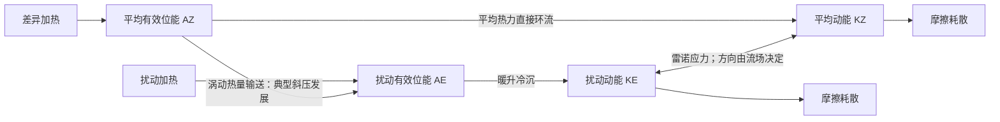

# 大气能量守恒与能量转换

难度：★★★★★（5/5）｜考试相关度：★★★★★（5/5）。评级是复习建议，不是命题概率。

真题定位：2020 年能量形式及转换、2023 年全位能、2025 年能量循环图与伯努利/干湿气块能量守恒。2025 年记录没有保留全部给定原式，以下明确采用的模型条件，不声称还原唯一原卷推导。

## 1．基本量与重复计数

单位质量内能 $e=c_vT$、重力位能 $\Phi\simeq gz$、动能 $K=V^2/2$，常用水汽潜热项为 $L_vq_v$。气象中全位能指内能与重力位能之和；有效位能 $A=P-P_{\min}$ 是全位能相对绝热重排最小值的差，不能把它作为另一项再加到全位能上。

## 2．干气块总能量式：压力局地变化不能漏掉

无曲率局地动量式点乘速度，科氏力不做功，且取重力势不显含时间：
$$\frac{D(K+\Phi)}{Dt}=-\alpha\mathbf V\cdot\nabla p+\mathbf V\cdot\mathbf F.$$
热力方程为 $c_pDT/Dt-\alpha Dp/Dt=\dot Q$。利用
$$Dp/Dt=\partial_tp+\mathbf V\cdot\nabla p,$$
两式相加，消去压力平流功：
$$\boxed{\frac{D(K+\Phi+c_pT)}{Dt}=\alpha\partial_tp+\dot Q+\mathbf V\cdot\mathbf F}.$$
只有进一步取定常压力场、绝热和无摩擦，才有 $D(K+\Phi+c_pT)/Dt=0$。定常流中沿同一流线为常数，不代表不同流线常数相同。

不可压均质流体还可从动量式沿流线积分：$dK+d\Phi+\alpha dp=0$，得到 $K+\Phi+p/\rho=\mathrm{const}$。这里 $p/\rho$ 是压力功项，不应随意用它替代可压空气的比焓。

## 3．湿过程的近似守恒及限制

以 $q_v$ 为水汽比湿，暂取 $c_p,L_v$ 常数，忽略凝结物热容和相态差异等高阶修正，热力式为
$$c_p\frac{DT}{Dt}-\alpha\frac{Dp}{Dt}=\dot Q_{\rm ext}-L_v\frac{Dq_v}{Dt}.$$
和机械能式相加，得
$$\frac D{Dt}(K+\Phi+c_pT+L_vq_v)=\alpha\partial_tp+\dot Q_{\rm ext}+\mathbf V\cdot\mathbf F.$$
定常压力、无外热、无摩擦且满足上述近似时，湿总能量沿气块近似守恒。动能变化还可忽略时，湿静力能 $c_pT+\Phi+L_vq_v$ 近似守恒。假绝热过程中凝结物离开气块，会带走质量与能量，不能宣称严格封闭多相系统守恒。

## 4．Lorenz 四库图与转换方向

这是典型转换方向示意，箭头并非任何天气下都单向。平均切变向扰动供能的项为 $-\overline{u'v'}U_y$；扰动有效位能向扰动动能转换含 $-\overline{\alpha'\omega'}$。暖空气上升、冷空气下沉时后一项为正。系统内部转换在四库相加时抵消，只有外部生成与耗散改变四库总量。

## 5．例题

定常、无摩擦、干绝热气流从 $z_1$ 到 $z_2$，若速度不变，则 $c_p(T_2-T_1)+g(z_2-z_1)=0$。取 $z_2-z_1=1000$ m，$c_p=1004$ J/(kg·K)，得 $T_2-T_1=-9.77$ K。若速度变化或非绝热加热显著，必须保留对应项；此数值不是所有实际云中上升的降温率。
