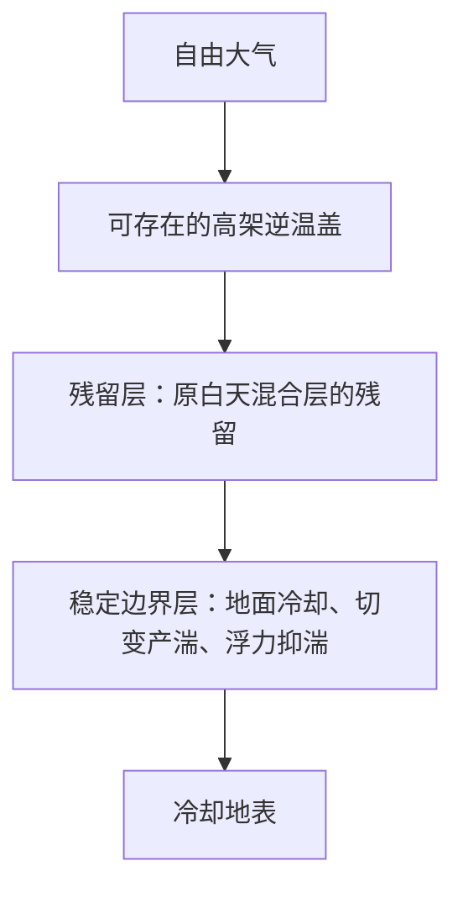

# 稳定边界层与残留层

难度：★★★☆☆（3/5）｜考试相关度：★★★★★（5/5）。评级是复习建议，不是命题概率。

直接真题：[[牢三样/往年试题分析/2024|2024 二-2]]、[[牢三样/往年试题分析/2026|2026 二-6]]。前者问一般分层，后者明确问稳定层结，不能只默写白天混合层结构。

## 1．两种“分层”不是一张固定高度表

按动力结构可分近地面常通量层、上部摩擦转向层；按日变化，晴朗夜间常有近地稳定边界层、其上的残留层和更高处自由大气。这两种划分标准不同。稳定边界层厚度变化很大，不应把 1—2 km 当作夜间固定厚度。

## 2．夜间的形成顺序

日落后地面净辐射冷却，贴地空气冷却并形成稳定层结；白天混合层失去热力驱动，其上部转为残留层。近地稳定层中浮力抑制湍流，但风切变仍可产湍，常出现间歇性和空间不均匀。残留层保存前一白天的温湿、污染物特征，常近中性，不能仅因处于夜间就一律称为强逆温层。更高处可保留前一日混合层顶部的逆温盖。

图表示从高到低的层序，不代表层间气流方向。稳定层顶附近可出现低空急流，但急流高度不等于残留层固定边界。

## 3．用湍动能解释

典型预算中的切变生成项 $P=-\overline{u'w'}U_z-\overline{v'w'}V_z$，浮力项 $B=(g/\bar\theta_v)\overline{w'\theta_v'}$。夜间向下感热通量通常使 $B<0$，抑制湍流；若 $P$ 足够强，湍流仍可存在。还须考虑耗散与输送，不能用某一个 Ri 阈值作所有条件下的开关。

**例：** 若 $P=4\times10^{-4}$、$B=-2\times10^{-4}$、耗散 $\varepsilon=3\times10^{-4}\ \mathrm{m^2/s^3}$，忽略输送，则净变化 $P+B-\varepsilon=-10^{-4}$，湍能减小。虽 $R_f=-B/P=0.5<1$，也不能断言湍流净增强。

衔接：[[牢三样/大气物理学/大气边界层/大气边界层的结构和分类特征]]、[[牢三样/动力气象/大气行星边界层/理查森数]]。
